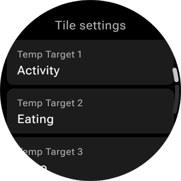
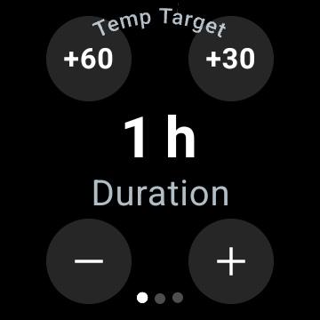
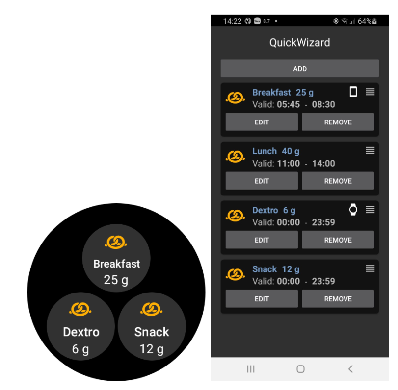
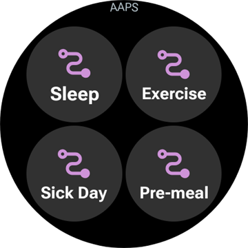

# Ovládání AAPS pomocí chytrých hodinek s Wear OS

(Watchfaces-aaps-watchfaces)=

## Ciferníky AAPS

```{warning}
Klasické ciferníky **AAPS** fungují jen na Wear OS 5 a starším a už Wear OS 5 je omezuje. Na **Wear OS 6 a novějším** aplikace pro hodinky místo nich instaluje jeden ciferník ve formátu Google Watch Face Format: váš vlastní ciferník jako obrázek, nebo **Ciferník komplikací**. Co přestává fungovat v jednotlivých verzích Wear OS, najdete v části [Změny ciferníků ve Wear OS](#wearos-watchface-changes); pro Wear OS 6 viz [ciferník, který AAPS instaluje](#wearos-aaps-v4-watchface).
```

Na Wear OS 5 a starším je v aplikaci **AAPS** pro hodinky vestavěno několik klasických ciferníků. Ukazují hodnotu glykémie s deltou, IOB, aktuální bazální dávku a graf hodnot. Fungují na nich dvě klepnutí:

* Dvojitým klepnutím na hodnotu glykémie otevřete hlavní nabídku **AAPS**
* Dvojitým klepnutím na graf změníte jeho časový rozsah

Na všech verzích Wear OS fungují [komplikace](#Watchfaces-complications) a [dlaždice](#WearOsSmartwatch-wear-os-tiles) popsané na této stránce s jakýmkoli ciferníkem, který pro ně má místo.

## Konfigurace

Zapněte **Wear** v [**Konfigurace** > **Komunikace**](#Config-Builder-wear).

Chcete-li z hodinek dávat bolus nebo provádět jiné akce, zapněte **Ovládání přes Wear**. Na stejném místě se nastavují i volby bolusové kalkulačky pro hodinky: viz [Nastavení > Wear](#preferences-wear). Když je **Ovládání přes Wear** vypnuté, telefon odmítne každé ošetření nebo změnu režimu poslanou z hodinek a hodinky zobrazí *„Ovládání Wear je vypnuto v nastavení Wear v telefonu.“*

Pomocí **Otevřít plugin** na kartě **Wear** otevřete obrazovku Wear:


Horní řádek ukazuje název připojených hodinek, nebo **(Žádné hodinky nejsou připojeny)**. Na této obrazovce můžete

* Znovu poslat všechna data. To může pomoci, pokud hodinky nebyly nějakou dobu připojené a chcete do nich informace poslat.
* Otevřít nastavení hodinek přímo z telefonu.
* Vybrat, který ciferník **AAPS** nainstaluje do hodinek (**Ciferník nainstalován na hodinkách**: váš vlastní ciferník, nebo Ciferník komplikací). Tato karta se zobrazí jen tehdy, když jsou připojeny hodinky s **Wear OS 6** nebo novějším. Viz [ciferník, který AAPS instaluje](#wearos-aaps-v4-watchface).
* Spravovat **Vlastní ciferník** (karta se zobrazí, když jsou hodinky připojeny): **Nahrát ciferník** pošle vlastní ciferník do hodinek, **Informace o ciferníku** ukáže podrobnosti nahraného ciferníku a pole, která obsahuje, **Další ciferníky** otevře v prohlížeči [stránku pro vlastní ciferníky](../ExchangeSiteCustomWatchfaces/index.md) a **Exportovat šablonu** uloží šablonu, kterou můžete upravit. Pod tlačítky se zobrazí náhled nahraného ciferníku. Viz [Přechod na ciferník AAPS](#WearOS_changing-to-AAPS-watchface).

Ujistěte se, že oznámení z AAPS nejsou na hodinkách blokována. Potvrzení akce (např. bolusu nebo dočasného cíle) přijde jako oznámení, které musíte posunout a odškrtnout.

## Vstup do hlavní nabídky AAPS


Hlavní nabídku **AAPS** otevřete jedním z těchto způsobů:

* otevřete **AAPS** ze seznamu aplikací v hodinkách
* klepněte na komplikaci **AAPS**, která otevírá nabídku, viz [Nastavení komplikací](#WearOsSmartwatch-complication-settings)
* klepněte na dlaždici **Graf glykémie**, která má **Akce při klepnutí** nastavenou na **Hlavní nabídka**, viz [Nastavení dlaždic](#WearOsSmartwatch-wear-os-tiles)
* na klasickém ciferníku **AAPS** dvakrát klepněte na hodnotu glykémie

(WearOsSmartwatch-loop-status)=

## Obrazovka Stav smyčky

Obrazovka **Stav smyčky** shrnuje, co smyčka dělá, aniž byste museli vytáhnout telefon. Otevřete ji z hlavní nabídky AAPS (**Stav smyčky** nebo **Stav → Smyčka**), nebo klepnutím na komplikaci **Glykémie**. Nabídka **Stav** má také stránku **Pumpa** a stránku **CDD** s celkovými denními dávkami.


Obrazovka je seznam karet. Posuňte se dolů, abyste viděli všechny:

* **Režim smyčky** — aktuální režim (uzavřená smyčka, otevřená smyčka, LGS, pozastaveno, odpojeno…) a u dočasného režimu, jak dlouho ještě poběží.
* **Výsledek smyčky** — kdy smyčka naposledy běžela a jaký dočasný bazál nebo SMB požadovala.
* **Scéna** — jen když je aktivní [scéna](#scenes-from-watch): její název, zbývající čas (nebo **Až do ukončení** u scény bez konce) a **Navazující** scéna, která začne, když tato skončí.
* **Cíle** — váš cíl a dočasný cíl, pokud nějaký běží.
* **Profil** — název aktivního profilu s jeho hodnotami **Procenta** a **Posun času**, pokud nejsou výchozí. Dočasné přepnutí profilu je zvýrazněné a ukazuje, jak dlouho ještě poběží a na který profil se po skončení vrátí (**Návrat na**).
* **Citlivost** — stejné řádky jako štítek citlivosti na hlavní obrazovce telefonu: hodnota autosens a ISF z profilu, proměnná a efektivní ISF.

Malá ikona scény vedle režimu smyčky, dočasného cíle nebo přepnutí profilu znamená, že ho **nastavila aktivní scéna**. Stejná ikona se zobrazuje i ve výběru **Režim smyčky**.


(WearOsSmartwatch-bolus-calculator)=

## Bolusová kalkulačka na hodinkách

Otevřete **Kalkulačka** z hlavní nabídky **AAPS**, z [dlaždice Akce](#WearOsSmartwatch-wear-os-tiles) nebo z komplikace nastavené tak, aby otevírala kalkulačku. Kalkulačka má několik stránek, na další přejdete potažením zprava doleva:

| Sacharidy                                                              | Požadavek                                                                | Výsledek                                                               | Výpočet                                                                           | Potvrdit                                                                |
| ---------------------------------------------------------------------- | ------------------------------------------------------------------------ | ---------------------------------------------------------------------- | --------------------------------------------------------------------------------- | ----------------------------------------------------------------------- |
|  |  |  |  |  |

1. **Sacharidy**: zadejte sacharidy tlačítky **+10**, **+5**, **−** a **+**.
2. **Požadavek**: poslední stránka, než převezme práci telefon. Ukazuje, co jste zadali: sacharidy a také typ jídla, čas sacharidů a procento, pokud je používáte, viz [Volitelné stránky](#WearOsSmartwatch-calculator-optional-pages). Klepnutím na značku zaškrtnutí ho pošlete do telefonu, který provede výpočet.
3. **Výsledek**: bolus, který **AAPS** navrhuje, a pod ním sacharidy: sacharidy teď a eSacharidy později, čas sacharidů a zvonek připomínky jídla. Dávku upravte tlačítky **−** a **+**, viz níže. Posuňte se dolů ke kartě **Výpočet**: klepnutím na ni uvidíte každý řádek výpočtu, stejně jako v telefonu.
4. **Potvrdit**: přejděte na druhou stránku a klepněte na značku zaškrtnutí. Telefon vydá bolus a zaznamená sacharidy.

(WearOsSmartwatch-calculator-optional-pages)=

### Volitelné stránky

Tři nastavení na hodinkách přidávají každé jednu stránku za stránku **Sacharidy**. Ve výchozím stavu jsou vypnutá. Otevřete hlavní nabídku **AAPS**, pak **Nastavení** > **Rozhraní**, a zapněte ta, která chcete; když jich je zapnuto více, stránky jdou v pořadí **Typ jídla**, **Čas sacharidů**, **Procento**. Tečky dole v kalkulačce ukazují, kolik má stránek.

| Nastavení                                                                                 | Typ jídla                                                                  | Čas sacharidů                                                                  | Procento                                                                   |
| ----------------------------------------------------------------------------------------- | -------------------------------------------------------------------------- | ------------------------------------------------------------------------------ | -------------------------------------------------------------------------- |
|  |  |  |  |

* **Typ jídla kalkulačky**: **Chléb**, **Koláč** nebo **Pizza**; rozdělí sacharidy pomalého jídla na sacharidy teď a eSacharidy později, viz [Výběr typu jídla](#WearOsSmartwatch-wizard-meal-type).
* **Čas sacharidu kalkulačky**: počet minut do jídla, se zvonkem **Nastavit alarm** pro připomínku jídla, viz [Čas sacharidů a připomínka jídla](#WearOsSmartwatch-wizard-carb-time).
* **Procento kalkulačky**: procento z vypočteného bolusu, například 70 %, když chcete menší dávku. Začíná na hodnotě **Procento bolusu** z [nastavení bolusové kalkulačky](#Preferences-deliver-this-part-of-bolus-wizard-result) v telefonu, tedy 100 %, pokud jste ji nezměnili. Viz také poznámku v části [Úprava bolusu na stránce výsledku](#WearOsSmartwatch-wizard-result).

(WearOsSmartwatch-wizard-result)=

### Úprava bolusu na stránce výsledku

Stránka výsledku ukazuje bolus, který **AAPS** navrhuje, spolu s tlačítky **−** a **+**. Pomocí nich upravíte dávku, než ji potvrdíte, a nemusíte se vracet do telefonu.

| Navržený                                                                      | Více                                                                            | Méně                                                                              |
| ----------------------------------------------------------------------------- | ------------------------------------------------------------------------------- | --------------------------------------------------------------------------------- |
|  |  |  |

* Každé stisknutí změní bolus o **jeden krok vaší pumpy**, takže nabízené dávky vždy odpovídají tomu, co vaše pumpa opravdu umí vydat.
* Když tlačítko **stisknete a podržíte**, hodnota se mění dál. Čím déle držíte, tím rychleji se mění.
* Nemůžete jít pod **0 U** ani nad nastavení **maximálního bolusu**.

Průběžný součet je vidět na stránce výsledku, takže vždy vidíte dávku, kterou se chystáte potvrdit. Změna se zobrazí za sacharidy, například *(+0,20 U)*, a tlačítko, které jste použili, zezelená pro více, nebo zčervená pro méně.

Pokud **AAPS** musel dávku omezit, například protože vypočtený bolus je vyšší než vaše nastavení **maximálního bolusu**, ukáže to oranžový varovný řádek pod součtem (například *„Použito omezení bolusu“*). Totéž platí pro omezené množství sacharidů.

```{admonition} Nejde o totéž co Procento kalkulačky :class: note Nastavení **Procento kalkulačky** vám umožní zadat *procento* z vypočteného bolusu **před** zobrazením stránky výsledku. Tlačítka **−** a **+** upravují *konečnou dávku* **na** stránce výsledku. Můžete použít obojí.

    <br />(WearOsSmartwatch-wizard-meal-type)=
    
    ### Výběr typu jídla
    
    Kalkulačka na hodinkách umí rozdělit sacharidy pomalého jídla na sacharidy teď a eSacharidy později, stejně jako [typ sacharidů](#AapsScreens-carbs-type) v kalkulačce v telefonu. Zapněte **Typ jídla kalkulačky** v **Nastavení** > **Rozhraní** na hodinkách. Ve výchozím stavu je nastavení vypnuté a stránka **Typ jídla** se pak přeskočí.
    
    * Po zadání sacharidů ukáže stránka **Typ jídla** tři ikony: **Chléb**, **Koláč** a **Pizza**. Klepněte na ikonu: pod ikonami se zobrazí její název a sacharidy, které z ní vyjdou, například *65 g* pro chléb nebo *52+22 g* pro pizzu (52 g teď a 22 g eSacharidů později). **Chléb** je výchozí a nechá všechny sacharidy teď.
    * Stránky požadavku a potvrzení ukazují sacharidy stejně (*52+22 g*). Stránka výsledku navíc ukazuje, kdy eSacharidy začnou a jak dlouho trvají.
    * Bolus se počítá jen pro sacharidy snědené teď. Rozdělení používá stejná čísla jako kalkulačka v telefonu.
    
    (WearOsSmartwatch-wizard-carb-time)=
    
    ### Čas sacharidů a připomínka jídla
    
    Když je v **Nastavení** > **Rozhraní** na hodinkách zapnutý **Čas sacharidu kalkulačky**, za sacharidy následuje stránka **Čas sacharidů**: počet minut do jídla, stejně jako [čas sacharidů](#aaps-screens-bolus-wizard) v kalkulačce v telefonu. Výchozí hodnota je **Nyní**. Tlačítka **−** a **+** ho posouvají po 5 minutách, až o hodinu před nebo po současném čase. Čas v minulosti je pro sacharidy, které už jste snědli.
    
    Při čase v budoucnosti se pod hodnotou objeví zvonek **Nastavit alarm**. Ve výchozím stavu je zapnutý, klepnutím ho vypnete. Stránky požadavku a výsledku ukazují čas sacharidů, například *+30 min*, a zvonek. Telefon zaznamená sacharidy v tomto čase, posune s nimi eSacharidy podle typu jídla a spustí svou připomínku **Čas na jídlo**.
    
    | Výsledek | Graf glykémie | Běží | Čas na jídlo |
    | --- | --- | --- | --- |
    |  |  |  |  |
    
    Připomínka běží i v hodinkách, takže zazvoní, i když je telefon mimo dosah:
    
    * Obrazovka **Graf glykémie**, dlaždice **Graf glykémie** a graf na **Ciferníku komplikací** kreslí přerušovanou oranžovou čáru v místě, kde připomínka zazvoní, a vedle ní počet zbývajících minut.
    * Během běhu je v proudu oznámení tiché oznámení **Čas na jídlo** s tlačítky **Zastavit** a **+5 min**. Když ho odsunete, vrátí se, dokud připomínka neskončí.
    * Když nastane čas, hodinky zavibrují, a pak znovu každou půlminutu po dobu pěti minut, dokud nezareagujete. Oznámení nabízí **Ztišit** a **+5 min**; odsunutí oznámení ho také ztiší.
    
    **Zastavit**, **Ztišit** a **+5 min** fungují stejně v hodinkách, v telefonu i v **AAPSClient** a všechny ukazují stejnou připomínku.
    
    (Watchfaces-complications)=
    
    ## Komplikace
    
    _Komplikace_ je pojem z tradičního hodinářství, kde označuje doplněk hlavního ciferníku – další malé okénko nebo vedlejší číselník (s datem, dnem v týdnu, fází Měsíce apod.). Systém Wear OS 2.0 používá tento pojem analogicky. Uživatelé si mohou do ciferníků, které použití komplikací umožňují, přidávat vlastní data, např. informace o počasí, oznámení, fitness trackery a další.
    
    Aplikace AAPS pro Wear OS podporuje komplikace od sestavení `2.6` a umožňuje nastavit jakýkoli ciferník třetí strany, který komplikace podporuje, tak, aby zobrazoval data z AAPS (glykémii s trendem, IOB, COB atd.).
    
    Komplikace slouží také jako **zkratka** k funkcím AAPS. Klepnutím na komplikace můžete otevřít příslušné nabídky a dialogová okna AAPS (v závislosti na typu komplikace a nastavení).
    
    
    
    ### Typy komplikací
    
    Aplikace AAPS pro Wear OS poskytuje jen surová data v předem daných formátech. Aplikace třetích stran se musí samy rozhodnout, jak vykreslit komplikace včetně jejich rozvržení, okrajů, barvy a písma. Z mnoha typů komplikací, které Wear OS nabízí, AAPS používá:
    
    * `SHORT TEXT` – obsahuje dva řádky textu, každý o 7 znacích, někdy se jim říká hodnota a popisek. Obvykle se vykreslí uvnitř kroužku nebo malého ováleného pole – pod sebou nebo vedle sebe. Je to prostorově velmi omezená komplikace. AAPS se snaží odstranit zbytečné znaky tak, aby se do zobrazení vešly: zaokrouhlením hodnot, odstraněním úvodních a koncových nul z hodnot atd.
    * `LONG TEXT` – obsahuje dva řádky textu, každý asi o 20 znacích. Obvykle se vykreslují uvnitř obdélníku nebo dlouhého oválného pole pod sebou. Používá se pro další podrobnosti a text.
    * `RANGED VALUE` – pro hodnoty z předem daného rozsahu, například procento. Obsahuje ikonu, popisek a je obvykle vykreslen jako kruhový ukazatel průběhu.
    * `LARGE IMAGE` – vlastní obrázek, který lze použít jako pozadí (pokud to ciferník podporuje).
    * `SMALL IMAGE` / `MONOCHROMATIC IMAGE` – malá ikona. V pozici `SMALL IMAGE` ji AAPS kreslí ve vlastní barvě; v pozici `MONOCHROMATIC IMAGE` ji obarví ciferník.
    
    ### Nastavení komplikací na ciferníku
    
    Komplikaci přidáte na ciferník tak, že ciferník dlouze stisknete a klepnete na ikonu ozubeného kolečka pod ním. Záleží, jak se konkrétní ciferník konfiguruje – buď klepněte na zástupné symboly nebo vstupte do nabídky nastavení ciferníku pro komplikace. Komplikace AAPS jsou seskupeny pod položkou nabídky AAPS.
    
    Při konfiguraci komplikací na ciferníku Wear OS zobrazí a filtruje seznam komplikací, které lze zobrazit ve vybraném místě pro komplikace na ciferníku. Nelze-li na seznamu nalézt konkrétní komplikace, je to pravděpodobně kvůli jejich typu, který nelze pro dané místo použít.
    
    ### Komplikace, které AAPS poskytuje
    
    AAPS poskytuje tyto komplikace. „Otevře“ znamená, co udělá klepnutí, když je **Akce po klepnutí na komplikaci** ponechaná na **Výchozí**, viz [Nastavení komplikací](#WearOsSmartwatch-complication-settings).
    
    **Glykémie**
    
    * **Glykémie** (`SHORT TEXT`, otevře _Stav smyčky_): na prvním řádku hodnota glykémie s trendovou šipkou, na druhém stáří hodnoty a delta.
    * **Glykémie (velká)** (`SHORT TEXT`, otevře _Graf glykémie_): na prvním řádku jen hodnota glykémie, aby ji ciferník mohl nakreslit velkou. Stáří hodnoty a trendová šipka jsou na druhém řádku.
    * **Graf glykémie** (`SMALL IMAGE` / `LARGE IMAGE`, otevře _Graf glykémie_): graf glykémie jako obrázek, pro ciferníky s pozicí pro obrázek. Tento graf je na **Ciferníku komplikací**.
    * **Kompletní stav** (`LONG TEXT`, otevře _Menu_): většina dat na jednom řádku: hodnota glykémie s trendovou šipkou, delta a stáří hodnoty, pak aktivní sacharidy, aktivní inzulín a bazální dávka.
    * **Kompletní stav (obráceně)** (`LONG TEXT`, otevře _Menu_): totéž, jen s prohozenými řádky, pro ciferníky, které z pozice `LONG TEXT` ukazují jen jeden ze dvou řádků.
    
    **Inzulín a sacharidy**
    
    * **Ikona IOB** (`SHORT TEXT`, otevře _Bolus_): aktivní inzulín s ikonou stříkačky.
    * **Detailní IOB** (`SHORT TEXT`, otevře _Bolus_): na prvním řádku celkový aktivní inzulín, na druhém jeho část z bolusu a z bazálu.
    * **Ikona COB** (`SHORT TEXT`, otevře _Kalkulačka_): aktivní sacharidy s ikonou sacharidů.
    * **Detailní COB** (`SHORT TEXT`, otevře _Kalkulačka_): na prvním řádku aktivní sacharidy teď, na druhém sacharidy, které teprve přijdou (eSacharidy).
    * **COB & IOB** (`SHORT TEXT`, otevře _Kalkulačka_): na prvním řádku aktivní inzulín, na druhém aktivní sacharidy.
    
    **Bazál a cíl**
    
    * **Bazál** (`SHORT TEXT`, otevře _Menu_): aktuální bazální dávka.
    * **Bazál & IOB** (`SHORT TEXT`, otevře _Menu_): na prvním řádku aktivní inzulín, na druhém bazální dávka.
    * **Bazál a cíl** (`SHORT TEXT`, otevře _Dočasný cíl_): na prvním řádku cíl, a když běží dočasný cíl, i zbývající čas; na druhém řádku bazální dávka.
    * **Cíl** (`SHORT TEXT`, otevře _Dočasný cíl_): na prvním řádku cíl a na druhém, když běží dočasný cíl, jeho zbývající čas.
    * **Bazál, COB & IOB** (`SHORT TEXT`, otevře _Menu_): na prvním řádku bazální dávka, na druhém aktivní sacharidy a aktivní inzulín.
    
    **Smyčka a telefon**
    
    * **Režim smyčky** (`SMALL IMAGE` / `ICON`, otevře _výběr režimu smyčky_): aktuální režim smyčky jako ikona: uzavřená smyčka, otevřená smyčka, ochrana před nízkou glykémií, pozastaveno, odpojeno nebo zakázáno. Klepnutí otevře výběr se změnami režimu, které jsou právě povolené, například **Pozastavit smyčku**, **Odpojit pumpu**, **Obnovit smyčku** nebo **Znovu připojit pumpu**. Stejný výběr je v hlavní nabídce **AAPS** pod položkou **Režim smyčky**.
    * **Baterie telefonu/uploaderu** (`RANGED VALUE` / `SHORT TEXT` / `ICON`, otevře _Stav_): baterie telefonu s **AAPS** jako ukazatel s ikonou baterie, jako číslo, nebo jen jako ikona. Aktualizuje se spolu s ostatními daty **AAPS**, obvykle každých 5 minut s novou hodnotou glykémie.
    
    Výběr **Režim smyčky**, jak se otevře z komplikace, z hlavní nabídky nebo z dlaždice Režim smyčky:
    
    
    
    (WearOsSmartwatch-complication-settings)=
    
    ### Nastavení komplikací
    
    V hlavní nabídce **AAPS** na hodinkách otevřete **Nastavení** > **Komplikace**:
    
    
    
    * **Akce po klepnutí na komplikaci** (výchozí `Výchozí`): co otevře klepnutí na komplikaci **AAPS**, pro všechny komplikace najednou:
      * _Výchozí_: to, co otevírá samotná komplikace, viz seznam výše
      * _Menu_: hlavní nabídku **AAPS**
      * _Kalkulačka_: bolusovou kalkulačku
      * _Ošetření_: dialog ošetření, inzulín a sacharidy
      * _eSacharidy_: dialog eSacharidů
      * _Stav_: nabídku stavu
      * _Režim smyčky_: výběr režimu smyčky. Vyžaduje zapnuté **Ovládání přes Wear** v nastavení Wear v telefonu, jinak se místo toho otevře hlavní nabídka.
      * _Nic_: klepnutí nic neudělá
    * **Časový rozsah grafu glykémie** (výchozí `3 hodiny`): kolik hodin ukazuje komplikace **Graf glykémie**, 1, 3 nebo 6. Dlaždice Graf glykémie má vlastní nastavení.
    * **Znaky Unicode v komplikacích** (výchozí `ZAP`): komplikace používají symboly Unicode, například `Δ` pro deltu, `⁞` jako oddělovač a `⎍` pro bazální dávku. Jak vypadají, závisí na písmu ciferníku. Nastavte `VYP`, když je ciferník kreslí jako čtverečky nebo prázdná místa.
    
    (WearOsSmartwatch-wear-os-tiles)=
    
    ## Dlaždice Wear OS
    
    Dlaždice jsou stránky, na které se dostanete posunutím prstu z ciferníku. **AAPS** jich přináší sedm, každá je sada až čtyř tlačítek. Klepnutí na tlačítko otevře v hodinkách příslušný dialog nebo vás požádá o potvrzení; práci pak udělá telefon. Dlaždice je zkratka, ne zobrazení stavu: neuchovává stav aplikace v telefonu.
    
    Než začnete dlaždice používat, zapněte **Ovládání přes Wear** v [Nastavení > Wear](#preferences-wear).
    
    ### Přidání dlaždice
    
    Jsou dvě možnosti, podle vašich hodinek a telefonu:
    
    1. V hodinkách: posuňte se z ciferníku za poslední dlaždici na **Přidat dlaždici** („Add tile“) a vyberte dlaždici **AAPS**. Na většině hodinek otevře zobrazení pro přidání a odebrání dlaždic také dlouhé stisknutí dlaždice.
    2. V telefonu, v doprovodné aplikaci pro vaše hodinky (**Galaxy Wearable** pro Samsung, **Wear OS** pro jiné značky): otevřete **Dlaždice**, klepněte na **Přidat** a vyberte dlaždice **AAPS**, které chcete. Pořadí dlaždic můžete změnit přetažením.
    
    
    
    ### Nastavení dlaždic
    
    Dlaždice **Akce**, **Dočasný cíl**, **Graf glykémie** a **Scéna** mají nastavení v hodinkách. Otevřete hlavní nabídku **AAPS**, pak **Nastavení** > **Dlaždice** a vyberte dlaždici. Nastavení dlaždice otevře také dlouhé stisknutí dlaždice, kromě hodinek Pixel. Ostatní tři dlaždice se plní z telefonu a v hodinkách nemají co nastavit.
    
    | Hlavní nabídka | Nastavení | Dlaždice |
    | --- | --- | --- |
    |  |  |  |
    
    Nastavení dlaždice je seznam jejích čtyř pozic. Klepnutím na pozici vyberete, co v ní bude, nebo **Žádný**, aby zůstala prázdná.
    
    | Dlouhé stisknutí dlaždice | Nastavení dlaždice Dočasný cíl |
    | --- | --- |
    |  |  |
    
    Každá dlaždice má čtyři pozice. Dlaždice s více položkami ukáže první čtyři.
    
    ### Dlaždice Akce
    
    
    
    Zkratky k dialogům aplikace **AAPS** v hodinkách. V nastavení dlaždice vyberte až čtyři z nich:
    
    * **Kalk**: bolusová kalkulačka se zadáním sacharidů, volitelným procentem [1] a volitelným typem jídla [2]
    * **Ošetř**: inzulín a sacharidy najednou
    * **Inzulín**: bolus zadaný v jednotkách
    * **Sacharidy**: sacharidy, i rozložené sacharidy. Přijme se i **záporné** množství, nejvýše do vašeho aktuálního COB, abyste mohli opravit dříve zadané sacharidy. Odebrání sacharidů se zobrazí v grafu glykémie na hodinkách.
    * **eSacharidy**: rozložené sacharidy
    * **Dočasný cíl**: dočasný cíl s vlastním cílem a trváním
    * **Přepnutí profilu**: přepnutí profilu s procentem, posunem času a trváním
    
    
    
    Dialogy, které tlačítka otevírají. Na další stránku dialogu přejdete potažením zprava doleva; na poslední stránce klepnutím na značku zaškrtnutí pošlete požadavek do telefonu:
    
    | Ošetř | Inzulín | Sacharidy | eSacharidy | Dočasný cíl | Přepnutí profilu |
    | --- | --- | --- | --- | --- | --- |
    |  |  |  |  |  |  |
    
    [1] V **Nastavení** > **Rozhraní** na hodinkách zapněte **Procento kalkulačky**, aby se v bolusové kalkulačce zobrazilo zadání procenta. Výchozí procento se bere z nastavení telefonu [„Vydat tuto část výsledku bolusové kalkulačky %“](#Preferences-deliver-this-part-of-bolus-wizard-result). Ostatní nastavení kalkulačky jsou nastavení telefonu v **Nastavení** > **Nastavení bolusové kalkulačky**.
    
    [2] V **Nastavení** > **Rozhraní** na hodinkách zapněte **Typ jídla kalkulačky**, aby se zobrazila stránka **Typ jídla**, kde vyberete **Chléb**, **Koláč** nebo **Pizza** a rozdělíte tak sacharidy pomalého jídla na sacharidy teď a eSacharidy později. Viz [Výběr typu jídla](#WearOsSmartwatch-wizard-meal-type).
    
    ### Dlaždice Dočasný cíl
    
    
    
    Dočasné cíle z předvoleb v telefonu. Trvání a cíl každé předvolby nastavíte v telefonu v **Nastavení** > [Výchozí dočasné cíle](#Preferences-default-temp-targets). V nastavení dlaždice vyberte až čtyři z nich:
    
    * **Aktivita**: pro sport
    * **Jídlo**: brzy jídlo, nižší cíl, aby při jídle bylo víc aktivního inzulínu
    * **Hypo**: vyšší cíl při léčbě hypoglykémie
    * **Ručně**: vlastní cíl a trvání
    * **Zrušit**: ukončí běžící dočasný cíl. Tlačítko se zobrazí jen tehdy, když běží dočasný cíl.
    
    ### Dlaždice Rychlý bolus
    
    
    
    Položky [Rychlého bolusu](#quickwizards) v telefonu, které mají zapnuté **Zobrazit na hodinkách**, v rámci své doby platnosti. Položka se sacharidy ukazuje sacharidy v g, položka s inzulínem pevnou dávku v U. Klepnutí položku spustí po potvrzení v hodinkách. V hodinkách není co nastavit: položky upravte v telefonu a u každé položky, kterou chcete mít na dlaždici, zapněte **Zobrazit na hodinkách** v části **Výběr zařízení**. Mimo dobu platnosti všech vašich položek dlaždice ukazuje **Není dostupná žádná konfigurace**.
    
    
    
    ### Dlaždice Scéna
    
    
    
    [Scény](#scenes-from-watch) z telefonu. Každá ze čtyř pozic je v nastavení dlaždice nastavená na **Automaticky**, **Žádný** nebo na jednu scénu. Pozice **Automaticky** vezme další scénu ze seznamu v telefonu, kterou si nevzala žádná jiná pozice. Pozice nastavená na scénu, která už v telefonu neexistuje, ukazuje **Nedostupný**.
    
    
    
    ### Dlaždice Režim smyčky
    
    
    
    [Režimy smyčky](#aaps-screens-running-mode), na které můžete z aktuálního přepnout, se stejnými ikonami jako v telefonu: uzavřená smyčka, ochrana před nízkou glykémií, otevřená smyčka, zakázat smyčku, pozastavit smyčku a odpojit pumpu, nebo obnovit a znovu připojit, když jeden z nich běží. **Pozastavit smyčku** a **Odpojit pumpu** se nejdříve zeptají na dobu trvání. Které režimy se nabídnou, rozhoduje telefon; hodinky ukážou první čtyři a vynechají **Zakázat smyčku**, když je v seznamu **Pozastavit smyčku**.
    
    ### Dlaždice Uživatelská akce
    
    
    
    Jedno tlačítko pro každou [automatizaci](#automations-automation-triggers) v telefonu, jejíž spouštěč je **Uživatelská akce**. Klepnutí vás požádá o potvrzení, pak telefon provede akce automatizace. Tlačítka mají názvy podle automatizací, proto jim dejte krátké názvy. V hodinkách není co nastavit.
    
    ### Dlaždice Graf glykémie
    
    
    
    Hodnota glykémie se šipkou, deltou a stářím, pod ní IOB, COB, bazální dávka a cíl, a graf glykémie s predikcemi, bolusy, sacharidy a SMB. Dvě nastavení v hodinkách: **Časové rozmezí** (1, 3 nebo 6 hodin) a **Akce při klepnutí**, která otevře celou obrazovku **Graf glykémie**, **Hlavní nabídka** nebo **Stav smyčky**.
    
    
    
    
    
    ## Vždy zapnuto
    
    Tato a následující část platí pro klasické ciferníky **AAPS** na Wear OS 5 a starším. Na Wear OS 6 má **Ciferník komplikací** vlastní režim vždy zapnutého displeje, viz [ciferník, který AAPS instaluje](#wearos-aaps-v4-watchface).
    
    Dlouhá výdrž baterie je u chytrých hodinek s Android Wear OS problém. Některé chytré hodinky vydrží až 30 hodin, než je musíte znovu nabít. Pro co nejlepší úsporu energie by měl být displej vypnutý, když hodinky nepoužíváte. Většina hodinek podporuje displej „Vždy zapnuto“.
    
    Od verze AAPS 3 můžeme v režimu vždy zapnutého displeje používat „Zjednodušené rozhraní“. Toto rozhraní obsahuje jen glykémii, směr trendu a čas. Toto rozhraní šetří energii: aktualizuje se méně často, ukazuje méně informací a rozsvěcuje méně pixelů, aby šetřilo baterii u OLED displejů.
    
    Režim zjednodušeného rozhraní je k dispozici pro ciferníky Digital Style a Custom (vlastní). Zjednodušené rozhraní je volitelné a nastavuje se v nastavení ciferníku (dlouze stiskněte ciferník a klepněte na „upravit“ nebo na ikonu ozubeného kolečka). Vyberte volbu „Zjednodušené rozhraní“ a nastavte ji na „Vždy zapnuto“ nebo „Vždy zapnuto a nabíjení“.
    
    ### Noční režim
    
    Během nabíjení by bylo užitečné, kdyby displej zůstal „vždy zapnutý“ a v noci ukazoval vaši glykémii. Standardní ciferníky jsou ale příliš jasné, mají příliš mnoho informací a v noci se rozespalýma očima špatně čtou. Proto jsme přidali možnost, aby ciferník zjednodušil rozhraní jen během nabíjení, pokud to zapnete v konfiguraci.
    
    Režim zjednodušeného rozhraní je k dispozici pro ciferníky Digital Style a Custom (vlastní). Zjednodušené rozhraní je volitelné a nastavuje se v nastavení ciferníku (dlouze stiskněte ciferník a klepněte na „upravit“ nebo na ikonu ozubeného kolečka). Vyberte volbu „Zjednodušené rozhraní“ a nastavte ji na „Při nabíjení“ nebo „Vždy zapnuto a nabíjení“.
    
    Možnosti vývojáře v Androidu umožňují, aby hodinky během nabíjení zůstaly zapnuté. Jak zpřístupnit možnosti vývojáře, najdete v [oficiální dokumentaci](https://developer.android.com/training/wearables/get-started/debugging). V možnostech vývojáře zapněte volbu „Nevypínat obrazovku při nabíjení“ („Stay awake when charging“).
    
    Poznámka: ne všechny displeje snášejí trvale zapnutý režim dobře. Může dojít k vypálení obrazu, hlavně u starších OLED displejů. Hodinky obvykle displej ztlumí, aby k vypálení nedošlo; radu najdete v návodu k hodinkám, u výrobce nebo na internetu.
    
    
    
    
    
    (WearOsSmartwatch-phone-alarms)=
    
    ## Alarmy telefonu na hodinkách
    
    
    
    Hodinky ukazují alarmy telefonu, takže vidíte, proč telefon vydává zvuk, a můžete reagovat přímo ze zápěstí. Hodinky zavibrují, a pak znovu každou půlminutu po dobu pěti minut, dokud nezareagujete. Oznámení ukazuje název a text alarmu se stejnými možnostmi jako připomínka [Čas na jídlo](#WearOsSmartwatch-wizard-carb-time):
    
    * **Ztišit** nebo odsunutí: alarm skončí a obrazovka alarmu v telefonu se zavře.
    * **Ztlumit na 5 min**: alarm skončí a znovu zazvoní za pět minut, v telefonu i v hodinkách.
    
    Do hodinek se dostanou dva druhy alarmů:
    
    * Obrazovka alarmu v telefonu (chyby pumpy, alarmy automatizace, alarmy glykémie): **Ztišit** a **Ztlumit na 5 min**.
    * Naléhavá oznámení se zvukem, například *Pumpa nedostupná* nebo alarm z Nightscoutu: jen **Ztišit**. Telefon má pro ně jen **Zavřít** a vracejí se samy, dokud trvá jejich příčina.
    
    Připomínka *Čas na jídlo* se takto neposílá: tu hodinky spustí samy.
    
    ## Zkratka pro potvrzení výstrahy
    
    Hodinky [alarm samy ukazují](#WearOsSmartwatch-phone-alarms); zkratka je druhý způsob, jak ho jedním stisknutím ztišit. Můžete si vytvořit zkratku pro potvrzení (odložení) výstrah a alarmů AAPS. Ztlumit zvuk na hodinkách je pohodlné a rychlejší, nemusíte sahat pro telefon. Poznámka: zprávu alarmu musíte i tak zkontrolovat v telefonu a podle ní jednat, ale můžete to udělat později. Pokud mají vaše hodinky dvě tlačítka, můžete jedno přiřadit programu `AAPS Snooze Alert` (v češtině „AAPS Potvrzení výstrahy“).
    
    Na hodinkách Samsung Watch 4 tlačítko propojíte v `Settings > Advanced Features > Customize Buttons > Double press > AAPS Snooze Alert` (Nastavení > Pokročilé funkce > Přizpůsobit tlačítka > Dvojité stisknutí).
    
    Na ciferníku s komplikacemi udělá totéž klepnutím komplikace **Zkratka aplikace** („App shortcut“) nastavená na **AAPS Potvrzení výstrahy**. [Alternativní nastavení Ciferníku komplikací](#wearos-complications-watchface-setup) pro ni používá pravou horní pozici.
    
    ### Potvrzení výstrahy xDrip
    
    Pokud používáte xDrip a máte xDrip nainstalovaný i v hodinkách, zkratka „AAPS Potvrzení výstrahy“ potvrdí (odloží) i všechny alarmy xDrip. 
    
    
    ## Tipy pro výkon a výdrž baterie
    
    Hodinky s Wear OS jsou zařízení s velmi omezenou energií. Velikost hodinek omezuje kapacitu vestavěné baterie. Navzdory nedávnému vylepšení na straně hardwaru i softwaru hodinky Wear OS stále vyžadují denní nabíjení.
    
    Pokud je výdrž baterie hodinek kratší než jeden den (od rána do večera), existuje pár tipů, jak se s tím vypořádat.
    
    Nejvíce baterii spotřebovávají:
    
    * aktivní displej se zapnutým podsvícením (u LED) nebo v režimu plného jasu (u OLED)
    * vykreslování na obrazovce
    * rádiová komunikace přes Bluetooth
    
    Protože nemůžeme slevit z komunikace (potřebujeme aktuální data) a chceme mít vykreslená co nejnovější data, většinu optimalizací lze udělat v oblasti _doby zobrazení_:
    
    * Vestavěné ciferníky jsou obvykle lépe optimalizované než vlastní ciferníky stažené z obchodu.
    * Je lepší používat ciferníky, které v neaktivním / ztlumeném režimu omezují množství vykreslovaných dat.
    * Dejte pozor při kombinaci s jinými komplikacemi, například widgety počasí od třetích stran nebo jinými, které používají data z externích zdrojů.
    * Začněte s jednoduššími ciferníky. Přidávejte komplikace po jedné a sledujte, jak ovlivňují výdrž baterie.
    * Používejte na ciferníku tmavý motiv. U OLED displejů znamená méně rozsvícených pixelů menší spotřebu a menší vypalování.
    * Vyzkoušejte, co funguje na vašich hodinkách lépe: vestavěné ciferníky AAPS, nebo jiné ciferníky s komplikacemi AAPS.
    * Sledujte to několik dní při různé aktivitě. Většina hodinek aktivuje obrazovku při pohledu na ně, pohybu a dalších spouštěčích souvisejících s užíváním.
    * Zkontrolujte globální nastavení systému, která ovlivňují výkon: oznámení, časový limit podsvícení / aktivního displeje, kdy se zapíná GPS.
    * Podívejte se na [seznam testovaných telefonů a hodinek](#Phones-list-of-tested-phones) a [zeptejte se komunity](../GettingHelp/WhereCanIGetHelp.md) na zkušenosti dalších uživatelů a jejich výdrž baterie.
    * **Nemůžeme zaručit, že data zobrazená na ciferníku nebo v komplikaci jsou aktuální**. Konečné rozhodnutí o tom, kdy aktualizovat ciferník nebo komplikaci, je na operačním systému. I když aplikace AAPS o aktualizaci požádá, systém se může rozhodnout aktualizace odložit nebo ignorovat, aby šetřil baterii. V případě pochybností nebo vybité baterie – vždy zkontrolujte hlavní AAPS v telefonu.
    
    (Watchfaces-troubleshooting-the-wear-app)=
    
    ## Řešení problémů s aplikací pro hodinky
    
    Pokud hodinky neukazují žádná data nebo ukazují stará data, nejprve zkontrolujte spojení mezi hodinkami a telefonem, viz [Řešení problémů s komunikací mezi AAPS v hodinkách a AAPS v telefonu](#wear-os-watch-phone-communication). U hodinek s Wear OS 5 viz také [obecná doporučení k řešení problémů pro Wear OS 5](#wear-os-5-troubleshooting). Komplikace, která se neaktualizuje, má stejné příčiny jako dlaždice nebo ciferník, které se neaktualizují, proto nejdřív zkontrolujte je.
    
    ## K dispozici jsou i další vlastní ciferníky AAPS
    
    [Zde](../ExchangeSiteCustomWatchfaces/index.md) si můžete stáhnout soubory ZIP s vlastními ciferníky, které vytvořili jiní uživatelé.
    
    ## Vytvořte si vlastní ciferník
    
    Pokud si chcete vytvořit vlastní ciferník, postupujte podle [tohoto návodu](../ExchangeSiteCustomWatchfaces/CustomWatchfaceReference.md).
    
    Když si vlastní ciferník vytvoříte, můžete svůj vlastní ciferník **AAPS** sdílet s ostatními: soubor ZIP lze nahrát do složky „ExchangeSiteCustomWatchfaces“ pomocí pull requestu na GitHubu. Při sloučení pull requestu tým dokumentace vybalí soubor CustomWatchface.png a před jeho název přidá název souboru ZIP.
    
    (WearOsSmartwatch-complications-watchface-download)=
    
    ## Vytvořte si vlastní verzi Ciferníku komplikací
    
    **Ciferník komplikací**, který **AAPS** instaluje na Wear OS 6 (viz [ciferník, který AAPS instaluje](#wearos-aaps-v4-watchface)), je vytvořený v programu **Watch Face Studio** od Samsungu. Jeho soubor projektu si můžete zdarma stáhnout, takže ho můžete upravit podle svého, nebo ho použít na hodinkách s Wear OS 5 či starším, kam ho **AAPS** neinstaluje:
    
    [Ciferník komplikací (AAPS V4), zip](https://github.com/openaps/AndroidAPSdocs/raw/refs/heads/master/docs/_static/wearos/Complications_watchface_AAPS_V4.zip)
    
    ZIP obsahuje čtyři soubory:
    
    * `AAPS V4_0_2.wfs`: projekt. Otevřete ho ve [Watch Face Studio](https://developer.samsung.com/watch-face-studio/download.html), změňte, co chcete, a odtud ho nainstalujte do hodinek.
    * `com.watchfacestudio.aapsv4.apk`: ciferník tak, jak je, připravený k instalaci pomocí [adb](https://developer.android.com/tools/releases/platform-tools): `adb install com.watchfacestudio.aapsv4.apk`, když jsou hodinky připojené přes ladění ADB.
    * `README.txt`: dvě doporučená nastavení komplikací, stejná jako na [stránce Wear OS](#wearos-complications-watchface-setup).
    * `AAPS V4.png`: náhled.
    
    ```{admonition} Toto není vlastní ciferník
    :class: note
    Tento ZIP není vlastní ciferník pro **Nahrát ciferník** v pluginu **Wear** a telefon ho nainstalovat nemůže. Musí se rozbalit a nainstalovat do hodinek pomocí Watch Face Studio nebo adb, jak je popsáno výše.