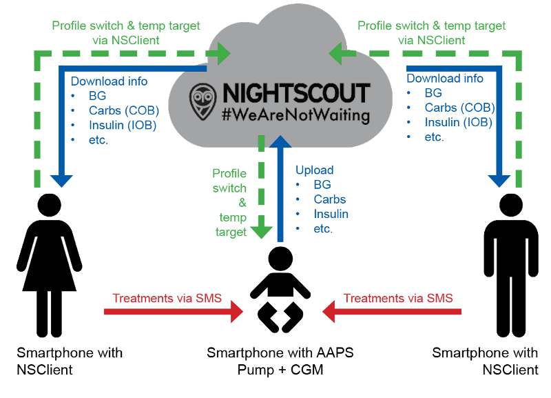

# Vzdálený dohled

__AAPS__ nabízí několik funkcí pro vzdálený dohled nad dětmi s diabetem 1. typu a umožňuje také vzdálené příkazy, které posílají pokyny do __AAPS__ na dálku. Podobně lze __AAPSClient__ použít i pro vzdálený dohled, abyste mohli sledovat __AAPS__ svého partnera nebo přítele.

## Funkce

- Pumpu dítěte ovládá telefon dítěte s __AAPS__.
- Pečovatelé mohou na dálku sledovat všechna důležitá data, jako je glykémie, aktivní sacharidy, aktivní inzulín atd., pomocí **AAPSClient apk** na svém telefonu s Androidem (verze **AAPSClient** pro iPhone se připravuje, viz [AAPSClient](AapsClient.md)). Nastavení změněná v __AAPS__ se synchronizují s __AAPSClient__ a naopak.
- Pečovatelé mohou dostávat alarmy pomocí **aplikace xDrip v režimu sledování** na svém telefonu s Androidem, pokud je nastavený režim doprovodné aplikace xDrip.
- Vzdálené ovládání __AAPS__ pomocí [SMS příkazů](../RemoteFeatures/SMSCommands.md) je zabezpečené dvoufázovým ověřením.
- Vzdálené ovládání přes __AAPSClient__ používá podepsaný kanál pro příkazy zavedený v **AAPS** 4: klient musí být nejdřív **spárovaný** s hlavním zařízením (pomocí QR kódu nebo PINu) a každý příkaz potvrdí a provede hlavní zařízení. Telefon každého pečovatele může mít vlastní [roli](#client-master-control-roles), od režimu jen pro čtení až po plné ovládání — viz [Ovládání master ↔ klient](#client-master-control).

## Nástroje a aplikace pro vzdálené monitorování

- [Nightscout](https://nightscout.github.io/) ve webovém prohlížeči (hlavně zobrazení dat).
- [__AAPSClient__](AapsClient.md) je zjednodušená verze __AAPS__, která umí sledovat hlavní __AAPS__ a po **spárování** posílat vzdálené příkazy: sacharidy, __Dočasné cíle__, __Přepnutí profilu__ a dokonce i bolusy (viz [Ovládání master ↔ klient](#client-master-control)). Jsou 3 aplikace: [AAPSClient, AAPSClient2 a AAPSClient3 ke stažení](https://github.com/nightscout/AndroidAPS/releases/), takže pečovatel může z jednoho telefonu sledovat až tři různé osoby (např. dvě děti s diabetem 1. typu, každé s vlastním účtem Nightscout a vlastním hlavním __AAPS__).
- Dexcom follow, pokud používáte originální aplikaci Dexcom (pouze hodnoty glykémie).
- [xDrip](../CompatibleCgms/xDrip.md) v režimu sledování (hlavně hodnoty glykémie a **alarmy**).
- [Sugarmate](https://sugarmate.io/) nebo [Spike](https://spike-app.com/) v iOS (hlavně hodnoty glykémie a **alarmy**).
- Někteří uživatelé používají pro plnohodnotný vzdálený přístup aplikace jako je [TeamViewer](https://www.teamviewer.com/), který je užitečný i pro pokročilé řešení problémů na dálku.

## Možnosti chytrých hodinek

Chytré hodinky mohou být velmi užitečným pomocníkem při používání __AAPS__ u dětí s diabetem 1. typu. Je několik možností:

- Možnost 1 – Pokud je __AAPSClient__ nainstalovaný na telefonu pečovatele, můžete na kompatibilní chytré hodinky spojené s telefonem pečovatele nainstalovat [aplikaci AAPSClient pro WearOS](https://github.com/nightscout/AndroidAPS/releases/). Zobrazí aktuální __glykémii__, stav smyčky a historii bolusů a umožní zadat sacharidy a měnit __Dočasné cíle__ a __Profil__. Pokud je klient **spárovaný** s hlavním zařízením, mohou hodinky spustit i **bolus**: příkaz se předá přes klienta hlavnímu zařízení, které ho potvrdí a vydá (viz [Ovládání master ↔ klient](#client-master-control)).
- Možnost 2 – [Aplikaci AAPS pro WearOS](../WearOS/WearOsSmartwatch.md) můžete také sestavit a nainstalovat na kompatibilní chytré hodinky, které jsou spojené s telefonem dítěte, ale nosí je pečovatel. To zahrnuje všechny výše uvedené funkce a navíc možnost vydat bolus inzulínu přímo, aniž byste museli dítěti brát telefon.
- Možnost 3 – Jen zobrazení: hodinky, které **AAPS** přímo nepodporuje (Xiaomi, Amazfit nebo hodinky s Wear OS zobrazující komplikaci), mohou zobrazovat glykémii, IOB, COB a stav smyčky přes doprovodnou aplikaci, jako je WatchDrip+ nebo GlucoDataHandler, kterou zásobuje daty plugin **Externí aplikace** v telefonu s **AAPS** nebo **AAPSClient**, ke kterému jsou hodinky připojené. Viz [Externí aplikace](#watches-external-companion-apps).

## Co je třeba zvážit

- Počítejte s časovým zpožděním mezi hlavním zařízením a sledujícím kvůli času na nahrání a stažení dat a také s tím, že hlavní telefon s __AAPS__ nahrává data až po proběhnutí smyčky.
- Jaký je váš nouzový plán pro případ, že vzdálené ovládání nefunguje (_např._ problémy se sítí nebo ztracené spojení Bluetooth)? Vždy zvažte, co se stane s **AAPS**, když najednou nebudete moci poslat nový příkaz. **AAPS** přepíše v pumpě nastavení bazálů, ISF a ICR aktuálními hodnotami profilu. Pokud přepínáte na silnější inzulínový profil, používejte jen dočasné přepnutí profilu (_tj._ s nastavenou dobou trvání) pro případ, že se vzdálené spojení přeruší. Po uplynutí nastavené doby se pak pumpa vrátí k původnímu profilu.
