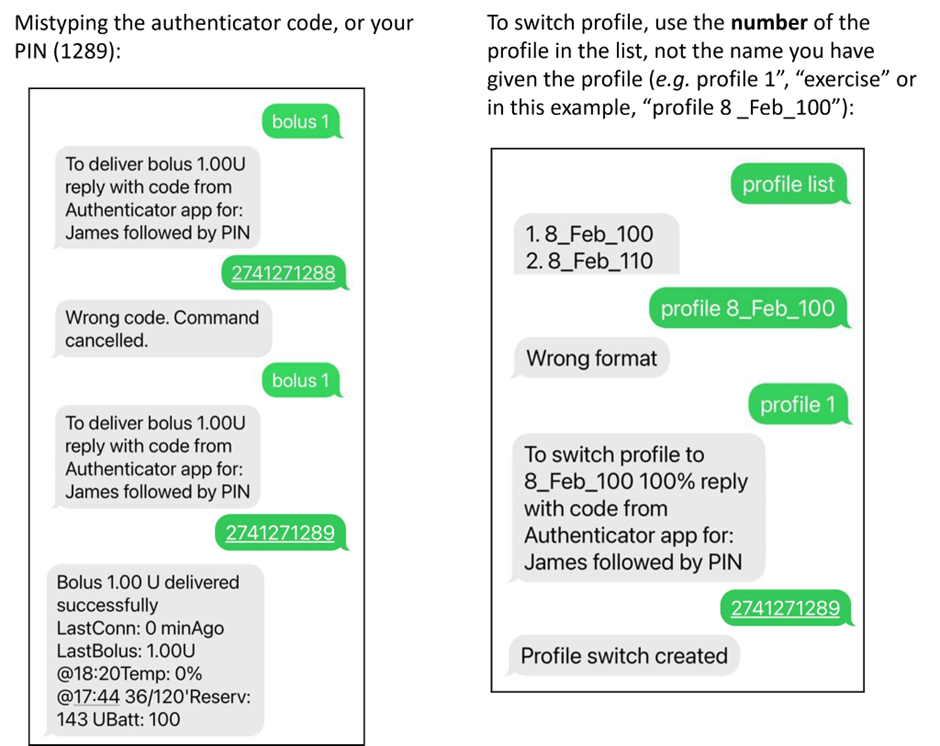

# SMS příkazy

```{contents} Table of contents
:depth: 2
```

Většinu vzdálených úprav (dočasné cíle, sacharidy, přepnutí profilu a po spárování klienta i bolusy) můžete provést v [aplikaci **AAPSClient**](../RemoteFeatures/RemoteMonitoring.md) na telefonu s Androidem s připojením k internetu, viz [Ovládání master ↔ klient](#client-master-control) (verze **AAPSClient** pro iPhone se vyvíjí, viz [AAPSClient](AapsClient.md)). SMS příkazy zůstávají alternativou, která funguje bez internetu, a jedinou možností vzdáleného ovládání, pokud jako sledující používáte iPhone a **AAPSClient** zatím nemáte.

**SMS příkazy jsou opravdu užitečné:**
1. Pro běžné vzdálené ovládání

2. Pokud chcete podávat bolus inzulínu na dálku bez spárovaného **AAPSClient**

3. V místech se slabým signálem, kde textové zprávy projdou, ale mobilní data a internet jsou omezené. To je velmi užitečné při cestách do odlehlých oblastí (např. kempování, lyžování).

4. Pokud váš jiný způsob vzdáleného ovládání (**AAPSClient**) dočasně nefunguje

## Bezpečnost především

Když v **AAPS** povolíte **SMS komunikátor**, vezměte do úvahy, že telefon, který má povoleno posílat příkazy, může být ukraden nebo použit jinou osobou. Vždy zamykejte svůj telefon alespoň pomocí PINu. Velmi doporučujeme silné heslo a/nebo biometrický zámek. Dbejte, aby se lišilo od hlavního hesla APK (heslo, které je potřeba pro export nastavení **AAPS**).

Dále doporučujeme povolit pro SMS příkazy [druhé telefonní číslo](#SMSCommands-authorized-phone-numbers). Pak můžete z druhého čísla SMS komunikátor [zakázat](#SMSCommands-other), pokud by byl váš hlavní telefon pro vzdálené ovládání zneužit.

Výchozí minimální prodleva mezi bolusovými příkazy je 15 minut. Z bezpečnostních důvodů musíte přidat alespoň dvě autorizovaná telefonní čísla ke zkrácení tohoto limitu. Pokud se pokusíte o další vzdálený bolus do 15 minut od předchozího bolusu, dostanete odpověď „Vzdálený bolus není k dispozici. Zkuste to později.“

AAPS vás bude textovou zprávou informovat, že byl poslaný příkaz (bolus, změna profilu apod.) úspěšně vykonán. Je proto vhodné nastavit, aby byly potvrzovací zprávy odesílány alespoň na dvě různá telefonní čísla pro případ, že by došlo ke zcizení jednoho z rodičovských telefonů.

**Pokud podáváte bolus přes SMS příkazy, musíte sacharidy zadat zvlášť (druhou SMS, **AAPSClient**...)!** Pokud to neuděláte, IOB bude správné, ale COB příliš nízké, což může vést k tomu, že korekční bolus nebude podán, protože **AAPS** předpokládá, že máte příliš mnoho aktivního inzulínu.

Pro citlivé příkazy je kvůli vyšší bezpečnosti nutné použít autentizační aplikaci s časově omezeným jednorázovým heslem.

Pokud chcete telefonu pečovatele odebrat možnost posílat SMS příkazy, použijte v **AAPS** nouzové tlačítko „[Resetovat Authenticatory](#sms-commands-authenticator-setup)“ nebo pošlete SMS příkaz „[SMS stop](#SMSCommands-other)“. Resetováním autentizačních aplikací zneplatníte VŠECHNY telefony pečovatelů. Budete je muset nastavit znovu.

## Nastavení SMS příkazů

```{contents} The overall process is as follows
:depth: 1
:local: true
```

(sms-commands-authenticator-setup)=
### Nastavení Authenticatoru

Dvoufaktorové ověření se používá ke zvýšení bezpečnosti.

Na telefon pečovatele stáhněte (z App Store nebo Google Play) a nainstalujte autentizační aplikaci. Oblíbené bezplatné aplikace jsou:
  - [Authy](https://authy.com/download/)
  - Google Authenticator - [Android](https://play.google.com/store/apps/details?id=com.google.android.apps.authenticator2) / [iOS](https://apps.apple.com/de/app/google-authenticator/id388497605)
  - [LastPass Authenticator](https://lastpass.com/auth/)
  - [FreeOTP Authenticator](https://freeotp.github.io/)

Tyto autentizační aplikace vytvářejí časově omezené jednorázové šestimístné heslo, podobně jako při mobilním bankovnictví nebo nakupování. Můžete použít libovolnou autentizační aplikaci, která podporuje tokeny RFC 6238 TOTP. Microsoft Authenticator nefunguje.

### Kontrola nastavení telefonu

V telefonu přejděte do **Aplikace > AAPS > Oprávnění**. Ujistěte se, že **SMS** a **Telefon** jsou povoleny.


```{admonition} "App was denied access to SMS"
:class: tip
Android může blokovat oprávnění **SMS** pro aplikace, které nebyly nainstalovány z obchodu s aplikacemi, jako je **AAPS**. Pokud tuto zprávu uvidíte při udělování oprávnění **SMS**, otevřete v telefonu **Nastavení > Aplikace > AAPS**, klepněte na nabídku **⋮** (vpravo nahoře) a vyberte **Povolit omezená nastavení**. Potom oprávnění **SMS** udělte znovu.
```


### Synchronizace data a času

Na obou telefonech musí být synchronizovaný čas. Nejlepší způsob je synchronizovat čas automaticky prostřednictvím sítě. Časové rozdíly mohou vést k problémům s ověřováním.

Na telefonu s **AAPS** i na telefonu pečovatele zkontrolujte, že datum a čas jsou synchronizované. Přesný postup závisí na vašem zařízení, možná budete muset vyzkoušet různá nastavení.

Příklad (pro Samsung S23): **Nastavení > Obecná správa > Datum a čas**: ujistěte se, že je zapnuto **Automatické datum a čas**.

Některé možnosti mohou být neaktivní z důvodu potřeby oprávnění správce přes rodinný účet, pokud byl telefon nastaven jako dětský. Na iPhonu pečovatele/rodiče se toto nastavení data a času jmenuje „Nastavit automaticky“. Pokud si nejste jistí, zda jsou telefony synchronizované, nebojte se. SMS příkazy můžete nastavit a problém řešit až potom, pokud se zdá, že způsobuje potíže (v případě potřeby požádejte o pomoc).

### Nastavení AAPS

Teď, když je nastavení telefonu zkontrolované, přejděte v samotné aplikaci **AAPS** do [**Konfigurace** → **Komunikace**](../SettingUpAaps/ConfigBuilder.md) a povolte plugin **SMS komunikátor**.

Otevřete nastavení **SMS komunikátoru**.

Zapněte **Povolit vzdálené příkazy přes SMS**. Možnosti **Další povinný PIN na konci tokenu** a **Nastavení Authenticatoru** se zobrazí, až když je tato volba zapnutá:


(SMSCommands-authorized-phone-numbers)=
#### Povolená telefonní čísla

Zadejte telefonní číslo (nebo čísla) pečovatele. Zadejte předvolbu země a vynechte první „0“ telefonního čísla, jak ukazují tyto příklady:
* Telefonní číslo ve Velké Británii: +447976304596
* Telefonní číslo v USA: +11234567890
* Telefonní číslo ve Francii:  +33612344567
* _atp._

Pamatujte, že znak „+“ před číslem může, ale nemusí být potřeba, podle toho, kde se nacházíte. Abyste to zjistili, pošlete zkušební zprávu. Na obrazovce pluginu **SMS komunikátor** (**Konfigurace** → **Komunikace** → **SMS komunikátor** → **Otevřít plugin**) se zobrazí, v jakém formátu číslo přišlo.

Pokud chcete přidat více telefonních čísel, oddělte je středníky, **BEZ mezery mezi čísly** (to je velmi důležité!). Vyberte **OK**:


#### Minimální vzdálenost vzdáleného bolusu

- Můžete nastavit minimální prodlevu (v minutách) mezi dvěma bolusy zadanými přes SMS.
- Z bezpečnostních důvodů musíte k úpravě této hodnoty přidat alespoň dvě autorizovaná telefonní čísla.

#### Další povinný PIN na konci tokenu

Z bezpečnostních důvodů musí za kódem v odpovědi následovat PIN. Zvolte PIN, který vy (a všichni ostatní pečovatelé) budete zadávat na konec kódu z autentizační aplikace při odesílání SMS příkazu.

Požadavky na PIN jsou:

* 3 až 6 číslic
* ne stejné číslice (_např._ 1111 nebo 1224)
* ne čísla jdoucí po sobě (_např._ 1234)


#### Nastavení Authenticatoru

* Klepněte na **Nastavení Authenticatoru** a postupujte podle pokynů na obrazovce.
* Na _telefonu pečovatele_ otevřete nainstalovanou autentizační aplikaci, nastavte nové připojení a
* Telefonem pečovatele naskenujte QR kód zobrazený pod **Naskenujte kód pro nastavení AAPS OTP kódů**.


* V části **Otestujte jednorázové heslo** zadejte do pole **Kód k ověření** jednorázový kód z autentizační aplikace v telefonu pečovatele a za ním váš PIN:

Příklad:
* Jednorázové heslo z autentizační aplikace je 457051
* Váš povinný PIN je 2401
* Kód k ověření: 4570512401

Pokud je kód správný, červený text „NESPRÁVNÝ PIN“ se automaticky změní na zelený „OK“. **Není tu žádné tlačítko, které byste stiskli!** Tím je postup hotový, po zadání kódu není potřeba stisknout žádné tlačítko „OK“:


Nyní byste měli mít nastaveny SMS příkazy.

Pokud chcete odebrat nastavené autentizační aplikace, použijte tlačítko **Resetovat Authenticatory** v dolní části obrazovky **Nastavení Authenticatoru**. (Resetováním autentikátorů způsobíte, že VŠECHNY používané autentikátory budou neplatné. Budete je muset nastavit znovu.)

## Používání SMS příkazů

### První kroky při užívání SMS příkazů

1)  Abyste ověřili, že je vše správně nastaveno, otestujte spojení: z telefonu pečovatele pošlete na telefon s **AAPS** SMS se zprávou „bg“. Odpověď by se měla podobat té, která je zde zobrazena:


Pokud nedostanete žádnou odpověď, podívejte se níže do části [Řešení problémů](#SMSCommands-troubleshooting).

2)  Nyní vyzkoušejte SMS příkaz, který vyžaduje autentizační aplikaci, _např._ „target hypo“. Telefon pečovatele dostane zpět zprávu s výzvou k zadání **šestimístného hesla** z autentizační aplikace, za kterým následuje další tajný **PIN**, který znají jen pečovatelé/sledující (celkem řetězec deseti číslic, pokud má váš PIN jen 4 číslice).

Když posíláte SMS příkaz poprvé, zkuste to v blízkosti telefonu s **AAPS**, abyste viděli, jak to funguje:


Telefon pečovatele dostane od **AAPS** odpověď v SMS, která potvrdí, zda byl vzdálený SMS příkaz úspěšně proveden.

Pokud je váš příkaz úspěšný, obdržíte odpověď s potvrzením. Pokud se vyskytne problém, obdržíte chybovou zprávu. Časté chyby najdete níže v části [Řešení problémů](#SMSCommands-troubleshooting).

**Nápověda**: Pokud budete posílat hodně SMS, je výhodné mít v tarifu neomezené SMS (pro každý používaný telefon).

### Posílání bolusů k jídlu prostřednictvím SMS příkazů

Vzdálený bolus inzulínu lze podat přes **SMS příkazy** nebo přes spárovaný **AAPSClient** (viz [Ovládání master ↔ klient](#client-master-control)); přes webovou stránku Nightscoutu to nejde. Sacharidy lze oznámit také přes SMS nebo **AAPSClient**. Přes SMS není možné poslat příkaz pro sacharidy i pro inzulín v jedné SMS zprávě. Tyto příkazy musí být zaslány odděleně:

1)  Pošlete bolus inzulínu (_např._ „bolus 2“ zadá bolus 2 jednotek). Přes SMS příkazy je to stejné jako **Ošetření** → **Inzulín** v **AAPS**. 2)  Pošlete sacharidy (_např._ „carbs 20“ oznámí 20 g sacharidů). Je to stejné jako **Ošetření** → **Sacharidy** v **AAPS**.

Abyste se vyhnuli hypoglykémii, je dobré začít opatrně a podat **méně inzulínu**, než by odpovídalo vašemu sacharidovému poměru, protože neberete v úvahu aktuální glykémii ani její trend.

**Pořadí, ve kterém odesíláte tyto příkazy, je důležité**. Pokud oznamujete velké množství sacharidů libovolnou cestou a máte povoleno SMB, **AAPS** může okamžitě reagovat podáním částečného bolusu inzulínu. Pokud se pak pokusíte poslat bolus inzulínu _až po_ oznámení sacharidů, můžete narazit na nepříjemné zpoždění a zprávu „probíhá bolus“ a pak musíte zkontrolovat, co už bylo podáno jako SMB. Nebo pokud si nevšimnete, že se právě podává SMB, a váš následný bolus také projde, může být na jídlo celkem podáno příliš mnoho inzulínu. Z tohoto důvodu, pokud potřebujete posílat bolusy vzdáleně, je nutné vždy odeslat bolus _před_ oznámením sacharidů. Pokud chcete, můžete **AAPSClient** kombinovat s SMS příkazy: sacharidy zadané ve spárovaném **AAPSClient** nepotřebují ověřovací kód, a proto je to rychlejší než SMS příkazy. Sacharidy ani jiná ošetření zadaná na webové stránce Nightscoutu se **nepoužijí**, dokud je zapnuté ovládání z klienta; **AAPS** je pak v [zabezpečeném režimu](#client-master-control-hardened-mode).

(SMSCommands-commands)=
## Příkazy

```{contents} List of command groups
:depth: 1
:local: true
```

Příkazy musí být odeslány v angličtině, odpověď bude ve vašem jazyce, pokud je řetězec odpovědi již [přeložen](#translations-translate-strings-for-AAPS-app). Příkazy nerozlišují velká a malá písmena, můžete psát malými i velkými písmeny.


V **tabulkách SMS příkazů** níže jsou uvedeny všechny možné SMS příkazy. Pro snazší pochopení jsou uvedeny _příklady hodnot_. Příkazy mají stejný rozsah možných hodnot (cíle, procento profilu atd.), jaký je povolen v samotné aplikaci **AAPS**.

(authentication-or-not)=
### Autentizace ano nebo ne?

Některé SMS příkazy dávají okamžitou odpověď a některé SMS příkazy vyžadují silné **ověření** přes autentizační aplikaci. Jednoduchý dotaz jako „**BG**“ (který žádá o aktuální glykémii) se rychle napíše, nepotřebuje ověření a vrátí informace o stavu **AAPS**, jak je vidět níže:


Příkazy, které potřebují vyšší zabezpečení, vyžadují zadání kódu, například:


Sloupec *Ověření* v tabulkách níže ukazuje, zda je pro daný příkaz takové silné ověření potřeba.

### CGM data

| Příkaz     | Ověření | Funkce a *odpověď*                                                                                                                                                                               |
| ---------- | ------- | ------------------------------------------------------------------------------------------------------------------------------------------------------------------------------------------------ |
| BG         | Ne      | Vrátí: poslední glykémii, rozdíl (delta), IOB (bolus a bazál), COB<br/>*Poslední gly: 5,6 před 4 min, Delta: -0,2 mmol, IOB: 0,20U (Bolus: 0,10U Bazál: 0,10U)*                            |
| CAL 5.6/90 | Ano     | Zkalibruje CGM hodnotou 5.6/90<br/>(použijte hodnotu podle vašich jednotek glykémie)<br/>Funguje jen tehdy, pokud je to v **AAPS** správně nastaveno.<br/>*Kalibrace odeslána* |

### Pumpa

| Příkaz               | Ověření | Funkce a *odpověď*                                                                                    |
| -------------------- | ------- | ----------------------------------------------------------------------------------------------------- |
| PUMPA                | Ne      | Last conn: 1 min ago<br/>Temp: 0.00U/h @11:38 5/30min<br/>IOB: 0.5U Reserv: 34U Batt: 100 |
| PUMP DISCONNECT *30* | Ano     | Odpojí pumpu na *30* minut                                                                            |
| PUMP CONNECT         | Ano     | Pumpa znovu připojena                                                                                 |

### Bazál

| Příkaz            | Ověření | Funkce a *odpověď*             |
| ----------------- | ------- | ------------------------------ |
| BASAL 0.3         | Ano     | Spustí bazál 0,3 U/h na 30 min |
| BASAL 0.3 20      | Ano     | Spustí bazál 0,3 U/h na 20 min |
| BASAL 30%         | Ano     | Spustí bazál 30 % na 30 min    |
| BASAL 30% 50      | Ano     | Spustí bazál 30 % na 50 min    |
| BASAL STOP/CANCEL | Ano     | Zastaví dočasný bazál          |

Některé pumpy přijímají dočasný bazál jen v procentech, jiné jen v U/h. Pokud použijete druhou formu, **AAPS** odpoví *„Tato pumpa má dočasný bazál pouze v procentech, ne v U/h.“* (nebo naopak) a nic nenastaví. Trvání musí být násobkem kroku trvání dočasného bazálu vaší pumpy.


### Smyčka

| Příkaz            | Ověření | Funkce a *odpověď*                                                                                                                                                                                                                                                      |
| ----------------- | ------- | ----------------------------------------------------------------------------------------------------------------------------------------------------------------------------------------------------------------------------------------------------------------------- |
| LOOP STATUS       | Ne      | Odpověď závisí na aktuálním stavu:<br/> - *Smyčka je zakázána*, pokud je smyčka zakázaná nebo v režimu LGS<br/> - *Smyčka je povolena*, pokud je smyčka uzavřená nebo otevřená<br/> - *Pozastaveno (10 m)*, pokud je smyčka odpojená nebo pozastavená |
| LOOP STOP/DISABLE | Ano     | Pumpa se vrátí k předem naprogramované bazální dávce.<br/>*Smyčka byla zakázána*                                                                                                                                                                                  |
| LOOP SUSPEND 20   | Ano     | *Smyčka pozastavena na 20 minut*                                                                                                                                                                                                                                        |
| LOOP RESUME       | Ano     | *Smyčka obnovena*                                                                                                                                                                                                                                                       |
| LOOP CLOSED       | Ano     | *Aktuální režim běhu: Uzavřená smyčka*                                                                                                                                                                                                                                  |
| LOOP LGS          | Ano     | *Aktuální režim běhu: Ochrana před nízkou glykémií*                                                                                                                                                                                                                     |

### Bolus

Vzdálený bolus není povolen do 15 minut (tato hodnota je upravitelná pouze v případě, že jsou přidána 2 telefonní čísla) po posledním bolusu nebo vzdálených příkazech! V tom případě bude odpověď *Vzdálený bolus není k dispozici. Zkuste to později.* Tuto odpověď dostanete také tehdy, když pumpa právě podává bolus.

| Příkaz               | Ověření | Funkce a *odpověď*                                                                                                                                                  |
| -------------------- | ------- | ------------------------------------------------------------------------------------------------------------------------------------------------------------------- |
| BOLUS 1.2            | Ano     |                                                                                                                                                                     |
| BOLUS 0.60 MEAL      | Ano     | Podá zadaný bolus 0,60 U<br/>**a** nastaví [dočasný cíl Před jídlem](#TempTargets-eating-soon-temp-target)                                                    |
| CARBS 5              | Ano     | Zadá 5 g sacharidů bez bolusu                                                                                                                                       |
| CARBS 5 17:35/5:35PM | Ano     | Zadá 5 g v 17:35.<br/>Přijatelný formát času závisí<br/> na nastavení času (12 h/24 h) v telefonu.                                                      |
| EXTENDED 2 120       | Ano     | Spustí prodloužený bolus 2 U na 120 min.<br/>Jen pro [kompatibilní pumpy](#Extended-Carbs-extended-bolus-and-switch-to-open-loop-dana-and-insight-pump-only). |
| EXTENDED STOP/CANCEL | Ano     | Zastaví prodloužený bolus                                                                                                                                           |

### Profil

| Příkaz         | Ověření | Funkce a *odpověď*                                                                                                                                          |
| -------------- | ------- | ----------------------------------------------------------------------------------------------------------------------------------------------------------- |
| PROFILE STATUS | Ne      | Aktuální profil a procento                                                                                                                                  |
| PROFILE LIST   | Ne      | Aktuální seznam profilů v **AAPS**, např.:<br/>1. Profile1<br/> 2. Profile2                                                                     |
| PROFILE 1      | Ano     | Přepne profil na profil 1 v seznamu.<br/>Použijte čísla, která vrátí příkaz **PROFILE LIST**,<br/>ne názvy profilů, pod kterými jste je uložili |
| PROFILE 2 30   | Ano     | Přepne profil na Profile2 30 %                                                                                                                              |

Procento musí být mezi 30 a 250 %, stejně jako v aplikaci. Hodnota mimo tento rozsah je odmítnuta dřív, než budete vyzváni k zadání ověřovacího kódu.

### Dočasné cíle

| Příkaz                    | Ověření | Funkce a *odpověď*                                                         |
| ------------------------- | ------- | -------------------------------------------------------------------------- |
| TARGET MEAL/ACTIVITY/HYPO | Ano     | Nastaví dočasný cíl MEAL/ACTIVITY/HYPO (Před jídlem/Aktivita/Hypoglykémie) |
| TARGET STOP/CANCEL        | Ano     | Zruší dočasný cíl                                                          |


(SMSCommands-other)=
### Jiné

| Příkaz           | Ověření | Funkce a *odpověď*                                                                                                                                                                                                                                                        |
| ---------------- | ------- | ------------------------------------------------------------------------------------------------------------------------------------------------------------------------------------------------------------------------------------------------------------------------- |
| RESTART          | Ano     | Restartuje AAPS. Hodí se při potížích, které se obvykle vyřeší restartem.                                                                                                                                                                                                 |
| SMS DISABLE/STOP | Ano     | Pro zakázání vzdálené služby SMS odpovězte kódem.<br/>Pamatujte, že ji budete moci znovu aktivovat<br/>pouze přímo z hlavního telefonu s **AAPS**.                                                                                                            |
| HELP             | Ne      | Vrátí všechny funkce, na které se lze dotázat:<br/>BG, LOOP, PUMP, BASAL, BOLUS, EXTENDED, CAL, PROFILE, TARGET, SMS, CARBS, HELP, RESTART<br/>Pošlete další příkaz ***HELP ***FUNCTION******, který vypíše<br/>všechny možnosti dostupné v této části. |
| HELP BOLUS       |         | *BOLUS 1.2<br/>BOLUS 1.2 MEAL*                                                                                                                                                                                                                                      |

(SMSCommands-troubleshooting)=
## Řešení problémů a časté dotazy

```{contents} List of questions and issues
:depth: 1
:local: true
```

### Co _nejde_ udělat pomocí SMS příkazů?

1)  **Nemůžete nastavit _dočasné_ přepnutí profilu** (například nastavit „profil cvičení“ na 60 minut), ale můžete trvale přepnout na „profil cvičení“. Dočasné přepnutí profilu můžete místo toho nastavit přes **AAPSClient**.

2)  **Nemůžete zrušit automatizace** ani **nastavit vlastní cíle**, ale existují přibližná řešení: Představte si například, že běžný cíl v profilu je 5,5. V AAPS máte nastavenou automatizaci, která kvůli tělocviku ve škole mezi 14:30 a 15:30 vždy nastaví vysoký cíl 7,0, a podmínkou automatizace je, že „neexistuje žádný dočasný cíl“. Tento týden se na poslední chvíli dozvíte, že tělocvik odpadá a místo něj bude jedení pizzy, ale vaše dítě už je ve škole s telefonem s **AAPS**. Pokud automatizace spustí vysoký dočasný cíl 7,0 a vy ho zrušíte (na telefonu s **AAPS** nebo na dálku), podmínky automatizace jsou stále splněny a **AAPS** o minutu později jednoduše nastaví vysoký cíl znovu.

**Pokud byste přístup k telefonu s AAPS měli**, mohli byste automatizaci vypnout nebo upravit. Pokud to nechcete, můžete jednoduše nastavit nový dočasný cíl 5,6 na 60 min klepnutím na cíl na hlavní obrazovce nebo přes **Spravovat** → **Dočasný cíl**. Tím zabráníte, aby automatizace nastavila vysoký cíl 7,0.

**Pokud nemáte přístup k telefonu s AAPS**, můžete SMS příkazy použít pro přibližné řešení: například příkazem „target meal“ nastavíte cíl 5,0 na 45 minut (další výchozí cíle jsou 8,0 pro aktivitu nebo hypoglykémii, viz tabulka). Pomocí SMS příkazů ale nemůžete zadat _konkrétní_ hodnotu cíle (například 5,6 na 60 minut), k tomu byste potřebovali **AAPSClient**.

### Co se stane, když si příkaz, který jsem právě poslal(a), rozmyslím?

**AAPS** provede pouze poslední příkaz. Pokud tedy napíšete „bolus 1.5“ a potom, bez ověření, pošlete nový příkaz „bolus 1“, AAPS dřívější příkaz s 1.5 ignoruje. **AAPS** vždy odešle telefonu pečovatele potvrzení, jaký SMS příkaz přišel, než vás vyzve k zadání ověřovacího kódu, stejně jako potvrzení po akci.

### Proč jsem nedostal(a) odpověď na SMS příkaz?

Může jít o jeden z těchto důvodů:

1) Zpráva se nedostala do telefonu (problémy se sítí). 2)  **AAPS** stále zpracovává požadavek (_např._ bolus, který může nějakou dobu trvat, v závislosti na rychlosti bolusu). 3)  Telefon s **AAPS** nemá v okamžiku přijetí příkazu dobré Bluetooth spojení s pumpou a příkaz selhal (obvykle to na telefonu s **AAPS** spustí alarm).

### Žádná odpověď na SMS příkazy

Na telefonu pečovatele a/nebo na telefonu s **AAPS** zkuste vypnout tyto možnosti:
* **Odesílat jako chatovou zprávu** (Send as chat message) 
* Pokud používáte aplikaci Android Messages nebo Google Zprávy, vypněte zprávy RCS:
  - Otevřete příslušnou SMS konverzaci v aplikaci Zprávy
  - Vyberte nabídku možností (tři tečky) v pravém horním rohu
  - Vyberte „Podrobnosti“
  - Zapněte „Odesílat pouze zprávy SMS a MMS“ (Only send SMS and MMS messages) 

### Chyby při provádění příkazů

Příkaz nemusí být úspěšný z několika možných důvodů:

* Nastavení SMS příkazů není dokončené nebo správné
* Poslali jste příkaz ve špatném formátu (např. „disconnect pump 45“ místo „pump disconnect 45“)
* Použili jste nesprávný kód z autentizační aplikace nebo kód s prošlou platností (obvykle je dobré počkat pár sekund na nový kód, pokud platnost aktuálního brzy vyprší)
* Kód + PIN byly správné, ale odeslání/doručení SMS se zpozdilo, a proto **AAPS** vyhodnotil, že platnost kódu z autentizační aplikace vypršela
* Telefon s **AAPS** je mimo dosah pumpy nebo s ní nemá spojení
* Systém už právě podává bolus

Časté chyby ukazují tyto příklady:



### Jak mohu zastavit příkaz, který už byl ověřen?

Nemůžete. Bolus odeslaný přes SMS ale můžete zrušit přímo na telefonu s **AAPS**: jednoduše ho zrušte v okně s průběhem bolusu, pokud jste dost rychlí. Mnoho SMS příkazů (kromě bolusů a oznámení sacharidů) lze snadno vrátit zpět, nebo můžete při chybě udělat kroky, které zmírní nechtěné následky.

V případě chybně poslaného bolusu nebo oznámení sacharidů můžete stále podniknout opatření. Například pokud jste oznámili 20 g sacharidů, ale dítě sní jen 10 g, a vy (ani pečovatel na místě) nemůžete ošetření smazat přímo v telefonu s **AAPS**, můžete nastavit vysoký dočasný cíl nebo slabší profil, aby se **AAPS** choval méně agresivně.

### Duplicitní SMS

Pokud obdržíte opakovaně stejnou zprávu (_např._ o přepnutí profilu), mohlo se stát, že jste omylem vytvořili smyčku s ostatními aplikacemi. Může to být například xDrip. Pokud ano, zajistěte, aby xDrip (ani žádná jiná aplikace) nenahrával ošetření do Nightscoutu.

Je-li tato jiná aplikace nainstalovaná na více telefonech, deaktivujte upload u všech instancí.

(sms-commands-too-many-messages)=
### Dostávám od SMS příkazů příliš mnoho textových zpráv. Mohu snížit jejich frekvenci nebo je zastavit?

Používání SMS příkazů může vést k velkému množství automatických zpráv z telefonu s **AAPS** na telefon pečovatele. Budete také dostávat zprávy, například „bazální profil v pumpě aktualizován“, pokud máte v **AAPS** nastavené automatizace. Pokud se bude posílat hodně SMS, je výhodné mít v tarifu telefonu s **AAPS** (i u každého používaného telefonu pečovatele) neomezené SMS a na všech telefonech vypnout oznámení, zvuky nebo vibrace pro SMS. Není možné mít zapnuté SMS příkazy a zároveň nedostávat tyto stavové zprávy. Z toho důvodu můžete chtít nastavit alternativní způsob komunikace přímo s vaším dítětem (pokud je dostatečně staré), mimo SMS. Běžné aplikace pro komunikaci, které pečovatelé s **AAPS** používají, jsou například WhatsApp, Lime, Telegram a Facebook Messenger.

SMS „Profil změněn“ lze vypnout, pokud změna profilu přišla z Nightscoutu. Vytvořte soubor s názvem **přesně**  `do_not_send_sms_on_profile_change` ve složce `extra` v adresáři AAPS.
