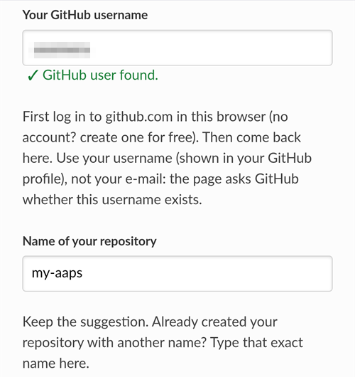
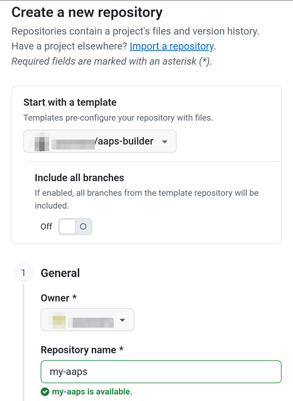
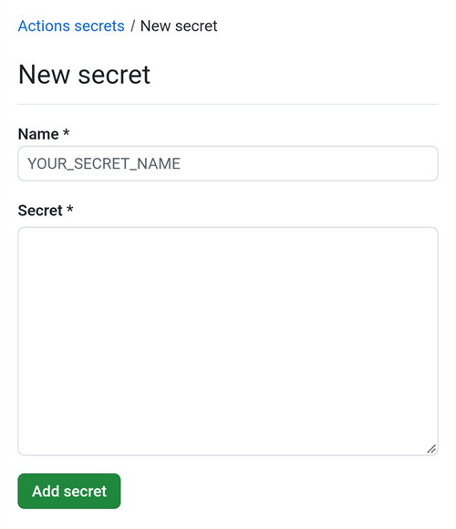

(aaps-builder)=

# Sestavení v prohlížeči s AAPS Builder

```{note}
Toto je doporučený způsob, jak sestavit AAPS z **telefonu s Androidem**. Funguje také v libovolném prohlížeči na počítači. Další způsoby sestavení z počítače nebo z iPhonu najdete v přehledu [Sestavení v prohlížeči](BrowserBuild.md).
```

```{contents} In this page
:backlinks: entry
:depth: 2
```

**AAPS Builder** za vás sestaví aplikaci AAPS na GitHubu, bezplatném webu pro ukládání kódu. Do telefonu nic neinstalujete a neotevíráte žádný přípravný soubor.

Celým postupem vás provede stránka nastavení. Poprvé to trvá asi 10 minut:

1. Vytvořte si ve svém účtu GitHub vlastní **soukromou kopii** AAPS Builder: stránka nastavení otevře GitHub se vším vyplněným a vy jen potvrdíte. Sestavovací workflow, tedy soubor, který GitHubu říká, jak sestavit AAPS, už v ní je.
2. Vytvořte nebo nahrajte svůj **podpisový klíč** (úložiště klíčů).
3. Předejte klíč svému repozitáři jako GitHub **secret**.
4. **Sestavte** aplikaci. Jedno sestavení trvá 15 až 30 minut.
5. **Stáhněte a nainstalujte** aplikaci do telefonu.

**Nemusíte** vytvářet fork AndroidAPS: zdrojový kód AAPS se při každém sestavení stáhne z oficiálního repozitáře AndroidAPS. **Nepotřebujete** ani Disk Google: aplikaci stáhnete přímo z GitHubu.

```{admonition} Where the code comes from
:class: note

Sestavovací workflow udržují vývojáři AAPS v repozitáři [nightscout/aaps-builder](https://github.com/nightscout/aaps-builder) a váš repozitář je jeho kopií. [Workflow](https://github.com/nightscout/aaps-builder/blob/main/.github/workflows/build.yml) ve vaší kopii je krátké: spouští [kroky sestavení](https://github.com/nightscout/aaps-builder/blob/main/.github/workflows/aaps-builder.yml) uložené v tom repozitáři, takže vylepšení k vám dorazí bez jakékoli změny ve vašem repozitáři. Oba soubory si můžete přečíst. Při sestavení workflow stahuje jen oficiální zdrojový kód AAPS a vlastní sestavovací nástroje GitHubu. Vaše úložiště klíčů nikdy neopustí váš prohlížeč a váš soukromý repozitář.
```

(aaps-builder-before-you-start)=

## Než začnete

Budete potřebovat:

- **Účet na GitHubu** (zdarma). Pokud ho nemáte, nejprve si ho vytvořte na [github.com](https://github.com/signup).
- **Webový prohlížeč**: Chrome v telefonu nebo jakýkoli prohlížeč na počítači. Než začnete, přihlaste se v tomto prohlížeči na github.com.
- **Máte v telefonu aplikaci GitHub?** Můžete si ji ponechat. Některá tlačítka stránky nastavení pak místo Chromu otevřou tuto aplikaci. Sestavení v aplikaci funguje, ale aplikace **nemůže stáhnout** hotové AAPS: [krok 5](#aaps-builder-step5) ukazuje, jak pro stažení přepnout do Chromu.
- Své **stávající úložiště klíčů** (soubor `.jks`), jeho heslo a alias, pokud jste AAPS již dříve sestavili a chcete ho aktualizovat bez přeinstalace.

```{warning}
**Váš repozitář pro sestavení musí zůstat soukromý.** Vše, co sestavení vytvoří, vidí každý, kdo vidí repozitář. Stránka nastavení vám vytvoří soukromý repozitář. Nikdy ho nepřepínejte na veřejný a místo toho nevytvářejte **fork** AAPS Builder: fork je vždy veřejný.

Soukromý repozitář dostává každý měsíc 2000 minut GitHub Actions zdarma, což stačí na několik sestavení.
```

```{warning}
**Nový klíč, nebo stávající klíč: na tom závisí, zda budete moci AAPS aktualizovat.**

- **AAPS už v telefonu máte a máte i úložiště klíčů, se kterým byl sestaven**: na stránce nastavení zvolte **I already have a keystore** a nahrajte ho. Vaše příští sestavení pak AAPS aktualizuje bez přeinstalace. Sestavovali jste AAPS dřívějším způsobem sestavení v prohlížeči (vlastní fork)? Vaše úložiště klíčů je ve vašem forku: [nejprve si z něj získejte kopii](#aaps-builder-from-fork).
- **Sestavujete AAPS poprvé, nebo jste ztratili úložiště klíčů či jeho heslo**: zvolte **Create a new key**. Aplikace podepsaná novým klíčem **nemůže aktualizovat** AAPS podepsané jiným klíčem. Musíte exportovat nastavení, zkopírovat soubor mimo telefon, odinstalovat staré AAPS, nainstalovat nové a potom nastavení importovat: viz [Přeinstalace AAPS s novým úložištěm klíčů](#reinstall-aaps).

Potom vždy používejte stále stejný klíč. Když vytváříte nový klíč, stáhněte zálohu, kterou stránka nabízí, a uložte ji spolu s heslem a aliasem (`key0`) na bezpečné místo mimo telefon.
```

(aaps-builder-from-fork)=

## Přechod z dřívějšího sestavení v prohlížeči (fork)

Tuto část přeskočte, pokud jste nikdy nesestavovali AAPS dřívějším způsobem sestavení v prohlížeči (vlastní kopie neboli fork AndroidAPS na GitHubu, s přípravným souborem a Diskem Google).

Vaše úložiště klíčů je uložené jako secrety ve vašem forku. GitHub už secret nikdy znovu neukáže, takže ho nemůžete zkopírovat do nového repozitáře. Nejprve si opatřete kopii svého úložiště klíčů a potom ji použijte v [kroku 2](#aaps-builder-step2) s volbou **I already have a keystore**.

```{warning}
Nevolte **Create a new key**. AAPS sestavené s novým klíčem nemůže aktualizovat AAPS ve vašem telefonu.
```

Která situace je ta vaše?

- **Použili jste Možnost 2** (nahráli jste vlastní úložiště klíčů z Android Studia) a stále máte soubor `.jks`, jeho hesla a alias: zde nemusíte nic dělat. Tento soubor použijte v kroku 2.
- **Použili jste Možnost 1** (klíč vytvořil přípravný soubor), nebo už soubor úložiště klíčů nemáte: exportujte ho ze svého forku podle postupu níže.

Export úložiště klíčů z vašeho forku:

1. Ve svém forku otevřete **Settings** → **Secrets and variables** → **Actions** a přidejte secret s názvem `ZIP_PASSWORD`. Zvolte heslo jen z anglických písmen a číslic. Chrání soubor, který se chystáte vytvořit.
2. Otevřete kartu **Actions** svého forku, klepněte na **CI Keystore Export** a potom na **Run workflow**. Více podrobností: [Export úložiště klíčů](#ci-keystore-export).
3. Když má běh zelenou fajfku, otevřete svůj Disk Google: soubor `keystore.zip` je ve složce **AAPS** → **KeyStore**. Pokud běh selže v kroku Disku Google, vypršel přístup vašeho forku k Disku Google: viz [Vypršel obnovovací token Google](#aaps-ci-google-token-expired).
4. Stáhněte `keystore.zip` a otevřete ho pomocí svého `ZIP_PASSWORD`: na počítači, nebo v telefonu ve správci souborů, který umí otevírat ZIP soubory chráněné heslem. Obsahuje:
   - `keystore.jks`: vaše úložiště klíčů,
   - `keyStoreInfo.txt`: vaše `KEYSTORE_PASSWORD`, `KEY_PASSWORD` a `ALIAS` (obvykle `key0`).
5. Zkopírujte `keystore.jks` do telefonu (nebo na Disk Google, abyste ho mohli vybrat odtud).

V [kroku 2](#aaps-builder-step2) stránky nastavení:

1. Klepněte na **I already have a keystore**.
2. V poli **Keystore file** vyberte `keystore.jks`.
3. Do pole **Keystore password** zadejte `KEYSTORE_PASSWORD` ze souboru `keyStoreInfo.txt`.
4. V poli **Key alias** vyberte nebo zadejte `ALIAS` ze souboru `keyStoreInfo.txt`.
5. Pokud se `KEY_PASSWORD` liší od `KEYSTORE_PASSWORD`, zrušte zaškrtnutí **Key password is the same as the keystore password** a zadejte `KEY_PASSWORD`.

Soubor `keystore.zip` a jeho `ZIP_PASSWORD` uchovávejte na bezpečném místě mimo telefon: je to záloha vašeho klíče.

Pokud chcete sestavení z AAPS Builder ukládat také na Disk Google, proveďte [krok 6](#aaps-builder-google-drive): stránka nastavení pro vás získá nový `GDRIVE_OAUTH2`. Svůj fork si můžete ponechat, dokud nebudete mít v telefonu nainstalované AAPS sestavené pomocí AAPS Builder.

## Otevřete stránku nastavení

**→ [Otevřít stránku nastavení AAPS Builder](#aaps-builder-setup)**

Stránka nastavení je součástí této dokumentace, ve vašem jazyce. Nechte si otevřenou i tuto stránku na jiné kartě: části níže podrobněji vysvětlují každý krok stránky nastavení, včetně snímků obrazovky.

Stránka nastavení otevírá každou stránku GitHubu na nové kartě Chromu. Pro návrat na stránku nastavení klepněte na tlačítko karet vedle adresního řádku Chromu (čtverec s číslem) a zvolte stránku nastavení AAPS Builder.

Stránka nastavení běží celá ve vašem prohlížeči: váš klíč a hesla se nikam neposílají, kromě GitHub secretu, do kterého je sami vložíte. GitHubu se posílá jen vaše uživatelské jméno, aby se ověřilo, že existuje. Pamatuje si vaše uživatelské jméno na GitHubu a název repozitáře, takže se k ní můžete kdykoli vrátit a znovu otevřít stránku secretů nebo svá sestavení.


(aaps-builder-step1)=

## Krok 1 – Vytvořte si soukromý repozitář pro sestavení

Tento krok vytvoří ve vašem účtu GitHub vlastní soukromou kopii AAPS Builder, ve které už je sestavovací workflow. Jen vy vidíte jeho obsah a aplikace, které v něm vzniknou.

1. Ujistěte se, že jste v tomto prohlížeči přihlášeni na github.com.

2. Do pole **Your GitHub username** zadejte své uživatelské jméno na GitHubu, ne e-mail. Stránka ho ověří u GitHubu: **✓ GitHub user found** znamená, že je správné.

3. V poli **Name of your repository** ponechte navržený název `my-aaps`. Pokud jste už repozitář vytvořili s jiným názvem, zadejte přesně tento název.

   ```{note}
   **Už máte repozitář AAPS Builder** (vytvořený starší verzí stránky nastavení)? Nevytvářejte nový: zadejte jeho přesný název, přeskočte **Create my private repository** a jednou aktualizujte jeho workflow podle části [Aktualizace AAPS](#aaps-builder-updates). Vaše secrety zůstanou, jak jsou. Pokud přesto chcete nový repozitář, zvolte název, který ještě nemáte, například `my-aaps-2`, a v kroku 2 použijte stejné úložiště klíčů.

   Nezadávejte název svého forku AndroidAPS: fork je veřejný a už sestavuje vlastním workflow **AAPS CI**.
   ```

   

4. Zkontrolujte řádek **Your repository:** – ukazuje `github.com/<your username>/my-aaps`. Stránka nastavení si pamatuje název z vaší poslední návštěvy: pokaždé ho zkontrolujte, než použijete její tlačítka.

5. Klepněte na **Create my private repository**.

   

6. GitHub otevře na nové kartě stránku **Create a new repository**. Vše je už vyplněné: v části **Start with a template** šablona `nightscout/aaps-builder` s vypnutou volbou **Include all branches** a v části **General** váš účet jako **Owner** a zvolený název.

   

   Nic neměňte.

7. Posuňte se dolů: v části **Configuration** je **Choose visibility** už nastaveno na **Private**. Klepněte na zelené tlačítko **Create repository**.

   

   GitHub ukáže váš nový repozitář: obsahuje složku `.github` (se sestavovacím workflow) a soubor `README.md`. **Vraťte se na kartu se stránkou nastavení** kvůli kroku 2: klepněte na tlačítko karet vedle adresního řádku Chromu a zvolte stránku nastavení.

```{warning}
**Váš nový repozitář je prázdný**, bez souborů? Nebyl vytvořen ze šablony a nemůže sestavovat. Smažte ho (**Settings** → konec stránky → **Delete this repository**) a potom na stránce nastavení znovu klepněte na **Create my private repository**.
```

(aaps-builder-step2)=

## Krok 2 – Váš podpisový klíč

Aplikace musí být podepsaná vaším vlastním klíčem. Zvolte jednu ze dvou karet. Nejprve si přečtěte [upozornění k novému nebo stávajícímu klíči](#aaps-builder-before-you-start).


### I already have a keystore

1. Klepněte na **I already have a keystore**.
2. V poli **Keystore file** vyberte svůj soubor `.jks` (nebo `.keystore`, `.p12`, `.pfx`). Pokud jste v telefonu, nejprve si soubor zkopírujte do telefonu nebo na Disk Google.
3. Do pole **Keystore password** zadejte heslo úložiště klíčů.
4. V poli **Key alias** vyberte svůj alias ze seznamu, nebo ho zadejte, pokud seznam není. U úložišť klíčů vytvořených v Android Studiu je to obvykle `key0`.
5. Pokud se heslo klíče liší od hesla úložiště klíčů, zrušte zaškrtnutí **Key password is the same as the keystore password** a zadejte heslo klíče.
6. Klepněte na **Check and continue**.

Stránka zkontroluje heslo a alias přímo ve vašem zařízení. **Keystore OK! Continue with step 3.** znamená, že je vše v pořádku. Pokud stránka napíše, že heslo bude zkontrolováno až při sestavení, přesto pokračujte: sestavení vám řekne, pokud je něco špatně.

### Create a new key

1. Klepněte na **Create a new key**.

2. Zvolte heslo a zadejte ho dvakrát. Pravidla: alespoň 8 znaků, jen písmena a–z a A–Z, číslice 0–9 a symboly jako `! ? #`. Žádné mezery, žádná písmena s diakritikou a žádný znak `|`.

3. Klepněte na **Create key**. Než se objeví **Key created**, trvá to několik sekund.

   

4. Klepněte na **Download backup (aaps-keystore.jks)**. Pokud se Chrome zeptá **Stáhnout soubor znovu?**, je už v telefonu starší záloha se stejným názvem: klepněte na **Stáhnout znovu**. Chrome pak uloží nový klíč jako `aaps-keystore (1).jks`: to je soubor, který patří k tomuto klíči. Uchovejte ho a nepleťte si ho se starším souborem.

   Tyto tři věci uchovávejte pohromadě na bezpečném místě mimo telefon (například ve vlastním cloudovém úložišti):

   - soubor `aaps-keystore.jks`,
   - vaše heslo,
   - alias klíče: **`key0`**.

   Všechny tři budete potřebovat, pokud budete někdy sestavovat AAPS jiným způsobem, například v Android Studiu. Klíče vytvořené dřívější verzí stránky nastavení mají alias `aaps`.

   

(aaps-builder-step3)=

## Krok 3 – Předejte klíč svému repozitáři

Krok 3 se odemkne, když je hotový krok 2. Váš klíč, jeho hesla a alias se zabalí do jedné hodnoty, secretu `KEYSTORE_SET`.

1. Klepněte na **Open the secrets page**.


2. GitHub otevře stránku **New secret** vašeho repozitáře. V telefonu je pod nabídkou nastavení: posuňte se dolů.



3. Přepněte na kartu se stránkou nastavení a klepněte na **Copy name**. Přepněte zpět na kartu GitHubu a vložte ho do malého pole **Name**. Název je `KEYSTORE_SET`.

4. Přepněte na kartu se stránkou nastavení a klepněte na **Copy secret**. Přepněte zpět na kartu GitHubu a vložte ho do velkého pole **Secret** (v telefonu dlouhým stiskem). Secret je velmi dlouhý kód o tisících znaků: stránka nastavení ukazuje jeho první znaky vedle tlačítka. Nevkládejte tam slovo `KEYSTORE_SET`.

5. Klepněte na **Add secret**. `KEYSTORE_SET` se nyní zobrazí v části **Repository secrets**.


Tento krok stačí udělat jen jednou.

```{tip}
GitHub ukazuje **Page not found** (404)? Nejprve zkontrolujte, že jste v tomto prohlížeči přihlášeni na github.com: GitHub ukazuje 404 u soukromých repozitářů, když nejste přihlášeni. Jinak uživatelské jméno nebo název repozitáře v kroku 1 neodpovídá vašemu repozitáři. Zkontrolujte název na github.com, opravte ho v kroku 1 a klepněte na tlačítko znovu.
```

(aaps-builder-step4)=

## Krok 4 – Sestavte aplikaci

1. Na stránce nastavení klepněte na **Open the build page**. GitHub otevře stránku **Build AAPS** vašeho repozitáře.

   

   Pokud se místo toho otevře **aplikace GitHub**: klepněte na **RUN WORKFLOW**, zkontrolujte verzi a variantu a znovu klepněte na **RUN WORKFLOW**. Aplikace může stále ukazovat **Nothing to see here**: stáhněte seznam dolů, aby se obnovil, a uvidíte své sestavení. Potom pokračujte krokem 4 níže.

2. Pokud se GitHub zeptá, klepněte na zelené tlačítko pro povolení workflow.

   Seznam workflow ukazuje dvě položky: použijte **Build AAPS**. **AAPS Builder** ignorujte: obsahuje kroky sestavení a nemá tlačítko **Run workflow**.

3. Klepněte na **Run workflow**. Otevře se malý formulář:
   - **Version**: ponechte `latest` pro sestavení nejnovější verze AAPS, nebo zadejte číslo verze, například `4.0.0`.
   - **Variant**: pro běžné použití s pumpou ponechte `fullRelease`. Ostatní varianty jsou vysvětleny v části [varianty sestavení](#browserbuild-variant). `aapsclient3Release` sestaví **AAPSClient3**, dostupný od verze **AAPS** 4.0 (viz [O AAPSClient, AAPSClient2 a AAPSClient3](#remotecontrol-aapsclient-versions)).
   - Klepněte na zelené tlačítko **Run workflow**.

   

4. Sestavení se spustí a ukazuje **In progress** se dvěma částmi: **AAPS / Check** a potom **AAPS / Build AAPS**.

   

5. Počkejte 15 až 30 minut. Zelená fajfka znamená, že je sestavení hotové. Červený křížek znamená, že selhalo: otevřete sestavení, přečtěte si zprávu a pak se podívejte do části [řešení problémů](#aaps-builder-troubleshooting).

   

   ```{tip}
   **E-mail po dokončení sestavení:** GitHub vám pošle e-mail jen tehdy, když sestavení selže. Pokud chcete e-mail dostat i po úspěšném sestavení: na github.com otevřete svůj profilový obrázek → **Settings** → **Notifications** → **System** → **Actions** a zrušte zaškrtnutí **Only notify for failed workflows**.
   ```

Pokud tam není tlačítko **Build AAPS** ani **Run workflow**:

- Otevřete svůj repozitář a zkontrolujte, že obsahuje složku `.github` se souborem `workflows/build.yml`. Pokud je repozitář prázdný, nebyl vytvořen ze šablony: smažte ho (**Settings** → konec stránky → **Delete this repository**) a proveďte [krok 1](#aaps-builder-step1) znovu pomocí tlačítka.
- Otevřete kartu **Actions**. Pokud je tam napsáno, že workflow jsou vypnutá, klepněte na zelené tlačítko pro jejich povolení a potom v seznamu klepněte na **Build AAPS**.

(aaps-builder-step5)=

## Krok 5 – Nainstalujte aplikaci do telefonu

```{warning}
**Před každou aktualizací** v AAPS [exportujte nastavení](#ExportImportSettings-Automating-Settings-Export) a soubor zkopírujte **mimo telefon** (Disk Google, Dropbox…). Uchovávejte tam i několik starších exportů a soubory APK, abyste se mohli vždy vrátit zpět.
```

1. V telefonu otevřete stránku nastavení v **Chromu**. Pokud budete vyzváni, přihlaste se na github.com.
2. Klepněte na **Open my builds** a potom na nejnovější sestavení se zelenou fajfkou.

   ```{admonition} The GitHub app opened instead of Chrome?
   :class: note

   Aplikace GitHub neumí stahovat sestavení. V aplikaci otevřete nejnovější sestavení a klepněte na **Artifacts ↗**, nebo klepněte nahoře na ikonu sdílení a zvolte **Chrome** (nebo **Kopírovat odkaz** a odkaz vložte do adresního řádku Chromu). Sestavení se otevře v Chromu: tam pokračujte dalším krokem.

   Aby se odkazy GitHubu neotevíraly v aplikaci: v Androidu **Nastavení** → **Aplikace** → **GitHub** → **Otevírat ve výchozím nastavení** → vypněte **Otevírat podporované odkazy**.
   ```

   

3. Posuňte se dolů k souhrnu sestavení a klepněte na odkaz **Download AAPS**.

   

   ```{tip}
   Posouvejte prstem po textu, ne po diagramu kroků sestavení: jinak se místo stránky posune diagram.
   ```

   Můžete se také posunout níže k části **Artifacts** a klepnout na ikonu stažení vedle `aaps-….apk`.

   

4. Když je stahování hotové, otevřete nabídku Chromu **⋮** → **Stažené soubory**, klepněte na `aaps-….apk` a zvolte **Instalovat**. Pokud budete vyzváni, povolte instalaci aplikací z tohoto zdroje.

   

`aaps-wear-….apk` je aplikace pro chytré hodinky. Pokud hodinky nepoužíváte, tento soubor vynechte.

Aplikace zůstává na stránce sestavení **14 dní**. V repozitáři se nezobrazuje v části **Code**. Zkopírujte ji na bezpečné místo mimo telefon, spolu s exporty nastavení.

Další způsoby instalace aplikace najdete na stránce [Přenos a instalace AAPS](TransferringAndInstallingAaps.md).

```{note}
Od září 2026 může [ověřování vývojářů pro Android](#android-developer-verification) od Googlu podle vaší země blokovat instalaci APK klepnutím na soubor. Bezplatná řešení jsou vysvětlena na té stránce.
```

(aaps-builder-google-drive)=

## Krok 6 (volitelný) – Ukládejte aplikaci také na Disk Google

Každé sestavení si můžete nechat ukládat také na svůj Disk Google, do složky `AAPS/<version>`. Je to volitelné: aplikace je vždy dostupná na stránce sestavení.

Potřebujete k tomu ještě jeden secret, `GDRIVE_OAUTH2`. Krok 6 stránky nastavení ho pro vás získá od Googlu, v telefonu i na počítači. **AAPS** pak na vašem Disku Google vidí a mění jen soubory, které samo vytvoří, nic jiného.

1. Na stránce nastavení klepněte na **Connect Google Drive**. Google se otevře na nové kartě.
2. Zvolte svůj účet Google a povolte přístup. Pokud Google napíše, že aplikace není ověřená, klepněte na **Rozšířená nastavení** (Advanced) a potom na **Přejít na …** (Go to …).
3. Nová karta pak ukáže chybu jako **Tento web není dostupný** (This site can't be reached) nebo **Připojení k webu 127.0.0.1 bylo odmítnuto** (127.0.0.1 refused to connect). **To je v pořádku:** odpověď Googlu je v adrese této karty. Klepněte na adresní řádek, vyberte celou adresu (začíná `http://127.0.0.1:47913/`) a zkopírujte ji.
4. Do několika minut se vraťte na kartu se stránkou nastavení: odpověď Googlu platí jen krátce a jen jednou. Vložte adresu do pole **Paste the copied address here** a klepněte na **Get GDRIVE_OAUTH2**. Stránka ukáže **GDRIVE_OAUTH2 is ready**.
5. Klepněte na **Open the secrets page**. Klepněte na **Copy name** a vložte ho do malého pole **Name** (název je `GDRIVE_OAUTH2`). Klepněte na **Copy secret**, vložte ho do velkého pole **Secret** a klepněte na **Add secret**.

Od příštího sestavení se soubory APK ukládají také na Disk Google.

Už máte hodnotu `GDRIVE_OAUTH2` z přípravného souboru jiných způsobů sestavení v prohlížeči? Funguje také: přidejte ji jako secret `GDRIVE_OAUTH2`.

Google přístup zruší, pokud 6 měsíců nic nesestavíte nebo pokud změníte heslo ke Googlu. Sestavení vám to pak oznámí: zopakujte tyto kroky. Viz [Vypršel obnovovací token Google](#aaps-ci-google-token-expired).

(aaps-builder-updates)=

## Aktualizace AAPS

Váš repozitář nikdy nic nesestaví sám: vy rozhodujete, kdy sestavit, jakou verzi a jakou variantu. Když vyjde nová verze AAPS:

1. [Zálohujte svá nastavení](#aaps-builder-step5) podle kroku 5.
2. Sestavte novou verzi podle [kroku 4](#aaps-builder-step4). Ponechte `latest`, nebo zadejte číslo verze.
3. Stáhněte a nainstalujte ji podle [kroku 5](#aaps-builder-step5).

**Aktualizace kroků sestavení** k vám dorazí samy: při každém sestavení váš repozitář spustí kroky sestavení, které vydali vývojáři AAPS v nightscout/aaps-builder. Ve vašem repozitáři se nic nezmění a nespustí se žádné automatické sestavení.

**Aktualizace vašeho souboru workflow** jsou vzácné: jen když se změní formulář **Run workflow**, například kvůli nové variantě sestavení, nebo jednou, pokud byl váš repozitář vytvořen starší verzí stránky nastavení (prázdný repozitář s krátkým souborem workflow) nebo ze staré šablony. Uvede to stránka [Aktualizace a změny dokumentace](../Maintenance/DocumentationUpdate.md). Váš secret `KEYSTORE_SET` zůstává beze změny. Na stránce nastavení otevřete na konci kroku 1 část **Updating your copy**:

1. Klepněte na **Open the newest workflow**. Na počítači klikněte vpravo nahoře u souboru na **ikonu kopírování** („Copy raw file“). V telefonu místo toho otevřete **verzi v prostém textu**, dlouze stiskněte text a zvolte **Vybrat vše** a **Kopírovat**.
2. Klepněte na **Open my workflow file**.
3. Nahraďte celý text zkopírovaným workflow (v telefonu dlouhým stiskem: **Vybrat vše** a potom **Vložit**).
4. Klepněte na **Commit changes…** a potom na **Commit changes**.

První řádek souboru ukazuje jeho verzi.

(aaps-builder-troubleshooting)=

## Řešení problémů

Chcete-li zjistit, proč sestavení selhalo, [přečtěte si log sestavení](#aaps-ci-read-the-logs): kroky se jmenují jinak, ale chybu najdete stejným způsobem. Stejným způsobem můžete také [aktualizovat secret](#aaps-ci-update-secret) a [spustit sestavení znovu](#aaps-ci-rerun).

- **Chybí tlačítko „Build AAPS“ nebo „Run workflow“, nebo je repozitář prázdný**: repozitář nebyl vytvořen ze šablony. Smažte ho (**Settings** → konec stránky → **Delete this repository**) a proveďte [krok 1](#aaps-builder-step1) znovu pomocí tlačítka **Create my private repository**.
- **Sestavení se zastaví se zprávou „This repository is PUBLIC“**: ve svém repozitáři otevřete **Settings** → **General** → **Danger Zone** → **Change visibility** → **Private** a potom sestavte znovu.
- **„Secret KEYSTORE_SET is missing“**: proveďte krok 3 stránky nastavení.
- **„The secret is too short“**, **„The secret is not a valid code“** nebo **„The secret does not contain a keystore“**: do secretu byl vložen špatný text, často samotné slovo `KEYSTORE_SET` nebo jen část kódu. Ve svém repozitáři otevřete **Settings** → **Secrets and variables** → **Actions**, upravte `KEYSTORE_SET` a znovu vložte dlouhý kód z **Copy secret** (pokud jste stránku nastavení zavřeli, nejprve zopakujte její krok 2).
- **„Keystore, password or alias is wrong“**: zkontrolujte heslo a alias svého úložiště klíčů a potom zopakujte kroky 2 a 3 stránky nastavení.
- **„Version … does not exist“**: zadaná verze není vydaná verze AAPS. Použijte `latest`, nebo zkontrolujte číslo verze.
- **„Variant … is not supported“**: váš soubor workflow je ve starší verzi. Nahraďte ho podle části [Aktualizace AAPS](#aaps-builder-updates).
- **„Page not found“ (404), když stránka nastavení otevře GitHub**: přihlaste se na github.com ve stejném prohlížeči (GitHub ukazuje 404 u soukromých repozitářů, když nejste přihlášeni). Pokud jste přihlášeni, uživatelské jméno nebo název repozitáře v kroku 1 stránky nastavení neodpovídá vašemu repozitáři. Zadejte přesné názvy.
- **„No GitHub user with this name“** v kroku 1: zadejte své uživatelské jméno na GitHubu tak, jak je uvedeno ve vašem profilu GitHub, ne e-mail.
- **Chybí odkaz Download, nebo se otevřela aplikace GitHub**: aplikace GitHub neumí stahovat sestavení. Otevřete sestavení v Chromu podle [kroku 5](#aaps-builder-step5). Aby se odkazy GitHubu neotevíraly v aplikaci: v Androidu **Nastavení** → **Aplikace** → **GitHub** → **Otevírat ve výchozím nastavení** → vypněte **Otevírat podporované odkazy**.
- **„Google Drive access has expired or was revoked“**: zopakujte [krok 6](#aaps-builder-google-drive) a aktualizujte secret `GDRIVE_OAUTH2`.

Další problémy s GitHubem a Diskem Google najdete na stránce [Sestavení v prohlížeči: řešení problémů](../GettingHelp/BrowserBuildTroubleshooting.md).

```{toctree}
:hidden:

Stránka nastavení AAPS Builder <BrowserBuildAapsBuilderSetup.md>
```
