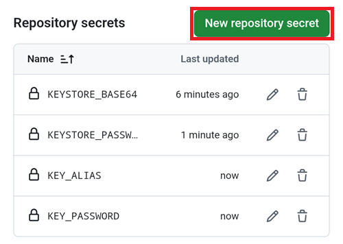
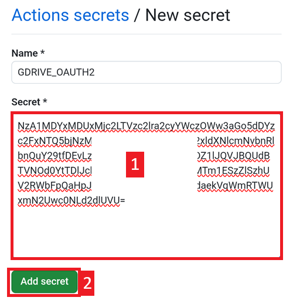

(aaps-ci-google-drive-auth)=

# Sestavení v prohlížeči – Krok 3: Autorizujte Disk Google

```{note}
Toto je **krok 3** návodu [Sestavení v prohlížeči](BrowserBuild.md). Nejprve dokončete [Krok 2 – Vytvořte si podpisové úložiště klíčů](BrowserBuildKeystore.md).
```

```{warning}
Bez ohledu na to, podle kterého z předchozích postupů jste šli (Možnost 1 nebo Možnost 2), MUSÍTE přidat autorizaci Disku Google, jinak sestavení v prohlížeči nebude fungovat.
```

Poznámka: pokud jste tuto část už udělali podle videa, můžete přejít rovnou na [Krok 4 – Sestavte APK](BrowserBuildAPK.md).

```{warning}
Pokud se autorizace Google nespustí nebo přípravná stránka selže, zavřete přípravnou stránku, otevřete `aaps-ci-preparation.html` znovu stejným způsobem jako v kroku 2 a začněte tento krok znovu. Viz [řešení problémů](#aaps-ci-preparation-web).
```

Vraťte se na kartu s přípravnou stránkou.

Posuňte se dolů k části Google Drive Auth a klepněte na Start Auth.


Vyberte svůj účet Google.


Posuňte se dolů a přístup povolte. Webová stránka ho potřebuje, aby získala autentizační klíč pro Disk Google.

Klepněte na Continue (Pokračovat).


Vyplní se pole `GDRIVE_OAUTH2`, klepněte na horní tlačítko Copy.


Přepněte zpět na kartu GitHubu.

Posuňte se dolů k části Repository secrets a klepněte na New repository secret.

Pokud jste šli podle Možnosti 1, měli byste vidět toto:


Pokud jste šli podle Možnosti 2, bude tam více klíčů:



Do pole Name vložte text, který jste právě zkopírovali. Nabídku pro vložení zobrazíte dlouhým stiskem v textovém poli.


Přepněte na kartu s přípravnou stránkou.

Klepněte na druhé tlačítko Copy.


Přepněte zpět na kartu GitHubu.

1. Do pole Secret vložte text, který jste právě zkopírovali. Nabídku pro vložení zobrazíte dlouhým stiskem v textovém poli.

2. Klepněte na Add secret.



Nyní byste měli mít buď dva (Možnost 1), nebo pět (Možnost 2) secretů.


GitHub teď bude moci po sestavení uložit soubor APK aplikace AAPS na váš Disk Google.

----

**Další: [Krok 4 – Sestavte APK](BrowserBuildAPK.md) →**
