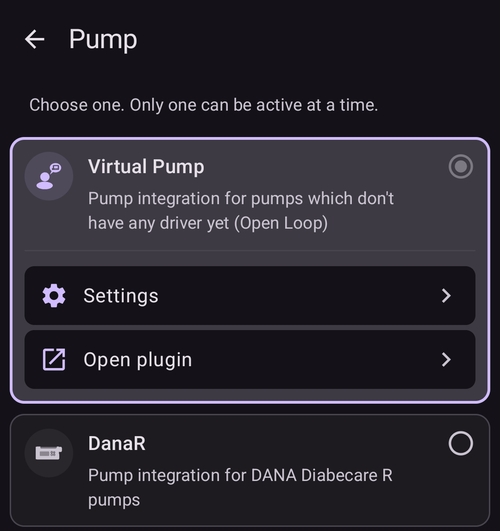

# Změny v konfiguraci AAPS

Po dokončení **[Průvodce nastavením](../SettingUpAaps/SetupWizard.md)** nemusíte spouštět celého průvodce znovu, pokud chcete změnit jen část konfigurace **AAPS**.

Konfiguraci **AAPS** můžete změnit třemi cestami. Kterou cestu zvolíte, je jen otázka pohodlí nebo osobní volby, protože všechny vedou ke stejným nastavením.

Máte tyto možnosti:

1. Obrazovka **Konfigurace**,
2. Obrazovka **Nastavení** nebo
3. **Nastavení** pluginu, otevřené z jeho kategorie v **Konfiguraci**.

Zde vysvětlujeme, která možnost je nejvhodnější pro jakou situaci:

## Configuration

Otevřete **nabídku** (☰) v levém horním rohu hlavní obrazovky a vyberte **Konfigurace**:

**Konfigurace** slouží k **výběru aktivních pluginů** – vašeho CGM, pumpy, algoritmu APS, detekce citlivosti, synchronizace a dalších, seskupených podle kategorií. Je to stejná obrazovka, kterou za vás nastavil Průvodce nastavením.

Dokumentace k obrazovce Konfigurace je k dispozici [zde](../SettingUpAaps/ConfigBuilder.md).

## Nastavení

Klepněte na ikonu **Nastavení** (ozubené kolo) v pravém horním rohu hlavní obrazovky. Otevřou se nastavení **všech zapnutých pluginů na jednom místě**, seskupená do rozbalovacích sekcí:

Tato cesta je vhodná, pokud si nejste jistí, kde danou možnost konfigurace hledat. Pokud ale víte, že chcete změnit konfiguraci jen jednoho konkrétního pluginu, může být trochu zdlouhavá.

Dokumentace k nastavení je k dispozici [zde](../SettingUpAaps/Preferences.md).

## Nastavení pluginu

V **Konfiguraci** otevřete kategorii a klepněte na „**Nastavení**“ pod aktivním pluginem. Dostanete se přímo do nastavení **pouze tohoto pluginu**:

Tato cesta je vhodná například tehdy, když víte, že chcete změnit konfiguraci své pumpy: otevřete **Konfigurace → Pumpa** a pak klepněte na „**Nastavení**“ pod vybranou pumpou.

Je to „zkratka“ ke stejným nastavením, která jsou na obecné obrazovce **Nastavení**.
