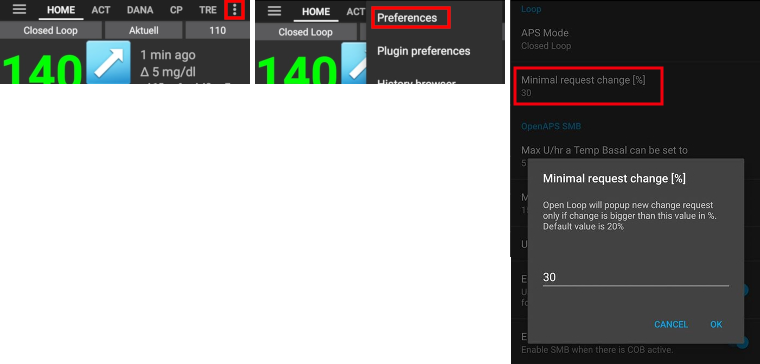
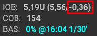
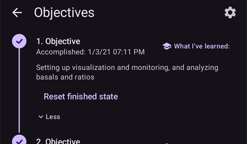
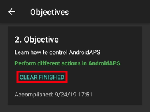

# Plnění cílů

**AAPS** má řadu **Cílů**, které musíte splnit. Pomohou vám postupně přejít od základní otevřené smyčky k hybridní uzavřené smyčce a k plné funkčnosti **AAPS**. Splnění **Cílů** má zajistit, že:

* máte vše v **AAPS** správně nastavené;
* znáte základní funkce **AAPS**; a
* máte základní představu o tom, co váš systém umí, abyste při používání **AAPS** získali jistotu.

Když **AAPS** instalujete poprvé, musíte každý cíl splnit dříve, než přejdete k dalšímu. Nové funkce se budou odemykat postupně, jak budete procházet jednotlivými **Cíli**.

**Cíle 1 až 8** vás provedou od nastavení **AAPS** ve vašem chytrém telefonu až k „základní“ hybridní uzavřené smyčce. This will take about 6 weeks to complete. Až do **Cíle 5** můžete postupovat s virtuální pumpou (a inzulín si mezitím podávat jiným způsobem). **Cíle 9 a 10** slouží k vyzkoušení pokročilejších funkcí **AAPS**, abyste měli diabetes lépe pod kontrolou. Jejich splnění trvá až 3 měsíce, možná i déle. Podrobnější odhad, kolik času jednotlivé kroky zaberou, najdete zde: [Jak dlouho to bude trvat?](#preparing-how-long-will-it-take)

Kromě postupu v **Cílech** můžete v případě potřeby svůj pokrok také smazat a [vrátit se k dřívějšímu cíli](#go-back-in-objectives).

## Backup your settings

```{admonition} Note
:class: note

Exporting your **AAPS** settings is recommended after completing each **Objective**!
```

Důrazně doporučujeme po splnění každého cíle [exportovat nastavení](../Maintenance/ExportImportSettings.md), abyste v **AAPS** nepřišli o dosažený pokrok. Export vytvoří **soubor s nastavením** (.json), který byste měli zálohovat na jedno nebo více bezpečných míst (např. Disk Google, pevný disk, příloha e-mailu _apod._). Tím zajistíte, že pokrok v **AAPS** bude uložen. Pokud telefon ztratíte nebo omylem smažete svůj pokrok, můžete soubor json znovu načíst do **AAPS** importem nedávného souboru s nastavením. Záložní **soubor s nastavením** potřebujete také tehdy, když z jakéhokoli důvodu potřebujete nový chytrý telefon pro **AAPS** (nový model, ztracený nebo rozbitý telefon _apod._)

Soubor s **nastavením** uloží nejen váš pokrok v **Cílech**, ale také všechna nastavení **AAPS**, například **maximální bolus** _apod._

Pokud nemáte zálohu nastavení a s vaším telefonem s **AAPS** se něco stane, budete muset **Cíle** plnit znovu od začátku. Plnění **Cílů** trvá dlouho. Je lepší se vyhnout situaci, kdy je musíte plnit znovu, například protože jste ztratili telefon.

(objectives-objective1)=
## Objective 1: Setting up visualization and monitoring, analyzing basals and ratios

**Cíl 1** vyžaduje, abyste v **AAPS** provedli základní technické nastavení. No progress can be made until this step has been completed.

- Vyberte správný CGM/FGM v [Konfigurace → Zdroj glykémie](#Config-Builder-bg-source). Více informací najdete v části [Zdroj glykémie](../Getting-Started/CompatiblesCgms.md).
- Vyberte správnou pumpu v [Konfigurace → Pumpa](#Config-Builder-pump), aby vaše pumpa mohla komunikovat s **AAPS**. Vyberte **virtuální pumpu**, pokud používáte model pumpy, pro který **AAPS** nemá ovladač pro smyčku, nebo pokud chcete projít prvními **Cíli** a inzulín si mezitím podávat jiným systémem. Více informací najdete v části [inzulínová pumpa](../Getting-Started/CompatiblePumps.md).
- If using Nightscout:
  - Postupujte podle pokynů na stránce [Nightscout](../SettingUpAaps/Nightscout.md), aby **Nightscout** mohl přijímat a zobrazovat data z **AAPS**.
  - Pozor: URL v **NSClientV3** musí být **_bez_ „/api/v1/“** na konci – viz [Nastavení → NSClientV3](#Preferences-nsclient).
- If using Tidepool:
  - Postupujte podle pokynů na stránce [Tidepool](../SettingUpAaps/Tidepool.md), aby **Tidepool** mohl přijímat a zobrazovat data z **AAPS**.

Poznámka – *Možná budete muset počkat na další hodnotu glykémie ze senzoru, než ji **AAPS** rozpozná.*

(objectives-objective2)=
## Cíl 2: Naučte se, jak ovládat AAPS

**Cíl 2** vyžaduje provedení několika „úkolů“, jak ukazuje snímek obrazovky níže. Každý úkol ukazuje svůj stav (**1**): oranžové „**Nedokončeno**“ se změní na „**Hotovo, gratulujeme!**“, jakmile **AAPS** akci zaregistruje. Klepněte na **Nápověda** (**2**) pod úkolem a otevře se související dokumentace, pokud danou akci ještě neznáte.


Úkoly ke splnění **Cíle 2** jsou:
- Nastavte svůj **Profil** na 90 % na dobu 10 min.
  - _Nápověda_: Klepnutím na název profilu na hlavní obrazovce otevřete obrazovku **Profil**, potom použijte tlačítko **Aktivovat** (▶) a nastavte procento a dobu trvání. Více informací najdete v části [Přepnutí profilu a procento profilu](../DailyLifeWithAaps/ProfileSwitch-ProfilePercentage.md).
  - _Poznámka_: **AAPS** nepřijímá bazální dávky nižší než 0,05 U/h. Pokud váš **Profil** obsahuje dávky 0,06 U/h nebo nižší, musíte před splněním tohoto úkolu vytvořit dočasný **Profil** s vyššími bazálními dávkami. Po splnění tohoto úkolu přepněte zpět na svůj běžný **Profil**.
- Simulujte „sprchování“ tím, že v **AAPS** na 1 h [odpojíte pumpu](#AapsScreens-loop-status).
  - _Nápověda_: stiskněte ikonu smyčky na hlavní obrazovce, otevře se dialog Smyčka. Potom vyberte dobu v části **Odpojit pumpu**.
- End "taking a shower" by reconnecting your pump.
  - _Nápověda_: stiskněte ikonu „odpojeno“, znovu se otevře dialog smyčky, a vyberte **Znovu připojit pumpu**.
- Nastavte vlastní [**Dočasný cíl**](../DailyLifeWithAaps/TempTargets.md) na dobu 10 min.
  - _Nápověda_: stiskněte cílový rozsah na hlavní obrazovce, otevře se obrazovka dočasného cíle.
- Zobrazte obsah modulu **Smyčka**.
  - _Nápověda_: otevřete **Konfigurace → Smyčka** a klepněte na „**Otevřít modul**“.
- Použijte posouvání nebo přiblížení na grafu glykémie, abyste zobrazili delší nebo kratší časové úseky.


(objectives-objective3)=
## Cíl 3: Prokažte své znalosti

**Cíl 3** vyžaduje, abyste složili test s výběrem odpovědí, který prověří vaše znalosti **AAPS**.

Pro některé uživatele je **Cíl 3** nejtěžší ze všech cílů. Při odpovídání na otázky si prosím čtěte dokumentaci **AAPS**. Pokud si opravdu nevíte rady ani po prostudování dokumentace **AAPS**, vyhledejte ve skupině na [Facebooku](https://www.facebook.com/groups/AndroidAPSUsers) nebo na [Discordu](https://discord.gg/4fQUWHZ4Mw) výraz „Objective 3“ (je pravděpodobné, že vaši otázku už někdo položil a skupina na ni odpověděla). Tyto skupiny vám mohou dát přátelskou radu nebo vás odkázat na správnou část dokumentace **AAPS**.

In the meantime :
- Abyste v otevřené smyčce snížili počet oznámení a rozhodnutí, která po vás systém chce (dočasné bazální dávky), nastavte ve svém **Profilu** široký cílový rozsah, _např._ 90–150 mg/dl nebo 5,0–8,5 mmol/l.
- V noci budete možná chtít zvýšit horní limit (nebo dokonce vypnout otevřenou smyčku).

Pro pokračování v **Cíli 3** klepněte na řádek otázky a otevřete ji. Každou otázku si pečlivě přečtěte a vyberte správnou odpověď (odpovědi).

Pro každou otázku může existovat více než jedna správná odpověď! If an incorrect answer is selected, the question will be time-locked for 1 hour before you can go back and answer the question again. Také pozor na to, že pořadí variant odpovědí se může při dalším pokusu o odpověď změnit. Cílem je, aby jste je pečlivě četli a skutečně chápali, jaká je správná nebo chybná odpověď a proč.

```{admonition} __What happens if new question(s) are added to an Objective when I update to a newer version of AAPS?__
:class: note
Do **AAPS** se čas od času přidávají nové funkce, kvůli kterým může být nutné přidat do **Cílů** novou otázku, hlavně do **Cíle 3**. V takovém případě bude každá nová otázka, přidaná do **Cíle 3**, označena jako „neúplná“, protože **AAPS** bude vyžadovat její zodpovězení. Nebojte se, každý **Cíl** je samostatný, takže **nepřijdete o stávající funkce AAPS**, pokud ostatní **Cíle** zůstanou splněné.
```

## Cíl 4: Začít s otevřenou smyčkou

Účelem **Cíle 4** je poznat, jak často **AAPS** porovnává vaši bazální dávku s hodnotami glykémie a doporučuje úpravy dočasné bazální dávky. V rámci tohoto **Cíle** poprvé zapnete otevřenou smyčku, potvrdíte 20 navržených změn dočasné bazální dávky a v případě potřeby je ručně nastavíte na pumpě. Také budete sledovat účinek [**Dočasných cílů**](../DailyLifeWithAaps/TempTargets.md). Pokud ještě nevíte, jak v **AAPS** nastavit změnu dočasné bazální dávky, podívejte se na akce pumpy v nabídce **Spravovat** ([Kam zmizela karta Akce?](#screens-action-tab)).

Minimální doba pro splnění tohoto cíle: **7 dní**. To je povinná čekací doba. K dalšímu **Cíli** nemůžete přejít dříve, i když už byly všechny změny bazální dávky provedeny.

- Otevřenou smyčku zapnete stisknutím [ikony smyčky](#AapsScreens-loop-status) na hlavní obrazovce a výběrem režimu smyčky **Otevřená smyčka**.
- Ručně proveďte alespoň 20 nastavení dočasných cílů, které vám systém navrhuje, a to během 7 dní; zadejte je do své pumpy a potvrďte v **AAPS**, že jste návrhy přijali. Ověřte, že se tyto změny bazální dávky zobrazují v **AAPS** i v **Nightscoutu**.
- V případě potřeby použijte [**Dočasné cíle**](../DailyLifeWithAaps/TempTargets.md). After treating a hypo, use the predefined "hypo temp target" to prevent the system from overcorrecting upon the bounce back.
- Pokud stále používáte [Zjednodušený režim](#preferences-simple-mode), je teď pravděpodobně vhodná doba ho vypnout.

Abyste v otevřené smyčce snížili počet navržených změn bazální dávky, můžete stále použít tipy popsané v [**Cíli 3**](#objective-3-prove-your-knowledge). Navíc můžete změnit minimální procento pro doporučené změny bazální dávky pomocí nastavení „**Minimální změna v otevřené smyčce**“ v **Nastavení → Smyčka**. The higher the value, the fewer change notifications you will receive.



```{admonition} Note
:class: note

Nemusíte provádět každé doporučení systému!
```
(objectives-objective5)=
## Cíl 5: Porozumění otevřené smyčce, včetně doporučení pro dočasné bazály

V rámci **Cíle 5** začnete chápat, jak vznikají doporučení dočasné bazální dávky. Patří sem [logika určení bazálu](#aaps-screens-how-predictions-become-a-dosing-decision), analýza účinku pomocí [predikčních křivek na obrazovce **Přehled v AAPS**](#aaps-screens-prediction-lines) (nebo v Nightscoutu) a prohlížení podrobných výpočtů na obrazovce modulu **OpenAPS SMB** (**Konfigurace → APS → Otevřít modul**).

Odhadovaná doba pro splnění tohoto cíle: **7 dní**.

Tento **Cíl** vyžaduje, abyste určili a nastavili hodnotu „Max U/h, na kterou lze nastavit dočasný bazál“ (max-basal), jak je popsáno v části [Funkce OpenAPS](#Open-APS-features-max-u-h-a-temp-basal-can-be-set-to). Tuto hodnotu můžete nastavit v [Nastavení → OpenAPS SMB](#Preferences-openaps-smb-settings). V [zjednodušeném režimu](#preferences-simple-mode) **AAPS** nastaví tuto hodnotu automaticky a nemusíte ji měnit. Pokud stále používáte virtuální pumpu, ujistěte se, že je toto bezpečnostní nastavení nastaveno v **AAPS** i ve vaší inzulínové pumpě.

Dokud si nezvyknete na výpočty a nastavení **AAPS**, můžete si nastavit [cílovou glykémii v **Profilu**](#profile-glucose-targets) vyšší než obvykle. Můžete zkusit nastavit **cílovou glykémii** ve svém **Profilu** v užším rozsahu (například o šířce 1 mmol/l nebo méně [20 mg/dl nebo méně]) a sledovat, jak se systém chová.


```{admonition} If you have been using a virtual pump, change to a real insulin pump now!
:class: note

Pokud používáte otevřenou smyčku s virtuální pumpou, **zde se zastavte**. Na konci tohoto **Cíle** klikněte na ověření až poté, co přejdete na „skutečnou“ pumpu, která podává inzulín.

```


(objectives-objective6)=
## Cíl 6: Začátek uzavřené smyčky - s pozastavením pumpy při nízké glykémii


```{admonition} Closed loop will not correct high **BG** values in **Objective 6** as it is limited to **Low Glucose Suspend** only!
:class: note
Vysoké glykémie budete stále muset korigovat sami (ručně korekcemi pumpou nebo perem)!
```

V rámci **Cíle 6** uzavřete smyčku a zapnete její režim **Ochrana před nízkou glykémií** (LGS), přičemž [max IOB](#Open-APS-features-maximum-total-iob-openaps-cant-go-over) je nastaveno na nulu. Pro splnění tohoto **cíle** musíte zůstat v režimu LGS 5 dní. Tento čas byste měli využít ke kontrole, zda je nastavení vašeho **Profilu** přesné a zda se události LGS nespouštějí příliš často.

Minimální doba pro splnění tohoto cíle: **5 dní**. To je povinná čekací doba. K dalšímu **Cíli** nemůžete přejít, dokud tato doba neuplyne.

Je velmi důležité, aby byl váš aktuální **Profil** (bazál, ISF, IC) dobře otestovaný dříve, než uzavřete smyčku v režimu **LGS**. Nesprávné nastavení **Profilu** vás může dostat do hypoglykémie, kterou budete muset řešit ručně. Přesný **Profil** pomůže během těchto 5 dní snížit potřebu léčit nízkou glykémii.

**Pokud stále pozorujete časté nebo závažné epizody nízké glykémie, zvažte úpravu [DIA vašeho typu inzulínu](#Config-Builder-insulin-dia), bazálu, ISF a sacharidových poměrů.** Podívejte se do skupiny na [Facebooku](https://www.facebook.com/groups/AndroidAPSUsers) nebo na [Discordu](https://discord.gg/4fQUWHZ4Mw), kde se o tom hodně diskutuje.


Během **Cíle 6** **AAPS** přepíše nastavení maxIOB na nulu. **Toto přepsání skončí při přechodu na Cíl 7.**

To znamená, že když jste v **Cíli 6** a glykémie ze senzoru klesá, **AAPS** za vás sníží podávání bazálního inzulínu. Pokud ale glykémie ze senzoru stoupá, **AAPS** zvýší bazální dávku nad hodnotu v **Profilu** jen tehdy, když je **bazální IOB** záporný v důsledku předchozího **LGS**. Jinak **AAPS** nezvýší bazál nad aktuální hodnotu v profilu, ani když glykémie stoupá. Toto opatření má zabránit hypoglykémiím, zatímco se učíte **AAPS** používat.

**V důsledku toho je nutné reagovat na vysoké hodnoty glykémie manuálními korekčními bolusy.**

- Pokud je váš IOB záporný (viz snímek obrazovky níže), může se v **Cíli 6** spustit dočasná bazální dávka (TBR) > 100 %.



- Nastavte cílový rozsah o něco výše než by byl obvyklý cíl, tak abyste měli jistotu a vytvořili si bezpečnostní rezervu.
- Režim „Ochrana před nízkou glykémií“ zapnete stisknutím ikony smyčky na hlavní obrazovce a výběrem režimu smyčky **Ochrana před nízkou glykémií**.
- Sledujte aktivní dočasné bazály zobrazené jako tyrkysový text bazálu na základní obrazovce nebo na tyrkysovou křivku bazálů která je součástí grafu na základní obrazovce.
- Může dočasně docházet k výskytu nárůstů v důsledku reakce na hypo, bez možnosti zpětného zvýšení bazálů.

(objectives-objective7)=
## Cíl 7: Vyladění uzavřené smyčky, zvýšení maxIOB nad 0 a postupné snižování cílové hladiny cukru v krvi

Pro splnění **Cíle 7** musíte uzavřít smyčku a zvýšit [maxIOB](#Open-APS-features-maximum-total-iob-openaps-cant-go-over). **maxIOB** bylo v **Cíli 6** automaticky nastaveno na nulu kvůli režimu Ochrana před nízkou glykémií. To už teď neplatí. **AAPS** začne ke korekci vysokých glykémií používat vámi nastavenou hodnotu maxIOB. V [zjednodušeném režimu](#preferences-simple-mode) **AAPS** nastaví maxIOB automaticky a nemusíte ho měnit.

Minimální doba pro splnění tohoto cíle: **1 den**. To je povinná čekací doba. K dalšímu **Cíli** nemůžete přejít, dokud tato doba neuplyne.

- **Uzavřenou smyčku** zapnete stisknutím [ikony smyčky](#AapsScreens-loop-status) na hlavní obrazovce a výběrem režimu smyčky **Uzavřená smyčka**. Zůstaňte v režimu **Uzavřená smyčka** po dobu 1 dne.

- Slowly raise your 'Maximum total IOB OpenAPS can’t go over' (in OpenAPS called 'max-iob') above 0, until you find the settings that work best for you.

Výchozí doporučení pro toto nastavení je „**průměrný bolus na jídlo + 3× maximální denní bazální dávka**“, kde „maximální denní bazální dávka“ je nejvyšší hodinová hodnota v kterémkoli časovém úseku dne.


Toto doporučení by mělo být považováno za výchozí bod. If you use this rule but are experiencing AAPS delivering too much insulin as glucose levels rise, you may need to :
* lower the "Maximum total IOB OpenAPS can’t go over" value;
* zkontrolujte nastavení svého **Profilu** a upravujte vždy jen jednu věc najednou.

Pokud jste velmi rezistentní na inzulín, můžete také velmi opatrně zvýšit hodnotu **maxIOB**.

Až si budete jistí, jaká hodnota **maxIOB** vyhovuje vaší smyčce, snižte své **cílové glykémie** na požadovanou úroveň.

(objectives-objective8)=
## Objective 8: Adjust basals and ratios if needed, and then enable Autosens

V rámci tohoto **cíle** znovu zhodnotíte, jak dobře funguje váš **Profil**, a jako ukazatel chybného nastavení použijete funkci [Autosens](#Open-APS-features-autosens).

Minimální doba pro splnění tohoto cíle: **7 dní**. To je povinná čekací doba. K dalšímu **Cíli** nemůžete přejít, dokud tato doba neuplyne.

Na 7 dní zapněte [Autosens](../DailyLifeWithAaps/KeyAapsFeatures.md) (ve [zjednodušeném režimu](#preferences-simple-mode) je zapnutý automaticky) a sledujte [bílou čáru v grafu na obrazovce **Přehled**](#AapsScreens-section-g-additional-graphs), která ukazuje, jak vaše citlivost na inzulín stoupá nebo klesá kvůli pohybu, hormonům apod. Sledujte obrazovku modulu **OpenAPS SMB** (**Konfigurace → APS → Otevřít modul**), která ukazuje, jak **AAPS** podle toho upravuje citlivost, bazály a cíle.

Teď je vhodná doba zkontrolovat nastavení [Detekce citlivosti](#Config-Builder-sensitivity-detection). Svou citlivost můžete vidět na hlavní obrazovce v [doplňkovém grafu](#AapsScreens-section-g-additional-graphs).

Navíc můžete jednorázově použít [Autotune](#autotune-how-autotune-calculates-adjustments) a ověřit, že jsou vaše bazály stále přesné, nebo udělat klasický bazální test.

(objectives-objective9)=
## Cíl 9: Povolit další funkce oref1 pro běžné používání, jako je SMB (super micro bolus)

V **Cíli 9** se seznámíte s **„Super Micro Bolus (SMB)“** jako jednou z hlavních funkcí a začnete ho používat. After working through the mandatory readings you will have a good understanding of what SMBs are, how these work, and why basal is set to zero temporarily after SMBs are given (zero-temping).

Minimální doba pro splnění tohoto cíle: **28 dní**. To je povinná čekací doba. You can’t proceed to the next Objective before this time is up.

- [Část o SMB v této dokumentaci](#Open-APS-features-super-micro-bolus-smb) a [popis oref1 v dokumentaci openAPS](https://openaps.readthedocs.io/en/latest/docs/Customize-Iterate/oref1.html) si musíte přečíst, abyste porozuměli **SMB** a principu **zero-temping** (dočasný bazál s nulovou dávkou).
- Potom můžete [zvýšit maxIOB](#Open-APS-features-maximum-total-iob-openaps-cant-go-over), aby **SMB** fungovaly účinněji. maxIOB nyní zahrnuje veškerý **IOB**, nejen nahromaděný bazál. Tato hranice pozastaví **SMB**, dokud IOB neklesne pod tuto hodnotu (_např._ **maxIOB** je nastaveno na 7 U a na jídlo podáte bolus 8 U: SMB budou pozastaveny a nebudou podány, dokud **IOB** neklesne pod 7 U). Dobrý začátek je nastavit **maxIOB** = **průměrný bolus na jídlo + 3× maximální denní bazální dávka**, kde „maximální denní bazální dávka“ je nejvyšší hodinová hodnota v kterémkoli časovém úseku dne. Pro srovnání viz [cíl 7](#objective-7-tuning-the-closed-loop-raising-maxiob-above-0-and-gradually-lowering-bg-targets).
- Vyhodnoťte rychlost absorpce sacharidů a pokud je podle vás příliš pomalá nebo příliš rychlá, zvažte změnu parametru „min_5m_carbimpact“ v [Nastavení → Nastavení absorpce sacharidů → min_5m_carbimpact](#Preferences-min_5m_carbimpact).

(objectives-objective10)=
## Cíl 10: Automatizace

**Automatizace** jsou k dispozici, jakmile zahájíte **Cíl 10**.

Minimální doba pro splnění tohoto cíle: **28 dní**. To je povinná čekací doba. You can’t proceed to the next Objective before this time is up.

Nejdříve si přečtěte stránku dokumentace [Automatizace](../DailyLifeWithAaps/Automations.md).

Nastavte co nejjednodušší pravidlo automatizace, například spuštění oznámení Androidu za několik minut:
- Otevřete **Spravovat → Automatizace** a klepněte na tlačítko **+** (**Přidat pravidlo**).
- Zadejte **Název úkolu**, například „Moje první oznámení z automatizace“.
- V části **Podmínka** klepněte na „**EDIT**“.
  - Klepněte na „**Přidat spouštěč**“ a vyberte „**Čas**“. **AAPS** vytvoří záznam pro dnešek s aktuálním časem.
  - Změňte čas tak, aby se pravidlo spustilo za několik minut.
  - Klepnutím na ikonu **Uložit** (vpravo nahoře) se vraťte k pravidlu.
- V části **Akce** klepněte na „**PŘIDAT**“ a vyberte „**Oznámení**“.
  - Na kartu akce zadejte zprávu, například „Moje první automatizace“.
- Klepněte na ikonu **Uložit** (vpravo nahoře) a ujistěte se, že je pravidlo **Povoleno**.
- Wait until the time triggers the notification (note that depending on your phone, it can be a few minutes late)

Potom můžete zkusit nastavit užitečnější **Automatizaci**. Stránka dokumentace uvádí několik příkladů. Snímky obrazovky „Automation“ můžete také hledat ve skupině na [Facebooku](https://www.facebook.com/groups/AndroidAPSUsers). V komunitě na [Discordu](https://discord.gg/4fQUWHZ4Mw) je pro to také samostatný kanál.

Pokud například každé ráno ve stejnou dobu před školou nebo prací jíte stejnou snídani, můžete vytvořit **Automatizaci**, například „cíl-před-snídaní“, která 30 minut před snídaní nastaví o něco nižší **Dočasný cíl**. V takovém případě bude vaše podmínka zahrnovat "opakující se čas", který se skládá z konkrétních dní v týdnu (Pondělí, Úterý, Středa, Čtvrtek, Pátek) a konkrétní čas (6:30). The action will consist of "Start temp target" with a lower than usual target value and a 30 minutes duration.

## Když jsou všechny cíle splněny

Jakmile splníte všechny **Cíle**, seznam u každého z nich zobrazí zatržítko a datum splnění. Položka **Cíle** zmizí ze spodní navigace; seznam můžete stále otevřít přes **Konfigurace → Omezení → Cíle → Otevřít modul**.


Stiskněte „**Více**“ pod cílem, abyste znovu viděli jeho úkoly:



(CompletingTheObjectives-go-back-in-objectives)=
## Návrat k předchozímu cíli

Pokud se z jakéhokoli důvodu chcete v **Cílech** vrátit, otevřete dokončený **Cíl** pomocí „**Více**“ a klepněte na „**Resetovat dokončený stav**“:



Stejným způsobem můžete **Cíl**, na kterém právě pracujete, spustit znovu pomocí „**Resetovat zahájený stav**“.
