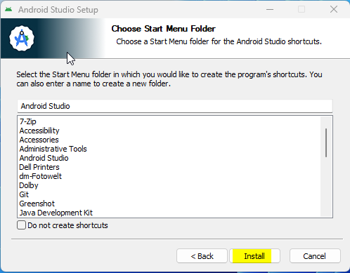
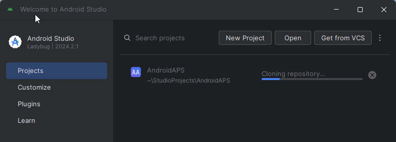
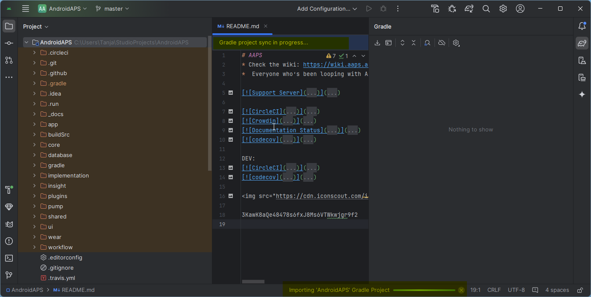
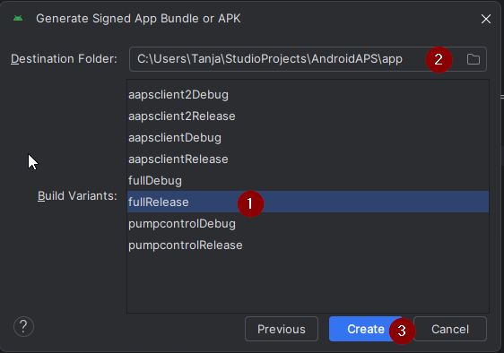

<!-- Android Studio Build, FKA Computer Build. Preserve filenames to avoid breaking URLs. -->

# Sestavení v Android Studiu

Toto je tradiční způsob, jak sestavit aplikaci AAPS.

Aplikaci můžete sestavit i bez počítače pomocí [Sestavení v prohlížeči](./BrowserBuild.md).

## Sestavte si aplikaci sami, místo stažení

**Aplikace AAPS (soubor apk) není k dispozici ke stažení kvůli předpisům pro zdravotnické prostředky. Sestavit si aplikaci pro vlastní použití je legální, ale nesmíte dávat kopii jiným!**

Podrobnosti najdete na stránce [Nejčastější otázky uživatelů APS](../UsefulLinks/FAQ.md).

---

(Building-APK-recommended-specification-of-computer-for-building-apk-file)=
## Specifikace hardware a softwaru pro vytvoření AAPS

* K sestavení APK může být potřeba konkrétní verze **[Android Studia](https://developer.android.com/studio/)**. Viz tabulka níže:

| Verze AAPS                  | Doporučená<br/>verze<br/>Android Studia | Alternativní<br/>verze<br/>Android Studia | Gradle | JVM |
| --------------------------- | --------------------------------------------------- | ----------------------------------------------------- | ------ |:--- |
| 2.6.2                       | 3.6.1                                               |                                                       | 5.6.4  | 11  |
| 2.8.2.1                     | 4.1.1                                               |                                                       | 6.1.1  | 13  |
| [3.1.0.3](#version3100)     | 2020.3.1                                            | testováno až po Quail 4                               | 7.3.3  | 17  |
| [3.2.0.4](#version3204)     | Hedgehog (2023.1.1)                                 | testováno až po Quail 4                               | 8.2    | 17  |
| [3.3.1.3](#version3300)     | Ladybug Feature Drop (2024.2.2)                     | testováno až po Quail 4                               | 8.10   | 21  |
| [3.3.2](#version3300)       | Meerkat (2024.3.1)                                  | testováno až po Quail 4                               | 8.11.1 | 21  |
| [3.3.2.1](#version3321)     | Narwhal (2025.1.2)                                  | testováno až po Quail 4                               | 8.13   | 21  |
| [3.4.2.6](#version3426)     | Panda 2 (2025.3.2)                                  | testováno až po Quail 4                               | 9      | 21  |
| [4.0.0-beta1](#version4000) | Rabbit 1                                            | až po nejnovější Rabbit 1                             | 9.8    | 21  |

„Doporučená verze“ obsahuje odpovídající verzi JVM. Doporučená verze je zároveň nejstarší verze, se kterou můžete **AAPS** sestavit. Ve verzi starší než „doporučená“ sestavení **NEPŮJDE**. Pokud použijete jinou verzi, můžete narazit na problémy s verzí JVM. Pomoc s řešením těchto problémů najdete na stránce [Řešení problémů s Android Studiem](#troubleshooting_androidstudio-uncommitted-changes). Pokud vaše současná verze Android Studia v tabulce není, musíte ho nejdříve aktualizovat.

Verze Gradle je svázaná se zdrojovým kódem. Při stažení nebo aktualizaci zdrojového kódu vždy dostanete správnou verzi Gradle. Je zde uvedená jen pro informaci, nemusíte s ní nic dělat.

* [32bitové systémy Windows](#troubleshooting_androidstudio-unable-to-start-daemon-process) Android Studio nepodporuje. Pamatujte, že **64bitový procesor i 64bitový operační systém jsou povinnou podmínkou.** Pokud váš systém tuto podmínku NESPLŇUJE, musíte vyměnit příslušný hardware nebo software, případně celý systém.

<table class="tg">
<tbody>
  <tr>
    <th class="tg-baqh">OS (Only 64 bit)</th>
    <td class="tg-baqh">Windows 8 or higher</td>
    <td class="tg-baqh">Mac OS 10.14 or higher</td>
    <td class="tg-baqh">Any Linux supports Gnome, KDE, or Unity DE;&nbsp;&nbsp;GNU C Library 2.31 or later</td>
  </tr>
  <tr>
    <th class="tg-baqh"><p align="center">CPU (Only 64 bit)</th>
    <td class="tg-baqh">x86_64 CPU architecture; 2nd generation Intel Core or newer, or AMD CPU with support for a <br><a href="https://developer.android.com/studio/run/emulator-acceleration#vm-windows" target="_blank" rel="noopener noreferrer"><span style="text-decoration:var(--devsite-link-text-decoration,none)">Windows Hypervisor</span></a></td>
    <td class="tg-baqh">ARM-based chips, or 2nd generation Intel Core or newer with support for <br><a href="https://developer.android.com/studio/run/emulator-acceleration#vm-mac" target="_blank" rel="noopener noreferrer"><span style="text-decoration:var(--devsite-link-text-decoration,none)">Hypervisor.Framework</span></a></td>
    <td class="tg-baqh">x86_64 CPU architecture; 2nd generation Intel Core or newer, or AMD processor with support for AMD Virtualization (AMD-V) and SSSE3</td>
  </tr>
  <tr>
    <th class="tg-baqh"><p align="center">RAM</th>
    <td class="tg-baqh" colspan="3"><p align="center">16 GB nebo více</td>
  </tr>
  <tr>
    <th class="tg-baqh"><p align="center">Disk</th>
    <td class="tg-baqh" colspan="3"><p align="center">At least 30GB free space. SSD is recommended.</td>
  </tr>
  <tr>
    <th class="tg-baqh"><p align="center">Resolution</th>
    <td class="tg-baqh" colspan="3"><p align="center">Minimálně 1280 × 800 <br></td>
  </tr>
  <tr>
    <th class="tg-baqh"><p align="center">Internet</th>
    <td class="tg-baqh" colspan="3"><p align="center">Broadband</td>
  </tr>
</tbody>
</table>

**Důrazně doporučujeme (není to povinné) použít SSD (Solid State Disk) místo HDD (Hard Disk Drive), protože sestavení souboru APK AAPS pak zabere méně času.**  Soubor APK **AAPS** můžete sestavit i na HDD. Pokud to uděláte, dokončení procesu sestavení může trvat dlouho, ale jakmile začnete, můžete ho nechat bez dozoru.

## Pomoc a podpora během procesu sestavení

Pokud při sestavování aplikace **AAPS** narazíte na potíže, existuje samostatná část [**Řešení problémů s Android Studiem**](../GettingHelp/TroubleshootingAndroidStudio.md), podívejte se nejprve do ní.

Pokud si myslíte, že je v návodu k sestavení něco špatně, chybí nebo je to nejasné, nebo pokud si stále nevíte rady, obraťte se na skupinu uživatelů **AAPS** na [Facebooku](https://www.facebook.com/groups/AndroidAPSUsers) nebo na [Discordu](https://discord.gg/4fQUWHZ4Mw). Pokud chcete něco změnit sami (aktualizovat snímky obrazovky _apod._), pošlete prosím [pull request (PR)](../SupportingAaps/HowToEditTheDocs.md).

## Návod k sestavení aplikace AAPS krok za krokem

```{admonition} WARNING
:class: warning
Pokud jste AAPS už dříve sestavovali, nemusíte znovu provádět všechny následující kroky.
Přejděte rovnou na [návod k aktualizaci](../Maintenance/UpdateToNewVersion.md)!
```

```{contents} The overall steps for building the **AAPS** apk file
:depth: 1
:local: true
```

V tomto návodu najdete _ukázkové_ snímky obrazovky ze sestavení souboru apk **AAPS**. Protože se **Android Studio** – program, kterým apk **AAPS** sestavujeme – pravidelně aktualizuje, nemusí být tyto snímky obrazovky úplně stejné jako ve vaší instalaci, ale i tak by mělo být možné se jimi řídit.

Protože **Android Studio** běží na platformách Windows, Mac OS X a Linux, mohou se kroky na různých platformách také mírně lišit.

(install-git-if-you-dont-have-it)=
### Instalace Gitu

```{admonition} Why Git? 
:class: dropdown

Git je známý jako „_systém pro správu verzí_“ (Versioning Control System, VCS).\
Git je program, který umožňuje sledovat změny v kódu a spolupracovat s ostatními. Pomocí Gitu si zkopírujete zdrojový kód **AAPS** z webu GitHub do svého počítače. Potom pomocí Gitu ve svém počítači sestavíte aplikaci **AAPS** (apk). 
```

(BuildingAaps-steps-for-installing-git)=
#### Postup instalace Gitu

1.  Zkontrolujte, zda už nemáte **Git** nainstalovaný. Můžete to zjistit tak, že do vyhledávání ve Windows napíšete „git“ – pokud uvidíte **„Git bash“** nebo jinou podobu Gitu, je už nainstalovaný a můžete přejít rovnou na [instalaci Android Studia](#install-android-studio):


2. Pokud Git nainstalovaný nemáte, stáhněte a nainstalujte nejnovější verzi pro svůj systém z části „Download“ [**zde**](https://git-scm.com/downloads). Jakákoliv nedávná verze Gitu by měla fungovat, vyberte správnou verzi pro váš systém, ať je to Mac, Windows nebo Linux.

**Poznámka pro uživatele Macu:** webová stránka Gitu vás také navede k instalaci dalšího programu s názvem „homebrew“, který s instalací pomůže. Pokud instalujete git přes homebrew, není třeba měnit žádné předvolby.

(Make_a_note_of_Git_path)=

* Když se vás instalace zeptá na „select destination location“ (výběr cílového umístění), poznamenejte si, _kam_ se Git instaluje („**instalační cestu**“). Budete ji potřebovat v dalším kroku. Bude se jednat o cestu jako "C:\Program Files\Git\cmd\git.exe".

*  V průběhu instalace Gitu jen přijměte všechny výchozí možnosti.

*  Po instalaci, pokud jste si zapomněli poznamenat cestu k instalaci Gitu, najdete program takto: napište "git" do vyhledávacího panelu Windows, klikněte pravým tlačítkem myši na "Git bash", vyberte "open file location" a přejeďte myší na ikonu "Git bash", která pak odhalí, kde je instalována.

* Před dalším krokem restartujte počítač.

(Building-APK-install-android-studio)=
### Instalace Android Studio

- **Musíte zůstat online při provádění dalších kroků, protože Android Studio bude stahovat několik aktualizací**

```{admonition} What is Android Studio?
:class: dropdown
Android Studio je program, který běží na vašem počítači. Umožňuje vám stáhnout zdrojový kód z internetu (pomocí Gitu) a vytvářet aplikace pro chytré telefony (a hodinky). Sestavením nové nebo aktualizované aplikace v Android Studiu na vašem PC nemůžete „rozbít“ současnou verzi **AAPS**, se kterou na chytrém telefonu provozujete smyčku – jsou to zcela oddělené procesy. 
```

Při instalaci Android Studia je jednou z nejdůležitějších věcí **trpělivost!** Během instalace a nastavení Android Studio stahuje spoustu věcí, což chvíli trvá.

```{admonition} Different UI
:class: warning
Důležitá poznámka: Android Studio v posledních verzích změnilo své uživatelské rozhraní. Tento návod ukazuje kroky v *novém rozhraní*. Snímky obrazovky byly pořízeny ve verzi „Ladybug“, takže novější verze mohou vypadat trochu jinak. Pokud stále používáte starší rozhraní, možná budete chtít nejprve přepnout Android Studio na nové rozhraní podle [těchto pokynů](#computerbuild-NewUI).
```

Verze Android Studia je velmi důležitá. Správnou verzi Android Studia vyberte podle [pokynů výše](#Building-APK-recommended-specification-of-computer-for-building-apk-file).

Stáhněte si [aktuální verzi Android Studia](https://developer.android.com/studio) nebo starší verzi z [**archivu**](https://developer.android.com/studio/archive) a přijměte licenční podmínky ke stažení.


Once the download is finished, start the downloaded application to install it on your computer. You might need to accept/confirm some warnings about downloaded apps from Windows!

Install Android Studio by clicking "Next", as shown in the following screenshots. **Nemusíte** měnit žádná nastavení!


Pokud chcete ušetřit místo na disku, můžete zrušit zaškrtnutí Android Virtual Device: pro sestavení **AAPS** se nepoužívá.


Now click on "Install":



Once it's completed, press "Next"


In the last step, click on "Finished" to start Android Studio for the first time.


You will be asked if you want to help improve Android Studio. Choose the option to your liking, it won't make any difference for the following steps.


The welcome screen greets you to the installation of Android Studio. Press "Next".


Select "Standard" as installation type.


Verify the settings by clicking "Next" again.


Now you need to accept the license agreements. You have two sections (1 + 3) on the left side which you have to select one after the other and each select "Accept" (2 + 4) on the right side.

Then the "Finish" (5) button can be clicked.


Some Android packages will now be downloaded and installed. Be patient and wait.

When it's finished, you will find the following screen where you can select "Finish" again.


You will now see the Welcome screen of Android Studio.


(Building-APK-download-AAPS-code)=
### Stažení zdrojového kódu AAPS

```{admonition} Why can it take a long time to download the AAPS code?
:class: dropdown

Při prvním stažení **AAPS** se Android Studio připojí přes internet k webu GitHub a stáhne zdrojový kód **AAPS**. To by mělo trvat asi 1 minutu. 

Android Studio pak pomocí **Gradle** (vývojový nástroj pro aplikace Android) zjistí, jaké další komponenty jsou ve vašem počítači potřeba k sestavení. 
```

Na úvodní obrazovce Android Studia (Welcome) zkontrolujte, že je vlevo zvýrazněno „**Projects**“ (1).

Pak vpravo klikněte na „**Clone Repository**“ (2):


Nyní řekneme Android Studiu, odkud kód získat:


* Zvolte "Adresa URL úložiště" (výchozí) vlevo (1).
* Ve výchozím nastavení by měl být vybrán verzovací systém „Git“ (2).
* Nyní zkopírujte tuto adresu URL:
    ```
    https://github.com/nightscout/AndroidAPS.git
    ```
    a vložte ji do textového pole URL (3).

* Zkontrolujte, že (výchozí) složka pro uložení klonovaného kódu ve vašem počítači ještě neexistuje (4). You can change it to some directory, but please remember where you stored it!
* Nyní spusťte klonování kódu kliknutím na tlačítko "Clone" (5).

```{admonition} INFORMATION
:class: note
Poznamenejte si tuto složku. Tam se bude nacházet váš zdrojový kód!
```

Nyní uvidíte obrazovku s informací, že se repozitář klonuje:



At some point, Android Studio will close and start again. You may be asked whether you want to trust the project. Klikněte na "Trust project":

  


Pouze pro uživatele Windows: Pokud firewall požaduje oprávnění, udělte mu je:

 

Po úspěšném dokončení klonování repozitáře otevře Android Studio naklonovaný projekt.

(computerbuild-NewUI)=
```{admonition} New UI
:class: note
Android Studio nedávno změnilo své uživatelské rozhraní. Nové instalace Android Studia používají nové uživatelské rozhraní automaticky!

Jen pokud vaše Android Studio vypadá jinak, možná budete muset přepnout na nové rozhraní:
Klikněte vlevo nahoře na hamburger menu a vyberte **Settings** (nebo **Preferences** na počítačích Apple).
V **Appearance & Behavior** přejděte na **New UI** a zaškrtněte **Enable new UI**. Potom Android Studio restartujte a začněte ho používat.

Pokud volbu **New UI** nenajdete, nevadí: nové rozhraní už používáte!
```


Až se Android Studio otevře, trpělivě počkejte (může to trvat několik minut) a hlavně projekt **neaktualizujte**, i když to navrhuje vyskakovací okno.

Android Studio will start a "Gradle project sync" automatically, which will take a couple of minutes to finish. You can see it (still) running:



```{admonition} NEVER UPDATE GRADLE!
:class: warning

Android Studio může doporučit aktualizaci systému gradle. **Nikdy neaktualizujte gradle!** Povede to k potížím.
```

Jen na počítačích s Windows: může se zobrazit oznámení, že běží Windows Defender. Klikněte na **Automatically** a potvrďte, sestavení pak poběží rychleji!


You can leave the gradle sync running and follow the next steps already.

(Building-APK-set-git-path-in-preferences)=
### Set Git path in Android Studio preferences

Teď Android Studiu řekneme, kde najde Git, který jste nainstalovali [dříve](#install-git-if-you-dont-have-it).

* Jen pro uživatele Windows: ujistěte se, že jste po [instalaci Gitu](#install-git-if-you-dont-have-it) restartovali počítač. If not, restart now and re-open Android Studio

V levém horním rohu **Android Studia** otevřete hamburger menu a přejděte na **File** > **Settings** (ve Windows) nebo **Android Studio** > **Preferences** (na Macu). Otevře se následující okno. Klikněte na rozbalovací nabídku **Version Control** (1) a vyberte **Git** (2)


Klikněte na tlačítko „Test“ (1) a zkontrolujte, zda **Android Studio** dokáže automaticky najít správnou cestu **Path to Git executable** (cesta ke spustitelnému souboru Git):


Pokud automatické nastavení uspěje, zobrazí se vedle cesty vaše aktuální verze **Gitu**.

   


Pokud zjistíte, že **git.exe** se automaticky nenašel, nebo že kliknutí na „Test“ skončí chybou, můžete buď
* ručně zadat cestu, kterou jste si [dříve](#BuildingAaps-steps-for-installing-git) poznamenali, nebo
* kliknout na ikonu složky (1) a ručně přejít do složky, kam byl **git.exe** [dříve](#BuildingAaps-steps-for-installing-git) nainstalován
* Ověřte své nastavení tlačítkem **Test**!

  

(Building-APK-generate-signed-apk)=
### Sestavení "podepsaného" APK aplikace AAPS

```{admonition} Why does the AAPS app need to be "signed"?
:class: dropdown

Android vyžaduje, aby každá aplikace byla _podepsaná_. Tím se zajistí, že ji později půjde aktualizovat jen ze stejného důvěryhodného zdroje, který vydal původní aplikaci. Další informace o tomto tématu najdete na [tomto odkazu](https://developer.android.com/studio/publish/app-signing.html#generate-key). 

Pro naše účely to jen znamená, že vytvoříme podpisový soubor neboli soubor „úložiště klíčů“ (keystore) a použijeme ho při sestavení aplikace **AAPS**.
```


**Důležité: než budete pokračovat, ujistěte se, že synchronizace gradle (gradle sync) úspěšně skončila!**


Click the hamburger menu on the top left to open the menu bar. Vyberte **Build** (1) a pak **Generate Signed App Bundle / APK** (2)


Vyberte „APK“ (1) místo „Android App Bundle“ a klikněte na „Next“ (2):


Na další obrazovce zkontrolujte, že „Module“ je nastaveno na „AndroidAPS.app“ (1). Část před „.app“ je název složky, do které jste kód naklonovali.

(Building-APK-wearapk)=
```{admonition} INFORMATION!
:class: note
Pokud chcete vytvořit apk pro hodinky, musíte teď vybrat AndroidAPS.wear!
```


Kliknutím na "Create new..." (2) začnete vytvářet váš "keystore" soubor (úložiště klíčů).

```{admonition} INFORMATION!
:class: note
Úložiště klíčů stačí vytvořit jen jednou.
Pokud jste AAPS už dříve sestavovali, NEVYTVÁŘEJTE nové úložiště klíčů, ale vyberte své stávající a zadejte jeho hesla!
```

**_Poznámka:_** Úložiště klíčů je soubor, ve kterém jsou uloženy informace pro podepsání aplikace. Tento soubor je zašifrovaný a chráněný heslem.


* Click the "folder" symbol (1) to select a path on your computer for your key store.

  **Nepoužívejte** složku, kde máte uložený zdrojový kód, ale nějakou složku, kterou byste přenesli i do nového počítače.

```{admonition} WARNING!
:class: warning
Poznamenejte si, kde je vaše úložiště klíčů uložené. Budete ho potřebovat, až budete sestavovat další aktualizaci AndroidAPS!
```

* Now choose a simple password (and make a note of it), enter it in the password box (2), and confirm it (2).

  Heslo ke keystore souboru a uloženým klíčům nemusí být složité. Pokud v budoucnu ztratíte heslo, podívejte se na [Přeinstalace AAPS s novým úložištěm klíčů](#reinstall-aaps).

```{warning}
**Nepoužívejte v heslech speciální znaky.** Pro hesla k úložišti klíčů i ke klíči používejte jen písmena a číslice. Hlavně nepoužívejte `$`, zpětný apostrof (backtick), `"` ani `\`. Pokud později přejdete na [Sestavení v prohlížeči](#aaps-ci-option2) a použijete toto úložiště klíčů znovu, mohou tyto znaky způsobit selhání kroku podepisování, viz [Sestavení v prohlížeči: řešení problémů](#aaps-ci-password-special-characters).
```

* Výchozí alias (3) pro váš klíč je "key0", ponechte to beze změny.

* Teď potřebujete heslo k vašemu klíči. Pro zjednodušení, pokud chcete, můžete použít stejné heslo jako k vašemu keystore souboru. Enter a password (4) and confirm it.

```{admonition} WARNING!
:class: warning
Tato hesla si poznamenejte! Budete je potřebovat, až budete sestavovat další aktualizaci AAPS!
```

* The validity is 25 years by default, leave it as it is.

* Enter your first and last name (5). No other information needs to be added but you are free to do (6-7).

* Pro pokračování klikněte na "OK" (8):


Na stránce **Generate signed App Bundle or APK** se teď zobrazí cesta k vašemu úložišti klíčů. Now re-enter the Key Store password (1) and Key password (2), and tick the box (3) to remember passwords, so you don't have to enter them again next time you build the apk (i.e. when updating to a new AAPS version). Klikněte na tlačítko "Next" (4):


Na další obrazovce vyberte variantu sestavení „fullRelease“ (1) a klikněte na „Create“ (3). Zapamatujte si cílovou složku zobrazenou u (2), protože tam později najdete sestavený soubor apk!

   

Android Studio teď sestaví apk **AAPS**. It will show "Gradle Build running" (2) at the bottom right. Proces nějakou dobu trvá podle vašeho počítače a internetového připojení, takže **buďte trpěliví!** Pokud chcete sledovat průběh sestavení, klikněte dole v Android Studiu na malé kladívko „build“ (1):


Nyní můžete sledovat proces sestavování:


Po dokončení sestavení aplikace zobrazí Android Studio informaci "BUILD SUCCESSFUL". Můžete vidět vyskakovací okno na kterém můžete kliknout na text "locate". Pokud vám to unikne, klikněte na ikonu oznámení (1), aby se zobrazila oznámení, a pak na **locate** (2):


**_Pokud sestavení neuspělo, podívejte se do části [Řešení problémů s Android Studiem](../GettingHelp/TroubleshootingAndroidStudio.md)._**

V oznámení klikněte na modrý odkaz "locate":

 Otevře se správce souborů a ukáže vám soubor apk, který jste právě sestavili.

   

Congratulations! Teď máte soubor apk **AAPS** sestavený. V další části dokumentace ho přenesete do svého chytrého telefonu.

```{tip}
Pokud si myslíte, že byste v budoucnu mohli chtít používat chytré hodinky s Android Wear, je teď nejlepší chvíle sestavit apk AAPS Wear, abyste měli jistotu, že bude sladěné s vaším apk AAPS.
```

Pokračujte další fází: [Přenos a instalace **AAPS**](../SettingUpAaps/TransferringAndInstallingAaps.md).


