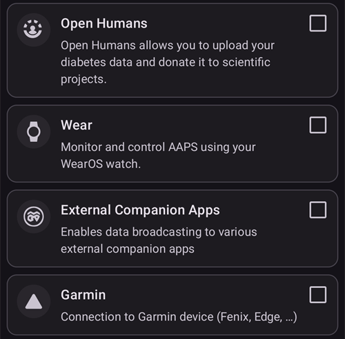
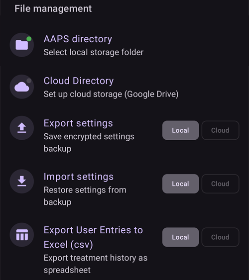

# Konfigurace (Config Builder)

```{admonition} Přecházíte z AAPS v3? :class: note **Config Builder** se nyní jmenuje **Konfigurace** a najdete ho v **nabídce** (☰). Viz [Co se změnilo v AAPS v4](#v4-changes).

    <br />V **Konfiguraci** vybíráte, které pluginy jsou aktivní (CGM, pumpa, algoritmus APS, citlivost, synchronizace, …), a otevíráte jednotlivé pluginy a jejich nastavení. [Postup krok za krokem](#configuration-v4) najdete níže; zbytek této stránky podrobně popisuje každou sekci.
    
    (configuration-v4)=
    ## Konfigurace v AAPS v4
    
    V **AAPS** v4 klepněte na **nabídku** (☰) v **levém horním** rohu hlavní obrazovky a vyberte **Konfigurace** (*„Nastavte svou konfiguraci (CGM, pumpa, …) a zapněte funkce“*).
    
    
    
    Pluginy jsou seskupeny podle **kategorií** – například *Vyhlazování*, *Kalibrace*, *Detekce citlivosti*, *APS*, *Komunikace* a *Obecné*. Každý řádek ukazuje název kategorie a **aktuálně aktivní** plugin (např. *APS → OpenAPS SMB*). Klepnutím na řádek otevřete kategorii.
    
    
    
    Uvnitř kategorie vidíte pluginy, které jsou pro ni k dispozici. V kategoriích s jednou volbou vyberete ten aktivní; některé kategorie umožňují vybrat více položek (*„Vyberte všechny, které platí“*). Každý plugin nabízí dvě akce:
    
    - **Otevřít plugin** – otevře vlastní obrazovku pluginu.
    - **Nastavení** – otevře předvolby pluginu (nastavení mohou být seskupena do rozbalovacích sekcí).
    
    
    
    (configuration_sync_icon)=
    ### Ikona mobilu – „synchronizováno z masteru“
    
    Malá **ikona mobilu (telefonu)** vedle kategorie nebo nastavení znamená, že je tato položka **synchronizována z masteru** – její hodnota/výběr se do tohoto zařízení přenáší přes kanál NSClientV3 (Nightscout).
    
    Na **klientovi** (**AAPSClient**) se tyto položky **udržují v souladu s masterem**. Ikona se zobrazuje jen na klientovi, proto ji nevidíte na snímku obrazovky výše, který byl pořízen v hlavní aplikaci **AAPS**. Na klientovi se obvykle zobrazuje u položek *Vyhlazování*, *Kalibrace*, *Detekce citlivosti* a *APS*. Jak přesně se master a klienti udržují v souladu – a která nastavení můžete měnit na které straně – popisuje stránka [Ovládání master ↔ klient](#client-master-config-prefs).
    
    Stejná ikona se zobrazuje také **uvnitř nastavení**, vedle jednotlivých předvoleb, které se synchronizují. V příkladu níže má ikonu *Doba absorpce*; nastavení bez ikony se nastavují na každém zařízení zvlášť:
    
    
    
    Položky **bez** ikony se nastavují **na každém zařízení zvlášť**. Nejdůležitějším příkladem je samotné připojení **NSClientV3 (Komunikace)** – **URL Nightscoutu**, **přístupový token** a **websockety** se nastavují na každém telefonu zvlášť, proto u nich ikona mobilu **není**.
    
    ---
    
    (Config-Builder-tab-or-hamburger-menu)=
    ## Otevření obrazovky pluginu
    
    Každou obrazovku pluginu otevřete jedním z těchto způsobů (karty a zaškrtávací políčko s okem z **AAPS** v3 už nejsou, viz [Co se změnilo v AAPS v4](#v4-changes)):
    
    - **Konfigurace** → kategorie pluginu → **Otevřít plugin**,
    - panel **Spravovat** ve spodní navigaci, pro obrazovky, které používáte nejčastěji (Profil, Nastavení inzulínu, Pumpa, Automatizace, Potraviny...),
    - tlačítko [Rychlého spuštění](../DailyLifeWithAaps/QuickLaunch.md), které si sami přidáte,
    - **vyhledávací pole** na hlavní obrazovce.
    
    ```{contents}
    :backlinks: entry
    :depth: 2
    

(ConfigBuilder_Profile)=

## Profil

Tento plugin nelze vypnout, protože je základní součástí **AAPS**.

Základní informace o tom, co obsahuje váš **Profil**, najdete na stránce [Váš profil AAPS](../SettingUpAaps/YourAapsProfile.md).

(insulin)= (Config-Builder-insulin)=

## Inzulín


V **AAPS** 4 už inzulín není plugin, který se vybírá v **Konfiguraci**. Inzulín, který používáte, nastavíte v **Spravovat → Nastavení inzulínu**.

Editor inzulínu umožňuje:

* dát profilu **Přezdívku inzulínu**, aby se dal snadno poznat,
* nastavit **Vrchol** (čas do maximální aktivity inzulínu, v minutách) a **DIA** (dobu působnosti inzulínu, v hodinách), buď zadáním hodnoty, nebo tlačítky **–** / **+**,
* klepnout na tlačítko předvolby **Načíst vrchol z** – **Novorapid** (75 min), **Fiasp** (55 min) nebo **Lyumjev** (45 min) – a jedním krokem vyplnit standardní čas vrcholu pro daný inzulín.

Povolené rozsahy jsou stejné pro jakýkoli inzulín:

* **DIA**: 5 až 9 hodin (5 až 10 hodin, pokud je typ pacienta nastaven na **Těhotná**). Jak zvolit hodnotu, popisuje sekce [Doba působnosti inzulínu (DIA) a vrchol](#Config-Builder-insulin-dia).
* **Vrchol**: 35 až 120 minut.

Křivky **IOB** (aktivní inzulín) a **Aktivita** ve spodní části editoru se mění, jak upravujete hodnoty, takže hned vidíte, jak vaše nastavení ovlivňuje působení inzulínu.

Více informací o inzulínovém profilu, jak ho zobrazuje **AAPS**, najdete [zde](#AapsScreens-insulin-profile).

(Config-Builder-insulin-change-active)=

### Změna používaného inzulínu (DIA nebo vrchol)

Inzulín označený **AKTIVNÍ** je ten, který používá váš běžící profil. Jeho pole jsou zašedlá: nemůžete ho upravit ani smazat. Díky tomu název inzulínu zobrazený ve vašem běžícím profilu vždy odpovídá nastavení, které se skutečně používá.

Změna DIA nebo vrcholu, který používáte:

1. Otevřete **Spravovat → Nastavení inzulínu**. Pokud se obrazovka otevře jen pro čtení (**✏️ tužka** v horní liště), klepněte na tužku a odemkněte nastavení.
2. Klepněte na **+** (*Přidat nový inzulín*). **AAPS** vytvoří kopii inzulínu zobrazeného na obrazovce.
3. Nastavte nový **Vrchol** a/nebo **DIA** a pak klepněte na ikonu uložení (vpravo nahoře).
4. Klepněte na **▶** (*Aktivovat inzulín*) a potvrďte. Nový inzulín se stane **AKTIVNÍ**.

```{admonition} Název obsahuje vrchol a DIA :class: note **AAPS** automaticky přidá do názvu inzulínu vrchol, DIA a koncentraci (například *Fiasp 55m 8h U100*), takže své konfigurace na první pohled rozlišíte.

    <br />Starý inzulín můžete smazat, jakmile už není aktivní.
    
    ### Předvolby „Načíst vrchol z“
    
    V **AAPS** 4 už není seznam typů inzulínu, ze kterého byste vybírali. Každý inzulín používá stejnou exponenciální křivku aktivity; liší se jen jeho **Vrchol** a **DIA**. Předvolby **Načíst vrchol z** v editoru inzulínu jedním klepnutím vyplní doporučený vrchol pro nejběžnější inzulíny (malé ⓘ vedle **Načíst vrchol z** je vypíše i s hodnotami vrcholu). **Vrchol** a **DIA** můžete potom stále upravit.
    
    Vrchol měňte mimo doporučenou hodnotu jen tehdy, když rozumíte, jaký to bude mít účinek. Pochopit křivky vám pomůže [graf křivky inzulínu](#AapsScreens-insulin-profile).
    
    #### Novorapid
    
    
    
    * doporučeno pro Humalog, Novolog a Novorapid (v **AAPS** v3 nazýváno *Rapid-Acting Oref*)
    * Vrchol = 75 minut po aplikaci
    
    #### Fiasp
    
    
    
    * doporučeno pro Fiasp (v **AAPS** v3 nazýváno *Ultra-Rapid Oref*)
    * Vrchol = 55 minut po aplikaci
    
    (Config-Builder-lyumjev)=
    #### Lyumjev
    
    
    
    * doporučeno pro Lyumjev
    * Vrchol = 45 minut po aplikaci
    
    #### Vlastní vrchol
    
    * V **AAPS** 4 už není samostatný typ inzulínu „Free-Peak Oref“: libovolný **Vrchol** (35 až 120 minut) zadejte přímo v [editoru inzulínu](#Config-Builder-insulin), bez použití předvolby.
    * Vlastní vrchol se hodí, pokud používáte inzulín, který není v seznamu, nebo směs různých inzulínů.
    
    (Config-Builder-insulin-dia)=
    ### Doba působnosti inzulínu (DIA) a vrchol
    
    ```{warning}
    Při používání smyčky snížení DIA nebo vrcholu vždy zvýší podávaný inzulín. DIA funguje v AAPS jinak než v komerčních systémech AID a neuvážené změny těchto nastavení mohou změnit dávkování inzulínu mnohem víc nebo méně, než čekáte.
    

AAPS modeluje časový průběh působení inzulínu matematickým vzorcem, který se nastavuje pomocí **DIA** a úzce souvisejícího nastavení **vrcholu**. DIA je teoretická doba, než IOB klesne na nulu, a vrchol je okamžik, kdy je účinek inzulínu nejsilnější. Z toho vychází křivka IOB a křivka aktivity, což je jednoduše **rychlost** poklesu IOB.

Počítejte s tím, že když AAPS řídí smyčku, je normální mít období [nulového dočasného bazálu](#Open-APS-features-super-micro-bolus-smb). Tento chybějící bazální inzulín se celý odečte od IOB, a proto IOB v praxi klesne na nulu o mnoho hodin dříve, než je nastavená DIA. [IOB z bolusů a IOB z bazálu](#aaps-screens-iob-cob-basal-sens) si můžete zobrazit odděleně na hlavní obrazovce.

DIA a vrchol nastavíte tak, že na hlavní obrazovce klepnete na **Spravovat** a pak na **Nastavení inzulínu**. AAPS zobrazuje aktivní konfiguraci inzulínu takto:


V tomto příkladu je vrchol nastaven na 55 minut, DIA na 8 hodin a [koncentrace inzulínu](#Insulin-Concentration) je standardní 100 IU/ml.

Kvůli vlivu nulového dočasného bazálu popsanému výše a vzorci, který AAPS používá pro pokles IOB, si většina uživatelů nastavuje výrazně vyšší DIA než v komerčních systémech. Obecně mnoha lidem vyhovuje **DIA** 9 h. Až budete mít s AAPS více zkušeností a dobře vyladěný profil, můžete podle informací níže zkusit najít osobní nastavení DIA a vrcholu.

````{admonition} Podrobnosti o vlivu nastavení DIA a vrcholu :class: dropdown

Protože bazální dávka v AAPS nepřímo ovlivňuje pokles IOB, znamená to, že příliš vysoké bazální dávky mohou zakrýt příliš vysokou DIA a naopak. Má smysl nejdříve pečlivě vyladit bazální dávky a teprve potom upravovat DIA a vrchol. Navíc mějte na paměti, že nastavení DIA a vrcholu se vzájemně ovlivňují: účinek DIA závisí na vrcholu a naopak.

Tyto grafy ukazují přesný vliv DIA a vrcholu na křivky IOB v celém rozsahu povolených hodnot.

Úprava DIA:

```{image} ../images/iob_remaining_static_peak.png :width: 400px

    <br />Úprava vrcholu:
    
    ```{image} ../images/iob_remaining_static_dia.png
    :width: 400px
    

Nakonec srovnání, kdy se DIA a vrchol upravují současně. Logika je taková, že se obě hodnoty upraví ve stejném poměru, takže `49/35 ~ 7/5`. Nebo podobně `120/93 ~ 9/7`. Odstupy budou stejné bez ohledu na výchozí DIA nebo vrchol, pokud je poměrná změna u obou stejná.

```{image} ../images/iob_remaining_uniform.png :width: 400px

    <br />Všimněte si, že když se DIA a vrchol upraví tímto způsobem, každý bod křivky se posune o stejnou poměrnou hodnotu.
    
    ````
    
    #### Další čtení o nastavení DIA a vrcholu
    
    * [Technické podrobnosti a historické pozadí od předchůdce AAPS, OpenAPS](https://openaps.readthedocs.io/en/latest/docs/While%20You%20Wait%20For%20Gear/understanding-insulin-on-board-calculations.html#understanding-the-new-iob-curves-based-on-exponential-activity-curves).
    * [Why we are regularly wrong in the duration of insulin action (DIA) times we use, and why it matters…](https://www.diabettech.com/insulin/why-we-are-regularly-wrong-in-the-duration-of-insulin-action-dia-times-we-use-and-why-it-matters/) (Proč se pravidelně mýlíme v délce působení inzulínu (DIA) a proč na tom záleží) na webu Diabettech.
    * [Exponential Insulin Curves + Fiasp](https://web.archive.org/web/20220630154425/http://seemycgm.com/2017/10/21/exponential-insulin-curves-fiasp/) (Exponenciální křivky inzulínu + Fiasp) na webu See My CGM (archiv).
    * [Revised Humalog model in a closed loop](https://bionicwookiee.com/2022/04/13/revised-humalog-model-in-a-closed-loop/) (Upravený model Humalogu v uzavřené smyčce) a další články na webu Bionic Wookie, které doporučují DIA 9 h pro Lyumjev, Fiasp, NovoRapid a Humalog.
    
    (Config-Builder-bg-source)=
    ## Zdroj glykémie
    Vyberte zdroj glykémie, který používáte. Další informace o nastavení najdete na stránce [Kompatibilní CGM](../Getting-Started/CompatiblesCgms.md).
    
    
    
    Další zdroje uvidíte, když posunete obrazovku dolů:
    
    
    
    
    
    * [xDrip+ glykémie](../CompatibleCgms/xDrip.md) – také pro kompatibilní aplikace, například [Juggluco](../CompatibleCgms/Juggluco.md)
    * [Glykémie z NS](../CompatibleCgms/CgmNightscoutUpload.md) – jen pokud víte, co děláte, viz [Kompatibilní CGM](../Getting-Started/CompatiblesCgms.md).
    * [MM640g](../CompatibleCgms/MM640g.md)
    * Glimp – podporována je jen verze 4.15.57 a novější
    * [BYODA (Build Your Own Dexcom App)](#DexcomG6-if-using-g6-with-build-your-own-dexcom-app).
    * Aplikace pro CGM MicroTech – pro CGM Aidex / LinX
    * [Poctech](../CompatibleCgms/PocTech.md)
    * Tomato (MiaoMiao) – aplikace Tomato pro zařízení MiaoMiao
    * [Glunovo](https://infinovo.com/) – aplikace Glunovo pro systém CGM Glunovo
    * Intelligo – aplikace Intelligo
    * Syai/Ottai – pro aplikace Syai a Ottai (viz [Syai Tag](../CompatibleCgms/SyaiTagX1.md) a [Ottai](../CompatibleCgms/OttaiM8.md))
    * Aplikace SI – upravená aplikace SI nebo aplikace Sibionics pro CGM Sibionics
    * Aplikace Sino – upravená aplikace pro CGM Sinocare
    * Čtečka oznámení – čte hodnoty glykémie z oznámení, která zobrazují oficiální aplikace CGM (Dexcom, Medtronic, Eversense atd.)
    * Instara – aplikace Instara
    * Náhodná glykémie – generuje náhodná data glykémie pro testování. Lze ji zapnout jen ve vývojářském (engineering) sestavení s **Virtuální pumpou**, takže v běžné instalaci **AAPS** ji použít nelze.
    
    ## Vyhlazování
    
    
    
    Viz [Vyhlazování dat glykémie](../CompatibleCgms/SmoothingBloodGlucoseData.md).
    
    ## Kalibrace
    
    Vyberte, jak má **AAPS** zacházet s hodnotami, které dostává z vašeho senzoru:
    
    - **Žádná kalibrace**: hodnoty senzoru se použijí tak, jak jsou. Tuto volbu použijte, pokud je senzor už kalibrovaný z výroby a přesný. Toto je výchozí nastavení.
    - **Lineární kalibrace**: **AAPS** opraví hodnoty senzoru pomocí sklonu a posunu, které vypočítá z vašich zadaných hodnot z glukometru.
    
    Jak funguje **Lineární kalibrace**:
    
    - Potřebuje mít zaznamenanou **výměnu senzoru**, aby věděla, kdy začala relace senzoru. První 2 hodiny relace se přeskočí jako zahřívací doba.
    - Potřebuje alespoň **2 hodnoty z glukometru**. Nové hodnoty mají větší váhu než staré.
    - Oprava se použije jen tehdy, když je výsledek v bezpečném rozsahu. Pokud jsou vaše hodnoty příliš blízko sebe, opraví se jen posun.
    - **Otevřít plugin** ukazuje stav kalibrace, použitý sklon a opravu a seznam hodnot z glukometru. Hodnotu můžete přidat pomocí **Přidat kalibraci** a chybnou hodnotu odebrat.
    
    ```{admonition} Kalibrujte opatrně
    :class: warning
    Chybná hodnota z glukometru vede k chybným hodnotám glykémie, a tedy k chybnému dávkování inzulínu. Před měřením si umyjte ruce a nekalibrujte, když se glykémie rychle mění.
    


(Config-Builder-pump)=

## Pumpa

Vyberte pumpu, kterou používáte. Další informace o nastavení najdete na stránce [Kompatibilní pumpy](../Getting-Started/CompatiblePumps.md).


Všechny ovladače pump uvidíte, když posunete obrazovku dolů:


Když vyberete jinou pumpu, **AAPS** vás požádá o potvrzení změny:


* [Dana R](../CompatiblePumps/DanaR-Insulin-Pump.md)
* Dana R Korean (pro domácí korejskou pumpu DanaR)
* Dana Rv2 (DanaR s neoficiálním upgradem firmwaru)
* [Dana-i/RS](../CompatiblePumps/DanaRS-Insulin-Pump.md)
* [Accu-Chek Insight](../CompatiblePumps/Accu-Chek-Insight-Pump.md)
* [Accu-Chek Combo](../CompatiblePumps/Accu-Chek-Combo-Pump-v2.md)
* Omnipod pro [Omnipod Eros](../CompatiblePumps/OmnipodEros.md)
* Dash pro [Omnipod DASH](../CompatiblePumps/OmnipodDASH.md)
* [Medtronic](../CompatiblePumps/MedtronicPump.md)
* [Diaconn G8](../CompatiblePumps/DiaconnG8.md)
* [EOPatch2](../CompatiblePumps/EOPatch2.md)
* [Medtrum](../CompatiblePumps/MedtrumNano.md)
* [Equil 5.3](../CompatiblePumps/Equil5.3.md)
* [Carelevo](../CompatiblePumps/CareLevo.md)
* Virtuální pumpa: otevřená smyčka – pouze návrhy **AAPS** 
  * když s **AAPS** děláte první kroky, během prvních [cílů](../SettingUpAaps/CompletingTheObjectives.md)
  * pro pumpu, která zatím nemá žádný ovladač

(config-builder-wrong-pump-data)=

### Zpráva: „Data přicházejí z jiné pumpy“

**AAPS** si pamatuje pumpu, ke které je připojen (typ pumpy a sériové číslo). Pokud dostane data z jiné pumpy, například když byla vaše pumpa vyměněna za novou stejného modelu, zobrazí tuto zprávu a data z této pumpy ignoruje:


Chcete-li použít novou pumpu, změňte ovladač pumpy: vyberte **Virtuální pumpu**, potvrďte a pak znovu vyberte svou pumpu. **AAPS** si pak zaregistruje pumpu, ke které je teď připojen.

(Config-Builder-sensitivity-detection)=

## Detekce citlivosti


Vyberte typ detekce citlivosti. Podrobnosti o různých variantách si [přečtěte zde](../DailyLifeWithAaps/SensitivityDetectionAndCob.md). Průběžně analyzuje historická data a provede úpravy, pokud zjistí, že na inzulín reagujete citlivěji (nebo naopak odolněji) než obvykle. Více podrobností o tom, jak se počítá samotný poměr citlivosti, najdete v [Klíčové funkce AAPS > Autosens](#Open-APS-features-autosens).

Svou citlivost můžete sledovat na hlavní obrazovce v [doplňkovém grafu](#AapsScreens-section-g-additional-graphs): vyberte SEN a sledujte bílou čáru. Pozor: aby detekce citlivosti/[Autosens](#Open-APS-features-autosens) mohla automaticky upravovat množství podaného inzulínu, musíte být v [Cíli 8](#objectives-objective8). Před dosažením tohoto cíle se procento Autosens / čára ve vašem grafu zobrazuje pouze pro informaci.

### Nastavení absorpce sacharidů

Pokud používáte Oref1 se **SMB**, musíte změnit **min_5m_carbimpact** na 8. Tato hodnota se používá jen při výpadcích hodnot z **CGM** nebo když fyzická aktivita „spotřebuje“ celý vzestup glykémie, podle kterého by jinak **AAPS** snižoval COB. V době, kdy nelze [vstřebávání sacharidů](../DailyLifeWithAaps/CobCalculation.md) dynamicky vypočítat podle reakce vaší glykémie, použije se pro vaše sacharidy výchozí rychlost vstřebávání. V podstatě jde o bezpečnostní pojistku.

(Config-Builder-aps)=

## APS


Vyberte požadovaný algoritmus APS pro úpravy léčby. Aktivní podrobnosti zvoleného algoritmu zobrazíte pomocí **Otevřít plugin**.

* OpenAPS AMA 
  * Advanced Meal Assist: starší algoritmus, který se už nedoporučuje.
  * Zjednodušeně: výhoda je v tom, že když si dáte bolus na jídlo, systém může rychleji zvýšit dočasný bazál, POKUD spolehlivě zadáváte sacharidy.
* [OpenAPS SMB](#Open-APS-features-super-micro-bolus-smb) 
  * Super Micro Bolus: nejnovější algoritmus doporučený pro všechny uživatele.
  * Na rozdíl od AMA nepoužívá SMB k řízení glykémie dočasné bazály, ale hlavně malé **super mikro bolusy**.
  * Poznámka: Tento algoritmus se doporučuje používat od začátku, i když SMB ve skutečnosti nebudou podávány až do [Cíle 9](#objectives-objective9).
* [Auto ISF](#Open-APS-features-auto-isf) 
  * Experimentální algoritmus pro pokročilé uživatele. Zobrazí se v seznamu až po splnění cílů.

Při přechodu z algoritmu AMA na SMB je nutné ručně změnit *min_5m_carbimpact* na **8** (výchozí hodnota pro SMB) v [Nastavení → Nastavení absorpce sacharidů](#Preferences-min_5m_carbimpact).

## Smyčka

Tento plugin nelze vypnout, protože je základní součástí **AAPS**.


## Omezení


### Cíle

**AAPS** má výukový program (řadu cílů), který musíte plnit krok za krokem. Ten by vás měl bezpečně provést nastavením systému uzavřené smyčky.

Další informace najdete na stránce [Plnění cílů](../SettingUpAaps/CompletingTheObjectives.md).

## Komunikace

V této kategorii (v **AAPS** v3 nazývané **Synchronizace**) vybíráte, zda a kam má **AAPS** odesílat vaše data.


Zbytek seznamu uvidíte, když posunete obrazovku dolů:



### NSClientV3

Může sloužit jako [reportovací server](../SettingUpAaps/SettingUpTheReportingServer.md) a/nebo pro [vzdálený dohled](../RemoteFeatures/RemoteMonitoring.md) a [vzdálené ovládání](../RemoteFeatures/RemoteControl.md).

Jak nastavit synchronizaci NSClientV3, popisuje sekce [Synchronizace s reportovacím serverem](#SetupWizard-synchronization-with-the-reporting-server-and-more).

### Tidepool

Může sloužit jako [reportovací server](../SettingUpAaps/SettingUpTheReportingServer.md).

Viz [Tidepool](../SettingUpAaps/Tidepool.md).

### xDrip

Slouží k **odesílání** dat, jako jsou hodnoty glykémie a ošetření, do xDrip+ na stejném telefonu. V jeho nastavení je také **Odesílat stav do xDrip+** – stavový řádek s IOB a COB, který zobrazuje xDrip+ a některé doprovodné aplikace pro hodinky.

### Open Humans

Viz [Open Humans](../SupportingAaps/OpenHumans.md).

(Config-Builder-wear)=

### Wear

Sledujte a ovládejte **AAPS** z hodinek s Wear OS. Nastavení hodinek popisuje stránka [Chytré hodinky s Wear OS](../WearOS/WearOsSmartwatch.md). Po zapnutí pluginu zvolte jeho možnosti v [Nastavení > Wear](#preferences-wear). Používání hodinek popisuje stránka [Ovládání AAPS pomocí chytrých hodinek s Wear OS](../RemoteFeatures/RemoteControlWearOS.md).

(external-companion-apps)=

### Externí aplikace

Vysílá stavová data **AAPS** v telefonu, aby je mohly zobrazit jiné aplikace v něm nainstalované – například doprovodné aplikace pro hodinky nebo widgety. Vysílání obsahuje glykémii a trend, IOB, COB, bazál a dočasný bazál, název profilu, stav smyčky, baterii telefonu a pumpy, stav zásobníku a průběh bolusu. Zapněte ho jen tehdy, když tato data požaduje doprovodná aplikace, kterou používáte.

Aplikace, o kterých víme, že toto vysílání čtou, jsou [WatchDrip+](https://bigdigital.home.blog/) (hodinky Xiaomi a Amazfit), [GlucoDataHandler](https://github.com/pachi81/GlucoDataHandler) (komplikace a widgety pro Wear OS a Android Auto přes GlucoDataAuto) a aplikace G-Watch. Jejich nastavení popisuje stránka [Chytré hodinky a AAPS](#watches-external-companion-apps). Některé z nich také používají **Odesílat stav do xDrip+** z pluginu **xDrip** výše pro stavový řádek s IOB a COB.

V dřívějších verzích se tento plugin jmenoval **Samsung Tizen**, podle [aplikace G-Watch pro hodinky Samsung Tizen](#Watchfaces-tizen), pro kterou byl původně vytvořen.

### Garmin

Připojení k zařízení Garmin (Fenix, Edge...)

## Ošetření

Otevřete **nabídku** (☰) a vyberte [Historie ošetření](#aaps-screens-treatments), kde uvidíte zaznamenaná ošetření. Pokud chcete záznam upravit nebo smazat (např. jste snědli méně sacharidů, než jste čekali), vyberte „Odstranit“ a zadejte novou hodnotu (v případě potřeby změňte čas) přes **Ošetření → Sacharidy** ve spodní navigaci (viz [Sacharidy](#screens-bolus-carbs)).

## Obecné

V **AAPS** 4 obsahuje kategorie **Obecné** v **Konfiguraci** jen **Autotune**. Ostatní funkce popsané níže jsou vždy dostupné a už je zde není nutné zapínat; každý odstavec uvádí, kde je najdete.


### Přehled

[Hlavní obrazovka](#AapsScreens-the-homescreen) **AAPS** už není plugin a nemá v **Konfiguraci** žádná vlastní nastavení. Možnosti, které tu dříve byly, jsou v **Nastavení** (ikona ozubeného kola): [Zobrazit poznámky v dialogových oknech](#Preferences-show-notes-field-in-treatments-dialogs), [Stavové indikátory](#Preferences-status-lights) a [Procento bolusu](#Preferences-deliver-this-part-of-bolus-wizard-result), které používá bolusová kalkulačka. Možnost super bolusu z **AAPS** 3.x [není dostupná jako nastavení](#Preferences-advanced-settings-overview) v **AAPS** 4.

(Config-Builder-actions)=

### Akce

Karta Akce z **AAPS** 3.x už neexistuje. Její tlačítka jsou nyní v panelu **Spravovat** – viz [Kam zmizela karta Akce?](#screens-action-tab).

### Automatizace

**Spravovat → Automatizace** umožňuje spravovat vaše [Automatizace](../DailyLifeWithAaps/Automations.md), a to od [Cíle 10](#objectives-objective10).

(Config-Builder-sms-communicator)=

### SMS komunikátor

Umožňuje pečovatelům na dálku ovládat některé funkce **AAPS** pomocí SMS. Další informace o nastavení najdete na stránce [SMS příkazy](../RemoteFeatures/SMSCommands.md).

### Jídlo

**Spravovat → Jídlo** zobrazuje předvolby jídel definované v databázi jídel Nightscoutu. Další informace o nastavení najdete v [Nightscout Readme](https://github.com/nightscout/cgm-remote-monitor#food-custom-foods).

Poznámka: Záznamy nelze použít v kalkulačce **AAPS**. (Pouze k zobrazení)

(Config-Builder-autotune)=

### Autotune

Můžete zapnout Autotune, viz [zde](../AdvancedOptions/Autotune.md).

### Údržba

Otevřete **nabídku** (☰) a vyberte **Údržba**, kde můžete exportovat / importovat nastavení a spravovat log soubory.





### Konfigurace

Nyní se jmenuje **Konfigurace**: tato stránka.