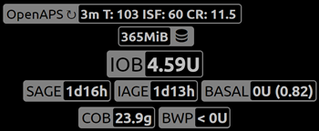

# Nightscout

(Nightscout-security-considerations)=

## Bezpečnostní pokyny

Nightscout je reportovací a monitorovací server pro **AAPS**: **AAPS** do něj nahrává vaše data a vy nebo vaši pečovatelé je sledujete na webu Nightscoutu nebo v aplikacích pro sledující. Obsahuje vaše zdravotní data, profily a ošetření, a proto stojí za to myslet na zabezpečení vašeho webu Nightscout.

V **AAPS** 4 vzdálené ovládání neprobíhá přes web Nightscoutu. Když je zapnuté ovládání z klienta ([zabezpečený režim](#client-master-control-hardened-mode)), **AAPS** ošetření ani cíle zadané přímo v Nightscoutu **nepoužije**. Vzdálené příkazy místo toho přicházejí ze spárovaného **AAPSClient** – viz [Ovládání Master ↔ Client](#client-master-control).

Pokud používáte Nightscout jako zdroj glykémie pro AAPS, buďte maximálně opatrní.

### Nastavení Nightscoutu

Veřejný přístup k webu Nightscout můžete odepřít použitím [autentizačních rolí](https://nightscout.github.io/nightscout/security): svou URL sdílejte pouze s tokenem `readable`, nikdy s tokenem `admin`.

Nightscout `API_SECRET` je hlavní heslo vašeho webu: nesdílejte jej veřejně.

(Nightscout-aaps-settings)=

### Nastavení AAPS

Přijímání dat z Nightscoutu (změny profilu, ošetření, ...) je volitelné a ve výchozím stavu vypnuté. Níže popsané přepínače jsou skryté, když je zapnuté ovládání z klienta (zabezpečený režim) a v [zjednodušeném režimu](#preferences-simple-mode).

* Nastavení **Synchronizace** pluginu NSClientV3 otevřete buď 1) **Nastavení** (ikona ozubeného kola na hlavní obrazovce) -> **NSClientV3** -> **Synchronizace**, nebo 2) **Konfigurace** (menu ☰) -> **Komunikace** -> „**Nastavení**“ pod NSClientV3.
* Zapněte „Nahrávat data do NS“.
* „Nahrávat glykémie do NS“ najdete v nastavení vašeho zdroje glykémie (**Konfigurace → Zdroj glykémie → Nastavení**). Zapněte ho, pokud vaším zdrojem glykémie pro AAPS není Nightscout. V tom případě ho **nezapínejte**.
* „Přijímat data CGM z NS“ nezapínejte, pokud Nightscout není vaším zdrojem glykémie.

#### Nesynchronizujte z Nightscoutu

Pokud necháte všechny volby „Přijímat ... z NS“ vypnuté, AAPS nepoužije žádnou změnu z Nightscoutu:

#### Přijmout změny z Nightscoutu

Zapnutím těchto voleb můžete měnit nastavení AAPS přes Nightscout, například úpravy a přepnutí profilu, dočasné cíle a přidání sacharidů, které AAPS vezme v úvahu. Zobrazují se, jen když je ovládání z klienta i zjednodušený režim vypnuté.  
Inzulínová ošetření se použijí jen pro výpočty, jako by šlo o „Nebolusovat, pouze zaznamenat“.

### Další nastavení zabezpečení

Udržujte svůj telefon aktualizovaný, jak je popsáno v části [bezpečnost na prvním místě](#preparing-safety-first).

(Nightscout-manual-nightscout-setup)=

## Ruční nastavení Nightscoutu

Předpokládá se, že už web Nightscout máte. Pokud ne, navštivte stránku [Nightscout](http://nightscout.github.io/nightscout/new_user/), kde najdete úplný návod k nastavení. Níže uvedené pokyny jsou nastavení, která budete muset přidat také na svůj web Nightscout. Váš web Nightscout musí mít alespoň verzi 15. Zkontrolujte proto, že používáte [nejnovější verzi](https://nightscout.github.io/update/update/#updating-your-site-to-the-latest-version), jinak se vám v aplikaci AAPS zobrazí chybová zpráva.

* [Upravte své proměnné](https://nightscout.github.io/nightscout/setup_variables/#nightscout-configuration)

* Přidejte nebo upravte proměnné takto:
  
  * `ENABLE` = `careportal boluscalc food bwp cage sage iage iob cob basal dbsize pushover pump openaps`
  * `DEVICESTATUS_ADVANCED` = `true`
  * `SHOW_FORECAST` = `openaps`
  * `PUMP_FIELDS` = `reservoir battery clock`
  * Pro [hlídání pumpy](https://github.com/nightscout/cgm-remote-monitor#pump-pump-monitoring) lze nastavit různé alarmy, doporučujeme zejména % nabití baterie: 
    * `PUMP_WARN_BATT_P` = `51`
    * `PUMP_URGENT_BATT_P` = `26` 

* Uložte změny. Váš Nightscout web by nyní měl umožňovat zobrazení pilulek. Můžete vynutit výchozí zobrazení přidáním do `SHOW_PLUGINS`.
  
  * `SHOW_PLUGINS` = `careportal boluscalc food bwp cage sage iage iob cob basal dbsize pushover pump openaps`
  
  

## Nightscout jako placená služba typu SaaS (Software as a Service)

Použijte webové rozhraní dodavatele k nastavení proměnných. V případě potřeby kontaktujte službu podpory dodavatele.