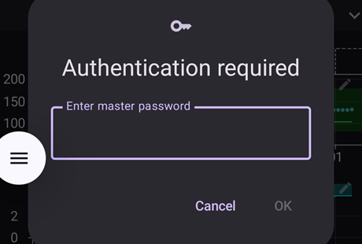
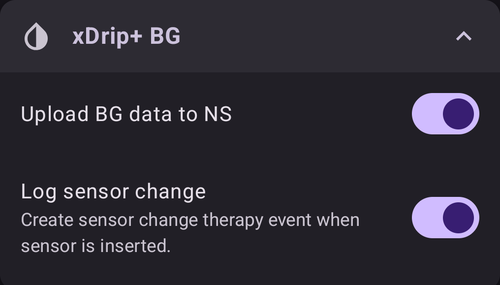
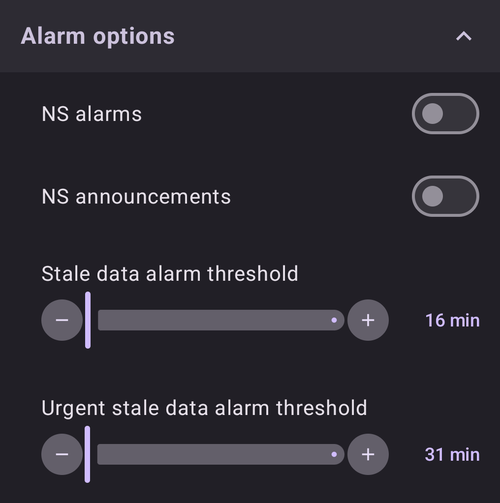

# Nastavení (Předvolby)

V **AAPS** v4 najdete předvolby na obrazovce **Nastavení**. Dostanete se k nim třemi cestami – podrobnosti najdete na stránce [Změny v konfiguraci AAPS](../SettingUpAaps/ChangeAapsConfiguration.md):

1. Klepněte na ikonu **Nastavení** (ozubené kolo) v pravém horním rohu hlavní obrazovky: všechna nastavení, seskupená do rozbalovacích sekcí.
2. V **Konfiguraci** klepněte na „**Nastavení**“ pod aktivním pluginem: jen nastavení tohoto pluginu.
3. Použijte **vyhledávací pole** nahoře na hlavní obrazovce: stačí začít psát část textu, který hledáte. Takto najdete jednotlivá nastavení (i ta, která nejsou vidět na obrazovce Nastavení), dialogy a dokumentaci.


- **Sekce** otevřete a zavřete klepnutím. Které sekce uvidíte, závisí na pluginech, které máte zapnuté, a na [zjednodušeném režimu](#preferences-simple-mode).


```{contents}
:backlinks: entry
:depth: 2
```

(Preferences-general)=
## Obecné


**Jednotky**

- Nastavte jednotky na mmol/l nebo mg/dl podle toho, co vám vyhovuje.

**Jazyk**

- Nová možnost je používat výchozí jazyk telefonu (doporučeno).

- Pokud chcete mít **AAPS** v jiném jazyce, než je standardní jazyk telefonu, můžete si vybrat z mnoha jazyků.

- Když změníte jazyk, texty **AAPS** se ihned přepnou do nového jazyka. Pokud se některé texty stále zobrazují ve starém jazyce, restartujte **AAPS**.
- Nastavení je skryté v [zjednodušeném režimu](#preferences-simple-mode).

(preferences-simple-mode)= **Zjednodušený režim**

**Zjednodušený režim** je ve výchozím stavu zapnutý, když **AAPS** poprvé nainstalujete. V **zjednodušeném režimu** je velká část nastavení skrytá a předvolby jsou nahrazeny předem danými hodnotami. Zjednodušený režim byste měli vypnout, jakmile se seznámíte s uživatelským rozhraním a nastavením **AAPS**.

**Podpora koncentrace inzulínu**

- Zapne podporu různých koncentrací inzulínu (U50, U200, ...). Zapněte to jen tehdy, pokud opravdu používáte jinou koncentraci než U100, a pozorně si přečtěte varování.
- Nastavení je skryté v [zjednodušeném režimu](#preferences-simple-mode).

**Nechat obrazovku zapnutou**

- Android bude nechávat obrazovku stále zapnutou. To je vhodné například pro prezentace. Při tomto nastavení ale dochází k velmi rychlému vybíjení baterie. Proto je doporučeno připojit chytrý telefon k napájecímu kabelu.

**Název instance**

- Jméno osoby, která tento telefon používá. Odliší tuto instanci **AAPS** v reportech a při synchronizaci, například když ve vaší rodině používají **AAPS** dvě děti s diabetem 1. typu.
- Používá se v názvech souborů s exportem nastavení.
- Zobrazuje se na ciferníku [Dual Watchface](../WearOS/WearOsSmartwatch.md).

(Preferences-skin)=
### Motiv vzhledu (skin)

Výběr motivu vzhledu (skin) z **AAPS** 3.x (Original, Low resolution, Large display...) už v **AAPS** 4 neexistuje. Nové rozhraní se automaticky přizpůsobí vaší obrazovce a barevné schéma lze změnit v sekci [Vzhled](#preferences-appearance).

(preferences-appearance)=
## Vzhled


(Preferences-range-for-visualization)=
### Rozsah pro zobrazení

Zvolte horní a dolní hranici pro graf glykémie na hlavní obrazovce **AAPS** a na chytrých hodinkách. Jde pouze o zobrazení, nikoliv nastavení cílové hodnoty glykémie. Příklad: 70–180 mg/dl nebo 3,9–10 mmol/l

(Preferences-show-notes-field-in-treatments-dialogs)=
### Zobrazit poznámky v dialogových oknech

Přidává možnost doplňovat k záznamům o ošetření krátkou textovou poznámku v dialozích, kde se zadávají (Bolusová kalkulačka, Sacharidy, Inzulín...)

Nastavení je skryté v [zjednodušeném režimu](#preferences-simple-mode).

### Barevné schéma aplikace

Vyberte světlý motiv, tmavý motiv, nebo nastavení podle systému telefonu.

(Preferences-protection)=
## Ochrana


(Preferences-master-password)=
### Hlavní heslo

Povinné, abyste mohli [exportovat nastavení](../Maintenance/ExportImportSettings.md), protože od verze 2.7 jsou šifrovaná.

**Ochrana biometrií nemusí fungovat na telefonech OnePlus. Jedná se o známou chybu OnePlus telefonů.**


(Preferences-settings-protection)=
### Ochrana nastavení

- Chraňte své nastavení heslem nebo biometrickým ověřením telefonu (např. když [dítě používá **AAPS**](../RemoteFeatures/RemoteMonitoring.md)). Pokud tuto funkci zapnete, budete vyzváni k ověření pokaždé, když budete chtít otevřít jakoukoli obrazovku související s nastavením.

- Obrazovky pro správu (**Profil**, **Nastavení inzulínu**, **Dočasný cíl**, **Rychlý bolus**) se pak otevírají **jen pro čtení**. Položku můžete stále aktivovat nebo použít, ale přidávání, úpravy, klonování a mazání jsou skryté, dokud nastavení neodemknete. Viz [Ochrana nastavení nyní zamyká i obrazovky pro správu](#v4changes-read-only-management).

- Vlastní heslo použijte, pokud chcete hlavní heslo používat jen k zabezpečení [exportovaných nastavení](../Maintenance/ExportImportSettings.md) a pro úpravy nastavení chcete jiné heslo.

- Pokud používáte vlastní heslo, klepněte na řádek „Heslo pro nastavení“ a nastavte heslo tak, jak je popsáno [výše](#Preferences-master-password).

### Ochrana aplikace

Pokud je aplikace chráněná, musíte pro otevření **AAPS** zadat heslo nebo použít biometrické ověření telefonu, a to znovu, když se k aplikaci vrátíte po uplynutí [časového limitu ochrany](#Preferences-password-and-pin-retention).

Pokud zadáte špatné heslo, **AAPS** se okamžitě ukončí – ale dál poběží na pozadí, pokud byla aplikace předtím úspěšně otevřena.

### Ochrana bolusu

- Ochrana bolusu může být užitečná, pokud **AAPS** používá malé dítě a vy [podáváte bolus přes SMS](../RemoteFeatures/SMSCommands.md).

- **Ochranu bolusu** lze vybrat, až když je nastavena **Ochrana nastavení** (úroveň 2).

- V příkladu níže používá ochrana bolusu **Hlavní heslo**: **AAPS** se na něj zeptá před otevřením dialogu ošetření, například **Inzulín**. Při volbě **Biometrie** můžete, pokud biometrické ověření nefunguje, místo něj zadat hlavní heslo.



(Preferences-password-and-pin-retention)=
### Uchování hesla a PINu

**Časový limit ochrany** určuje, jak dlouho (v sekundách) zůstanou funkce nastavení nebo bolusu odemčené po úspěšném zadání hesla.

## Bezpečnostní omezení ošetření


(preferences-patient-type)=
### Věk pacienta

- Bezpečnostní limity jsou nastaveny na základě věku, který jste zvolili v tomto nastavení.
- Pokud začnete narážet na pevně nastavené limity (jako například na maximální bolus), je čas posunout se o stupeň výš.
- Vybrat vyšší než skutečný věk je špatný nápad, protože to může vést k předávkování při zadání chybné hodnoty v dialogu inzulínu (například když vynecháte desetinnou čárku).
- Chcete-li znát přesné hodnoty těchto pevně nastavených bezpečnostních limitů, najděte funkci algoritmu, kterou používáte, [na této stránce](../DailyLifeWithAaps/KeyAapsFeatures.md).

(Preferences-maximum-bolus)=
### Maximální bolus

- Určuje maximální množství bolusového inzulínu v jednotkách inzulínu, které **AAPS** smí podat najednou.
- Toto nastavení slouží jako bezpečnostní limit, který zabrání podání příliš velkého bolusu kvůli náhodnému zadání nebo chybě uživatele.
- Doporučuje se nastavit ho na rozumnou hodnotu, která zhruba odpovídá největšímu množství bolusového inzulínu, které budete pravděpodobně kdy potřebovat na jídlo nebo na korekci.
- Toto omezení se vztahuje i na výsledky bolusové kalkulačky.

### Maximální povolené sacharidy

- Určuje maximální množství sacharidů v gramech, pro které smí bolusová kalkulačka **AAPS** spočítat dávku.
- Toto nastavení slouží jako bezpečnostní limit, který zabrání podání příliš velkého bolusu kvůli náhodnému zadání nebo chybě uživatele.
- Doporučuje se nastavit limit na rozumnou hodnotu, která zhruba odpovídá největšímu množství sacharidů, které budete pravděpodobně kdy potřebovat na jedno jídlo.

## Zdroj glykémie (BG source)

Nastavení vybraného [zdroje glykémie](#Config-Builder-bg-source) se zobrazí jako samostatná sekce. Například u **xDrip+ glykémie**:



- **Nahrávat glykémie do NS**: **AAPS** bude nahrávat přijaté hodnoty glykémie do Nightscoutu. Zapněte to jen tehdy, pokud je už nenahrává samotná CGM aplikace.
- **Zaznamenávat výměnu senzoru**: při zavedení senzoru se automaticky vytvoří záznam o výměně senzoru.

## Hlavní obrazovka

V **AAPS** 3.x byla tato nastavení seskupena v sekci „Přehled“. V **AAPS** 4 se nastavují přímo z prvků hlavní obrazovky, ke kterým patří.

(Preferences-buttons)=
### Tlačítka Rychlého spuštění

Určete, která akční tlačítka budou na hlavní obrazovce vidět: klepněte na malé **ozubené kolo** dole uprostřed hlavní obrazovky („Konfigurace Rychlého spuštění“) a **Přidejte** akce, ke kterým chcete mít rychlý přístup (ošetření, akce CGM, záznamy péče...).


(Preferences-quick-wizard)=
### Rychlý bolus

Vytvořte si vlastní tlačítka pro určitá standardní jídla nebo svačiny, která se budou zobrazovat na hlavní obrazovce. Užitečné pro standardní jídla, která jíte často.

U každého tlačítka nastavíte sacharidy a způsob výpočtu bolusu. Pak určíte, v jakém časovém období bude tlačítko na hlavní obrazovce vidět – jen jedno tlačítko na jedno období. Tlačítko nebude vidět mimo nastavený časový rozsah, nebo pokud máte dost IOB na pokrytí sacharidů nastavených v tlačítku Rychlého bolusu. Pokud nastavíte pro různá jídla různé časy, budete mít na hlavní obrazovce vždy vhodné tlačítko pro standardní jídlo podle denní doby.

Chcete-li spravovat přednastavení Rychlého bolusu, napište do vyhledávacího pole na hlavní obrazovce „QuickWizard“ (v češtině „Rychlý bolus“) a otevřete **Rychlý bolus - Spravovat přednastavení rychlého bolusu**.

Když klepnete na tlačítko Rychlého bolusu, **AAPS** vypočítá a navrhne bolus na tyto sacharidy podle vašich aktuálních poměrů (s ohledem na glykémii nebo aktivní inzulín, pokud je to nastaveno).

Navržený bolus musí být potvrzen, aby byl následně vydán.

(Preferences-default-temp-targets)=
### Výchozí nastavení dočasných cílů

[Dočasné cíle (TT)](../DailyLifeWithAaps/TempTargets.md) vám umožňují změnit cílovou glykémii na určitou dobu. Když si nastavíte výchozí dočasné cíle, můžete snadno změnit cíl pro aktivitu, pro čas před jídlem atd.

Klepněte na **cílový rozsah** na hlavní obrazovce a otevře se obrazovka **Dočasný cíl**. Procházejte karty přednastavení (Před jídlem, Aktivita, Hypoglykémie) a v části **Nastavení předvoleb** změňte cíl a dobu trvání každého přednastavení. Přednastavené hodnoty jsou:

* Před jídlem: cíl 90 mg/dl / 5,0 mmol/l, doba trvání 45 min
* Aktivita: cíl 140 mg/dl / 7,8 mmol/l, doba trvání 90 min
* Hypoglykémie: cíl 160 mg/dl / 8,9 mmol/l, doba trvání 60 min


Zde se dozvíte, jak [aktivovat dočasné cíle](#TempTargets-where-can-i-select-a-temp-target).

### Standardní množství inzulínu pro plnění/doplňování

Pokud chcete naplnit hadičku nebo kanylu přes **AAPS**, můžete to udělat tlačítky **Plnění/doplňování** v rozbaleném stavovém panelu hlavní obrazovky.

Výchozí množství tří tlačítek plnění lze nastavit v nastavení **Plnění/doplňování** podle délky vašeho katétru. Otevřete je tak, že do vyhledávacího pole na hlavní obrazovce napíšete „prime“ (v češtině „plnění“).


(Preferences-status-lights)=
### Stavové indikátory

Stavové indikátory zobrazují vizuální varování pro:

- Stáří senzoru
- Stáří inzulínu (doba použití aktuálního zásobníku)
- Stav zásobníku (jednotky)
- Stáří kanyly
- Stáří baterie v pumpě
- Úroveň nabití baterie pumpy (%)

Pokud je překročena mez pro varování, hodnoty se zobrazí žlutě. Pokud je překročena kritická mez, hodnoty se zobrazí červeně.

Chcete-li změnit meze, rozbalte stavový panel na hlavní obrazovce (šipka vpravo na řádku stavu) a klepněte na malou ikonu **Nastavení** vedle „Stav“:


Klepněte na položku (**Kanyla**, **Inzulín**, **Senzor** nebo **Baterie pumpy**) a otevřou se její meze pro varování a kritický stav:


Poslední volba umožňuje tato nastavení importovat z Nightscoutu, pokud jsou tam nastavena. Více informací najdete v [dokumentaci Nightscoutu](https://nightscout.github.io/nightscout/setup_variables/#age-pills).

(Preferences-deliver-this-part-of-bolus-wizard-result)=
### Nastavení bolusové kalkulačky

Napište do vyhledávacího pole na hlavní obrazovce „bolus“ a otevřete nastavení **Bolusové kalkulačky**:


**Procento bolusu** nastavuje [výchozí procento](#AapsScreens-section-j) bolusu vypočteného bolusovou kalkulačkou.

Výchozí hodnota je 100 %: žádná úprava. I když zde nastavíte jinou hodnotu, můžete ji při každém použití bolusové kalkulačky změnit. Pokud je toto nastavení 75 % a měli byste podat bolus 10 U, bolusová kalkulačka navrhne bolus na jídlo jen 7,5 U.

Při používání [SMB](#objectives-objective9) mnoho lidí nepodává bolus na jídlo ve výši 100 % potřebného inzulínu, ale jen jeho část (např. 75 %), a zbytek nechá na SMB s UAM (detekce neoznámeného jídla). Hodnota nižší než 100 % zde může být užitečná:
* pro lidi s pomalým trávením: podání celého bolusu předem může způsobit hypoglykémii, protože inzulín působí rychleji, než probíhá trávení.
* aby **AAPS** měla více prostoru sama reagovat na **vzestup glykémie**. V obou případech **AAPS** chybějící část bolusu vyrovná pomocí SMB, pokud a když to bude považovat za vhodné.

**Povolit poradce s bolusem**

Pokud je zapnuto a použijete bolusovou kalkulačku při hyperglykémii, dostanete varování s nabídkou, zda chcete podat předstihový bolus a jíst později, až se vaše **glykémie** vrátí do rozsahu.

(Preferences-advanced-settings-overview)=
### Superbolus

Volba Superbolus z **AAPS** 3.x už v **AAPS** 4 není dostupná jako nastavení.

## Smyčka

Jak nyní změnit režim smyčky, najdete v [Obrazovky AAPS > Hlavní obrazovka > Stav smyčky](#AapsScreens-loop-status).

(Preferences-minimal-request-change)=
### Minimální změna v otevřené smyčce

Když používáte **Otevřenou smyčku**, dostanete oznámení pokaždé, když **AAPS** doporučí upravit bazální dávku. Chcete-li snížit počet oznámení, můžete použít [širší rozsah cílové glykémie](#profile-glucose-targets) nebo zvýšit procento v nastavení „**Minimální změna v otevřené smyčce**“. Toto definuje relativní změnu, která je požadována pro spuštění oznámení.


## Vylepšený asistent pro jídlo (AMA) nebo Super Micro Bolus (SMB)

Podle nastavení v [Konfigurace > APS](../SettingUpAaps/ConfigBuilder.md) si můžete vybrat ze dvou algoritmů:

- [Vylepšený asistent pro jídlo (OpenAPS AMA)](#Open-APS-features-advanced-meal-assist-ama) - stav algoritmu v roce 2017
- [Super Micro Bolus (OpenAPS SMB)](#Open-APS-features-super-micro-bolus-smb) - nejnovější algoritmus, doporučený pro začátečníky

Od [**AAPS** verze 3.3](#version3300) je funkce [Dynamická ISF](../DailyLifeWithAaps/DynamicISF.md) přesunuta do OpenAPS SMB.

### OpenAPS AMA

Všechna nastavení pro OpenAPS AMA jsou popsána v samostatné části [Hlavní funkce AAPS > Vylepšený asistent pro jídlo (AMA)](#Open-APS-features-advanced-meal-assist-ama).

(Preferences-openaps-smb-settings)=
### OpenAPS SMB

Všechna nastavení pro OpenAPS SMB jsou popsána v samostatné části [Hlavní funkce AAPS > Super Micro Bolus (SMB)](#Open-APS-features-super-micro-bolus-smb).

Seznam nastavení, která uvidíte, závisí na vašem postupu v [Cílech](../SettingUpAaps/CompletingTheObjectives.md) a na [zjednodušeném režimu](#preferences-simple-mode). Při nové instalaci se zobrazuje jen **Použít dynamickou citlivost**. Po splnění cílů vypadá sekce takto:


**Rozšířená nastavení** na konci sekce obsahují hodnoty, které obvykle nemusíte měnit:


## Nastavení absorpce sacharidů


(Preferences-min_5m_carbimpact)=
### SMB min 5m dopad sacharidů (min_5m_carbimpact)

Nastavení je skryté v [zjednodušeném režimu](#preferences-simple-mode).

Algoritmus používá BGI (vliv na glykémii), aby určil, kdy se [sacharidy vstřebávají](../DailyLifeWithAaps/CobCalculation.md).

Když nelze vstřebávání sacharidů dynamicky určit z reakcí vaší glykémie, použije **AAPS** pro vaše sacharidy výchozí rychlost úbytku. V podstatě jde o bezpečnostní pojistku. Tato hodnota se používá jen při výpadcích hodnot z **CGM**, nebo když fyzická aktivita „spotřebuje“ celý vzestup glykémie, který by jinak **AAPS** vedl ke snížení COB.

Zjednodušeně řečeno: algoritmus „ví“, jak by se vaše glykémie *měla* chovat, když je ovlivněna aktuální dávkou inzulínu apod. Kdykoli dojde ke kladné odchylce od očekávaného průběhu, část sacharidů se považuje za vstřebanou. Velká změna = více sacharidů atp.

Hodnota min_5m_carbimpact definuje výchozí vliv absorpce sacharidů za 5 minut. Úplný popis parametru najdete v [dokumentaci OpenAPS k předvolbám a bezpečnostním nastavením](https://openaps.readthedocs.io/en/latest/docs/While%20You%20Wait%20For%20Gear/preferences-and-safety-settings.html?highlight=carbimpact#min-5m-carbimpact).

Standardní hodnota pro AMA je 3, pro SMB 8.

Graf COB na hlavní obrazovce ukazuje, kdy se používá min_5m_carbimpact, oranžovými tečkami podél horní části křivky COB.


### Doba absorpce

Doba, po které se každé jídlo považuje za vstřebané; zbývající sacharidy budou odříznuty. Pokud často jíte jídla s vysokým obsahem tuků nebo bílkovin, budete si muset nastavit delší čas absorpce jídla.

### Rozšířená nastavení – poměr autosens


- Definujte min. a max. poměr [autosens](#Open-APS-features-autosens).
- Za normálních okolností by se standardní hodnoty (max. 1,2 a min. 0,7) neměly měnit.

## Pumpa


### BT Watchdog

V případě potřeby aktivujte BT watchdog (např. pro pumpy Dana). Pokud se nelze k pumpě připojit, vypne na jednu sekundu Bluetooth. To může pomoci u některých telefonů, kde Bluetooth zamrzá.

## Nastavení pumpy

Možnosti se zde liší podle ovladače pumpy, který jste vybrali v [Konfigurace > Pumpa](#Config-Builder-pump). Spárujte a nastavte svou pumpu podle [pokynů pro danou pumpu](../Getting-Started/CompatiblePumps.md).

Například u **Virtuální pumpy** se sekce jmenuje **Nastavení virtuální pumpy**. Vyberete **Typ pumpy**, který virtuální pumpa napodobuje, a zda se její stav nahrává do Nightscoutu:


## Tidepool

Více informací najdete na samostatné stránce [Tidepool](../SettingUpAaps/Tidepool.md).

(Preferences-nsclient)=
## NSClient


Plugin NSClient (v nabídce konfigurace zobrazený jako **NSClientV3**) synchronizuje vaše data s Nightscoutem. Používá Nightscout API v3.

```{admonition} Data uploaders
:class: warning

Když používáte NSClientV3, musí všechny uploadery používat Nightscout API v3. Pokud jiný uploader (například vaše CGM aplikace) nepodporuje API v3, **nechte **AAPS** nahrávat všechna data** (glykémie, ošetření, ...) do Nightscoutu a tento uploader vypněte.
```

- Nastavte svou *Nightscout URL* (tj. <https://yoursitename.yourplaform.dom>).
- **Ujistěte se, že adresa URL na konci NEOBSAHUJE /api/v1/.**
- V Nightscoutu vytvořte *[Admin token](https://nightscout.github.io/nightscout/security/#create-a-token)* (pro API V3 je potřeba [Nightscout 15](https://nightscout.github.io/update/update/)) a zadejte ho do pole **Přístupový token Nightscoutu** (ne váš API Secret!). V **AAPSClient** můžete místo toho naskenovat QR kód z hlavního telefonu, který nastaví vlastní token klienta. Klient spárovaný pomocí PINu dostane po spárování vlastní token z hlavního telefonu. Viz [Vlastní Nightscout token klienta](#client-master-control-own-token).
- Toto umožňuje čtení a zápis dat mezi webem Nightscout a **AAPS**.
- Pokud se nemůžete dostat přes Cíl 1, zkontrolujte, zda zde nemáte překlep.
- Nechte „Použít websockety“ zapnuté (doporučeno).

(Preferences-nsclient-synchronization)=
### Synchronizace


Volby synchronizace závisí na tom, jak chcete **AAPS** používat.

Můžete vybrat, která data chcete [nahrávat a stahovat do nebo z Nightscoutu](#Nightscout-aaps-settings).

Když je ovládání z klienta zapnuté (v Zjednodušeném režimu vždy), jsou tato nastavení skrytá: **AAPS** je pak v [zabezpečeném režimu](#client-master-control-hardened-mode), nepřijímá změny provedené přímo v Nightscoutu a nahrává všechna svá data.

### Nastavení alarmů



- Nastavení alarmů umožňují vybrat, jaké alarmy Nightscoutu se mají v aplikaci používat. **AAPS** spustí alarm, když se spustí alarm v Nightscoutu.
- Aby alarmy zněly, musíte v [proměnných Nightscoutu](https://nightscout.github.io/nightscout/setup_variables/#alarms) nastavit hodnoty alarmů Urgent High, High, Low a Urgent Low.
- Fungují jen tehdy, když máte připojení k Nightscoutu, a jsou určeny pro rodiče/pečovatele.
- Pokud máte zdroj **CGM** v telefonu (např. xDrip nebo BYODA), používejte místo alarmů Nightscoutu jeho alarmy.
- NS oznámení zobrazí [oznámení](https://nightscout.github.io/nightscout/discover/#announcement) z Nightscoutu v upozorněních **AAPS**.
- Můžete nastavit Mezní hodnotu pro zastaralá data a Urgentní mezní hodnotu pro zastaralá data. Tato nastavení spustí alarm pokud po určenou dobu nejsou přijata žádná data z Nightscoutu.

### Vzdálené ovládání

Přepínač „**Povolit ovládání z klienta**“ už v tomto nastavení není: je nahoře na obrazovce **Spravovat → Autorizovaní klienti**, kde se spravují spárovaní klienti. Viz samostatnou stránku [Ovládání master ↔ klient](../RemoteFeatures/ClientMasterControl.md), včetně [zabezpečeného režimu](#client-master-control-hardened-mode), který tento přepínač zapíná.

### Nastavení připojení


- Nastavení připojení definují, kdy bude povoleno připojení k Nightscoutu.
- Nahrávání do Nightscoutu můžete omezit jen na Wi-Fi, nebo dokonce jen na určité Wi-Fi sítě (SSID).
- Pokud chcete používat jen určitou Wi-Fi síť, můžete zadat její Wi-Fi SSID.
- Více SSID můžete oddělit středníkem.
- Chcete-li smazat všechna SSID, zadejte do pole mezeru.

(Preferences-advanced-settings-nsclient)=
### Rozšířená nastavení (NSClient)


Možnosti v rozšířeném nastavení jsou srozumitelné samy o sobě.

## SMS komunikátor

Více informací najdete na samostatné stránce [SMS příkazy](../RemoteFeatures/SMSCommands.md).

(preferences-wear)=
## Wear

Tato sekce se zobrazí, když je plugin **Wear** zapnutý v [Konfigurace > Komunikace](#Config-Builder-wear). Více informací najdete na samostatných stránkách [Nastavení AAPS na hodinkách s Wear OS](../WearOS/WearOsSmartwatch.md) a [Ovládání AAPS pomocí chytrých hodinek s Wear OS](../RemoteFeatures/RemoteControlWearOS.md).


- **Ovládání přes Wear**: povolí odesílat z hodinek ošetření a další akce. Bez toho hodinky jen zobrazují data: telefon odmítne jakýkoli příkaz z hodinek a klepnutí na komplikaci, která by otevřela ovládací obrazovku, otevře místo toho na hodinkách nabídku **AAPS**.

**Nastavení průvodce na hodinkách** určuje, které výpočty se zahrnou do výsledku bolusové kalkulačky na hodinkách. Na hodinkách zadáváte jen sacharidy; tyto přepínače nahrazují volby, které byste udělali v bolusové kalkulačce v telefonu:

- **Zahrnout glykémii v kalkulátoru**: přidá korekci na rozdíl mezi vaší aktuální glykémií a cílem.
- **Zahrnout dočasný cíl v kalkulátoru**: pro tuto korekci použije běžící dočasný cíl místo cíle z profilu.
- **Zahrnout trend v kalkulátoru**: vezme v úvahu aktuální trend glykémie.
- **Zahrnout COB v kalkulátoru**: přidá inzulín na sacharidy, které jsou stále aktivní (COB).
- **Zahrnout IOB v kalkulátoru**: odečte inzulín, který je stále aktivní (IOB).


**Nastavení vlastního ciferníku** obsahuje **Autorizovat vlastní ciferníky**. Soubor vlastního ciferníku může obsahovat hodnoty některých nastavení hodinek. Když je tento přepínač zapnutý, smí načtení takového ciferníku tato nastavení na hodinkách změnit; když je vypnutý, ciferník se načte, ale nastavení zůstanou beze změny:


**Základní nastavení** obsahují **Upozornit na SMB**, abyste na hodinkách dostali oznámení pokaždé, když je podán SMB:


## Autotune

Tato sekce se zobrazí, když je plugin **Autotune** zapnutý v [Konfigurace > Obecné](#Config-Builder-autotune). Nastavení jsou popsána na samostatné stránce [Autotune](../AdvancedOptions/Autotune.md).


## Automatizace


Vyberte, jaká služba určování polohy se použije:

- Použít pasivní polohu: **AAPS** zjišťuje polohu jen tehdy, když si ji vyžádají jiné aplikace
- Použít polohu sítě: poloha podle vaší Wi-Fi
- Použít GPS polohu (Pozor! Může způsobovat nadměrné vybíjení baterie!)

## Místní výstrahy


Nastavení by měla být srozumitelná sama o sobě.

(preferences-maintenance-settings)=
## Nastavení údržby


**Příjemce e-mailu**: standardní příjemce logů je <logs@aaps.app>.

**Počet odesílaných záznamů**: kolik nejnovějších log souborů se připojí, když posíláte logy.

**Výběr dat**


Můžete pomoci s dalším vývojem **AAPS** tím, že budete vývojářům posílat hlášení o pádech.

**Bezobslužný export nastavení**<br/> Zapnutím této funkce dovolíte **AAPS** provádět export nastavení bez zásahu uživatele. K tomu se při příštím ručním exportu hlavní heslo bezpečně uloží ve vašem telefonu (a jen tam). Uložené heslo se bude používat nejvýše 4 týdny. Po 4 týdnech dostanete upozornění, že platnost hesla brzy skončí. Během 1týdenní lhůty pak můžete heslo obnovit tím, že ručně exportujete nastavení z nabídky Údržba.

Po uplynutí 1týdenní lhůty platnost uloženého hesla skončí a každý automatický export nastavení se přeruší a upozorní uživatele, aby znovu zadal heslo. [(**Automatické exporty nastavení**)](../DailyLifeWithAaps/Automations.md#automating-preference-settings-export) se zaznamenají do seznamů **AAPS** „Péče“ a „Uživatelský záznam“ v Ošetřeních.

Po zapnutí této volby nezapomeňte provést ruční export nastavení, při kterém budete požádáni o heslo, aby si ho **AAPS** mohla uložit.

### Soubory záznamů

AAPS ukládá logy pro řešení problémů.

Tuto funkci nevypínejte: pomůže zjistit příčiny, když se něco pokazí.

Pokud potřebujete poslat logy vývojářům, v e-mailu přesně popište problém. Logy je lepší posílat jen tehdy, když jste o to požádáni, po [nahlášení problému na GitHubu](https://github.com/nightscout/AndroidAPS/issues).

Logy AAPS najdete v paměti telefonu -> Android -> data -> info.nightscout.androidaps -> files.

Práce s logy (nastavení logů, odesílání a mazání logů) a správa souborů jsou na obrazovce **Údržba**, kterou otevřete z **nabídky** (☰) v levém horním rohu hlavní obrazovky:


(preferences-maintenance-logdirectory)=

### Nastavení místního adresáře AAPS

Obrazovka **Údržba** obsahuje také **Adresář AAPS**. Toto nastavení umožňuje uživateli vybrat v telefonu adresář, kam bude **AAPS** ukládat předvolby, logy a další soubory. Jakmile adresář vyberete, jeho cesta (například `Documents/AAPS`) se zobrazí pod **Adresář AAPS**, takže vždy vidíte, kam se vaše soubory ukládají.

Důrazně doporučujeme použít adresář přímo v hlavní složce paměti telefonu. Výchozí je AAPS.


Pokud vyberete podadresář adresáře AAPS, zobrazí se chybová zpráva. Klepněte na „OK“ a zkuste to znovu se správným adresářem (o úroveň výš). Nevybírejte „DISMISS“ (zavřít), pokud přesně nevíte, co děláte.


Android může oprávnění k adresáři bez upozornění odebrat, například když **AAPS** přeinstalujete nebo vymažete její úložiště. Když se to stane, **AAPS** zobrazí trvalé oznámení **Přístup k adresáři AAPS byl ztracen** a místní export nastavení přestane fungovat, dokud se sem nevrátíte a adresář znovu nevyberete. Udělejte to co nejdříve, jinak se vaše zálohy v telefonu přestanou aktualizovat.

(preferences-maintenance-cloud)=

### Nastavení cloudového adresáře

Svá nastavení, logy a data CSV můžete exportovat do cloudové služby.

1. Otevřete **nabídku** (☰), vyberte **Údržba** a klepněte na **Cloudový adresář** (v části **Správa souborů**).

   

2. V okně **Vybrat typ úložiště** vyberte **Disk Google**.

   

3. Otevře se přihlašovací stránka Google. Vyberte účet Google, ve kterém budou vaše zálohy (můžete použít [samostatný účet Google](../UsefulLinks/DedicatedGoogleAccountForAaps.md)).

   

4. Zkontrolujte, že jde o správný účet, a klepněte na **Pokračovat**, abyste **AAPS** udělili přístup. Pokud jste cloudový adresář už dříve nastavili, stránka uvádí, že **AAPS** už má určitý přístup.

   

5. Po návratu do **AAPS** se dole na hlavní obrazovce zobrazí zpráva **Autentizace cloudového úložiště úspěšná**:

   

   V nabídce **Údržba** má nyní **Cloudový adresář** zelenou tečku a jsou dostupná tlačítka **Cloud** vedle položek **Odeslat záznamy**, **Exportovat nastavení**, **Importovat nastavení** a **Exportovat uživatelské záznamy do Excelu (csv)**.

   

Chcete-li export do cloudu ukončit, klepněte na ikonu **✕** (**Vymazat nastavení**) na konci řádku **Cloudový adresář** v nabídce **Údržba** (zobrazí se, jakmile je cloudová služba nastavená) a potvrďte **Vymazat cloudová nastavení**. Tím se přepnete zpět na místní úložiště a autorizace se vymaže.

## Open Humans

Můžete pomoci komunitě tím, že darujete svá data výzkumným projektům! Podrobnosti jsou popsány na stránce [Open Humans](../SupportingAaps/OpenHumans.md).

V **Nastavení → Open Humans** můžete určit, kdy se mají data nahrávat
- pouze při připojení k Wi-Fi
- pouze při nabíjení
