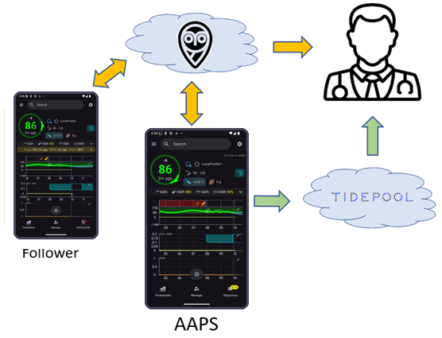

# Nastavení reportovacího serveru

S **AAPS** můžete v současné době používat dva reportovací servery:

- [Nightscout](https://nightscout.github.io/)
- [Tidepool](https://www.tidepool.org/)



Doporučujeme používat Nightscout.

(SettingUpTheReportingServer-nightscout)=
## Nightscout

Nightscout je webová aplikace, která ukládá a zobrazuje vaše data z CGM a z **AAPS** a vytváří z nich přehledy. Je to výkonná platforma, která je do **AAPS** zapojena už mnoho let. It enables users and caregivers to track the patient's diabetes data in near real-time (only a few seconds may pass between data reception and data provision if there is a sufficient Internet connection between all components involved). Pečovatelům také umožňuje posílat do **AAPS** vzdálené příkazy.

Nightscout je poskytován jako open source software. Kdokoli může vytvořit a provozovat Nightscout server, a to buď zdarma, nebojako placenou službu.

Více informací najdete na [webu projektu Nightscout](http://nightscout.github.io/).

### Option 1 - Set up your Nightscout server yourself

Vytváření Nightscout reporting serveru může vyžadovat jednu nebo více webových aplikací, které budou vyžadovat údržbu. Aby byla služba zcela zdarma, možná budete muset migrovat vaše stránky Nightscout a data, pokud poskytovatelé přestanou poskytovat servis zdarma.

Popis, jak si Nightscout nastavit, včetně výhod a nevýhod různých možností provozu a odhadu nákladů, najdete [zde](https://nightscout.github.io/nightscout/new_user/#free-diy).

### Možnost 2 - Zaplaťe si hostovanou službu Nightscout

Existují také možnosti od různých poskytovatelů služeb, kteří pro vás hostují Nightscout za měsíční poplatek. Náklady jsou zvládnutelné a výhodou hostovaného řešení je, že nemusíte IT znalosti ani ani mít provozní infrastrukturu.


Stávající uživatelé Nightscoutu mohou čas od času přehodnotit, kde a jak je jejich Nightscout server hostován, a přejít na jiné řešení, pokud se stane vhodnější.

Některé služby, které Nightscout hostují, jsou uvedeny [zde](https://nightscout.github.io/nightscout/new_user/#vendors-comparison-table).

### Further configuration of Nightscout

Až budete mít svou instanci Nightscoutu spuštěnou, podívejte se na [stránku Nightscout](../SettingUpAaps/Nightscout.md), kde najdete další důležité informace.

(SettingUpTheReportingServer-tidepool)=
## Tidepool

Tidepool je v **AAPS** k dispozici od verze 3.2, která vyšla na konci roku 2023.

```{admonition} Tidepool with **AAPS** is only for reporting
:class: danger  
Při používání **AAPS** je mezi příjmem dat a jejich zobrazením v přehledech zpoždění tři hodiny, proto Tidepool není vhodný pro sdílení informací v reálném čase s pečovateli.  
Na druhou stranu může být Tidepool skvělým řešením pro sdílení přehledů s endokrinologem pacienta, pokud Nightscout není přijatelné řešení.  
```

Tidepool je projekt s [otevřeným zdrojovým kódem](https://github.com/tidepool-org). Nabízí bezplatné provozování účtu na serverech Tidepool.

Více informací o nastavení Tidepoolu s AAPS najdete [zde](../SettingUpAaps/Tidepool.md).

```{admonition} **AAPS** has the uploader for Tidepool integrated
:class: note
Aplikaci pro nahrávání do Tidepoolu (Tidepool uploader) **nepotřebujete**: **AAPS** za vás nahraje glykémie, ošetření i bazál. Potřebujete pouze osobní účet na Tidepoolu. Nenahrávejte svá data samostatným nástrojem Tidepool uploader, protože by vznikly duplicitní hodnoty.  
```

## Next step

Až budete mít reportovací server nastavený, můžete **AAPS** v telefonu nakonfigurovat pomocí [Průvodce nastavením](./SetupWizard.md), který také propojí **AAPS** s vaším reportovacím serverem.