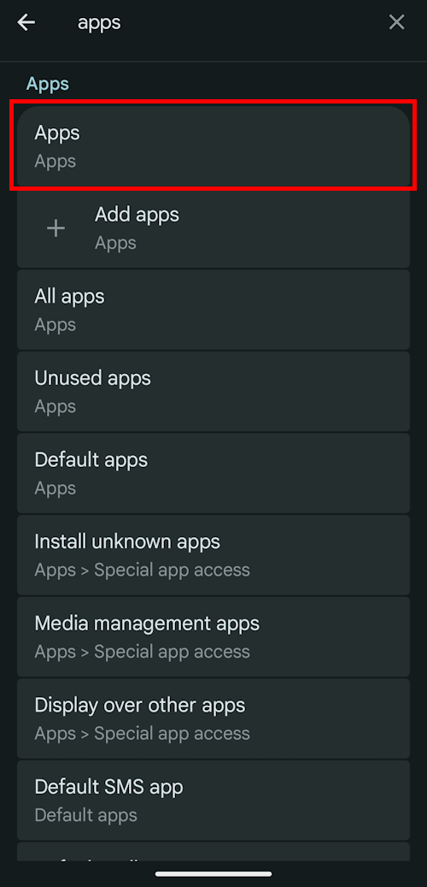
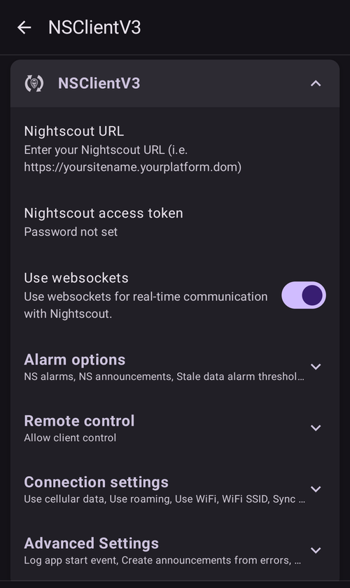
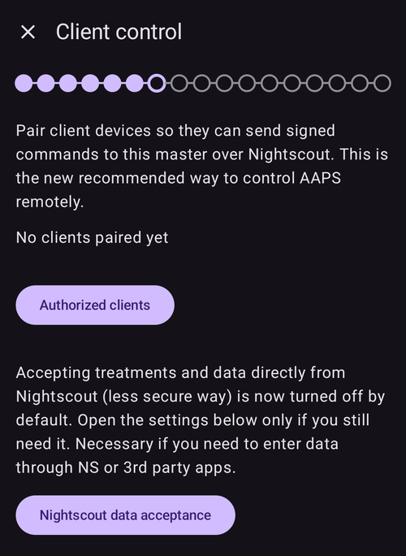
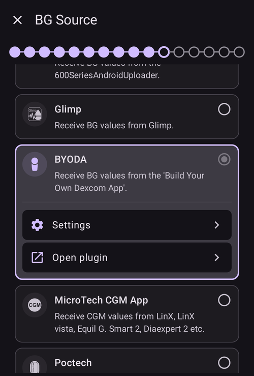
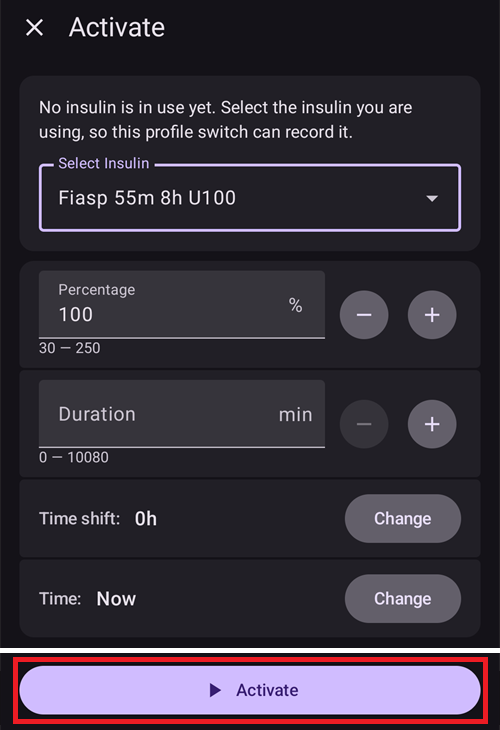
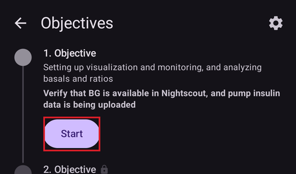

# Průvodce nastavením AAPS

```{contents} In this page
:backlinks: entry
:depth: 2
```

Když **AAPS** spustíte poprvé, provede vás „**Průvodce nastavením**“, abyste rychle a najednou nastavili všechny základní volby aplikace. **Průvodce nastavením** vás vede tak, abyste nezapomněli na nic důležitého. Například **nastavení oprávnění** je pro správné nastavení **AAPS** zásadní.

Není ale nutné mít vše kompletně nastavené hned při prvním použití **Průvodce nastavením**. Průvodce můžete snadno opustit a vrátit se k němu později. Po dokončení **Průvodce nastavením** máte tři cesty, jak konfiguraci dále vyladit nebo změnit. Všechny budou popsány v následující sekci. Je tedy v pořádku, pokud některé body v Průvodci nastavením přeskočíte, později je můžete snadno nakonfigurovat.

Během používání **Průvodce nastavením** a hned po něm možná v **AAPS** nezaznamenáte žádné velké viditelné změny. Abyste zapnuli smyčku **AAPS**, musíte plnit **Cíle**, které odemykají jednu funkci po druhé. **Cíl 1** zahájíte na konci Průvodce nastavením. Vy jste pánem **AAPS**, ne naopak.

```{admonition} Preview Objectives
:class: note
Pokud chcete znát strukturu cílů, přečtěte si [Plnění cílů](../SettingUpAaps/CompletingTheObjectives.md), ale pak se sem vraťte a nejprve projděte Průvodce nastavením.

```

Ze zkušenosti víme, že začátečníci na sebe často tlačí, aby **AAPS** nastavili co nejrychleji. To může vést k frustraci, protože je potřeba se toho hodně naučit.

Proto si na nastavení smyčky dejte čas. Přínosy dobře fungující smyčky **AAPS** jsou obrovské.

```{admonition} Ask for Help
:class: note
If there is an error in the documentation or you have a better idea for how something can be explained, you can ask for help from the community as explained at [Connect with other users](../GettingHelp/WhereCanIGetHelp.md).
```
## Uvítací zpráva

Když se Průvodce nastavením otevře, přivítá vás krátkou uvítací zprávou a hned ve spodní části obrazovky zobrazí panel „**Vyžadovaná oprávnění**“ (viz další část).

Jakmile oprávnění udělíte, panel se zavře a na uvítací obrazovce se zobrazí tlačítko „**Další**“. Pokračujte stisknutím „**DALŠÍ**“:


## Vyžadovaná oprávnění

**AAPS** potřebuje ke správnému fungování několik oprávnění. Průvodce je seskupuje na jednom panelu „**Vyžadovaná oprávnění**“, každé s vlastním tlačítkem „**Udělit**“. Udělte je jedno po druhém – jakmile je položka hotová, ikona vedle ní se změní na zaškrtnutí.


### Optimalizace baterie

Spotřeba baterie je u chytrých telefonů důležitá, protože výdrž baterií je stále dost omezená. Proto systém Android ve vašem telefonu omezuje, kdy mohou aplikace běžet a spotřebovávat čas procesoru, a tím i energii baterie.

**AAPS** však musí běžet pravidelně, _např._ aby každých několik minut přijal hodnoty glykémie a pak pomocí algoritmu rozhodl, jak s vaší glykémií naložit, podle vašeho nastavení. Proto musí být vyjmuta z optimalizace baterie.

Stiskněte „**Udělit**“ vedle „**Optimalizace baterie**“ a v dialogu „Nechat aplikaci vždy běžet na pozadí?“ zvolte „**Povolit**“:


(SetupWizard-StoragePermission)=

### Adresář AAPS

**AAPS** potřebuje ukládat svá nastavení a log soubory do trvalého úložiště vašeho telefonu. Trvalá paměť znamená, že data budou k dispozici i po restartu vašeho telefonu. Informace uložené pouze v operační paměti a nikoli v paměti trvalé mohou být ztracené.

Stiskněte „**Udělit**“ vedle „**Adresář AAPS**“. Otevře se souborový systém telefonu, kde zvolíte, kam bude **AAPS** ukládat své informace.

```{tip}
Doporučujeme zvolit výchozí adresář AAPS.</br>
**Nevybírejte** podadresář AAPS.
```

Výchozí adresář je **AAPS**, ale můžete použít jakýkoli vlastní adresář. V případě potřeby adresář vytvořte, otevřete ho a zvolte „**POUŽÍT TUTO SLOŽKU**“:


Potvrďte tlačítkem „**POVOLIT**“, že chcete aplikaci **AAPS** udělit přístup k vybranému adresáři:


### Notifications

Android vyžaduje zvláštní oprávnění pro aplikace, které potřebují posílat uživateli upozornění.

Vypnout oznámení _např._ u aplikací sociálních sítí je užitečné, ale je nezbytné, abyste aplikaci **AAPS** oznámení posílat povolili.

Stiskněte „**Udělit**“ vedle „**Oznámení**“ a v systémovém dotazu zvolte „**Povolit**“:


### Alarmy a připomenutí

V **Androidu 14 a novějším** potřebuje **AAPS** oprávnění „**Alarmy a připomenutí**“, aby alarmy mohly probudit obrazovku, když **AAPS** běží na pozadí, a aby připomenutí (například z **Automatizace**) zazněla včas.

Tato položka se zobrazuje, jen když je potřeba. Jakmile je **AAPS** vyjmuta z optimalizace baterie (viz výše), Android automaticky povolí přesné alarmy a položka zmizí. Pokud je položka stále v seznamu, stiskněte „**Udělit**“ vedle „**Alarmy a připomenutí**“. Otevře se obrazovka systémového nastavení pro **AAPS**. Zapněte přepínač a vraťte se do **AAPS**. V Androidu 13 a starším se tato položka nezobrazuje a není potřeba nic dělat.

Jakmile mají všechna oprávnění zaškrtnutí (tři, nebo čtyři v Androidu 14 a novějším), panel „**Vyžadovaná oprávnění**“ se sám zavře a pro pokračování můžete na uvítací obrazovce stisknout „**DALŠÍ**“.

(setup-wizard-bluetooth-battery-optimisation)=
### Optimalizace baterie pro Bluetooth

```{admonition} Extra Android setting, not part of the Wizard
:class: note
Následuje další nastavení Androidu, které se provádí mimo Průvodce nastavením. Nejde o žádné z tlačítek „Udělit“ výše, ale je důležité pro spolehlivé spojení s pumpou.
```

Novější verze Androidu přidaly optimalizaci baterie také pro systémovou aplikaci Bluetooth.

Kromě vypnutí optimalizace baterie pro **AAPS** ji pravděpodobně budete muset vypnout i pro systémovou aplikaci Bluetooth. Pokud to neuděláte, může docházet k výpadkům spojení s pumpou a k dalším problémům.

***POZNÁMKA: Jak to udělat, popisuje dokumentace xDrip zde: [dokumentace xDrip](https://navid200.github.io/xDrip/docs/BluetoothBatteryOpt.html)***

Postupujte podle těchto kroků v Androidu 16. V jiných verzích se obrazovky mohou od uvedených snímků mírně lišit:

1. Otevřete nastavení Androidu, vyhledejte **Aplikace** a otevřete nastavení aplikací.

   

2. Zobrazí se nastavení aplikací. Musíme ale zobrazit všechny aplikace, proto klikněte na **Zobrazit všechny aplikace**.

   

3. Aplikace Bluetooth je systémová aplikace, a proto je ve výchozím stavu skrytá. Musíme tedy zobrazit systémové aplikace. Klikněte na **tři tečky** (⋮) vpravo nahoře (1). Pak klikněte na **Zobrazit systémové** (2).

   

4. Vyhledejte aplikaci `Bluetooth` a klikněte na `Bluetooth` a/nebo `Legacy Bluetooth`. Pokud jsou k dispozici obě, proveďte postup pro obě.

   ***POZNÁMKA: `Bluetooth MIDI Service` můžete klidně ignorovat, AAPS ji nepoužívá.***

           

   1. V Androidu 12 klikněte na `Baterie`, v Androidu 13+ klikněte na `Využití baterie aplikací`,

   )

5. V Androidu 12+ vyberte možnost `Neomezeno`. V Androidu 15+ musíte rozbalit nastavení `Povolit využití na pozadí`. Klikněte k tomu na část zvýrazněnou červeně a pak dokončete postup podle kroku 6.

       

6. V Androidu 16 vyberte `Neomezeno`

   

## Licenční ujednání

V licenční smlouvě s koncovým uživatelem jsou důležité informace o právních aspektech používání **AAPS**. Přečtěte si ji prosím pozorně.

Pokud licenční smlouvě s koncovým uživatelem nerozumíte nebo s ní nemůžete souhlasit, **AAPS** vůbec nepoužívejte!

Pokud rozumíte a souhlasíte, stiskněte tlačítko „**ROZUMÍM A POTVRZUJI**“ a pokračujte v Průvodci nastavením:


Jakmile souhlasíte, zobrazí se tlačítko „**Další**“. Stiskněte „**DALŠÍ**“.

Další obrazovka, „**Oprávnění**“, znovu zobrazí seznam oprávnění. Všechna by měla mít zaškrtnutí, protože jste je udělili už na začátku. Pokud některé chybí, stiskněte vedle něj „**Udělit**“. Pokračujte stisknutím „**DALŠÍ**“:


## Hlavní heslo

Konfigurace **AAPS** obsahuje citlivé údaje (_např._ přístupový token k vašemu serveru Nightscout), a proto je zašifrovaná heslem, které nastavíte zde.

Průvodce zobrazí „**Heslo není nastavené**“. Stiskněte „**Nastavit**“:


Otevře se obrazovka „**Ochrana**“. Stiskněte „**Hlavní heslo**“ (zobrazuje se jako „Heslo není nastavené“):


Zadejte stejné heslo do obou polí a stiskněte „**OK**“:


Vraťte se zpět šipkou v levém horním rohu. Průvodce teď zobrazí „**Heslo nastaveno!**“:


```{admonition} Do not lose your Master Password
:class: danger
**NEZTRAŤTE SVÉ HLAVNÍ HESLO**. Poznamenejte si ho _např._ na Disk Google. To je dobré místo, protože Google ho za vás zálohuje. Váš telefon nebo poočítač se může porouchat a vy byste mohli skončit bez vašeho aktuálního hesla. Pokud byste ztratili Hlavní heslo do aplikace (Master password), bylo by v budoucnu obtížné obnovit nastavení profilu a vaše splněné **Cíle**.
```

Až budete hotovi, stiskněte „**DALŠÍ**“ a přejděte na další obrazovku.

(setup-wizard-import-settings)=
## Importujte nastavení

Tato obrazovka se zobrazí, jen když **AAPS** najde v adresáři **AAPS** dříve exportované nastavení („Nalezeno uložené nastavení“), například když aplikaci přeinstalujete nebo přecházíte na nový telefon.

- Chcete-li obnovit předchozí konfiguraci, stiskněte „**Importovat nastavení**“ – viz [Export a import nastavení](../Maintenance/ExportImportSettings.md).
- Chcete-li začít s novou konfigurací, stiskněte „**DALŠÍ**“ a pokračujte v Průvodci.


## Jednotky (mg/dl <-> mmol/l)

Vyberte, zda jsou vaše hodnoty glykémie v mg/dl nebo mmol/l, a pak stiskněte tlačítko „**DALŠÍ**“:


## Nastavení zobrazení

Zde nastavíte „**Dolní značku**“ a „**Horní značku**“ pro zobrazení glykémie ze senzoru. Hodnoty glykémie mezi těmito dvěma značkami se zobrazují jako „v rozsahu“. Výchozí hodnoty (72 a 180 mg/dl) můžete zatím ponechat a upravit je později.

Zadané hodnoty ovlivňují pouze grafické zobrazení diagramu a nic jiného.

Vaše cílová glykémie se _např._ nastavuje zvlášť ve vašem profilu.

Váš rozsah pro analýzu Času v rozsahu se konfiguruje nezávisle na vašem reportovacím serveru.

V případě potřeby značky upravte tlačítky „−“ / „+“ a pak stiskněte tlačítko „**DALŠÍ**“:


(SetupWizard-synchronization-with-the-reporting-server-and-more)=
## Komunikace

Obrazovka „**Komunikace**“ zobrazuje pluginy pro nahrávání, synchronizaci a vysílání vašich dat:

- **SMS komunikátor** – vzdálené ovládání **AAPS** pomocí SMS příkazů
- **NSClientV3** – synchronizuje vaše data s Nightscoutem pomocí API v3
- **Tidepool** – nahrává data do Tidepoolu
- **xDrip** – posílá data do xDripu
- **Open Humans** – nahrání a darování vašich dat o diabetu pro vědecké projekty
- **Wear** – sledování a ovládání **AAPS** z hodinek s WearOS
- **Externí aplikace** – vysílání dat do různých externích aplikací
- **Garmin** – spojení se zařízením Garmin


Zbytek seznamu uvidíte, když posunete obrazovku dolů:


Několik z nich byste mohli nastavit už teď, ale při prvním spuštění se zaměříme jen na reportovací server. Pokud ho teď nastavit nemůžete, zatím ho přeskočte – nastavit ho můžete později.

V tomto příkladu používáme jako reportovací server Nightscout. Zaškrtněte políčko vpravo od „**NSClientV3**“ a tím ho zapněte. Pro reportovací server Tidepool je nastavení ještě jednodušší, protože je třeba pouze zadání vašch přihlašovacích údajů.

Po zapnutí stiskněte „**Nastavení**“ pod NSClientV3 a nastavte ho:


Zde nastavíte reportovací server Nightscout. Nastavení NSClientV3 se zobrazuje jako jedna posuvná stránka:



Stiskněte „**URL Nightscoutu**“ a zadejte adresu svého osobního serveru Nightscout (URL, kterou jste si nastavili sami nebo kterou jste dostali od poskytovatele služby). Potvrďte tlačítkem „**OK**“.

Stiskněte „**Přístupový token Nightscoutu**“ a zadejte přístupový token k vašemu serveru Nightscout. Bez tohoto tokenu nebude přístup fungovat. Pokud ho ještě nemáte, podívejte se do dokumentace k nastavení reportovacího serveru.

Nechte zapnuté „**Použít websockety**“ pro komunikaci s Nightscoutem v reálném čase.

Ostatní části můžete zatím nechat ve výchozím nastavení. Popisujeme je zde, abyste později věděli, kde je najdete:

**Nastavení alarmů** – alarmy Nightscoutu, oznámení a limity pro zastaralá data. Přepínače zatím nechte vypnuté. Otevíráme je jen proto, abyste o těchto možnostech věděli.

**Nastavení připojení** – zvolte, jak se data přenášejí. Pečovatelé musí zapnout „**Používat mobilní data**“, jinak telefon osoby, o kterou pečují (_např._ dítěte), nemůže nahrávat data mimo dosah Wi-Fi, _např._ cestou do školy. Ostatní uživatelé mohou přenos přes mobilní data vypnout a ušetřit tak data nebo baterii. Pokud si nejste jistí, nechte vše zapnuté.


**Rozšířená nastavení** – zapněte „**Zaznamenat spuštění aplikace**“, pokud chcete v Nightscoutu vidět, kdy se aplikace restartuje (užitečné pro pečovatele). Nechte zapnuté „**Vytvářet oznámení z chyb**“ a „**Vytvářet oznámení z požadavků na sacharidy**“. „**Použít pomalou synchronizaci**“ nechte vypnuté. Použili byste ho jen tehdy, když server Nightscout zpracovává velké množství dat pomalu.


Vraťte se na seznam pluginů a stiskněte „**DALŠÍ**“ pro přechod na další obrazovku.

## Ovládání z klienta

Od verze 4 aplikace **AAPS** lze klientská zařízení s aplikací **AAPSClient** **spárovat** s tímto telefonem (**hlavním zařízením**) a ovládat ho podepsanými příkazy posílanými přes Nightscout. Toto je nový doporučený způsob, jak **AAPS** ovládat na dálku – úplné vysvětlení a nastavení najdete v části [Ovládání Master ↔ Client](../RemoteFeatures/ClientMasterControl.md).

Na této obrazovce teď nemusíte nic nastavovat. Klienty můžete kdykoli později spárovat v **Spravovat → Autorizovaní klienti**. Tam přidáte klienta pomocí **QR kódu** (ten nastaví Nightscout i na klientovi) nebo pomocí **PINu** a přidělíte mu **roli**.

- „**Autorizovaní klienti**“ – správa spárovaných klientských zařízení, která smí ovládat toto hlavní zařízení.
- „**Přijímání dat z Nightscoutu**“ – přijímání ošetření a dat zadaných přímo v Nightscoutu (starý, méně bezpečný způsob) je teď ve výchozím stavu vypnuté. Tato nastavení otevírejte, jen pokud to stále potřebujete, _např._ pro zadávání dat přes Nightscout nebo aplikace třetích stran.

Když je ovládání z klienta už zapnuté – v [Zjednodušeném režimu](#preferences-simple-mode) vždy – je tento telefon v [zabezpečeném režimu](#client-master-control-hardened-mode): přijímá změny jen od spárovaných klientů, a proto obrazovka místo nastavení „**Přijímání dat z Nightscoutu**“ vysvětluje zabezpečený režim.



„**Přijímání dat z Nightscoutu**“ otevře nastavení „**Synchronizace**“, kde má každý druh dat přijímaných z Nightscoutu vlastní přepínač:


Stiskněte „**DALŠÍ**“ pro přechod na další obrazovku.

(setup-wizard-instance-name)=
## Kdo používá tento telefon?

Zde zadáte jméno osoby, která tento telefon používá. Odliší tuto instanci **AAPS** od ostatních v reportech a při synchronizaci, například když **AAPS** používají dvě děti ve vaší rodině. Používá se také v názvech souborů s exportem nastavení a zobrazuje se na hodinkách.

Může zde být zadáno cokoli. Později ho můžete změnit v **Nastavení → Obecné → Název instance**.

Stiskněte „**DALŠÍ**“ pro přechod na další obrazovku.


## Patient type

Zde vyberete „Typ pacienta“. Je to důležité, protože software **AAPS** má různé limity podle věku pacienta. Nastavení je důležité z bezpečnostních důvodů.

Zde také nastavíte **maximální povolený bolus** na jídlo. Jedná se o největší hodnotu bolusu, který potřebujete k pokrytí typické porce jídla. Je to bezpečnostní funkce, která pomáhá zabránit náhodnému předávkování, když si dáváte bolus na jídlo.

Druhý limit je koncipován obdobně, ale vztahuje se k maximálnímu očekávanému příjmu sacharidů.

Po nastavení těchto hodnot stiskněte „**DALŠÍ**“ pro přechod na další obrazovku:


## Inzulín

Zde nastavíte inzulín, který používáte v pumpě. Nové inzulínové profily vyžadují **DIA alespoň 5 h**.

Stiskněte tlačítko „**Inzulín**“ a otevřete editor inzulínu:


V editoru můžete inzulínu dát **přezdívku** a nastavit jeho **Vrchol** (v minutách) a **DIA** (v hodinách). Nejrychlejší je načíst předvolbu pomocí „**Načíst vrchol z**“ – zvolte **Novorapid**, **Fiasp** nebo **Lyumjev** – a vrchol se vyplní za vás. Graf ve spodní části ukazuje náhled výsledné křivky aktivity inzulínu.


Vyberte předvolbu, která odpovídá vašemu inzulínu, například **Fiasp**:


```{admonition} Use your insulin brand's preset peak
:class: danger
Neměňte vrchol, pokud nejste odborník – předvolené hodnoty obvykle pro každý značkový inzulín fungují dobře.
```

Pokud jste nový uživatel **AAPS**, nastavte **DIA** na 9 hodin – proč, se dozvíte v části [Doba působnosti inzulínu (DIA) a vrchol](#Config-Builder-insulin-dia).

```{admonition} "Insulin configuration changed" dialog
:class: note
Pokud konfiguraci inzulínu změnil spárovaný klient (_např._ jiný telefon), zobrazí se dialog. Stiskněte **OK** a načtěte jeho změny, nebo **Zrušit** a pokračujte v úpravách (vaše příští uložení jeho změny přepíše).
```


Stiskněte ikonu uložení (vpravo nahoře) a pak stiskněte „**DALŠÍ**“ pro přechod na další obrazovku.

## Zdroj informací o glykémii

Zde vyberete, odkud **AAPS** získává data o glykémii. Přečtěte si dokumentaci k vašemu [zdroji glykémie](../Getting-Started/CompatiblesCgms.md).

K dispozici je mnoho zdrojů – projděte seznam a vyberte ten, který používáte:


Jakmile zdroj vyberete, jeho karta se rozbalí a zobrazí dvě tlačítka: „**Nastavení**“ pro úpravu příjmu dat a „**Otevřít modul**“ pro otevření vlastní obrazovky zdroje. V příkladu níže je vybraný **BYODA**. Některé zdroje v tomto kroku nemají co nastavit, takže obvykle můžete rovnou přejít na další obrazovku:



Po výběru stiskněte „**DALŠÍ**“ pro přechod na další obrazovku.

(setup-wizard-profile)=
## Profil

Teď se dostáváme k velmi důležité části Průvodce nastavením.

Než začnete na další obrazovce zadávat údaje svého profilu, přečtěte si dokumentaci o [profilech](../SettingUpAaps/YourAapsProfile.md).

```{admonition} Working profile required - no exceptions here !
:class: danger
Přesný profil je nutný pro bezpečné fungování **AAPS**.

Je nezbytné, abyste svůj profil stanovili a probrali s lékařem a aby se osvědčil při úspěšném testování bazálů, citlivosti (ISF) a inzulínosacharidového poměru (I:C)!

Pokud robot dostane chybné vstupní informace, selže - důsledně. **AAPS** může pracovat pouze s informacemi, které dostává. Pokud bude váš profil příliš silný, riskujete hypoglykémii, a pokud bude příliš slabý, riskujete hyperglykémii. 
```

Stiskněte tlačítko „**Profil**“ a otevřete editor profilu:


Editor se otevře prázdný („Nejsou k dispozici žádné záznamy“). Stiskněte tlačítko „**+**“ dole a vytvořte nový profil:


Postupem času se může stát, že budete potřebovat několik různých profilů. V tuto chvíli vytvoříme pouze jeden.

```{admonition} Profile only for tutorial - not for your usage
:class: note
Zdejší příklad profilu slouží jen k tomu, abyste viděli, jak zadávat data.

Nemá to být přesný ani dobře optimalizovaný profil, protože potřeby každého člověka jsou velmi rozdílné.

Nepoužívejte ho pro skutečné řízení smyčky!
```

Nový profil (například „**LocalProfile1**“) má čtyři karty: **I:C**, **ISF**, **BAS** a **CÍL**. Pro přejmenování profilu stiskněte tužku vedle jeho názvu. Vyplňte všechny karty – karta zůstane červená a zobrazuje chybovou zprávu, dokud neobsahuje platné hodnoty:


Stiskněte „**I:C**“ a zadejte své hodnoty [I:C](#your-aaps-profile-insulin-to-carbs-ratio). Další časové bloky přidáte tlačítkem „**+**“:


Stiskněte „**ISF**“ a zadejte své [hodnoty ISF](#your-aaps-profile-insulin-sensitivity-factor):


Stiskněte „**BAS**“ a zadejte své [hodnoty bazálu](#your-aaps-profile-basal-rates):


Stiskněte „**CÍL**“ a zadejte své cílové hodnoty glykémie.

Pro otevřenou smyčku může být tento cíl širší rozsah. Jinak vás **AAPS** bude neustále upozorňovat, abyste změnili dočasný bazál nebo jiné nastavení, a to může být vyčerpávající.

Později, s uzavřenou smyčkou, budete mít obvykle zadanou stejnou hodnotu pro horní i dolní limit. Pro **AAPS** je pak snazší cíle dosáhnout a dát vám celkově lepší kontrolu diabetu.


Když jsou všechny čtyři karty platné, **ikona uložení** (vpravo nahoře) se stane aktivní. Stiskněte ji a profil uložte:


Zavřete editor pomocí „**X**“ v levém horním rohu. Souhrn profilu pak zobrazí jeho název, celkový denní bazál (∑), jednotky a hodnoty I:C a ISF s jejich grafy:


```{admonition} Several defined but only one active profile
:class: note
Můžete mít definováno několik profilů, ale v každém okamžiku běží jen jeden aktivovaný profil.
```

Stiskněte tlačítko „**▶**“ (aktivovat) vpravo dole. Otevře se obrazovka „**Aktivovat**“. Protože se zatím nepoužívá žádný inzulín, nejprve vás požádá o výběr inzulínu, který používáte, aby ho přepnutí profilu mohlo zaznamenat. Tlačítko „**Aktivovat**“ zůstane šedé, dokud to neuděláte:


Stiskněte „**Vybrat inzulín**“ a zvolte inzulín, který jste nastavili dříve. Procento nechte na 100 % a stiskněte „**Aktivovat**“:



Zobrazí se dialog přepnutí profilu. V tomto případě nechte předvolené hodnoty a potvrďte tlačítkem „**OK**“:

```{admonition} Profile switch dialog
:class: note
Později se naučíte, jak tento obecný dialog používat v situacích, jako je nemoc nebo sport, kdy musíte profil přizpůsobit okolnostem.
```


Váš profil je teď aktivní. Stiskněte „**DALŠÍ**“ pro přechod na další obrazovku.

## Inzulínová pumpa

Teď vyberete svou inzulínovou pumpu. Přečtěte si dokumentaci k vaší [inzulínové pumpě](../Getting-Started/CompatiblePumps.md).

Projděte seznam a vyberte svou pumpu. V tomto příkladu používáme „**Virtuální pumpu**“. Je užitečná, dokud se učíte a ještě nemáte připojenou skutečnou pumpu:


Podporováno je mnoho pump – svou najdete posunutím dolů:


Když vyberete skutečnou pumpu, **AAPS** vás požádá o potvrzení, protože zkopíruje bazální dávky z vašeho profilu do pumpy a přepíše bazální dávky v ní uložené. Stiskněte „**OK**“, jen pokud jsou bazální dávky ve vašem profilu **AAPS** správné. Jinak stiskněte „**Zrušit**“ a pumpu přepněte později:


Pokud vybraná pumpa komunikuje přes Bluetooth, **AAPS** po dokončení Průvodce požádá o oprávnění připojovat se k zařízením v okolí (viz [Oprávnění Bluetooth](#bluetooth-permission)).

Pokud už máte profil nastavený a víte, jak pumpu připojit, klidně ji připojte hned. Jinak zatím nechte **Virtuální pumpu** – můžete ji kdykoli změnit, nebo Průvodce nastavením opustit šipkou v levém horním rohu a nechat **AAPS** nejprve zobrazit nějaké hodnoty glykémie.

Stiskněte „**DALŠÍ**“ pro přechod na další obrazovku.

## APS algorithm

Vyberte OpenAPS SMB jako váš APS algoritmus. Navzdory názvu je funkce SMB v algoritmu vypnutá, dokud se s AAPS neseznámíte a nesplníte první cíle. OpenAPS SMB je stejně novější a obecně lepší než OpenAPS AMA.

SMB je na začátku vypnuté, protože funkce SMB reaguje na vzestup glykémie rychleji – místo zvýšení procenta bazální dávky použije Super Micro Bolus. Protože váš profil na začátku obecně není tak dobrý jako po získání zkušeností, je tato funkce zpočátku vypnutá.

```{admonition} Only use the older algorithm **OpenAPS AMA** if you know what you are doing
:class: note
OpenAPS AMA je nejzákladnější algoritmus, který nepodporuje mikroboly ke korekci vysokých hodnot. Mohou nastat okolnosti, kdy je lepší používat tento algoritmus, ale nedoporučujeme to.
```

Vyberte „**OpenAPS SMB**“ a pak stiskněte „**Nastavení**“ a zobrazte podrobnosti:


Jedinou volbou je zde „**Použít dynamickou citlivost**“. Nechte ji vypnutou a zatím nic neměňte – jen si přečtěte text.

Kvůli omezením, která stanovují **Cíle**, stejně zatím nemůžete používat ani „uzavřenou smyčku“, ani „funkce SMB“.

Vraťte se zpět a stiskněte „**DALŠÍ**“ pro přechod na další obrazovku:


## Detekce citlivosti

Jako standardní plugin citlivosti nechte vybranou „**Sensitivita Oref1**“:


Když stisknete „**Nastavení**“, můžete si prohlédnout nastavení vstřebávání. Výchozí hodnoty (_např._ limit vstřebávání 6 h) zatím stačí.


Stiskněte „**DALŠÍ**“ pro přechod na další obrazovku.

## Začněte Cíl 1

Teď vstupujete do Cílů – kvalifikace pro přístup k dalším funkcím **AAPS**.

Stiskněte „**Otevřít Cíle**“:


Zde začínáme Cíl 1, i když v tuto chvíli naše nastavení není zcela připraveno k jeho úspěšnému dokončení. Ale je to začátek.

Stiskněte tlačítko „**Začátek**“ vedle „**1. cíl**“:



Cíl se rozbalí a zobrazí jednotlivé kontroly. Vidíte, že už jste udělali určitý pokrok, zatímco jiné položky ještě zbývají:


Vraťte se zpět a pak stiskněte „**DOKONČIT**“ a ukončete Průvodce nastavením:


Po stisknutí „**DOKONČIT**“ se dostanete na hlavní obrazovku **AAPS**. Může se otevřít panel „**Oznámení**“ s informačními zprávami, například o právě provedeném přepnutí profilu – každou zprávu odstraníte tlačítkem „**Zavřít**“ pod ní.

Pokud Průvodce nastavením kdykoli omylem opustíte, můžete ho jednoduše spustit znovu, nebo ručně změnit [konfiguraci smyčky AAPS](../SettingUpAaps/ChangeAapsConfiguration.md).

## Oprávnění Bluetooth

Pokud vyberete pumpu, která se připojuje přes Bluetooth (například **Omnipod Dash**), banner vám připomene, že **AAPS** potřebuje oprávnění Bluetooth. Zatím můžete stisknout „**Zavřít**“ – oprávnění udělíte po dokončení Průvodce:


Po dokončení Průvodce nastavením zobrazí hlavní obrazovka **AAPS** panel „**Vyžadovaná oprávnění**“. Ostatní oprávnění už jsou udělená. Stiskněte „**Udělit**“ vedle „**Bluetooth**“:


Zvolte „**Povolit**“, aby **AAPS** mohla najít vaši pumpu a připojit se k ní:


Pokud je teď vaše smyčka **AAPS** plně nastavená, pokračujte další částí [„Plnění cílů“](../SettingUpAaps/CompletingTheObjectives.md).
