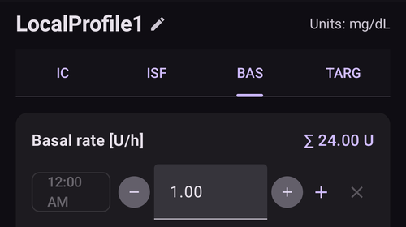
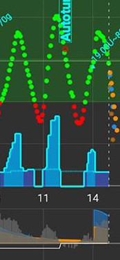
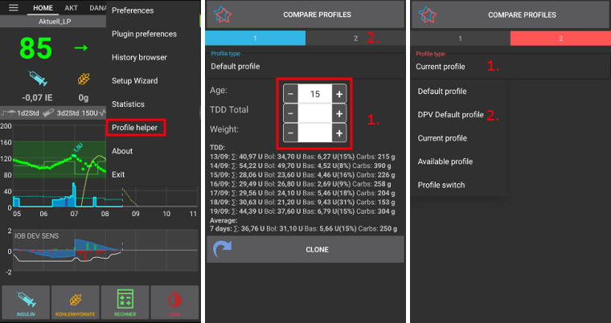
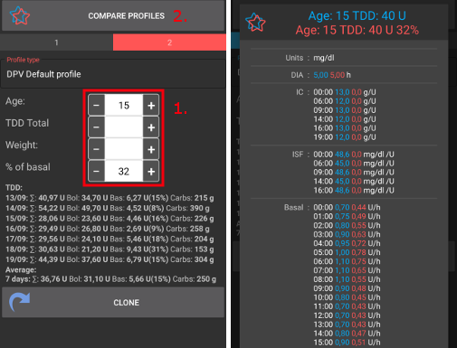
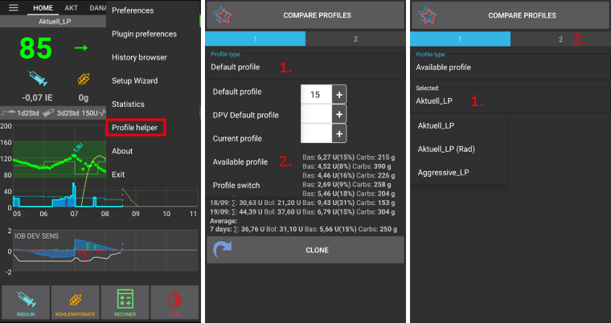
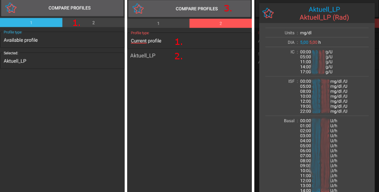

# Váš profil v AAPS

Váš **profil AAPS** je sada čtyř klíčových parametrů, které určují, jak má **AAPS** podávat inzulín v reakci na glykémii ze senzoru. Toto jsou hlavní parametry, na kterých je **AAPS** postaven. Jak budete postupovat **Cíli**, odemknete další nastavitelné parametry (např. nastavení SMB). To, jak dobře tyto funkce fungují, ale závisí na tom, zda je váš základní **Profil** správný. **Profil** obsahuje:
* [cílové glykémie](#profile-glucose-targets),
* [bazální dávky](#your-aaps-profile-basal-rates) (BR),
* [citlivost na inzulín](#your-aaps-profile-insulin-sensitivity-factor) (ISF) a
* [inzulínosacharidové poměry](#your-aaps-profile-insulin-to-carbs-ratio) (IC nebo ICR).

```{admonition} Where did DIA go?
:class: note
**Doba působnosti inzulínu (DIA)** už není součástí vašeho **Profilu**. Nastavuje se místo toho pro každý inzulín zvlášť – viz [Spravovat → Nastavení inzulínu](#Config-Builder-insulin-dia).
```

Při používání **AAPS** byste měli průběžně hodnotit a prověřovat, zda je nastavení vašeho **Profilu** přesné. Doporučujeme procházet nastavení v pořadí, v jakém jsou zde uvedena. Cílem je mít dané nastavení správně, předtím než začnete měnit další. Postupujte po malých krocích a neprovádějte velké změny najednou. Po každé změně nezapomeňte nový profil aktivovat. Pravidelně [zálohujte nastavení svého **Profilu**](#YourAapsProfile_Profile-backup) exportem nastavení.

Nastavení vašeho **Profilu** se navzájem ovlivňují – můžete mít „špatná“ nastavení, která spolu za určitých okolností fungují dobře, ale za jiných ne. Například když je příliš vysoký bazál ve stejnou dobu jako příliš vysoký **CR**. Nastavení je proto třeba posuzovat jednotlivě a ověřit, že spolu dobře fungují v různých situacích.

Jako vodítko můžete použít nástroj [Autotune](https://autotuneweb.azurewebsites.net/), ale nesmíte mu slepě věřit: ve vašem případě nebo za všech okolností nemusí fungovat správně.

```{admonition} Your diabetes may vary
:class: note
**Profily** se u jednotlivých lidí velmi liší.

U bazálních dávek (BR), citlivosti na inzulín (ISF) a inzulínosacharidových poměrů (IC nebo ICR) se absolutní hodnoty i trendy potřeby inzulínu u každého člověka velmi liší. Závisí na vaší biologii, pohlaví, věku, kondici atd. a také na krátkodobých faktorech, jako je nemoc nebo nedávný pohyb. Další rady k tomu najdete ve výborné knize [„Brights Spots and Landmines“](https://diatribe.org/bright-spots-and-landmines/) od Adama Browna.

```

Poslední čtyři parametry (cílové glykémie, bazální dávky, citlivost na inzulín a inzulínosacharidové poměry) lze během 24 hodin nastavit na různé hodnoty, v případě potřeby i s hodinovou změnou.


Níže jsou snímky obrazovky z **AAPS** s _ukázkovým_ profilem. Upozornění: ukázkový profil níže obsahuje velký počet časových bodů. Když s **AAPS** začínáte, bude váš profil pravděpodobně mnohem jednodušší.


(profile-glucose-targets)=
## Glucose targets

### Popis

Vaše **cílová glykémie** je základní hodnota a všechny výpočty **AAPS** vycházejí z ní. Liší se od cílového rozmezí, ve kterém se obvykle snažíte udržet glykémii. Cíl se používá ve výpočtech **AAPS**: pokud **AAPS** předpovídá, že vaše **glykémie** skončí mimo cílové rozmezí, zasáhne, aby vás do tohoto rozmezí vrátil.

The targets can be defined within those boundaries :

|         | _Dolní_ cíl              | _Horní_ cíl                |
| ------- | ------------------------ | -------------------------- |
| Minimum | 4,4 mmol/l nebo 80 mg/dl | 5 mmol/l nebo 90 mg/dl     |
| Maximum | 10 mmol/l nebo 180 mg/dl | 11,1 mmol/l nebo 200 mg/dl |

### Dopad

Pokud je cíl ve vašem **Profilu** velmi široký (řekněme 3 mmol/l nebo více [50 mg/dl nebo více]), **AAPS** bude často zasahovat jen málo. Je to proto, že se předpokládá, že **glykémie** bude někde v tomto širokém rozmezí, a **AAPS** proto dočasné bazály spustí jen zřídka.

### Jak to nastavit

**Obrázek níže** ukazuje příklad, jak lze cíl nastavit v profilu **AAPS**.


Cílové **glykémie** se nastavují podle vašich osobních preferencí a potřeb. Pokud se například obáváte nočních hypoglykémií, můžete si cíl od 21:00 do 7:00 nastavit o něco výš, na 117 mg/dl (6,5 mmol/l). Pokud se chcete ujistit, že máte máte ráno v těle dostatek inzulínu (Insulin On Board; IOB) než budete podávat bolus k snídani, můžete nastavit nižší hodnotu cílové glykémie 4,5 mmol/L v době od 7:00 - 8:00.

V [otevřené smyčce](#KeyAapsFeatures-OpenLoop), zvlášť když procházíte [prvními cíli](../SettingUpAaps/CompletingTheObjectives.md), může být dobrou volbou široké cílové rozmezí, zatímco se učíte, jak se **AAPS** chová, a upravujete svůj **Profil**.<br/> V [uzavřené smyčce](#KeyAapsFeatures-ClosedLoop) (od **[Cíle 6](#objectives-objective6)**) doporučujeme rozmezí zužovat, až budete mít pro každou denní dobu jediný cíl (_Dolní_ cíl = _Horní_ cíl), aby **AAPS** na výkyvy **glykémie** reagoval rychle.

(your-aaps-profile-basal-rates)=

## Basal rates

### Popis

Vaše bazální dávky inzulínu (jednotky za hodinu) poskytují na pozadí inzulín, který udržuje vaši glykémii při absenci jídla nebo cvičení stabilní.

Inzulínová pumpa posílá malé dávky rychle působícího inzulínu každých pár minut, aby bránil játrům v uvolňování nadbytečného množství glukózy a aby se glukóza dostala do tělesných buněk. Bazální inzulín obvykle tvoří 40 - 50% celkové denní dávky (TDD), v závislosti na vaší stravě, a obvykle se řídí cirkadiánním rytmem, denně s jedním vrcholem a jedním propadem v požadavcích na inzulín. Další informace najdete v 6. kapitole velmi užitečné knihy [„Think like a Pancreas“](https://amzn.eu/d/iVU0RGe) od Garyho Scheinera.

Většina edukátorů diabetu 1. typu (i lidí s diabetem 1. typu!) se shoduje, že byste nejdříve měli správně nastavit bazály a teprve potom se pokoušet optimalizovat ISF a ICR.

### Dopad

Vyladěné bazály vám umožní probudit se v rozsahu, přeskakovat jídla nebo jíst dříve či později, aniž by šla glykémie nahoru nebo dolů.

Příliš vysoký bazál může vést k nízkým glykémiím. A naopak.

**AAPS** bere výchozí bazál jako základní linii a vše počítá vůči němu. Je-li bazál příliš vysoký, „dočasný nulový bazál“ bude započítán jako větší záporný IOB, než by měl být. To povede k tomu, že **AAPS** následně podá více korekcí, než by měl, aby nakonec dostal IOB na nulu.

Příliš vysoký bazál tedy způsobí nízké **glykémie** jak při výchozí dávce, tak i o několik hodin později, když **AAPS** koriguje k cíli.

Naopak příliš nízký bazál může vést k vysokým glykémiím a k tomu, že se hodnoty nepodaří snížit k cíli.

### Jak to nastavit

**Obrázek níže** ukazuje příklad, jak lze bazální dávky nastavit v profilu **AAPS**.



Správné bazály se hledají metodou pokus–omyl a mělo by to probíhat po dohodě s vaším diabetologickým týmem.

Existují metody testování bazálu, které obvykle spočívají ve sledování bazálů a potřeby inzulínu během <u>přerušovaného</u> hladovění v průběhu 24 hodin. I když musíte bazály otestovat pro celý den, nedoporučujeme hladovět 24 hodin v kuse. Tělo totiž spouští mechanismy, například hormony, které to kompenzují. Doporučený způsob je hladovět ve 3 různých dnech, vždy po dobu 8 hodin.

Doporučenou metodou je pozastavit smyčku (pro bezpečnost můžete AAPS přepnout do režimu [**LGS**](#KeyAapsFeatures-LGS), abyste se vyhnuli hypoglykémiím, stejně jako při plnění [cíle 6](#objectives-objective6)). Tím se vrátíte k výchozímu bazálu. Sledujte, jak se mění vaše **glykémie**: pokud klesá, je bazál příliš vysoký. A naopak.<br/> Jinou metodou (může být složitější) je nechat smyčku běžet a sledovat, jak se mění **IOB**. Pokud je **IOB** záporný, je váš bazál příliš vysoký. A naopak. Pozor, tato metoda spoléhá na to, že **ISF** koriguje **glykémii**, a proto funguje jen tehdy, když jsou rozumně nastavené i další proměnné.<br/> Další způsob, jak upravit bazály, je sledovat činnost smyčky během noci, kdy už jsou všechny COB vstřebané. Tato metoda je zvlášť užitečná u dětí, když je hladovění obtížné nebo se potřeba inzulínu často mění. [Dr. Saleh Adi z Tidepoolu](https://www.youtube.com/watch?v=-fpWnGRhLSo) ukazuje užitečné způsoby, jak analyzovat noční křivky glykémie a optimalizovat tak bazály.

[Zde](../GettingHelp/ProfileTuning.md) najdete, jak upravit bazální profil analýzou vzorců v uzavřené smyčce.

Když na základě výsledků testování bazálu provádíte změny, měly by se změny v **Profilu** nastavit 1 až 2 hodiny (podle typu inzulínu) před vzestupem/poklesem. Test podle potřeby opakujte, dokud nebudete s nastavením **bazálů** spokojeni.

(your-aaps-profile-basal-not-compatible)=
#### Zpráva: „Bazál není kompatibilní s aktuální pumpou“

Každá pumpa má limity: nejnižší a nejvyšší bazální dávku, kterou dokáže podat, a u některých pump (například Dana, Accu-Chek Combo, Medtronic a Diaconn G8) se bazální dávky mohou měnit jen v celou hodinu. **AAPS** kontroluje váš profil vůči pumpě, kterou používáte, a to **po** použití zvoleného procenta.

Pokud je některá bazální dávka mimo tyto limity, obrazovka **Aktivovat** zobrazí tuto zprávu a tlačítko **Aktivovat** zůstane šedé:


Například při bazální dávce 0,10 U/h v noci a procentu profilu 35 % by **AAPS** musel podávat 0,035 U/h. To je méně, než dokáže podat pumpa Dana (0,04 U/h).

Řešení je jedno z následujících:

* zvolte jiné procento: **vyšší**, pokud je bazální dávka příliš nízká, **nižší**, pokud je bazální dávka příliš vysoká, nebo
* [upravte profil](#your-aaps-profile-create-and-edit-profiles) a změňte bazální dávku.

Editor profilu umožňuje začínat bazální dávky jen v celou hodinu. Bazální dávka začínající např. v 06:30 může pocházet jen ze staršího profilu, například když přejdete na pumpu, která to nepodporuje.

(your-aaps-profile-insulin-sensitivity-factor)=

## Insulin sensitivity factor (ISF)

### Popis

Faktor citlivosti na inzulín (někdy nazývaný korekční faktor) říká o kolik se sníží hladina krevního cukru po podání 1 jednotky inzulínu.

**V jednotkách mg/dl:** Pokud máte **ISF** 40, každá jednotka inzulínu sníží vaši glykémii přibližně o 40 mg/dl (například glykémie klesne ze 140 mg/dl na 100 mg/dl).

**V jednotkách mmol/l:** Pokud máte **ISF** 1,5, každá jednotka inzulínu sníží vaši glykémii přibližně o 1,5 mmol/l (například z 8 mmol/l na 6,5 mmol/l).

Z těchto příkladů vidíte, že čím _menší_ je hodnota **ISF**, tím jste na inzulín méně citliví. Pokud tedy snížíte ISF ze 40 na 35 (mg/dl) nebo z 1,5 na 1,3 (mmol/l), často se tomu říká zesílení **ISF**. Naopak zvýšení hodnoty **ISF** ze 40 na 45 (mg/dl) nebo z 1,5 na 1,8 (mmol/l) je zeslabení **ISF**.

### Dopad

**Nižší / silnější ISF** (tj. 40 místo 50) znamená, že jedna jednotka inzulínu sníží vaši **glykémii** méně. To vede k agresivnější / silnější korekci smyčky s vydáním **více inzulínu**. Pokud je vaše **ISF** příliš silná (malá hodnota), může to vést k nízké **glykémii**.

**Vyšší / slabší ISF** (tj. 45 místo 35) znamená, že jedna jednotka inzulínu sníží vaši **glykémii** více. To vede k méně agresivní / slabší korekci smyčky s vydáním **méně inzulínu**. Pokud je vaše **ISF** příliš slabá (velká hodnota), může to vést k vysoké **glykémii**.

**Příklad:**
* **Glykémie** je 190 mg/dl (10,5 mmol/l) a cíl je 100 mg/dl (5,6 mmol/l).
* Chcete tedy korekci `190 - 110 = 90 mg/dL` nebo `10,5 - 5,6 = 4.9 mmol/L`
* Pokud `ISF = 30` -> `90 / 30 = 3` nebo `ISF = 1.63` -> `4.9 / 1.63 = 3`: 3 jednotky inzulínu
* Pokud `ISF = 45` -> `90 / 45 = 2` nebo `ISF = 2.45` -> `4.9 / 2.45 = 2`: 2 jednotky inzulínu

Příliš nízká **ISF** (a tedy agresivnější, což není neobvyklé) může vést k „překorigování“, protože **AAPS** vypočítá, že ke korekci vysoké **glykémie** potřebujete více inzulínu, než je skutečně nutné. To může vést k „horské dráze“ glykémií (zvlášť při hladovění), jak ukazuje obrázek níže. V takovém případě je třeba hodnotu **ISF** zvýšit, aby byl **AAPS** méně agresivní. Tím zajistíte, že **AAPS** podá menší korekční dávky a nebude vysokou **glykémii** překorigovávat, což by vedlo k nízké **glykémii**.



Naopak příliš vysoko nastavená **ISF** může vést k nedostatečným korekcím, takže vaše **glykémie** zůstane nad cílem – zvlášť patrné je to v noci.

### Jak to nastavit

Na **obrázku níže** je příklad, jak lze hodnoty ISF nastavit v profilu **AAPS**.


Výchozím bodem pro stanovení vaší citlivosti v průběhu dne je výpočet založený na celkové denní dávce (TDD) pomocí pravidla 1700 (94). Více podrobností najdete v 7. kapitole knihy [„Think like a Pancreas“](https://amzn.eu/d/iVU0RGe) od Garyho Scheinera.

| 1700 (při měření v mg/dl) nebo 94 (mmol/l) / CDD = přibližná ISF.<br/><br/>Příklad: CDD = 40 U<br/>Přibližná ISF (mg/dl) = 1700/40 = 43<br/>Přibližná ISF (mmol/l) = 94/40 = 2,4 |
| -------------------------------------------------------------------------------------------------------------------------------------------------------------------------------------------------------- |
|                                                                                                                                                                                                          |

Za předpokladu, že máte správné bazály, to můžete otestovat tak, že pozastavíte smyčku, zkontrolujete, že **IOB** je nula, a vezmete si několik glukózových tablet, abyste se dostali na stabilní „vysokou“ hodnotu.

Poté si aplikujete adekvátní množství inzulinu (podle aktuálního nastavení citlivosti), abyste glykémii dostali na cílovou hodnotu.

Buďte opatrní, protože tato hodnota je často nastavena příliš nízko. Příliš nízko znamená, že vám 1 jednotka inzulinu sníží glykémii více, než jste očekávali.

(your-aaps-profile-insulin-to-carbs-ratio)=

## Insulin to Carb ratio (ICR)

### Popis

**ICR** udává, kolik gramů sacharidů pokryje jedna jednotka inzulínu.

Někteří lidé místo **ICR** používají také zkratku **I:C** nebo mluví o sacharidovém poměru: **CR**.

Například inzulíno sacharidový poměr 1:10 znamená, že na každých 10 gramů zkonzumovaných sacharidů si vezmete 1 U inzulinu. Jídlo s obsahem 25g sacharidů potřebuje 2,5 jednotky inzulínu.

Pokud je váš **ICR** slabší (vyšší hodnota), třeba 1:20, potřebovali byste k pokrytí 10 g sacharidů jen 0,5 U inzulínu. Jídlo s obsahem 25g sacharidů potřebuje 25/20 = 1,25 jednotky inzulínu.

Je běžné mít v různou denní dobu různý **ICR** kvůli hladinám hormonů a fyzické aktivitě. Mnoho lidí zjistí, že nejnižší/nejsilnější **ICR** mají kolem snídaně, protože v tu dobu bývají odolnější vůči inzulínu. Například jeden dospělý uživatel může mít **ICR** 1:8 na snídani, 1:10 na oběd a 1:10 na večeři. Tyto vzorce ale neplatí obecně. Někteří lidé jsou odolnější vůči inzulínu večer, a tehdy potřebují silnější/menší **ICR**.

> **POZNÁMKA:**
> 
> V některých evropských zemích se používaly chlebové/výměnné jednotky pro stanovení toho, kolik inzulínu je na dané jídlo potřeba. Z počátku odpovídala 1 výměnná jednotka 12 g sacharidů, později se to změnilo na 10 g sacharidů.
> 
> V tomto modelu bylo množství sacharidů fixní a měnilo se množství inzulinu. („Kolik inzulínu je zapotřebí k pokrytí jedné výměnné jednotky?“)
> 
> Při použití **ICR** je množství inzulínu pevné a množství sacharidů se mění. („Kolik g sacharidů lze pokrýt jednou jednotkou inzulínu?“)
> 
> Příklad:
> 
> Faktor výměnné jednotky (BU = 12 g sacharidů): 2,4 U/BU -> Když sníte jednu výměnnou jednotku, potřebujete 2,4 jednotky inzulínu.
> 
> Odpovídající **ICR**: 12 g / 2,4 U = 5,0 g/U -> Jednou jednotkou inzulínu lze pokrýt 5,0 g sacharidů.
> 
> Faktor BU 2,4 U / 12 g   ===>   IC = 12 g / 2,4 U = 5,0 g/U
> 
> Převodní tabulky jsou k dispozici online, např. [zde](https://www.mylife-diabetescare.com/files/media/03_Documents/11_Software/FAS/SOF_FAS_App_KI-Verha%CC%88ltnis_MSTR-DE-AT-CH.pdf).

### Dopad

**Nižší / silnější ICR** znamená méně jídla na jednotku, tj. na pevné množství sacharidů dostanete více inzulínu. Lze také označit za „agresivnější“. Pokud je váš IC příliš silný, dostáváte příliš mnoho inzulínu a to může vést k nízkým **glykémiím**.

**Vyšší / slabší ICR** = více jídla na jednotku, tj. na pevné množství sacharidů dostanete méně inzulínu. Lze také označit za „méně agresivní“. Pokud je váš IC příliš slabý, dostáváte méně inzulínu, než potřebujete, a to může vést k vysokým **glykémiím**.

### Jak to nastavit

**Obrázek níže** ukazuje příklad **ICR** jednoho uživatele a jak ho lze nastavit v **profilu AAPS**. Při zadávání těchto hodnot zadáváme poslední část poměru, takže inzulínosacharidový poměr 1:3,5 zadáte jednoduše jako „3,5“.


Pokud po strávení jídla, když se **IOB** vrátil na nulu, zůstává vaše **glykémie** vyšší než před jídlem, je váš **ICR** pravděpodobně příliš slabý (_tj._ číslo je příliš vysoké a mělo by se postupně snižovat). Naopak pokud je vaše **glykémie** nižší než před jídlem, je **ICR** příliš silný (_tj._ číslo je příliš malé a mělo by se postupně zvyšovat).

Za předpokladu, že máte správné bazály, můžete to otestovat takto: zkontrolujte, že **IOB** je nula a že jste v cílovém rozmezí, snězte přesně známé množství sacharidů a podejte si odhadnuté množství inzulínu podle aktuálního inzulínosacharidového poměru. Nejlepší je sníst jídlo, které v tu denní dobu běžně jíte, a přesně spočítat jeho sacharidy.

## Časté otázky k profilu

```{contents} Common questions related to the Profile
:depth: 1
:local: true
```

### About the importance of getting your profile right

**Proč bych se měl pokusit nastavit svůj profil správně? Nemůže se o to prostě postarat smyčka?**

Hybridní uzavřená smyčka se _může_ pokusit upravit podávání inzulínu tak, aby omezila špatnou kontrolu glykémie způsobenou nesprávnými hodnotami v **Profilu**. It can do this, for example, by withholding insulin delivery if you are going to hypo. Mnohem lepší kontroly glykémie ale dosáhnete, pokud už jsou nastavení vašeho **Profilu** co nejblíže tomu, co vaše tělo potřebuje. To je jeden z důvodů, proč **AAPS** používá postupné cíle, které vás vedou od otevřené smyčky k hybridní uzavřené smyčce. Navíc přijdou chvíle, kdy budete muset smyčku otevřít (zahřívání senzoru, selhání senzoru _apod._), někdy i uprostřed noci, a pro tyto situace budete chtít mít nastavení správné.

Pokud s **AAPS** začínáte po používání jiného systému s pumpou s otevřenou nebo uzavřenou smyčkou, budete už mít rozumnou představu, jaké hodnoty použít pro bazální dávky (**BR**), citlivost na inzulín (**ISF**) a inzulínosacharidové poměry (**ICR**).

Pokud přecházíte z injekcí (MDI) na **AAPS**, je dobré si nejdříve přečíst, jak přejít z MDI na pumpu, a přechod pečlivě naplánovat a provést po dohodě s vaším diabetologickým týmem. Velmi užitečné jsou knihy [„Pumping insulin“](https://amzn.eu/d/iaCsFa2) od Johna Walshe a Ruth Roberts a [„Think like a Pancreas“](https://amzn.eu/d/iVU0RGe) od Garyho Scheinera.

### Co způsobuje výrazné vrcholy po jídle při používání uzavřené smyčky?
Ze všeho nejdřív ověřte své bazály a proveďte „hladový test“ bazálu (bez příjmu sacharidů). Pokud je správný a vaše **glykémie** klesá k cíli až po úplném vstřebání sacharidů, zkuste v **AAPS** nějakou dobu před jídlem nastavit dočasný cíl „Před jídlem“, nebo se s endokrinologem poraďte o vhodném čase předstihového bolusu. <br/> Pokud je vaše **glykémie** po jídle příliš vysoká a zůstává příliš vysoká i po úplném vstřebání sacharidů, zvažte s endokrinologem snížení **ICR**. Pokud je vaše **glykémie** příliš vysoká, dokud jsou aktivní **COB**, a příliš nízká po úplném vstřebání sacharidů, zvažte s endokrinologem zvýšení **ICR** a vhodný čas předstihového bolusu.

### Mám dlouho vysokou glykémii a smyčka ji nesnižuje
Možné důvody, proč **AAPS** nepodává dost inzulínu:
* **ISF** není dost silná
* Bazál možná není dost silný
* Může zasáhnout bezpečnostní nastavení, například **maxIOB**. Nebo je v tuto dobu podle vašeho nastavení vypnutý **SMB**.
* Byla nastavena automatizace, která má přednost před **AAPS**.

Viz také [Ladění profilu AAPS](../GettingHelp/ProfileTuning.md).

### Mám záporný IOB, je to problém?
Záporný **IOB** znamená, že absolutní množství inzulínu (bazál + bolus) ve vašem těle je menší než bazál. **AAPS** proto podá více inzulínu, jakmile začne **glykémie** stoupat, protože usoudí, že inzulín chybí. To může později vést k nízké **glykémii**.

Zde jsou některé důvody, proč můžete mít záporný IOB, a co s tím dělat:
* příliš silný bazál: upravte svůj **Profil**
* příliš velký bolus k předchozímu jídlu: upravte svůj **Profil** nebo zkontrolujte, zda si bolus dáváte ve správnou dobu.
* DIA nastavená pro váš typ inzulínu je příliš krátká, takže se inzulín hromadí: upravte ji v [Spravovat → Nastavení inzulínu](#Config-Builder-insulin-dia)
* fyzická aktivita: příště zvažte během aktivity nižší [procento profilu](../DailyLifeWithAaps/ProfileSwitch-ProfilePercentage.md), abyste zohlednili zvýšenou citlivost.

## Správa profilů

```{contents} Operations that you can perform on your **Profiles** in **AAPS**
:depth: 1
:local: true
```
(your-aaps-profile-create-and-edit-profiles)=
### Vytvoření a úprava profilů

V **AAPS** v4 najdete své profily na obrazovce **Spravovat** (spodní navigace) → **Profil**. Zobrazují se jako karty, mezi kterými přejíždíte prstem, s lištou akcí (**➕ Přidat**, **✏️ Upravit**, **⧉ Klonovat**, **🗑️ Smazat**, **▶ Aktivovat**). Správu a aktivaci profilu popisuje kapitola [Správa a aktivace profilů](#ProfileSwitch-manage-v4). Přecházíte z **AAPS** v3, kde měly profily vlastní záložku? Viz [Co se změnilo v AAPS v4](#v4changes-manage).

Klepnutím na **✏️ Upravit** otevřete editor. Nastavte **název** a **jednotky** profilu a pak pomocí záložek vyplňte čtyři rozpisy:

- **I:C** — inzulínosacharidový poměr (g/U)
- **ISF** — citlivost na inzulín
- **BAS** — bazální dávky
- **CÍL** — cílové rozmezí


Každý rozpis je seznam **časových bloků**: přidejte blok, nastavte jeho počáteční čas a hodnotu a pak klepněte na **Uložit**.

Pokud v **Profilu** děláte změny, ujistěte se, že upravujete správný **Profil**: karta používaného profilu je označena **AKTIVNÍ**, ale karta vybraná na obrazovce může být jiná.

(your-aaps-profile-profile-from-scratch-for-a-kid)=
### Vytvoření profilu pro dítě od začátku

[Pomocník s profilem](#aaps-screens-profile-helper) (menu ☰ → **Pomocník s profilem**) vám může pomoci vytvořit profil pro dítě (do 18 let).

**Důležitá poznámka:**

**Pomocník s profilem je určen k tomu, aby vám pomohl s počátečním nastavením profilu vašeho dítěte. I když je založen na datech dvou různých nemocnic, vždy jeho výsledky konzultujte s vaším lékařem, než je použijete jako hotový profil!**

Pomocník s profilem nabízí datové sady dětských pacientů do 18 let ze dvou různých nemocnic, aby vám pomohly najít úvodní nastavení profilu.



1. Ujistěte se, že jste na záložce **Profil 1**.
2. V poli **Typ profilu** zkontrolujte, že je vybrán „Výchozí profil“.
3. Upravte Výchozí profil (připravený z nemocničních dat) zadáním věku a buďto CDD celkem **nebo** hmotnosti.
4. Přepněte na záložku **Profil 2**.
5. Klepněte na **Typ profilu** a vyberte „Výchozí profil DPV“.
6. Upravte Výchozí profil DPV (připravený z dat jiné nemocnice) zadáním věku dítěte, CDD celkem a procenta bazálu. Datová sada DPV obsahuje pouze **bazální dávky**, proto se u tohoto profilu I:C a ISF zobrazují jako nula.
7. Otevřete záložku **Porovnání**. Zobrazí se porovnání obou upravených profilů (viz snímek obrazovky níže).
8. Pokud chcete začít ladit svůj profil podle jednoho z těchto návrhů, použijte tlačítko **Klonovat** pod porovnáním.



### Přepnout profil

Viz [Přepnutí profilu a procento profilu](../DailyLifeWithAaps/ProfileSwitch-ProfilePercentage.md).

(your-aaps-profile-clone-profile-switch)=
### Klonování přepnutí profilu do nového profilu


[Historie ošetření](#aaps-screens-treatments) zobrazuje všechna minulá **Přepnutí profilu**. Na záložce **Přepnutí profilu** můžete jako základ pro nový **Profil** použít některé minulé **Přepnutí profilu**. V tomto případě se na nový lokální profil použije časový posun i procento. Použijte tlačítko **Klonovat** na řádku **2**.

Nyní můžete přejít na [obrazovku Profil](#your-aaps-profile-create-and-edit-profiles) (**Spravovat → Profil**) a nově vytvořený profil upravit.

(YourAapsProfile_Profile-backup)=
### Záloha profilu

Vaše **Profily** jsou základním nastavením vaší smyčky. Jsou to velmi citlivá data a rozhodně o ně nechcete přijít.

* Vaše **Profily** jsou uloženy v databázi **AAPS**.
* Když je nastaven **NSClientV3** (viz [Synchronizace](#SetupWizard-synchronization-with-the-reporting-server-and-more)), vaše **Profily** se také automaticky nahrávají do Nightscoutu.
* Jsou také součástí [exportovaného nastavení](../Maintenance/ExportImportSettings.md). Proto se ujistěte, že máte zálohu bezpečně uloženou.

### Úprava profilů z Nightscoutu

Pokud je to povoleno, může **AAPS** přijímat změny **Profilu** provedené přímo v Nightscoutu. Toto nastavení se jmenuje „**Přijímat úložiště profilů z NS**“ a je součástí možností **Přijímání dat z Nightscoutu** (přijímání dat z Nightscoutu je ve výchozím stavu vypnuté, viz [krok Ovládání z klienta v Průvodci nastavením](../SettingUpAaps/SetupWizard.md)). Rychle ho najdete pomocí **vyhledávacího pole** na hlavní obrazovce. Když je ovládání z klienta zapnuté, toto nastavení je skryté a **AAPS** nepřijímá z Nightscoutu žádné změny profilu ([zabezpečený režim](#client-master-control-hardened-mode)). Profil místo toho upravte na spárovaném klientovi, nebo ho jednou načtěte pomocí funkce **Plná synchronizace**.

To se může hodit, když chystáte velké změny v rozsáhlejším **Profilu**. Přes webové rozhraní je lze zadat snadněji, _např._ když ručně kopírujete data z tabulky.

K tomu je ale důležité naklonovat v editoru Nightscoutu celý **databázový záznam**, který obsahuje několik profilů (modrá šipka na snímku obrazovky níže). Nové databázové záznamy pak nesou aktuální datum. Po uložení lze změněný/nový **Profil** aktivovat v **AAPS** běžným [přepnutím profilu](../DailyLifeWithAaps/ProfileSwitch-ProfilePercentage.md).


(your-aaps-profile-compare-profiles)=
### Porovnání dvou profilů

Pomocí [Pomocníka s profilem](#aaps-screens-profile-helper) (menu ☰ → **Pomocník s profilem**) můžete také porovnat dva různé profily nebo přepnutí profilu (procento jednoho z vašich profilů, které jste dříve použili v [přepnutí profilu](../DailyLifeWithAaps/ProfileSwitch-ProfilePercentage.md)).



1. Ujistěte se, že jste na záložce **Profil 1**.
2. V poli **Typ profilu** vyberte „Dostupný profil“, abyste mohli vybírat ze všech uložených **Profilů**.
3. Vyberte **Profil**, který chcete porovnat.
4. Přepněte na záložku **Profil 2**.
5. V poli **Typ profilu** vyberte „Přepnutí profilu“, abyste mohli vybírat z historie všech svých **Přepnutí profilu**.
6. Vyberte **Přepnutí profilu**, se kterým ho chcete porovnat.
7. Otevřete záložku **Porovnání**. Zobrazí se porovnání obou profilů (viz snímek obrazovky níže).


