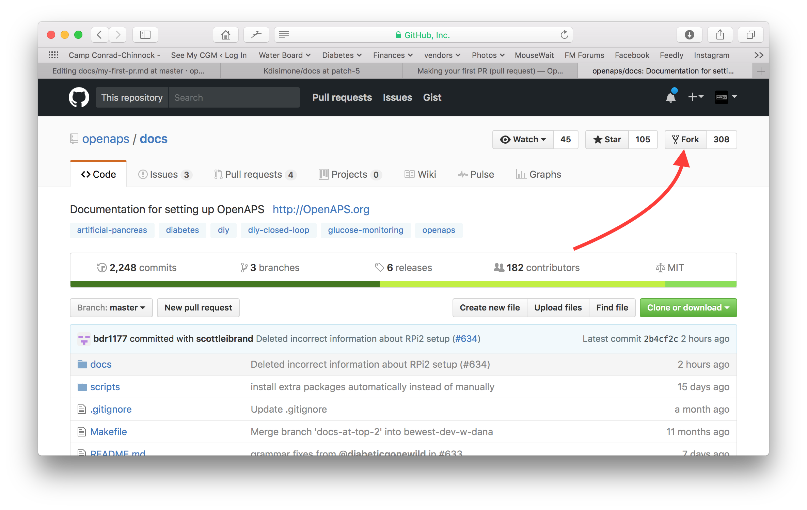
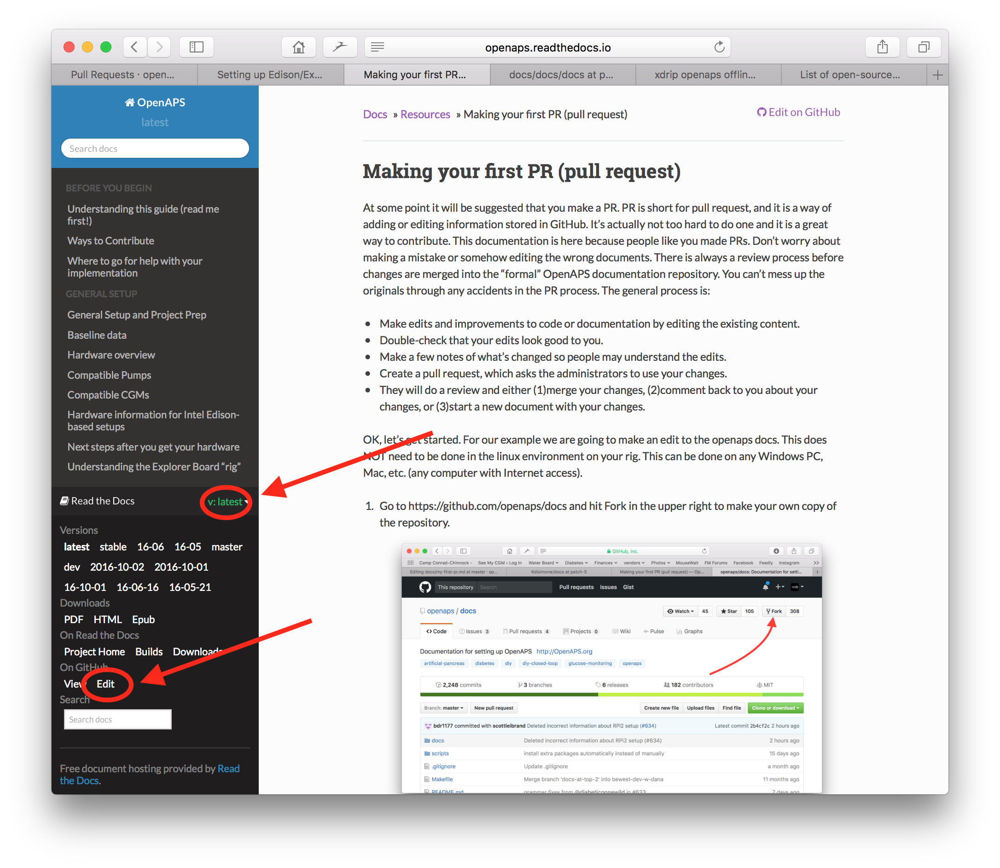
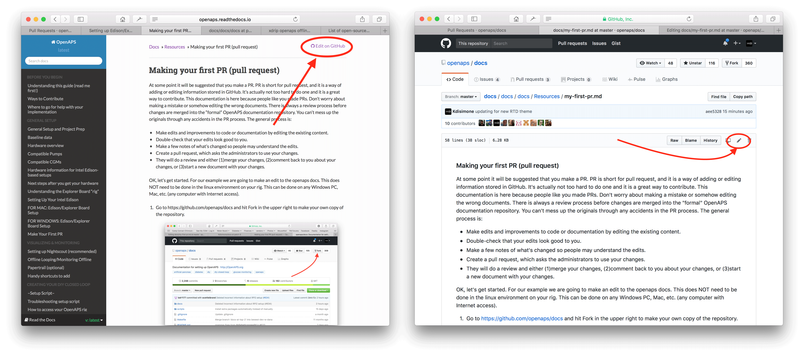

# Jak upravovat dokumentaci

**Tento popis je pouze pro editaci anglické dokumentace. Všechny nové informace musí být přidány nejdřív v angličtině. Pokud chcete přeložit wiki do jiných jazyků (děkujeme), použijte prosím [crowdin](https://crowdin.com/project/androidapsdocs).**

Rady, jak formátovat text (nadpis, tučné písmo...) a vkládat odkazy, najdete v části [„Syntaxe kódu“](#code-syntax) na této stránce.

## Obecné

Máte-li jakékoliv dotazy, můžete kontaktovat dokumentační tým prostřednictvím [Discordu](https://discord.gg/4fQUWHZ4Mw).

V některém okamžiku bude navrženo, abyste vytvořili žádost o začlenění (pull request; PR), což je způsob, jakým jsou vaše změny v dokumentaci skutečně vloženy na webové stránky AAPS, které jsou uloženy v GitHubu. Ve skutečnosti není příliš těžké udělat PR a je to skvělý způsob, jak přispět. Tuto dokumentaci právě teď čtete z toho důvodu, že lidé jako vy udělali PR. Nebojte se, že uděláte chybu nebo nějak editujete špatné dokumenty. Vaše změny jsou přezkoumány než jsou zahrnuty do "formální" dokumentace AAPS. Žádnou náhodnou chybou v procesu tedy nemůžete poškodit originál. Obecný proces je:

- Upravte a vylepšete kód nebo dokumentaci úpravou stávajícího obsahu.
- Zkontrolujte, že vaše úpravy vypadají dobře.
- Udělejte několik poznámek o tom, co je změněno, aby lidé mohli porozumět editacím.
- Vytvořte pull request (PR), kterým požádáte správce, aby vaše změny použili.
- Správci změny zkontrolují a buď (1) sloučí vaše změny, (2) napíšou vám ke změnám komentář, nebo (3) založí nový dokument s vašimi změnami.

(Poznámka: Pokud se učíte spíše vizuálně, existuje YouTube video [zde](https://youtu.be/4b6tsL0_kzg) ukazující, jak PR funguje.)

Například: chystáme se upravit AndroidAPSdocs. To lze udělat na jakémkoli Windows PC, Mac atd. (libovolném počítači s připojením k internetu).

1. Jděte na <https://github.com/openaps/AndroidAPSdocs> a vpravo nahoře klikněte na Fork, abyste si vytvořili vlastní kopii repozitáře.



2. Přejděte na jakoukoli stránku a přejděte na stránku, kterou chcete upravit. Můžete kliknout na odkaz „Edit in GitHub“ v pravém horním rohu. To jde jen u anglických stránek. 



Nebo klikněte na ikonu tužky, která se zobrazí v horní liště obsahu stránky, kterou chcete upravit. Budete muset být již přihlášeni do svého účtu na Githubu (pokud ho nemáte, je snadné si ho vytvořit).



3. Libovolnou možností v kroku 2 vytvoříte nový branch ve svém repozitáři, kde budou uloženy vaše změny. Udělejte své úpravy do souboru.

Pro stránky dokumentace používáme Markdown. Soubory mají příponu „.md“. Specifikace Markdownu není pevně daná a pro naše soubory Markdown v současnosti používáme myst_parser. Dbejte na správnou syntaxi, jak je [popsáno níže](#code-syntax).


4. Pracujete v záložce "<>Edit file". Vyberte záložku „Preview changes“ (náhled změn) a podívejte se na text znovu, abyste měli jistotu, že všechno, co jste změnili, vypadá tak, jak jste chtěli (včetně překlepů). Pokud vidíte, že je potřeba další zlepšení, vraťte se zpět na záložku editace a pokračujte. 


5. Když jste dokončili své úpravy, přesuňte se do dolní části stránky. V obdélníku dole napište komentář do textového pole "Add an optional extended description...". Výchozí název má jméno souboru. Zkuste přidat větu s vysvětlením **důvodu** změny. Pomůže to při kontrole, o jakou změnu se pokoušíte.


6. Klikněte na zelené tlačítko "Propose file changes" nebo "Commit changes". Na stránce se pak objeví tlačítko "Create Pull Request" a znovu na další stránce klepněte na tlačítko "Create Pull Request".


7. Tím dokončíte žádost PR. GitHub přiděluje PR číslo, které se nachází za názvem a hashovou značkou. Na tuto stránku se vracejte a kontrolujte zpětnou vazbu (nebo pokud vám GitHub posílá oznámení e-mailem, budou vám chodit e-maily o každé aktivitě v PR). Úprava teď bude v seznamu PR, které tým zkontroluje a případně k nim dá zpětnou vazbu, než je začlení do hlavní dokumentace AAPS! Pokud chcete zkontrolovat pokrok ve zpracování PR, můžete kliknout na symbol zvonku v horním pravém rohu svého účtu na GitHub a uvidíte všechny své PR.


PS: Váš fork a větev zůstanou na vašem osobním účtu GitHub. Až dostanete oznámení, že váš PR byl sloučen, můžete svou větev smazat, pokud už ji nepotřebujete (v oblasti oznámení z kroku 8 bude odkaz na smazání větve, jakmile bude PR uzavřen nebo sloučen). Pro budoucí úpravy, pokud budete následovat tento postup, budou změny vždy začínat aktualizovanou verzí repozitáře AndroidAPSdocs. Pokud se rozhodnete začít PR jiným způsobem (např. úpravou, která začíná z hlavní větve master ve vašem forku), musíte zajistit, aby byl váš repozitář aktuální. Nejprve proveďte „compare“ (porovnání) a slučte všechny aktualizace, které proběhly od poslední aktualizace vašeho forku. Protože lidé často zapomínají aktualizovat svůj repozitář, doporučujeme použít pro PR proces popsaný výše, dokud se neseznámíte s detaily fungování "Compare".

(edit-the-docs-code-syntax)=

## Syntaxe kódu

Pro stránky dokumentace používáme Markdown. Soubory mají příponu „.md“.

Markdown je velmi jednoduchý jazyk pro formátování textu, který odděluje obsah textu od jeho formátování.

Autor jen například označí nadpis jako nadpis 1. úrovně a procesor Markdownu při zpracování vytvoří potřebný kód HTML, který nadpis v HTML zobrazí.

Cílem je, aby

- autor nejdřív přemýšlel o textu, a ne o formátování,
- text v Markdownu šlo přenášet mezi různými nástroji Markdown, a ne jen v uzavřených (proprietárních) nástrojích, jako je Microsoft Windows, a
- z jednoho souboru Markdown šlo vytvořit několik výstupních formátů.

Markdown není 100% pevný standard a snažíme se držet co nejblíže standardu, abychom

- jsme mohli zůstat flexibilní a měnit nástroje Markdown podle potřeby nebo když nás k tomu donutí další vývoj nástrojů Markdown a služeb SaaS pro Markdown a
- mohli používat překladatelské služby k překladu z angličtiny do cílového jazyka, například francouzštiny nebo němčiny. Ty umí pracovat s Markdownem, ale ne se složitými formátovacími kódy, protože nedokážou oddělit obsah od rozvržení, což může být fatální.

### Nadpisy

- Nadpis 1: `# headline`
- Nadpis 2: `## headline`
- Nadpis 3: `### headline`
- Nadpis 4: `#### headline`

Další úrovně nadpisů se snažíme nepoužívat.

### Formát textu

- **tučně**: `**text**`
- *kurzíva*: `*text*`
- ***tučná kurzíva***: `***text***`

### Číslovaný seznam

    1. první
    1. druhý
    1. třetí
    

1. první
2. druhý
3. třetí

### Nečíslovaný seznam

    - jeden prvek
    - další prvek
    - a ještě další prvek
    

- jeden prvek
- další prvek
- a ještě další prvek

### Víceúrovňový seznam

Seznam můžete vložit do seznamu tak, že další úroveň odsadíte o 4 mezery víc doprava než předchozí.

    1. první
    1. druhý
    1. třetí
      1. jeden prvek
      1. další prvek
      1. a ještě další prvek
    1. čtvrtý
    1. pátý
    1. šestý
    

1. první
2. druhý
3. třetí 
    1. jeden prvek
    2. další prvek
    3. a ještě další prvek
4. čtvrtý
5. pátý
6. šestý

### Obrázky

Obrázky vložíte pomocí této syntaxe Markdown.

- obrázky: ``

Obrázky mají být ve formátu PNG nebo JPEG.

Názvy obrázků mají odpovídat jednomu z následujících pravidel pojmenování. V příkladu používám příponu png. Pokud používáte JPEG, použijte místo toho příponu jpeg.

- `filename-image-xx.png`, kde xx je jedinečné dvoumístné číslo obrázku v tomto souboru.
- `filename-image-xx.png`, kde xx je smysluplný název podle autora souboru md.

Obrázky jsou ve složce images pro angličtinu a do ostatních jazyků je automaticky přenese Crowdin. Nemusíte pro to nic dělat!

Obrázky zatím nepřekládáme: obrázky mají obsahovat **co nejméně textu**, aby byly přístupné i čtenářům, kteří neumí anglicky.

(make-a-PR-image-size)= Používejte rozumnou velikost obrázků, aby byly čitelné na počítači, tabletu i mobilu.

- Snímky obrazovky z webových stránek mají mít šířku nejvýše **1050 pixelů**.
- Diagramy postupů mají mít šířku nejvýše **1050 pixelů**.
- Snímky obrazovky z aplikace mají mít šířku nejvýše **500 pixelů**. Nedávejte je vedle sebe, pokud to není nutné.
- Snímky obrazovky z hodinek (**Wear OS**) mají mít šířku nejvýše **360 pixelů**. Menší snímek obrazovky nikdy nezvětšujte.

### Odkazy

#### Externí odkazy

Externí odkazy jsou odkazy na externí webové stránky.

- externí odkaz: `[alt text](www.url.tld)`

#### Interní odkazy na začátek souboru md

Interní odkazy na stránky jsou odkazy na začátek souboru md, který je uložen na našem vlastním serveru.

- interní odkaz na stránku .md: `[alt text](../folder/file.md)`

#### Interní odkazy na pojmenované odkazy v textu

Interní odkazy na pojmenované odkazy v textu jsou odkazy na libovolné místo v souboru md, který je uložen na našem vlastním serveru a kde byl nastaven odkaz (reference), na který lze odkázat.

Na místo v cílovém souboru md, kam chcete skočit, přidejte pojmenovaný odkaz (referenci).

`(name-of-my-md-file-this-is-my-fancy-named-reference)=`

Pojmenovaný odkaz musí být jedinečný ve všech souborech md AndroidAPSDocs, nejen v souboru, ve kterém je!

Proto je dobré začít názvem souboru a za ním dát zvolený název odkazu.

Používejte jen malá písmena a slova oddělujte pomlčkou.

Potom na tento odkaz odkažte v textu, který píšete, tímto typem odkazu.

- Interní odkazy na pojmenované odkazy v textu: `[alt text](name-of-my-md-file-this-is-my-fancy-named-reference)`

### Poznámky, varování, sbalitelné poznámky

Do dokumentace můžete přidat rámečky s poznámkou nebo varováním.

Dále můžete přidat sbalitelné poznámky s podrobnými informacemi, aby uživatele, které podrobnosti nezajímají, neodradily od čtení celého textu. Používejte je prosím s rozmyslem, protože dokumentace má být co nejsnáze čitelná.

#### Poznámky

    ```{admonition} Nadpis poznámky
    :class: note
    Toto je poznámka.
    ```
    

```{admonition} Nadpis poznámky :class: note Toto je poznámka.

    <br />#### Varování
    
    ````
    ```{admonition} Varování
    :class: warning
    Toto je varování.
    

    ```{admonition} Nadpis varování
    :class: warning
    Toto je varování.
    ```
    
    #### Sbalitelné poznámky
    
    

    {admonition} podrobnější informace pro zájemce
    :class: dropdown
    
    Tato poznámka je sbalená,
    takže sem můžete přidat delší obsah
    a nezabere na stránce příliš místa.
    

````

```{admonition} podrobnější informace pro zájemce :class: dropdown Tato poznámka je sbalená, takže sem můžete přidat delší obsah a nezabere na stránce příliš místa.

```

## Tabulky

Nepoužívejte tabulky s dlouhými texty. Obsah se v Markdownu špatně nastavuje, tabulky se obvykle nevejdou na šířku obrazovky mobilu a po překladu se pravděpodobně nezobrazí stejně.

## Průvodce stylem

### Obsah

1. Tipy pro psaní v angličtině

2. Poznámky k psaní specifické pro AAPS

3. Užitečné odkazy

###  1\. Tipy pro psaní v angličtině

#### Používejte jazyk, který odpovídá čtenáři

Kde je to možné, používejte jednoduchou angličtinu. Pomáhá to čtenářům, pro které angličtina není rodný jazyk, a také usnadňuje překlad dokumentů AAPS do jiných jazyků. Pište s uživatelem jako v rozhovoru. Představte si, že sedíte u stolu naproti člověku, pro kterého píšete. Pamatujte, že většina uživatelů AAPS nemá programátorské znalosti. I samotný diabetes má hodně odborných výrazů a zkratek. Myslete na to, že někdo může mít diabetes krátce, nemusí mít s diabetem tolik zkušeností jako vy nebo mohl projít jiným školením o diabetu. Pokud použijete zkratku, při prvním použití ji napište celou a zkratku dejte hned za ni do závorky, například „super micro bolus (SMB)“. Také odkažte na slovníček. Do závorky můžete přidat i odborné výrazy, které čtenář nemusí znát.

Místo: *“What causes high postprandial BG peaks in closed loop?"*

Použijte: *“What causes a high BG peak **after lunch** (postprandial) in closed loop?"*

##### Používejte jednoduchá slova, kterým rozumí každý

Seznam alternativních slov od A do Z, se kterými bude váš text srozumitelnější, najdete zde:

<https://www.plainenglish.co.uk/the-a-z-of-alternative-words.html>

#### Ochrana soukromí a licence:

Hlavně když nahráváte video nebo děláte snímky obrazovky, dejte pozor, abyste neprozradili své soukromé údaje (klíč API, hesla). Zajistěte, aby obsah na YouTube nebyl veřejně v seznamu a dal se zobrazit jen přes odkaz z dokumentace. Neupozorňujte na materiály, které porušují autorská práva (BYODA apod.).

#### Pište krátké věty a jděte k věci

- Srozumitelný text má mít průměrnou délku věty 15 až 20 slov.

- To neznamená, že všechny věty mají být stejně dlouhé. Buďte úderní. Střídejte krátké věty (jako tu předchozí) s delšími (jako je tato).

- V jedné větě se držte jedné hlavní myšlenky, případně ještě jednoho souvisejícího bodu.

- Občas i tak napíšete delší větu, hlavně když vysvětlujete složitou věc. Většinu dlouhých vět ale lze nějak rozdělit.

- Vynechávejte slabá slova: “you can”, “there is/are/were”, “in order to”.

- Klíčová slova dávejte blízko začátku nadpisů, vět a odstavců.

- Buďte názorní! Kde je to možné, přidejte krátký diagram, snímek obrazovky nebo video.

#### Nebojte se dávat pokyny

Příkazy jsou nejrychlejší způsob, jak dát pokyn, ale autoři se jich někdy bojí a píšou “you should do this” místo prostého “do this”. Možná se lidé bojí, že příkazy zní příliš tvrdě. Často to vyřešíte tak, že před ně dáte slovo „please“ (prosím). Pokud ale něco udělat musíte, je lepší „please“ nepoužít, protože to čtenáři dává možnost odmítnout.

Místo: *“You should just think of it as a complete statement."*

Použijte: *“Think of it as a complete statement.”*

#### Používejte hlavně činný rod, ne trpný rod

Příklad slovesa v **činném rodě**:

- *“The pump (subject) delivers (verb) the insulin (object).”*

“delivers” je zde sloveso v činném rodě. Věta nejdřív říká, kdo dodává, a teprve potom, co se dodává.

Příklad slovesa v **trpném rodě**:

- *“The insulin (subject) is delivered (verb) by the pump (object)”*

*“delivered”* je zde sloveso v trpném rodě. Podmět a předmět jsou proti větě v činném rodě prohozené. Větu jsme museli prodloužit o “is” a “by the”. Zvažte také, zda začít větu slovesem v činném rodě.

Místo: *“You can connect your pump with the phone through the AAPS pump menu, and there are a number of pumps available for you to connect with.”*

Použijte: *“Connect your desired pump to the phone through the AAPS pump menu.”*

Trpný rod může způsobit problémy:

- Může být matoucí.

- Text s ním bývá zbytečně rozvláčný.

- Text s ním je méně živý.

##### Kdy je trpný rod vhodný

Někdy může být trpný rod vhodný.

- Aby věc zněla méně nepřátelsky – 'this bill has not been paid' (trpný rod) zní mírněji než 'you have not paid this bill' (činný rod).

- Aby nikdo nebyl obviňován – 'a mistake was made' (trpný rod) místo 'You made a mistake' (činný rod).

- Když nevíte, kdo nebo co děj vykonává – 'the England team has been picked'.

- Když to prostě zní lépe.

#### Vyhýbejte se nominalizacím

Nominalizace je název něčeho, co není fyzický předmět, například procesu, techniky nebo emoce. Nominalizace vznikají ze sloves.

Například:

| Sloveso   | Nominalizace |
| --------- | ------------ |
| complete  | completion   |
| introduce | introduction |
| provide   | provision    |
| fail      | failure      |

Často se používají **místo** sloves, ze kterých vznikly, ale pak to může znít, jako by se vlastně nic nedělo. Když jich je moc, je text velmi nudný a těžko se čte.

Místo: *“The implementation of the method has been done by a team.”*

Použijte: *“A team has implemented the method.”*

#### Kde je to vhodné, používejte seznamy

Seznamy jsou výborné pro rozdělení informací. Existují dva hlavní typy seznamů:

- Souvislá věta, ve které jsou jednotlivé body vyjmenované na začátku, uprostřed nebo na konci.

- Samostatné odrážky s úvodní větou.

V seznamu s odrážkami výše je každý bod celá věta, proto každý začíná velkým písmenem a končí tečkou. Používejte odrážky, ne čísla nebo písmena. Odrážky upozorní na každý bod a nepřidávají další informaci, kterou musíte vnímat.

#### Vyvracení mýtů

- Větu můžete začít slovy **and, but, because, so nebo however**.

- Infinitiv můžete rozdělit (split infinitive). Takže můžete napsat **“to boldly go”**.

- Větu můžete ukončit předložkou. Ve skutečnosti je to něco, **we should stand up for** (za čím bychom si měli stát).

- A **vy** můžete použít stejné **slovo** ve větě dvakrát, pokud **vy** nenajdete lepší **slovo**.

#### Optimalizace stylu psaní podle účelu

Aby byla dokumentace jasná a krátká, píšeme různé části dokumentace různým stylem.

Styl „vysvětlení“ (explanation) se používá pro úvod, pozadí a části, které rozšiřují znalosti.

Styl „návod“ (how-to guide, s minimem vysvětlování) se používá pro sestavení a konfiguraci AAPS a pro některé části řešení problémů.

Výukový průvodce (tutorial) pomáhá žákovi získat základní dovednosti. Uživatel se bude **učit tím, že věci dělá**.


#####  Výukové průvodce (např. jak naučit dítě ušlehat sníh z bílků)

- vypravěč mluví přímo ke čtenáři: V tomto průvodci **vy** budete (my) lze v některých vzácných případech použít, aby text vyjádřil myšlenku „jsme v tom spolu“

- Budoucí čas -> ukazuje konečný cíl

- Rozkazovací způsob -> pro provádění úkolů -> Konkrétní kroky - vyhněte se abstraktním pojmům

- Minulý čas -> ukazuje dokončené úkoly -> Rychlé a hned viditelné výsledky

- Minimum vysvětlování -> jen to, co je nutné k dokončení úkolu - **co a proč**

- Ignorujte možnosti/alternativy/…. Žádná nejednoznačnost

- Přechody mezi kroky: krok ukončete větou, která logicky vede k dalšímu kroku. Příklad: *Nyní máte nainstalovaného klienta Let’s Encrypt, ale před získáním certifikátů musíte zajistit, aby byly otevřené všechny potřebné porty. Uděláte to v dalším kroku úpravou nastavení firewallu.*

- Název **výukového průvodce** (nadpis 1. úrovně)

- Úvod (bez nadpisu)

- Požadavky (nadpis 2. úrovně)

- Kroky:

- Krok 1 — První úkon (nadpis 2. úrovně)

- Krok 2 — Další úkon (nadpis 2. úrovně)

- Krok n — Poslední úkon (nadpis 2. úrovně)

- Závěr (nadpis 2. úrovně)
    
    - **Jazyk výukových průvodců**
        
        *V tomto průvodci budete…*
        
        Popište, co žák dokáže (pozor – ne: „naučíte se…“).
        
        *Nejprve udělejte x. Teď udělejte y. Když jste udělali y, udělejte z.*
        
        Žádný prostor pro nejednoznačnost nebo pochybnosti.
        
        *Vždy musíme udělat x před y, protože… (podrobnosti viz Vysvětlení).*
        
        Akce vysvětlete co nejméně a co nejjednodušším jazykem. Odkažte na podrobnější vysvětlení.
        
        *Výsledek by měl vypadat přibližně takto…*
        
        Dejte žákovi jasná očekávání.
        
        *Všimněte si, že… Pamatujte, že…*
        
        Dejte žákovi hodně vodítek, aby si mohl ověřit, že je na správné cestě, a zorientovat se.
        
        *Sestavili jste bezpečný třívrstvý hylomorfní stázový motor…*
        
        Popište (a mírně oceňte), co žák dokázal (pozor – ne: „naučili jste se…“)

#####  Návody (how-to guides, např. recept)

Účelem návodu je pomoci uživateli, který už věci rozumí, správně provést určitý úkol.

- JAK na to

- vypravěč mluví přímo ke čtenáři: V tomto průvodci **vy** budete

- Budoucí čas -> ukazuje konečný cíl

- Podmíněný rozkazovací způsob -> abyste získali X, udělejte Y -> Konkrétní kroky - vyhněte se abstraktním pojmům

- Minimum vysvětlování -> jen to, co je nutné k dokončení úkolu -> **co a proč**

- Ignorujte možnosti/alternativy/…. Žádná nejednoznačnost, ale můžete odkázat na referenční nebo vysvětlující text

- **Návod**: Název (nadpis 1. úrovně)

- Úvodní odstavec

- Volitelné požadavky (odstavec, nebo nadpis 2. úrovně, pokud jich je víc než 1)

- Kroky:

- Krok 1 — První úkon (nadpis 2. úrovně)

- Krok 2 — Další úkon (nadpis 2. úrovně)

- Krok n — Poslední úkon (nadpis 2. úrovně)

- Závěrečný odstavec
    
    - **Jazyk návodů**
        
        *Tento návod vám ukáže, jak…*
        
        Jasně popište problém nebo úkol, který návod uživateli ukáže, jak vyřešit.
        
        *Pokud chcete x, udělejte y. Abyste dosáhli w, udělejte z.*
        
        Používejte podmíněný rozkazovací způsob.
        
        *Úplný seznam možností najdete v referenční příručce x.*
        
        Nezahlcujte praktický návod vším, co by uživatel mohl s x dělat.

#####  Vysvětlení (např. věda o tom, proč bílky při šlehání ztuhnou)

Vysvětlení objasňuje, prohlubuje a rozšiřuje čtenářovo porozumění tématu.

- PROČ

- Začněte slovem **O** (About)

- Uveďte souvislosti, odkažte na VŠECHNY související zdroje

- Proberte možnosti/alternativy

- Nedávejte pokyny ani referenční informace (odkažte na ně)

- Uveďte, co není známo nebo co se mění, atd…

- Název **O** … (About; nadpis 1. úrovně)

- Úvod (bez nadpisu)

- Volitelné požadavky (nadpis 2. úrovně)

- Podtéma 1 (nadpis 2. úrovně)

- Závěr (nadpis 2. úrovně)
    
    - **Jazyk vysvětlení**
    
    *Důvodem pro x je, že historicky y…*
    
    Vysvětlujte.
    
    *W je lepší než z, protože…*
    
    Kde je to vhodné, nabídněte hodnocení a i názory..
    
    *x v systému y je obdobou w v systému z. Ale…*
    
    Uveďte souvislosti, které čtenáři pomohou.
    
    *Někteří uživatelé dávají přednost w (protože z). Může to být dobrý přístup, ale…*
    
    Zvažte alternativy.
    
    *x spolupracuje s y takto:…*
    
    Odhalte vnitřní tajemství mechanismu, aby bylo jasné, proč něco dělá to, co dělá.

### 2\. Poznámky k psaní a úpravám specifické pro AAPS

#### Autor a editor

Psaní a úpravy dokumentace AAPS berte jako proces, který má dvě fáze. Může je provést stejná osoba v různých chvílích, nebo více lidí.

**Autor (např. vy!)** napíše nebo upraví část dokumentace stručným tónem jako v rozhovoru a pak ji předá editorovi.

**Editor (např. jiný uživatel AAPS nebo ten, kdo dostane pull request)** zkontroluje, zda text odpovídá průvodci stylem, upraví část, aby byla jasná a přístupná, a odstraní co nejvíc slov (hlavně v částech typu výukový průvodce a návod). Může pomoci, když si text přečtete nahlas.

#### Obecné body k AAPS

- U hodnot glykémie uvádějte pokaždé mg/dl i mmol/l (pokud je to možné, i na snímcích obrazovky).

- Kvůli jednotnosti používejte „AAPS“, ne „Android APS“.

- Jasně uveďte verzi Android Studia/AAPS, pro kterou píšete nebo ze které jsou snímky obrazovky.

### 3\. Užitečné odkazy

<https://dev.readthedocs.io/en/latest/style-guide.html>

[Diátaxis (diataxis.fr)](https://diataxis.fr/)

[Technical Writer Style Guide Examples | Technical Writer HQ](https://technicalwriterhq.com/writing/technical-writing/technical-writer-style-guide/)

[DigitalOcean's Technical Writing Guidelines | DigitalOcean](https://www.digitalocean.com/community/tutorials/digitalocean-s-technical-writing-guidelines)

[Top 10 tips for Microsoft style and voice - Microsoft Style Guide | Microsoft Learn](https://learn.microsoft.com/en-us/style-guide/top-10-tips-style-voice?source=recommendations)

<https://www.plainenglish.co.uk/how-to-write-in-plain-english.html>

<https://developers.google.com/style>

<https://www.mongodb.com/docs/meta/style-guide/screenshots/screenshot-guidelines/>