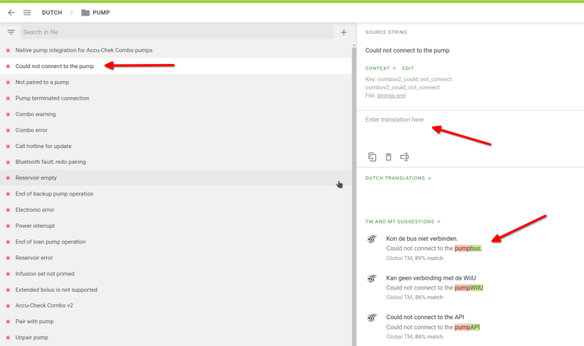
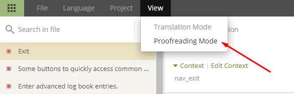
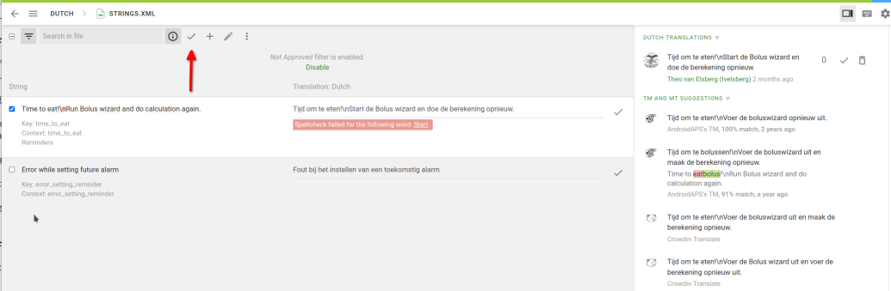

# Jak překládat texty pro aplikaci AAPS nebo dokumentaci

* Pro texty používané v aplikaci přejděte na <https://crowdin.com/project/androidaps> a přihlaste se pomocí vašeho GitHub účtu
* Pro dokumentaci přejděte na <https://crowdin.com/project/androidapsdocs> a přihlaste se pomocí vašeho GitHub účtu

* Pošlete týmu dokumentace žádost o připojení. Klikněte na vlajku požadovaného jazyka a poté na tlačítko "Join" vpravo nahoře na následující stránce. Specifikujte prosím jazyk, uveďte nějaké informace o sobě a svých zkušenostech s AAPS a zda chcete být překladatel nebo korektor (pouze osoby se zkušeností s překlady + pokročilí uživatelé AAPS).

```{admonition} Čas na schválení :class: note

Schválení je nutné provést ručně. Jako nezisková organizace neposkytujeme SLA, ale obecně bude schválení provedeno za méně než jeden den. Pokud ne, kontaktujte prosím dokumentační tým prostřednictvím Facebooku nebo Discordu.

    <br />* Až vás schválíme, klikněte na vlajku
       
    
    ## Překlad aplikace
    
    (translations-translate-strings-for-AAPS-app)=
    ### Překlad textů pro aplikaci AAPS
    
    * Pokud nechcete překládat žádné konkrétní texty, začněte kliknutím na tlačítko „Translate All“. Zobrazí vám řetězce, které potřebují přeložit.
    
       
    
    * Pokud chcete přeložit konkrétní soubor, najděte ho prosím prostřednictvím dialogu vyhledávání nebo stromové struktury a klikněte na název souboru, abyste mohli začít pracovat na překladu textů v souboru.
    
       
    
    * Překládejte věty na levé straně: přidejte nový přeložený text, nebo použijte a upravte návrh
    
       
    
    
    ### Korektura textů pro aplikaci AAPS
    
    * Korektoři začínají výběrem „Proofread“ na domovské obrazovce jazyka.
    
       
    
    
      a schvalují přeložené texty
    
       
    
    Když korektor překlad schválí, bude přidán do příští verze AAPS.
    
    (translations-translation-of-the-documentation)=
    ## Překlad dokumentace
    
    * Klikněte na název stránky dokumentace, kterou chcete přeložit
    
    
    
    
    * Překládejte větu po větě
    
        1. Žlutý text je text, na kterém právě pracujete.
    
        1. Zelený text je už přeložený. Ten už nemusíte překládat znovu.
    
        1. Červený text je zbývající text, který je potřeba přeložit.
    
        1. Toto je zdrojový text, na kterém právě pracujete
    
        1. Toto je překlad, který připravujete. Text můžete zkopírovat shora nebo vybrat jeden z návrhů níže.
    
        1. Toto jsou návrhy překladu. Hlavně zde vidíte, jak moc Crowdin návrh hodnotí jako vhodný, nebo zda už byl přeložen dříve a znovu se objevil jen kvůli přeskupení textu, bez změny obsahu.
        1. Klikněte na tlačítko „Save“ a uložte návrh překladu. Návrh pak půjde ke korektorovi na závěrečnou kontrolu.
    
    
    
    * Přeložená stránka nebude v dokumentaci zveřejněna, dokud
    
        1. překlad je zkontrolován korektorem
    
        1. proběhla synchronizace mezi Crowdinem a GitHubem (jednou za hodinu), která na GitHubu vytvoří PR.
    
        1. PR na GitHubu byl schválen.
    
    Obvykle to trvá 1–3 dny, o svátcích to může trvat o něco déle.
    
    ### Překlad odkazů
    
    ```{admonition} Odkazy se už nepřekládají
    :class: note
    
    Odkazy se už nepřekládají. Dříve zde byla samostatná kapitola, ale ta už neplatí. Po přechodu na Markdown a myst_parser vytváříme v anglickém textu výslovně štítky (labels) a ty se automaticky přenášejí do ostatních jazyků.
    
    

Překládáte text, který odkaz představuje. Dejte prosím pozor, abyste **neodstranili** odkaz, který představuje dvojice značek `<0></0>`, nebo jiná čísla, pokud je jich v odstavci více.

Korektoři na to musí dávat zvláštní pozor!

### Proofreading

* Korektoři se musí přepnout do režimu Proofreading
    
    
    
    a schválit přeložené texty
    
    

* Když korektor překlad schválí, bude přidán do příštího sestavení dokumentace. To nemá pevný rozpis, probíhá podle potřeby, ale zhruba jednou týdně, kromě svátků. Proces můžete urychlit, když tým dokumentace informujete o nových překladech.