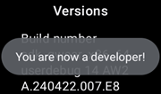
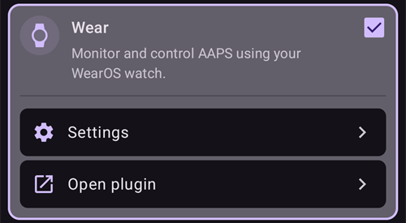

# Set up AAPS on your Wear OS watch

The instructions below apply to the **AAPS Wear** apk that you need to build. If you haven’t built it yet, see the linked guide [here](../WearOS/BuildingAapsWearOS.md). When building, make sure to use the same keystore file that you used for the phone **AAPS** apk.

You can also use some of the information for the **AAPSClient** and **PumpControl** **Wear** apk. Each **Wear** app will communicate with it's matching phone app. For example: the **AAPSClient Wear** app can be used to display **AAPSClient** data and not **AAPS** data. When several client flavors (**AAPSClient**, **AAPSClient2**, **AAPSClient3**) are installed side by side, each one's tiles carry a small header in that flavor's accent colour so you can tell them apart while swiping.

## Wear OS Versions and compatibility

(wearos-watchface-changes)=

### Wear OS watch face changes (impact on AAPS watchfaces)

```{admonition} Why newer Wear OS watches break AAPS watchfaces
:class: warning

In June 2025 Google [announced changes](https://android-developers.googleblog.com/2025/06/upcoming-changes-to-wear-os-watch-faces.html) that phase out the legacy watch face engine (the AndroidX / Wearable Support Library, or "WSL", engine) in favour of the newer declarative **Watch Face Format**. The **AAPS** custom watchfaces are built on the legacy engine, so the newer the Wear OS version, the more likely an AAPS watchface is to misbehave or stop working.

This affects the **watchfaces** specifically — AAPS **complications**, tiles and remote-control functions are not impacted. It is also why **a firmware/system update on a Wear OS watch can break AAPS watchfaces**, and a watch cannot be rolled back to an older Wear OS version afterwards. If your AAPS watchface currently works, **disable automatic watch updates**.
```

The table below summarises how Google's change affects the AAPS (legacy-engine) watchfaces by Wear OS version:

| Wear OS version         | Base Android | API level | Impact on AAPS (legacy) watchfaces                                                                                                                                                          |
| ----------------------- | ------------ | --------- | ------------------------------------------------------------------------------------------------------------------------------------------------------------------------------------------- |
| Wear OS 6               | Android 16   | 36        | **Legacy watchfaces no longer available** — AAPS installs a [Watch Face Format watchface](#wearos-aaps-v4-watchface) instead: your custom watchface, or the AAPS V4 complications watchface |
| Wear OS 5               | Android 14   | 34        | **Severe** — active (interactive) mode often fails, complications freeze, animations stop                                                                                                   |
| Wear OS 4               | Android 13   | 33        | **Moderate** — throttling, missed updates, partial failures                                                                                                                                 |
| Wear OS 3.0 / 3.2 / 3.5 | Android 11   | 30        | **Low** — legacy engine still supported                                                                                                                                                     |

If your watch runs a version where AAPS watchfaces are unreliable, you can instead display AAPS data through **complications** on a compatible watchface, or use [GlucoDataHandler](https://play.google.com/store/apps/details?id=de.michelinside.glucodatahandler) with a complication, fed by the [External Companion Apps](#external-companion-apps) plugin of **AAPS**. On **Wear OS 6 and newer**, AAPS installs a replacement watchface built in the new format — see below.

(wearos-aaps-v4-watchface)=

### Wear OS 6 and newer — the watchface AAPS installs

Watches running **Wear OS 6 or newer** cannot run the classic AAPS watchfaces as watchfaces. For these watches the AAPS watch app brings two watchfaces built in Google's new **Watch Face Format**. Wear OS lets an app install only **one** watchface, so you choose which of the two is on the watch:

- **Custom watchface** (default): shows the custom watchface you loaded from the phone with **Load Watchface** (see [Changing to an AAPS Watchface](#WearOS_changing-to-AAPS-watchface)). The watch draws your design as a picture, so every existing custom watchface works. The complication slots a custom watchface may define are **not available** in this picture, because Wear OS only delivers complication data to a real watchface. Long-press the face to reach its one setting: whether the always-on display shows a plain clock or your own design, dimmed.
- **Complications watchface** (the **AAPS V4** watchface): its **seven complication slots** come **preconfigured with AAPS data**: BG value, IOB, COB, the [BG Graph complication](#Watchfaces-complications), basal rate / temp target, and the **Running Mode** icon in the top-left slot (tap it to change the loop mode from the watch). Tap the time at the top to open the watch's alarm app. You can change what each slot shows in the watch face editor.

You choose on the phone: open the **Wear** plugin and, under **Watchface installed on watch**, select one of the two. This card is only shown while a Wear OS 6 or newer watch is connected. **AAPS** asks you to confirm, because the watch replaces its face immediately. Switching away from the **Complications watchface** also resets the complications you changed in the watch face editor back to the defaults, and the confirmation says so. While the **Complications watchface** is selected, the custom watchface buttons are hidden and a preview of the face is shown instead. If you load a custom watchface while the **Complications watchface** is selected, **AAPS** reminds you to switch to **Custom watchface** to see it on the watch.

- The selected watchface is **installed and activated automatically** the first time the AAPS watch app runs on such a watch, and it is **updated automatically** together with the watch app.
- If you removed the watchface, an **Install watchface** entry appears at the bottom of the watch's AAPS **main menu** — tap it to reinstall.

While a watch running Wear OS 5 or older is connected, the **Watchface installed on watch** card is not shown at all (the mechanism it relies on requires Wear OS 6); the classic watchfaces run there as before.

(wearos-complications-watchface-setup)=

### Complications watchface — recommended setup

The **Complications watchface** has seven complication slots. Long-press the watchface, tap **Customize**, and pick a data source for each slot. The slots are numbered as in the watch face editor: **1** left, **2** centre, **3** right, **4** the graph, **5** bottom, **6** top-left and **7** top-right.

| Default setup                                                                                   | Alternative setup                                                                                       |
| ----------------------------------------------------------------------------------------------- | ------------------------------------------------------------------------------------------------------- |
|  |  |

| Slot | Pozice    | Default                                                             | Alternative                           |
| ---- | --------- | ------------------------------------------------------------------- | ------------------------------------- |
| 1    | Left      | IoB Icon                                                            | CoB & IoB                             |
| 2    | Centre    | Blood Glucose                                                       | Blood Glucose                         |
| 3    | Right     | CoB Icon                                                            | BR & Target                           |
| 4    | Graph     | BG Graph                                                            | BG Graph                              |
| 5    | Bottom    | BR & Target                                                         | Uploader/Phone Battery                |
| 6    | Top-left  | Režim smyčky                                                        | Režim smyčky                          |
| 7    | Top-right | Uploader/Phone Battery, or an app shortcut to **AAPS Snooze Alert** | App shortcut to **AAPS Snooze Alert** |

The **AAPS Snooze Alert** shortcut is picked from the watch's own **App shortcut** complications. Tapping it snoozes the alarm that is sounding on the phone.

```{tip}
Turn on **Always-on display** on the watch (**Settings** > **Display**). The watchface then keeps showing your glucose when the wrist is down, instead of a blank or a plain clock.
```

```{admonition} No complication data while the watch is locked
:class: note
If a **Lock type** is set under **Settings** > **Security and privacy**, the watch hides complication data while it is locked, and the watchface shows empty slots until you unlock it. To keep the data visible, turn off **Hide information** in the same menu.
```

### Wear OS 3

Install the **AAPS Wear** apk using [Wear Installer 2](https://youtu.be/abgN4jQqHb0?si=5L7WUeYMSd_8IdPV), Easy Fire Tools (described below) or ADB.  
No limitation in **AAPS Wear** operations.

(BuildingAapsWearOs-WearOS5)=

### Wear OS 4 and Wear OS 5

Example: Galaxy Watch 4, 5, 6, 7 and Ultra or Pixel Watch that have **not** been updated to Wear OS 6 yet. Check the version under **Settings** > **About watch** > **Software**.

Install the **AAPS Wear** apk using [Wear Installer 2](https://youtu.be/abgN4jQqHb0?si=5L7WUeYMSd_8IdPV) (for Wear OS 5 follow [this video](https://www.youtube.com/watch?v=yef_qGvcCnk)). All **AAPS Wear** functions work, but the classic **AAPS** watchfaces are limited as described in the table above: throttled on Wear OS 4, often failing on Wear OS 5.

```{admonition} Wear OS 5
:class: warning
On Wear OS 5 the AAPS watchface has to be selected with Wear Installer 2 right after installing the Wear app: the installer offers the **AAPS (Custom)** watchface at the end of the installation. If you accidentally switch to another watchface, repeat the installation. Changing the watchface settings (Dark, Watchdivider, etc.) may not be possible.

If the classic watchface currently works for you, **disable automatic watch updates**: the next firmware update is likely to break it. If you update to Wear OS 6 anyway, read the section above: **AAPS** then installs its own watchface in the new format.
```

If the watchface is too unreliable, consider [GlucoDataHandler](https://play.google.com/store/apps/details?id=de.michelinside.glucodatahandler) with a complication instead. It needs the [External Companion Apps](#external-companion-apps) plugin enabled in **AAPS**.

### Wear OS 6 and newer

Example: Galaxy Watch 4 and newer with One UI 8 Watch, Pixel Watch after the 2025 update. Most Galaxy and Pixel watches have received this update.

Install the **AAPS Wear** apk using [Wear Installer 2](https://youtu.be/abgN4jQqHb0?si=5L7WUeYMSd_8IdPV). The classic watchfaces are not available; **AAPS** installs the watchface selected on the phone automatically, see [the watchface AAPS installs](#wearos-aaps-v4-watchface). No limitation in **AAPS Wear** operations.

## How to set up a Samsung Galaxy 4 smartwatch with **AAPS**

This section assumes you are totally new to Smartwatches, and gives you basic orientation of a popular watch, the **Galaxy Watch 4**, followed by a step-by-step guide to setup **AAPS** on the watch.

_This guide was written for a Galaxy Watch running Wear OS 3._ On Wear OS 4 and later the watch asks for a **pairing code** when a phone or computer connects over ADB. Wear Installer 2 and the terminal procedure [below](#BuildingAapsWearOs-WearOS5-TShoot) both support it.

Here are basic setup guides for the [Galaxy Watch 5](https://www.youtube.com/watch?v=Y5upzOIxwTU) and [Galaxy Watch 6](https://www.youtube.com/watch?v=D6bq20KzPW0)

## Basic smartwatch familiarity

After basic setup of your watch according to the video above, go to the playstore on the phone and download the following apps: "Galaxy Wearable" “Samsung” and either “Easy Fire tools” or "Wear Installer 2".

There are plenty of 3rd party YouTube videos which will help you with getting familiar with your new smartwatch, for example:

[https://www.youtube.com/watch?v=tSVkqWNmO2c](https://www.youtube.com/watch?v=tSVkqWNmO2c)

The app “Galaxy Wearable” also has an instruction manual section in it. Open galaxy wearable on the phone, search for the watch, attempt to pair the watch with the phone. Depending on your version, this may prompt you to install a further 3rd app “galaxy watch 4 plugin” from the playstore (takes a while to download). Install this on the phone, and then attempt to pair the watch and phone again in the wearable app. Go through a series of menus and tick various preferences.

## Setting up a Samsung account

You need to make sure that the email account you use to set up the Samsung account has a date-of-birth such that the user is age 13+, as otherwise the Samsung permissions are really difficult to approve. If you have given your child under 13 a Gmail account and are using that email address, you cannot simply change it to an adult account. One way around this is to modify the current date-of-birth to make the current age 12 years and 363 days old. The following day, the account will be converted to an adult account, and you can progress with the setup of the Samsung account.

(remote-control-transferring-the-aaps-wear-app-onto-your-aaps-phone)=

## Transferring the **AAPS** Wear app onto your **AAPS** phone

Loading the Wear.apk from Android Studio to your phone can be done either by:

a)  using a USB cable to put the **AAPS** wear apk file onto the phone, and then “side-load” it to the watch. Transfer Wear.apk to the phone via USB into the downloads folder; or

b)  cut and paste Wear.apk from Android Studio onto your Gdrive.


To side-load AAPS onto the watch You can use either: 1) Wear Installer 2 2) Easy Fire tools 3) Android Debug Bridge (ADB) Here we recommend Wear Installer 2, because the instructions and process in the video are so clear and well-explained. If Wear Installer 2 does not work for you, try Easy Fire Tools or ADB, both described below.

### Using Wear Installer 2 to side-load **AAPS** Wear from the phone onto the watch

 

Wear Installer 2, developed by [Malcolm Bryant](https://www.youtube.com/@Freepoc) can be downloaded from Google Play onto your phone and can be used to side-load the AAPS wear app onto the watch. The app includes a handy ‘how to sideload’ [video.](https://youtu.be/abgN4jQqHb0?si=5L7WUeYMSd_8IdPV)

```{tip}
For Wear OS 5 watches follow [this video](https://www.youtube.com/watch?v=yef_qGvcCnk).
See troubleshooting tips [below](#BuildingAapsWearOs-WearOS5-TShoot).
```

This provides all the necessary detail (best to open the video on a separate device so you can watch it while setting up the phone).

As mentioned in the video, once complete, switch ADB debugging off on the watch, to avoid draining the smartwatch battery.

Alternatively, but not for Wear OS 5, you can:

### Use Easy Fire tools to side-load the **AAPS** wear on the watch

1)   Download _[Easy Fire Tools](https://play.google.com/store/apps/details?id=de.agondev.easyfiretools&hl=en)_ from the Play Store onto phone


2)  Make yourself a developer in the watch (once set up and connected to phone):

Go to **Settings** > **System** > **About** > **Versions** (the menu names vary between watch brands — on some watches it is **About watch** > **Software info** > **Software version**).


Rapidly tap on **Build number** (or **Software version**) several times until a message tells you that you are now a developer.



Go back to **Settings** > **System**: a new **Developer options** menu is now shown.

In **Developer options**, turn on **ADB debugging** and **Wireless debugging**, and confirm the prompts. Wireless debugging then shows the watch's **IP address & Port**, something like: **192.168.1.214** : 5555. You only need the IP address (here **192.168.1.214**), not the port number after the colon. Note that the IP address can change, for example every time you change to a new phone handset for AAPS.


STEP 3)     Enter IP address _e.g._ **192.168.1.214** into Easy Fire tools on the phone (go into the left hamburger, settings and enter the IP address).


Then click the plug socket icon on the top right. It will turn green when connected.


STEP 4) Follow the instructions [here](https://wearablestouse.com/blog/2022/01/04/install-apps-apk-samsung-galaxy-watch-4/?utm_content=cmp-true) to side-load (i.e. transfer)  aaps-wear.apk onto the smartwatch using Easy Fire tools


(BuildingAapsWearOs-WearOS5-TShoot)=

### Using the terminal
Connect your smartwatch and computer to the same Wi-Fi network.

- To install ADB download it from: https://developer.android.com/tools/releases/platform-tools
- Open a terminal.
- For Windows, create a new folder named `adb` under your disk `C:`. Open the `platform-tools-latest-windows.zip` file you downloaded above. Copy all files inside `platform-tools` to `C:\adb` and open this folder with a command prompt (right click and Open in Terminal). Type the command below to set the path to the folder where ADB is located: `setx PATH "%PATH%;C:\adb"`
- For Mac instead of installing manually you can use homebrew: `brew install android-platform-tools`

On the watch:
- Go to Settings → About watch → **Software Information**
- Tap Software version 7 times until you see Developer mode enabled.
- Go to Settings → Developer options. Enable **ADB debugging**
- Go to Settings → Developer options → Wireless debugging → **Pair new device**

You will see a Wi-Fi pairing code and IP address and port appearing:


- In the terminal: `adb pair ipaddress:port` E.g. `adb pair 10.10.1.125:36299`
- You will be asked for the pairing code. Enter it.
- You will see a response:<br> `Successfully paired to 10.10.1.125:36299 [guid=adb-RXXXW20LMKJY-eh5zBj]`<br>
- In the terminal type: <br>`adb devices`.<br> You should see something like:<br> `List of devices attached`<br> `10.10.1.125:36299  offline`<br> `adb-RFAW20LMKJY-eh5zBj._adb-tls-connect._tcp   device`<br>

- Now go to the folder on your computer where the Wear apk is and type<br> `adb install wear-full.apk` <br>with wear.apk replaced by the name of your apk file.
- You will see:<br> `Performing Streamed Install`<br> `Success`


(wear-os-5-troubleshooting)=

### General troubleshooting recommendations for Wear OS 5

- Do not use Wi-Fi Tethering. That won't work.
- You do not need to enable adb debugging on the phone (only on the watch). Disable adb debugging on the Phone.
- Make sure you are connecting to your local network where phone and watch can see each other (do not use your Wi-Fi guest network to connect).
- Make sure both watch and phone are on the same network and Wi-Fi device. Especially Wi-Fi repeaters or access points may create problems.
- Make sure to be near your main router, then restart both phone and watch.

**Pairing :**

- Watch: Wireless Debugging: note the IP address.
- Wear Installer: Enter the IP on the in Wear Installer app.
- Select Pair new, note the pairing code and port number displayed.
- Wear Installer: enter the pairing code + space + port number.
- Wear installer should report pairing was successful. If it does not, exit the Wear Installer, then try again.

Once paired you should be able to install the AAPS wear apk:

- Exit/close, then restart Wear Installer.
- On wireless debug, note the IP and Port number and make sure you check/enter the IP and port number in Wear Installer.
- Note: the port number is different from the one used for pairing!

## Setting up the connection between the watch and the phone from **AAPS**

The final step is to configure **AAPS** on the phone to interact with **Wear.apk** on the watch. To do this, enable the Wear plugin:

* Go to the **AAPS** app on the phone

* Open the **menu** (☰) in the top-left corner and go to **Configuration** > **Communication**

* Tick the **Wear** box



To bolus or take other actions from the watch, also turn on **Wear control** in [Settings > Wear](#preferences-wear).

To change to a different **AAPS**  watchface, press on the home screen of the watch and it will come to “customise”. Then swipe right until you get to all the **AAPS**  faces.

If the **AAPS** Wear.apk has been successfully side-loaded onto the smartwatch, it will look like this:


For certain smart watches, like the Samsung Galaxy, 'Remote Connection' under Samsung Galaxy's Advanced Features must be switched **on** to use **Wear.apk** & **AAPS** remotely via Wi-Fi.


(wear-os-watch-phone-communication)=

### Troubleshooting the **AAPS** watch- **AAPS** phone communication

1.  If EasyFire tools does not connect or if you are receiving ‘authorisation failed’ > check IP address has been correctly entered.
2.  Check that the smartwatch is connected to the internet (and not just connected to the phone via Bluetooth).
3.  Check that the **AAPS** Phone and smartwatch are paired or linked in Samsung app.
4.  It may also help to do a hard restart of Phone and smartwatch (meaning turning phone on and off)
5.  Assuming you have managed to download the Wear.apk onto your phone but you are not receiving any BG data, _check_ that you have side-loaded the correct **AAPS** Wear apk onto the watch: the watch app of a browser build is the `aaps-wear-….apk` file, see [Building the Wear app](../WearOS/BuildingAapsWearOS.md). If the file you installed is any of the following: a) an **AAPSClient** Wear apk (while the phone runs **AAPS**); b) a `.aab` file; or c) a file with the word ‘debug’ in its name, you have not selected the correct Wear OS apk during the build.
6.  Check that your router is not isolating the devices from one another.

More troubleshooting tips can be found [here](https://freepoc.org/wear-installer-help-page/#:~:text=If%20you%20are%20having%20problems,your%20phone%20and%20your%20watch.)

(WearOS_changing-to-AAPS-watchface)=

## Changing to an AAPS Watchface on your WearOS watch

There are a number of watchfaces available in the standard build of the AAPS Wear OS APK build. Once you have installed the AAPS Wear APK on your watch, they will be available. Here are the steps for selecting one:

1. On your watch (assuming WearOS), long press on your current watchface to bring up the watchface selector screen and scroll all the way to the right until you see the "Add Watch Face" button and select it


2. Scroll through the list until you find "AAPS (Custom)" (depending on the watch, the watch faces of installed apps are listed under a "Downloaded" section or grouped by app) and click the middle of the image to add it to your shortlist of current watchfaces. Don't worry about the current appearance of the "AAPS (Custom)" watchface, we will select your preferred skin in the next step.


3. Now open AAPS on your phone and open the Wear plugin: **Configuration** > **Communication** > **Wear** > **Open plugin** (tick **Wear** first if it is not enabled).


4. Click on the "Load Watchface" button and select the watchface that you like


5. Check your watch, the "AAPS (Custom)" watchface should now be displaying the skin that you have selected. Give it a few seconds to refresh. The **Wear** screen on the phone now shows the name of the loaded watchface and a preview of it. **Infos Watchface** lists its details and the fields it contains, and **More watchfaces** opens the [exchange site](../ExchangeSiteCustomWatchfaces/index.md) where you can download other custom watchfaces. You may now customize the complications, etc. by long pressing the watchface and then pressing the "Customize" button on the watchface image.

```{admonition} Complications on a custom watchface
:class: note
Custom watchfaces made with version 3.0 or newer of the custom watchface format can contain up to five complication slots, with their position and size defined by the watchface (**Complication layout**). On the watch, long-press the watchface, tap **Customize** and tap **Complication 1** to **Complication 5** to choose the data source shown in each slot. The same rows are listed in the watch's AAPS app under **Settings** > **AAPS(Custom)**; tapping one there opens the same picker. **Complication type priority** decides whether a slot prefers a value or gauge, text, or an icon when the data source offers several. A changed priority only applies the next time you pick a data source for that slot.

These slots only work on watches running **Wear OS 5 or older**, where the custom watchface runs as a real watchface. On **Wear OS 6 and newer**, the custom watchface is shown as a picture without its complication slots, and steps 1 and 2 above are not needed: make sure **Custom watchface** is selected under **Watchface installed on watch** in the phone's **Wear** plugin (see [the watchface AAPS installs](#wearos-aaps-v4-watchface)).
```

## AAPSv2 watchface - Legend


A - time since last loop run

B - CGM reading

C - minutes since last CGM reading

D - change compared to last CGM reading (in mmol or mg/dL)

E - average change CGM reading last 15 minutes

F - phone battery

G - basal rate (shown in U/h during standard rate and in % during TBR)

H - BGI (blood glucose interaction) -> the degree to which BG “should” be rising or falling based on insulin activity alone.

I - carbs (carbs on board | e-carbs in the future)

J - insulin on board (from bolus | from basal)
