# Sådan bruger du Autotune-pluginet

Autotune-pluginet er en implementering af OpenAPS' autotune-algoritme i AAPS. Det analyserer din seneste AAPS-historik og foreslår justeringer af dine basalrater, ISF og kulhydratforhold (IC).

Autotune-pluginet findes i AAPS-udgivelser siden [3.4](#version3400), men er skjult som standard.

(autotune-how-autotune-calculates-adjustments)=
## Sådan beregner Autotune justeringer

Autotune ser tilbage på din seneste AAPS-historik — CGM-målinger, boluser, kulhydrater og midlertidige basalrater — og finder ud af, hvor din **profil** (basalrater, ISF, kulhydratforhold) ikke helt passer til det, der faktisk skete med dit BS.

For hvert datapunkt på 5 minutter sammenligner den din **faktiske BS-ændring** med den ændring, din profil forudsagde, og sorterer den afvigelse, der kommer ud af det, i en af tre grupper:

* afvigelser, der skete uden kulhydrater om bord og uden insulinaktivitet (bruges til at justere **basalrater**, time for time),
* afvigelser, der skete efter en bolus/korrektion uden kulhydrater (bruges til at justere **ISF**), eller
* afvigelser, der skete, mens kulhydrater blev absorberet (bruges til at justere **kulhydratforhold**).

Derefter ser den på mønsteret af afvigelser i hver gruppe (med percentiler i stedet for et simpelt gennemsnit, så nogle få datapunkter med støj ikke forvrænger resultatet) og foreslår en ny værdi for den time/parameter.

For at en enkelt kørsel ikke skal overkorrigere, flytter hver Autotune-kørsel kun en værdi en del af vejen mod det, dataene foreslår: op til 10% for ISF og kulhydratforhold og op til 20% for hvert basalsegment. Den samlede ændring begrænses desuden af indstillingerne **Autosens maks.** / **Autosens min.** (se [Andre indstillinger](#autotune-other-settings) nedenfor) — de samme grænser, som begrænser Autosens. Derfor er Autotune lavet til at blive kørt gentagne gange (dag efter dag eller hver nat) i stedet for at man stoler på det efter en enkelt kørsel: resultaterne bør nærme sig en stabil værdi lidt efter lidt, og et stort spring i én kørsel er et tegn på, at du skal kontrollere dine data igen (manglende kulhydrater, en dårlig sensordag _osv._) i stedet for at stole blindt på det.

Autotune kan køres på tre måder: manuelt en enkelt gang inde fra pluginet (som beskrevet nedenfor), automatisk hver nat via en [automatiseringsregel](#autotune-run-autotune-with-an-automation-rule) eller — helt uden for AAPS — som et selvstændigt kommandolinjeværktøj på eksporterede data. Sådan beskriver nogle vejledninger fra fællesskabet, at man kan bruge det uden en telefon, der kører AAPS.

*Den underliggende oref0-algoritme med alle matematiske detaljer finder du i [OpenAPS' Autotune-dokumentation](https://openaps.readthedocs.io/en/latest/docs/Customize-Iterate/autotune.html).*

## Vis Autotune-pluginet

Opret en tom fil med navnet `enable_autotune` i undermappen `extra` i din telefons [AAPS-mappe](#preferences-maintenance-settings).

***BEMÆRK: Sørg for at kontrollere i AAPS-indstillingerne, hvor din AAPS-mappe er, og at du har lagt filen i den rigtige mappe. Flere brugere har lagt filen i den forkerte mappe.***

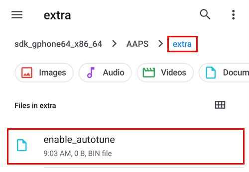

Genstart **AAPS**. Åbn derefter **menuen** (☰), vælg **Konfiguration**, derefter kategorien **Generelt**, og sæt flueben ved **Autotune**. Kortet viser så **Indstillinger** og **Åbn plugin**:

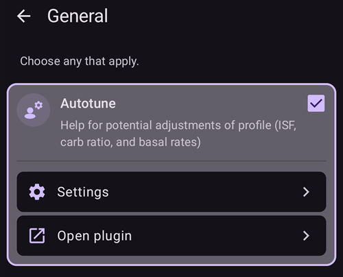

## Autotunes brugerflade

Tryk på **Åbn plugin** på kortet **Autotune** for at åbne Autotune-skærmen:

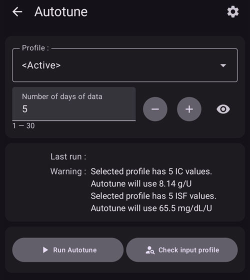

- I rullemenuen Profil kan du vælge den input-profil, du vil justere (som standard er din aktuelle aktive profil valgt)
  - Bemærk: Hver gang du vælger en ny profil, bliver tidligere resultater fjernet, og **Antal dage med data** bliver sat til sin standardværdi
- Med **Antal dage med data** (kaldet **Tune days** i ældre versioner) vælger du derefter det antal dage, der bruges i beregningen til at justere din profil. Mindsteværdien er 1 dag, og højeste værdi er 30 dage. Dette tal bør ikke være for lille, så du får korrekte, gentagne og jævne resultater (over 7 dage for hver beregning)
  - Bemærk: Hver gang du ændrer **Antal dage med data**, bliver tidligere resultater fjernet
- Sidst kørt er et link, der henter din seneste gyldige beregning. Hvis du ikke har startet Autotune i dag, eller hvis tidligere resultater blev fjernet ved en ændring af en beregningsparameter ovenfor, kan du hente parametrene og resultaterne fra den seneste vellykkede kørsel.
- Advarsel viser dig f.eks. nogle oplysninger om den valgte profil (hvis du har flere IC-værdier eller flere ISF-værdier)
  - Bemærk: Autotune-beregningen virker kun med én IC-værdi og én ISF-værdi. Der findes i øjeblikket ingen Autotune-algoritme, der kan justere en døgnvarierende IC eller en døgnvarierende ISF. Hvis din input-profil har flere værdier, kan du i advarselsfeltet se den gennemsnitsværdi, der bruges til at justere din profil.
- Knappen Tjek input-profil åbner profilvisningen, så du hurtigt kan kontrollere din profil (enheder, IC, ISF, basal og mål)
  - Bemærk: Autotune justerer kun din IC (én værdi), ISF (én værdi) og basal (med døgnvariation). Enheder og mål forbliver uændrede i output-profilen.

- »Kør Autotune« starter Autotune-beregningen med den valgte profil og det valgte antal dage med data
  - Bemærk: Autotune-beregningen kan tage lang tid. Når den er startet, kan du skifte til en anden visning (hjem, ...) og komme tilbage til Autotune-pluginet senere for at se resultaterne

  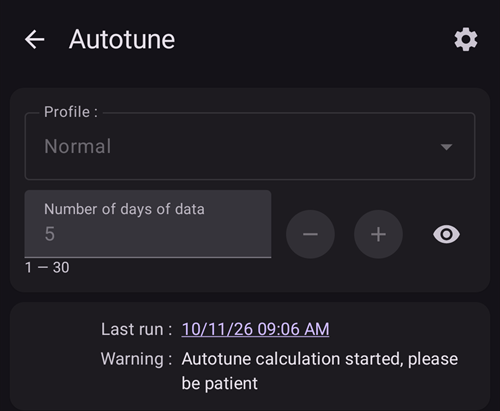

- Under kørslen ser du så mellemresultater nedenfor

  - Bemærk: Under kørslen er indstillingerne låst, så du kan ikke længere ændre den valgte input-profil eller antallet af dage. Du skal vente, til den aktuelle beregning er færdig, hvis du vil starte en ny kørsel med andre parametre.

  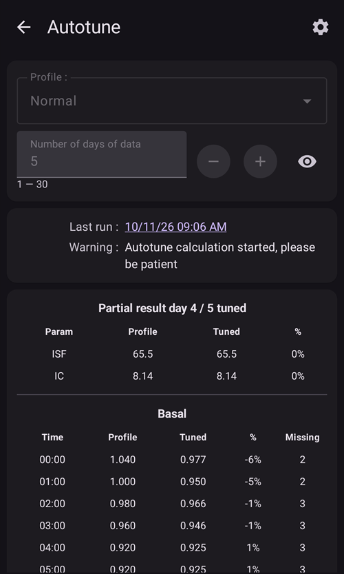

- Når Autotune-beregningen er færdig, ser du resultatet (den justerede profil) og fire knapper nedenfor.

  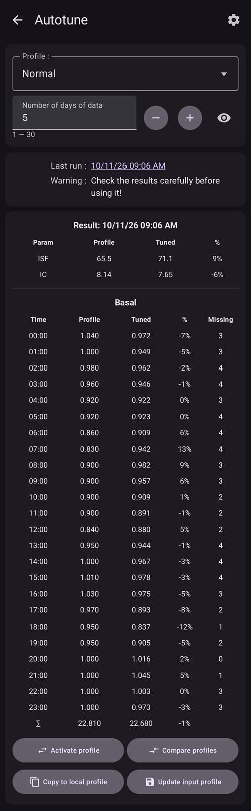

- Det er vigtigt altid at sammenligne input-profilen (kolonnen »Profil«), output-profilen (kolonnen »Justeret«) og ændringen i procent for hver værdi (kolonnen »%«).

- For basalrater ser du også antallet af »manglende dage«. Du har manglende dage, når Autotune ikke har nok data kategoriseret som »Basal« til at justere basalraten i denne periode (f.eks. efter hvert måltid, når du har kulhydratabsorption). Dette tal bør være så lavt som muligt, især når basal er vigtig (f.eks. om natten eller sidst på eftermiddagen)

- Knappen »Sammenlign profiler« åbner visningen til sammenligning af profiler. Input-profilen er blå, og output-profilen (med navnet »Justeret«) er rød.

  - Bemærk: I eksemplet nedenfor har input-profilen døgnvariation for IC og ISF, men den beregnede output-profil har én værdi. Hvis det er vigtigt for dig at få en døgnvarierende output-profil, så se [Døgnvarierende IC- eller ISF-profil](#autotune-circadian-ic-or-isf-profile) nedenfor.

  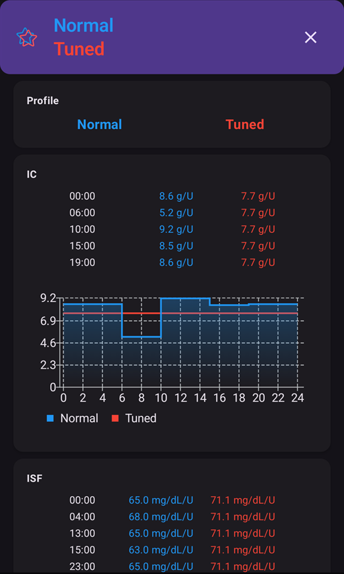

- Hvis du stoler på resultaterne (lille ændring i procent mellem input-profil og output-profil), kan du klikke på knappen »Aktiver profil« og derefter på OK for at bekræfte.

  - »Aktiver profil« opretter automatisk en ny profil »Justeret« i din profilliste (**Administrer → Profil**).
  - Hvis du allerede har en profil med navnet »Justeret« i **Administrer → Profil**, bliver denne profil opdateret med den beregnede Autotune-profil før aktiveringen

  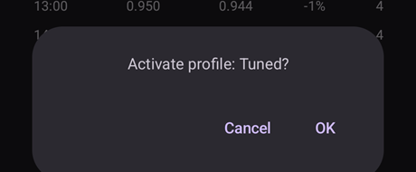

- Hvis du mener, at den justerede profil skal tilpasses (f.eks. hvis du mener, at nogle ændringer er for store), kan du klikke på knappen »Kopier til lokal profil«

  - En ny profil med præfikset »Justeret« og dato og tidspunkt for kørslen bliver oprettet i **Administrer → Profil**

  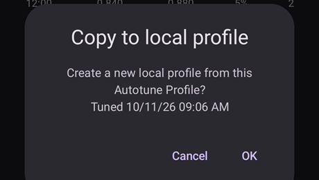

- Du kan derefter redigere den justerede profil: åbn **Administrer** > **Profil**, stryg hen til kortet med navnet »Justeret« og dato og tidspunkt for kørslen, og tryk på knappen **Rediger** (blyant)

  - værdierne i profilen bliver i brugerfladen afrundet til det, din pumpe kan

  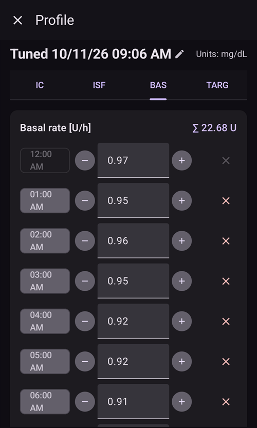

- Hvis du vil erstatte din input-profil med resultatet fra Autotune, så klik på knappen »Opdater input-profil«, og bekræft pop op-vinduet med OK

  - Bemærk: Hvis du klikker på »Aktiver profil« efter »Opdater input-profil«, aktiverer du din opdaterede profil og ikke standardprofilen »Justeret«.

  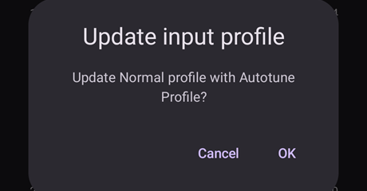

- Hvis du har opdateret din input-profil, bliver knappen »Opdater input-profil« erstattet af knappen »Gendan input-profil« (se skærmbilledet nedenfor). På den måde kan du med det samme se, om din aktuelle input-profil i **Administrer → Profil** allerede indeholder resultatet af sidste kørsel eller ej. Med denne knap kan du også hente din input-profil tilbage uden resultatet fra Autotune

  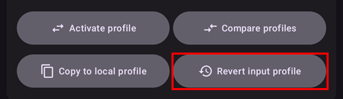


## Autotune-indstillinger

(autotune-plugin-settings)=

### Indstillinger for Autotune-pluginet

  

```{admonition} Only DEV
:class: note
Funktionen **Skift profil automatisk** findes kun i Dev/Engineering-tilstand.
```

- **Skift profil automatisk** (standard Fra): se [Kør Autotune med en automatiseringsregel](#autotune-run-autotune-with-an-automation-rule) nedenfor. Hvis du slår denne indstilling Til, bliver input-profilen automatisk opdateret med den justerede profil, og den bliver aktiveret.
  - **Vær forsigtig: Du skal stole på og kontrollere i flere dage efter en opdatering og aktivering af den justerede profil uden ændringer, at den forbedrer dit loop**

- **Kategoriser UAM som basal** (standard Fra): Denne indstilling er til brugere, der bruger AAPS uden at indtaste kulhydrater (fuld UAM). Den forhindrer (når den er Fra), at UAM kategoriseres som basal.
  - Bemærk: Hvis der i løbet af en dag er registreret mindst én times kulhydratabsorption, bliver alle data, der er kategoriseret som »UAM«, kategoriseret som basal, uanset denne indstilling (Til eller Fra)
- **Standardantal dage til beregning** (standard 5): Med denne indstilling kan du fastsætte standardværdien. Hver gang du vælger en ny profil i Autotune-pluginet, bliver **Antal dage med data** erstattet af denne standardværdi
- **Brug døgnvarierende IC/ISF** (standard Fra): se [Døgnvarierende IC- eller ISF-profil](#autotune-circadian-ic-or-isf-profile) nedenfor.

(autotune-other-settings)=
### Andre indstillinger

- Autotune bruger også Autosens maks. og Autosens min. til at begrænse ændringerne. Du kan se og justere disse værdier i [**Indstillinger** > **Indstillinger for absorbering** > **Avancerede indstillinger**](../SettingUpAaps/Preferences.md) (**Autosens maks.** og **Autosens min.**).

  


## Avanceret funktion

(autotune-circadian-ic-or-isf-profile)=

### Døgnvarierende IC- eller ISF-profil

- Hvis du har store variationer af IC og/eller ISF i din profil, og du stoler fuldt ud på dine tidspunkter og variationer over døgnet, kan du aktivere **Brug døgnvarierende IC/ISF** (kaldet »Apply average result in circadian IC/ISF« i ældre versioner)

  - Bemærk, at Autotune-beregningen altid udføres med én værdi, og at døgnvariationen ikke bliver justeret af Autotune. Denne indstilling anvender kun den gennemsnitlige ændring, der er beregnet for IC og/eller ISF, på dine døgnvarierende værdier

- Se på skærmbilledet nedenfor den justerede profil med »Apply average variation« Fra (til venstre) og Til (til højre)

  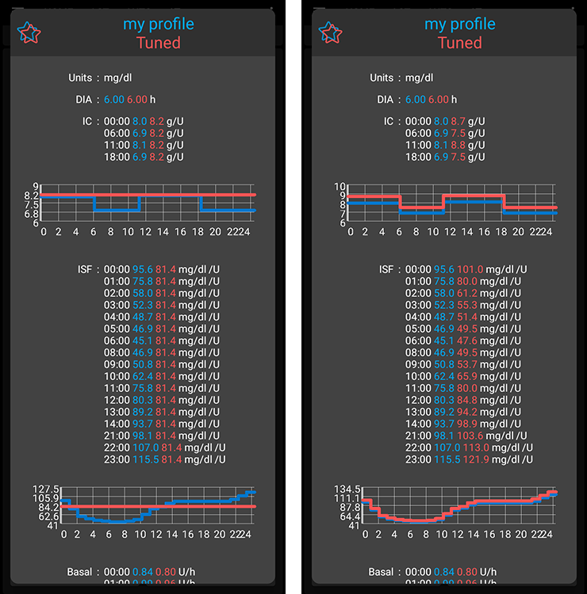


### Juster bestemte ugedage

- Hvis du trykker på ikonet **øje** til højre for feltet **Antal dage med data**, ser du valget af dage. Du kan vælge, hvilke ugedage der skal med i Autotune-beregningen (på skærmbilledet nedenfor ser du et eksempel for »hverdage«, hvor lørdag og søndag er fjernet fra Autotune-beregningen)
  - Hvis antallet af dage, der er med i Autotune-beregningen, er lavere end **Antal dage med data**, ser du til højre for dagsvælgeren, hvor mange dage der kommer med (10 dage i eksemplet nedenfor)
  - Denne indstilling giver kun gode resultater, hvis antallet af resterende dage ikke er for lille (f.eks. hvis du justerer en bestemt profil til weekenddage med kun lørdag og søndag valgt, bør du sætte **Antal dage med data** til mindst 21 eller 28 for at få 6 eller 8 dage med i Autotune-beregningen)

  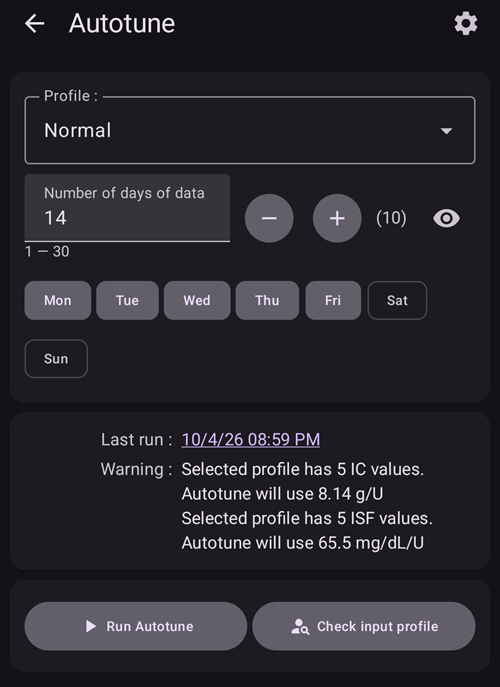

- Under Autotune-beregningen kan du følge beregningernes fremskridt (»Delvis resultat dag 1 / 4 justeret« i eksemplet nedenfor, hvor lørdag og søndag er fravalgt)

  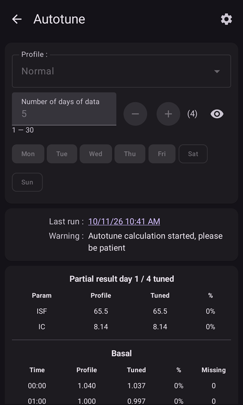


(autotune-run-autotune-with-an-automation-rule)=

## Kør Autotune med en automatiseringsregel

```{admonition} Only DEV
:class: note
Funktionen **Skift profil automatisk** findes kun i Dev/Engineering-tilstand.
```

Første trin er at vælge den rigtige udløser til en automatiseringsregel med Autotune:

Bemærk: Du kan læse mere om, hvordan du laver en automatiseringsregel, [her](../DailyLifeWithAaps/Automations.md).

- Du bør vælge udløseren Tilbagevendende tid: kør kun Autotune én gang om dagen. Autotune er lavet til at blive kørt dagligt (ved hver ny kørsel flytter du én dag frem, og ændringerne i profilen bør hurtigt blive meget små)

  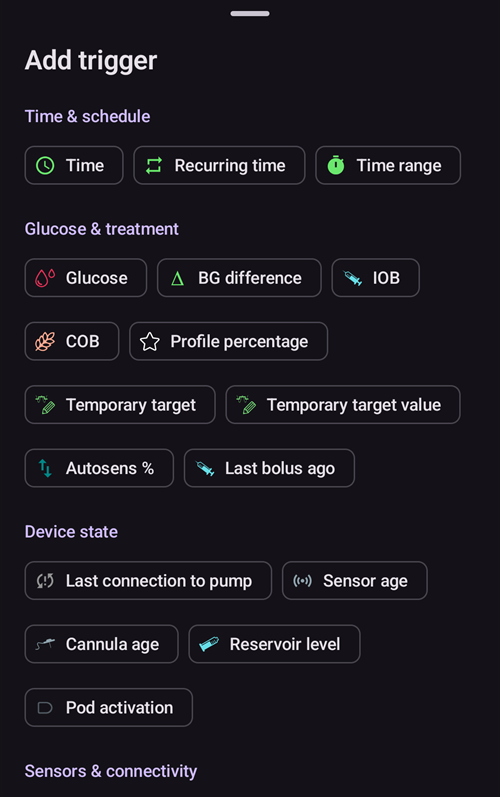

- I starten er det bedre at køre Autotune om dagen, så du kan kontrollere resultaterne. Hvis du vil køre Autotune om natten, skal du i udløseren vælge kl. 4:00 eller senere, så den aktuelle dag kommer med i næste Autotune-beregning.

  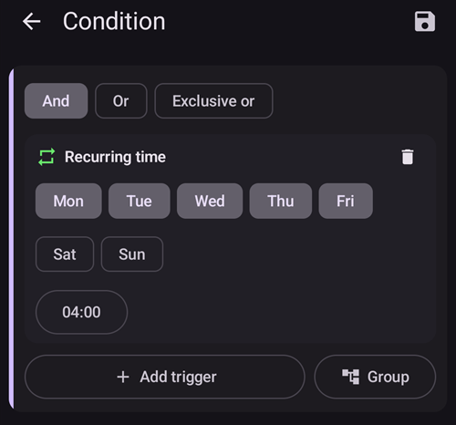

- Derefter kan du vælge handlingen **Kør Autotune** (i gruppen **Loop & insulin**)

  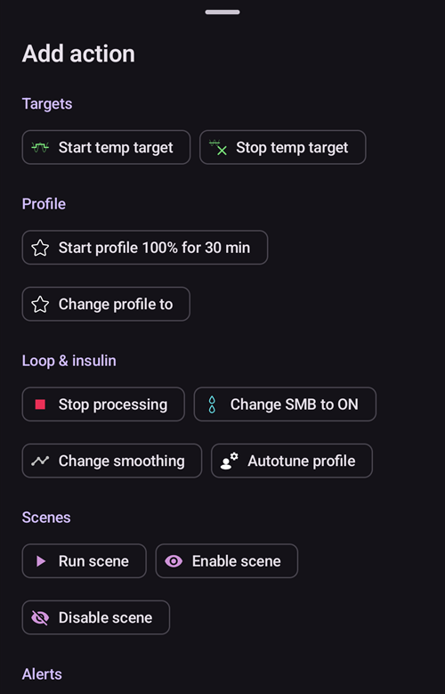

- Derefter kan du tilpasse handlingens parametre til din kørsel. I en ny handling viser **Vælg profil, der skal justeres** den første profil i din liste over lokale profiler, feltet **Justeringsdage** er tomt, og alle dage er valgt. Vælg den profil, der skal justeres, og indtast antallet af **Justeringsdage** (1 til 30).

  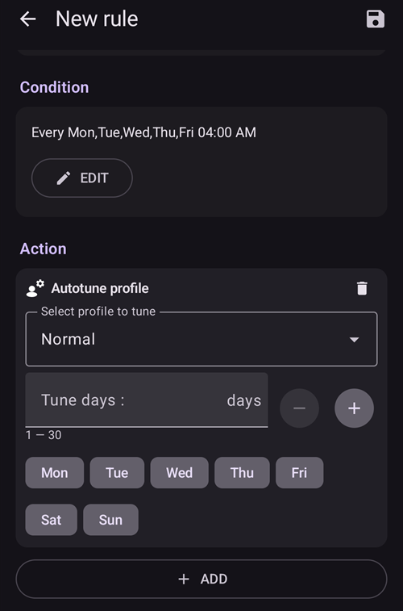

- Hvis du efter nogle dage stoler fuldt ud på resultaterne fra Autotune, og ændringen i procent er lille, kan du slå [Autotune-indstillingen](#autotune-plugin-settings) »**Skift profil automatisk**« til, så den justerede profil automatisk bliver opdateret og aktiveret efter beregningen.

Bemærk: Hvis du vil justere profiler automatisk for bestemte ugedage (f.eks. en profil for »weekenddage« og en anden for »hverdage«), så opret én regel for hver profil, og vælg de samme dage i udløseren og i Autotune-handlingen. Justeringsdage skal være høje nok til, at justeringen med sikkerhed udføres med mindst 6 eller 8 dage, og glem ikke at vælge et tidspunkt efter kl. 4:00 i udløseren...

- Nedenfor ser du et eksempel på en regel, der kører hver hverdag (mandag til fredag) kl. 04:00 og justerer profilen »Normal« med 14 **Justeringsdage**, kun hverdage (så kun 10 dage kommer med i Autotune-beregningen).

  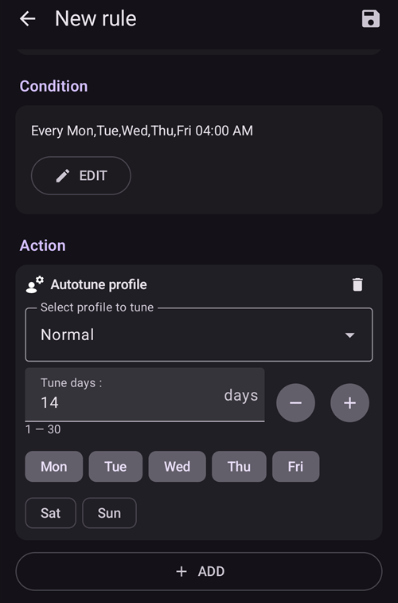


## Tips og tricks

Autotune arbejder med de oplysninger, der findes i din database. Hvis du lige har installeret AAPS på en ny telefon, skal du derfor vente flere dage, før du kan starte Autotune med nok dage til at få brugbare resultater.

Autotune er kun en hjælp. Det er vigtigt jævnligt at kontrollere, om du er enig i den beregnede profil. Hvis du er i tvivl, så ændr Autotune-indstillingerne (f.eks. antallet af dage), eller kopier resultaterne til en lokal profil, og tilpas profilen, før du bruger den.

Kør altid Autotune manuelt i flere dage for at kontrollere resultaterne, før du anvender dem. Og først når du stoler fuldt ud på resultaterne fra Autotune, og når ændringen mellem den tidligere profil og den beregnede profil bliver meget lille, begynder du at bruge automatisering (aldrig før)

- Autotune kan virke meget godt for nogle brugere og ikke for andre, så **hvis du ikke stoler på resultatet fra Autotune, så brug det ikke**

Det er også vigtigt at analysere resultaterne fra Autotune for at forstå (eller prøve at forstå), hvorfor Autotune foreslår disse ændringer

- du kan få en samlet stigning eller et samlet fald i styrken af din profil (f.eks. en stigning i samlet basal sammen med et fald i ISF- og IC-værdierne). det kan hænge sammen med flere dage i træk med autosens-korrektion over 100% (mere aggressivitet nødvendig) eller under 100% (du er mere følsom)
- Nogle gange foreslår Autotune en anden balance mellem basalrater og IC/ISF (f.eks. lavere basal og mere aggressiv IC/ISF)

Vi råder dig til ikke at bruge Autotune i disse tilfælde:

- Du indtaster ikke alle dine kulhydrater
  - Hvis du ikke indtaster kulhydrater til at korrigere en hypoglykæmi, ser Autotune en uventet stigning i din BS-værdi og øger dine basalrater 4 timer tidligere. Det kan være det modsatte af det, du har brug for for at undgå hypo, især hvis det er midt om natten. Derfor er det vigtigt at indtaste alle kulhydrater, især korrektion for hypo.
- Du har mange perioder med UAM registreret i løbet af dagen.
  - Har du indtastet alle dine kulhydrater og vurderet dine kulhydrater korrekt?
  - Alle UAM-perioder (undtagen hvis du ikke indtaster nogen kulhydrater i løbet af en dag, og »Kategoriser UAM som basal« er deaktiveret): alle dine UAM-perioder bliver kategoriseret som basal. Det kan øge din basal meget (meget mere end nødvendigt)

- Din kulhydratabsorption er meget langsom: hvis det meste af din kulhydratabsorption beregnes med parameteren min_5m_carbimpact (du kan se disse perioder med en lille orange prik øverst på COB-kurven), kan beregningen af COB være forkert og føre til forkerte resultater.
  - Når du dyrker sport, er du som regel mere følsom, og dit BS stiger ikke meget. Derfor er det normalt at se nogle perioder med langsomme kulhydrater under eller efter motion. Men hvis du alt for ofte har uventet langsom kulhydratabsorption, kan du have brug for at justere profilen (højere IC-værdi) eller en min_5m_carbimpact, der er lidt for høj.
- Du har »meget dårlige dage«, f.eks. hvor du sidder fast i hyperglykæmi i flere timer og skal bruge en stor mængde insulin for at komme ned i målområdet, eller hvor du efter et sensorskift har lange perioder med forkerte BS-værdier. Hvis du i de seneste uger kun har en eller 2 »dårlige dage«, kan du manuelt fravælge disse dage i Autotune-beregningen for at udelukke dem fra beregningen, og igen **kontrollere grundigt, om du kan stole på resultaterne**
- Hvis ændringen i procent er for stor
  - Du kan prøve at øge antallet af dage for at få jævnere resultater
