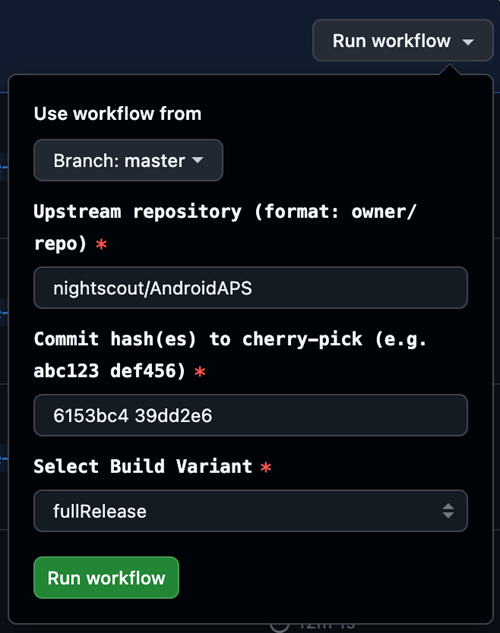

(github-cherry-pick)=

# Build i browseren: cherry-pick et commit

```{note}
Dette er en valgfri, avanceret handling. Det virker kun, hvis du bygger med en **fork** ([Build i browseren, trin 1–4](../SettingUpAaps/BrowserBuild.md)). **AAPS Builder**-repositories har ikke dette workflow.
```

Brug det kun, når en udvikler beder dig om at teste en bestemt ændring (udvikleren giver dig en eller flere commit-hashes), før den er med i en udgivet version.

## Før du starter

- [Synkroniser din fork](#Update-to-new-version-update-your-repo): dette workflow bygger den nuværende tilstand af din gren, ikke en version, som du vælger fra en liste.
- Google Drive skal have adgang ([Trin 3](../SettingUpAaps/BrowserBuildGoogleDrive.md)): den byggede app gemmes der, som ved et normalt build.

## Kør workflowet

1. Åbn **Actions** i din GitHub-fork af AndroidAPS.
2. Fold **All workflows** ud, og vælg **Cherry Pick CI (Pre-release Feature Backport)**.
3. Tryk på **Run workflow**, og udfyld:

   

   - **Use workflow from**: den gren, som commits skal tilføjes til, normalt `master`.
   - **Upstream repository**: hvor commits kommer fra. Behold `nightscout/AndroidAPS`, medmindre udvikleren har sagt noget andet.
   - **Commit hash(es) to cherry-pick**: den eller de hashes, som du har fået, adskilt af mellemrum.
   - **Select Build Variant**: se [varianter](#browserbuild-variant) (normalt `fullRelease`).
4. Tryk på **Run workflow**. Når det er færdigt, ligger appen i dit Google Drive, som efter et [normalt build](../SettingUpAaps/BrowserBuildAPK.md).
