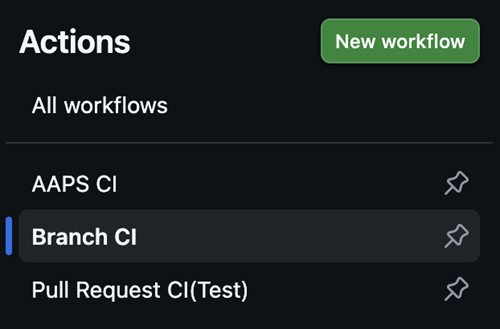
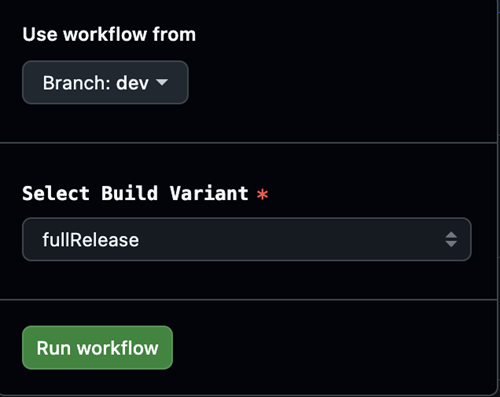
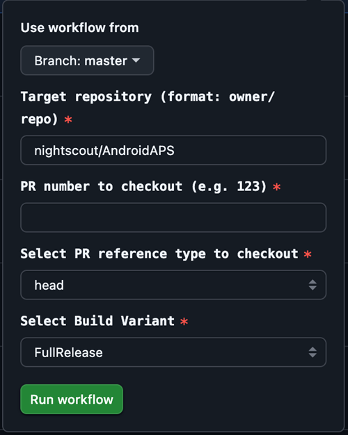

# Udviklingsgren

```{warning}
Dev-grenen er kun til videreudvikling af AAPS. Den skal bruges på en separat telefon til test <font color="#FF0000">**ikke til rigtigt loop!**</font>
```

Den mest stabile version af AAPS findes i [master-grenen](https://github.com/nightscout/AndroidAPS/tree/master). Vi anbefaler, at du bliver på master-grenen, når du looper i hverdagen.

Dev-versionen af AAPS er kun til udviklere og testere, der er vant til at arbejde med stacktraces, se logfiler igennem og måske starte debuggeren for at lave fejlrapporter, som udviklerne kan bruge (kort sagt: folk, der ved, hvad de gør, uden at få hjælp!). Derfor er mange funktioner, der ikke er færdige, deaktiveret. For at slå disse funktioner til skal du gå i **Engineering Mode** ved at oprette en fil med navnet `engineering_mode` i mappen /AAPS/extra. Hvis du slår engineering mode til, kan det få loopet til at holde helt op med at virke.

Dev-grenen er dog et godt sted at se, hvilke funktioner der bliver testet, at hjælpe med at rette fejlene og give feedback på, hvordan de nye funktioner virker i praksis. Mange tester dev-grenen på en gammel telefon og pumpe, indtil de er sikre på, at den er stabil - al brug sker på eget ansvar. Når du tester nye funktioner, så husk, at du selv vælger at teste en funktion, som stadig er under udvikling. Det sker på eget ansvar, og du skal være omhyggelig med at passe på din egen sikkerhed.

Hvis du finder en fejl eller mener, at noget er gået galt, når du bruger dev-grenen, så se under [fanen Issues](https://github.com/nightscout/AndroidAPS/issues), om andre allerede har fundet den, eller tilføj den selv, hvis ikke. Jo flere oplysninger du kan dele her, jo bedre (husk, at du måske skal dele dine [logfiler](../GettingHelp/AccessingLogFiles.md)). De nye funktioner kan også diskuteres på [Discord](https://discord.gg/4fQUWHZ4Mw).

En dev-version har en udløbsdato. Det kan virke upraktisk, når den fungerer godt, men det har et formål. Når der kun er én dev-version i omløb, er det lettere at holde styr på de fejl, folk melder. Udviklerne vil ikke ende i en situation, hvor der er tre dev-versioner i omløb, hvor fejl er rettet i nogle og ikke i andre, og folk bliver ved med at melde fejl, der allerede er rettet.

(branch-ci-test)=

## Test en bestemt gren (branch-ci)

For at bygge en testgren skal du vælge branch-ci, som lader dig vælge en bestemt gren, som APK'en bygges fra. Du kan bruge denne metode, når du skal teste dev-grenen.





(github-pr-test)=

## Test ændringer i en pull request (GitHub CI actions deploy)

Tilgængelig fra 3.3.2.1.dev

- Egnet til testere eller dem, der hjælper med at teste.

```{eval-rst}
.. raw:: html

    <!--crowdin: exclude-->
    <div align="center" style="max-width: 360px; margin: auto; margin-bottom: 2em;">
      <div style="position: relative; width: 100%; aspect-ratio: 9/16;">
        <iframe
          src="https://geo.dailymotion.com/player/x9rdx1q.html?video=x9rdx1q&loop=true&mute=true"
          loading="lazy"
          style="position: absolute; top: 0; left: 0; width: 100%; height: 100%;"
          frameborder="0"
          allowfullscreen>
        </iframe>
      </div>
    </div>
```



- Target repository: det repository, der indeholder PR'en, i formatet owner/repo. Behold standardværdien **nightscout/AndroidAPS**, medmindre du har fået besked på at bruge et andet repository (det bør kun udviklere gøre).

- PR number: Indtast nummeret på den PR, du vil teste.

- PR reference types: Der er to muligheder for PR-referencetype:
    
    - head:
    - Henter det faktiske indhold fra PR-forfatterens gren (dvs. den oprindelige commit-historik uden nogen merge).
    - Det svarer til PR-grenens oprindelige tilstand, som om den blev hentet direkte fra en fork eller en feature-gren.
    
    - merge:
    
    - Henter resultatet af GitHubs forudgående simulerede merge af PR'en ind i målgrenen (f.eks. dev).
    - Det er et virtuelt merge-commit, som GitHub laver automatisk.
    - Dette commit findes kun, når PR'en ikke har konflikter og kan merges.
    
    - variant:
    
    - Se [variant](#browserbuild-variant)