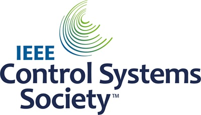
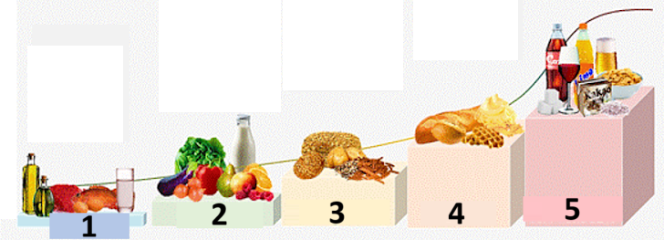
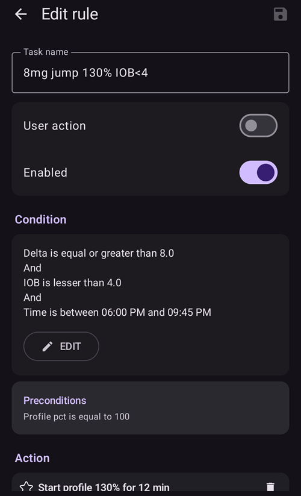
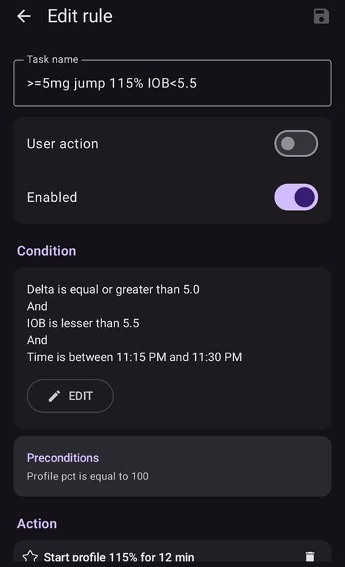
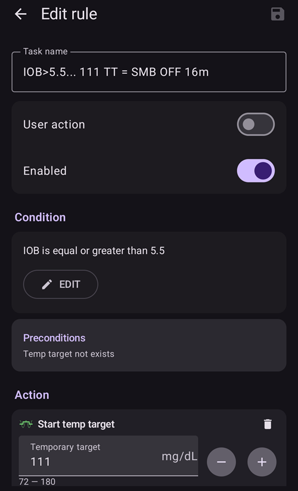
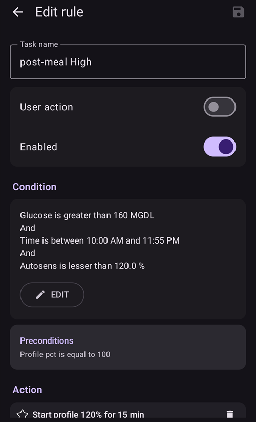
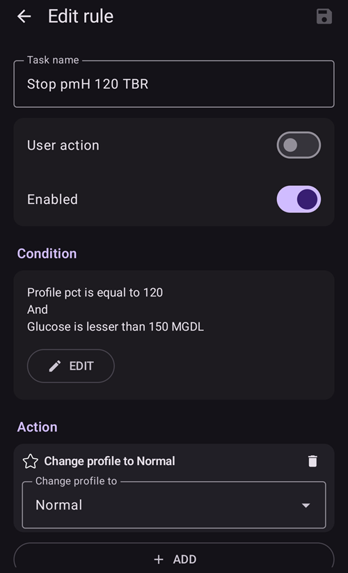

# Fuldt lukket loop

```{contents} In this page
:backlinks: entry
:depth: 2
```

Det store plus ved fuldt lukket loop **FCL** er, at det kan efterligne en kunstig bugspytkirtel og gøre hverdagen lettere, uden at du skal give bolus til måltider.

Selvom **hybrid lukket loop** ('HCL') bygger på en algoritme, skal brugeren stadig selv give bolus før måltider. Derfor kan loopet gå i en midlertidig stop (midlertidig nul-basal) for at undgå, at der gives for meget insulin.

I **FCL** er der ikke længere brug for bolus efter måltidets størrelse: overlad det til algoritmen!  **AAPS** kan håndtere måltider, uden at brugeren giver bolus og uden at indtaste kulhydrater, i en tilstand, der hedder »uanmeldte måltider« **(»UAM«)**. **UAM** gør det muligt for **AAPS** bedre at klare forkerte kulhydratindtastninger ved at være mere aggressiv.

## Hvad kan du forvente?

Der er mange offentliggjorte undersøgelser om de gode resultater, som **FCL** kan give. Du kan læse mere her:

1)   National Library of Medicine, PubMed [First Use of Open-Source Automated Insulin Delivery AndroidAPS in Full Closed-Loop Scenario: Pancreas4ALL Randomized Pilot Study](https://pubmed.ncbi.nlm.nih.gov/36826996/);

2)  ClinicalTrials.gov National Library of Medicine, klinisk forsøg [Feasibility and Safety Study of the Automated Insulin Delivery Closed Loop System Pancreas4ALL (ASAP)](https://www.clinicaltrials.gov/study/NCT04835350?term=Feasibility%20and%20Safety%20Study%20of%20the%20Automated%20Insulin%20Delivery%20Closed%20Loop%20System%20Pancreas4ALL%20(ASAP)&rank=1)

For at få succes med **FCL** skal brugeren:

- kontrollere, om kravene til **FCL** er opfyldt;
- opsætte **automatiseringer**, der passer til behovene i hverdagen; og
- finjustere og tilpasse **AAPS**-indstillingerne (især **automatiseringer**).


## Generelle overvejelser om, hvorfor du (ikke) skal skifte fra HCL til FCL

**FCL** er ikke for alle:

- Nogle **FCL**-brugere opnår TIR (70-180) omkring 90% og HbA1c under 6%, men andre brugere foretrækker en strammere kontrol. Især hvis du vil holde værdier over 140 mg/dl nede ved kost med hurtige kulhydrater, kræver det sandsynligvis en bolus før måltidet.
- Det kan være svært at justere **AAPS**. Det er ikke for brugere, der føler sig overvældet af AAPS.  Du skal bruge et par uger på at tilpasse og finjustere dit **FCL**. Den tid kan give bedre resultater og bedre **BS**-kontrol.
- Det kan blive lettere at håndtere måltider, men motion kan stadig være svært i **FCL**. De fleste af os vil gerne spise færre snacks ved sport for at styre vores vægt.
- Det er stadig svært at opsætte et **FCL** for børn (se nedenfor).


## Velfungerende hybrid lukket loop

Det anbefales først at opnå et velfungerende **HCL**, før du overvejer at skifte til **FCL**.  For at få succes med **FCL** skal brugerens indstillinger justeres meget personligt, så **AAPS** kan give insulin, der ligner DIT velfungerende hybride lukkede loop så meget som muligt.

**FCL** kræver, at brugeren opsætter og justerer sine **automatiseringer**. Men brugeren skal have en sikker forståelse af sit insulinbehov, før han eller hun går i gang med **FCL**. Fejl kan blive skjult af andre fejl, der virker modsat. Det kan give et ustabilt **FCL**-system, som er svært at rette senere. Du kan forvente at nå en lignende %TIR med dit FCL, som du ser i dag i dit **HCL**.

**FCL er en DIY-opsætning af automatiseringer, som brugeren selv bestemmer ved at analysere sine data fra både sit velfungerende HCL og de første erfaringer med FCL, når indstillingerne justeres.**

## Hurtig insulin (Lyumjev, Fiasp)

**FCL** kræver hurtig insulin.  Det er for at **FCL** ved starten af en **BS**-stigning efter et måltid kan holde **BS** i målområdet (efter den almindelige definition under 180 mg/dl (10 mmol/l)).

En modelleringsundersøgelse (detaljer: se LINK FullLoop V2/March2023, afsnit 2.2) kan vise med tal, at *hurtigere insuliner*

Kilde:

 


IEEE Control Systems Magazine, ResearchGate [The Artificial Pancreas and Meal Control: An Overview of Postprandial Glucose Regulation in Type 1 Diabetes](https://www.researchgate.net/publication/322866519_The_Artificial_Pancreas_and_Meal_Control_An_Overview_of_Postprandial_Glucose_Regulation_in_Type_1_Diabetes);

- giver meget lavere **BS**-toppe end langsommere insuliner;
- tåle, at den første måltidsbolus kommer et par minutter for sent, uden at toppene bliver uacceptabelt høje; og
- mindske virkningen på **BS**-toppen af forskellige mængder kulhydrater (måltidsstørrelser).

**FCL** virker sandsynligvis ikke godt med anden insulin end Lyumjev eller Fiasp, medmindre brugeren spiser meget moderat eller lavt kulhydratindhold.

Men Fiasp eller Lyumjev kan give hyppige tilstopninger i pumpen, også efter at f.eks. nålelængden er optimeret. Det er vigtigt at holde øje med, hvor længe kanylen eller poden har siddet. Mange brugere oplever, at insulinen virker godt i højst 48 timer, før kanylen/poden svigter.

## Krav

**BS**-værdier og en stabil Bluetooth-forbindelse er nødvendige, så **AAPS** kan arbejde optimalt uden at miste værdifuld tid. **FCL** kræver et system, der er teknisk stabilt døgnet rundt:

- hvor godt din **CGM** virker. Din CGM må ikke give hoppende **BS**-værdier, som **FCL** kan tolke forkert som tegn på et måltid, der starter. På samme måde kan **CGM**-kalibreringer give hoppende værdier.
- hvordan og hvor **CGM**-udjævning sker, og hvad det kan betyde for din justering. Især hvordan delta er defineret, og at AAPS genkender det som et tegn på et måltid, der starter.
- Bluetooth-stabilitet for pumpen og CGM;
- undgå (eller i det mindste opdage tidligt) tilstopning af pumpen;
- dataflow og de apps, du bruger på telefonen, og forskelle mellem sensorens brugsdage;
- holde alle **AAPS**-komponenter godt opladet og have reservedele tæt på; og
- altid skifte kanyle (eller pod) tidligt nok til at mindske risikoen for tilstopning;

Ovenstående afhænger af dit **AAPS**-system og din livsstil.

## Begrænsninger ved måltider

- Det kan være lettere at opsætte et **FCL** for personer, hvis kost ikke består af mad, der hurtigt får **BS** til at stige meget, og hvis måltider ikke ændrer sig meget fra dag til dag. Det betyder ikke nødvendigvis lavt kulhydratindhold.

- Kost med meget fedt eller protein eller langsom fordøjelse/gastroparese gør det lettere og ikke sværere for **FCL**, fordi sene kulhydrater fint dækker de uundgåelige »haler« af sen virkning fra den bolus, der var nødvendig omkring toppen.

### Glykæmisk indeks og virkning på blodsukkeret

Udfordringen for **UAM**-tilstand bliver større, jo større »virkning på blodsukkeret« ('EBG') maden har

- Start moderat/lavt, og juster indstillingerne i din **profil**. Først derefter kan du »teste« måltider med høj **EBG**.
- Overvej en startbolus på < 50%, hvis du spiser noget med meget høj **EBG**.

1) **Ingen EBG**: f.eks. frisk kød, fisk, æg, bacon, olie, ost. 2) **Lav EBG**: f.eks. friske grøntsager og bær, svampe, nødder, mælk, yoghurt, hytteost. 3) **Moderat EBG**: f.eks. fuldkornsbrød/-nudler, kartofler, vildris, havregryn, tørret frugt. 4) **Høj EBG**: f.eks. hvedebrød, baguette, toast, vafler, småkager, kartoffelmos, nudler, ris. 5) **Meget høj EBG**: f.eks. sukker, søde drikke, frugtjuice, cornflakes, slik, søde sager, kartoffelchips, saltstænger.



De sværeste måltider for **FCL** er mad, der kun består af dele med meget høj og høj **EBG** (se rødt på billedet): Ikke alene stiger **BS** meget hurtigt, men der er også kun lidt fedt/protein/fibre til at modvirke den uundgåelige »hale« af insulinvirkning, som følger af forsøget på at styre det høje blodsukker tidligt.

Uregelmæssige snacks og søde drikke med mange hurtigt optagne kulhydrater er et problem for **FCL**.


## Forberedelse til aktivitet/sport

Ved motion eller aktivitet med en pumpe eller hybrid lukket loop anbefales det, at brugeren mindsker **IOB** før motionen.

Med **FCL** er algoritmen justeret til at opdage **UAM** og automatisk give insulin for at modvirke stigninger i **BS**.  Et højt **midlertidigt mål** og en lavere **profilprocent** (som allerede virker omkring måltidets start) skal indstilles i god tid før enhver aktivitet.

Usædvanlig eller uregelmæssig motion er svært for **FCL**. Motion kræver planlægning (især hvis du vil mindske behovet for nødkulhydrater/snacks ved lavt blodsukker under sport). Efter en aktiv dag anbefales det at sætte en lavere **profilprocent** for natten, når aftensmaden er helt fordøjet: sæt i **automatiseringer** en forhøjet (>100 mg/dl) **BS**-målværdi, og slå **Aktiver SMB ved højt midlertidigt mål** fra i **AAPS**-**indstillinger**.

## Udfordringer for børn

**FCL** kan give ekstra udfordringer for børn, f.eks.:

- Lyumjev eller Fiasp er måske ikke tilgængelig eller tåles ikke godt.
- Basalraten pr. time kan være meget lav og dermed et dårligt grundlag for store **SMB**.
- Kosten kan indeholde meget sødt. På grund af den lille blodmængde i en lille krop er der en stærk tendens til meget høje **BS**-toppe.
- Væksthormoner og store ændringer i insulinfølsomheden gør det svært at holde **FCL** præcist justeret.


## Aktivering af forstærkede SMB: sikkerhed

I **HCL** er der sikkerhedsgrænser for, hvor store boluser loopet automatisk må give.

**FCL**-loopere behøver ikke længere at give en stor bolus omkring måltidets start. Det betyder, at grænserne for størrelsen af **SMB** skal udvides, så loopet kan give store nok **SMB**.

Hvis du bruger **AAPS** i Master-udgaven, anbefales det, at **AAPS**' **indstillinger** er sat op med den største tilladte **SMB**-størrelse, som **FCL** kan give (maxUAMSMBBasalMinutes=120, dvs. basal for 2 timer på det tidspunkt af dagen).

Hvis din basalrate er meget lav, kan de deraf følgende **SMB**-grænser være for lave til at styre stigninger i **BS** efter måltider godt nok. En mulig løsning er at undgå kost, der giver kraftige **BS**-toppe. Algoritmen [Auto ISF](#Open-APS-features-auto-isf) (findes kun i et dev-build med engineering mode) har indstillingen **SMB maks. udvidelse af område**, der udvider standardmaksimum på basal for 2 timer med en faktor >1, og lader dig hæve standardværdien på 50% for **SMB-leveringsforhold**.

**Følg vejledningen, så AAPS kan efterligne din bolus med et par SMB**.

Kontroller jævnligt skærmen for **APS**-pluginet (**Konfiguration → APS → Åbn plugin**) for at se, om dine **SMB** må være store nok til at give den insulin, som loopet har brug for omkring måltidets start.

Ellers vil dit arbejde med justeringen nogle gange være spildt!


```{admonition} Boosting **ISF** can become dangerous
:class: danger

Observer/analyser nøje størrelsen af **SMB** kort efter, at dit måltid starter. Juster i trin, og ændr ikke mere end 1 eller 2 parametre ad gangen.

Dine **AAPS**-indstillinger skal være sat godt nok op til at klare dine (!) forskellige måltider.
```

## Genkendelse af måltider/dine automatiseringer til forstærkning

For et vellykket **FCL** er **ISF** den vigtigste parameter at justere. Når du bruger **AAPS** Master + **automatiseringer**, skal **et profilskift på > 100% starte automatisk, når et måltid bliver genkendt** (via glukose-deltaer), og give den skærpede **ISF**.

**AAPS** Master tillader en midlertidig **profil** på op til 130% i **HCL**-tilstand. **ISF** forstærkes i 3 trin:

- Trin 1 - se på den **ISF**, der gælder for denne måltidstime i **profilen**, og se, om f.eks. Autosens foreslår en ændring, der tager højde for kroppens aktuelle insulinfølsomhed (i de sidste par timer).
- Trin 2 - brug en faktor (1/profil%, som indstillet i **automatiseringen**) til at forstærke **ISF**.
- Trin 3 - kontroller, at den foreslåede **ISF** ligger inden for de indstillede sikkerhedsgrænser.

### Skabeloner til automatiseringer i FCL

Felter at sætte flueben i øverst. Du har mulighed for:

- I din liste over **automatiseringer** kan du fjerne fluebenet (til venstre for hvert felt) => Det deaktiverer den **automatisering**. Du kan f.eks. gøre det for alle **FCL**-**automatiseringer** til morgenmad for at bruge **HCL** til morgenmad.

- For hver **automatiseringsregel** kan du sætte flueben i Brugerhandling => så bliver de definerede handlinger ikke udført automatisk, når betingelserne er opfyldt. I stedet giver **AAPS**-hovedskærmen dig besked, hver gang dit **FCL** automatisk ville give en **SMB**. Du kan så svare »ja« eller »nej«. Det er meget nyttigt, mens du justerer.

Funktionen kan være nyttig i visse situationer, f.eks. ved »fod på gulvet«-syndrom, hvor **BS** pludselig stiger, når du står op om morgenen, men brugeren vil undgå en helt automatisk »morgenmad startet«-reaktion.

Afsnittet nedenfor viser, hvordan du samler betingelser i **automatiseringer**, og hvordan du håndterer situationer, hvor **AAPS** skal øge (eller mindske) insulintilførslen. Da **ISF** ikke kan justeres direkte, giver det samme resultat til vores formål at hæve **profilprocenten** over 100%.

### Automatiske store SMB ved stigende BS

Nøglen til et vellykket **FCL**: **når BS begynder at stige efter et måltid, skal loopet give meget store automatiske SMB så hurtigt som muligt** for at »indhente« den nødvendige **IOB** (sammenlign med din typiske bolus til et lignende måltid i **HCL**!)

For at opnå det skal data fra dit **HCL** analyseres for at finde ud af, hvilke **deltaer** måske ikke har med måltider at gøre, og hvilke der måske har.

- Da du kan definere **automatiseringen** inden for et fast tidsvindue, behøver du kun at analysere der.
- Hvis du spiser meget forskellige måltider (f.eks. en morgenmad med mange kulhydrater, men en frokost med få kulhydrater), kan du lave to forskellige (sæt af) **automatiseringer** til hvert tidsrum.
- Se bort fra nætterne, hvis du af og til ser spring på grund af kompressionslave værdier
- Normalt er det nok at bruge delta for de sidste 5 minutter.
- Men du kan også bruge en af de gennemsnitlige deltaer. Ved at sammenligne deltaerne i betingelserne for dine **automatiseringer** kan du endda definere handlinger med forskellig aggressivitet, alt efter om **BS** stiger accelereret eller ej.

> ( delta – kort gns. delta )>n   er et udtryk, der kan bruges til at opdage acceleration og starte den første **SMB** ved det første tegn på stigende **BS**. -                                                                             
> Pas på: kan ikke bruges med dårlige eller meget udglattede **CGM**-værdier!

En **CGM** med mangelfulde data giver brugeren et problem, fordi du for at være på den sikre side må gøre din definition af, hvilket delta der helt sikkert betyder et startet måltid, mere forsigtig. Det betyder:

- **FCL** mister ekstra tid, hvilket giver højere **BS**-toppe og lavere %**TIR**;
- du kan ikke bruge et tidligere eller mindre delta, som også uden et måltid kunne starte de **SMB**, der skal erstatte brugerens bolus i **FCL**.

Desuden er de første stigninger efter et måltid kendetegnet ved **lav iob**. Med det i tankerne kan en automatisering (#1) til aftensmad se sådan ud:



Automatisering #1

Hvis betingelserne er opfyldt, vil **AAPS** give 1 eller 2 **SMB** i de næste 12 minutter med en forstærket **ISF** efter den indstillede forhøjede **profilprocent** (i eksemplet et boost på 30% af insulinReq). Så længe disse betingelser er opfyldt, forlænges **automatiserings**reglen med yderligere 12 minutter. Et måltid med få kulhydrater kan give en langsommere stigning i **BS**. Den vil have gavn af en anden automatisering (#2), der starter ved et lavere delta og giver et svagere insulinboost.



Den samme **automatisering** vil sandsynligvis også starte ved måltider med flere kulhydrater, når den stejle stigning, som defineret i automatisering #1, er overstået.

Du skal »afstemme« disse to (+ måske en tredje) **automatiseringer**, så de passer til det, du ser ved dine (forskellige) måltider => At finde passende spring, **iob**-kriterier og forstærkninger er en justering, som du gentager trin for trin.  Hvis du også tilføjer passende tidsrum i betingelserne, kan du let lave forskellige automatiseringer til dine forskellige måltider i løbet af dagen (morgenmad, frokost, aftensmad).

Bemærk, at mens BS stadig stiger (!), skal »overløbet« af **iob** blokeres, så den sene virkning af **insulin** (»**halen**« efter 3-5 timer) ikke bliver større end loopets evne til at bremse med nul-basal (at »tage« basal væk for at mindske risikoen for hypo).

Ved store måltider kommer der **nogle gange en anden stigning**. På det tidspunkt er iob som regel også faldet lidt, og de mere aggressive automatiseringer virker igen. (Kontroller, at din iob-betingelse i automatisering #2 ikke er sat for lavt til, at det kan ske).

Kort efter at de første **SMB** er givet, kommer en **balanceret fase**, hvor en moderat insulintilførsel skal dække de ekstra kulhydrater, der bliver optaget. (Undtagen ved måltider med få kulhydrater, hvor loopet måske ser en for svag stigning i **BS** og allerede nu går direkte til nul-basal).

**AAPS**-hovedskærmen (hvor du ser cob=0 i **UAM**-fuldt loop) kan i denne fase bede om flere kulhydrater. I **UAM**-tilstand betyder det blot, at du kan lave en meget grov kontrol af, om det er sandsynligt: Er der så mange kulhydrater i din krop, som endnu ikke er optaget fra dit måltid for ca. en time siden (som du ikke gav dit loop nogen information om)?


### iob-grænse

Ofte får **automatisering** #1 og/eller #2 iob til at stige til et niveau, der typisk er nok til **dine** måltider. For en personlig justering kan du se i dine **HCL**-data, hvilke maks. iob-værdier der opstår ved godt styrede måltider (ofte: din måltidsbolus), og over hvilken størrelse der til sidst opstod en hypo (eller behov for ekstra kulhydrater).

Fornuftige **iob-grænser**, hvor du bør gøre dit loop mindre aggressivt, er måske ikke de samme for alle måltider. Men især i den første time efter måltidets start, som er meget vigtig i **UAM**-tilstand. Det er forskelligt for hver bruger. For nogle brugere bliver der kun optaget ca. 30 g/time, og det kan være muligt at definere en meningsfuld **iob** uafhængigt af det præcise måltid.

Til særlige måltider, eller for at sænke den, hvis der kommer sport bagefter, kan **iob**-grænsen hurtigt ændres i din **automatisering**.

Automatisering (#3), "iobTH nået => **SMB** fra”, er defineret til at afslutte (eller sætte på pause, indtil endnu en bølge af kulhydratstigning kommer) den aggressive forstærkning af **SMB**.



Automatisering #3

Den fortæller loopet, at over din indstillede **iob-grænse** er det bedre ikke at bruge flere **SMB**

- Eksemplet gør det ved at sætte TT=111 (tallet er valgt lidt tilfældigt; vælg et tal>100, som du let kan genkende som dit automatiske **SMB**-stop)
- I **AAPS**' [Indstillinger → OpenAPS SMB](#Preferences-openaps-smb-settings) skal du generelt ikke tillade **SMB** ved forhøjet mål.                                                                                                                   
  Den nødvendige insulin skal så gives meget mere forsigtigt gennem flaskehalsen **TBR**

**Pas på: Automatisering #3 virker kun, når der ikke er et aktivt midlertidigt mål (TT).** Hvis du har brugt EatingSoonTT, skal det altså være slut på det tidspunkt, normalt 30-40 minutter efter måltidets start.

En måde at gøre det på er at opsætte en **automatiserings**betingelse, der afslutter et eventuelt aktivt EatingSoonTT under betingelsen **iob**>65% * iobTH.
> Måder at arbejde med EatingSoonTT Nogle loopere sætter et EatingSoonTT cirka en time eller mere før måltidets start (ved at trykke på TT-knappen, eller automatisk via en lavere **BS**-målværdi i **profilen**, hvis spisetiderne er ret faste), bare for at sikre et lavt **BS** ved starten og lidt højere **iob**. Men hvis **FCL** altid er på vej mod målet, giver det måske ikke meget, og du vil måske hellere definere en **automatisering**, der sætter et EatingSoonTT, når måltidets start bliver genkendt (glukose-delta eller acceleration = delta > gns. delta). Et lavt **TT** er vigtigt i denne fase, fordi loopet beregner hver **SMB** med (forudsagt glukose minus TT)/sens, så et lavt TT gør den beregnede insulinReq større.

Når de første forstærkede **SMB** er givet, skal din indstillede iobTH og **automatisering** #3 finde en god balance mellem at begrænse glukosetoppen og ikke give en hypo efter måltidet.

Hvis din morgenmad har et meget andet kulhydratindhold end din gennemsnitlige aftensmad, kan det være en fordel at definere **automatiseringer**, der gælder på de forskellige tider af dagen og har forskellig **iobTH** (måske også forskellige deltaer og forskellig **profilprocent**). Både du, når du definerer dine måltider og indstillinger (især **iobTH**), og loopet, der styrer **BS**-kurven undervejs, må acceptere en vis højde på toppene for at mindske faren for hypo mod slutningen af **DIA** for **SMB**.

### Stagnation ved høje BS-værdier

Hvis du efter et »tungt« måltid ser en lang stagnation med **højt BS**, hjælper **automatisering** #4 (nedenfor), »post-meal High« (højt efter måltid), med at håndtere fedtsyreresistens: Efter måltider med flere retter, en stor fedtet pizza eller en raclette-aften kan glukosekurven få to pukler eller meget ofte et langt højt plateau.



Automatisering #4



Automatisering #5

Automatisering #4, »post-meal High« (højt efter måltid), kan også bruges i hybrid lukket loop.

Desuden er der brug for en stop-automatisering #5, »Stop pmH«, så insulintilførslen bliver mindre aggressiv, så snart glukoseværdien falder. (Men ofte vil loopet alligevel begrænse mere insulin for at forebygge hypo, fordi den forudsagte glukose allerede er lav).

## Forebyggelse af hypo

Kerneproblemet er, at **UAM**-**FCL** (uden kulhydratindtastning) **ikke kan vide, hvor mange gram kulhydrater der stadig er tilbage** til optagelse og måske bruger den »hale«-insulin, uden at du får en hypo af den.

Med forstærkede **SMB** »indhentede« **FCL** det, som vi tidligere gjorde med en måltidsbolus. Men **i »halen« af insulinvirkningen kan forebyggelse af hypo blive et alvorligt emne**.

Som forberedelse til **FCL** skal brugeren se nærmere på **iob-forløbet over tid** ved typiske måltider og vurdere, **hvornår det bliver for meget, og hvordan du kan fange det ved at justere dine automatiseringer**. Det er muligt, fordi vi har flere »justeringsskruer«. Det kan være svært at få det helt rigtigt

Generelt giver det ingen mening at blive ved med at optimere indstillinger til én slags måltid. Når du har en god nok indstilling, f.eks. til en slags frokost, som du ofte spiser, så test, hvordan den virker med andre slags måltider, og hvordan du vil finde et »kompromis«.

For at forebygge hypo 3-5 timer efter måltidet skal du gøre loopet mindre aggressivt, før der samles for meget iob. Konkrete metoder:

- Bliv mildere og mildere med **ISF** allerede mens glukosen stiger, som i automatiseringseksempel #1 og #2.
- Definer iob-grænsen, hvorfra **AAPS** bliver meget mere forsigtig (automatisering #3 ovenfor). Bemærk, at denne **iob** kan blive overskredet af den sidste **SMB**, før den trådte i kraft, og derefter yderligere af TBR, hvis loopet ser insulinReq. Kulhydrater, der bliver optaget, vil trække i retning af lavere iob.
- Iob-grænsen kan tilpasses hvert måltid: Ved at klone automatiseringerne kan du let skelne mellem tidsrum til morgenmad, frokost og aftensmad (eller endda steder, som kantinen på arbejdet eller hos svigermor osv.)
> Du kan skelne endnu mere inden for disse tidsrum ved at sætte forskellige TT for f.eks. få kulhydrater og hurtige kulhydrater og dermed kunne »kode« forskellige typer måltider, der kan forekomme på det tidspunkt af dagen, og starte **automatiseringer**, der er særligt justeret til dem. Det er sandsynligvis ikke nødvendigt, medmindre dine spisevaner varierer meget.

Før et særligt måltid kan du hæve din **iob**-grænse eller ændre noget andet i en af dine automatiseringer på under 5 sekunder, direkte på din AAPS-telefon (**Administrer → Automatisering**).

Faren for hypo nogle timer efter måltidet afhænger først og fremmest af, om dit måltid var sammensat sådan, at **insulin-halerne fra kampen mod hovedparten af kulhydraterne** bliver **brugt op af »forlængede kulhydrater«** (meget/forsinket kulhydratabsorption, protein, fedt, fibre).

Med tiden lærer du mønstre at kende og justerer dine automatiseringer – måske ændrer du endda dine spisevaner lidt, f.eks. ved at nyde en lille(!) sen snack en gang imellem. Det kan hjælpe med at holde en god **balance mellem insulinvirkning og kulhydratabsorption** i **hele** måltidets tid (fordøjelse, absorption) og gør dermed livet lettere for dit loop (og for dig selv).

### Rækkefølge af programmerede automatiseringer

Der kan opstå problemer, når definitioner i **automatiseringer** overlapper hinanden. Eksempel: Problemet er, at delta >8 også er delta >5, dvs. der kan være to **automatiseringer**, der konkurrerer. Hvad gør loopet så? Det beslutter altid efter den rækkefølge, som dine **automatiseringer** har i **Administrer → Automatisering**.  Eksempel: Reglen med delta > +8 skal komme først (og starte det stærkeste boost, hvis alle betingelser er opfyldt); derefter kommer kontrollen af delta >5 (med et mildere svar). Hvis det er omvendt, vil reglen med delta>8 aldrig blive brugt, fordi delta>5 allerede gælder, og så er sagen afgjort.
> Tip til automatiseringer: Det er meget let at ændre rækkefølgen. I **Administrer → Automatisering** skal du trykke og holde på håndtaget **=** til højre for en regel og trække den til en anden plads.

Det er også meget let og hurtigt at ændre betingelser eller handlinger når som helst, på få sekunder, direkte på din AAPS-telefon; f.eks. hvis du skal til en helt særlig spisebegivenhed. (Men glem ikke at sætte det tilbage til normal til næste dag).

(full-closed-loop-troubleshooting)=

## Fejlfinding

### Sådan går du tilbage til hybrid lukket loop

Du kan fjerne fluebenet ved de **automatiseringer**, der hører til dit **FCL**, og gå tilbage til at give bolus til måltider og indtaste kulhydrater igen. Hvis du havde fjernet knapperne **Insulin** eller **Beregner** fra hovedskærmen, så tilføj dem igen i indstillingen af [Hurtigstart-værktøjslinjen](#quicklaunch) (de findes altid under **Behandlinger** i navigationen nederst). Husk, at det nu igen er dig, der skal give bolus til måltider.

Det kan være klogt kun at bruge **FCL** til måltider (tidsrum), hvor **automatiseringer** er helt definerede og slået til, og kun slå dem fra for de andre måltider, hvor du vil bruge **HCL** (eller hvor du endnu ikke har defineret nogen i din overgangsperiode).

Det er f.eks. helt muligt uden ekstra trin, når **automatiseringer** til aftensmaden er defineret, kun at bruge **FCL** til aftensmad, mens morgenmad og frokost klares i et **HCL**, som du er vant til.


### Er kravene til FCL stadig opfyldt?

- Er din grundlæggende **profil** stadig korrekt?
- Er kvaliteten af **CGM** blevet dårligere
- Se kravene (ovenfor).

### Glukosen bliver for høj

- Måltider bliver ikke genkendt hurtigt nok
    - Kontroller Bluetooth-forbindelsens (u)stabilitet
    - Kontroller, om du kan sætte mindre deltaer til at starte den første **SMB**
    - Eksperimenter med en aperitif eller suppe et par minutter før måltidets start
- SMB er for svage
    - Kontroller rækkefølgen af **automatiseringer** (f.eks.: stort delta før lille delta)
    - Kontroller (i realtid) på skærmen for **APS**-pluginet, om profilens basal pr. time og de indstillede minutter (maks. 120) begrænser den tilladte SMB-størrelse
    - Kontroller (i realtid) på skærmen for **APS**-pluginet, om %profil skal sættes højere
- Hvis alle dine indstillinger er ved grænsen, må du måske leve med det midlertidigt høje blodsukker eller ændre din kost.
> Hvis du er klar til at teste et dev-build, tillader [Auto ISF](#Open-APS-features-auto-isf) også større SMB. Nogle brugere giver også en lille bolus før måltidet i deres »FCL«. Men det påvirker glukosekurven og dermed, hvordan stigninger bliver opdaget og **SMB** bliver startet. Derfor er det ikke let at gøre med en overbevisende samlet fordel.
- En vigtig observation fra pilotbrugerne var, at det betyder meget for toppen fra kulhydraterne, hvordan dine glukose- og iob-kurver ser ud, når måltidet starter: Hvis kurven går nedad (f.eks. mod et indstillet EatingSoonTT), der opbygges lidt iob, og kurven allerede bøjer mod en stærk positiv acceleration, hjælper det meget med at holde toppene lave.

### Glukosen bliver for lav

- Måltider bliver genkendt forkert
    - Kontroller, om du kan sætte større deltaer til at starte den første **SMB**
    - Sæt flueben i »Brugerhandling« i den pågældende automatisering, så du fremover kan bestemme fra gang til gang at blokere automatiseringen, hvis den ikke har med et måltid at gøre
    - For at undgå at snacks starter **SMB** som ved et måltid, så sæt et TT>100, når du spiser en snack (som du alligevel gør ved sport og ved snacks mod hypo)
- SMB giver samlet set for meget insulin
    - Kontroller (i realtid) på skærmen for **APS**-pluginet, om **SMB maks. udvidelse af område** skal sættes lavere
    - Kontroller (i realtid) på skærmen for **APS**-pluginet, om **profilprocenten** skal sættes lavere
    - SMB-leveringsforholdet kan sandsynligvis sættes lavere. Bemærk, at det i dette tilfælde gælder for alle **SMB** (alle tidsrum),
- Problemer med insulin-»halen« efter måltider
    - Du skal måske spise en snack (når du ser en hypo-forudsigelse) eller druesukkertabletter (hvis du allerede er i hypo-området). Men vær opmærksom på, at de nødvendige kulhydrater, som loopet måske viser dig på et tidspunkt, med stor sandsynlighed er for høje. Loopet har nemlig ingen information om, hvor mange kulhydrater du har spist og hvor mange der stadig venter på at blive optaget (mens du måske selv kan gætte det, også fra fedt og protein).
    - Det vil være nyttigt at vide, om problemet for det meste allerede opstår i den fase, hvor BS stiger. Så kan en lavere iobTH være en let løsning.
    - Hvis du ofte har brug for ekstra kulhydrater, så skriv ned, hvor mange gram der skulle til (tæl ikke det med, som du måske spiste for meget og igen skulle bruge ekstra insulin til).  Brug derefter IC-værdien i din profil til at anslå, hvor meget mindre insulin **SMB** skulle have givet, og brug denne information i din justering (af **profilprocenten** i **automatiseringer** eller måske også din indstillede iobTH). Det kan hænge sammen med de **SMB**, der blev givet, mens glukosen var høj, eller også med de **SMB** under **BS**-stigningen.
    - Det kan sagtens være, at du simpelthen må acceptere højere **BS**-toppe for ikke at blive lav. Eller skift til en kost med færre kulhydrater og mere protein og fedt.


### Mere information

Sørg for at holde kontakt med andre **FCL**-brugere.

Diskussion om fuldt lukket loop med automatiseringer:

- Engelsk:   [Discord-kanal](https://discord.gg/ChXj8BaKwA)

- Tysk:  [German Looper Community](https://de.loopercommunity.org/t/ueber-die-kategorie-full-loop/10107)
