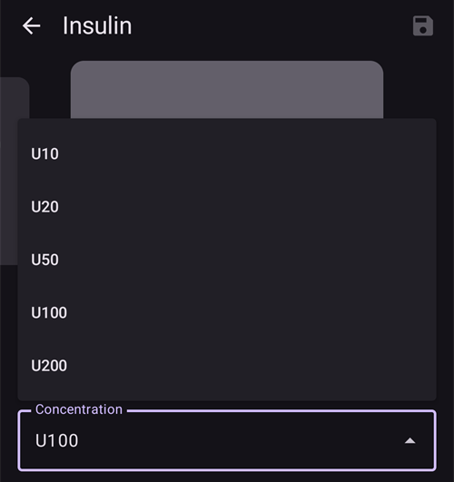
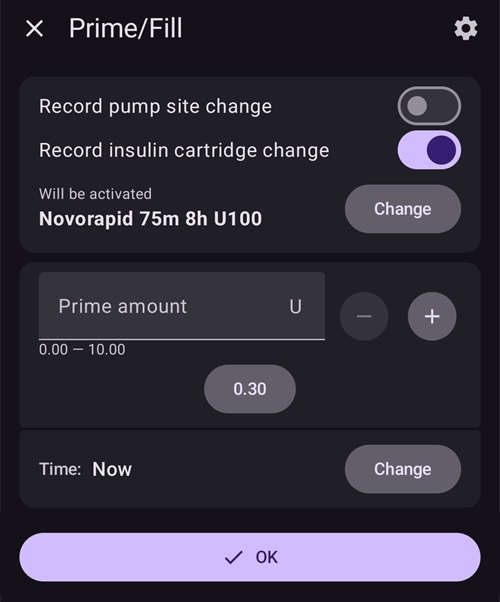

(Insulin-Concentration)=
# Insulinkoncentration

```{warning}
Alle pumper i handlen er lavet til at bruge insulin U100 **KUN**. Det kan være farligt at bruge en anden insulinkoncentration i en pumpe. Selv om flere og flere brugere kører AAPS med andre koncentrationer, skal omregningen altid styres, og den fører ofte til fejl (også for meget erfarne brugere!).
```

## Grundlæggende om insulin

Dette kapitel dækker de vigtigste begreber om måling og levering af insulin.

### Insulinenheden: et mål for virkning

Insulin måles i **internationale enheder (IE)**, som angiver dens biologiske virkning (evnen til at sænke blodsukkeret), ikke kun dens fysiske masse.

- **Definition:** 1 IE svarer til virkningen af en bestemt mængde insulin, standardiseret til **ca. 0,04167 mg**.
- **Vigtigt:** En »enhed« betyder den samme biologiske virkning for alle typer insulin, så doseringen bliver ensartet.

### Insulinkoncentrationer

Insulin findes i forskellige styrker, der angives som antal enheder pr. milliliter (ml).

- **U100:** Den globale standard med **100 IE/ml**.
- **U200-U500:** Mere koncentrerede insuliner (f.eks. har U200 200 IE/ml) til mindre injektionsmængder.
- **U40/U50:** Mindre almindelige, historiske koncentrationer (40 IE/ml og 50 IE/ml). **U40 kræver sprøjter, der er lavet til U40.**
- **Manuel fortynding:** En klinisk praksis, hvor man laver meget fortyndet insulin (f.eks. U50, U10) til sjældne tilfælde som brug hos nyfødte eller ved ekstrem følsomhed. Det kræver meget omhyggelig tilberedning på apoteket.

```{admonition} Critical Warning
:class: danger
Det er meget farligt at bruge en koncentration med en enhed, der ikke passer til den, og det kan give en alvorlig overdosis eller underdosis. **Kontroller altid tre gange, at insulinkoncentrationen passer til specifikationerne for sprøjten, pennen eller pumpen.**
```

## Hvornår bruger man en koncentration, der ikke er standard?

Insulinpumper er lavet til U100-insulin, men visse medicinske situationer kræver koncentrationer, der ikke er standard. I disse situationer skal du være meget forsigtig og styre alt meget omhyggeligt.

### Eksempel 1: fortyndet insulin til meget små doser

- **Situation:** Behandling af type 1-diabetes hos meget små babyer og småbørn.
- **Problem:** Deres insulinbehov er så lavt, at pumpens mindste dosis (f.eks. 0,05 IE) stadig kan være for stor. Det gør det svært at styre blodsukkeret præcist og giver en høj risiko for hypoglykæmi.
- **Løsning:** Brug meget fortyndet insulin (f.eks. U10, som er 10 IE/ml).
- **Virkning:** Det øger mængden af væske, der leveres pr. enhed insulin. Når insulinens »pakker« bliver større i volumen, men svagere i koncentration, kan man lave meget finere justeringer og dosere mere præcist med pumpens eksisterende indstillinger.

```{admonition} Critical Safety Note on Dilution
:class: danger
Fortynding af insulin er en procedure med høj risiko, som du aldrig må prøve derhjemme uden særlig oplæring og medicinsk opsyn. Den skal udføres af sundhedspersonale eller en oplært omsorgsperson med en steril fortyndingsvæske, der er lavet specielt til den type insulin. **Brug aldrig vand fra hanen, saltvand eller nogen anden væske**, da det kan ødelægge insulinen, ændre dens virkning og tilføre farlig forurening.
```

### Eksempel 2: koncentreret insulin ved højt insulinbehov eller betydelig insulinresistens

- **Situation:** Behandling af voksne eller unge med betydelig insulinresistens eller personer, der får lokale smerter af tilsætningsstofferne i almindelig insulin.
- **Problem:**
  1. **Højt behov:** Et meget højt dagligt insulinbehov kan overstige pumpens grænser for maks. bolus eller daglig levering.
  1. **Smerter:** Konserveringsmidlerne i insulin kan give svie eller irritation ved infusion.
- **Løsning:** Brug en mere koncentreret insulin, f.eks. U200 (200 IE/ml).
- **Virkning:** Den nødvendige insulindosis leveres i det halve volumen. For brugeren skal pumpens interne indstillinger justeres (f.eks. halverede basalrater og boluser) på grund af den dobbelte koncentration, så det rigtige antal enheder bliver leveret. Det mindsker også mængden af væske, der kan irritere, og som leveres under huden.

## Hvordan styrer man insulinkoncentration med AAPS (AAPS 3 og tidligere)?

Når man bruger anden insulin end U100 i et AAPS-loop, skal konfigurationen være meget omhyggelig, så softwarens beregninger passer til den insulin, der faktisk bliver leveret. En almindelig metode er »Brug af en ændret profil«.

### Brug af en ændret profil

Med denne metode får man AAPS til at tro, at patientens insulinbehov er lavere, end det er. Det opvejer, at pumpen leverer mere koncentreret insulin, end den er lavet til. Eksemplet nedenfor gælder U200-insulin i en pumpe, der er lavet til U100.

- **Kerneproblemet:** En pumpe til U100 er kalibreret til at levere **10 µL** for **1 enhed**. Hvis du fylder den med U200 (1 enhed U200 svarer til **5 µL** insulin), og du vælger **1 enhed** på pumpen, leverer den **10 µL** insulin, men det volumen indeholder nu **2 enheder U200-insulin**. Det giver en overdosis på 100%.
- **Løsningen »Profilskift 50%«:** For at rette det skaleres patientens hele behandlingsprofil i AAPS, så den er »dobbelt så svag«.
  1. Brugeren laver en ny profil ud fra sin almindelige U100-profil med funktionen »Profilskift **50%**«.
  1. Det giver en ny profil, hvor:
     - **Basalraterne** er halveret.
     - **Insulin til kulhydrat-forholdet (IC)** er fordoblet (f.eks. bliver 1:10 g til 1:20 g).
     - **Insulinfølsomhedsfaktoren (ISF)** er fordoblet (f.eks. bliver »1 enhed sænker BS med 50 mg/dl (2,8 mmol/l)« til »1 enhed sænker BS med 100 mg/dl (5,6 mmol/l)«).
- **Det rettede resultat:** AAPS tror nu, at patienten kun har brug for halvdelen af insulinen. Når AAPS beregner og sender en bolus på **1 enhed**, leverer pumpen (lavet til U100, men fyldt med U200) de **10 µL**, som indeholder **2 reelle enheder U200-insulin**. Fordi AAPS har beregnet dosis ud fra en profil med »halv styrke«, er denne levering på **2 reelle enheder** den rigtige, tilsigtede dosis. Loopets beregning med »halv styrke« passer til pumpens levering med »dobbelt styrke«.

```{admonition} Critical Risks and Common Errors
:class: caution

Denne metode giver betydelige risici, fordi der hele tiden er en forskel mellem appens data og den fysiske virkelighed.

**Den vigtigste fejl: forskellen ved »ekstern bolus«**

Den mest almindelige fejl sker, når insulin leveres og registreres **uden for** AAPS-pumpesystemet.

- **Situationen:** AAPS beregner med den ændrede profil en bolus på **5 enheder** til et måltid. Brugeren injicerer den med en U200-pen.
- **Den dobbelte fejl:**
  1. **Forkert valg af dosis:** Brugeren tænker »AAPS beregner 5 enheder« og forventer på grund af U200-pennen at levere **5 reelle enheder U200** uden nogen omregning. Men fordi profilen er halveret, har kroppen faktisk brug for **10 reelle enheder**. Det er en **underdosis på 50%**, som kan føre til hyperglykæmi.
  1. **Forkert beregning af insulin om bord (IOB) (for høj IOB):** Når brugeren registrerer denne eksterne bolus i AAPS, skriver brugeren **5 enheder**. Det er forkert. Da AAPS-profilen er til U200, er **1 enhed i AAPS lig med 2 reelle enheder**. Derfor skal de 5 reelle enheder, som pennen har leveret, registreres som **2,5 enheder** i appen. Når brugeren registrerer 5 enheder, bliver IOB 100% for høj. AAPS tror nu, at der er 5 »koncentrerede enheder« om bord (svarer til 10 reelle enheder), selv om kun 5 reelle enheder virker. Det kan få loopet til at holde basalinsulin tilbage eller give mindre boluser bagefter, og det øger risikoen for hyperglykæmi fra den første underdosis.

**Andre risici:**

- **Vildledende data og rapporter:** Alle data i AAPS eller Nightscout - også IOB, samlet daglig dosis (TDD) og rapporter om historik - er i »koncentrerede enheder«. Det giver et forvrænget billede for brugeren og brugerens behandlerteam. En læge, der ser en rapport, kan se en TDD på 30 enheder og ikke opdage, at patienten faktisk har fået 60 reelle enheder. Det fører til forkerte vurderinger af behandlingen.
- **Ændret tankegang:** Efter længere tids brug begynder brugeren at »tænke« i appens halverede værdier. Brugeren vænner sig til, at ISF er 100 mg/dl (5,6 mmol/l), eller at basal er 0,5 E/t, og glemmer, at disse værdier er »koncentrerede«. Det skaber en farlig afhængighed af systemet, og brugeren mister fornemmelsen for sit faktiske insulinbehov. Det er afgørende for sikkerheden, når pumpen svigter, eller appen har problemer.

**Konklusion:** Denne metode kræver konstant opmærksomhed, fordi brugeren hele tiden skal omregne mellem en »koncentreret verden« i appen og den fysiske verden. Al ekstern insulinlevering eller gennemgang af data bryder denne tankegang og er en alvorlig risiko. Den ændrer grundlæggende betydningen af hvert eneste tal i systemet.
```

## Brug af koncentrationsparameteren (ny funktion i AAPS 4.0)

For at mindske risikoen ved en ændret profil styrer en ny funktion insulinkoncentrationen direkte i AAPS. Funktionen klarer omregningerne automatisk, så hovedprogrammet altid kan arbejde i **reelle internationale enheder (IE)**.

### Sådan virker det: automatisk omregning

Grundprincippet er en klar adskillelse mellem appens logik og kommunikationen med pumpen:

- **AAPS bruger internationale enheder:** AAPS' hoveddatabase, algoritmer, rapporter og logfiler **bruger altid reelle IE**. Det betyder, at din IOB, TDD og dine behandlingsindstillinger (basal, ISF, IC) viser de faktiske biologiske insulinenheder.
- **Pumpedriveren bruger koncentrerede enheder:** Alle værdier, der sendes til eller modtages fra pumpedriveren, omregnes automatisk til »koncentrerede enheder« i pumpedriveren ud fra den valgte koncentration.
  - **Eksempel med U200:** Når brugeren beder om en **bolus på 1 enhed**, modtager pumpedriveren **0,5 CU (koncentrerede enheder)**, før den sender den til pumpen. Pumpen (indstillet til U100) leverer så **5 µL**, som indeholder **1 IE U200-insulin**.

### Fordele og risici, der stadig er

**Fordele:**

- Der er ikke længere brug for en ændret profil og de fejl i hovedregning, der følger med den.
- Brugerne kan altid »tænke« i reelle IE.
- Til en ekstern bolus med en pen skal du bare vælge den forventede mængde insulin på pennen (uanset hvilken pen og insulinkoncentration du bruger). Der er ikke brug for omregning, da U100- og U200-penne altid bruger IE, når du vælger enheder.
- Alle AAPS-rapporter og data (TDD, IOB) er i reelle IE. Det giver klarhed for brugeren og brugerens behandlerteam.
- Risikoen for at beregne eksterne boluser forkert forsvinder, da de registreres i reelle IE.

**Risici, der stadig er:**

- **Overgang til en ny tankegang:** Brugere, der skifter fra metoden med »ændret profil«, skal skifte deres profil tilbage til den rigtige, reelle profil (dvs. dobbelt så stærk, hvis de kommer fra U200), og de skal have tid til at ændre deres **tankegang**. Når de har vænnet sig til »koncentrerede« værdier i appen, skal de lære igen at stole på de **reelle, synlige IE-værdier**, der vises overalt. I denne overgangsperiode er der risiko for at misforstå værdierne.
- **Manuel bolus på pumpen:** Hvis du bruger pumpens egen bolusfunktion (uden om AAPS), får du en overdosis på 100%, da pumpen leverer U200-insulin ud fra volumenberegninger for U100.
- **Generel advarsel:** Brug af koncentrationer, der ikke er standard, er stadig en avanceret procedure med risici, og den anbefales ikke officielt.

```{admonition} Never use the pump's own interface (tube pump users) to deliver a bolus manually
:class: danger
Sæt en fast seddel med **»U200 Insulin«** på din pumpe som påmindelse, så du aldrig glemmer det!
```

### Visning i brugerfladen

For at gøre det tydeligt viser brugerfladen både reelle og koncentrerede enheder, hvor det er relevant. Bemærk, at brugerfladen ikke ændrer sig, hvis den aktuelle insulin er U100.

**Eksempler på visning:**

- **Dialogen for bolusfremskridt:**
  - Dialogen for bolusfremskridt er en del af selve AAPS-appen, så den viser kun oplysningerne i IE (i overensstemmelse med brugerens valg): **`2.50 U / 10.00 U delivered`**
- **Pumpedriverens skærm (aktuel status):**
  - I pumpeoversigten vises den leverede mængde i begge enheder; hvis f.eks. `U200` er valgt: **`Last Bolus: 10 U (5 CU) (10')`**

**Bemærk:** Begge enheder (U og CU) vises kun i pumpens hovedoversigt. Afhængigt af din pumpe kan der være andre skærme, hvor kun de koncentrerede enheder vises. Historiske data i pumpedrivere vil som regel stadig være i »koncentrerede enheder«.

### Aktivering af funktionen

På grund af de sikkerhedsrisici, der følger med, er denne parameter ikke aktiveret som standard. For at aktivere den skal du gennemføre læringsmål 3 og aktivere **Understøttelse af insulinkoncentration** under Generelle indstillinger.

### Opret en ny insulin med en anden koncentration

For at oprette en insulin med en anden koncentration skal du først åbne **Administrer → Insulinindstillinger**.

- Klik på ikonet »+« nederst på skærmen.
- Vælg den nye forventede koncentration i rullemenuen (U10, U20, U50, U100 og U200 findes).
  - Fortyndede koncentrationer som U10, U20 eller U50 er til børn med meget lave basalrater.
  - U200 er mest til voksne med et højt insulinbehov.

  

- Juster spidstidspunkt og varighed af insulinvirkning (DIA), og tilpas eventuelt insulinens kaldenavn (valgfrit).
- Brug knappen Gem øverst til højre på skærmen.

Nu er insulinen oprettet, men den kan ikke vælges direkte fra **Insulinindstillinger**.

### Skift koncentration fra U100 til Uxxx (AAPS 4)

```{admonition} Switching concentration is only allowed during a reservoir or patch/pod change
:class: warning
Af sikkerhedsgrunde registrerer AAPS kun et skift af koncentration ved et reservoirskift eller et skift af patch/pod.
```

Når du starter fra U100-insulin, passer hele din profil, dine historiske data og rapporter til standarden med internationale enheder, så skiftet er meget »nemt«:

- Til en patch-/pod-pumpe er der et særligt trin, når du skifter pumpen, hvor du vælger den insulin, du har fyldt i den.
- Til en pumpe med slange skal du klikke på knappen Klargør/Fyld (for insulinskift) i Oversigt (udvidet visning af statuslinjen) og derefter klikke på knappen »Skift«.

1. Vælg den ønskede koncentration i rullemenuen (f.eks. `U200`).
1. Vælg derefter den rigtige insulin nedenfor. Indtil du bekræfter, står der **Bliver aktiveret** over dens navn (i stedet for **Aktiv nu**).

   

1. **Vigtigt:** skiftet af koncentration registreres først i AAPS, når profilskiftet er overført til pumpen.
   - Dette trin er påkrævet for alle patch-/pod-pumper.
   - For pumper med slange skal du vente på, at profilskiftet er overført til pumpen, eller gøre det under **Administrer → Profil** eller **Insulinindstillinger**.

Det var det hele!

```{admonition} If the profile cannot be written to the pump
:class: warning
The new insulin is already in the pump before the profile with the new concentration is written to it. Until it is written, the pump gives the wrong amount of insulin.

- While the profile is not written yet, **AAPS** refuses boluses, SMBs, TBRs and extended boluses: *The profile with the new insulin is not written to the pump yet. Insulin cannot be given until it is written.* Prime and cancelling still work.
- If writing the profile fails, **AAPS** raises an **Insulin change failed** alarm, and raises it again at every retry until the profile is written. **Disconnect or remove the pump**, check your BG and give insulin another way if you need it. Connect the pump again only after the profile is written.
- If the prime itself fails, the insulin is not switched either. If the new insulin is already in the pump, do not connect the pump, and run the insulin change again.
```

Hvis et midlertidigt **Profilskift** (et med en varighed) kører, når du skifter insulin, får den profil, der kommer tilbage, når det midlertidige skift slutter, også den nye insulin. Den gamle insulin kommer ikke tilbage.

### Skift koncentration for brugere med U200-insulin sammen med en profil på 50% (AAPS 4)

Hvis du allerede bruger U200 i din pumpe sammen med en profil på 50%, skal du lave flere trin end ved det almindelige skift fra U100-insulin.

Husk, at den sværeste del nok ikke er at styre skiftet rigtigt i AAPS, men at lære din hjerne igen at tænke i »IE« i stedet for »CU«. Alle dine almindelige værdier for boluser (morgenmad, frokost, aftensmad ...) bliver dobbelt så høje, og det samme gælder dine TDD, basalrater osv. Du skal være meget forsigtig med ikke at lave fejl i de første uger, indtil du igen »tænker« i internationale enheder.

- Lav først en ny profil, hvor alle værdier passer til internationale enheder:
  - Lav et midlertidigt profilskift på 200% af den almindelige profil, du kører med.
  - Åbn menuen (☰) → **Behandlinger**, gå til fanebladet **Profilskift**, og klon den nye profil på 200% (se [Klon et profilskift](#your-aaps-profile-clone-profile-switch)).
  - Skift tilbage til din almindelige profil indtil næste skift af reservoir eller patch.
  - Gå til **Administrer → Profil**, og giv den nye profil et tydeligt navn (det bliver din fremtidige profil sammen med U200-insulin, der er indstillet i AAPS 4).
- Hvis du bruger funktionen Dynamisk ISF (DynISF), skal du deaktivere den i mindst en uge:
  - Al din historik, der er registreret i AAPS eller Nightscout, er i de forkerte enheder (CU), dvs. halvdelen af den reelle værdi i internationale enheder. Vent mindst en uge med U200-insulinen kørende, før du aktiverer den igen.
- Nu er du klar til at skifte insulin (med en ny U200, der er defineret i **Insulinindstillinger**) ved næste insulinskift eller podskift.
- Når den nye U200-insulin er anvendt korrekt, så husk at aktivere den nye almindelige profil, som du lavede i det første trin.

## Hvordan håndterer man eksterne boluser med forskellige penne?

### Med U200-insulin sammen med en profil på 50% (AAPS 3)

Husk, at alle penne er inddelt i internationale enheder. Uanset hvilken pen du bruger (U100, U200), skal du derfor omregne begge veje, hvis du bruger en pen til en ekstern bolus:

- Fra AAPS til pennen: hvis Beregner foreslår en bolus, eller hvis du har en bestemt mængde i tankerne, skal du gange med 2, når du vælger mængden på pennen, i forhold til den samme bolus givet fra AAPS.
- Fra pennen til AAPS: hvis du har valgt en mængde på pennen for at give en ekstern bolus, skal du dividere mængden med 2 for at registrere den rigtige mængde i AAPS (knappen Insulin, ekstern bolus), så IOB bliver beregnet korrekt i CU (koncentrerede enheder).

### Med U200-insulin og den styring af koncentration, der er indbygget i AAPS 4

Det er meget enklere, når AAPS selv styrer koncentrationen: vælg bare den forventede mængde på pennen (uanset hvilken pen og tilhørende insulin du bruger), og registrer den i AAPS.

- Hvis du vælger en ekstern bolus under knappen Insulin, kan du vælge enhver type insulin, der er defineret i **Insulinindstillinger** (som regel U100 og U200 til penne). På den måde får du en meget præcis beregnet IOB, også selv om spidstidspunkt/DIA for den insulin, du bruger i pennen, er meget forskellig fra spidstidspunkt/DIA for insulinen i pumpen.
