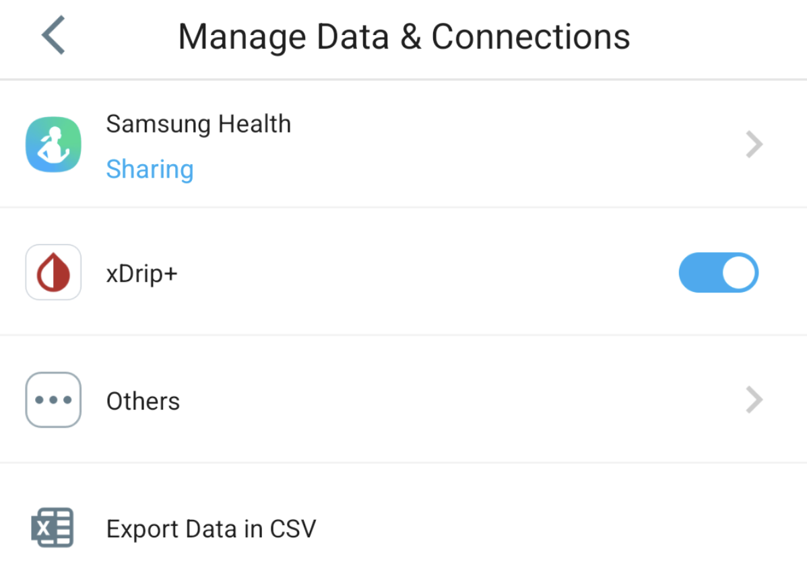

# CareSens

Der er flere måder at bruge CareSens-data med **AAPS**:

- xDrip
- Juggluco

**Bemærk:** Du behøver ikke følger-appen Sens365 for at forbinde til AAPS.

## 1. xDrip

1. Installer og opsæt den officielle CareSens-app.
2. I CareSens-appen skal du gå til settings -> Manage Data and Connections -> slå xDrip-kontakten til. Hvis du ønsker det, kan du slå dataforbindelserne til CareLevo, DIA:CONN, CloudLoop osv. fra under »others«.

2. Installer xDrip: [xDrip](https://github.com/NightscoutFoundation/xDrip).
3. I xDrip skal du gå til settings -> hardware data source og vælge `Companion App` som datakilde.
4. I **AAPS** skal du vælge xDrip under [**Konfiguration → BS-kilde**](#Config-Builder-bg-source).

## 2. Juggluco

1. Installer Juggluco-appen.
2. Åbn venstre menu i Juggluco, og vælg `Photo`
3. Scan QR-koden på sensorens pakke.
4. I venstre menu -> settings -> exchange data skal du sikre dig, at xDrip broadcast er slået til.
5. I **AAPS** skal du vælge xDrip under [**Konfiguration → BS-kilde**](#Config-Builder-bg-source).
