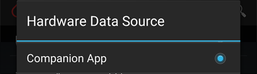
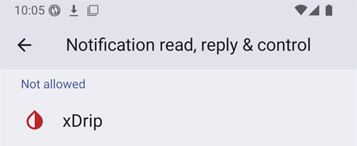
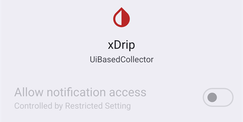
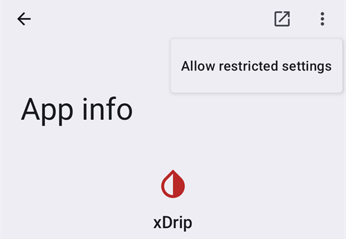
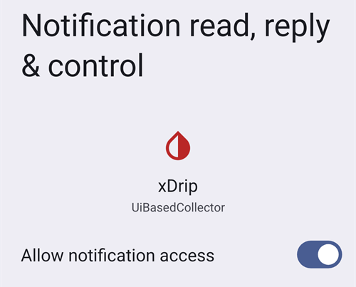
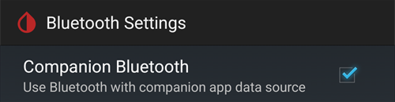

# Dexcom G7, ONE+ og Stelo


## Vigtigt at vide på forhånd

Bemærk, at G7-, ONE+- og Stelo-systemerne, i modsætning til G6, ikke udglatter værdierne, hverken i appen eller i modtageren. Flere detaljer om dette [her](https://www.dexcom.com/en-us/faqs/why-does-past-cgm-data-look-different-from-past-data-on-receiver-and-follow-app).

```{admonition} Smoothing method 
Læs forslagene til [udjævningsmetode](../CompatibleCgms/SmoothingBloodGlucoseData.md), som du kan bruge til Dexcom G7/ONE+/Stelo
```

## 1. xDrip (direkte forbindelse til G7, ONE+ eller Stelo)

- xDrip forbinder selv til sensoren: afinstaller Dexcom-appen, da kun én app kan forbinde til sensoren. Hvis du vil beholde Dexcom-appen, så brug i stedet [xDrip Companion App](#DexcomG7-xdrip-companion-app).
- Følg vejledningen her: [xDrip G7, ONE+ og Stelo](https://navid200.github.io/xDrip/docs/Dexcom/G7.html). Der kræves en nyere version af xDrip – se den linkede side for mindsteversionen.
- Vælg xDrip i [**Konfiguration → BS-kilde**](#Config-Builder-bg-source).

- Juster xDrip-indstillingerne efter forklaringerne på siden [xDrip-indstillinger](../CompatibleCgms/xDrip.md).

## 2. Build Your Own Dexcom App (kun G7)

```{admonition} Old app version
:class: warning
Dexcom BYODA er nu en meget gammel version af appen og kan ikke opdateres. Ikke tilgængelig til ONE+ eller Stelo.
```

-   [Build Your Own Dexcom App](https://docs.google.com/forms/d/e/1FAIpQLScD76G0Y-BlL4tZljaFkjlwuqhT83QlFM5v6ZEfO7gCU98iJQ/viewform?fbzx=2196386787609383750) (BYODA) understøtter lokal broadcast til AAPS

-   Med denne app kan du bruge din Dexcom G7 med enhver Android-smartphone.
-   Afinstaller den originale Dexcom-app
-   Installer den downloadede apk
-   Indtast sensorkoden i den patchede app
-   Efter kort tid bør BYODA fange sensorens signal.

(DexcomG7-xdrip-companion-app)=

## 3. xDrip Companion App (G7, ONE+ og Stelo)

Den officielle Dexcom-app forbliver forbundet til sensoren. xDrip læser glukoseværdierne fra Dexcom-appens notifikationer og sender dem til **AAPS**.

```{admonition} Not a trusted data source
:class: note
**AAPS** betragter ikke xDrip i Companion App-tilstand som en [pålidelig BS-kilde](#GettingStarted-TrustedBGSource): SMB'er er ikke tilladt hele tiden.

Hvis du vil læse Dexcom-appens notifikationer uden xDrip og som en pålidelig datakilde, så brug [Notifikationslæser](#DexcomG7-notification-reader).
```

### Læs Dexcom-appens notifikationer

- Behold Dexcom-appen installeret og forbundet til sensoren. Dens notifikationer skal forblive synlige: slå dem ikke fra, og skjul dem ikke.
- Download og installer [xDrip](https://github.com/NightscoutFoundation/xDrip). Brug de samme glukoseenheder i xDrip som i Dexcom-appen.
- I xDrip skal du gå til **Settings** > **Hardware Data Source** og vælge **Companion App**.

  

- xDrip beder om tilladelse til at læse notifikationer. Tryk på **OK**, vælg derefter **xDrip** på listen, og slå **Tillad adgang til notifikationer** til.

  

- Hvis **Tillad adgang til notifikationer** er nedtonet (*Styres af begrænset indstilling* (Controlled by Restricted Setting)), blokerer Android den, fordi xDrip ikke blev installeret fra Play Butik:

  

  Åbn appinfo for xDrip (tryk længe på xDrip-ikonet > **Appinfo**), tryk på menuen med de tre prikker øverst til højre, og vælg **Tillad begrænsede indstillinger**. Gå derefter tilbage til skærmen for adgang til notifikationer, og tillad den.

  

  

- Målinger vises i xDrip, når Dexcom-appen viser en ny værdi. Hvis der ikke vises noget, skal du måske starte en sensor i xDrip: det har ingen virkning på den rigtige sensor. Stelo giver en måling hvert 15. minut i denne tilstand.

### Companion Bluetooth (G7)

Når Dexcom-appen er forbundet til en G7-sensor, kan xDrip også lytte med på de målinger, som sensoren sender til Dexcom-appen via Bluetooth. xDrip parrer ikke med sensoren, og du behøver ikke at indtaste sensorkoden: Dexcom-appen har stadig kontrollen.

Med **Companion Bluetooth** får xDrip det præcise tidspunkt og den præcise tendens for hver måling fra sensoren i stedet for tidspunktet, hvor notifikationen blev vist. xDrip udfylder også huller fra de perioder, hvor telefonen var uden for rækkevidde (backfill).

- I xDrip skal du gå til **Settings** > **Less common settings** > **Bluetooth Settings** og aktivere **Companion Bluetooth**.

  

- Det virker ikke på alle telefoner og Android-versioner. Deaktiver det, hvis du ser problemer.
- Hvis en gammel Dexcom-sensor stadig er på telefonens Bluetooth-liste, kan xDrip komme til at lytte til den forkerte: i Android **Indstillinger** > **Forbundne enheder** skal du glemme de sensorer, du ikke længere bruger.
- Companion Bluetooth er lavet til G7. Med ONE+ og Stelo skal du bruge notifikationer.

### Konfiguration i AAPS

- Vælg xDrip i [**Konfiguration → BS-kilde**](#Config-Builder-bg-source).
- Juster xDrip-indstillingerne efter forklaringerne på siden [xDrip-indstillinger](../CompatibleCgms/xDrip.md).

## 4. Juggluco (G7 og ONE+)

Version 9.0+ kræves

- Deaktiver den app, der tidligere var forbundet til sensoren: Afinstaller appen, eller brug »Tving til at standse«. Fjern tilladelsen »Enheder i nærheden« i appens indstillinger. Begræns appens batteriforbrug.

- Glem sensoren i Bluetooth-indstillingerne: Find sensoren blandt de parrede enheder i Android-indstillingerne, og vælg »Glem«. Navnene på Dexcom G7-sensorer starter med DXCM.

- Undgå forstyrrelser fra andre sensorer: Hold gamle Dexcom-sensorer uden for Bluetooth-rækkevidde.

- Forbind G7-sensoren med Juggluco: Åbn Juggluco → venstre menu → Photo. Scan datamatrix-koden på G7-sensorens applikator. Vent op til 5 minutter på, at Juggluco finder sensoren.

- Krav til parring: Accepter at parre sensoren med Juggluco. Sørg for, at skærmen ikke er låst under parringen. Hvis parringen mislykkes, så vent 5 minutter, før du prøver igen.

- Undtagelse: Wear OS-ure kan parres uden at trykke på en knap for at acceptere.

(DexcomG7-notification-reader)=

## 5. Notifikationslæser (G7, ONE+ og Stelo)

Den officielle Dexcom-app forbliver forbundet til sensoren. **AAPS** læser glukoseværdien direkte fra notifikationen fra Dexcom-appen, uden nogen anden app imellem.

```{admonition} Trusted data source
:class: note
Målinger fra Dexcom G7-, ONE+- og Stelo-apps er en [pålidelig BS-kilde](#GettingStarted-TrustedBGSource): SMB'er kan være tilladt hele tiden.
```

Sammenlignet med de andre metoder på denne side har Notifikationslæser nogle begrænsninger:

- **Ingen trendpil** og **ingen udfyldning af manglende data (backfill)**: værdier, der mangler, mens telefonen var slukket eller uden for rækkevidde, går tabt.
- Hver værdi får det tidspunkt, hvor notifikationen kom, ikke det præcise tidspunkt for sensormålingen.
- Kun værdier mellem 40 og 405 mg/dl (2,2 og 22,5 mmol/l) bliver læst. "LOW" og "HIGH" bliver ikke læst.
- Stelo giver en måling hvert 15. minut.

### Opsæt Dexcom-appen

- Behold Dexcom-appen installeret og forbundet til sensoren.
- Sørg for, at Dexcom-appen viser den aktuelle glukoseværdi i sin notifikation. Dens notifikationer skal forblive synlige: slå dem ikke fra, og skjul dem ikke.
- Brug de samme glukoseenheder (mg/dl eller mmol/l) i Dexcom-appen som i **AAPS**. Ellers kan **AAPS** ikke læse værdien.

### Konfiguration i AAPS

- Vælg **Notifikationslæser** i [**Konfiguration → BS-kilde**](#Config-Builder-bg-source), og bekræft skiftet.

  

- Tilbage på hovedskærmen viser **AAPS** **Tilladelser påkrævet**. Tryk på **Tillad** ved siden af **Adgang til notifikationer**.

  

- Android åbner sin liste over adgang til notifikationer (navnet afhænger af din Android-version, f.eks. *Læse, besvare og styre notifikationer* (Notification read, reply & control)). Vælg **AAPS**, slå **Tillad adgang til notifikationer** til, og bekræft med **Tillad**.

  

  Android advarer om, at **AAPS** kan læse alle dine notifikationer. **AAPS** læser kun notifikationer fra understøttede CGM-apps og ignorerer alle andre.

  

- Hvis **Tillad adgang til notifikationer** er gråtonet (*Styres af begrænset indstilling* (Controlled by Restricted Setting)), blokerer Android det, fordi **AAPS** ikke er installeret fra Play Butik. Åbn appinfo for **AAPS** (tryk længe på ikonet for **AAPS** > **Appinfo**), tryk på menuen med de tre prikker øverst til højre, og vælg **Tillad begrænsede indstillinger**. Gå derefter tilbage til skærmen for adgang til notifikationer, og tillad den.
- Værdierne vises i **AAPS**, når Dexcom-appen viser en ny værdi.

```{warning}
Hvis notifikationen fra Dexcom-appen viser mere end ét glukosetal eller intet, springer **AAPS** den notifikation over.
```
