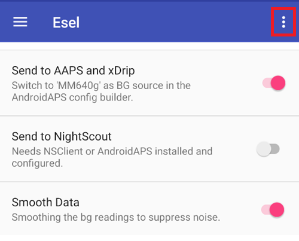
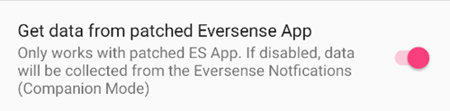

# Eversense

Der er fire forskellige metoder til at hente værdierne fra Eversense:

- ESEL companion-tilstand
- ESEL patched-tilstand (modificeret app)
- xDrip companion-app
- Notifikationslæser (indbygget i **AAPS**)

## ESEL

Hent og installer [ESEL-appen](https://github.com/BernhardRo/Esel/tree/master/apk), og følg denne [vejledning](https://github.com/BernhardRo/Esel?tab=readme-ov-file#esel).

- Åbn i ESEL menuen med tre prikker (⋮) øverst til højre, og vælg **Settings** (findes også i menuen ☰). I indstillingerne:
  - Aktiver "Send to AAPS and xDrip"
  - **Deaktiver** "Send to Nightscout"
  - Da BS-data fra Eversense kan have støj, anbefales det at aktivere "Smooth Data" i ESEL.



### Companion-tilstand

Læser data fra notifikationerne fra Eversense-appen (virker med den almindelige Eversense-app, tilgængelig fra ESEL version 3.0.1).

1. Brug den officielle Eversense-app fra Google Play Butik
   - Valgfrit, men nødvendigt for at udfylde manglende data: Log ind på din Eversense-konto
   - Aktiver Auto synchronization under Sync
2. Konfiguration af ESEL:
   - Deaktiver indstillingen "Get data from patched Eversense App"
   - For at udfylde manglende data: Aktiver "Fill missing data from eversensedms.com"
   - Angiv dine Eversense-logindata som e-mailadresse og adgangskode
3. Vælg "MM640g" som BS-kilde i [**Konfiguration → BS-kilde**](#Config-Builder-bg-source).

### Modificeret Eversense-app

 Kræver en modificeret (patched) version af Eversense-appen (virker helt offline, også udfyldning af manglende data).

1. Afinstaller Eversense-appen (Advarsel: dine lokale historiske data (ældre end 1 uge) går tabt!)

2. Installer den [modificerede Eversense-app](https://cr4ck3d3v3r53n53.club), og brug den som beskrevet af leverandøren

   - Start Eversense-appen, log ind, forbind til din sender, og brug den ligesom den normale app.

3. Konfiguration af ESEL:

   - Aktiver indstillingen "Get data from patched Eversense App"




Hvis du kører ESEL med en ny installation af Eversense for første gang, kan der gå op til 15 min, før dine første værdier vises i xDrip!

4. Vælg "MM640g" som BS-kilde i [**Konfiguration → BS-kilde**](#Config-Builder-bg-source).

## xDrip

xDrip kan læse notifikationer fra producentens app, ligesom ESEL gør. Udfyldning af manglende data er ikke tilgængelig.

- Download og installer xDrip: [xDrip](https://github.com/NightscoutFoundation/xDrip)
- Som datakilde i xDrip skal »Companion App« være valgt.
- Vælg xDrip i [**Konfiguration → BS-kilde**](#Config-Builder-bg-source).
- Juster xDrip-indstillingerne efter forklaringerne på siden [xDrip-indstillinger](../CompatibleCgms/xDrip.md).
- Aktiver [Eksponentiel udjævning](../CompatibleCgms/SmoothingBloodGlucoseData.md) i AAPS.

## Notifikationslæser

**AAPS** kan læse glukoseværdierne direkte fra de notifikationer, som den officielle Eversense-app viser, uden nogen anden app imellem. Udfyldning af manglende data er ikke tilgængelig.

- Vælg **Notifikationslæser** i [**Konfiguration → BS-kilde**](#Config-Builder-bg-source), og giv **AAPS** adgang til notifikationer, når du bliver spurgt.
- Sørg for, at Eversense-appen viser den aktuelle glukoseværdi i sin notifikation.

```{warning}
BS-værdier kommer ikke altid hvert 5. minut, og der kan forekomme dubletter.
```