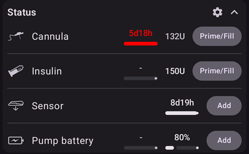

# Generelle anbefalinger om CGM

## CGM-hygiejne

Uanset hvilket CGM-system du bruger, er der nogle meget klare regler, du bør følge, hvis du vil kalibrere med blod, uanset om du bruger DIY CGM-software eller de officielle apps.

-   Sørg for, at hænder og udstyr er rene.
-   Prøv at kalibrere, når du har en række punkter med en vandret pil (15-30 minutter er som regel nok)
-   Undgå at kalibrere, når glukoseniveauet stiger eller falder.
-   Lav »nok« kalibreringer – i de officielle apps bliver du bedt om en kontrol en eller to gange om dagen. I DIY-systemer bliver du måske ikke bedt om det, og du skal være forsigtig med at fortsætte uden kalibreringer.
-   For sensorer, der ikke kræver eller ikke tillader kalibrering, skal du mindst én gang om dagen kontrollere dit rigtige blodsukker. AAPS er kun så sikker, som dine sensorværdier er pålidelige.
-   Hvis det overhovedet er muligt, så kalibrer med nogle af dine værdier i et lavere område (4-5 mmol/l eller 72-90 mg/dl) og nogle på et lidt højere niveau (7-9 mmol/l eller 126-160 mg/dl), da det giver et bedre område for punkt/hældning-kalibreringen.

## Isætning af sensor (G6)

Når du sætter sensoren i, anbefales det ikke at trykke for hårdt på indføreren, så du undgår blødning. Sensorens kontakter må ikke komme i kontakt med blod.

Når sensoren er sat i, kan senderen klikkes fast i sensorholderen. Forsigtig! Klik først den firkantede side i, og tryk derefter den runde side ned.

(general-cgm-troubleshooting)=
## Fejlfinding

### Forbindelsesproblemer

Bluetooth-forbindelsen kan blive forstyrret af andre Bluetooth-enheder i nærheden, f.eks. blodsukkermålere, headsets, tablets eller køkkenapparater som mikrobølgeovne eller keramiske kogeplader. I så fald viser xDrip ingen BS-værdier. Når Bluetooth-forbindelsen er genoprettet, bliver de manglende data udfyldt.

### Sensorfejl

Hvis der ofte opstår sensorfejl, så prøv at vælge et andet sted på kroppen til din sensor. Sensorens kontakter må ikke komme i kontakt med blod.

Ofte kan en »Sensor Error« (sensorfejl) rettes ved straks at drikke noget og massere området omkring sensoren!

### Springende værdier

Du kan prøve at ændre indstillingerne for støjblokering i xDrip (Settings - Inter-App Settings - Noise Blocking), f.eks. »Block Very High noise and worse«. Se også [Udjævning af blodsukkerdata](../CompatibleCgms/SmoothingBloodGlucoseData.md).

### Negativ sensoralder

Sensoralderen vises i rækken **Sensor** i statuspanelet på hovedskærmen (tryk på pilen for at udvide det). En negativ alder opstår, hvis der enten er to [Careportal-registreringer](#aaps-screens-careportal) af typen »Sensorindstik«, eller et sensorindstik med forkert dato. Åbn **Behandlingshistorik** (menu ☰), vælg fanen **Careportal**, og slet den forkerte registrering.
