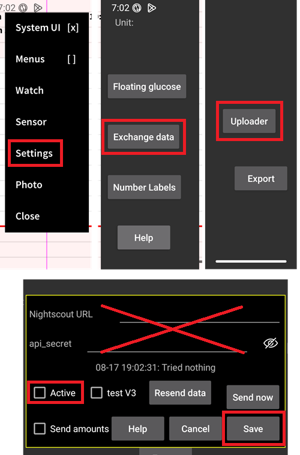
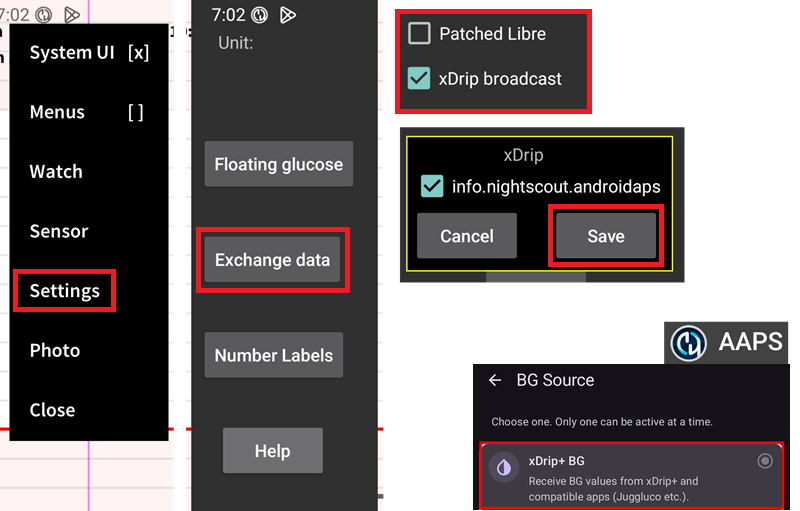
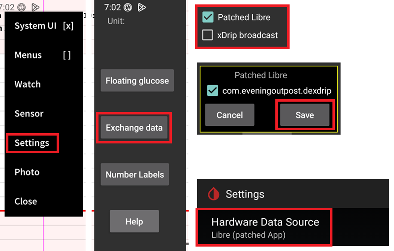

# Juggluco-indstillinger

Hvis du ikke allerede har sat den op, så download [Juggluco](https://www.juggluco.nl/Juggluco/download.html).

Følg [vejledningen](https://www.juggluco.nl/Jugglucohelp/introhelp.html) for at forbinde din sensor.

## Grundindstillinger for alle CGM-systemer

### Deaktiver Nightscout-uploader

Du bør ikke lade nogen anden app uploade data (blodsukker og behandlinger) til Nightscout.

Deaktiver enhver aktiv upload til Nightscout i Juggluco.

(juggluco-to-aaps)=

## Juggluco til AAPS

Juggluco kan sende blodsukker direkte til AAPS. Så er SMB altid aktiveret, hvis du bruger en [pålidelig sensor](#GettingStarted-TrustedBGSource).

Når du bruger en Libre 2/2+/3/3+-sensor, sendes målinger hvert minut til AAPS, men de starter ikke en beregning hvert minut i AAPS.

Aktiver xDrip broadcast i Juggluco (aktiver ikke Patched Libre), bekræft og gem pakkeoplysningerne for AAPS. Vælg BS-kilden xDrip i AAPS.

Brug tilstrækkelig [udjævning](./SmoothingBloodGlucoseData.md) i AAPS.

(juggluco-to-xdrip)=

## Juggluco til xDrip

Juggluco kan sende blodsukker til xDrip, som derefter sender dem videre til AAPS.

Aktiver Patched Libre i Juggluco (aktiver ikke xDrip broadcast), bekræft og gem pakkeoplysningerne for dexdrip. Vælg BS-kilden xDrip i AAPS.

Brug tilstrækkelig [udjævning](./SmoothingBloodGlucoseData.md) i AAPS, hvis det er nødvendigt. Når du bruger en Libre 2/2+/3/3+-sensor, beregner xDrip gennemsnittet af målingerne hvert minut til målinger hvert 5. minut og [udglatter](#libre2-value-smoothing-raw-values) dem også.

