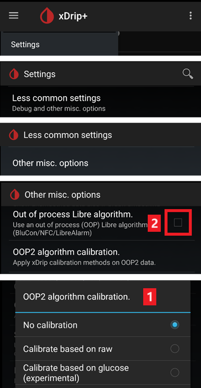
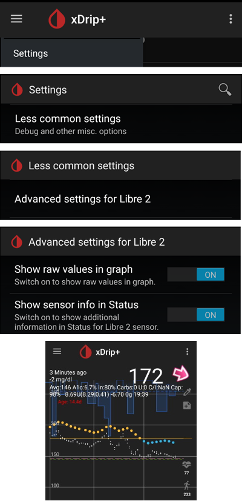

# Freestyle Libre 2 og 2+

Freestyle Libre 2-sensoren er nu en rigtig CGM, også med den officielle app. LibreLink kan dog stadig ikke sende data til AAPS. Der er flere løsninger til at bruge den med AAPS.

## 1. Brug en Bluetooth-bro og OOP

Bluetooth-sendere kan bruges med Libre 2 (EU) eller 2+ (EU) og en app med en »out of process«-algoritme (OOP). Du kan få blodsukkermålinger hvert 5. minut ligesom med [Libre 1](./Libre1.md).

Kontroller, at broen og appen, du vil bruge, virker med din sensor og xDrip.

Libre2 OOP (find den [her](#Libre2_OOP2)) laver de samme BS-målinger som den originale læser. AAPS med Libre 2 udglatter over 10 til 25 minutter for at undgå visse spring. Se nedenfor [Udjævning af værdier og råværdier](#libre2-value-smoothing-raw-values). OOP laver en måling hvert 5. minut med gennemsnittet af de sidste 5 minutter. Derfor er BS-målingerne ikke så glatte, men de svarer til den originale læser og følger de »rigtige« BS-værdier hurtigere. Hvis du vil loope med OOP, skal du slå alle udjævningsindstillinger til i xDrip.

Der er nogle gode grunde til at bruge en Bluetooth-sender:

-   Du kan vælge forskellige OOP2-kalibreringsstrategier (1): få læserens værdier med "no calibration", kalibrere sensoren som en Libre 1 med "calibrate based on raw" eller kalibrere de læserlignende værdier med "calibrate based on glucose".  
  Sørg for, at OOP1 forbliver deaktiveret (2).

    → Hamburger Menu → Settings → Less common settings → Other misc. options



-   Libre 2-sensoren kan bruges i 14,5 dage ligesom Libre 1
-   Udfyldning af 8 timers manglende data understøttes fuldt ud

Bemærk: Senderen kan bruges samtidig med LibreLink-appen uden at forstyrre den.

### Start sensor

- → Hamburger Menu (1) → Start sensor (2) → Start sensor (3) → Svar "Not Today" (4).


Dette starter ikke fysisk en Libre2-sensor og påvirker den slet ikke. Dette fortæller bare xDrip, at en ny sensor leverer blodsukkerværdier. Hvis det er muligt, så indtast to blodmålte værdier til den første kalibrering. Nu bør blodsukkerværdierne blive vist i xDrip hvert 5. minut. Manglende værdier, f.eks. fordi du var for langt væk fra din telefon, bliver ikke udfyldt bagefter.

Efter et sensorskift finder xDrip automatisk den nye sensor og sletter alle kalibreringsdata. Du kan kontrollere dit blodsukker efter aktivering og lave en ny første kalibrering.

### Konfigurer AAPS (kun til looping)

-   I **AAPS** skal du åbne **menuen** (☰) i øverste venstre hjørne, gå til **Konfiguration** > **BS-kilde** og vælge **xDrip+**


-   Hvis AAPS ikke modtager BS-værdier, når telefonen er i flytilstand, så brug 'Identify receiver' som beskrevet på [xDrip-indstillinger](#xdrip-identify-receiver).

## 2. Brug direkte forbindelse i xDrip

```{admonition} Libre 2 EU only
:class: warning
xDrip understøtter ikke direkte forbindelse til Libre 2 US og AUS.
Kun Libre 2 og 2+ **EU**-modeller.
```

- Følg [denne vejledning](./Libre2MinimalL00per.md) for at sætte xDrip op, da den originale dokumentation linker til en forældet OOP2-version.
- Følg opsætningsvejledningen på [xDrip-indstillinger](../CompatibleCgms/xDrip.md).

-   Vælg xDrip+ i [Konfiguration > BS-kilde](#Config-Builder-bg-source).

(libre2-value-smoothing-raw-values)=

### Udjævning af værdier og råværdier

Teknisk set bliver den aktuelle blodsukkerværdi sendt til xDrip hvert minut. Et vægtet gennemsnitsfilter beregner som standard en udglattet værdi over de sidste 25 minutter. Du kan ændre perioden i menuen NFC Scan features.

→ Hamburger menu → Settings → NFC Scan features → Smooth libre 3 data when using xxx method


Dette er nødvendigt for at loope. Kurverne ser glatte ud, og loopets resultater er rigtig gode. Råværdierne, som alarmerne er baseret på, svinger lidt mere, men de svarer til de værdier, som læseren også viser. Desuden kan råværdierne vises i xDrip-grafen, så du kan reagere i tide på hurtige ændringer. Slå Less Common Settings \> Advanced Settings for Libre2 \> "show Raw values" og "show Sensors Infos" til. Så bliver råværdierne også vist som små hvide prikker, og der er ekstra sensorinfo i systemmenuen.

Råværdierne er meget nyttige, når blodsukkeret ændrer sig hurtigt. Selv om prikkerne hopper mere, kan du se tendensen meget bedre end med den udglattede linje, så du kan træffe de rigtige beslutninger om behandlingen.

→ Hamburger menu → Settings → Less common settings → Advanced settings for Libre 2




#### Kalibrering

Du kan kalibrere Libre2 **med en forskydning på -40 mg/dl til +20 mg/dl \[-2,2 mmol/l til +1,1 mmol/l\]** (skæringspunkt). Hældningen (slope) kan ikke ændres. Kontroller med fingerprik, når du har sat en ny sensor, og husk, at den måske ikke er præcis de første 12 timer efter indstik. Da der kan være store forskelle i forhold til blodmålingerne, skal du kontrollere hver 24. time og kalibrere om nødvendigt. Hvis sensoren viser helt forkert efter et par dage, bør den skiftes.

## 3. Brug Diabox

- Installer [Diabox](https://t.me/s/DiaboxApp). Gå til Settings, Integration, og aktiver Share data with other apps.


- Vælg xDrip+ i [Konfiguration > BS-kilde](#Config-Builder-bg-source).

## 4. Brug Juggluco

Se [her](./Juggluco.md).
