# Sådan sætter du FSL 2 og OOP2 op til en direkte Bluetooth-forbindelse i xDrip

Overført fra [MinimalL00per](https://www.minimallooper.com/post/how-to-setup-freestyle-libre-2-and-oop2-to-use-a-native-Bluetooth-connection-in-xdrip) til markdown og **revideret/opdateret**: 25. aug. 2025, psonnera

Nederst i dette dokument er der en liste med definitioner. Hvis du ikke kender et ord eller en forkortelse, kan du *[springe ned](#minimallooper-definitions)* og få en forklaring.

 

## Konfiguration

### Hardware

- *FSL2 og 2+* **BEMÆRK: Versionerne fra USA, Canada, New Zealand og Australien understøttes IKKE**

**(VALGFRI) Aflæser** (virker ikke med FSL2+)

- Aflæser 1 (med opdateret firmware)

- Aflæser 2

*BEMÆRK: Hvis du vil bruge aflæseren i denne løsning, SKAL du STARTE sensoren med AFLÆSEREN FØRST. Hvis du ikke gør det, kan du ikke bruge aflæseren til at hente målinger fra den aktiverede sensor. Når sensoren er varmet op, kan du tage målinger med LL-appen eller xDrip.*

### Software

**OOP** - Out of Process Algorithm, en ekstern Android-app (APK), der hjælper med at hente rå sensordata for at få blodsukkerværdier. xDrip sender de indsamlede rå BT-data fra FSL2 til OOP, og blodsukkerværdierne sendes tilbage til xDrip.

- **OOP2**

  - **Virker kun med europæiske FSL2/2+-sensorer**

  - Lukket kildekode (findes ikke på GitHub)

  - Formålet er at dekryptere de krypterede rå sensorværdier og sende dem tilbage til xDrip. Derefter kan xDrip enten bruge rå data, som kræver kalibrering, eller give glukoseværdier, der ligner dem fra aflæser 1.

[***xDrip***](https://jamorham.github.io/)

- [*Nightly*](https://github.com/NightscoutFoundation/xDrip/releases) nyeste kildekode, bygget hver nat. Ikke grundigt testet

- [*Stable*](https://xdrip-plus-updates.appspot.com/stable/xdrip-plus-latest.apk) nyeste stabile, testede udgivelse.

- **BEMÆRK: Nye sensorer kræver en opdateret OOP2-app. Derfor anbefales det at bruge mindst den nyeste udgivelse (Stable) af xDrip, som passer til den nyeste OOP2.**

 

## Fremgangsmåde

- *Download og installer først de apps, der står nedenfor*
- *Afinstaller apps, der kan give konflikter*
- *Sådan starter du en FSL2-sensor i direkte Bluetooth-tilstand med LL og xDrip
  - [*Trin 1: Installation og konfiguration af apps*](#minimallooper-step1)
  - [*Trin 2: Konfiguration af indstillinger i xDrip*](#minimallooper-step2)
  - [*Trin 3: Sæt sensoren fysisk på*](#minimallooper-step3)
  - [*Trin 4: Start LL-appen, og start sensoren med den allerførste NFC-scanning*](#minimallooper-step4)
  - [*Trin 5: Åbn xDrip, og NFC-SCAN FSL2-sensoren*](#minimallooper-step5)
  - [*Trin 6: Start den nye sensor i xDrip*](#minimallooper-step6)
  - [*Trin 7: Vent 60 sekunder, og scan sensoren med NFC igen*](#minimallooper-step7)
  - [*Trin 8: Indsamling af data mellem 3 og 15 minutter*](#minimallooper-step8)
  - [*Trin 9: Kontroller, at sensoren er forbundet og sender data*](#minimallooper-step9)

- *[Noter](#minimallooper-notes)*
- *[Fordele](#minimallooper-advantages)*
- *[Ulemper](#minimallooper-disadvantages)*
- <u>*\[Fejlfinding\](#minimallooper-troubleshooting)*</u>

## Før du starter

Vi anbefaler stærkt, at du følger denne fremgangsmåde med en **ny sensor**. Det er rapporteret, at man kan få forbindelse til en sensor, der allerede kører (***se [nedenfor](#minimallooper-started-sensor)***), men det er meget sandsynligt, at LL-appen eller aflæseren laver en ny privat delt nøgle til kommunikationen, mens forbindelsen oprettes. Det betyder, at xDrip efter bindingen ikke kender den nye nøgle og ikke kan kommunikere med sensoren. Hvis du prøver at oprette forbindelse til en sensor, der allerede kører, er det på egen risiko, helst mod slutningen af sensorens levetid.

### Download og installer først de apps, der står nedenfor

(Libre2_OOP2)=

- **OOP2** - Versioner af oop2 findes her:

  (*Bemærk: Du skal være logget ind på Google for at åbne linket.*)

*[oop2.apk](https://drive.google.com/file/d/1106h2s12b3Ev9gKCTU2G75q8h9ChHjcz/view?usp=sharing)* - OOP2_21_09_25 (05d1989) **2025.09.21** (nyeste version)

- **xDrip** - **<u>nyeste version</u>** (mindst version 2025.09.26) findes her:

[*xDrip.apk*](https://github.com/NightscoutFoundation/xDrip/releases)

(minimallooper-started-sensor)=

### Hvad hvis min sensor allerede er startet? Kan jeg stadig få målinger i xDrip? JA!

Mange har spurgt, om denne metode kan bruges med en sensor, der allerede er aktiv, og jeg kan svare med et klart **JA**: Du kan starte en sensor, der allerede kører.

1.  Sørg **FØRST** for, at du har lavet ændringerne i konfiguration og indstillinger i xDrip og har installeret og konfigureret OOP2 som vist nedenfor.

2.  Gå **DEREFTER** videre til *trin 5*, og **SØRG FOR**, at du har tvunget LL til at lukke, før du starter. Følg derefter fremgangsmåden til ende.

*BEMÆRK: Du kan ikke bruge din aktiverede FSL2-sensor med FSLReader, HVIS den ikke først blev startet med FSLReader. Hvis den BLEV startet med FSLReader først, kan du **scanne** sensoren og hente målinger fra BÅDE sensoren og apps som LL og xDrip.*

## Sådan starter du en FSL2-sensor i direkte Bluetooth-tilstand med LL og xDrip

*BEMÆRK: Hvis der er indstillinger på skærmbillederne, som ikke er markeret med en BOKS, og som er SLÅET FRA (dvs. deaktiveret), så LAD DEM VÆRE DEAKTIVERET. Skærmbillederne viser en konfiguration, der virker, for ALLE de viste indstillinger. Hvis du vil eksperimentere med at slå andre funktioner til eller fra, når du har en sensor, der virker, må du gøre det på egen risiko.*

(minimallooper-step1)=

### Trin 1: Installation og konfiguration af apps

**Installer og konfigurer OOP2**, og kontroller, at den virker, ved bare at åbne appen.


**Indstillinger**

- *Use service* **til**

- *Use foreground service* **til**

- *Timer Duration* **5 minutter**

  - Skift til **1 sek.**, hvis du ikke får resultater hurtigt nok (skærmbilledet nedenfor viser denne indstilling).

**Version 2: 93e5cac-2020.12.08 (nyeste version)**

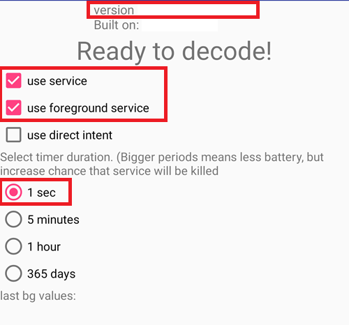

**Installer xDrip** mindste version: nyeste udgivelse. Mere dokumentation om installation og opsætning af xDrip finder du [*her*](../CompatibleCgms/xDrip.md).

(minimallooper-step2)=

### Trin 2: Konfiguration af indstillinger i xDrip

**Hardware Data Source**: Libre Bluetooth

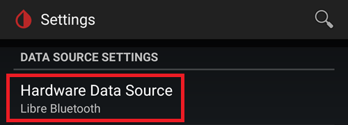

**NFC Scan features**: *indstillinger, der ikke er nævnt, regnes som slået fra.*

- *Use NFC feature*: **til**
- *Sensor Age or Expiry*: **til**
- *Scan when not in xDrip*: **til**
- *Use Any-tag optimized reading method*: **fra**, men prøv **til**, hvis du har svært ved at scanne

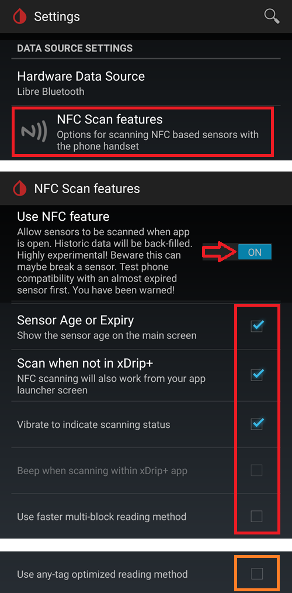

- *Starting Bluetooth connection with FSL2 sensor*: **Always connect to libre2 sensors**

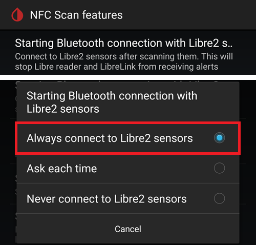

- *Smooth libre 3 data when using xxx method*: lad standardværdien stå. Hæv værdien for sensorer med meget støj, sænk den, når de er stabile.

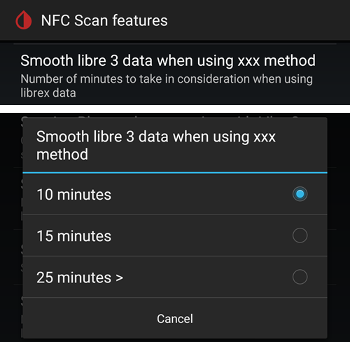

**Less Common Settings -\> Bluetooth Settings** (*disse er vigtige og kan variere med din telefon og opsætning*)

- *Turn Bluetooth on*: **til**
- *Trust Auto-Connect*: **til**
- *Use Background Scans*: **til**
- *Always discover services*: **til**

Du kan sætte xDrip op med QR-koden nedenfor. Du skal scanne den (eller indlæse billedet) i xDrip -> Auto Configure.

```{admonition} QR Code
:class: dropdown

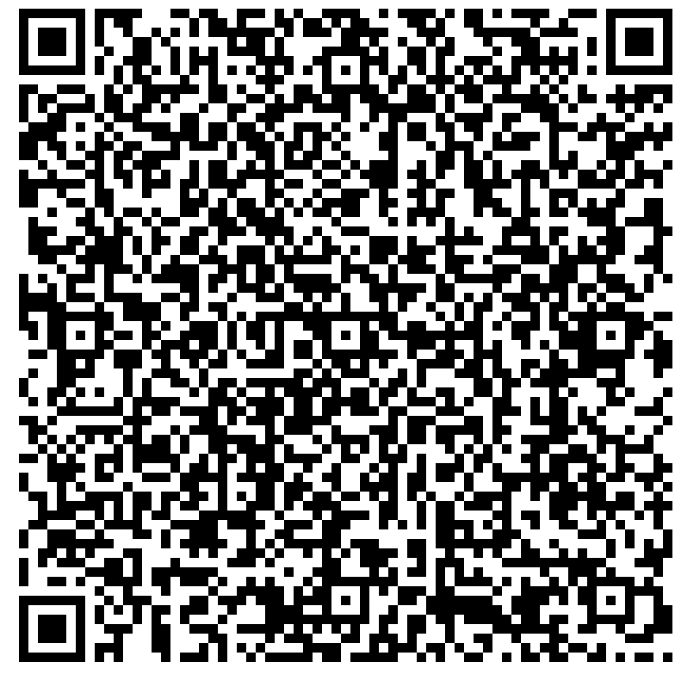
```

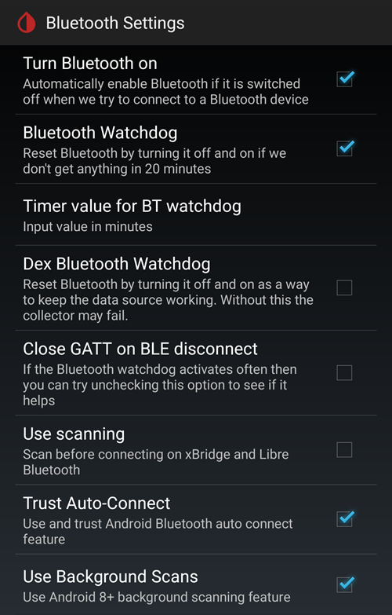

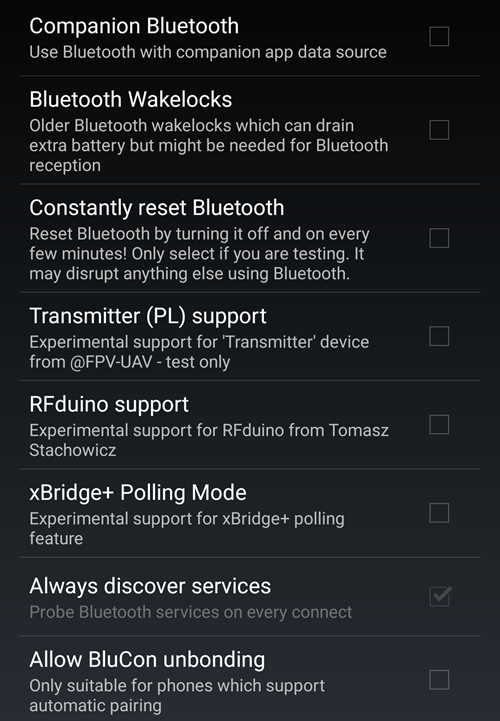

Når du har scannet QR-koden ovenfor, og hvis du har en Samsung-telefon (det hjælper også for mange kinesiske mærker), så scan den anden QR-kode nedenfor for at ændre indstillingerne, så forbindelsen bliver mere stabil:

- *Trust Auto-Connect*: **fra**
- *Use Background Scans*: **fra**

```{admonition} QR Code
:class: dropdown

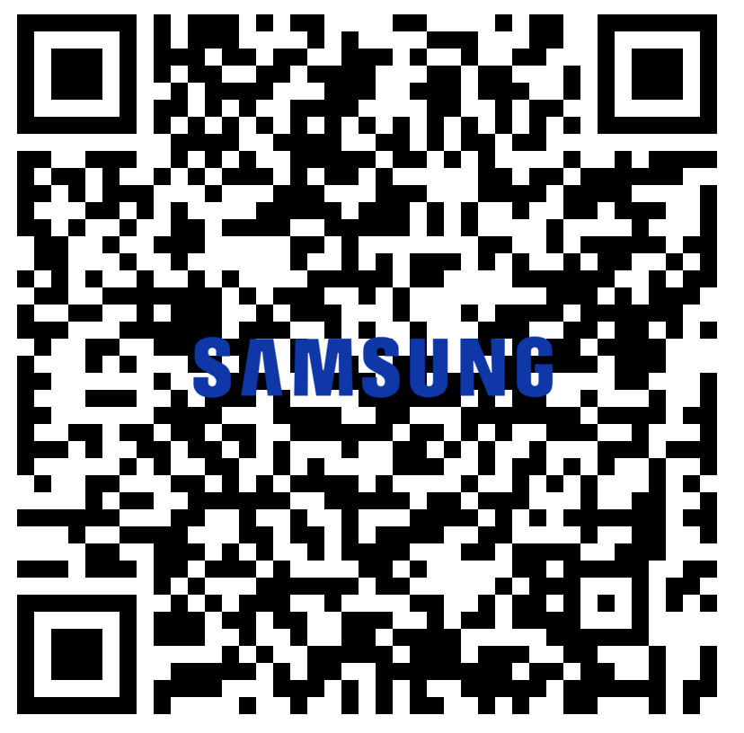
```

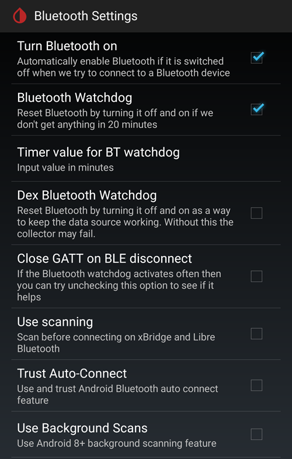

**Advanced settings for FSL2** (*valgfrit, men nyttigt*)

- *show Raw values in Graph*: **til**

- *show Sensor info in Status*: **til**

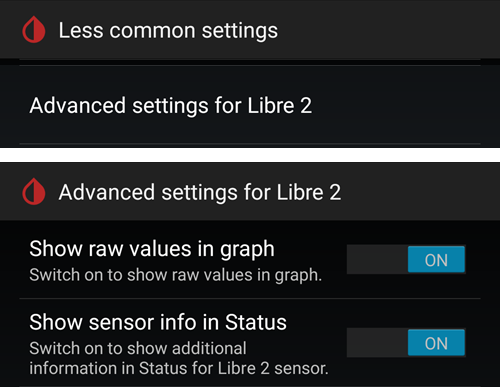

**Extra Logging Settings** (*nødvendigt til fejlsøgning, hvis det ikke virker rigtigt*)

- *Extra tags for logging*: skriv denne værdi

`BgReading:d,jamorham librereceiver:v,LibreOOPAlgorithm:v,jamorham nsemulator:v,DexCollectionService:v`

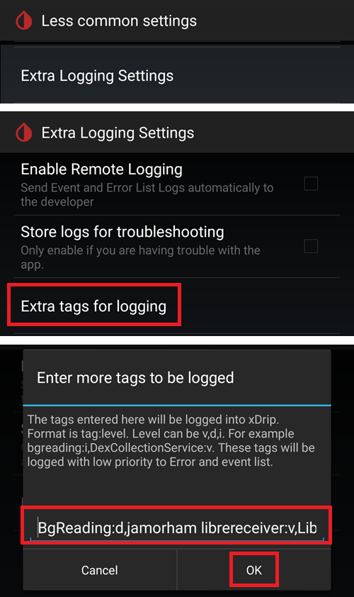

(minimallooper-OOPsettings)=

**Less Common Settings -\> Other misc options**

> **Indstillinger til konfiguration af OOP2**

- *Out of process Libre algorithm*: **FRA**

(*SØRG FOR, AT DENNE ER **FRA** TIL OOP2, ELLERS FÅR DU INGEN MÅLINGER!*)

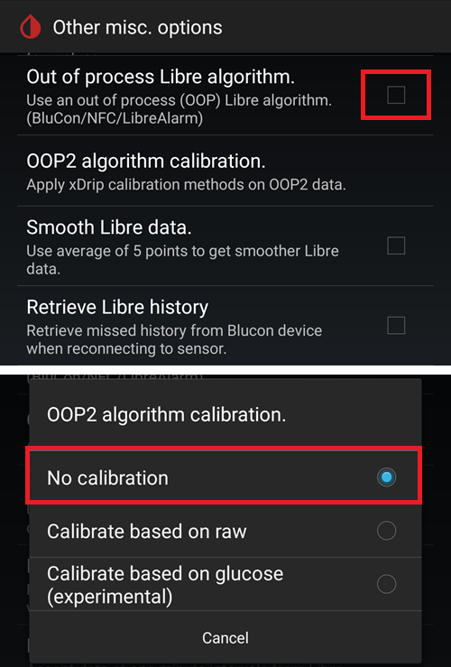

(minimallooper-step3)=

### Trin 3: Sæt sensoren fysisk på

(minimallooper-step4)=

### Trin 4: Start LL-appen, og start sensoren med den allerførste NFC-scanning

Start LL-appen, scan den nye sensor, og luk derefter LL-appen og deaktiver eller afinstaller den. **Du skal stadig vente de fulde 60 minutter på, at sensoren varmer op, før du fortsætter og starter sensoren i xDrip**. Stol ikke på målingerne før, for sensoren kalibrerer stadig internt, og værdierne svinger meget.

#### Trin 4a (VALGFRIT, brug FSLReader):

**Start FSL2-sensoren (ikke 2+) ved at scanne den med FSLReader med den allerførste NFC-scanning**

Hvis du vil kunne bruge **FSLReader** og også LL-appen eller xDrip til at læse værdier fra FSL2-sensoren, så **skal du scanne den nye FSL2-sensor med FSL-aflæseren FØRST.** Når sensoren er færdig med at varme op, kan du bruge LL-appen eller xDrip til at scanne målinger.

*BEMÆRK: LL-appen skal kun bruges til den ALLERFØRSTE NFC-scanning, efter at sensoren er sat på. Den sender signalet, der starter opvarmningen. Bagefter SKAL appen deaktiveres (appindstillinger -\> tving til at lukke) eller afinstalleres. Du kan bruge den patchede 2.3-app eller de officielle versioner, det er lige meget. Det vigtigste er at forhindre, at LL-appen kører, mens xDrip prøver at starte BT-bindingen med sensoren, fordi LL-appen forstyrrer kommunikationen, når Bluetooth-forbindelsen genoprettes.*

*Det er rapporteret, at det er nok at slå **tilladelsen til placering** fra for LL-appen i Androids systemindstillinger, så den ikke forstyrrer forbindelsen. Nogle få brugere har rapporteret, at det virker. Igen: **Jeg anbefaler at deaktivere eller afinstallere appen**, men du kan prøve dette, hvis du vil eksperimentere.*

(minimallooper-step5)=

### Trin 5: Åbn xDrip, og NFC-SCAN FSL2-sensoren

(*Husk! Sørg for, at LL er deaktiveret (placering slået fra) eller afinstalleret, OG at du har ventet alle 60 minutter, så sensoren er varmet op og har kalibreret internt.*)

**NFC-SCAN** FSL2-sensoren med xDrip. Det sender et signal til sensoren om at slå Bluetooth-parring til, så bindingen (bonding) kan starte. Når NFC-scanningen af FSL 2-sensoren lykkes, vises en lille notifikation kort nederst på xDrips skærm Overview med teksten **Scanning** og derefter notifikationen **Scanned OK!**.

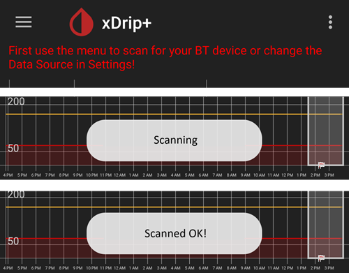

(minimallooper-step6)=

### Trin 6: Start den nye sensor i xDrip

På **xDrips skærm Overview** trykker du på **hamburgermenuen** øverst til venstre. Vælg derefter **Start Sensor**.

På skærmen **Start New Sensor** trykker du på **Start Sensor**. Du bliver spurgt **Did you insert it today?** (Satte du den på i dag?). Svar ved at trykke på **NOT TODAY**.

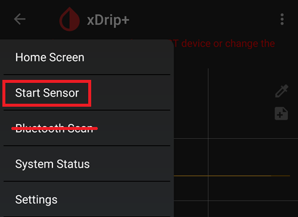

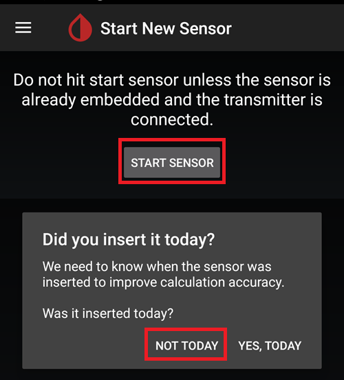

*BEMÆRK: Hvis du ved en fejl trykkede på "YES, TODAY", skal du vælge "stop sensor" i xDrips hovedmenu og derefter "start sensor" ved at gå frem som i trin 5 igen.*

(minimallooper-step7)=

### Trin 7: Vent 60 sekunder, og scan sensoren med NFC igen

Der skal en anden NFC-scanning til for at **TILFØJE** sensoren som den Bluetooth-enhed, som xDrip bruger til at hente målingerne. Når det er færdigt, ser du en notifikation med teksten **NEW SENSOR STARTED**.

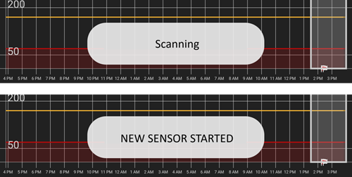

Der er en ventetid på 60 sekunder, fordi sensoren ikke kan scannes mere end én gang i minuttet under denne proces. Hvis sensoren scannes for tidligt, vises advarslen **Not so quickly, wait 60 seconds** på xDrips skærm Overview.

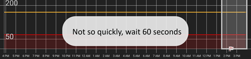

Åbn xDrips hændelseslog (event logs), og kontroller, at sensoren er parret korrekt med xDrip.

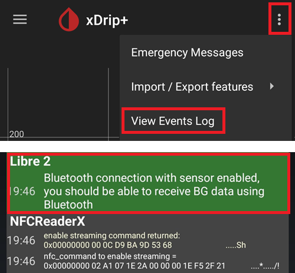

(minimallooper-step8)=

### Trin 8: Indsamling af data mellem 3 og 15 minutter

Efter 3 til 15 minutter er der indsamlet nok data til at vise de første værdier. *Hvis du stadig ikke får målinger på dette tidspunkt, hjælper det nogle gange at genstarte telefonen.*

Hvis du bruger en Samsung-telefon (eller mange kinesiske mærker) og har problemer med at modtage data, så scan QR-koden nedenfor i xDrip -> Auto Configure.

```{admonition} QR Code
:class: dropdown


```

Den ændrer xDrips Bluetooth-indstillinger til:

- *Trust Auto-Connect*: **fra**
- *Use Background Scans*: **fra**

(minimallooper-step9)=

### Trin 9: Kontroller, at sensoren er forbundet og sender data

Tryk på hamburgermenuen øverst til venstre på xDrips skærm Overview, og vælg **System Status**. På skærmen System Status viser feltet **Bluetooth Device:** det aktive FSL2-Bluetooth-navn i formatet **ABB___XXXXXXXXXXX**, hvor X'erne er sensorens serienummer. Feltet **Connection Status** viser **Connected**, og feltet **Sensor Start:** viser tidspunktet, hvor sensoren blev startet.

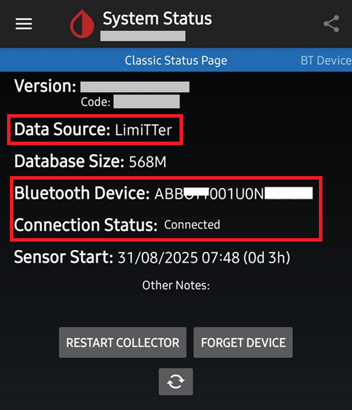

På skærmen **BT Device** (stryg til venstre) kan du se flere detaljer om sensorens forbindelse. Du kan også bruge skærmen til fejlfinding af forbindelsen. Nedenfor er en liste over felterne og hvad de bruges til, som hjælp til fejlfinding af forbindelsen.

*BEMÆRK: **<u>RØR IKKE</u> OG ÆNDR IKKE Bluetooth Pairing fra <u>Disabled</u>** i dette vindue. Hvis du gør det, prøver xDrip en direkte parring, som mislykkes (Not bonded), og du skal starte forfra fra trin 5.*

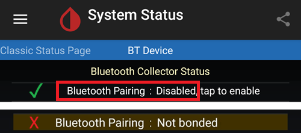

- **Phone Service State:** Sidste gang telefonen fik BT-forbindelse til sensoren (det skal være mindre end 5 minutter siden)
- **Bluetooth Device:** Viser forbindelsens nuværende status (enten **Connected** eller **Disconnected**)
- **Device Mac Address**: Dette er sensorens hardware-id
- **Bluetooth Pairing**: Her skal stå **<u>Disabled, tap to enable</u>**. Pas på IKKE at trykke på denne. Hvis du trykker på den ved en fejl, så tryk igen, indtil den er tilbage på disabled.
- **Slowest wake up**: Dette kan du se bort fra. xDrip bruger ikke tid på at vente på målinger: Den begynder at forvente dem efter en bestemt tid (normalt 5 minutter). Hvis der ikke kommer data på det tidspunkt, ser du "Woke up early". Det betyder, at xDrip ventede, at data var klar, men der var ingen. Slowest wake up er den længste forsinkelse, der har været, før data normalt modtages.
- **Next Wake up**: Skal vise 5 minutter

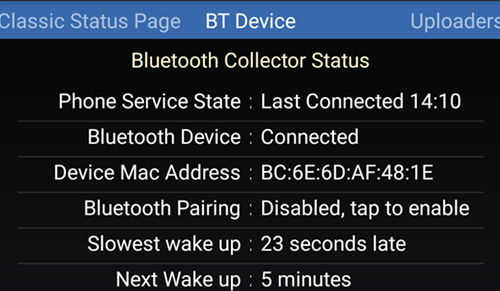

(minimallooper-notes)=

### Noter

- **Brug af LL-NFC-scanninger EFTER binding/parring i xDrip er færdig**: Du kan lave NFC-scanninger, men binding/parring med xDrip skal være færdig først. Se altid i xDrip, om det er tæt på målingen hvert 5. minut (f.eks. 4 minutter siden). Hvis det er tæt på 5 min, så vent på, at den nye BT-måling kommer, og lav derefter NFC-scanningen. Hvis du rammer det forkerte tidspunkt, forstyrrer det BT-processen i xDrip, så der ikke kommer BT-målinger. Det kan tage et stykke tid at binde igen og sende igen, og nogle gange kan sensorens BT-forbindelse blive »stjålet« af LL. Men mellem disse BT-målinger har jeg ikke haft problemer med at lave en NFC-scanning og straks derefter deaktivere appen. Jeg er ikke sikker på, om LL skal deaktiveres hver gang, men jeg deaktiverer den for en sikkerheds skyld.

- **Hvad sker der?** Når der oprettes en Bluetooth-forbindelse, laves en privat delt nøgle, som er nødvendig for at sensoren og den app eller enhed, der forbinder, kan kommunikere. Det er meget sandsynligt, at LL-appen eller aflæseren laver en ny privat delt nøgle til kommunikationen, mens forbindelsen oprettes. Det betyder, at xDrip efter bindingen ikke kender den nye nøgle og ikke kan kommunikere med sensoren.

  - Flere brugere har rapporteret, at LL-appen kan startes igen, når sensoren er startet, og der kommer målinger i xDrip. I LL-appens Android-tilladelser skal du bare slå indstillingen **Tillad placering** fra. Når det er gjort, bør du kunne bruge LL-appen og xDrip samtidig. Jeg anbefaler, at du ikke vælger en standardapp til NFC-scanning, men selv vælger, hvilken app der skal læse sensoren ved en NFC-scanning. Og GLEM IKKE ved dit næste sensorskift at tvinge LL-appen til at lukke efter den første NFC-scanning til opvarmning af den nye sensor. Når sensoren er konfigureret og modtager målinger i xDrip, kan du starte LL-appen igen.

&nbsp;

- **Genstart af telefonen**: Efter genstart, og efter at du har deaktiveret appen eller tvunget den til at lukke, så HUSK at kontrollere, at LL-appen IKKE kører. Jeg foreslår, at du prøver en genstart for at se, om LL starter igen af sig selv. Du kan se det i LL-appens indstillinger under Android-appindstillinger på din telefon. Hvis den stadig er aktiveret, så deaktiver LL-appen igen. Det kan være, at den eneste måde at undgå dette på er at afinstallere LL-appen. Det er for at forhindre, at LL ved et uheld stjæler BT-bindingen. Efter en genstart tager det også de samme 3-15 minutter at få BT-målinger fra sensoren. Vær tålmodig, og planlæg det, hvis du genstarter tæt på et tidspunkt, hvor du har brug for en BS-måling for at give bolus, til måltider osv.

&nbsp;

- **Indstillinger for batterioptimering**: Sørg for at UNDTAGE disse apps fra telefonens indstillinger for batterioptimering

  - xDrip

  - OOP 2

  - LL

  - AAPS

&nbsp;

- **Brug af flytilstand:** Der er situationer, hvor man slår flytilstand til (når man flyver ;-), eller når man sover om natten og ikke vil have Wi-Fi- eller mobilsignaler fra telefonen tæt på hovedet), og det kan give problemer med Bluetooth-kommunikationen, når flytilstand aktiveres. Hvis du slår flytilstand til på telefonen og derefter aktiverer Bluetooth, mister du blodsukkermålinger. Den eneste løsning er at genstarte collector i xdrip+ -\> System Status -\> Classic Status Page. Efter genstart af collector kom blodsukkermålingerne igen.

 

(minimallooper-advantages)=

### Fordele

- **Patchet LL-app er ikke længere nødvendig** Du behøver ikke længere en patchet version af LL-appen for at hente værdier fra FSL2-sensoren. Du kan godt bruge den patchede LL-app, men de officielle versioner af LL-appen kan starte den første NFC-scanning til initialisering på samme måde som den patchede app. Der er ingen forskel, når det gælder NFC-scanningen til initialisering, der starter sensoren.

&nbsp;

- **3rd party NFC scanning device no longer required** 3rd party NFC scanning devices such as (Miaomiao or Blucon) are no longer needed *(but can still be used)* to collect readings as the sensor alone can deliver them now via Bluetooth. Mindre hardware betyder færre ting, der kan gå galt, færre enheder at oplade og en mere enkel opsætning.

&nbsp;

- **Du kan stadig NFC-scanne målinger med FSL2-aflæseren (version 1 med opdateret firmware eller version 2), NÅR FSL2-sensoren er startet med FSL-aflæseren FØRST.** Den selvstændige FSL2-aflæser kan stadig bruges til at scanne målinger på den aktive sensor, når den er bundet til xDrip via Bluetooth.

  - Du **SKAL** starte sensoren med den allerførste NFC-scanning, der starter opvarmningen, **med FSL-aflæseren FØRST**. Herefter kan andre apps også tage NFC-målinger fra den nu aktiverede sensor.
- Så vidt jeg ved, vil FSL2-sensoren (så længe den ikke har oprettet eller prøver at oprette en forbindelse) altid annoncere, at den er der (og er ledig), via BLE præcis hvert 2. minut (synligt for enhver Bluetooth-enhed, der kan søge efter Bluetooth-enheder). Den enhed, der først svarer på denne annoncering, vinder kapløbet og er den *eneste* enhed, der må forbinde til og læse sensoren, fordi der under NFC-scanningen laves en privat delt nøgle, som bruges til at dekryptere kommunikationen fra FSL 2. Sensoren er derefter ikke tilgængelig for andre enheder, som ikke har denne private delte nøgle, og som måske også prøver at oprette forbindelse. Det ser ud til, at FSL 2-aflæseren altid vinder dette kapløb, uanset hvem »modstanderen« er.

&nbsp;

- **Opsætning med mindst mulig hardware** Mit mål har altid været at have så få medicinske enheder på kroppen som muligt. FSL2 sammen med Omnipod-systemet nåede dette mål. Det er endnu vigtigere, når jeg rejser (både korte og lange rejser), fordi der bliver færre ting og færre skift af dem, så jeg har mere plads til andre ting i bagagen. Forhåbentlig kommer der i fremtiden en patchpumpe, hvor kun reservoiret skiftes, mens chip og motor kan genbruges som en del, man beholder. Det ville give mindre affald og mindre emballage ved skift af infusionssæt, og igen mere plads i kufferten til andre ting.

&nbsp;

- **Ikke længere en times hul ved sensorskift** Fordi du kan starte en ny sensor med LL-appen med en første NFC-scanning, kan den nuværende sensor samtidig blive ved med at køre og sende målinger via Bluetooth. Efter 20 minutter kan du få målinger fra den nye sensor, men det er bedst at vente 1 time, så sensoren kan kalibrere ordentligt internt. Det betyder, at du kan stoppe den nuværende sensor og starte den nye (efter at den er sat på og varmet op med LL-NFC-scanningen en time før), og inden for 3 til 15 minutter har du dine første kalibreringer og målinger.

&nbsp;

(minimallooper-disadvantages)=

### Ulemper

- **Genstart af telefonen:** Fordi Bluetooth-processen skal starte forfra, når telefonen genstarter, skal du først sikre dig, at du manuelt deaktiverer LL-appen (hvis du ikke har afinstalleret den), og være tålmodig, indtil de første målinger kommer (3 til 15 min). Det betyder, at du skal time genstart af telefonen, så den ikke sker på vigtige tidspunkter, f.eks. ved korrektionsboluser eller ved måltider og mellemmåltider.

&nbsp;

- **Du kan ikke køre LL og xDrip samtidig til Bluetooth-målinger**. LL vil altid prøve at »stjæle« Bluetooth-forbindelsen til sensoren og bindingen. Hvis det sker, er du låst til LL resten af sensorens levetid. Så det virker ikke altid at køre apps samtidig. Som jeg nævner nedenfor, kan du aktivere LL-appen og lave en NFC-scanning for at få LL-målingen (hvis du vil sammenligne eller vil hente historik til dig selv eller til rapporter til din diabeteslæge). Men du skal deaktivere den, så snart du har din måling, og ikke prøve det inden for et minut før xDrip skal hente sin Bluetooth-måling. Jeg ved ikke, hvordan FSL2-aflæseren virker, mens man gør dette, men jeg vil teste det senere.
- Flere brugere har rapporteret, at LL-appen kan startes igen, når sensoren er startet, og der kommer målinger i xDrip. I LL-appens Android-tilladelser skal du bare slå indstillingen **Tillad placering** fra. Når det er gjort, bør du kunne bruge LL-appen og xDrip samtidig. Jeg anbefaler, at du ikke vælger en standardapp til NFC-scanning, men selv vælger, hvilken app der skal læse sensoren ved en NFC-scanning. Og GLEM IKKE ved dit næste sensorskift at tvinge LL-appen til at lukke efter den første NFC-scanning til opvarmning af den nye sensor. Når sensoren er konfigureret og modtager målinger i xDrip, kan du starte LL-appen igen.

&nbsp;

- **NFC-scannere fra tredjepart kan stadig bruges**. Ja, jeg har skrevet det som en ulempe, men jeg ville også pege på, at hvis noget går galt med sensoren, og LL tager kontrol over den, kan du altid falde tilbage på at sætte en NFC-scanner på sensoren for at få målinger i xDrip. You can also use this device instead of a direct Bluetooth connection if you are more comfortable with a setup consisting of a 3rd party NFC scanning device (Miaomiao, Blucon). Nogle telefoner virker ikke så godt med sensorens egen Bluetooth-binding og dataoverførsel. Du kan bruge disse enheder som backup eller til daglig brug. Begge dele er stadig en mulighed.
- Hvis du vil bruge **FSL-aflæseren** som NFC-scanner til at tage målinger, SKAL du starte FSL2-sensoren med den **ALLERFØRSTE NFC-scanning** til opvarmning af sensoren med **AFLÆSEREN FØRST**.

&nbsp;

- **LV-data uploades ikke automatisk** Da LL-appen ikke har en fast Bluetooth-forbindelse (fordi LL ikke skal køre samtidig med xDrip, når sensoren sender Bluetooth-målinger), modtager den ikke automatisk målinger fra sensoren. Det betyder, at blodsukkerdata ikke automatisk bliver uploadet til LV og dermed heller ikke til andre telefoner med LL. Jeg ser det som en ulempe, fordi jeg ved, at mange forældre er afhængige af denne funktion, og det samme er de, der skal bruge LV-rapporter til deres behandler. Du kan stadig åbne LL-appen og scanne hver 8. time for at få de udfyldte data fra sensoren ind i LL (3 gange om dagen, mindst hver 8. time, men der skal sikkert flere scanninger til for at få alle 24 timers data med), men igen er det en manuel proces.

&nbsp;

(minimallooper-definitions)=

### Definitioner

- **BT** - Bluetooth

- **BLE** - Bluetooth Low Energy

- **FSL** - FreeStyle Libre
  - **Libre 1 (FSL1)** - Kun NFC. Første version af sensoren

  - **Libre 2 (FSL2)** - Bluetooth og NFC. Anden version af sensoren.

  - **Libre 3 (FSL3)** - Bluetooth og NFC. Tredje og mindre version af sensoren. Understøttes ikke af OOP2 (se Juggluco).

- **LL** - LibreLink, **appen**, der bruges til at starte sensoren med den første NFC-scanning

- **LV** - LibreView, skytjeneste til at dele data med dit diabetesteam (overvej at bruge Tidepool eller Nightscout)

- **MM** - MiaoMiao, navn og producent af en NFC-scanner fra tredjepart, som sender målinger via Bluetooth til xDrip.

- **NFC** - Near Field Communication, en fysisk handling, hvor du holder telefonens NFC-sensor tæt på din sensor for at starte en måling. Det kaldes ofte »at scanne sensoren«, en »sensorscanning« eller en »NFC-scanning«. Denne proces bruger slet ikke Bluetooth.

- **OOP1** - Out of Process Algorithm version 1, appen fra tredjepart, der modtager rå værdier (sendt til xDrip fra sensoren via Bluetooth eller NFC-scanning). Den bruger så en algoritme (meget lig hardwarealgoritmen på sensorens chip) til at behandle de rå værdier og sender et kalibreret blodsukker (kalibreret af OOP1-algoritmen, ikke af xDrips egne kalibreringer) tilbage til xDrip. Her kan det enten vises eller om nødvendigt behandles videre med xDrips kalibrering (med en kalibrering fra fingerprik).

- **OOP2** - Out of Process Algorithm version 2, appen fra tredjepart, der modtager krypterede data fra FSL 2-sensoren (via Bluetooth eller NFC-scanning) og derefter dekrypterer dem. Når dataene er dekrypteret, sendes de til xDrip.

 

(minimallooper-troubleshooting)=

### Fejlfinding

#### Sensoren kan ikke scannes med NFC

- Sørg for, at telefonens NFC-læser er aktiveret i Androids indstillinger.
- NFC-læseren skal kunne læse **ISO 15693**-tags. Nogle Cubot-telefoner er meget svære at bruge.
- Se i telefonens dokumentation, hvor NFC-antennen sidder. Hold telefonen mod sensoren, og bliv der i 10 sekunder: NFC-læsning i xDrip tager længere tid end i producentens app eller aflæseren.
- Prøv at lukke xDrip, før du scanner sensoren.
- Sørg for, at ingen anden app vil læse sensoren (du ser måske et valg mellem forskellige apps, når du scanner: vælg xDrip, men flyt ikke telefonen).
- Prøv alle kombinationer af NFC-indstillingerne i xDrip *Use faster multi-block reading method* og *Use Any-tag optimized reading method*. Husk, at NFC-scanninger normalt er mest pålidelige, når begge indstillinger er **fra**.

#### Hænger ved indsamling af de første målinger

*Bemærk: FSL 2 genkendes ikke som en pålidelig datakilde, når den kalibreres manuelt.*

Sæt strategien for [OOP2-kalibrering](#minimallooper-OOPsettings) til »No calibration«, indtil alt virker.

Derefter kan du vælge, om du vil kalibrere eller ej.

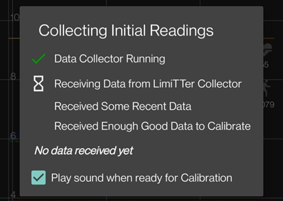

#### Sensoren vises som FSL1

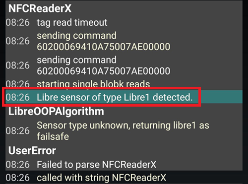

Sørg for, at du bruger de nyeste versioner af xDrip og OOP2.

#### Forbindelsen til sensoren mislykkes

- Kontroller, at OOP1 er deaktiveret (se [her](#minimallooper-OOPsettings))

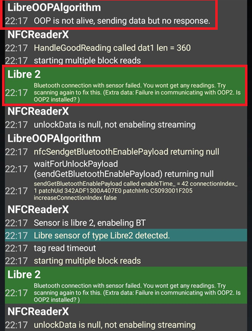

- Kontroller, at OOP2 ikke sættes i dvale af telefonens apps og indstillinger til batteribesparelse
- Kontroller, at Google Play Protect er deaktiveret, da den ellers lukker OOP2
- Har du ændret Bluetooth Pairing i System Status? Tryk på den igen for at sætte den tilbage til **<u>Disabled</u>**


#### Manglende målinger

Sørg for, at OOP2 viser værdier, der ikke er 0 eller -1. Ellers kan det være et tegn på, at din sensor er ved at svigte (eksempel nedenfor i mmol/l).

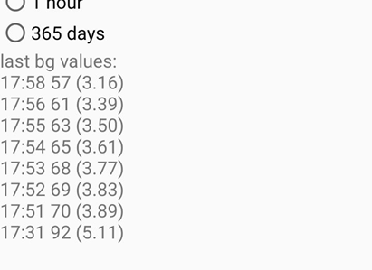

Hvis sensorens alder ikke er gået frem, kan det også være et tegn på, at der er problemer med sensoren. Det betyder, at xDrip modtog en værdi, men smed den væk, fordi den ikke var acceptabel (sensorfejl).

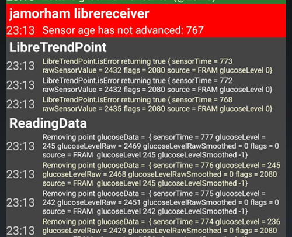

#### Start parringen af sensoren helt forfra

1. xDrip-menu -> Stop sensor (den stopper ikke FSL2, den ændrer bare xDrips status til ikke startet)
2. xDrip-menu -> System status -> Forget device
3. Scan sensoren med xDrip-NFC. Vent mindst ét minut
4. xDrip-menu -> Start sensor. Vent mindst ét minut
5. Scan sensoren med xDrip-NFC nogle gange, og vent altid mindst ét minut mellem to scanninger.
