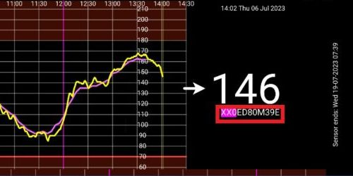
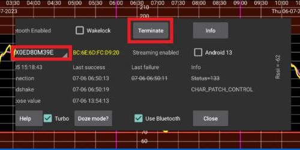

# **Freestyle Libre 3** og 3+

Freestyle Libre 3 (FSL3) kræver en særlig opsætning for at sende BS-værdier til AAPS. Der er to mulige måder at få værdier fra Freestyle Libre 3 (FSL3) ind i AAPS.

Metoderne nedenfor bruger den separate app Juggluco. Den bruger Juggluco til at modtage rå data med 1 minuts interval fra sensoren. Data sendes derefter videre til xDrip eller AAPS. Nye sensorer kan startes enten med Libre 3-appen eller direkte i Juggluco. Vejledningen nedenfor viser, hvordan du starter en sensor med Juggluco-appen. Hvis sensoren er startet, mens du var logget ind med en LibreView-konto, kan du også skifte mellem Juggluco og Libre 3-appen som modtager.

Juggluco kan også sende data til LibreView, så de kan deles med sundhedspersonale, når sensoren er startet med Libre 3-appen.

I xDrip kan sensoren kalibreres i området -40 mg/dl til +20 mg/dl (-2,2 mmol/l til +1,1 mmol/l) for at udligne forskelle mellem en måling med blodsukkerapparat og sensorens målinger.

## Metode 1: brug 1-minuts-målinger direkte
**AAPS** er lavet til målinger hvert 5. minut. Derfor har behandling af 1-minuts-værdier nogle gange begrænsninger.

Se [her](#juggluco-to-aaps).

## Metode 2: omdan 1-minuts-målinger til 5-minuts-værdier via xDrip
Denne metode bruger Juggluco til at modtage rå data med 1 minuts interval fra sensoren. Data sendes derefter til xDrip, som udglatter dem til data med 5 minutters interval og sender dem videre til AAPS.

### Trin 1: Opsæt Juggluco
Download og installer Juggluco-appen [herfra](https://www.juggluco.nl/Juggluco/download.html). Følg vejledningen [her](https://www.juggluco.nl/Juggluco/libre3/)

Sørg for, at du sender glukoseværdierne til xDrip: I Jugglucos indstillinger kan du sætte Juggluco op til at sende glukoseværdien til andre apps. Juggluco kan sende tre typer af sådanne broadcasts: **Patched Libre broadcast** blev oprindeligt brugt af den patchede LibreLink-app og kan bruges til at sende glukoseværdier til xDrip.

### Trin 2: Opsæt xDrip

Blodsukkerværdierne modtages af xDrip-appen på smartphonen.

- Hvis det ikke allerede er sat op, så download [xDrip](https://github.com/NightscoutFoundation/xDrip), og følg vejledningen på siden [xDrip-indstillinger](../CompatibleCgms/xDrip.md).
- Vælg »Libre2 (patched app)« som datakilde i xDrip.
- Hvis det er nødvendigt, så indtast "BgReading:d,xdrip libre_receiver:v" under Less Common Settings → Extra Logging Settings → Extra tags for logging. Så bliver der logget ekstra fejlmeddelelser til fejlfinding.

- Teknisk set bliver den aktuelle blodsukkerværdi sendt til xDrip hvert minut. Et vægtet gennemsnitsfilter beregner som standard en udglattet værdi over de sidste 25 minutter. Du kan ændre perioden i menuen NFC Scan features.

  → Hamburger menu → Settings → NFC Scan features → Smooth libre 3 data when using xxx method

  

### Trin 3: Start sensoren i xDrip

Start sensoren i xDrip med »Start Sensor« og »not today«. Det er ikke nødvendigt at holde telefonen hen til sensoren. Faktisk vil »Start Sensor« ikke fysisk starte en Libre 3-sensor eller på nogen måde kommunikere med den. Det er kun for at fortælle xDrip, at en ny sensor leverer blodsukkerværdier. Hvis det er muligt, så indtast to værdier målt i blodet til den første kalibrering. Nu bør blodsukkerværdierne blive vist i xDrip hvert 5. minut. Manglende værdier, f.eks. fordi du var for langt væk fra din telefon, bliver ikke udfyldt bagefter.

Vent mindst 15-20 minutter, hvis der stadig ikke er nogen data.

Efter et sensorskift registrerer xDrip automatisk den nye sensor og sletter alle kalibreringsdata. Du kan måle dit blodsukker efter aktiveringen og lave en ny første kalibrering.

### Trin 4: Konfigurer AAPS

- Se [her](#juggluco-to-xdrip), og kom så tilbage.

- Hvis **AAPS** ikke modtager BS-værdier, når telefonen er i flytilstand, så brug »Identify receiver«
- Slå udjævning fra (det er allerede gjort i xDrip)

## Senere sensorskift

1. Åbn Juggluco, og skriv serienummeret på den nuværende sensor ned

2. Scan nu bare din nye sensor med telefonens NFC-læser. Juggluco viser en besked, hvis processen er startet korrekt.
3. Når du er klar til at deaktivere den gamle sensor, så åbn Juggluco-menuen ved at klikke et sted i det tomme område i skærmens øverste venstre hjørne.
4. Vælg den udløbne sensor, og tryk på »Terminate«

Bemærk: Når to sensorer er aktive, sender Juggluco den nyeste værdi fra en af sensorerne til xDrip. Hvis sensorerne ikke er kalibreret til at måle BS ens, kan det give BS-værdier, der hopper op og ned, i xDrip. Hvis du afslutter den forkerte sensor, kan du aktivere den igen ved bare at scanne sensoren.

## Skift sensoren mellem Libre 3- og Juggluco-appen

Hvis sensoren er startet, mens du var logget ind med en LibreView-konto, kan du også skifte mellem Juggluco og Libre 3-appen som modtager. Det kræver følgende trin:

1. Installer Libre 3-appen fra Google Play Butik
2. Opsæt Libre 3-appen med den LibreView-konto, som sensoren blev aktiveret med.
3. Tving Juggluco-appen til at stoppe i Android-indstillingerne.
4. I Libre 3-menuen klikker du på »Start Sensor«, vælger »Yes«, »Next« og scanner din sensor.
5. Efter nogle minutter bør BS-værdierne kunne ses i Libre 3-appen.

For at skifte fra Libre 3-appen til Juggluco skal du tvinge Libre 3-appen til at stoppe via Android-indstillingerne og fortsætte med trin 1 og 2.

(libre3-experiences-and-troubleshooting)=
## Erfaringer og fejlfinding

### Fejlfinding af forbindelsen Libre3 -> Juggluco

- Sørg for, at du bruger en aktuel version af Juggluco-appen
- Kontroller dine indstillinger efter denne vejledning
- Nogle gange skal du måske tvinge Libre 3-appen og Juggluco til at stoppe og starte dem igen.
- Slå Bluetooth fra, og slå det til igen
- Vent lidt, eller prøv at lukke Juggluco
- Ældre versioner af Juggluco (under 2.9.6) sender ikke senere data fra Libre3-sensoren videre til forbundne enheder (f.eks. Juggluco på Wear OS). Du skal måske klikke på »Resend data« i den patchede Libre3-app (Juggluco-menuen).

### Mere hjælp

Oprindelig vejledning: [jkaltes websted](https://www.juggluco.nl/Juggluco/libre3/)

Ekstra GitHub-repository: [GitHub-link](https://github.com/maheini/FreeStyle-Libre-3-patch)
