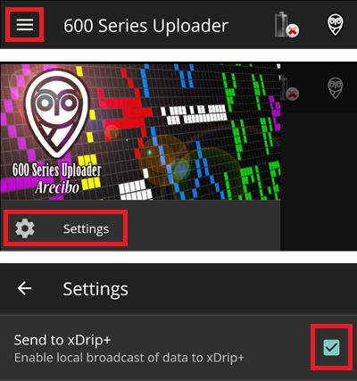

# MM640g eller MM630g

-   Hvis det ikke allerede er sat op, så download [600SeriesAndroidUploader](https://pazaan.github.io/600SeriesAndroidUploader/) og følg vejledningen på [Nightscout](https://nightscout.github.io/uploader/setup/?h=uploader#medtronic-600-series-with-uploader).
-   I 600 Series Uploader skal du gå til Settings > Send to xDrip og vælge ON (sæt flueben).

-   Vælg MM640g i [**Konfiguration → BS-kilde**](#Config-Builder-bg-source).

