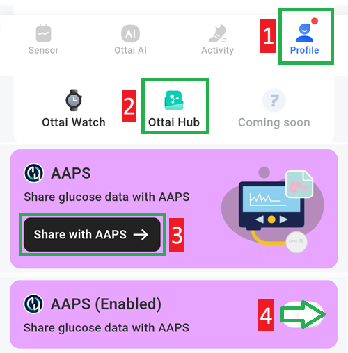

# Ottai M8

## Brug af M8 med Ottai-appen

-   Download og installer APK'en fra <https://play.google.com/store/apps/details?id=com.ottai.seas>. Til den kinesiske version af Ottai skal du bruge <https://ottai.com.cn/70ICjxAI4i>

-   Start sensor

- Vælg **Syai/Ottai** i [**Konfiguration → BS-kilde**](#Config-Builder-bg-source).

Aktiver broadcast i Ottai-appen:

1. Vælg Profile
2. Ottai hub
3. Tryk på Share with AAPS, og accepter aftalen om dataoverførsel til tredjepart
4. Aktiver Share glucose data with AAPS

