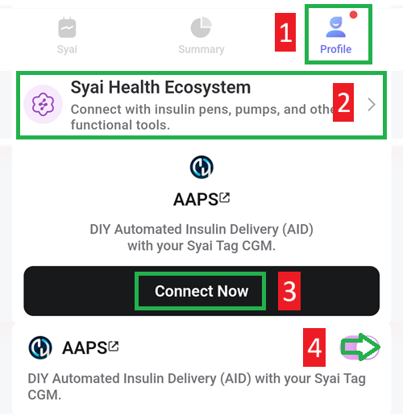

# Syai X1

## Brug af X1 og appen Syai Tag

-   Installer apk'en fra <https://play.google.com/store/apps/details?id=com.syai.tag>.

-   Start X1-sensoren

- Vælg **Syai/Ottai** i [**Konfiguration → BS-kilde**](#Config-Builder-bg-source).

Aktiver broadcast i Syai-appen:

1. Vælg Profile
2. Syai Health Ecosystem
3. Tryk på Connect Now with AAPS, og accepter aftalen om dataoverførsel til tredjepart
4. Aktiver deling af data med AAPS

