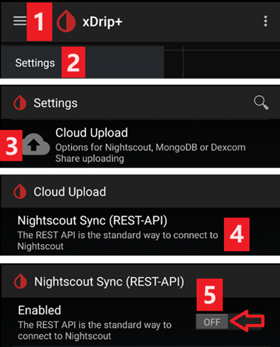
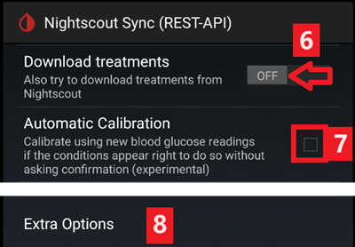
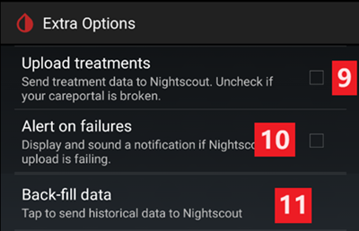
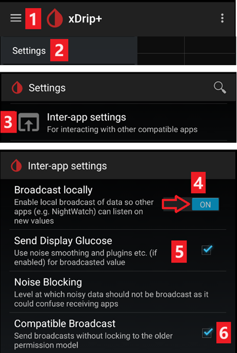
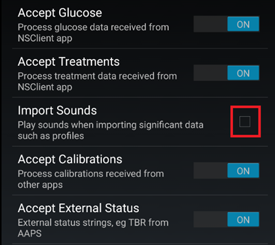
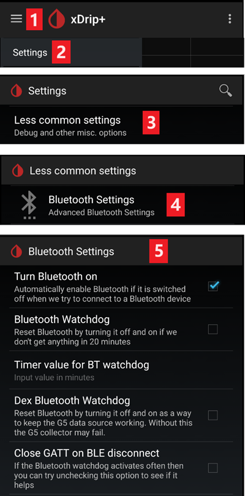
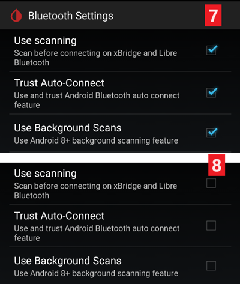
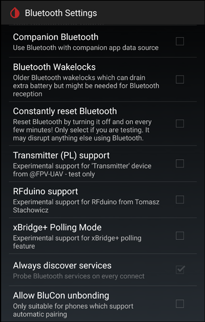
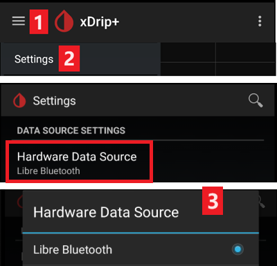
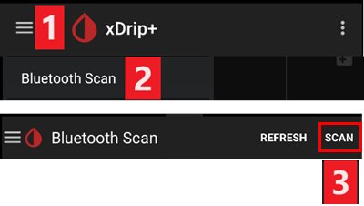

# xDrip-indstillinger

Hvis det ikke allerede er sat op, så download og installer den nyeste xDrip-udgivelse fra [siden med xDrip-udgivelser](https://github.com/NightscoutFoundation/xDrip/releases).

Deaktiver batterioptimering, og tillad baggrundsaktivitet for xDrip-appen.

## Grundindstillinger for alle CGM- & FGM-systemer

### Deaktiver upload til Nightscout

Du bør ikke lade nogen anden app uploade data (blodsukker og behandlinger) til Nightscout.

→ Hamburgermenu (1) → Settings (2) → Cloud Upload (3) → Nightscout Sync (REST-API) (4) → Slå `Enabled` **FRA** (5)

#### Deaktiver automatisk kalibrering og behandlinger

Sørg for, at `Automatic Calibration` (7) er deaktiveret. Hvis der er flueben ved `Automatic Calibration`, så aktiver `Download treatments` (6) én gang, fjern derefter fluebenet ved `Automatic Calibration`, og deaktiver `Download treatments` igen.

Tryk på `Extra Options`(8)

    {admonition} Sikkerhedsadvarsel
    :class: warning
    Du skal deaktivere »Upload treatments« i xDrip, ellers kan behandlinger blive dobbelte i AAPS, og det giver forkert COB og IOB.

Deaktiver `Upload treatments`(9), og sørg for, at du **IKKE** bruger `Back-fill data` (11).

Muligheden `Alert on failures` skal også være deaktiveret (10). Ellers får du en alarm hvert 5. minut ved problemer med Wi-Fi/mobilnetværk, eller hvis serveren ikke er tilgængelig.

### **Inter-app Settings** (Broadcast)

Hvis du bruger AAPS, skal du aktivere broadcast i xDrips Inter-App settings, så dataene sendes videre til AAPS.

→ Hamburgermenu (1) → Settings (2) → Inter-app settings (3) → Broadcast locally **ON** (4)

For at værdierne i AAPS skal være de samme som i xDrip, skal du aktivere `Send the displayed glucose value` (5).

Aktiver Compatible Broadcast (6).

Hvis du også har aktiveret `Accept treatments` i xDrip og `Aktiver udsendelser til xDrip+` i AAPS' xDrip-plugin, så modtager xDrip information om insulin, kulhydrater og basalrate fra AAPS.

Hvis du aktiverer `Accept Calibrations`, bruger xDrip kalibreringerne fra AAPS. Vær forsigtig, når du bruger denne funktion med Dexcom-sensorer: læs [dette](https://navid200.github.io/xDrip/docs/Calibrate-G6.html) først.

Husk at deaktivere Import Sounds, så xDrip ikke laver en ringetone, hver gang AAPS sender en ændring af basal/profil.

(xdrip-identify-receiver)=

#### Identify receiver (identificer modtager)

- Hvis du opdager problemer med lokal broadcast (AAPS modtager ikke BS-værdier fra xDrip), så gå til → Hamburgermenu (1) Settings (2) → Inter-app settings (3) → Identify receiver (7), og indtast `info.nightscout.androidaps` for AAPS-build (hvis du bruger PumpControl-build, så indtast i stedet `info.nightscout.aapspumpcontrol`!!).
- Vær opmærksom på: Autokorrektur ændrer nogle gange i til stort bogstav. Du **må kun bruge små bogstaver**, når du skriver `info.nightscout.androidaps` (eller `info.nightscout.aapspumpcontrol` til PumpControl). Et stort I vil forhindre appen i at modtage BS-værdier fra xDrip.
    
    

## Brug AAPS til at kalibrere i xDrip

- Hvis du vil kunne bruge AAPS til at kalibrere, så gå i xDrip til Settings → Interapp Compatibility → Accept Calibrations, og vælg ON. 
- Du kan også se på mulighederne i Settings → Less Common Settings → Advanced Calibration Settings.

## Dexcom-sensorer

Alt om selve Dexcom-sensoren og -senderen (start, stop, udskiftning, kalibrering, fejlfinding) er beskrevet og holdes opdateret i [xDrips Dexcom-dokumentation](https://navid200.github.io/xDrip/docs/Dexcom_page.html). Følg den vejledning for sensoren; indstillingerne, der forbinder xDrip med **AAPS** (beskrevet ovenfor på denne side), er den eneste del, der er specifik for AAPS.

### Dexcom G6 og ONE

- Sæt xDrip op efter de [anbefalede indstillinger](https://navid200.github.io/xDrip/docs/G6-Recommended-Settings.html).
- Senderne til Dexcom G6 og ONE kan være forbundet til Dexcom-modtageren (eller i stedet t:slim-pumpen) og én app på din telefon på samme tid.
- Når du bruger xDrip som modtager, skal du først afinstallere Dexcom-appen. **Du kan ikke forbinde både xDrip og Dexcom-appen med senderen på samme tid!**
- Hvis du har brug for Clarity og vil have glæde af xDrips funktioner, så brug [Build Your Own Dexcom App](#DexcomG6-if-using-g6-with-build-your-own-dexcom-app) med lokal broadcast til xDrip, eller brug xDrip som »Companion app«, der modtager notifikationer fra den officielle Dexcom-app (BS-værdierne kan blive forsinket).

#### Genstart af sensor

- xDrip bruger altid senderens [native algoritme](https://navid200.github.io/xDrip/docs/Native-Algorithm.html) med nuværende sendere; der er ingen grund til at slå den fra.
- [Forebyggende genstart](https://navid200.github.io/xDrip/docs/Preemptive-Restart.html) virker kun på gamle sendere (firmware 1.6.5.25 eller ældre), hvor de er nødvendige for at sensoren ikke stopper efter 10 dage. Nyere sendere (Firefly) ignorerer dem.
- Genstart af en sensor på en Firefly-sender kræver, at du [fjerner senderen](https://navid200.github.io/xDrip/docs/Remove-transmitter.html), og målingerne kan være meget forkerte efter genstarten, hvilket er farligt, når du looper: læs hele [Genstart en sensor](https://navid200.github.io/xDrip/docs/Restart-G6-sensor.html), og [kalibrer omhyggeligt](https://navid200.github.io/xDrip/docs/Calibrate-after-G6Restart.html).

(xdrip-connect-g6-transmitter-for-the-first-time)=

#### Start, stop og udskift sensorer

Følg vejledningen:

- [Start en G6- eller ONE-sender](https://navid200.github.io/xDrip/docs/Starting-G6.html)
- [Stop og start en G6- eller ONE-sensor](https://navid200.github.io/xDrip/docs/Dexcom/StartG6Sensor.html)
- [Fjern senderen fra en sensor](https://navid200.github.io/xDrip/docs/Remove-transmitter.html)
- [Senderens levetid](https://navid200.github.io/xDrip/docs/Transmitter-lifetime.html) kan kun forlænges ([hard reset](https://navid200.github.io/xDrip/docs/Hard-Reset.html)) på sendere med nyt batteri eller ændrede sendere, ikke på Firefly.

(xdrip-replace-transmitter)=

#### Udskift en sender

- Sluk den originale Dexcom-modtager (hvis du bruger den), og tænd den ikke igen, før xDrip viser målinger.
- Glem enheden i xDrip (System Status → Forget Device) OG i smartphonens Bluetooth-indstillinger (vist som DexcomXX, hvor XX er de sidste to cifre i senderens serienummer).
- Hold den gamle sender uden for Bluetooth-rækkevidde, så den ikke forbinder igen.
- Følg derefter [Start en G6- eller ONE-sender](https://navid200.github.io/xDrip/docs/Starting-G6.html).

### Dexcom G7, ONE+ og Stelo

- Følg [vejledningen til G7, ONE+ og Stelo](https://navid200.github.io/xDrip/docs/Dexcom/G7.html) (der kræves en nyere xDrip-udgivelse – se den linkede side).
- Se også siden [Dexcom G7, ONE+ og Stelo](../CompatibleCgms/DexcomG7.md) for de mulige opsætninger med **AAPS**.

(xdrip-troubleshooting-dexcom-g5-g6-and-xdrip)=

### Fejlfinding af Dexcom og xDrip

- [Fejlfinding af forbindelsen til G6/ONE](https://navid200.github.io/xDrip/docs/Connectivity-troubleshoot.html)
- [Fejlfinding af G7/ONE+/Stelo](https://navid200.github.io/xDrip/docs/Dexcom/G7_Troubleshooting.html)
- [Problem ved start af en ny sensor](https://navid200.github.io/xDrip/docs/Dexcom/SensorFailedStart.html)
- Fuld liste: se **Troubleshooting** på [xDrips Dexcom-side](https://navid200.github.io/xDrip/docs/Dexcom_page.html).

## Libre 1

- Sæt din NFC-til-Bluetooth-bro op i xDrip
    
    → Hamburgermenu (1) → Settings (2) → Less common settings (3) → Bluetooth Settings (4)

- I Bluetooth Settings sætter du flueben præcis som på skærmbillederne nedenfor (5)
    
    - Deaktiver watchdogs, da de nulstiller telefonens Bluetooth og afbryder forbindelsen til din pumpe.
    
    

- Du kan prøve at aktivere følgende indstillinger (7)
    
    - Brug scanning
    - Trust Auto-Connect
    - Use Background Scans

- Hvis du let mister forbindelsen til broen eller har svært ved at få forbindelsen tilbage, så **DEAKTIVER DEM** (8).
    
    

- Lad alle andre muligheder være deaktiveret, medmindre du ved, hvorfor du vil aktivere dem.
    
    

### Batteriniveau for Libre smart reader

- Battery level of bridges such as MiaoMiao can be displayed in AAPS (not Blucon).
- Detaljer findes på [siden med skærmbilleder](#screens-sensor-level-battery).

### Forbind Libre-sender & start sensor

- Hvis din sensor kræver det (Libre 2 EU og Libre 1 US), så installer den nyeste »out of process«-algoritme.

- Din sensor skal allerede være startet med producentens app eller readeren (xDrip kan ikke starte eller stoppe Libre-sensorer).

- Sæt datakilden til Libre Bluetooth.
    
    → Hamburgermenu (1) → Settings (2) → Vælg Libre Bluetooth i Hardware Data source (3)
    
    

- Scan efter Bluetooth, og forbind broen.
    
    → Hamburgermenu (1) → Scan Bluetooth (2) → Scan (3)
    
    - Hvis xDrip ikke kan finde broen, så sørg for, at den ikke er forbundet til producentens app. Sæt den til opladning, og nulstil den.
    
    

- Start sensoren i xDrip.
    
        {admonition} Sikkerhedsadvarsel
        :class: warning
        Brug ikke sensordata, før opvarmningen på en time er slut: værdierne kan være ekstremt høje og give forkerte beslutninger i AAPS.
    
    → Hamburgermenu (1) → Start sensor (2) → Start sensor (3) → Indstil det præcise tidspunkt, hvor du startede den med readeren eller producentens app. Hvis du ikke startede den i dag, så svar »Not Today« (4).

(xdrip-libre2-patched-app)=

## Lappet Libre 2-app

- Sæt datakilden til Libre patched app.
    
    → Hamburgermenu (1) → Settings (2) → Vælg Libre (patched App) i Hardware Data source (3)
    
    

- Du kan tilføje `BgReading:d,xdrip libre_receiver:v` under Less Common Settings->Extra Logging Settings->Extra tags for logging. Det logger ekstra fejlmeddelelser til fejlfinding.

