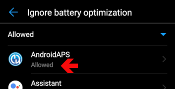
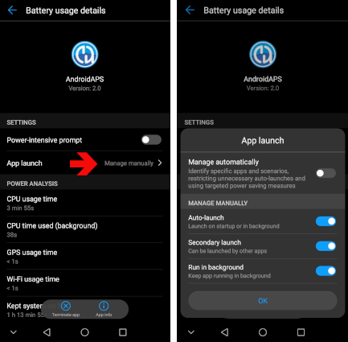
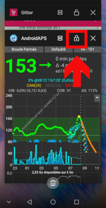

# Sådan konfigurerer du en Huawei-telefon

**Hvilke telefoner denne side gælder for:** Huawei-telefoner med **EMUI 12 til EMUI 15**. De er alle baseret på Android 12, som er minimum for den nuværende version af **AAPS**. På en telefon med en ældre EMUI-version kan du kun bruge en [ældre AAPS-version](#maintenance-android-version-aaps-version).

```{admonition} Telefoner med HarmonyOS NEXT / HarmonyOS 5 :class: warning

Nyere Huawei-telefoner, der sælges i Kina, kører HarmonyOS NEXT (HarmonyOS 5 og nyere). Dette system er ikke længere Android og kan ikke køre **AAPS**. ```

Huawei-telefoner lukker apps, der kører i baggrunden, meget aggressivt. Anvend alle indstillingerne nedenfor på **AAPS** og på din CGM-app (f.eks. xDrip+ eller Juggluco). Ellers kan loopet og glukoseværdierne stoppe, når skærmen er slukket.

Navnene i menuerne kan være lidt forskellige fra model til model. Hvis du ikke kan finde en indstilling, så skriv dens navn i søgefeltet øverst i **Indstillinger**.

Skærmbillederne nedenfor er fra en ældre EMUI-version. Indstillingerne er de samme på EMUI 12 til 15.

## Ignorer batterioptimering

1. Åbn **Indstillinger > Apps > Apps**.
2. Tryk på menuen **⋮** øverst til højre, og vælg **Særlig adgang > Batterioptimering**.
3. Tryk på pilen øverst i listen, og vælg **Alle apps**.
4. Vælg **AAPS**, og vælg **Tillad ikke**. Huawei optimerer ikke længere apps på denne liste.
5. Gentag for din CGM-app.



## Appstart: tillad kørsel i baggrunden

1. Åbn **Indstillinger > Batteri > Appstart** (eller **Indstillinger > Apps > Apps >** vælg appen **> Batteri > Appstart**).
2. Find **AAPS**, og slå **Administrer automatisk** fra.
3. I vinduet **Administrer manuelt** skal du slå alle tre muligheder til: 
    - **Automatisk start**
    - **Sekundær start** (kan startes af andre apps)
    - **Kør i baggrunden**
4. Gentag for din CGM-app.



## Lås AAPS i listen over seneste apps

Låste apps bliver ikke lukket, når du rydder listen over seneste apps.

1. Åbn listen over seneste apps.
2. Stryg nedad på kortet for **AAPS**. Et låsesymbol vises på kortet.
3. Gør det samme for din CGM-app.



## Strømsparetilstand

Hold **Strømsparetilstand** og **Ultra-strømsparetilstand** slået fra (**Indstillinger > Batteri**). De lukker apps i baggrunden uanset indstillingerne ovenfor.

## Hvis AAPS stadig stopper i baggrunden

Se [Don't kill my app](https://dontkillmyapp.com/huawei) for flere løsninger, der gælder specielt for Huawei.

## Honor-telefoner

Honor er nu et separat mærke, og telefonerne kører MagicOS i stedet for EMUI. Indstillingerne for baggrunden er meget ens: Kig efter **Appstart** i appens batteriindstillinger, slå **Administrer automatisk** fra, og tillad alle tre muligheder. Fjern derefter appen fra batterioptimering.