# Accu-Chek Combo

**Denne software er en del af en gør-det-selv-løsning og er ikke et produkt. Den kræver, at DU læser, lærer og forstår systemet, også hvordan du bruger det. Den klarer ikke hele din diabetesbehandling for dig, men den kan hjælpe dig med at forbedre din diabetes og din livskvalitet, hvis du vil bruge den tid, der skal til. Skynd dig ikke, men giv dig selv tid til at lære. Du alene er ansvarlig for det, du gør med den.**

```{admonition} Accu-Chek Combo is being phased out
:class: note

Roche trækker sig ud af markedet for insulinpumper for at fokusere sine diabetesprodukter på Accu-Chek SmartGuide CGM. Roche har meddelt, at salget af både Accu-Chek Combo- og Accu-Chek Insight-pumperne stopper; den sidste pumpe, mikropumpen Accu-Chek Solo, udfases også (sidste leveringer i Tyskland i slutningen af 2025). Ændringen indføres region for region. Den begynder i Tyskland, og andre europæiske markeder ventes at følge efter. Hvis du er afhængig af denne pumpe, så planlæg i god tid et skift til en understøttet pumpe.
```

```{contents} Table of contents
:depth: 1
:local: true
```

## Pumpens funktioner med AAPS

* Kommunikerer med **AAPS** via telefonens indbyggede Bluetooth uden en ekstra kommunikationsenhed.
* Automatisk håndtering af sommertid og tidszoner.

## Krav til hardware og software

* En Roche Accu-Chek Combo (al firmware virker).
* En Smartpix- eller Realtyme-enhed sammen med 360 Configuration Software til at konfigurere pumpen. (Roche sender gratis Smartpix-enheder og konfigurationssoftwaren til sine kunder, hvis de beder om det.)
* En kompatibel telefon med Android 12 eller nyere. Se [Udgivelsesnoter](#maintenance-android-version-aaps-version) for detaljer.
* Appen **AAPS** installeret på din telefon.

Nogle telefoner virker bedre end andre. Det afhænger af, hvor god deres Bluetooth-understøttelse er, og om de har ekstra, meget aggressiv strømsparing. En liste over telefoner findes i dokumentet [Telefoner](#Phones-list-of-tested-phones). Bemærk, at listen ikke er komplet og bygger på brugernes egne erfaringer. Du er velkommen til også at skrive dine erfaringer ind og dermed hjælpe andre (disse projekter bygger på, at man giver hjælpen videre).

(combov2-before-you-begin)=
## Før du starter

**SIKKERHED FØRST** - prøv ikke denne proces i en situation, hvor du ikke kan rette op på en fejl. Hav din Smartpix-/Realtyme-enhed klar sammen med 360 Configuration Software. Regn med at bruge cirka en time på at sætte alt op og kontrollere, at alt virker korrekt.

Vær opmærksom på disse begrænsninger:

* Forlænget bolus og multiwave-bolus understøttes ikke i øjeblikket (du kan bruge [Forlængede kulhydrater / »e-kulhydrater«](../DailyLifeWithAaps/ExtendedCarbs.md) i stedet).
* Kun én basalprofil (den første) understøttes.
* Den laveste basalrate i din **Profil** er 0,05 E/t. **AAPS** afviser en **Profil** med en lavere rate. Combo runder basalrater af til sine egne trin (0,01 E/t under 1 E/t, 0,05 E/t op til 10 E/t, 0,1 E/t over). **AAPS** bruger de rater, som pumpen faktisk giver.
* Midlertidige basalrater er begrænset til 500% af den aktuelle basalrate. **AAPS** tager højde for denne grænse.
* Loopet deaktiveres, hvis den aktive profil på pumpen ikke er profil nr. 1. Det fortsætter, indtil profil nr. 1 er gjort aktiv. Når det er gjort, opdager AAPS næste gang, den forbinder (enten af sig selv efter et stykke tid eller fordi du trykker på **Opdater** på Accu-Chek Combo-pumpeskærmen), at profil nr. 1 er den aktive, og aktiverer loopet igen.
* Hvis loopet beder om at annullere en kørende TBR, sætter Combo i stedet en TBR på 90% eller 110% i 15 minutter. Det er, fordi en rigtig annullering af en TBR giver en alarm på pumpen med mange vibrationer, og disse vibrationer kan ikke slås fra.
* Bluetooth-forbindelsens stabilitet er forskellig fra telefon til telefon. Det giver advarsler om »pump unreachable« (pumpe utilgængelig), hvor der ikke længere er forbindelse til pumpen. Hvis fejlen opstår, så sørg for, at Bluetooth er slået til, og tryk på **Opdater** på pumpeskærmen (**Administrer** > **Pumpe**) for at se, om det skyldtes et kortvarigt problem. Hvis der stadig ikke er forbindelse, så genstart telefonen, hvilket normalt løser det.
* Der er et andet problem, hvor en genstart ikke hjælper, men hvor der skal trykkes på en knap på pumpen (det nulstiller pumpens Bluetooth-stak), før pumpen igen tager imod forbindelser fra telefonen.
* Undgå at sætte en TBR på pumpen, da loopet styrer TBR'er. Det kan tage op til 20 minutter at opdage en ny TBR på pumpen, og TBR'ens virkning regnes først med fra det øjeblik, den opdages. I værste fald kan der altså være 20 minutter med en TBR, som ikke er med i IOB.

Driveren understøtter i øjeblikket følgende sprog på Combo. (Det har intet med sproget i AAPS at gøre - det er sproget, der vises på selve Combos LCD-skærm.)

* Engelsk
* Spansk
* Fransk
* Italiensk
* Russisk
* Tyrkisk
* Polsk
* Tjekkisk
* Ungarsk
* Slovakisk
* Rumænsk
* Kroatisk
* Hollandsk
* Græsk
* Finsk
* Norsk
* Portugisisk
* Svensk
* Dansk
* Tysk
* Slovensk
* Litauisk

**Vigtigt**: Hvis din pumpe er sat til et sprog, som ikke er på denne liste, så kontakt udviklerne, og sæt pumpens sprog til et sprog på listen. Ellers virker driveren ikke korrekt.

## Opsætning af telefonen

Det er meget vigtigt at sikre, at batterioptimering er slået fra. AAPS opdager allerede selv, når den er udsat for denne optimering, og beder i sin brugerflade om, at den bliver slået fra. Men på nyere Android-telefoner er Bluetooth _selv_ en app (en system-app). Og denne »Bluetooth-app« kører normalt _med batterioptimering slået til som standard_. Derfor kan Bluetooth holde op med at svare, når telefonen vil spare strøm, fordi den lukker Bluetooth-appen. Det betyder, at batterioptimering også skal slås fra i indstillingerne for Bluetooth-system-appen. Desværre er det forskelligt fra telefon til telefon, hvordan man finder Bluetooth-system-appen. I standard-Android går du til Indstillinger -> Apps -> Se alle N apps (N = antallet af apps på din telefon). Åbn derefter menuen i øverste højre hjørne, og tryk på »Vis system«, »Vis system-apps« eller »Alle apps«. Find nu en »Bluetooth«-app i den udvidede liste over apps. Vælg den, og tryk på »Batteri« på skærmen »Appinfo«. Slå batterioptimering fra der (kaldes nogle gange »batteriforbrug«).

## Opsætning af Combo

* Konfigurer pumpen med Accu-Chek 360 Configuration Software. Hvis du ikke har softwaren, så kontakt din Accu-Chek-hotline. De sender normalt registrerede brugere en cd med »360° Pump Configuration Software« og en SmartPix USB-infrarød forbindelsesenhed (Realtyme-enheden virker også, hvis du har den).

  - **Krævede indstillinger** (markeret med grønt på skærmbillederne):

     * Sæt eller lad menukonfigurationen stå på »Standard«. Så viser pumpen kun de menuer og handlinger, der understøttes, og skjuler dem, der ikke understøttes (forlænget bolus/multiwave-bolus, flere basalrater). Hvis de bruges, begrænses loop-funktionen, fordi loopet så ikke kan køre sikkert.
     * Kontroller, at _Quick Info Text_ er sat til »QUICK INFO« (uden anførselstegn, findes under _Insulin Pump Options_).
     * Sæt TBR _Maximum Adjustment_ til 500%
     * Slå _Signal End of Temporary Basal Rate_ fra
     * Sæt TBR _Duration increment_ til 15 min
     * Slå Bluetooth til

  - **Anbefalede indstillinger** (markeret med blåt på skærmbillederne)

     * Sæt alarmen for lav ampul, som du ønsker
     * Konfigurer en maks. bolus, der passer til din behandling, for at beskytte mod fejl i softwaren
     * Konfigurer på samme måde en maksimal TBR-varighed som sikkerhed. Tillad mindst 3 timer, da muligheden for at afbryde pumpen i 3 timer sætter 0% i 3 timer.
     * Slå tastelåsen på pumpen til for at undgå bolus fra pumpen, især hvis pumpen er brugt før, og du er vant til at give hurtigbolus.
     * Sæt display-timeout og menu-timeout til minimum, henholdsvis 5,5 og 5. Så kan AAPS hurtigere komme sig efter fejlsituationer, og der kommer færre vibrationer under sådanne fejl

  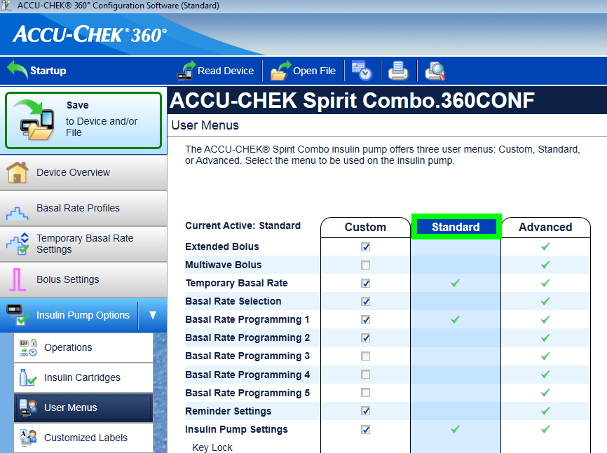

  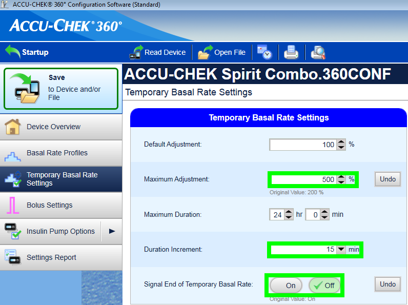

  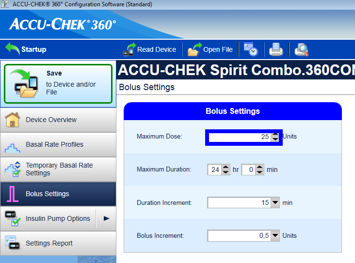

  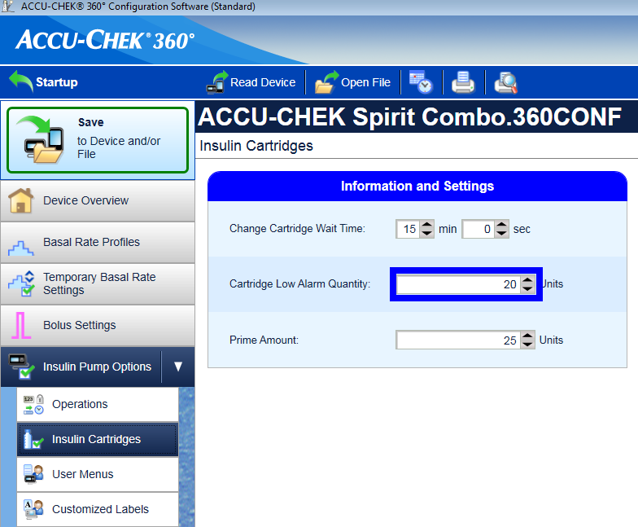

## Aktivering af driveren og parring med Combo

* Åbn **menuen** (☰) i øverste venstre hjørne, gå til [**Konfiguration** > **Pumpe**](../SettingUpAaps/ConfigBuilder.md), og vælg **Accu-Chek Combo**.

  

  Når det er valgt, viser kortet **Accu-Chek Combo** to knapper, **Indstillinger** og **Åbn plugin**:

  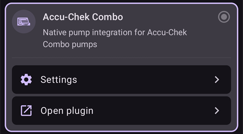

  **Indstillinger** åbner indstillingerne for Accu-Chek Combo-driveren (se [Indstillinger](#combov2-preferences) nedenfor):

  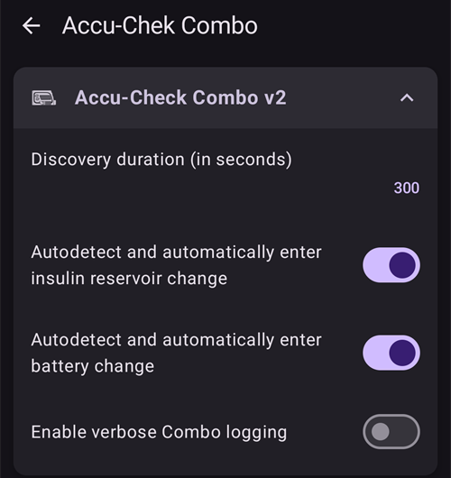

  **Åbn plugin** (eller **Administrer** > **Pumpe**) åbner Accu-Chek Combo-pumpeskærmen. Før en pumpe er parret, viser den **Ikke parret til en pumpe**:

  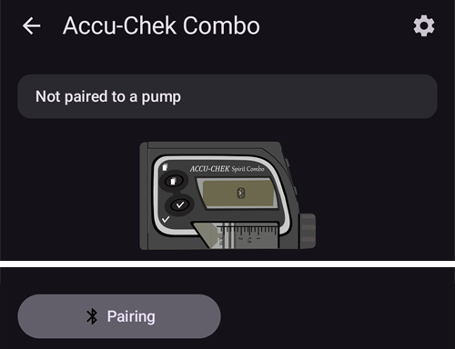

* Tryk på **Parring** på pumpeskærmen. Skærmen **Par med pumpe** åbner. Følg trinene på skærmen, og tryk derefter på **Start parring**. Når Android beder om tilladelse til at gøre telefonen synlig for andre Bluetooth-enheder, så tryk på **Tillad**. Til sidst viser Combo en 10-cifret parrings-PIN på sin skærm, og **AAPS** beder om den. Indtast denne PIN i feltet **10-cifret PIN**.

  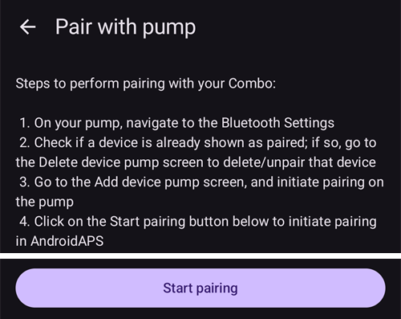

  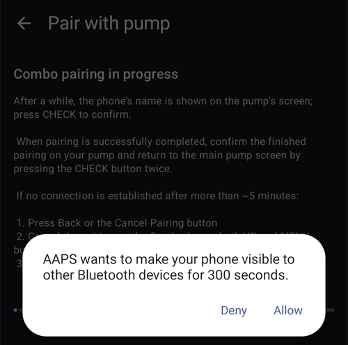

  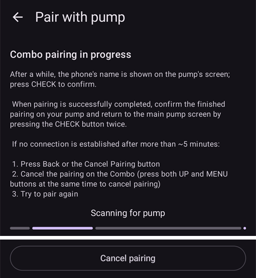

  De næste billeder er fra en ældre version af **AAPS**. Trinene og teksterne er de samme, men skærmene ser lidt anderledes ud.

  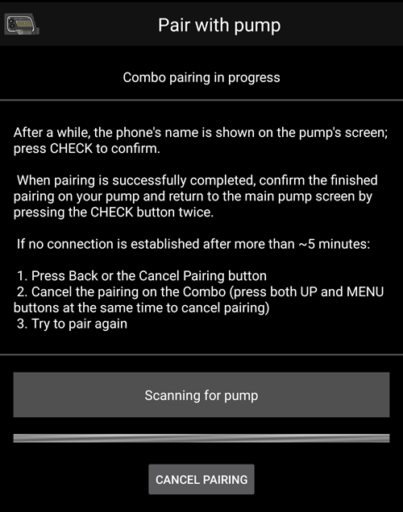

  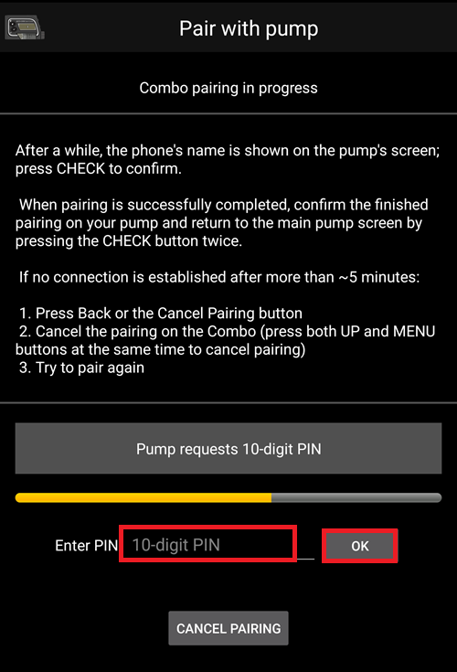

  

* Hvis PIN indtastes forkert, viser **AAPS** **PIN virkede ikke. Tjek om der var en tastefejl. Hvis dette bliver ved med at ske, annuller og prøv at parre igen.**

  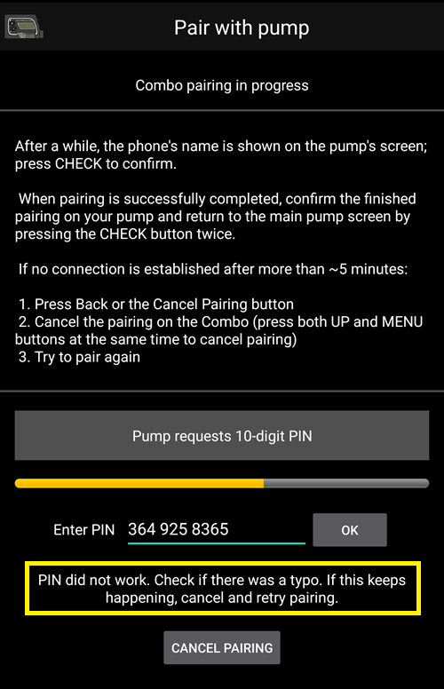

* Når **Succesfuldt parret med Combo** vises, så tryk på **OK**. Du kommer tilbage til pumpeskærmen, som nu viser pumpestatus (se [Indhold på Accu-Chek Combo-pumpeskærmen](#combov2-tab-contents) nedenfor). Knappen **Parring** erstattes af **Ophæv parring**.

* For at kontrollere din opsætning (med pumpen **afbrudt** fra enhver kanyle for en sikkerheds skyld!) bruger du AAPS til at sætte en TBR på 500% i 15 min og give en bolus. Pumpen skal nu have en kørende TBR og bolussen i historikken. AAPS skal også vise den aktive TBR og den leverede bolus.

* På Combo anbefales det at slå tastelåsen til for at undgå bolus fra pumpen, især hvis pumpen er brugt før, og du er vant til at bruge funktionen »quick bolus«.

## Noter om parring

Accu-Chek Combo blev udviklet, før Bluetooth 4.0 kom, og kun ét år efter den allerførste Android-version kom. Derfor er dens måde at parre med andre enheder på ikke 100% kompatibel med, hvordan det gøres i Android i dag. For helt at løse dette skulle AAPS have tilladelser på systemniveau, og dem har kun system-apps. De installeres af telefonproducenterne på telefonen - brugere kan ikke installere system-apps.

Derfor vil parring aldrig være 100% uden problemer. Under parring kan Androids Bluetooth-PIN-dialog især vises kort og forsvinde af sig selv. Men nogle gange bliver den på skærmen og beder om en 4-cifret PIN. (Den må ikke forveksles med Combos 10-cifrede parrings-PIN.) Indtast ikke noget, tryk bare på Annuller. Hvis parringen ikke fortsætter, så følg vejledningen på skærmen for at prøve parringen igen.

(combov2-tab-contents)=
## Indhold på Accu-Chek Combo-pumpeskærmen

Gå til **Administrer** > **Pumpe** for at åbne pumpeskærmen. Når en pumpe er parret, viser den følgende oplysninger (punkterne står fra top til bund):

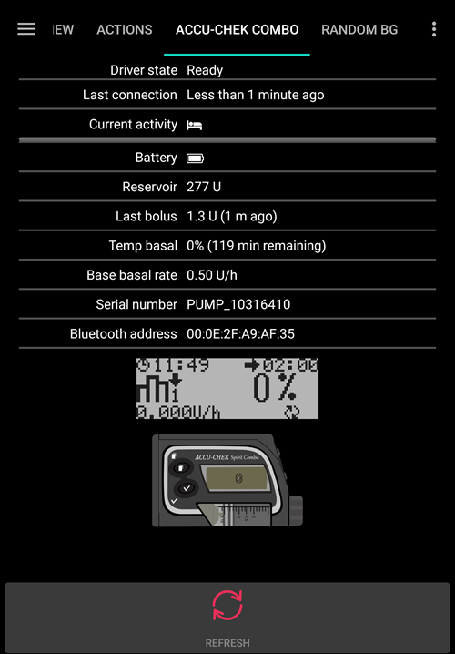

1. **Driver-status**: Driveren kan være i en af følgende tilstande:
   - **Forbindelse afbrudt**: Der er ingen Bluetooth-forbindelse. Driveren er i denne tilstand det meste af tiden og forbinder kun til pumpen, når det er nødvendigt - det sparer strøm
   - **Forbinder**
   - **Kontrollerer pumpe**: Pumpen er forbundet, men driveren udfører lige nu sikkerhedskontroller for at sikre, at alt er OK og opdateret
   - **Klar**: Driveren er klar til at modtage kommandoer fra AAPS
   - **Sat på pause**: Pumpen er sat på pause (vises som »stopped« på Combo)
   - En beskrivelse af den kommando, der udføres, f.eks. **Indstiller basalprofil** eller **Opdaterer pumpestatus**
   - **Fejl**: Der er sket en fejl; forbindelsen blev afsluttet, og en igangværende kommando blev afbrudt
2. **Seneste forbindelse**: Hvor mange minutter siden driveren sidst fik forbindelse til Combo. Hvis det er mere end 30 minutter, vises punktet med rød farve
3. **Batteri**: Batteriniveau. Combo viser kun **Fuldt**, **Lavt** eller **Tomt** og giver ikke noget mere præcist (som en procent), så kun disse tre niveauer vises her
4. **Reservoir**: Hvor mange IE der lige nu er i Combos reservoir
5. **Seneste bolus**: Hvor mange minutter siden den seneste bolus blev givet. Hvis der ikke er givet nogen bolus, siden AAPS blev startet, vises dette ikke
6. **Midlertidig basal**: Detaljer om den aktive midlertidige basal. Hvis ingen er aktiv, vises dette ikke
7. **Standardbasalrate**: Den aktive standardbasalrate (»standard« betyder basalraten uden en aktiv TBR, der ændrer basalratens faktor)
8. **Serienummer**: Combos serienummer, som pumpen viser det (det svarer til serienummeret bag på Combo)
9. **Bluetooth adresse**: Combos 6-byte Bluetooth-adresse, vist i formatet `XX:XX:XX:XX:XX:XX`

Mens driveren er i gang med noget (f.eks. at sætte en basalprofil), beskriver en boks under listen den aktuelle aktivitet med en tynd statuslinje, der viser fremskridtet.

Combo kan styres via Bluetooth i tilstanden _remote-terminal_ eller i tilstanden _command_. Remote-terminal-tilstanden svarer til »fjernbetjeningstilstanden« på Combos måler, som efterligner pumpens LCD-skærm og fire knapper. Nogle kommandoer skal driveren udføre i denne tilstand, da de ikke findes i command-tilstanden. Den sidste tilstand er meget hurtigere, men som sagt begrænset i, hvad den kan. Når remote-terminal-tilstanden er aktiv, vises den aktuelle remote-terminal-skærm i feltet lige over tegningen af Combo. Når driveren skifter til command-tilstanden, er feltet dog tomt.

(Det har du ingen indflydelse på; driveren bestemmer helt selv, hvilken tilstand den bruger. Det er kun en note, så du ved, hvorfor du nogle gange kan se Combo-billeder i feltet.)

Nederst er der disse knapper:

- **Opdater**: Starter en opdatering af pumpestatus med det samme. Den bruges også til at fortælle AAPS, at en tidligere fundet fejl nu er løst, og at AAPS igen kan kontrollere, at alt er OK (mere om det nedenfor i [afsnittet om alarmer](#combov2-alerts)). Du kan kun trykke på den, når driveren er afbrudt, sat på pause eller i fejltilstand.
- **Ophæv parring**: Ophæver parringen mellem den parrede Combo og **AAPS** og Android, efter du har bekræftet **Vil du virkelig ophæve parringen med pumpen?**. Når ingen pumpe er parret, erstattes denne knap af **Parring**.

(combov2-preferences)=
## Indstillinger

Disse indstillinger findes for Combo-driveren (**Konfiguration** > **Pumpe** > **Accu-Chek Combo** > **Indstillinger**, eller indstillingsikonet (tandhjul) på pumpeskærmen). Punkterne står fra top til bund:

1. **Opdagelsesvarighed (i sekunder)**: Ved parring gør driveren telefonen synlig for pumpen. Dette styrer, hvor længe telefonen kan findes. Som standard er maksimum (300 sekunder = 5 minutter) valgt. Android tillader ikke, at telefonen kan findes uden tidsgrænse, så der skal vælges en varighed.
2. **Registrer skift af insulinreservoir automatisk**: Hvis den er slået til, registrerer driveren det »reservoirskift«, som du normalt selv ville registrere med **Administrer** > **Klargør/Fyld**. Det forklares [mere detaljeret nedenfor](#combov2-autodetections).
3. **Registrer batteriskift automatisk**: Hvis den er slået til, registrerer driveren det »batteriskift«, som du normalt selv ville registrere med **Administrer** > **Skift af pumpebatteri**. Det forklares [mere detaljeret nedenfor](#combov2-autodetections).
4. **Aktiver detaljeret Combo-logning**: Driveren logger da meget mere. **FORSIGTIG**: Slå ikke dette til, medmindre en udvikler beder dig om det. Ellers kan det give meget støj i logfilerne fra **AAPS** og gøre dem mindre nyttige.

Parring og ophævelse af parring sker på pumpeskærmen, ikke i indstillingerne (se ovenfor).

(combov2-autodetections)=
## Automatisk opdagelse og registrering af batteri- og reservoirskift

Driveren kan opdage batteri- og reservoirskift ved at holde øje med batteri- og reservoirniveauet. Hvis Combo sidste gang, pumpestatus blev opdateret, meldte batteriniveauet som lavt, og batteriniveauet nu ved den nye opdatering af pumpestatus er normalt, så konkluderer driveren, at brugeren må have skiftet batteriet. Samme logik bruges for reservoirniveauet: Hvis det nu er højere end før, tolkes det som et reservoirskift.

Det virker kun, hvis batteri og reservoir skiftes, når niveauerne meldes som lave, _og_ det nye batteri og reservoir er tilstrækkeligt fyldt.

Denne automatiske opdagelse kan slås fra i driverens [indstillinger](#combov2-preferences).

(combov2-alerts)=
## Alarmer (advarsler og fejl) og hvordan de håndteres

Combo viser alarmer som remote-terminal-skærme. Advarsler vises med en »Wx«-kode (x er et ciffer) sammen med en kort beskrivelse. Et eksempel er »W7«, »TBR OVER«. Fejl ligner dem, men vises i stedet med en »Ex«-kode.

Visse advarsler afvises automatisk af driveren. Det er:

- W1 »reservoir low« : driveren laver den om til en advarsel om »lavt reservoir«, som vises på AAPS' hovedskærm
- W2 »battery low« : driveren laver den om til en advarsel om »lavt batteri«, som vises på AAPS' hovedskærm
- W3, W6, W7, W8 : disse er kun til information for brugeren, så det er sikkert, at driveren afviser dem automatisk

Andre advarsler afvises _ikke_ automatisk. Fejl afvises heller _aldrig_ automatisk. Begge dele håndteres på samme måde: Driveren viser en alarmdialog oven på AAPS' brugerflade og afbryder alle igangværende kommandoer. Driveren skifter så til tilstanden »fejl« (se [Indhold på Accu-Chek Combo-pumpeskærmen ovenfor](#combov2-tab-contents)). I denne tilstand kan der ikke udføres kommandoer. Brugeren skal håndtere fejlen på pumpen; f.eks. kan en tilstopningsfejl kræve, at kanylen skiftes. Når brugeren har løst fejlen, kan normal drift genoptages ved at trykke på **Opdater** på Accu-Chek Combo-pumpeskærmen. Driveren forbinder så til Combo og opdaterer dens status. Den kontrollerer bl.a., om der stadig vises en fejl på skærmen. Driveren opdaterer også selv pumpestatus efter et stykke tid, så du behøver ikke trykke på knappen.

Bolus er et særtilfælde. Den gives i Combos command-tilstand, som ikke melder, hvis der kommer en alarm midt i en bolus. Derfor kan driveren ikke automatisk afvise advarsler _under_ en bolus. Det betyder desværre, at pumpen bipper, indtil bolussen er færdig. Den mest almindelige alarm midt i en bolus er normalt W1 »reservoir low«. **Afvis ikke** selv Combo-advarsler manuelt på pumpen under en bolus. Du risikerer at afbryde bolussen. Driveren tager sig af advarslen, når bolussen er færdig.

Driveren opdager ikke alarmer, der kommer, mens den ikke er forbundet til Combo. Combo kan ikke selv sende alarmen til telefonen; det er altid telefonen, der skal starte forbindelsen. Derfor bliver alarmen ved, indtil driveren forbinder til pumpen. Du kan trykke på **Opdater** på pumpeskærmen for at starte en forbindelse, så driveren kan håndtere alarmen med det samme (i stedet for at vente, til AAPS selv starter en forbindelse).

**VIGTIGT**: Hvis der opstår en fejl, eller der vises en advarsel, som ikke er en af dem, der afvises automatisk, går driveren i fejltilstand. I denne tilstand **BLIVER LOOPET BLOKERET**, indtil pumpestatus er opdateret! Blokeringen ophæves, når pumpestatus er opdateret (enten ved at trykke på **Opdater** eller ved driverens egen automatiske opdatering), og der ikke længere vises en fejl.

## Ting du skal passe på, når du bruger Combo

* Husk, at dette ikke er et produkt. Især i starten skal brugeren holde øje med og forstå systemet, dets begrænsninger og hvordan det kan svigte. Det frarådes kraftigt at bruge dette system, hvis den person, der bruger det, ikke helt kan forstå systemet.
* På grund af den måde, Combos fjernbetjening virker på, er flere handlinger (især at sætte en basalprofil) langsomme sammenlignet med andre pumper. Det er en uheldig begrænsning ved Combo, som ikke kan løses.
* Sæt eller annuller ikke en TBR på pumpen. Loopet styrer TBR'er og kan ikke virke pålideligt på anden måde, da det ikke er muligt at finde starttidspunktet for en TBR, som brugeren har sat på pumpen.
* Tryk ikke på knapper på pumpen, mens AAPS kommunikerer med pumpen (Bluetooth-logoet vises på pumpen, mens den er forbundet til AAPS). Gør du det, afbrydes Bluetooth-forbindelsen. Gør det kun, hvis der er problemer med at oprette forbindelse (se [afsnittet »Før du starter« ovenfor](#combov2-before-you-begin)).
* Tryk ikke på knapper, mens pumpen giver bolus. Prøv især ikke at afvise alarmer ved at trykke på knapper. Se [afsnittet om alarmer](#combov2-alerts) for en mere detaljeret forklaring af hvorfor.

## Tjekliste, når der ikke kan oprettes forbindelse til Combo

Driveren gør sit bedste for at forbinde til Combo og bruger et par tricks for at gøre forbindelsen så pålidelig som muligt. Alligevel oprettes forbindelsen nogle gange ikke. Her er nogle trin, du kan prøve for at løse problemet.

1. Tryk på en knap på Combo. Nogle gange holder Combos Bluetooth-stak op med at svare og tager ikke længere imod forbindelser. Når du trykker på en knap på Combo, så LCD-skærmen viser noget, nulstilles Bluetooth-stakken. Som regel er det det eneste trin, der skal til for at løse forbindelsesproblemerne.
2. Genstart telefonen. Det kan være nødvendigt, hvis der er et problem med selve telefonens Bluetooth-stak.
3. Hvis Combos batterilåg er gammelt, så overvej at skifte det. Gamle batterilåg kan give problemer med Combos strømforsyning, og det påvirker Bluetooth.
4. Hvis forbindelsesforsøgene stadig fejler, så overvej at ophæve parringen og derefter parre pumpen igen.

(combov2-tips-for-basic-usage)=
## Tips til almindelig brug

### Sådan sikrer du en stabil drift

* **Hav altid smartphonen med dig**, og læg den ved siden af din seng om natten. Da din pumpe kan ligge bag eller under din krop, mens du sover, virker en højere placering (på en hylde eller et bræt) bedst.
* Sørg altid for, at pumpebatteriet er så fuldt som muligt. Se afsnittet om batteriet for tips om batteriet.
* Betjen så vidt muligt kun pumpen via AAPS-appen. Det bliver lettere, hvis du slår tastelåsen til på pumpen under **PUMP SETTINGS / KEY LOCK / ON**. Kun når du skifter batteri eller ampul, er det nødvendigt at bruge pumpens knapper.


### Pumpen kan ikke nås. Hvad gør du?

#### Aktiver alarmen for utilgængelig pumpe
* I **AAPS** trykker du på ikonet **Indstillinger** (tandhjul) øverst til højre på hovedskærmen, går til **Lokale alarmer**, aktiverer **Advar, hvis pumpen er utilgængelig** og sætter **Grænse for utilgængelig pumpe** til **31** minutter.
* Så har du tid nok til at forlade rummet, mens din telefon ligger på bordet, uden at alarmen går. Men du får besked, hvis pumpen ikke kan nås i længere tid end varigheden af en midlertidig basalrate.

#### Få forbindelse til pumpen igen

* Når AAPS melder en **Pumpe utilgængelig**-alarm, så lås først tastelåsen op, og **tryk på en vilkårlig knap på pumpen** (f.eks. »ned«-knappen). Så snart pumpens display er slukket, så tryk på **Opdater** på Accu-Chek Combo-pumpeskærmen (**Administrer** > **Pumpe**). Som regel virker kommunikationen så igen.
* Hvis det ikke hjælper, så genstart din smartphone. Efter genstarten aktiveres AAPS igen, og der oprettes en ny forbindelse til pumpen.

* Test med forskellige smartphones har vist, at visse smartphones udløser fejlen »pumpe utilgængelig« oftere end andre. Se [Telefoner](#Phones-list-of-tested-phones) for smartphones, der er testet med godt resultat.

#### Årsager til og følger af hyppige kommunikationsfejl
* På telefoner med **lidt hukommelse** (eller **aggressive strømspareindstillinger**) bliver AAPS ofte lukket ned. Du kan se det ved, at behandlingsknapperne (Hurtigstart-værktøjslinjen) på hovedskærmen ikke vises, når du åbner AAPS, fordi systemet er ved at starte op. Det kan udløse alarmer om »pumpe utilgængelig« ved opstart. I feltet **Seneste forbindelse** på pumpeskærmen (**Administrer** > **Pumpe**) kan du se, hvornår AAPS sidst kommunikerede med pumpen.

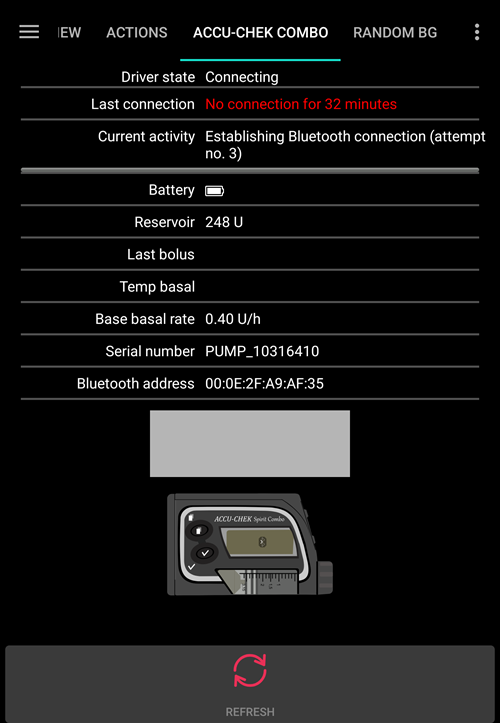

* Denne fejl kan tømme pumpens batteri hurtigere, fordi basalprofilen læses fra pumpen, når appen genstartes.
* Den øger også risikoen for den fejl, der får pumpen til at afvise alle forbindelser, indtil der trykkes på en knap på pumpen.

### Annullering af midlertidig basalrate mislykkes
* En gang imellem kan AAPS ikke automatisk afvise en **TBR CANCELED**-alarm. Så skal du enten trykke på **Opdater** på Accu-Chek Combo-pumpeskærmen eller bekræfte alarmen på pumpen.

### Om pumpebatteriet

#### Skift af batteri
* Efter en alarm om **lavt batteri** skal batteriet skiftes så hurtigt som muligt, så der altid er strøm nok til en pålidelig Bluetooth-forbindelse til smartphonen, også hvis telefonen er længere væk fra pumpen.
* Selv efter en alarm om **lavt batteri** kan batteriet ofte bruges i ret lang tid. Det anbefales dog altid at have et nyt batteri med dig, når alarmen »lavt batteri« har lydt.
* Før du skifter batteriet, så tryk på **Loop**-symbolet på hovedskærmen, og vælg **Suspender loop** i 1 time.
* Vent, til telefonen kommunikerer med pumpen, og Bluetooth-logoet på pumpen forsvinder.

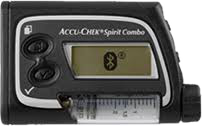

* Lås tastelåsen op på pumpen, sæt pumpen i stop-tilstand, bekræft en eventuelt annulleret midlertidig basalrate, og skift batteriet hurtigt.
* Du behøver ikke at stille pumpens ur igen efter batteriskiftet: AAPS opdaterer automatisk pumpens dato og klokkeslæt.
* Sæt derefter pumpen tilbage i kørselstilstand, og vælg **Genoptag**, når du trykker på ikonet **Loop suspenderet** på hovedskærmen.
* AAPS sætter en nødvendig midlertidig basalrate igen, når den næste blodsukkerværdi kommer.

(Accu-Chek-Combo-Tips-for-Basic-usage-battery-type-and-causes-of-short-battery-life)=
#### Batteritype og årsager til kort batterilevetid
* Da meget Bluetooth-kommunikation bruger meget strøm, skal du kun bruge **batterier af høj kvalitet** som Energizer Ultimate Lithium, »power one«-batterierne fra den »store« Accu-Chek-servicepakke, eller, hvis du vil bruge et genopladeligt batteri, Eneloop-batterier.

 

Typisk levetid for de forskellige batterityper:
* **Energizer Ultimate Lithium**: 4 til 7 uger
* **Power One Alkaline** (Varta) fra servicepakken: 2 til 4 uger
* **Eneloop genopladelige** batterier (BK-3MCCE): 1 til 3 uger

Hvis din batterilevetid er meget kortere end ovenfor, så tjek disse mulige årsager:
* Der findes nogle varianter af Combo-pumpens skruelåg til batteriet, som delvist kortslutter batterierne og tømmer dem hurtigt. Låg uden dette problem kan kendes på de gyldne metalkontakter.
* Hvis pumpens ur ikke »overlever« et kort batteriskift, er kondensatoren, som holder uret i gang under en kort strømafbrydelse, sandsynligvis i stykker. I så fald kan det hjælpe at få pumpen udskiftet af Roche, hvilket ikke er et problem i garantiperioden.
* Smartphonens hardware og software (Android-styresystemet og Bluetooth-stakken) påvirker også pumpens batterilevetid, selvom de præcise faktorer endnu ikke er helt kendt. Hvis du har mulighed for det, så prøv en anden smartphone, og sammenlign batterilevetiden.

### Forlænget bolus, multiwave-bolus
OpenAPS-algoritmen understøtter ikke en samtidig forlænget bolus eller multiwave-bolus. Men en lignende behandling kan opnås med disse alternativer:
* Brug **e-kulhydrater**, når du indtaster kulhydrater eller bruger bolusberegneren: Indtast kulhydraterne for hele måltidet og den tid, du forventer, at kulhydraterne er om at komme ud i blodet som glukose. Systemet beregner så små kulhydratmængder fordelt ligeligt over hele varigheden. Det får algoritmen til at give tilsvarende insulin, mens den hele tiden holder øje med, om blodsukkeret stiger eller falder. For en multiwave-lignende bolus kan du også kombinere en mindre bolus med det samme med e-kulhydrater.
* Før du spiser, så sæt et midlertidigt mål **Spiser snart** på 80 mg/dl (4,4 mmol/l) i flere timer (tryk på målet på hovedskærmen, eller **Administrer** > **Midlertidigt mål**). Varigheden bør bygge på det tidsrum, du ville vælge til en forlænget bolus. Det holder dit mål lavere end normalt og øger derfor den mængde insulin, der gives.
* Brug derefter **Bolusberegner** til at indtaste alle måltidets kulhydrater, men brug ikke direkte de værdier, den foreslår. Hvis der skal gives en multiwave-lignende bolus, så sæt insulindosis ned. Afhængigt af måltidet skal algoritmen nu give ekstra SMB'er eller højere midlertidige basalrater for at modvirke stigningen i blodsukkeret. Her skal du være meget forsigtig, når du afprøver basalratens sikkerhedsgrænser (maks. E/t, maks. basal-IOB), og om nødvendigt ændre dem midlertidigt.

* Brug ikke forlænget bolus eller multiwave-bolus direkte på pumpen. Driveren understøtter dem ikke (se [Før du starter](#combov2-before-you-begin)). Hvis der alligevel gives en multiwave-bolus på pumpen, registrerer **AAPS** den fra pumpehistorikken som en normal bolus plus en forlænget bolus, så den tælles med i IOB. En forlænget bolus virker ikke i et lukket loop (se [denne side](#extended-bolus-and-why-they-wont-work-in-closed-loop-environment) for detaljer).

### Alarmer ved bolus
* Efter hver bolus læser driveren pumpens bolushistorik. Det er en sikkerhedsfunktion, så insulin om bord (IOB) beregnes korrekt, også når en bolus gives direkte fra pumpen.
* Hvis pumpehistorikken før en bolus har en bolus, som **AAPS** ikke kendte til (f.eks. en bolus givet direkte på pumpen), bliver den ønskede bolus **ikke givet**, fordi den blev beregnet uden den insulin. **AAPS** viser **Pumpehistorikken har en bolus, som AAPS ikke kendte til. Den ønskede bolus blev ikke givet...** Tjek bolushistorikken på pumpen og din IOB. Hvis der stadig er brug for en bolus, så beregn den igen. Det gælder også, når den ukendte bolus findes ved en ny forbindelse.
* Hvis bolussen blev givet, men pumpehistorikken også havde andre boluser, som **AAPS** ikke kendte til, bliver de registreret nu, og **AAPS** beder dig tjekke IOB før næste bolus.
* Hvis forbindelsen til pumpen afbrydes **under** en bolus, registrerer **AAPS** ikke 0 IE: Den viser, hvor meget pumpen havde givet indtil da, og advarer om, at pumpen måske stadig giver resten. **Giv ikke bolus igen.** **AAPS** læser den rigtige mængde fra pumpehistorikken ved næste forbindelse.
* Hvis forbindelsen afbrydes, mens **AAPS** sender bolussen, vides det ikke, om pumpen modtog den. Tjek bolushistorikken på pumpen før næste bolus.
* Hvis **AAPS** ikke kan bekræfte, at en bolus blev givet, viser den **Bolus levering mislykkedes. Det ser ud til at ingen bolus blev leveret. Kontroller venligst pumpen for at undgå en dobbelt bolus og derefter bolus igen.** Boluser gentages aldrig automatisk.

## Hvor kan du få hjælp

Combo-driveren udvikles af fællesskabet på **frivillig** basis. Før du beder om hjælp:

1. **Læs** det relevante afsnit i denne dokumentation for at bekræfte, hvordan funktionen skal virke.
2. **Spørg** i kanalen *#AAPS* på [Discord](https://discord.gg/4fQUWHZ4Mw) eller i en af de andre [kanaler i fællesskabet](../GettingHelp/WhereCanIGetHelp.md).
3. **Rapporter en fejl** ved at søge i de [eksisterende issues](https://github.com/nightscout/AndroidAPS/issues); hvis din fejl ikke er på listen, så opret et [nyt issue](https://github.com/nightscout/AndroidAPS/issues), og vedhæft dine [logfiler](../GettingHelp/AccessingLogFiles.md).

Når du beder om hjælp, så oplys din telefons mærke og model, Android-version, **AAPS**-version og en enkel beskrivelse af problemet (hvad er ændret, hvornår virkede det sidst).
