# Accu-Chek Insight

**Denne software er en del af en gør-det-selv kunstig bugspytkirtel. Den er ikke et produkt, men kræver, at DU læser, lærer og forstår systemet, også hvordan du bruger det. Den klarer ikke al din diabetesbehandling for dig, men den lader dig forbedre din diabetes og din livskvalitet, hvis du er villig til at bruge den tid, det kræver. Forhast dig ikke, men giv dig selv tid til at lære. Du alene er ansvarlig for, hvad du gør med den.**

```{admonition} Accu-Chek Insight udfases :class: note

Roche trækker sig ud af markedet for insulinpumper for at fokusere sine diabetesprodukter på Accu-Chek SmartGuide CGM. Roche har meddelt, at salget af både Accu-Chek Combo- og Accu-Chek Insight-pumperne stopper; den sidste pumpe, mikropumpen Accu-Chek Solo, udfases også (sidste leveringer i Tyskland i slutningen af 2025). Ændringen indføres region for region. Den begynder i Tyskland, og andre europæiske markeder ventes at følge efter. Support til Insight er allerede angivet som ophørt (se [Pumper, der ikke længere sælges](./Future-possible-Pump-Drivers.md)). Hvis du er afhængig af denne pumpe, så planlæg i god tid et skift til en understøttet pumpe.

    <br />```{note}
    Før **AAPS** havde sin egen Insight-driver, blev Insight styret gennem den separate app [SightRemote](https://github.com/TebbeUbben/SightRemote). SightRemote er ikke længere nødvendig og bliver ikke længere vedligeholdt: hvis du stadig har den installeret fra dengang, så afinstaller den, og brug en aktuel version af **AAPS** i stedet.
    

```{contents} Indholdsfortegnelse :depth: 1 :local: true

    <br />## Pumpens funktioner med AAPS
    
    * Kommunikerer med **AAPS** via telefonens egen Bluetooth, uden en ekstra kommunikationsenhed.
    * Automatisk håndtering af sommertid og tidszoner.
    
    ## Krav til hardware og software
    
    * En Roche Accu-Chek Insight-pumpe (alle firmwareversioner virker)
    
    Bemærk: AAPS skriver altid data i **den første basalrateprofil i pumpen**.
    
    * En Android-telefon med Android 12 eller nyere (se [Telefoner](../Getting-Started/Phones.md))
    * AAPS-appen installeret på din telefon
    
    ## Opsætning
    
    * Insight-pumpen må kun være forbundet med én enhed ad gangen. Hvis du tidligere har brugt Insight-fjernbetjeningen (blodsukkermåleren), skal du fjerne måleren fra listen over parrede enheder i din pumpe: **Menu** > **Settings** > **Communication** > **Remove device**.
    
       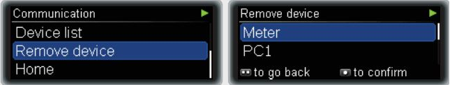
    
    * I [Konfiguration > Pumpe](#Config-Builder-pump) skal du vælge kortet **Accu-Chek Insight**. Der kan kun være én pumpe aktiv ad gangen.
    
       
    
       Når det er valgt, viser kortet **Accu-Chek Insight** to knapper, **Indstillinger** og **Åbn plugin**:
    
       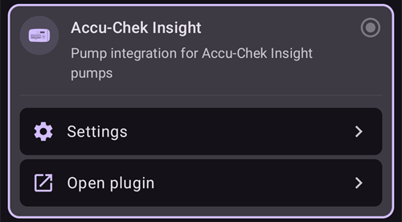
    
       **Indstillinger** åbner indstillingerne for Accu-Chek Insight-driveren (se [Indstillinger i AAPS](#Accu-Chek-Insight-Pump-settings-in-aaps)).
    
       **Åbn plugin** (eller **Administrer → Pumpe**) åbner pumpeskærmen for Accu-Chek Insight. Før en pumpe er parret, ser den sådan ud:
    
       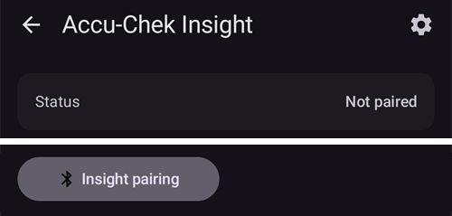
    
    (accu-chek-insight-pairing)=
    ### Parring
    
    * Tryk på **Insight parring** på pumpeskærmen. Parringsguiden åbner og søger efter Bluetooth-enheder i nærheden (øverst på billedet nedenfor).
    * På Insight-pumpen skal du gå til **Menu** > **Settings** > **Communication** > **Add Device**. Pumpen viser følgende skærm (nederst på billedet nedenfor) med pumpens serienummer.
    
       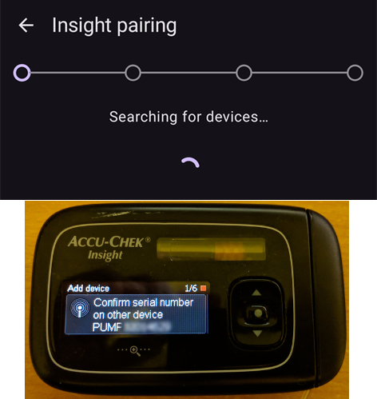
    
    * Gå tilbage til din telefon, og tryk på pumpens serienummer i listen over Bluetooth-enheder. Hvis Android beder dig bekræfte parringen, så tryk på **Par**.
    
       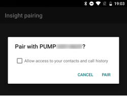
    
    * Pumpen og telefonen viser begge en kode. Tjek, at koderne er ens på begge enheder. Bekræft på pumpen, og tryk på **Ja** på telefonen. (Tryk på **Nej**, hvis koderne ikke er ens.)
    
       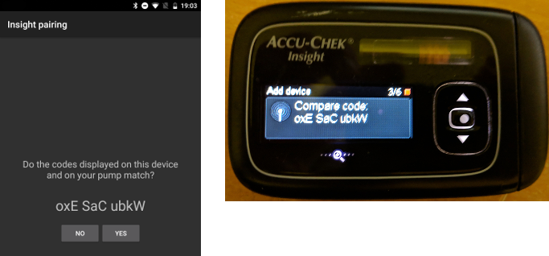
    
    * Telefonen viser **Parring fuldført**. Tryk på **Afslut** for at gå tilbage til pumpeskærmen.
    
       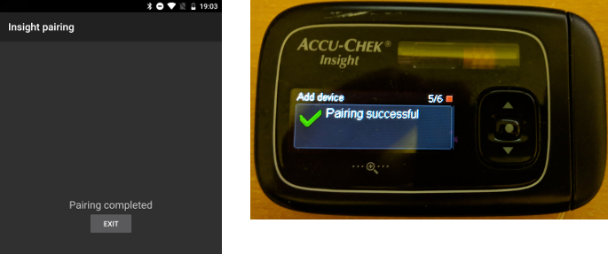
    
    * For at tjekke, at alt er i orden, så se på pumpeskærmen (**Administrer → Pumpe**). Når pumpen er parret, viser den information om pumpen, f.eks. **Serienummer**, **Produktionsdato**, **Softwareversion (release)** og **Bluetooth-adresse**.
    
       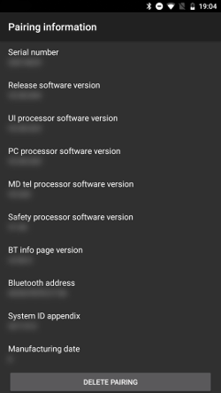
    
       ```{admonition} Ældre skærmbillede
       :class: note
       Bortset fra toppen af det første billede er skærmbillederne af parringen ovenfor fra en tidligere version af **AAPS** og kan se anderledes ud i **AAPS** 4.
       ```
    
    * For at fjerne parringen skal du trykke på **Ophæv parring** på pumpeskærmen og bekræfte **Nulstil parringsoplysninger?**. Knappen **Insight parring** vises så igen.
    
    Bemærk: Der er ingen fast forbindelse mellem pumpen og telefonen. **AAPS** forbinder kun, når det er nødvendigt (f.eks. for at sætte en midlertidig basalrate, give en bolus eller læse pumpens historik). Ellers ville batterierne i telefonen og pumpen blive brugt op alt for hurtigt.
    
    (Accu-Chek-Insight-Pump-settings-in-aaps)=
    ## Indstillinger i AAPS
    
    Åbn indstillingerne med **Indstillinger** på kortet **Accu-Chek Insight** i **Konfiguration** > **Pumpe**, eller med tandhjulsikonet øverst til højre på pumpeskærmen.
    
    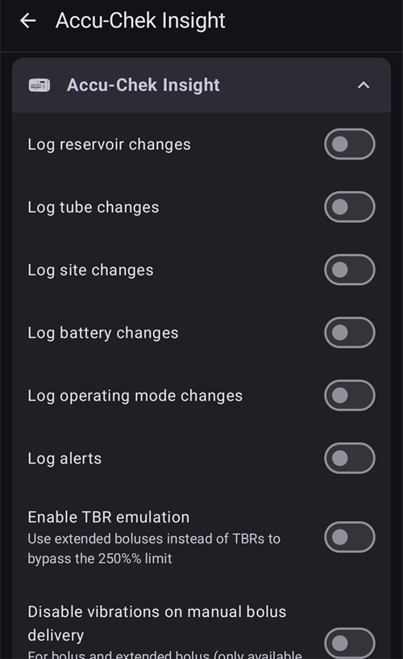
    
    I Insight-indstillingerne i **AAPS** kan du aktivere følgende muligheder:
    
    * **Log skift af ampul**: registrerer automatisk et skift af insulinampul, når du skifter ampullen i pumpen.
    
    * **Log skift af slange**: tilføjer et notat i **AAPS**-databasen, når du kører programmet »tube filling« (fyld slange) på pumpen.
    
    * **Log skift af kanyle**: tilføjer et notat i **AAPS**-databasen, når du kører programmet »cannula filling« (fyld kanyle) på pumpen. **Bemærk: Et skift af infusionssæt nulstiller også Autosens.**
    
    * **Log skift af batteri**: registrerer et batteriskift, når du sætter et nyt batteri i pumpen.
    
    * **Log ændring af driftstilstand**: tilføjer et notat i **AAPS**-databasen, hver gang du starter, stopper eller sætter pumpen på pause.
    
    * **Log advarsler**: tilføjer et notat i **AAPS**-databasen, hver gang pumpen giver en advarsel (undtagen påmindelser, bolus og annullering af TBR, som ikke registreres).
    
    * **Aktiver MBR emulering**: Insight-pumpen kan kun sætte midlertidige basalrater (TBR) op til 250%. For at komme uden om denne grænse får TBR-emulering pumpen til at give en forlænget bolus for den ekstra insulin, hvis der bedes om en TBR på mere end 250%.
    
      **Bemærk: Brug kun én forlænget bolus ad gangen. Flere forlængede boluser på samme tid kan give fejl.**
    
    * **Deaktiver vibrationer ved manuel boluslevering**: stopper Insight-pumpen i at vibrere, når den giver en manuel bolus (eller forlænget bolus). Kun tilgængelig med Insight firmware 3.x.
    
    * **Deaktiver vibrationer ved automatisk boluslevering**: stopper Insight-pumpen i at vibrere, når den giver en automatisk bolus (SMB eller midlertidig basal med TBR-emulering). Kun tilgængelig med Insight firmware 3.x.
    
    * **Min. pause mellem forbindelsesforsøg [s]** og **Max. pause mellem forbindelsesforsøg [s]**: hvor længe **AAPS** venter, før den prøver igen efter et mislykket forsøg på at forbinde. Du kan vælge fra 0 til 20 sekunder. Hvis du har problemer med forbindelsen, så vælg en længere ventetid.
        <br><br>Eksempel for min. pause mellem forbindelsesforsøg = 5 og maks. pause mellem forbindelsesforsøg = 20
        <br><br>ingen forbindelse -> vent <b>5</b> sek.
          <br>  prøv igen -> ingen forbindelse -> vent <b>6</b> sek.
          <br>  prøv igen -> ingen forbindelse -> vent <b>7</b> sek.
          <br>  prøv igen -> ingen forbindelse -> vent <b>8</b> sek.
          <br>...
          <br>prøv igen -> ingen forbindelse -> vent <b>20</b> sek.
          <br>prøv igen -> ingen forbindelse -> vent <b>20</b> sek.
          <br>...
    
    * **Afvent manglende forbindelse [s]**: hvor længe (i sekunder) **AAPS** venter, før den afbryder forbindelsen til pumpen, når en handling er færdig. Du kan vælge fra 0 til 15 sekunder. Standardværdien er 5 sekunder.
    
    For perioder, hvor pumpen var stoppet, registrerer **AAPS** en midlertidig basalrate på 0%.
    
    ### Pumpeskærmen
    
    Pumpeskærmen for Accu-Chek Insight (**Administrer → Pumpe**) viser pumpens aktuelle status, f.eks. **Status**, **Seneste forbindelse**, **Driftstilstand**, **Batteri**, **Reservoirniveau**, dagens samlede daglige doser (**TDD bolus**, **TDD basal**), basalrater og den seneste bolus. Når pumpen er parret, har den disse knapper:
    
    * **Opdater**: opdaterer pumpens status.
    * **Aktiver notifikation af MBR afslutning (pumpeindstilling)** / **Deaktiver notifikation af MBR afslutning (pumpeindstilling)**: en almindelig Insight-pumpe giver en alarm, når en TBR slutter. Denne knap slår alarmen til eller fra, uden at du skal bruge konfigurationssoftware.
    * **Ophæv parring**: fjerner parringen med pumpen (se [Parring](#accu-chek-insight-pairing)).
    
    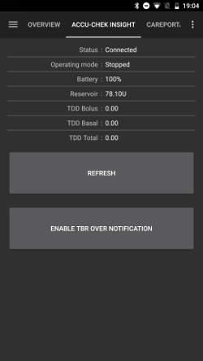
    
    ```{admonition} Ældre skærmbillede
    :class: note
    Skærmbilledet ovenfor er fra en tidligere version af **AAPS**. I **AAPS** 4 ser pumpeskærmen anderledes ud og har også en knap **Ophæv parring**.
    

## Indstillinger i pumpen

Indstil alarmerne i pumpen sådan:

* Menu > Settings > Device settings > Mode settings > Quiet > Signal > Sound
* Menu > Settings > Device settings > Mode settings > Quiet > Volume > 0 (fjern alle streger)
* Menu > Modes > Signal mode > Quiet

Det gør alle alarmer fra pumpen lydløse, så AAPS kan afgøre, om en alarm er vigtig for dig. Hvis AAPS ikke kvitterer for en alarm, bliver den kraftigere (først bip, derefter vibration).

(Accu-Chek-Insight-Pump-vibration)=

### Vibration

Alt efter firmwareversionen på din pumpe vibrerer Insight kort, hver gang en bolus gives (f.eks. når AAPS giver en SMB, eller når TBR-emulering giver en forlænget bolus).

* Firmware 1.x: Ingen vibration (sådan er pumpen lavet).
* Firmware 2.x: Vibration kan ikke slås fra.
* Firmware 3.x: AAPS giver bolus uden lyd og vibration.

Firmwareversionen kan findes i menuen.

## Batteriskift

Batteritiden for Insight ved loop er fra 10 til 14 dage, højst 20 dage. Brugeren, der har rapporteret dette, bruger Energizer lithium-batterier.

Insight-pumpen har et lille indbygget batteri, som holder vigtige funktioner som uret i gang, mens du skifter det udskiftelige batteri. Hvis batteriskiftet tager for lang tid, kan det indbyggede batteri løbe tør for strøm. Så nulstilles uret, og du bliver bedt om at indtaste et nyt klokkeslæt og en ny dato, når du har sat et nyt batteri i. Hvis det sker, bliver alle registreringer i AAPS fra før batteriskiftet ikke længere brugt i beregningerne, fordi det rigtige tidspunkt ikke kan bestemmes.

(Accu-Chek-Insight-Pump-insight-specific-errors)=

## Fejl, der er specielle for Insight

### Forlænget bolus

Brug kun én forlænget bolus ad gangen, da flere forlængede boluser på samme tid kan give fejl.

### Timeout

Nogle gange svarer Insight-pumpen ikke, mens **AAPS** opretter forbindelsen. **AAPS** viser så notifikationen »En timeout opstod i parringsprocessen - genstart Bluetooth«.

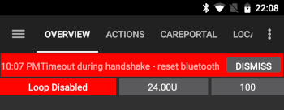

Hvis det sker, så slå Bluetooth fra på pumpen OG på telefonen i ca. 10 sekunder, og slå det så til igen.

## Rejse over tidszoner med Insight-pumpen

Information om rejser over tidszoner finder du i afsnittet [Rejse over tidszoner med pumper](#timezone-traveling-insight).

## Hvor kan du få hjælp

Udviklingen af Insight-driveren sker i fællesskabet som **frivilligt** arbejde. Før du beder om hjælp:

1. **Læs** det relevante afsnit i denne dokumentation for at se, hvordan funktionen skal virke.
2. **Spørg** i kanalen *#AAPS* på [Discord](https://discord.gg/4fQUWHZ4Mw) eller i en af de andre [kanaler i fællesskabet](../GettingHelp/WhereCanIGetHelp.md).
3. **Rapporter en fejl** ved at søge i de [eksisterende issues](https://github.com/nightscout/AndroidAPS/issues); hvis din fejl ikke er der, så opret et [nyt issue](https://github.com/nightscout/AndroidAPS/issues), og vedhæft dine [logfiler](../GettingHelp/AccessingLogFiles.md).

Når du beder om hjælp, så angiv mærke og model på din telefon, Android-version, **AAPS**-version og en enkel og tydelig beskrivelse af problemet (hvad der er ændret, hvornår det sidst virkede).