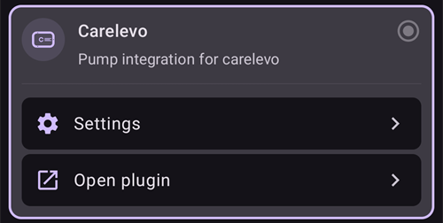
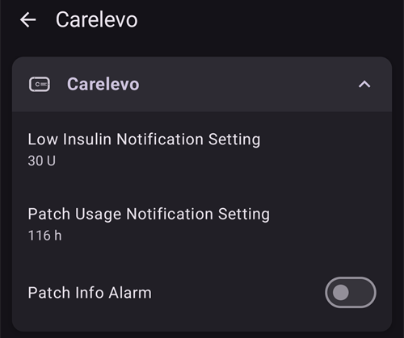
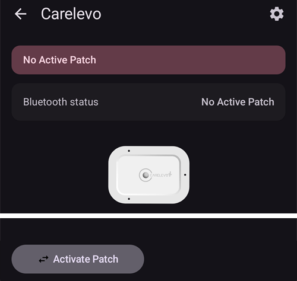

# CareLevo

CareLevo er en patchpumpe uden slange, lavet af CareMedi. Hver patch rummer op til 300 IE insulin og bæres i op til 7 dage (168 timer). Den kommunikerer med **AAPS** via din telefons Bluetooth, uden en ekstra enhed.

```{admonition} New driver
:class: warning
CareLevo-driveren er ny i **AAPS**. Læs hele denne side, før du aktiverer din første patch, og hav pumpens egen brugsanvisning ved hånden.
```

Den mindste dosis, patchen kan levere, er 0,05 IE. Indstil dine basalrater i **Profil** til mindst 0,05 E/t i trin på 0,05 E/t. Ellers vil den insulin, som **Profil** forventer, og den insulin, som patchen leverer, være en smule forskellige. **AAPS** bruger de basalrater, som patchen har accepteret.

```{contents} Table of contents
:depth: 1
:local: true
```

## Pumpens funktioner med AAPS

* Kommunikerer med **AAPS** via telefonens indbyggede Bluetooth uden en ekstra kommunikationsenhed.
* Bolus i trin på 0,05 IE.
* Basalrater fra 0,05 E/t til 15 E/t i trin på 0,05 E/t, med basalsegmenter på 30 minutter.
* Midlertidige basalrater indstillet som en absolut rate, op til 12 timer.
* Forlænget bolus op til 8 timer.
* Sommertid og skift af tidszone skal håndteres manuelt. Patchen giver dig besked, når tidszonen skifter.

## Opsætning af pumpen

1. Åbn **menuen** (☰) øverst til venstre på hovedskærmen i **AAPS**, og vælg **Konfiguration**.
1. Vælg **Carelevo** i afsnittet Pumpe.
1. Tryk på tilbage-knappen for at gå tilbage til hovedskærmen.



## Indstillinger

Åbn pumpeskærmen med **Administrer → Pumpe** (eller **Konfiguration → Pumpe → Åbn plugin**).

Åbn CareLevo-indstillingerne ved at trykke på ikonet **Indstillinger** (tandhjul) i øverste højre hjørne. Der er tre indstillinger:



### Notifikation om lavt insulinniveau

Patchen giver dig besked, når den resterende insulin i reservoiret når den valgte mængde. Den kan indstilles fra 20 IE til 50 IE i trin på 5 IE. Standard er 30 IE. Uafhængigt af denne indstilling udløser patchen en kritisk alarm og stopper insulintilførslen, når der er mindre end 10 IE tilbage.

### Notifikation om patchens brugstid

Patchen giver dig besked, når den har været båret i det valgte antal timer, så du kan planlægge skiftet. Den kan indstilles fra 24 til 167 timer. Standard er 116 timer.

### Info-alarm fra patch

Når denne er slået til, bipper patchen, når en bolus, forlænget bolus eller midlertidig basal starter, og når den slutter. Standard er fra.

## Pumpeskærmen



Pumpeskærmen viser **Bluetooth-status** (Ingen aktiv patch, Forbindelse afbrudt eller Tilsluttet), patchens **Serienr.**, dens **Aktiveringstid** og **Udløb**, den aktuelle **Basalrate** og **Midlertidig basalrate**, **Resterende insulin** (tilbage / fyldt), **Resterende tid for patch** og **Samlet leveret insulin**.

Knapperne afhænger af patchens tilstand:

* **Aktiver patch**: starter aktiveringen af en ny patch, se nedenfor.
* **Insulinvejledning**: viser de tolv trin for at fylde en patch med insulin.
* **Sæt tilførsel på pause** / **Genoptag tilførsel**: sætter insulintilførslen på pause og starter den igen, se nedenfor.
* **Kassér patch**: stopper den aktuelle patch, så en ny kan aktiveres.

## Aktivering af en patch

Før du starter, skal du sikre dig, at en **Profil** er aktiv i **AAPS**, og at Bluetooth er slået til. Patchen skal aktiveres inden for en begrænset tid, efter at den er tændt. Hvis tiden løber ud, udløser patchen alarmen **Tiden til påsætning af patch er udløbet** og kan ikke bruges.

Tryk på **Aktiver patch** på pumpeskærmen, og følg trinnene. Du kan annullere når som helst, før nålen er indstukket. Det, du har indtastet, bliver slettet.

### Vælg insulinen

Bekræft den insulin, du bruger. Patchen kræver hurtigtvirkende U-100-insulin.

### Fyld patchen med insulin

Fyld patchen med 50 til 300 IE. Tænk på, hvor længe du vil bære den. Tryk på **Insulinvejledning**, hvis du har brug for vejledningen til påfyldning. Tryk derefter på påfyldningsmængden, og vælg den mængde, du har fyldt. **AAPS** bruger den til at vise den resterende insulin.

### Forbind patchen

1. Tag patchen ud af blisterpakningen, og fjern nålehætten.
1. Tryk på patchens tænd/sluk-knap i mere end ét sekund. Tryk på **Søg efter patch** efter bippet.
1. Når den fundne patch er den rigtige, skal du trykke på **Bekræft**. Tryk på **Søg igen**, hvis den ikke er.

### Sikkerhedstjek

Når patchen er forbundet, skal du trykke på **Sikkerhedstjek**. Patchen tester sig selv og klargør. Kontroller, at der er dannet en dråbe insulin på nålespidsen. Hvis der ikke er en synlig dråbe, skal du trykke på **Prøv igen**. Når kontrollen er færdig, skal du trykke på **Næste**.

### Indstikssted og påsætning af patch

1. Vælg det sted, hvor du vil bære patchen.
1. Rens stedet grundigt med en spritserviet.
1. Fjern beskyttelsesfilmen, og sæt patchen på huden med den markerede prik opad.
1. Tryk på **Næste**, når patchen er sat på.

### Stik nålen ind

1. Drej sikkerhedshætten i pilens retning, og fjern den.
1. Tryk applikatorens trykknap helt ned, og hold den nede i 10 sekunder. Der lyder et bip, når nålen er stukket ind.
1. Fjern applikatoren, og tryk på **Bekræft indstik**.

Hvis indstikket mislykkes, fortæller **AAPS** dig, hvor mange forsøg der er tilbage. Når der ikke er flere forsøg tilbage, udløser patchen alarmen **Fejl ved indstik af nål**, og den skal udskiftes.

Insulintilførslen starter, så snart indstikket er bekræftet.

## Meddelelser om bolus

Hvis patchen afviser en bolus, fortæller **AAPS** dig hvorfor. For eksempel betyder *Bolus kan ikke leveres. Mulig bolus: 2,8 IE*, at patchen kun kan levere denne mængde nu.

Hvis du stopper en bolus, og patchen ikke bekræfter stoppet, venter **AAPS**, til bolussen er slut, og registrerer den mængde, som patchen melder. Hvis en bolus ikke blev registreret (f.eks. fordi den blev stoppet, mens den kørte), tilføjer **AAPS** den ud fra patchens samlede mængde og beder dig kontrollere IOB, før du prøver igen.

## Pause i og genoptagelse af insulintilførslen

Tryk på **Sæt tilførsel på pause** på pumpeskærmen, og vælg, hvor længe tilførslen skal være på pause: fra 30 minutter til 4 timer i trin på 30 minutter. Tilførslen genoptages ikke af sig selv: når pausen er slut, udløser patchen advarslen **Start insulin**. Tryk på **Genoptag tilførsel** på pumpeskærmen eller på **Start insulin** i advarslen, og bekræft.

## Kassering af en patch

Tryk på **Kassér patch** på pumpeskærmen, og bekræft. Insulintilførslen stopper, og patchen kan ikke længere bruges. Fjern patchen fra kroppen, og aktiver en ny.

Når en kritisk alarm har stoppet patchen, tilbyder alarmen i stedet **Deaktiver patch**. Et tryk på den kasserer patchen på samme måde.

If the patch cannot be reached, you can still discard it. **AAPS** removes it and stops counting its temp basal and extended bolus, but the patch itself was not told to stop. **AAPS** warns you: *The patch could not be reached. It was removed from AAPS but not stopped, and it may still give insulin. Take it off.* Take the patch off your body straight away.

(carelevo-alarms-and-notifications)=

## Alarmer og notifikationer

Patchen melder hændelser på tre niveauer. Alle vises som notifikationer i **AAPS**.

### Kritiske alarmer

Insulintilførslen er stoppet. Handl nu:

* **Lavt insulin**: der er mindre end 10 IE tilbage. Deaktiver patchen, og skift den.
* **Patch udløbet**: patchen har nået slutningen af sin levetid. Deaktiver patchen, og skift den.
* **Lavt batteri**: kassér patchen, og skift den.
* **Høj/lav temperatur**: flyt dig til en passende temperatur, mellem 40 ℉ og 99 ℉ (4,4 ℃ og 37,2 ℃).
* **Automatisk slukning**: patchen stoppede, fordi advarslen Automatisk slukning blev ignoreret. Tryk på **Start insulin** for at starte basaltilførslen igen.
* **Tiden til påsætning af patch er udløbet**, **Selvtest mislykkedes**, **Patch-fejl**, **Tilstopning** og **Fejl ved indstik af nål**: deaktiver patchen, og skift den.

### Alarmer

Insulintilførslen fortsætter, men noget kræver din opmærksomhed:

* **Lavt insulin**: reservoiret har nået den mængde, der er indstillet i **Notifikation om lavt insulinniveau**. Gør dig klar til at skifte patchen.
* **Patchen udløber snart** og **Patchens brugstid er udløbet**: skift patchen.
* **Lavt batteri**: gør dig klar til at skifte patchen.
* **Høj/lav temperatur**: tilførslen er sat på pause, indtil patchen igen er mellem 40 ℉ og 99 ℉ (4,4 ℃ og 37,2 ℃).
* **Automatisk slukning**: tryk på **OK**. Hvis den ignoreres, bliver advarslen til en kritisk alarm, og tilførslen stopper.
* **Aktivering af patch ikke færdig**: tryk på **OK** for at gøre aktiveringen færdig.
* **Start insulin**: den pause, du har indstillet, er slut. Tryk på **Start insulin** for at genoptage tilførslen.
* **Slå Bluetooth til** og **BLE ikke forbundet**: telefonen kan ikke nå patchen. Slå Bluetooth til, eller kontroller forbindelsen til patchen.

### Meddelelser

Kun til information: **Lavt insulin**, **Notifikation om patchens brugstid** (den tid, der er indstillet i **Notifikation om patchens brugstid**, er gået), **Notifikation om kontrol af patch**, **Skift af tidszone** og **Kontroller blodsukker** (en fast tid efter en bolus).

Patchen melder også, når dens egen funktion til stop ved lavt BS (**LGS**) starter eller slutter. **AAPS** bruger ikke denne funktion. Loopet håndterer selv lavt blodsukker.

## Hvor kan du få hjælp

Rapporter problemer med CareLevo-driveren på [siden med AAPS-problemer på GitHub](https://github.com/nightscout/AndroidAPS/issues) eller i AAPS-fællesskabets kanaler, se [Hvor kan jeg få hjælp?](../GettingHelp/WhereCanIGetHelp.md).
