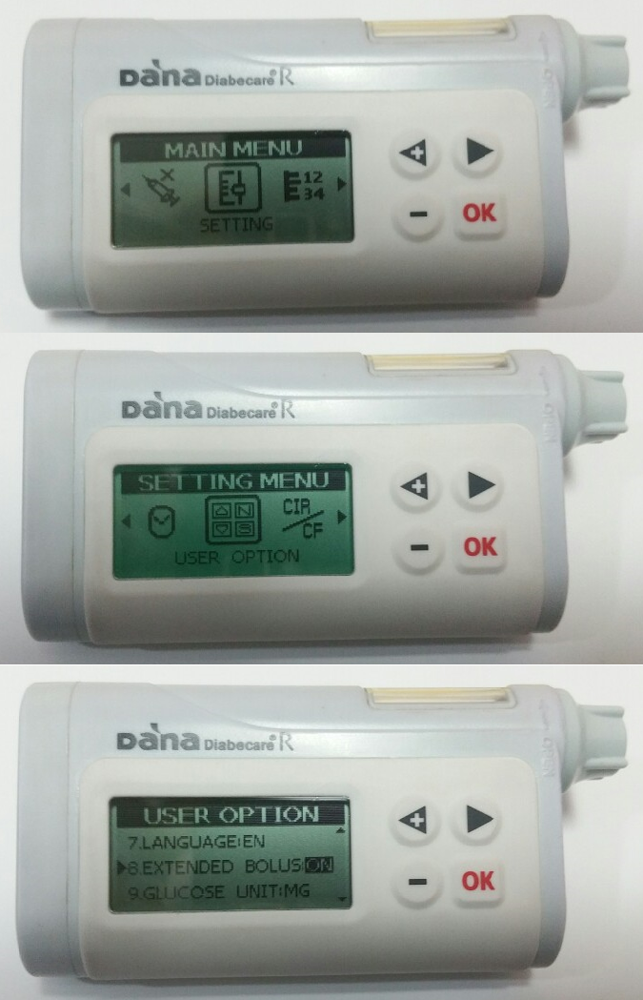

# DanaR

*Denne vejledning beskriver, hvordan du konfigurerer appen og din pumpe, hvis du har en DanaR. Se [DanaRS, Dana-i og Dana-i2](./DanaRS-Insulin-Pump.md), hvis du i stedet har DanaRS, der kom på markedet i 2017.*

## Pumpens funktioner med AAPS

* Kommunikerer med **AAPS** via telefonens indbyggede Bluetooth, uden en ekstra kommunikationsenhed.
* Ændringer af tidszone og sommertid kræver ingen særlig handling, da pumpen ikke bruger sin egen historik.

## Opsætning

* Gå på pumpen til Main Menu > Setting > User Option
* Slå "8. Extended Bolus" til

* Gå til Main Menu > Setting > Discovery
* Gå i telefonens indstillinger til Bluetooth, søg efter enheder i nærheden, vælg serienummeret på din DanaR, og indtast din adgangskode (parringsadgangskoden er 0000). Hvis DanaR ikke vises i søgningen, så genstart telefonen, tag batteriet ud af DanaR, sæt det i igen, og gentag de to trin.

* Åbn i **AAPS** **menuen** (☰) i øverste venstre hjørne, gå til **Konfiguration** > **Pumpe**, og vælg den type DanaR, du har (**DanaR**, **DanaR Koreansk** eller **DanaRv2**).
  
  

* Åbn pumpeskærmen: tryk på **Åbn plugin** på DanaR-kortet (eller gå til **Administrer** > **Pumpe**).

* Tryk på **Parring**. På parringsskærmen: 
  * Indtast din pumpeadgangskode under **Pumpeadgangskode** (standardadgangskoden er 1234).
  * Tryk på serienummeret på din DanaR under **Vælg parret enhed**. Hvis listen er tom, så tryk på **Åbn Bluetooth-indstillinger**, og par først pumpen med din telefon (se trinnet ovenfor). Når du kommer tilbage til **AAPS**, vises pumpen i listen. Hvis den ikke gør, så tryk på opdateringsikonet.
  * Tryk på **Parring**. **AAPS** forbinder til pumpen og kontrollerer adgangskoden.
* Tryk på **Indstillinger** på DanaR-kortet i **Konfiguration** > **Pumpe** for at ændre driverens indstillinger: 
  * **Bolushastighed** (DanaR og DanaRv2): skift standardhastigheden for bolus (12 s/E, 30 s/E eller 60 s/E).
  * **Brug forlængede boluser ved >200%** (DanaR og DanaR Koreansk): aktiver dette, hvis du vil have, at **AAPS** tillader en basalrate over 200%. Bemærk, at det betyder, at du ikke kan loope med høje TBR'er, mens du bruger forlængede boluser til mad.
* Sæt basaltrinnet på pumpen til 0,01 E/t
* Sæt bolustrinnet på pumpen til 0,1 IE. **AAPS** læser bolustrinnet fra pumpen og bruger det til hver bolus.
* Aktiver forlængede boluser på pumpen

## Rejser over tidszoner med DanaR-pumpen

Information om rejser på tværs af tidszoner finder du i afsnittet [Rejser over tidszoner med pumper](#timezone-traveling-danarv2-danars).

## Hvor kan du få hjælp

Udviklingen af DanaR-driveren sker i fællesskabet på **frivillig** basis. Før du beder om hjælp:

1. **Læs** det relevante afsnit i denne dokumentation for at se, hvordan funktionen skal virke.
2. **Spørg** i kanalen *#AAPS* på [Discord](https://discord.gg/4fQUWHZ4Mw) eller i en af de andre [kanaler i fællesskabet](../GettingHelp/WhereCanIGetHelp.md).
3. **Rapporter en fejl** ved at søge i de [eksisterende issues](https://github.com/nightscout/AndroidAPS/issues); hvis din fejl ikke er der, så opret et [nyt issue](https://github.com/nightscout/AndroidAPS/issues), og vedhæft dine [logfiler](../GettingHelp/AccessingLogFiles.md).

Når du beder om hjælp, så angiv mærke og model på din telefon, Android-version, **AAPS**-version og en enkel og tydelig beskrivelse af problemet (hvad der er ændret, hvornår det sidst virkede).