# DanaRS, Dana-i og Dana-i2

*Denne vejledning beskriver, hvordan du indstiller appen og din pumpe, hvis du har en DanaRS fra 2017 eller senere, en Dana-i eller en Dana-i2. Gå til [DanaR](./DanaR-Insulin-Pump.md), hvis du i stedet har den oprindelige DanaR.*

**Dana-i2 kan bruges fra AAPS version 4.0.** Den bruger den samme **Dana-i/RS**-driver som Dana-i.

* I DanaRS/i/i2-pumpen bruger appen »BASAL A«. Eksisterende data bliver overskrevet.

    {contents} Indholdsfortegnelse
    :depth: 1
    :local: true

## Pumpens funktioner med AAPS

* Kommunikerer med **AAPS** via telefonens indbyggede Bluetooth, uden en ekstra kommunikationsenhed.
* Sommertid og skift af tidszone skal håndteres manuelt (se [Skift af tidszone og sommertid](#timezone-traveling-danarv2-danars)).

(DanaRS-Insulin-Pump-pairing-pump)=

## Parring af pumpen

* Åbn **menuen** (☰) i øverste venstre hjørne af hovedskærmen i **AAPS**, og vælg **Konfiguration**.
* Tryk på **Pumpe**, og vælg **Dana-i/RS**.
    
    
    
    Når det er valgt, viser kortet **Dana-i/RS** to knapper, **Indstillinger** og **Åbn plugin**:
    
    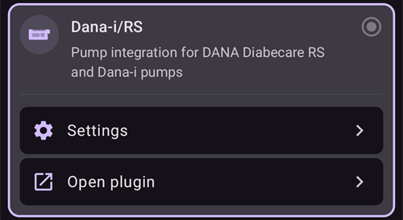
    
    **Indstillinger** åbner indstillingerne for Dana-i/RS-driveren:
    
    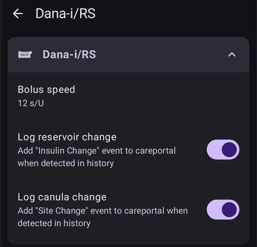
    
    **Åbn plugin** (eller **Administrer** > **Pumpe**) åbner pumpeskærmen for Dana-i/RS. Før en pumpe er parret, ser den sådan ud:
    
    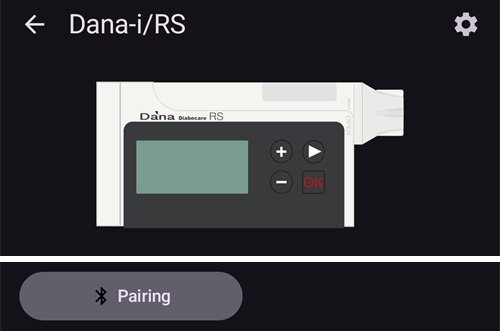

* Tryk på **Parring** på pumpeskærmen. **AAPS** søger efter pumper i nærheden.

* Tryk på din pumpe i listen.
    
    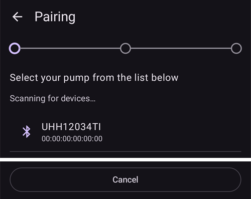

* **Du skal bekræfte parringen på pumpen!** Det fungerer på samme måde som andre Bluetooth-parringer, du måske kender (for eksempel smartphone og bilradio).
    
    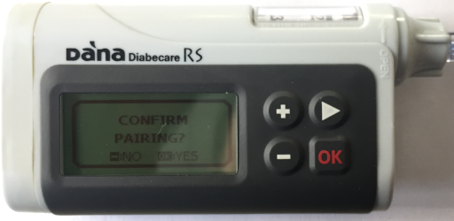

* Følg parringen ud fra typen og firmwaren på din pumpe:
    
    * For DanaRS v1 beder **AAPS** om **Pumpeadgangskode (kun v1)**. Indtast adgangskoden til din pumpe (se [Standardadgangskode](#DanaRS-Insulin-Pump-default-password)).
    * For DanaRS v3 beder **AAPS** dig om at trykke på OK på pumpen og indtaste de 2 rækker af tal og bogstaver, der vises på pumpen. Hold pumpens display tændt ved at trykke på minusknappen, indtil du er færdig. Tryk derefter på **Færdig**.
    * For Dana-i og Dana-i2 vises Androids almindelige dialog til parring. Indtast det 6-cifrede tal, der vises på pumpen.

* Når **Parring lykkedes!** vises, så tryk på **Færdig**.
    
    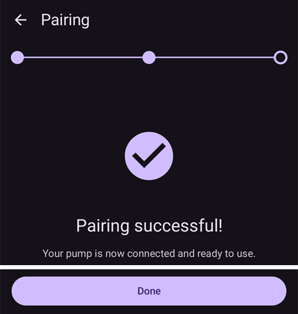
    
    Du er tilbage på pumpeskærmen, som nu viser din pumpes status.
    
    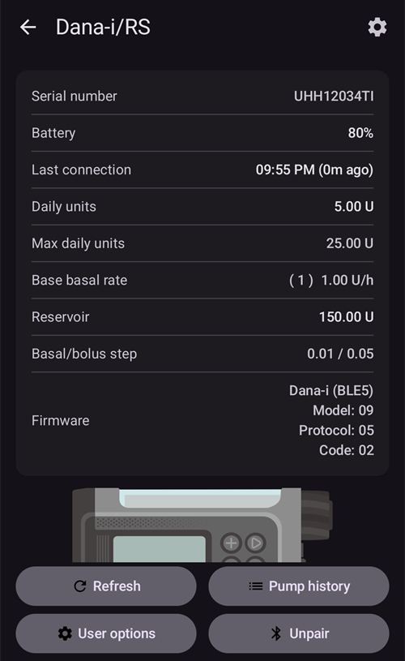

* Vælg **Bolushastighed** under **Indstillinger** for at ændre standardhastigheden for bolus (12 s/E, 30 s/E eller 60 s/E).

* Indstil basaltrinnet på pumpen til 0,01 E/t i lægemenuen (Doctors menu) (se pumpens brugervejledning).
* Indstil bolustrinnet på pumpen til 0,05 E i lægemenuen (Doctors menu) (se pumpens brugervejledning). **AAPS** læser basal- og bolustrinnene fra pumpen og bruger dem til hver bolus, så en bolus altid passer til det trin, der er indstillet på pumpen. Pumpeskærmen viser dem i rækken **Basal-/bolustrin**.
* Aktiver forlængede boluser på pumpen

### Indstillinger, der kun vises for nogle modeller

* **Autolås**: På en Dana-i2 har skærmen **Brugerindstillinger** (på pumpeskærmen, **Administrer** > **Pumpe**) en kontakt **Autolås** til pumpens indstilling for automatisk lås. Tryk på **Gem indstillinger på pumpen**, når du har ændret den.
* **Easy-tilstand**: På pumpemodeller, der har en enkel menutilstand (easy mode), viser pumpeskærmen en række **Easy-tilstand** med **Tændt** eller **Slukket**.
* Hvis en Dana-i2 afviser en bolus, viser **AAPS** årsagen, for eksempel *Pumpen er ikke klargjort*, *Ikke nok insulin i reservoiret* eller *Easy sleep-tilstand er slået til i pumpen*.

(DanaRS-Insulin-Pump-default-password)=

### Standardadgangskode

* For DanaRS med firmware v1 og v2 er standardadgangskoden 1234.
* For DanaRS med firmware v3 eller Dana-i bliver standardadgangskoden beregnet ud fra produktionsdatoen som MMDD, hvor MM er måneden og DD er dagen, hvor pumpen blev produceret (dvs. '0124' betyder måned 01 og dag 24).
    
    * Vælg REVIEW i MAIN MENU, og åbn derefter SHIPPING INFORMATION i undermenuen
    * Nummer 3 er produktionsdatoen. 
    * For v3/i bruges denne adgangskode kun til at låse menuen på pumpen. Den bruges ikke til kommunikation, og du skal ikke indtaste den i AAPS.

(DanaRS-Insulin-Pump-change-password-on-pump)=

## Skift adgangskoden på pumpen

* Tryk på OK-knappen på pumpen
* Vælg »OPTION« i hovedmenuen (gå til højre ved at trykke på pileknappen flere gange)
    
    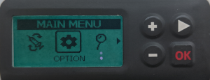

* Vælg »USER OPTION« i menuen med indstillinger
    
    

* Brug pileknappen til at rulle ned til »11. password«
    
    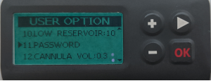

* Tryk på OK for at indtaste den gamle adgangskode.

* Indtast den **gamle adgangskode** (standardadgangskoden, se [ovenfor](#DanaRS-Insulin-Pump-default-password)), og tryk på OK
    
    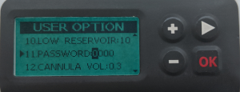

* Hvis du indtaster en forkert adgangskode her, kommer der ingen besked om, at det ikke virkede!

* Indstil en **ny adgangskode** (skift tallene med knapperne + og - / gå til højre med pileknappen).
    
    

* Bekræft med OK-knappen.

* Tryk på OK for at gemme indstillingen.
    
    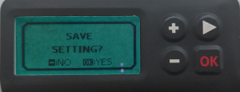

* Gå ned til »14. EXIT«, og tryk på OK for at afslutte.
    
    

(DanaRS-Insulin-Pump-dana-rs-specific-errors)=

## Fejl, der er specifikke for Dana RS

### Fejl under levering af insulin

Hvis forbindelsen mellem AAPS og Dana RS bliver afbrudt under levering af en bolus (dvs. du går væk fra telefonen, mens Dana RS giver insulin), ser du følgende besked og hører en alarm.

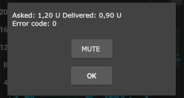

* I de fleste tilfælde er det bare et kommunikationsproblem, og den rigtige mængde insulin er leveret.
* Tjek i pumpens historik, at den rigtige bolus blev givet. Du kan gøre det på selve pumpen eller i **AAPS** på pumpeskærmen (**Administrer** > **Pumpe**) > **Pumpehistorik** > **Bolusser**.
* Slet fejlposten under [behandlinger](#screens-bolus-carbs), hvis du vil.
* Den rigtige mængde bliver læst og registreret ved næste forbindelse. For at gennemtvinge det kan du trykke på **Opdater** på pumpeskærmen eller bare vente på næste forbindelse.

## Vigtigt ved skift af telefon

Når du skifter til en ny telefon, skal du gøre følgende:

* [Eksporter indstillinger](../Maintenance/ExportImportSettings.md) på din gamle telefon
* Overfør indstillinger fra den gamle til den nye telefon

### DanaRS v1

* **Par Dana RS manuelt** med den nye telefon
* Hvis du sætter flueben ved **Erstat også pumpeindstillinger**, når du importerer, bliver pumpens forbindelsesindstillinger også importeret, og AAPS på din nye telefon »kender« allerede pumpen og starter derfor ikke en Bluetooth-søgning. Derfor skal den nye telefon og pumpen parres manuelt.
* Installer AAPS på den nye telefon.
* [Importer indstillinger](../Maintenance/ExportImportSettings.md) på din nye telefon

### DanaRS v3, Dana-i, Dana-i2

* Start parringen som beskrevet [ovenfor](#DanaRS-Insulin-Pump-pairing-pump).
* Nogle gange skal du først slette parringsoplysningerne i **AAPS**. Tryk på **Ophæv parring** på pumpeskærmen (**Administrer** > **Pumpe**), og bekræft **Nulstil parringsinformation?**. Tryk derefter på **Parring** igen.

## Skift af tidszone med pumperne DanaRS, Dana-i og Dana-i2

Information om rejser på tværs af tidszoner finder du i afsnittet [Rejser over tidszoner med pumper](#timezone-traveling-danarv2-danars).

## Hvor kan du få hjælp

Driveren til DanaRS/Dana-i/Dana-i2 er udviklet af fællesskabet på **frivillig** basis. Før du beder om hjælp:

1. **Læs** det relevante afsnit i denne dokumentation for at se, hvordan funktionen skal virke.
2. **Spørg** i kanalen *#AAPS* på [Discord](https://discord.gg/4fQUWHZ4Mw) eller i en af de andre [kanaler i fællesskabet](../GettingHelp/WhereCanIGetHelp.md).
3. **Rapporter en fejl** ved at søge i de [eksisterende issues](https://github.com/nightscout/AndroidAPS/issues); hvis din fejl ikke er der, så opret et [nyt issue](https://github.com/nightscout/AndroidAPS/issues), og vedhæft dine [logfiler](../GettingHelp/AccessingLogFiles.md).

Når du beder om hjælp, så angiv mærke og model på din telefon, Android-version, **AAPS**-version og en enkel og tydelig beskrivelse af problemet (hvad der er ændret, hvornår det sidst virkede).