# Diaconn G8

```{contents} Table of contents
:depth: 1
:local: true
```

## Pumpens funktioner med AAPS

* Kommunikerer med **AAPS** via telefonens indbyggede Bluetooth uden en ekstra kommunikationsenhed.
* Sommertid og skift af tidszone skal håndteres manuelt.

## Bluetooth-parring af insulinpumpen

- Tryk på **menuen** (☰) i øverste venstre hjørne.


- Tryk på **Konfiguration** > **Pumpe**, og vælg **Diaconn G8**.

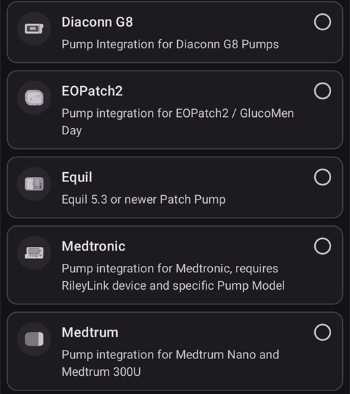

Når det er valgt, viser kortet **Diaconn G8** to knapper, **Indstillinger** og **Åbn plugin**:

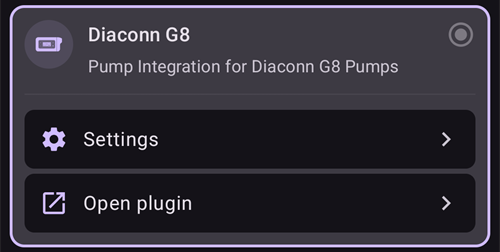

**Indstillinger** åbner indstillingerne for Diaconn G8-driveren (se [Indstillinger for Diaconn G8-insulinpumpen](#diaconn-g8-insulin-pump-option-setting) nedenfor).

**Åbn plugin** (eller **Administrer** > **Pumpe**) åbner pumpeskærmen for Diaconn G8. Før en pumpe er parret, ser den sådan ud:

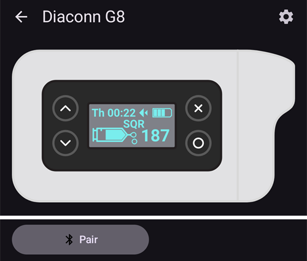

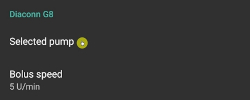

```{admonition} Older screenshot
:class: note
Skærmbilledet ovenfor er fra en tidligere **AAPS**-version. I **AAPS** 4 starter parringen med knappen **Par** på pumpeskærmen; der er ingen indstilling **Valgt pumpe**.
```

- Tryk på **Par** på pumpeskærmen. Skærmen **Parring af Diaconn-pumpe** åbner, og **AAPS** søger efter pumper i nærheden.
- Tryk på din insulinpumpes modelnummer, når det vises på listen (f.eks. **DIACONN-65010**).

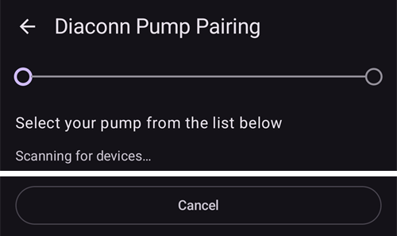

- Der er to måder at finde dit modelnummer på:

1. De sidste 5 cifre i serienummeret (SN) bag på pumpen.
2. Tryk på O-knappen > Information > BLE > de sidste 5 cifre.

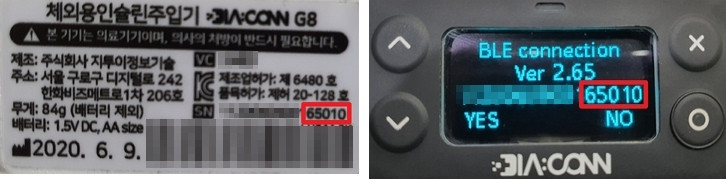

- Når du har valgt din pumpe, vises et vindue, der beder om en PIN-kode. Indtast den PIN-kode, som vises på din pumpe, for at fuldføre forbindelsen.

 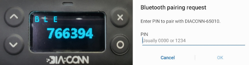

- Når **Parring lykkedes!** vises, så tryk på **OK** for at gå tilbage til pumpeskærmen.

## Kontrol af pumpestatus og synkronisering af log

- Når din pumpe er forbundet, så åbn pumpeskærmen (**Administrer** > **Pumpe**). Den viser pumpestatus (batteri, reservoir, sidste forbindelse, sidste bolus, basalrate og mere).
- Tryk på **Opdater** for at forbinde til pumpen, opdatere status og synkronisere loggene.
- Tryk på **Pumpehistorik** for at se historikken, der er læst fra pumpen.

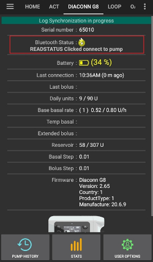

```{admonition} Older screenshot
:class: note
Skærmbilledet ovenfor er fra en tidligere **AAPS**-version. I **AAPS** 4 vises pumpestatus på pumpeskærmen (**Administrer** > **Pumpe**) og synkroniseres med knappen **Opdater**.
```

(diaconn-g8-bluetooth-troubleshooting)=

## Fejlfinding af Bluetooth

**Hvad du skal gøre, hvis Bluetooth-forbindelsen til pumpen er ustabil.**

### Metode 1) Genstart AAPS, og kontroller derefter pumpen igen

- Tryk på **menuen** (☰) i øverste venstre hjørne.
- Tryk på **Afslut** nederst i menuen.


- Start **AAPS** igen, og kontroller forbindelsen til pumpen.

### Metode 2) Hvis den første metode ikke virker, så afbryd Bluetooth-forbindelsen, og forbind igen.

- Tryk på Bluetooth-knappen øverst, og hold den nede i ca. 3 sekunder.

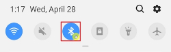

- Tryk på knappen Setting på den parrede Diaconn G8-insulinpumpe.

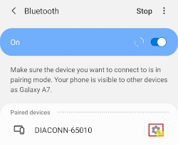

- Ophæv parringen.

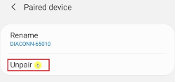

- Åbn pumpeskærmen i **AAPS** (**Administrer** > **Pumpe**), tryk på **Ophæv parring**, og bekræft **Nulstil parringsinformation?**.
- Gentag Bluetooth-parringen af pumpen (se ovenfor).

## Yderligere information

(diaconn-g8-insulin-pump-option-setting)=

### Indstillinger for Diaconn G8-insulinpumpen

- **Konfiguration** > **Pumpe** > **Diaconn G8** > **Indstillinger**
- Eller tryk på indstillingsikonet (tandhjul) i øverste højre hjørne på pumpeskærmen (**Administrer** > **Pumpe**).

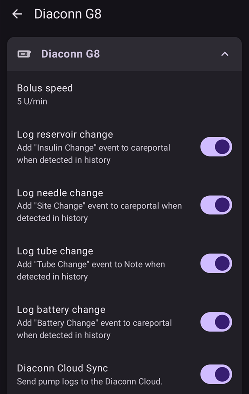

- **Bolus hastighed** bestemmer, hvor hurtigt pumpen leverer en bolus.
- Hvis indstillingen **Log reservoir skift** er slået til, bliver detaljerne automatisk uploadet til careportal, når en hændelse »Insulinskift« sker.
- Hvis indstillingen **Log indstik skift** er slået til, bliver detaljerne automatisk uploadet til careportal, når en hændelse »Skift af infusionssæt« sker.
- Hvis indstillingen **Log skift af slange** er slået til, bliver detaljerne automatisk tilføjet som et notat, når en hændelse »Skift af slange« sker.
- Hvis indstillingen **Log skift af batteri** er slået til, bliver detaljerne automatisk uploadet til careportal, når en hændelse »Batteriskift« sker. Du kan også selv registrere et batteriskift med **Administrer** > **Skift af pumpebatteri**. (Bemærk: Før du skifter batteriet, skal du stoppe alle igangværende injektionsfunktioner.)
- **Diaconn Cloud-synkronisering** sender pumpens logge til Diaconn Cloud.

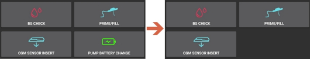

```{admonition} Older screenshot
:class: note
Skærmbilledet ovenfor er fra en tidligere **AAPS**-version. I **AAPS** 4 registreres et batteriskift med **Administrer** > **Skift af pumpebatteri**; der er ingen fane **Handlinger**.
```

### Funktionen forlænget bolus

- Hvis du bruger forlænget bolus, bliver lukket loop deaktiveret.
- Se [denne side](#extended-bolus-and-why-they-wont-work-in-closed-loop-environment) for at få at vide, hvorfor forlænget bolus ikke virker med lukket loop.

## Hvor kan du få hjælp

Diaconn G8-driveren bliver udviklet af fællesskabet på **frivillig** basis. Før du beder om hjælp:

1. **Læs** det relevante afsnit i denne dokumentation for at bekræfte, hvordan funktionen skal virke.
2. **Spørg** i kanalen *#AAPS* på [Discord](https://discord.gg/4fQUWHZ4Mw) eller i en af de andre [kanaler i fællesskabet](../GettingHelp/WhereCanIGetHelp.md).
3. **Rapporter en fejl** ved at søge i de [eksisterende issues](https://github.com/nightscout/AndroidAPS/issues); hvis din fejl ikke er på listen, så opret et [nyt issue](https://github.com/nightscout/AndroidAPS/issues), og vedhæft dine [logfiler](../GettingHelp/AccessingLogFiles.md).

Når du beder om hjælp, så oplys din telefons mærke og model, Android-version, **AAPS**-version og en enkel beskrivelse af problemet (hvad er ændret, hvornår virkede det sidst).
