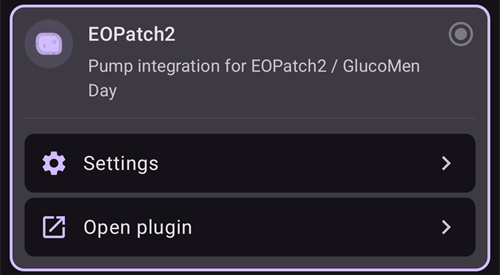
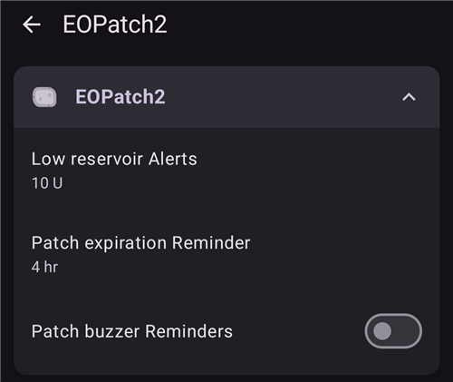
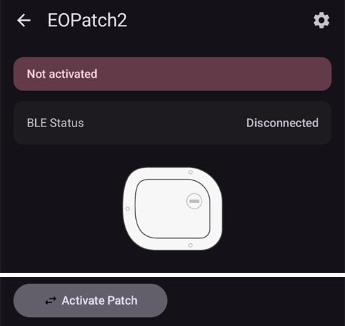
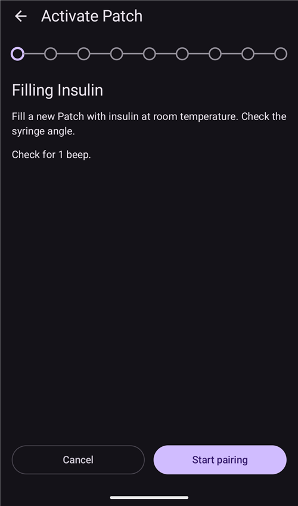

# EOPatch2

Patchen skal bruge hurtigtvirkende U-100-insulin, f.eks. NovoRapid eller Humalog. Brug den hurtigtvirkende insulin, som din læge har ordineret til dig.

Den mindste dosis, patchen kan give, er 0,05 IE. Sæt hver basalrate i din **profil** til mindst 0,05 E/t, i trin på 0,05 E/t. Ellers runder **AAPS** hver rate til nærmeste 0,05 E/t (aldrig ned til 0) og bruger de rater, som patchen faktisk giver. Så den samlede insulin pr. dag afviger lidt fra din **profil**. På samme måde skal boluser være mindst 0,05 IE.

```{contents} Table of contents
:depth: 1
:local: true
```

## Pumpens funktioner med AAPS

* Kommunikerer med **AAPS** via telefonens indbyggede Bluetooth uden en ekstra kommunikationsenhed.
* Sommertid og skift af tidszone skal håndteres manuelt.

## Opsætning af pumpen

1. Åbn **menuen** (☰) øverst til venstre på hovedskærmen i **AAPS**, og vælg **Konfiguration**.
1. Vælg **EOPatch2** i afsnittet **Pumpe**.
1. Tryk på tilbage-knappen for at gå tilbage til hovedskærmen.

 

Når det er valgt, viser kortet **EOPatch2** to knapper, **Indstillinger** og **Åbn plugin**:



## Indstillinger

Du kan åbne indstillingerne for EOPatch2 på to måder:

* tryk på **Indstillinger** på kortet **EOPatch2** i **Konfiguration**, eller
* åbn pumpeskærmen (**Administrer** → **Pumpe**), og tryk på tandhjulsikonet øverst til højre.

Der er tre indstillinger:



### Low Reservoir Alerts

Der vises en advarsel, når den insulin, der er tilbage i patchen, falder til denne mængde eller mindre. Du kan sætte den fra 10 til 50 IE, i trin på 5 IE. Standard er 10 IE.

### Patch Expiration Reminder

Minder dig om, hvor lang tid der er tilbage, før den nuværende patch udløber. Du kan sætte den fra 1 til 24 timer, i trin på 1 time. Standard er 4 timer.

### Patch buzzer-påmindelser

Når denne er slået til, bipper patchen, når en bolus, forlænget bolus eller midlertidig basal starter, og når den slutter. Den har ingen virkning på din normale basal. Standard er fra.

## Aktivering af en ny patch

### Åbn aktiveringsguiden

Åbn pumpeskærmen med **Administrer** → **Pumpe** (eller tryk på **Åbn plugin** på kortet **EOPatch2** i **Konfiguration**). Når ingen patch er aktiv, viser skærmen **Ikke aktiveret** og en knap **Aktiver Patch** nederst.

Tryk på **Aktiver Patch** for at starte guiden.



Guiden fører dig gennem hvert trin. Rækken af prikker øverst viser, hvor langt du er nået.

```{note}
Hvis du aldrig har aktiveret en **profil** i **AAPS**, viser guiden først siden **Profil påkrævet**. Vælg den profil, du vil bruge, og tryk på **Aktiver profil**.
```

### Påfylder insulin

Stik sprøjtens nål ind i insulinpåfyldningsporten på patchen. Tryk langsomt stemplet ind for at fylde patchen. Når der er mere end 80 IE i patchen, bipper den én gang og starter op (booter).

Når du hører bippet, så tryk på **Start parring**.



```{warning}
- Drej ikke nålearmen, før guiden siger, at du skal. Hvis du drejer den for tidligt, kan det give alvorlige problemer under påfyldningen eller sikkerhedstjekket.
- Patchen kan rumme 80 til 200 IE. Hvis du fylder mindre end 80 IE i, virker patchen ikke.
- Tag insulinen ud af køleskabet 15 til 30 minutter før påfyldning, så den når stuetemperatur. Insulinen skal være mindst 10°C.
```

### Parring af patch

**AAPS** prøver nu automatisk at parre med patchen. Under parringen vises to anmodninger om Bluetooth-parring fra Android. Tryk på **OK** på den første. Tryk på **OK** igen på den anden, som viser en adgangsnøgle.

```{warning}
- Hold patchen og din telefon inden for 30 cm af hinanden under parringen.
- Når patchen er startet op, bipper den hvert 3. minut, indtil parringen er færdig.
- Du skal gøre aktiveringen af patchen færdig inden for 60 minutter, efter den er startet op. Hvis du ikke kan, skal du kassere patchen.
```

  

```{admonition} Older screenshot
:class: note
De to skærmbilleder af Bluetooth-parringen er fra en tidligere version af **AAPS**: Skærmen i **AAPS** bag Androids parringsanmodning ser anderledes ud i **AAPS** 4.
```

### Vælg insulin

Vælg den insulin, du har fyldt patchen med, og tryk på **Næste**. **AAPS** laver et profilskift med denne insulin efter aktiveringen.

### Forberéd dig på vedhæftning af Patchen

Fjern den klæbende tape fra patchen, og tryk derefter på **Næste**.

Hvis en nål stikker ud, eller hvis patchen er våd eller snavset, eller dens klæbende tape er foldet, så tryk i stedet på **Kassér**, og brug en ny patch.


### Indstikssted

Dette trin vises kun, hvis **Administrer rotation af indstikssted for pumpe** er slået til i indstillingerne for rotation af indstikssteder. Tryk på det sted på kropsdiagrammet, hvor du vil sætte patchen på, og tryk på **Næste**, eller tryk på **Spring over**.

### Fastgøring af Patchen

Insulin skal ind et sted med fedtvæv under huden, men med få nerver og blodkar. Maven, armen eller låret er gode valg. Rens og tør stedet, og sæt derefter patchen på huden.

Kontroller infusionsstedet, og tryk derefter på **Start sikkerhedstjek**.

```{warning}
- Tryk kanterne af patchens tape jævnt ned, så hele patchen sidder godt fast på huden.
- Hvis patchen ikke sidder helt fast, kan der komme luft ind mellem patchen og huden. Det svækker klæbeevnen og patchens vandtæthed.
```


### Sikkerhedstjek

Sikkerhedstjekket tager omkring 30 sekunder. Når det er færdigt, bipper patchen én gang. Hvis det mislykkes, så tryk på **Prøv igen**.

```{warning}
Af hensyn til sikkerheden må du ikke dreje nålearmen, før sikkerhedstjekket er gennemført.
```

 

```{admonition} Older screenshot
:class: note
Skærmbillederne fra **Forberéd dig på vedhæftning af Patchen** til **Sikkerhedstjek** er fra en tidligere version af **AAPS** og kan se anderledes ud i **AAPS** 4.
```

### Indsætter nålen

Hold godt fast i patchen. Drej nålearmen opad mere end 100° for at indsætte nålen. Patchen bipper én gang, når nålen er sat korrekt ind. Drej derefter armen helt rundt for at fjerne den. Tryk på **Næste**.

```{caution}
Hvis du går til næste trin uden at have hørt bippet, vises **Nålindføringsfejl**. Lyt efter bippet, og tryk på **Prøv igen**. Hvis fejlen bliver ved, så tryk på **Kassér** for at deaktivere patchen.
```

### Patch-aktivering fuldført

Den sidste side bekræfter, at patchen er aktiv, og at den vil minde dig om det, når den nærmer sig sin udløbstid. Tryk på **Færdig** for at gå tilbage til pumpeskærmen.

## Kassering af patchen

Skift patchen, når den har lidt insulin tilbage, når den udløber, eller hvis den er defekt. Vi anbefaler, at du ikke bruger hver patch i mere end 84 timer, efter den er startet op.

1. Åbn pumpeskærmen (**Administrer** → **Pumpe**). Mens en patch er aktiv, så tryk på **Kassér Patch**.
1. Siden **Kassér Patch** viser den resterende tid og den insulin, der er tilbage i patchen. Tryk på **Kassér Patch**.
1. En dialogboks beder dig bekræfte. Tryk på **Kassér Patch** igen.
1. Når patchen er deaktiveret, viser guiden **Bortskaffelse af Patch afsluttet.** Fjern patchen fra kroppen, og tryk på **Bekræft**.

Derefter går guiden direkte videre til aktivering af en ny patch (se ovenfor). Tryk på tilbage-pilen, hvis du vil stoppe her.

Mens ingen patch er aktiv, viser **AAPS** pumpen som sat på pause og registrerer en midlertidig basal på 0 E/t. Så der tælles ingen basalinsulin med i IOB, før den næste patch er aktiveret.

   

```{admonition} Older screenshot
:class: note
Skærmbillederne ovenfor er fra en tidligere version af **AAPS**. I **AAPS** 4 åbner du pumpeskærmen fra **Administrer** → **Pumpe**, og knappen på den hedder **Kassér Patch**.
```

```{admonition} If the patch does not respond
:class: warning
Hvis **AAPS** ikke kan få forbindelse til patchen, viser den måske en side om at slukke patchens alarm manuelt: Fjern patchen fra kroppen, træk den klæbende tape af, og brug en clips til at trykke hårdt ind i hullet ved siden af insulinpåfyldningsporten.

Siden **Kassér Patch** har også en knap **Tvungen nulstilling**. Den fjerner kun patchen fra **AAPS** uden at sende nogen kommando til patchen. Patchen fortsætter med at give insulin, indtil batteriet løber tør, eller du slukker den manuelt. Brug den kun, hvis en normal kassering mislykkes, og fjern patchen fra kroppen.
```

## Pause i og genoptagelse af insulintilførslen

En pause i insulintilførslen annullerer også en forlænget bolus og en midlertidig basal, hvis de kører. Når du genoptager, bliver de **ikke** startet igen. Mens insulintilførslen er sat på pause, bipper patchen hvert 15. minut.

### Pause i insulintilførslen

1. Åbn pumpeskærmen (**Administrer** → **Pumpe**), og tryk på **Sæt pumpe på pause**.
1. En dialogboks forklarer, hvad der bliver sat på pause. Tryk på **Bekræft**.
1. I dialogboksen **Basal-suspenderingstid** skal du vælge, hvor længe pausen skal vare: 30 min, 1 t, 1 t 30 min eller 2 t. Tryk på **Bekræft**.

Insulintilførslen er sat på pause i den tid, du har valgt.

  

```{admonition} Older screenshot
:class: note
Skærmbillederne ovenfor er fra en tidligere version af **AAPS**. I **AAPS** 4 åbner du pumpeskærmen fra **Administrer** → **Pumpe**, og knappen på den hedder **Sæt pumpe på pause**.
```

### Genoptagelse af insulintilførslen

1. Åbn pumpeskærmen (**Administrer** → **Pumpe**), og tryk på **Genoptag pumpe**.
1. I dialogboksen **Genoptag insulintilførsel** skal du trykke på **Bekræft**.

 

```{admonition} Older screenshot
:class: note
Skærmbillederne ovenfor er fra en tidligere version af **AAPS**. I **AAPS** 4 åbner du pumpeskærmen fra **Administrer** → **Pumpe**, og knappen på den hedder **Genoptag pumpe**.
```

```{warning}
Når pausen er slut, viser **AAPS** advarslen **Afslutning af insulinsuspensionen**. Insulintilførslen starter **ikke** igen, før du bekræfter det. Hvis du ikke gør det, kan du få hyperglykæmi.
```

(eopatch2-alarms-and-warnings)=

## Alarmer og advarsler

### Alarmer

Alarmer er til akutte situationer med højeste prioritet og kræver, at du handler med det samme. **AAPS** giver en alarm, der bliver ved, indtil du kvitterer for den, og viser beskeden som en notifikation på skærmen **Oversigt**. En alarm betyder, at der er et problem med den patch, du bruger. I mange tilfælde skal patchen kasseres og skiftes ud med en ny.

Når du trykker på **Bekræft** på notifikationen, håndterer **AAPS** alarmen. For de fleste alarmer deaktiverer det patchen. For alarmen **Upassende temperatur** er knappen **Prøv igen**.

 

```{admonition} Older screenshot
:class: note
Skærmbillederne af alarmerne er fra en tidligere version af **AAPS** og kan se anderledes ud i **AAPS** 4.
```

De forskellige alarmer er forklaret nedenfor.

| Alarm                       | Forklaring                                                                                                                                                |
| --------------------------- | --------------------------------------------------------------------------------------------------------------------------------------------------------- |
| Tomt reservoir              | Patchen er løbet tør for insulin.                                                                                                                         |
| Patch udløbet               | Patchens brugstid er slut, og den kan ikke give mere insulin.                                                                                             |
| Okklusion                   | Patchens insulinvej ser ud til at være blokeret.                                                                                                          |
| Fejl i selvtest ved opstart | Patchen fandt en uventet fejl under sin selvtest efter opstart.                                                                                           |
| Upassende temperatur        | Patchen er uden for sin normale driftstemperatur, mens du aktiverer eller bruger den. Flyt patchen til et sted med en passende temperatur (4,4 til 37°C). |
| Nålindføringsfejl           | Nålen blev ikke sat korrekt ind under aktiveringen. Kontroller, at patchens kant til indstik af nålen og nålearmen er på linje.                           |
| Patch batterifejl           | Patchens indbyggede batteri er ved at løbe tør, og patchen slukker.                                                                                       |
| Patch aktiveringsfejl       | Patchen blev ikke aktiveret helt inden for 60 minutter efter opstart.                                                                                     |
| Patch-fejl                  | Patchen fandt en uventet fejl under aktivering eller brug.                                                                                                |

### Advarsler

Advarsler er til situationer med middel eller lav prioritet. En advarsel vises som en notifikation på skærmen **Oversigt**.


```{admonition} Older screenshot
:class: note
Dette skærmbillede er fra en tidligere version af **AAPS**: I **AAPS** 4 vises advarslen på hovedskærmen, som ser anderledes ud.
```

De forskellige advarsler er forklaret nedenfor.

| Advarsel                          | Forklaring                                                                                                                           |
| --------------------------------- | ------------------------------------------------------------------------------------------------------------------------------------ |
| Afslutning af insulinsuspensionen | Den pausetid, du valgte, er slut. Tryk på **Genoptag pumpe** på notifikationen for at starte insulintilførslen igen.                 |
| Lavt reservoir                    | The insulin left in the patch is below the amount set in **Low Reservoir Alerts**.                                                   |
| Patch driftslevetid udløbet       | Patchens brugsperiode er slut.                                                                                                       |
| Patch udløber snart               | Patchen skal kasseres inden for 1 time.                                                                                              |
| Ufuldstændig Patch-aktivering     | Aktiveringen af patchen blev afbrudt i mere end 3 minutter efter parringen. Åbn pumpeskærmen, og gør aktiveringen af patchen færdig. |
| Patch-batteri lavt                | Patchens batteri er lavt.                                                                                                            |

## Hvor kan du få hjælp

Udviklingen af driveren til EOPatch2 udføres af fællesskabet på **frivillig** basis. Før du beder om hjælp:

1. **Læs** det relevante afsnit i denne dokumentation for at bekræfte, hvordan funktionen skal virke.
2. **Spørg** i kanalen *#AAPS* på [Discord](https://discord.gg/4fQUWHZ4Mw) eller i en af de andre [kanaler i fællesskabet](../GettingHelp/WhereCanIGetHelp.md).
3. **Rapporter en fejl** ved at søge i de [eksisterende issues](https://github.com/nightscout/AndroidAPS/issues); hvis din fejl ikke er på listen, så opret et [nyt issue](https://github.com/nightscout/AndroidAPS/issues), og vedhæft dine [logfiler](../GettingHelp/AccessingLogFiles.md).

Når du beder om hjælp, så oplys din telefons mærke og model, Android-version, **AAPS**-version og en enkel beskrivelse af problemet (hvad er ændret, hvornår virkede det sidst).
