# Equil

Denne vejledning beskriver, hvordan du konfigurerer insulinpumpen Equil.

```{contents} Table of contents
:depth: 1
:local: true
```

## Pumpens funktioner med AAPS

* Slangefri patchpumpe, der kommunikerer med **AAPS** via telefonens egen Bluetooth, uden en ekstra kommunikationsenhed.
* **AAPS** treats the Equil as a patch pump with a 200 U reservoir: the main screen shows the patch pump status lights. Filling the reservoir, priming and changing the battery are done in the pump wizards, so **Pump battery change** is not offered.
* **Prime/Fill** is offered, in the **Manage** sheet, in QuickLaunch and in the expanded status panel on the main screen. Use it only while the pump is **off its base plate**, so the insulin goes into the air: like every prime, it is not counted in IOB, so a prime while the pump is attached gives insulin the loop does not know about.
* Mens pumpen er sat på pause eller stoppet, registrerer **AAPS** en midlertidig basal på 0 E/t, så der ikke tælles basalinsulin med i IOB.
* Sommertid og skift af tidszone skal håndteres manuelt.

## Krav til hardware og software
* **Kompatibel Equil-hardware**

  I øjeblikket understøttes Equil 5.3 og 5.4.

* **AAPS** bygget og installeret efter vejledningen [Byg AAPS](../SettingUpAaps/BuildingAaps.md)

## Opsætning

### Vælg Equil-pumpen

Åbn **menuen** (☰) i øverste venstre hjørne, vælg **[Konfiguration](#Config-Builder-pump)**, og vælg **Equil** under **Pumpe**.

Når den er valgt, viser kortet **Equil** to knapper, **Indstillinger** og **Åbn plugin**:

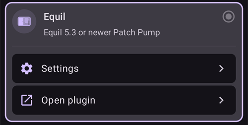

**Åbn plugin** (eller **Administrer** → **Pumpe**) åbner Equil-pumpeskærmen. Før en pumpe er parret, ser den sådan ud:

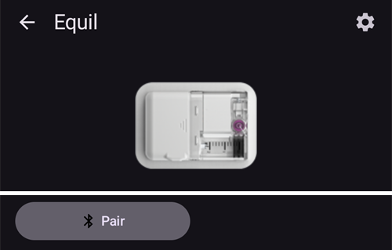

### Indstillinger

Åbn Equil-indstillingerne med **Indstillinger** på kortet **Equil** eller med tandhjulsikonet i øverste højre hjørne af pumpeskærmen.

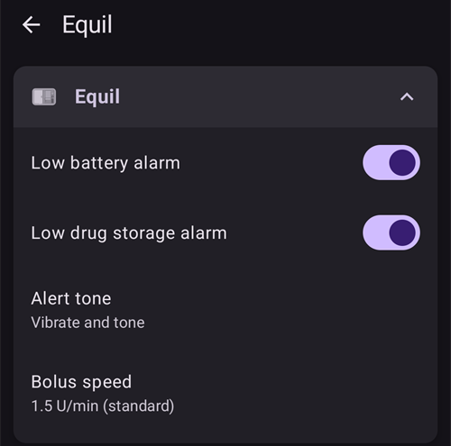

* **Alarm for lavt batteri**: advarer dig, når pumpens batteri er lavt.
* **Alarm for lavt reservoir**: advarer dig, når der er lidt insulin tilbage i reservoiret.
* **Alarmlyd**: hvordan pumpen advarer dig: **Lydløs**, **Kun vibration**, **Kun lyd** eller **Vibration og lyd**.
* **Bolushastighed**: hvor hurtigt en bolus gives: **1,5 E/min (standard)**, **3 E/min**, **6 E/min** eller **12 E/min**. En hurtigere bolus kan give flere okklusionsalarmer.

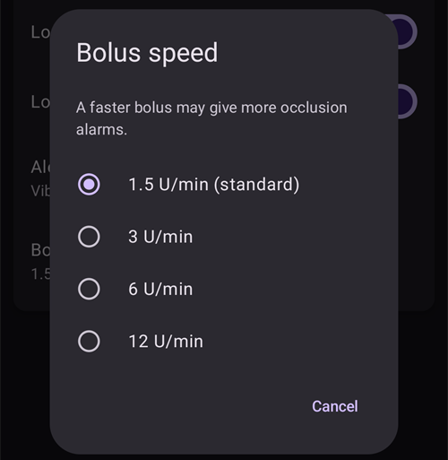

```{admonition} Max basal and max bolus on the patch
:class: note
Selve patchen afviser enhver basalrate over et maksimum, som **AAPS** programmerer ind i den. **AAPS** bruger den højeste værdi af din [indstilling](../SettingUpAaps/Preferences.md) for **maks. basal** og den højeste basalrate pr. time i din **profil**, så patchen altid accepterer din profil og de midlertidige basaler, som loopet beder om. **AAPS** sender også din maksimalt tilladte bolus til patchen.

Når du ændrer din **maks. basal** eller **maks. bolus**, sender **AAPS** automatisk de nye værdier til patchen. De sendes også ved hvert profilskift. Der er intet at indstille på selve patchen.
```

### Par pumpen

Tryk på **Par** på pumpeskærmen. En guide fører dig gennem hvert trin. Rækken af prikker øverst viser, hvor langt du er nået.

Hvis Android spørger, om **AAPS** må finde og oprette forbindelse til enheder i nærheden, skal du trykke på **Tillad**. **AAPS** har brug for dette for at finde pumpen.

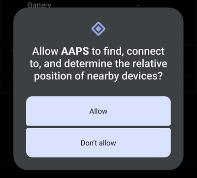

Guiden har disse trin. Tryk på **Næste** for at gå videre, eller på **Annuller** for at forlade guiden.

1. **Profil påkrævet**: vises kun, hvis du aldrig har aktiveret en **profil** i **AAPS**. Vælg den profil, du vil bruge, og tryk på **Aktiver profil**.
1. **Saml pumpe**: saml pumpen, det fyldte reservoir og det opladede batteri.

   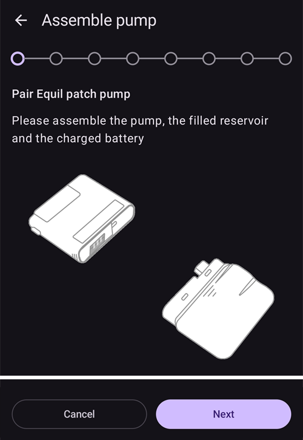

1. **Find pumpe**: **AAPS** søger efter Equil-pumper i nærheden. Vælg din pumpe på listen.

   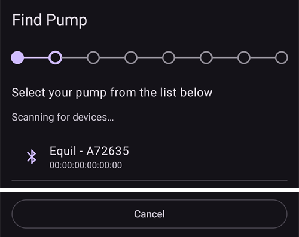
1. **Par enhed**: du kan indtaste en parringsadgangskode under **Indstil parringsadgangskode**. Den skal være 4 tegn lang og bestå af tegnene `ABCDEF0123456789`. Tryk på **Par**.

   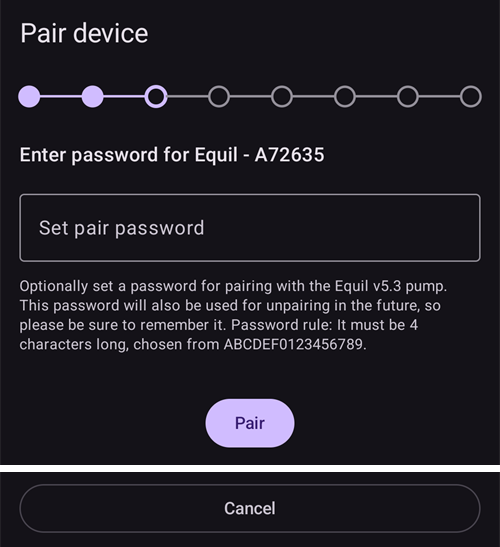

1. **Vælg insulin**: vises kun, hvis du har opsat mere end én insulin. Vælg den insulin, der er i reservoiret.
1. **Klargør / Fyld**: pumpen må **ikke** sidde på bundpladen. Tryk på **Klargør/Fyld**, og klargør reservoiret, indtil der er en dråbe insulin på nålespidsen. Tryk på **Næste**.

   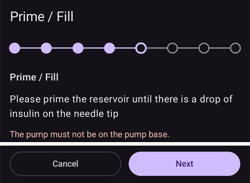
1. **Rotation af indstikssteder**: vises kun, hvis **Administrer rotation af indstikssted for pumpe** er slået til i indstillingerne for rotation af indstikssteder. Tryk dér, hvor du vil sætte pumpen på, eller tryk på **Spring over**.
1. **Sæt pumpe på**: sæt pumpen på bundpladen.

   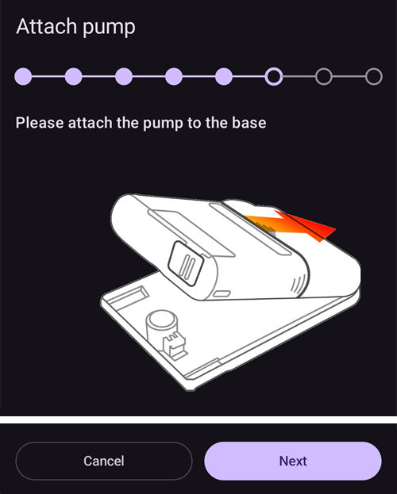
1. **Klargør kanyle**: når pumpen sidder på bundpladen, skal du trykke på **Tøm for luft** for at fjerne luft fra kanylen. Tryk på **Næste**.

   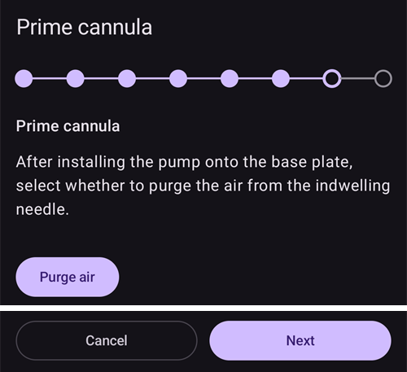

1. **Bekræft**: sæt pumpen på kroppen, og tryk på **Færdig**.

   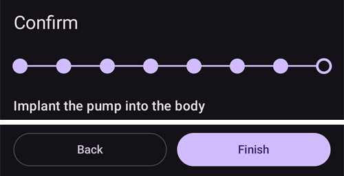

```{warning}
Hvis du indstiller din egen parringsadgangskode (anbefales af hensyn til din sikkerhed), skal du gemme den et sikkert sted. Adgangskoden gemmes i pumpen. Pumpen beder om den ved hver ny parring, indtil du ophæver parringen korrekt i **AAPS**. Indtil da kan pumpen heller ikke bruges med den originale håndholdte styreenhed (PDA).
```

### Pumpeskærmen efter parring

Når pumpen er parret, viser pumpeskærmen disse knapper:

* **Opdater**: læser pumpens tilstand og historik med det samme.
* **Sæt på pause** / **Genoptag insulintilførsel**: stopper eller genstarter insulintilførslen.
* **Skift reservoir**: fører dig gennem at tage pumpen af, sætte et nyt reservoir i (og om nødvendigt et nyt batteri), klargøre og sætte pumpen på igen. Det første trin spørger *Sætter du også et nyt infusionssæt på (bundplade og kanyle)?*
  * **Ja, nyt infusionssæt**: du vælger indstiksstedet, kanylen bliver klargjort, og **AAPS** registrerer et insulinskift og et kanyleskift.
  * **Nej, kun reservoir eller batteri**: kanylen bliver ikke klargjort, og **AAPS** registrerer kun et insulinskift.

  Efter et reservoirskift viser batteriniveauet **-**, indtil **AAPS** har læst det fra pumpen igen.

  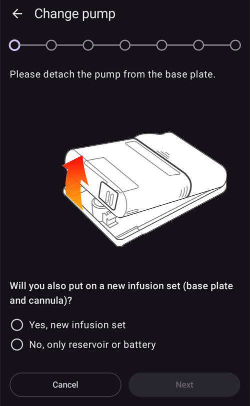

* **Historik**: viser de hændelser, som pumpen har registreret.
* **Ophæv parring af enhed**: fører dig gennem at tage pumpen af og ophæve parringen med **AAPS**. Dette stopper insulintilførslen, kører pumpens stempel tilbage til bunden og sletter parringen.

### Alarmer

* Alarmen for lavt insulinniveau lyder én gang ved hvert niveau (10 IE, 5 IE og 2 IE), og når reservoiret er tomt. Alarmen for lavt batteri lyder én gang ved 10% og én gang ved 5%. Hvert niveau giver kun alarm én gang indtil næste reservoirskift.
* Pumpens alarmer og stop registreres også som meddelelser i behandlingerne, på det tidspunkt hvor pumpen loggede dem, så du senere kan se, hvornår og hvorfor pumpen stoppede.
* Hvis reservoiret løber tørt under en bolus, registrerer **AAPS** kun den insulin, der blev givet indtil da, og viser dig begge mængder.

## Hvor kan du få hjælp

Udviklingen af Equil-driveren udføres af fællesskabet på **frivillig** basis. Før du beder om hjælp:

1. **Læs** det relevante afsnit i denne dokumentation for at bekræfte, hvordan funktionen skal virke.
2. **Spørg** i kanalen *#AAPS* på [Discord](https://discord.gg/4fQUWHZ4Mw) eller i en af de andre [kanaler i fællesskabet](../GettingHelp/WhereCanIGetHelp.md).
3. **Rapporter en fejl** ved at søge i de [eksisterende issues](https://github.com/nightscout/AndroidAPS/issues); hvis din fejl ikke er på listen, så opret et [nyt issue](https://github.com/nightscout/AndroidAPS/issues), og vedhæft dine [logfiler](../GettingHelp/AccessingLogFiles.md).

Når du beder om hjælp, så oplys din telefons mærke og model, Android-version, **AAPS**-version og en enkel beskrivelse af problemet (hvad er ændret, hvornår virkede det sidst).
