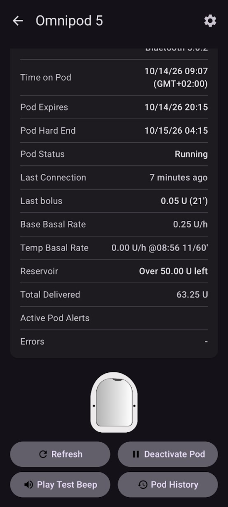
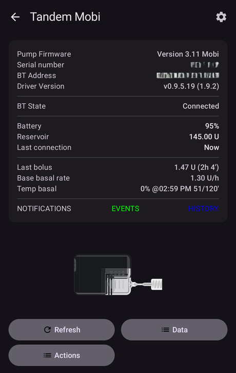

# Fremtidige (mulige) pumpedrivere

Dette er en liste over nogle pumper på markedet, status for deres understøttelse i andre loop-systemer og deres status i AAPS. Til sidst er der nogle oplysninger om, hvad en pumpe skal kunne for at kunne bruges i et loop.

    {contents} Indholdsfortegnelse
    :depth: 1
    :local: true

## Pumper, som er ved at blive integreret i AAPS

**Kommer snart:** Drivere til disse pumper er under udvikling og kører allerede i test-builds.

Omnipod 5 ([Hjemmeside](https://www.omnipod.com/))

Tandem: t:Mobi ([Hjemmeside](https://www.tandemdiabetes.com/))

## Pumper, som kan bruges i et loop

### Kaleido ([Hjemmeside](https://www.hellokaleido.com/))

**Loop-status:** Pumpen er en kandidat til loop, men protokollen er ukendt på nuværende tidspunkt. Producenten er ikke interesseret i open source.

**Krav til hardware for AAPS:** Ingen. Den ser ud til at have BT.

### Tandem: t:slim X3 ([Hjemmeside](https://www.tandemdiabetes.com/about-us/pipeline))

**Loop-status:** Mulig kandidat til loop i fremtiden. Håbet er, at t:slim X3 vil kunne styres helt fra en telefon. Det vil gøre det muligt at understøtte den i AAPS, men tidsplanen og funktionerne er stadig ukendte.

**Krav til hardware for AAPS:** Ingen. Den forventes at have Bluetooth.

**Kommentarer:** Ikke udgivet endnu. t:slim X3 ser ud til gang på gang at blive nedprioriteret i Tandems planer til fordel for t:Mobi (også en version uden slange) og Sigi (deres patchpumpe).

### Twiist ([Hjemmeside](https://www.twiist.com/))

**Loop-status:** Kandidat til loop.

**Krav til hardware for AAPS:** Ingen. Den har Bluetooth.

### Willcare insulinpumpe ([Hjemmeside](http://shinmyungmedi.com/en/))

**Loop-status:** Lige nu er den ikke en kandidat til loop, men firmaets medarbejdere har kontaktet os, og de er interesserede i at gøre pumpen klar til loop (det ser ud til, at der kun mangler kommandoerne til at hente/sætte profil).

**Krav til hardware for AAPS:** Ingen. Den ser ud til at have BT.

**Kommentarer:** Da firmaet er interesseret i at blive integreret med AAPS, laver de måske selv implementeringen.

### Ypsopump ([Hjemmeside](https://www.ypsomed.com/))

**Loop-status:** Kandidat til loop. Fællesskabet har afkodet pumpens Bluetooth-protokol (reverse engineering), så det er i princippet muligt at kommunikere med den.

**Krav til hardware for AAPS:** Ingen. Den har Bluetooth.

**Kommentarer:** Ypsopump beskytter sin Bluetooth-kommunikation med stærk kryptering fra en tredjepart. Det er teknisk krævende at arbejde med, og det gør det svært at bygge og vedligeholde en pålidelig driver. Der findes endnu ingen AAPS-driver, som er klar til brug.

## Pumper, som ikke længere sælges (firmaer, som ikke længere findes)

### Animas Vibe

### Animas Ping

### Cellnovo

### Accu-Chek Insight

**Kommentarer:** Support ophørte i marts 2025.

## Pumper, som ikke kan bruges i et loop

### Medtronic Bluetooth

**Kommentarer:** Medtronic [trak sig](https://www.tidepool.org/blog/tidepool-loop-partner-update-ace-pumps).

### Tandem: t:slim X2 ([Hjemmeside](https://www.tandemdiabetes.com/))

**Kommentarer:** Tandems Bluetooth-protokol er blevet afkodet (reverse engineering), men på t:slim X2 kan der kun gives boluser — basaltilførslen kan ikke styres — så den kan ikke bruges sikkert i et loop. Det ændrer sig sandsynligvis ikke, medmindre Tandem tillader fuld styring af X2 fra en telefon. Det kommer mere sandsynligt med t:slim X3 i stedet.

### Accu-Chek Solo

**Kommentarer:** Det er ikke lykkedes for fællesskabet at kommunikere med Solo-pumpen.

## Krav til pumper, som skal kunne bruges i et loop

**Forudsætning**

- Pumpen skal kunne fjernstyres på en eller anden måde. (BT, radiofrekvens osv.)
- Protokollen er hacket, dokumenteret eller lignende.

**Minimumskrav**

- Sæt midlertidig basalrate
- Hent status
- Annuller midlertidig basalrate

**For oref1 (SMB) eller for at give bolus:**

- Giv bolus

**Godt at have**

- Annuller bolus
- Hent basalprofil (næsten et krav)
- Sæt basalprofil (rart at have)
- Læs historik 

**Andet (ikke et krav, men godt at have)**

- Sæt forlænget bolus
- Annuller forlænget bolus
- Læs historik
- Læs TDD

### Understøttelse af andre pumper

Hvis du gerne vil se status for andre pumper, så kontakt os på Discord.