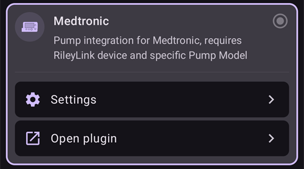
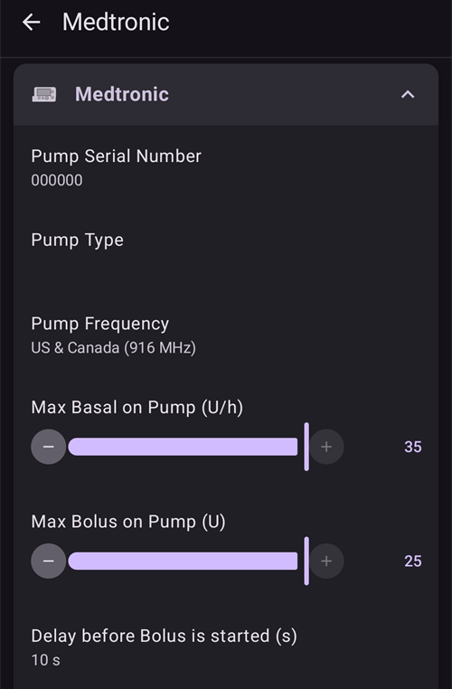
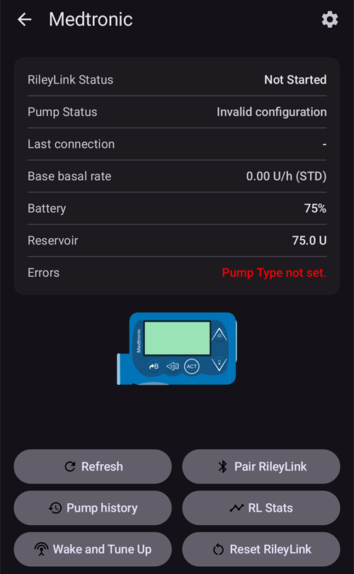
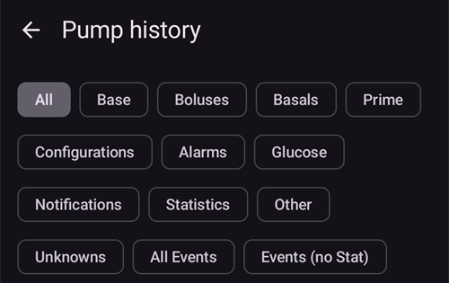
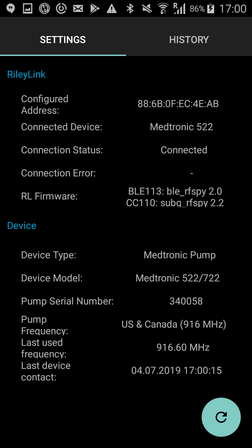
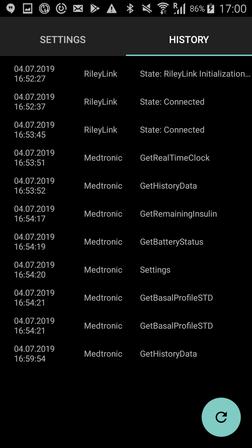
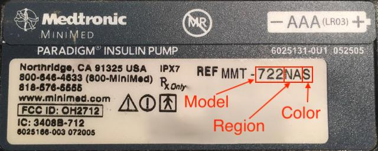

# Medtronic-pumper

Driveren virker ikke med nyere modeller, heller ikke med alle modeller, der ender på G (530G, 600-serien [630G, 640G, 670G], 700-serien [770G, 780G] osv.).

Følgende kombinationer af model og firmware er kompatible:

- 512/712 (alle firmwareversioner)
- 515/715 (alle firmwareversioner)
- 522/722 (alle firmwareversioner)
- 523/723 (firmware 2.4A eller lavere)
- 554/754 EU-udgave (firmware 2.6A eller lavere)
- 554/754 canadisk udgave (firmware 2.7A eller lavere)

Du kan se, hvordan du tjekker firmwaren på pumperne, i [OpenAPS-dokumentationen](https://openaps.readthedocs.io/en/latest/docs/Gear%20Up/pump.html#how-to-check-pump-firmware-check-for-absence-of-pc-connect) eller i [LoopDocs](https://loopkit.github.io/loopdocs/build/step3/#medtronic-pump-firmware).

    {contents} Indholdsfortegnelse
    :depth: 1
    :local: true

## Pumpens funktioner med AAPS

* Kræver en RileyLink-kompatibel enhed for at kommunikere med **AAPS**.
* Automatisk håndtering af sommertid og tidszoner.

## Krav til hardware og software

- **Telefon:** Medtronic-driveren bør virke med alle Android-telefoner, der understøtter Bluetooth-forbindelser. **VIGTIGT: Telefonproducenterne bruger Bluetooth forskelligt, så hver telefonmodel kan opføre sig forskelligt. F.eks. håndterer nogle telefoner det forskelligt, når Bluetooth slås til og fra. Det kan påvirke brugeroplevelsen, når AAPS skal genoprette forbindelsen til din Rileylink-enhed.**
- **RileyLink-kompatibel enhed:** Android-telefoner kan ikke kommunikere med Medtronic-pumper uden en separat enhed, der står for kommunikationen. Denne enhed forbinder til din telefon via Bluetooth og til din pumpe via en kompatibel radioforbindelse. Den første af disse enheder hed Rileylink, men nu findes der flere andre muligheder, som kan give ekstra funktioner.
    
    - Rileylink kan købes på [getrileylink.org](https://getrileylink.org/product/rileylink916)
    - Orangelink kan købes på [getrileylink.org](https://getrileylink.org/product/orangelink)
    - Emalink (flere modeller) kan købes på [github.com](https://github.com/sks01/EmaLink)
    - Gnarl (kræver lidt ekstra gør-det-selv) – detaljer findes på [github.com](https://github.com/ecc1/gnarl)

En sammenligning af de forskellige Rileylink-kompatible enheder findes på [getrileylink.org](https://getrileylink.org/rileylink-compatible-hardware-comparison-chart)

(MedtronicPump-configuration-of-the-pump)=

## Konfiguration af pumpen

Følgende indstillinger skal konfigureres på pumpen, for at AAPS kan sende kommandoer på afstand. De trin, der skal til for at ændre hver indstilling på en Medtronic 715, står i parentes ved hver indstilling. De præcise trin kan variere afhængigt af pumpetype og/eller firmwareversion.

- **Aktiver fjerntilstand på pumpen** (tryk på Act på pumpen, og gå til Utilities -> Remote Options, vælg On, og på næste skærm vælg Add ID og tilføj et vilkårligt ID, f.eks. 111111). Der skal være mindst ét ID på listen Remote ID, for at pumpen forventer kommunikation på afstand.
- **Indstil maks. basal** (tryk på Act på pumpen, og gå til Basal og vælg derefter Max Basal Rate) Hvis du f.eks. sætter denne værdi til fire gange din højeste normale basalrate, tillader det en midlertidig basalrate på 400%. Den højeste værdi, som pumpen tillader, er 34,9 enheder i timen.
- **Indstil maks. bolus** (tryk på Act på pumpen, og gå til Bolus og vælg derefter Max Bolus) Det er den største bolus, som pumpen accepterer. Den højeste værdi, som pumpen tillader, er 25.
- **Sæt profilen til Standard**. (tryk på Act på pumpen, og gå til Basal og derefter Select Patterns) Pumpen har kun brug for én profil, da AAPS styrer de forskellige profiler på din telefon. Der er ikke brug for andre mønstre (patterns).
- **Indstil typen af midlertidig basalrate** (tryk på Act på pumpen, og gå til Basal og derefter Temp Basal Type). Vælg Absolute (ikke Percent).

## Medtronic-konfiguration af telefon/AAPS

- **Par ikke den RileyLink-kompatible enhed via Bluetooth-menuen på din telefon.** Hvis du parrer via Bluetooth-menuen på telefonen, kan AAPS ikke se din Rileylink-kompatible enhed, når du følger vejledningen nedenfor.
- Slå automatisk skærmrotation fra på din telefon. På nogle enheder får automatisk skærmrotation Bluetooth-forbindelsen til at genstarte, hvilket giver problemer med din Medtronic-pumpe. 
- Der er to måder at konfigurere din Medtronic-pumpe i AAPS:

1. Brug af opsætningsguiden ved en ny installation
2. I **Konfiguration** > **Pumpe** ved at vælge **Medtronic**
    
    
    
    Når det er valgt, viser kortet **Medtronic** to knapper, **Indstillinger** og **Åbn plugin**:
    
    
    
    **Indstillinger** åbner indstillingerne for Medtronic-driveren:
    
    
    
    **Åbn plugin** (eller **Administrer** > **Pumpe**) åbner Medtronic-pumpeskærmen. Før en pumpe er parret, ser den sådan ud:
    
    

Når du konfigurerer din Medtronic-pumpe med opsætningsguiden, kan Bluetooth-problemer forhindre dig i at gøre opsætningen færdig (f.eks. hvis du ikke kan forbinde til pumpen). Hvis det sker, skal du vælge den virtuelle pumpe for at gøre konfigurationen færdig og senere fejlfinde ved at bruge mulighed 2.

Når du sætter AAPS op til at arbejde med din Medtronic-pumpe, skal du indstille følgende i **Indstillinger** (se billedet af indstillingerne ovenfor):

- **Pumpens serienummer**: Står på bagsiden af din pumpe og begynder med SN. Indtast kun de 6 viste tal uden bogstaver (f.eks. 123456).
- **Pumpetype**: Den pumpemodel, du bruger (f.eks. 522). 
- **Pumpefrekvens**: Der er to muligheder, afhængigt af hvor din pumpe oprindeligt blev solgt. Se [Ofte stillede spørgsmål](#MedtronicPump-faq), hvis du er i tvivl om, hvilken mulighed du skal vælge: 
    - til USA og Canada bruges frekvensen 916 MHz
    - til resten af verden bruges frekvensen 868 MHz
- **Maks. Basal på pumpe (E/t)**: Skal svare til indstillingen på din pumpe (se Konfiguration af pumpen ovenfor). Også denne indstilling skal vælges med omhu, da den bestemmer, hvor meget AAPS kan give via din basalrate. Det sætter i praksis den højeste midlertidige basalrate. Hvis du f.eks. sætter denne værdi til fire gange din højeste normale basalrate, tillader det en midlertidig basalrate på 400%. Den højeste værdi, som pumpen tillader, er 34,9 enheder i timen.
- **Maks. Bolus på pumpe (IE)** (inden for en time): Skal svare til indstillingen på din pumpe (se Konfiguration af pumpen ovenfor). Overvej denne indstilling grundigt, da den bestemmer, hvor stor en bolus AAPS nogensinde kan give.
- **Forsinkelse før Bolus starter (s)**: Det antal sekunder, der går, fra en bolus bliver givet, til kommandoen faktisk sendes til pumpen. I denne tid kan brugeren annullere bolussen, hvis en boluskommando er sendt ved en fejl. Det er ikke muligt at annullere en bolus, der er startet via AAPS. Den eneste måde at annullere en bolus, der allerede er startet, er at sætte pumpen på pause manuelt og derefter genoptage den.
- **Medtronic-kodning**: Bestemmer, hvor Medtronic-kodningen udføres (hardware eller software). Det anbefales at vælge Hardware-kodning (dvs. at den udføres af den Rileylink-kompatible enhed), da der så sendes færre data. Hvis du ser mange afbrydelser, kan det hjælpe at vælge Software-kodning (dvs. at den udføres af AAPS). Denne indstilling bliver ignoreret, hvis du har firmwareversion 0.x på Rileylink-enheder.
- **Batteritype**: For at kunne beregne det resterende batteriniveau korrekt skal du vælge den type AAA-batteri, du bruger. Når der er valgt noget andet end enkel visning, viser AAPS det beregnede resterende batteriniveau i procent og volt. Følgende muligheder findes:
    
    - Ikke valgt (enkel visning)
    - Alkaline (udvidet visning)
    - Lithium (udvidet visning)
    - NiZn (udvidet visning)
    - NiMH (udvidet visning)
- **Brug scanning**: Aktiverer Bluetooth-scanning, før der forbindes til dine Rileylink-kompatible enheder. Det bør gøre forbindelsen til enheden mere pålidelig.

- **Vis batteriniveau rapporteret af OrangeLink/EmaLink/DiaLink**: Denne funktion understøttes kun på nyere link-enheder som EmaLink eller OrangeLink. Værdien vises som **RileyLink-batteri** på Medtronic-pumpeskærmen.
- **Indstil neutrale midlertidige basaler**: Som standard bipper Medtronic-pumper hver hele time, når en midlertidig basalrate er aktiv. Hvis du slår denne mulighed til, kan det give færre bip, fordi en midlertidig basal afbrydes ved timeskiftet for at undgå bippet.

(pairing-your-rileylink-compatible-device)=

### Parring af din RileyLink-kompatible enhed

Din RileyLink-kompatible enhed parres fra Medtronic-pumpeskærmen, ikke fra Bluetooth-menuen på din telefon:

- Åbn pumpeskærmen (**Administrer** > **Pumpe**, eller **Åbn plugin** på Medtronic-kortet i **Konfiguration** > **Pumpe**).
- Tryk på **Par RileyLink**. **AAPS** søger efter RileyLink-kompatible enheder i nærheden.
- Tryk på din enhed på listen. Når **RileyLink er parret** vises, så tryk på **OK**.

## Medtronic-pumpeskærm

For at åbne Medtronic-pumpeskærmen skal du gå til **Administrer** > **Pumpe**. Pumpeskærmen viser den aktuelle status for pumpen og nogle handlinger, der er særlige for Medtronic (se billedet af pumpeskærmen ovenfor).

- **RileyLink-status**: Den aktuelle status for forbindelsen mellem din telefon og den Rileylink-kompatible enhed. Den bør altid vise Tilsluttet. Ved alle andre statusser kan det være nødvendigt, at brugeren griber ind. 
- **RileyLink-batteri**: Det aktuelle batteriniveau i din EmaLink- eller OrangeLink-enhed. Vises kun, hvis **Vis batteriniveau rapporteret af OrangeLink/EmaLink/DiaLink** er aktiveret i Medtronic-indstillingerne.
- **Pumpestatus**: Den aktuelle status for forbindelsen til pumpen. Da pumpen ikke er forbundet hele tiden, vil den mest vise ikonet for søvn. Der findes flere andre statusser, bl.a. »Vågner«, når AAPS forsøger at sende en kommando, eller andre mulige pumpekommandoer som »Hent tid«, »Sæt TBR« osv.
- **Batteri**: Viser batteristatus ud fra den værdi, der er valgt for **Batteritype** i Medtronic-indstillingerne.
- **Seneste forbindelse**: Hvor længe siden den seneste vellykkede forbindelse til pumpen var.
- **Seneste Bolus**: Hvor længe siden den seneste vellykkede bolus blev givet.
- **Standardbasalrate**: Den basalrate, der kører på pumpen i denne time i din aktive profil.
- **Midlertidig basal**: Den midlertidige basal, der gives lige nu. Den kan være 0 enheder i timen.
- **Reservoir**: Hvor meget insulin der er i reservoiret (opdateres mindst hver time).
- **Fejl**: Fejltekst, hvis der er et problem (vises mest, hvis der er en fejl i konfigurationen).

Nederst på skærmen er der disse knapper:

- **Opdater** opdaterer den aktuelle status for pumpen. Den bør kun bruges, hvis forbindelsen har været tabt i længere tid, da den kræver en fuld opdatering af data (hente historik, hente/indstille tid, hente profil, hente batteristatus osv.).
- **Par RileyLink**: Finder og parrer din RileyLink-kompatible enhed (se [ovenfor](#pairing-your-rileylink-compatible-device)).
- **Pumpehistorik**: Viser pumpehistorikken (se [nedenfor](#MedtronicPump-pump-history)).
- **RL Statistik**: Viser RL-statistik (se [nedenfor](#MedtronicPump-rl-status-rileylink-status)).
- **Vågn og Tune op** og **Nulstil RileyLink**: Se [Handlinger](#medtronic-actions) nedenfor.
- **Ryd Bolus-blok**: Vises kun kort tid efter en bolus, mens **AAPS** venter på, at pumpen bliver færdig med at give den. Når du trykker på den, stopper ventetiden.

(MedtronicPump-pump-history)=

## Pumpehistorik

Pumpehistorikken hentes hvert 5. minut og gemmes lokalt. Kun historikken fra de seneste 24 timer gemmes. Det gør det nemt at se, hvad pumpen har gjort, hvis der er brug for det. Kun poster, der er relevante for AAPS, gemmes, og konfigurationsfunktioner uden betydning kommer ikke med.

Tryk på **Pumpehistorik** på pumpeskærmen for at åbne den. Som standard er **Alle** valgt. Tryk på en af filterknapperne øverst (f.eks. **Bolusser**, **Basaler** eller **Alarmer**) for kun at vise én type poster.

(MedtronicPump-rl-status-rileylink-status)=

## RL Status (RileyLink-status)

 

Dialogen RL Status har to faner:

- **Indstillinger**: Viser indstillinger for den RileyLink-kompatible enhed: konfigureret adresse, tilsluttet enhed, forbindelsesstatus, forbindelsesfejl og RileyLink-firmwareversioner. Enhedstype er altid Medtronic-pumpe, Model er din model, Serienummer er det konfigurerede serienummer, Pumpefrekvens viser, hvilken frekvens du bruger, og Sidst anvendt frekvens er den senest brugte frekvens.
- **Historik**: Viser kommunikationshistorikken. Poster med RileyLink viser statusændringer for RileyLink, og Medtronic viser, hvilke kommandoer der blev sendt til pumpen.

(medtronic-actions)=

## Handlinger

Når Medtronic-driveren bruges, er der to ekstra handlinger på pumpeskærmen (**Administrer** > **Pumpe**):

- **Vågn og Tune op** – Hvis AAPS ikke har haft forbindelse til din pumpe i længere tid (den bør forbinde hvert 5. minut), kan du tvinge en tune-up (søgning efter frekvens). Den forsøger at kontakte din pumpe ved at søge på alle de radiofrekvenser, som din pumpe kan bruge. Hvis forbindelsen lykkes, bliver den frekvens, der virkede, sat som standard. Mens tune-up kører, vises det i RileyLink-status på pumpeskærmen. Hvis en tune-up mislykkes (f.eks. fordi pumpen var uden for rækkevidde), prøver **AAPS** selv igen ca. hvert 10. minut.
- **Nulstil RileyLink** – Hvis du nulstiller din RileyLink-kompatible enhed, kan det være nødvendigt at bruge denne handling, så enheden kan konfigureres igen (frekvens, frekvenstype og kodning indstilles).

## Vigtige bemærkninger

### Vær særligt opmærksom på konfigurationen af NS

AAPS bruger serienummeret til synkronisering, og serienummeret bliver synligt i NS. Da man kan fjernstyre en gammel Medtronic-pumpe, hvis man kender dens serienummer, skal du være særligt omhyggelig med at sikre dit NS-site, så pumpens serienummer ikke slipper ud. Se https://nightscout.github.io/nightscout/security/

### OpenAPS-brugere

OpenAPS-brugere skal være opmærksomme på, at AAPS med Medtronic bruger en helt anden fremgangsmåde end OpenAPS. Med AAPS sker betjeningen af pumpen primært via din telefon. Ved normal brug er det sandsynligvis kun ved skift af reservoir, at du skal bruge pumpens menu. Det er meget anderledes end med OpenAPS, hvor i hvert fald en del af en bolus normalt gives via pumpens hurtigbolusknapper. Hvis pumpen bruges til at give en bolus manuelt, kan der opstå problemer, hvis AAPS forsøger at give en bolus samtidig. Der er kontroller, der skal forhindre problemer i sådanne tilfælde, men det bør stadig undgås, hvor det er muligt.

### Logning

Hvis du skal fejlfinde din Medtronic-pumpe, så vælg menuikonet øverst til venstre på skærmen, og vælg Vedligeholdelse og Logindstillinger. Ved fejlfinding af problemer med Medtronic skal Pump, PumpComm og PumpBTComm tjekkes.

### Medtronic CGM

Medtronic CGM understøttes IKKE i øjeblikket.

### Manuel brug af pumpen

Undgå at give bolus eller indstille TBR manuelt på din pumpe. Alle sådanne kommandoer skal sendes via AAPS. Hvis du bruger manuelle kommandoer, skal der gå mindst 3 minutter mellem dem for at mindske risikoen for problemer.

### Skift af tidszone og sommertid eller rejser med Medtronic-pumpe og AAPS

AAPS opdager automatisk skift af tidszone og opdaterer pumpens tid, når din telefon skifter til den nye tid.

At rejse mod øst betyder, at du lægger timer til den aktuelle tid (f.eks. fra GMT+0 til GMT+2). Det giver ingen problemer, da der ikke er noget overlap (det er f.eks. ikke muligt at have den samme time to gange). At rejse mod vest kan dog give problemer, da du i praksis går tilbage i tiden, hvilket kan give forkerte IOB-data.

Udviklerne kender til problemerne ved rejser mod vest, og der arbejdes på en mulig løsning. Se https://github.com/andyrozman/RileyLinkAAPS/issues/145 for flere detaljer. Indtil videre skal du være opmærksom på, at dette problem kan opstå, og holde nøje øje, når du skifter tidszone.

### Er en GNARL en fuldt kompatibel Rileylink-kompatibel enhed?

GNARL-koden understøtter fuldt ud alle de funktioner, som Medtronic-driveren i AAPS bruger, så den er fuldt kompatibel. Bemærk, at det kræver ekstra arbejde, da du selv skal skaffe kompatibel hardware og derefter lægge GNARL-koden på enheden.

**Bemærkning fra forfatteren:** Vær opmærksom på, at GNARL-softwaren stadig er eksperimentel og kun lidt testet, og at den ikke bør anses for lige så sikker at bruge som en RileyLink.

(MedtronicPump-faq)=

## Ofte stillede spørgsmål

(MedtronicPump-what-to-do-if-i-loose-connection-to-rileylink-and-or-pump)=

### Hvad gør jeg, hvis jeg mister forbindelsen til RileyLink og/eller pumpen?

Der er flere ting, du kan prøve for at løse problemer med forbindelsen.

- Tryk på **Vågn og Tune op** på pumpeskærmen (**Administrer** > **Pumpe**) som beskrevet ovenfor.
- Slå Bluetooth fra på din telefon, vent 10 sekunder, og slå det til igen. Det tvinger Rileylink-enheden til at forbinde til telefonen igen.
- Nulstil Rileylink-enheden. Derefter skal du trykke på **Nulstil RileyLink** på pumpeskærmen (**Administrer** > **Pumpe**).
- Andre brugere har oplevet, at følgende trin kan genoprette forbindelsen, når andre metoder ikke har virket: 
    1. Genstart telefonen
    2. Genstart Rileylink-enheden, *mens* telefonen genstarter
    3. Åbn AAPS, og lad forbindelsen blive genoprettet

### Sådan finder du ud af, hvilken frekvens din pumpe bruger

På bagsiden af pumpen finder du en linje med dit modelnummer og en særlig kode på 3 bogstaver. De første to bogstaver bestemmer frekvenstypen, og det sidste bestemmer farven. Her er de mulige værdier for frekvens:

- NA – Nordamerika (i valget af frekvens skal du vælge »US & Canada (916 MHz)«)
- CA – Canada (i valget af frekvens skal du vælge »US & Canada (916 MHz)«)
- WW – hele verden (i valget af frekvens skal du vælge »Hele verden (868 MHz)«)

(MedtronicPump-pump-unreachable)=

### Sådan løser du fejlen »pump unreachable«

Nogle Medtronic-pumper melder fejlen »pump unreachable« (pumpen kan ikke nås) efter en opdatering af **AAPS**. For at løse det skal du skifte kodningstype:

1. Gå til **Konfiguration** > **Pumpe**, og tryk på **Indstillinger** på kortet **Medtronic**.
2. Sæt **Medtronic-kodning** til **Hardware 4b6b-kodning**.

## Hvor kan du få hjælp

Medtronic-driveren udvikles af fællesskabet på **frivillig** basis. Før du beder om hjælp:

1. **Læs** det relevante afsnit i denne dokumentation for at se, hvordan funktionen skal virke.
2. **Spørg** i kanalen *#AAPS* på [Discord](https://discord.gg/4fQUWHZ4Mw) eller i en af de andre [kanaler i fællesskabet](../GettingHelp/WhereCanIGetHelp.md).
3. **Rapporter en fejl** ved at søge i de [eksisterende issues](https://github.com/nightscout/AndroidAPS/issues); hvis din fejl ikke er der, så opret et [nyt issue](https://github.com/nightscout/AndroidAPS/issues), og vedhæft dine [logfiler](../GettingHelp/AccessingLogFiles.md).

Når du beder om hjælp, så angiv mærke og model på din telefon, Android-version, **AAPS**-version og en enkel og tydelig beskrivelse af problemet (hvad der er ændret, hvornår det sidst virkede).