(medtrum-nano-300u)=
# Medtrum Nano 200U / 300U

Denne vejledning handler om at konfigurere Medtrum-insulinpumpen.

```{contents} Table of contents
:depth: 1
:local: true
```

## Pumpens funktioner med AAPS
* Alle loop-funktioner understøttes (SMB, TBR osv.)
* Automatisk håndtering af sommertid og tidszone
* Forlænget bolus understøttes ikke af AAPS-driveren

## Krav til hardware og software
* **Kompatible Medtrum-pumpebaser og reservoir-patches**
    - Understøttes i dag:
        - Medtrum TouchCare Nano 200U med pumpebase ref.: **MD0201** og **MD8201**.
        - Medtrum TouchCare 300U med pumpebase ref.: **MD8301**.
        - Hvis du har en model, der ikke understøttes, og vil donere hardware eller hjælpe med test, så kontakt os på Discord [her](https://discordapp.com/channels/629952586895851530/1076120802476441641).
* **AAPS bygget og installeret** efter vejledningen [Byg AAPS](../SettingUpAaps/BuildingAaps.md).
* **Kompatibel Android-telefon** med en BLE Bluetooth-forbindelse
    - Se AAPS [Udgivelsesnoter](../Maintenance/ReleaseNotes.md)

## Før du starter

**SIKKERHED FØRST** Gør ikke dette et sted, hvor du ikke kan rette op på en fejl (ekstra patches, insulin og udstyr til at styre pumpen er et must).

**PDM'en og Medtrum-appen virker ikke med en patch, der er aktiveret af AAPS.** Før har du måske brugt din PDM eller Medtrum-appen til at sende kommandoer til din pumpe. Af sikkerhedshensyn kan du kun bruge den aktiverede patch med den enhed eller app, som blev brugt til at aktivere den.

*Det betyder IKKE, at du skal smide din PDM ud. Vi anbefaler, at du gemmer den et sikkert sted som reserve i nødsituationer, f.eks. hvis du mister din telefon, eller hvis AAPS ikke virker korrekt.*

**Din pumpe stopper ikke med at give insulin, når den ikke er forbundet til AAPS** Standard-basalraterne er programmeret på pumpen som defineret i den aktive profil. Så længe AAPS kører, sender den kommandoer om midlertidig basalrate, som højst varer 120 minutter. Hvis pumpen af en eller anden grund ikke får nye kommandoer (f.eks. fordi forbindelsen blev afbrudt på grund af afstanden mellem pumpe og telefon), går pumpen tilbage til den standard-basalrate, der er programmeret på pumpen, når den midlertidige basalrate slutter.

**AAPS-profilen understøtter ikke basalrater i tidsrum på 30 minutter** Hvis du er ny med AAPS og sætter din basalprofil op for første gang, så vær opmærksom på, at basalrater, der starter på en halv time, ikke understøttes. Du skal tilpasse din basalprofil, så hver basalrate starter på en hel time. Et eksempel: Hvis du har en basalrate på 1,1 IE, som starter kl. 09:30 og varer 2 timer til kl. 11:30, så virker det ikke. Du skal ændre denne basalrate på 1,1 IE til et tidsrum på enten 9:00-11:00 eller 10:00-12:00. Selvom selve Medtrum-pumpens hardware understøtter basalrater i trin på 30 min i profilen, kan AAPS i dag ikke tage højde for dem i sine algoritmer.

**Basalrater på 0 E/t i profilen understøttes IKKE i AAPS** Selvom Medtrum-pumpen understøtter en basalrate på nul, bruger AAPS multipla af profilens basalrate til at bestemme automatisk behandling og kan derfor ikke fungere med en basalrate på nul. Den laveste basalrate i profilen er 0,05 E/t.

En midlertidig basalrate på nul kan du få med funktionen »Afbryd pumpe« eller med en kombination af Deaktiver loop/midlertidig basalrate eller Suspender loop/midlertidig basalrate.

## Opsætning

```{caution}
Når du aktiverer en patch med **AAPS**, **SKAL** du slukke for alle andre enheder, som kan tale med Medtrum-pumpebasen, f.eks. en aktiv PDM eller Medtrum-appen.
```

### Trin 1: Vælg Medtrum-pumpen

#### Mulighed 1: Nye installationer

Hvis du installerer **AAPS** for første gang, fører **Opsætningsguide** dig gennem opsætningen. Vælg **Medtrum**, når du kommer til trinnet **Pumpe**.

Hvis du er i tvivl, kan du også vælge **Virtuel pumpe** og vælge **Medtrum** senere, når du har sat **AAPS** op (se mulighed 2).


#### Mulighed 2: Skærmen Konfiguration

På en eksisterende installation kan du vælge **Medtrum**-pumpen i [Konfiguration > Pumpe](#Config-Builder-pump):

Åbn **menuen** (☰) øverst til venstre, tryk på **Konfiguration** > **Pumpe**, og vælg kortet **Medtrum**. Der kan kun være én pumpe aktiv ad gangen.


Når det er valgt, viser kortet **Medtrum** to knapper, **Indstillinger** og **Åbn plugin**:

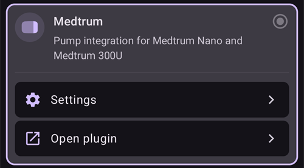

**Åbn plugin** (eller **Administrer → Pumpe**) åbner Medtrum-pumpeskærmen. Du bruger den til at skifte patch og se pumpens status. Før en patch er aktiveret, ser den sådan ud:

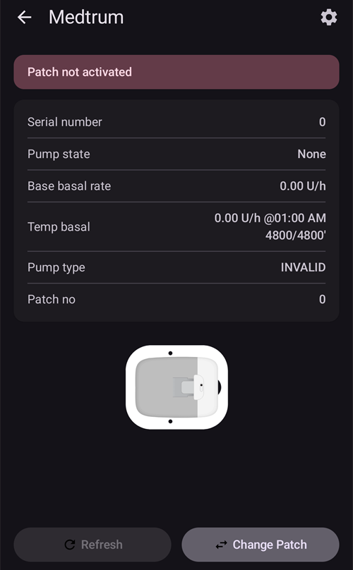

(medtrum-step-2)=
### Trin 2: Skift Medtrum-indstillinger

Tryk på **Indstillinger** på kortet **Medtrum** i **Konfiguration** > **Pumpe**. Du kan også trykke på tandhjulsikonet øverst til højre på Medtrum-pumpeskærmen. Så åbner **Medtrum pumpeindstillinger**:

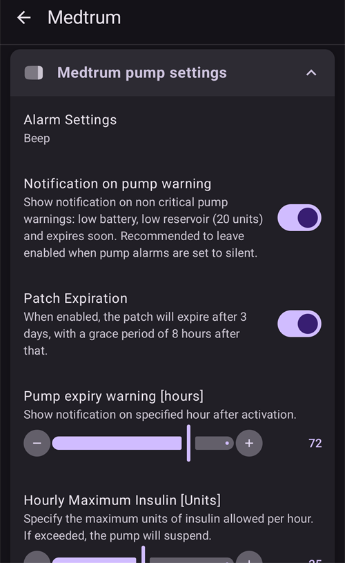

```{note}
Der er ikke længere en indstilling for **Serienummer**. **AAPS** finder din pumpebase med en Bluetooth-scanning, første gang du aktiverer en patch (se [Trin 3](#medtrum-activate-patch)), og husker dens serienummer. Se [Ophæv parring](#medtrum-unpair), hvis du vil bruge en anden pumpebase.
```

#### Alarmindstillinger

***Standard: Bip.***

Denne indstilling ændrer, hvordan pumpen advarer dig, når der er en advarsel eller en fejl.

- **Bip**: patchen bipper ved alarmer og advarsler.
- **Lydløs**: patchen advarer dig ikke ved alarmer og advarsler.

Bemærk: I lydløs tilstand afgiver **AAPS** stadig alarmen, afhængigt af telefonens lydstyrke-indstillinger. Hvis du ikke reagerer på alarmen, bipper patchen til sidst.

#### Notifikation ved pumpeadvarsel

***Standard: Aktiveret.***

Denne indstilling ændrer, hvordan **AAPS** viser notifikationer for pumpeadvarsler, som ikke er kritiske. Når den er aktiveret, vises en notifikation på telefonen, når der kommer en pumpeadvarsel, bl.a.:
- Lavt batteri
- Lavt reservoir (20 IE)
- Patchen udløber snart

Vi anbefaler at lade den være aktiveret, når pumpens alarmer er sat til **Lydløs**. I begge tilfælde vises disse advarsler også på Medtrum-pumpeskærmen under [Aktive alarmer](#medtrum-active-alarms).

(medtrum-patch-expiration)=
#### Patch Udløber

***Standard: Aktiveret.***

Denne indstilling ændrer patchens opførsel. Når den er aktiveret, udløber patchen efter 3 dage og giver en advarsel med lyd, hvis du har slået lyd til. Efter 3 dage og 8 timer holder patchen op med at virke.

Hvis denne indstilling er deaktiveret, advarer patchen dig ikke, før den stopper. Med nyere firmware i pumpebasen kører en patch højst 5 dage.

#### Advarsel om pumpeudløb [timer]

***Standard: 72 timer.***

Denne indstilling ændrer tidspunktet for advarslen om udløb. Når [Patch Udløber](#medtrum-patch-expiration) er aktiveret, viser **AAPS** en notifikation så mange timer efter aktiveringen.

#### Maks. insulin pr. time [IE]

***Standard: 25 IE.***

Denne indstilling ændrer den største mængde insulin, der kan gives på én time. Hvis denne grænse overskrides, sætter patchen sig selv på pause og giver en alarm. Du kan nulstille alarmen med knappen **Nulstil alarmer** på pumpeskærmen, se [Nulstil alarmer](#nano-reset-alarms).

Sæt den til en fornuftig værdi i forhold til dit insulinbehov.

#### Maks. insulin pr. dag [IE]

***Standard: 80 IE.***

Denne indstilling ændrer den største mængde insulin, der kan gives på én dag. Hvis denne grænse overskrides, sætter patchen sig selv på pause og giver en alarm. Du kan nulstille alarmen med knappen **Nulstil alarmer** på pumpeskærmen, se [Nulstil alarmer](#nano-reset-alarms).

Sæt den til en fornuftig værdi i forhold til dit insulinbehov.

#### Scan ved forbindelsesfejl

***Standard: Fra.***

Findes under **Avancerede indstillinger**.

Aktiver kun denne, hvis du har problemer med forbindelsen. Når den er aktiveret, scanner driveren efter pumpen igen, før den prøver at forbinde til den igen. Sørg for, at tilladelsen Placering for **AAPS** er sat til »Tillad hele tiden«.

### Trin 2b: Advarselsindstillinger i AAPS

Disse indstillinger er ikke en del af Medtrum-driveren. Du åbner dem med ikonet **Indstillinger** (tandhjul) øverst til højre på hovedskærmen. Se [Indstillinger](../SettingUpAaps/Preferences.md) for mere.

#### BT Watchdog

Åbn **Indstillinger** > **Pumpe**:


**BT Watchdog** slukker telefonens Bluetooth i et sekund, hvis **AAPS** ikke kan forbinde til pumpen. Det kan hjælpe på nogle telefoner, hvor Bluetooth fryser.

Aktiver denne indstilling, hvis du ofte har problemer med forbindelsen til din pumpe.

#### Lokale alarmer

Åbn **Indstillinger** > **Lokale alarmer**:


##### Advar, hvis pumpen er utilgængelig

***Standard: Aktiveret.***

Denne indstilling er altid slået til, når Medtrum-driveren er aktiveret. Den advarer dig, når pumpen er utilgængelig. Det kan ske, når pumpen er uden for rækkevidde, eller når den ikke svarer på grund af en defekt patch eller pumpebase, f.eks. når der trænger vand ind mellem pumpebasen og patchen.

Af sikkerhedshensyn kan denne indstilling ikke slås fra.

##### Grænse for utilgængelig pumpe

***Standard: 30 min.***

Denne indstilling ændrer, hvor længe **AAPS** venter, før den advarer dig om, at pumpen er utilgængelig.

Du kan ændre denne indstilling, når du bruger Medtrum-pumpen, men af sikkerhedshensyn anbefaler vi at beholde 30 minutter.

(medtrum-activate-patch)=
### Trin 3: Aktiver patchen

**Før du fortsætter:**
- Hav din Medtrum-pumpebase og en ny reservoir-patch klar.
- Sluk andre enheder, som kan tale med Medtrum-pumpen (PDM og Medtrum-appen).
- Det bedste er, at **AAPS** er sat op, og at en [profil er aktiveret](../DailyLifeWithAaps/ProfileSwitch-ProfilePercentage.md). Hvis ingen profil er aktiv, starter aktiveringen med trinnet **Profil påkrævet**, hvor du vælger den profil, der skal aktiveres.

#### Start aktiveringen

Åbn [Medtrum-pumpeskærmen](#nano-overview) (**Administrer → Pumpe**), og tryk på **Skift Patch**. Hvis du har sat [beskyttelse af indstillinger](#Preferences-protection) op, skal du først indtaste din adgangskode eller PIN.

Hvis en patch allerede er aktiv, bliver du bedt om at deaktivere den først, se [Deaktiver patchen](#nano-deactivate-patch).

Aktiveringen er en guide, trin for trin. Følg vejledningen på skærmen for at fylde og aktivere en ny patch. Tryk på **Annuller** i et hvilket som helst trin for at stoppe.

```{important}
Sæt først patchen på kroppen og indfør kanylen, når guiden beder dig om det (efter klargøringen er afsluttet).
```

De første trin, du ser, afhænger af din opsætning:

1. **Profil påkrævet**: kun hvis ingen profil er aktiv. Vælg den profil, der skal bruges, og fortsæt.
2. **Find pumpe**: kun første gang, eller efter du har brugt [Ophæv parring](#medtrum-unpair). Forbind pumpebasen til en ny patch for at tænde den. **AAPS** scanner efter Medtrum-pumpebaser i nærheden (deres navne starter med `MT`). Tryk på din i listen. **AAPS** gemmer dens serienummer og går direkte videre til at fylde patchen.

   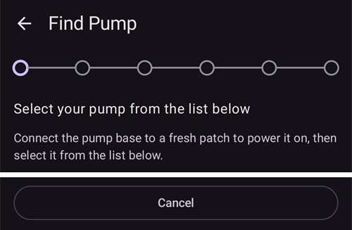

3. **Aktiver Patch**: kun når **AAPS** allerede kender din pumpebase. Skærmen viser »Ingen aktiv patch. Tryk på **Næste** for at starte aktiveringsprocessen.« Sørg for, at pumpebasen **ikke** er forbundet til patchen endnu, og tryk så på **Næste**.

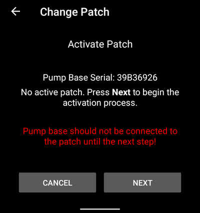

#### Forbind og fyld patchen

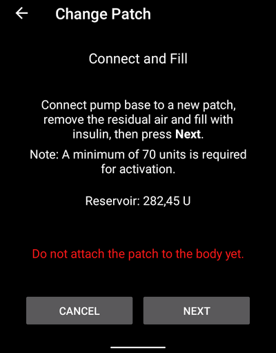

Forbind pumpebasen til patchen, fjern den resterende luft, og fyld patchen med insulin. Der skal mindst 70 IE til aktiveringen. Skærmen viser niveauet i reservoiret. Sæt ikke patchen på kroppen endnu.

Når patchen er fundet og fyldt, vises knappen **Næste**. Tryk på den.

#### Vælg insulin

Dette trin vises kun, hvis du har sat mere end én insulin op i **AAPS**. Vælg den insulin, du fylder patchen med. **AAPS** laver et profilskift med denne insulin efter aktiveringen.

#### Klargør patchen

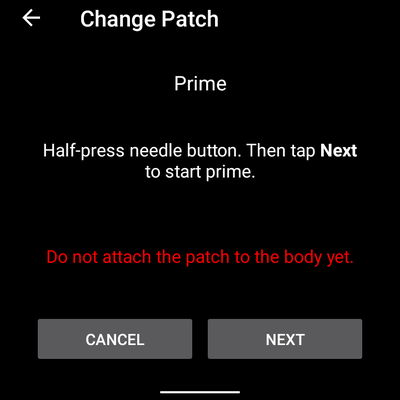

Fjern **ikke** sikkerhedslåsen. Tryk nåleknappen på patchen halvt ned, og tryk så på **Næste** for at starte klargøringen.

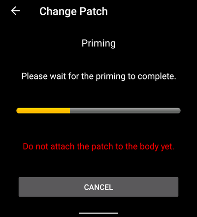

Vent, til klargøringen er afsluttet.

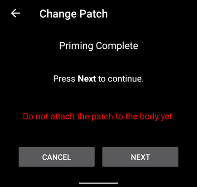

Når klargøringen er afsluttet, så tryk på **Næste** for at fortsætte.

#### Rotation af indstikssteder

Dette trin vises kun, hvis du styrer indstikssteder for pumpen med [Rotation af indstikssteder](#Aapsscreens-site-rotation) (indstillingen **Administrer rotation af indstikssted for pumpe**). Vælg, hvor på kroppen du sætter patchen, eller spring dette trin over.

#### Vedhæft Patch

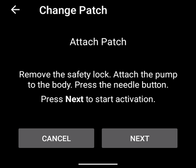

Rens huden, og fjern klistermærkerne. Fjern sikkerhedslåsen, sæt patchen på kroppen, og tryk på nåleknappen for at indføre kanylen.

Tryk på **Næste** for at aktivere patchen.

#### Aktiver Patch

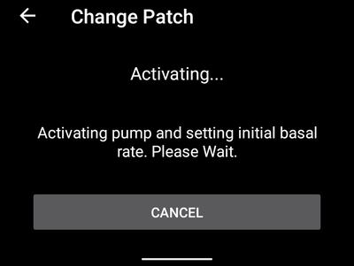

**AAPS** aktiverer pumpen og sætter den første basalrate. Vent venligst. Når aktiveringen er afsluttet, vises denne skærm:

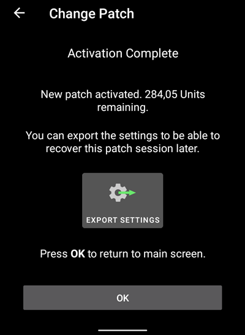

```{admonition} Older screenshot
:class: note
Bortset fra **Find pumpe** er skærmbillederne af aktiveringen ovenfor fra en ældre version af **AAPS** og kan se anderledes ud i **AAPS** 4.
```

Den viser, hvor mange enheder der er tilbage i patchen. Tryk på **OK** for at gå tilbage til pumpeskærmen.

```{tip}
Efter en ny aktivering skal du [eksportere dine indstillinger](../Maintenance/ExportImportSettings.md). Så kan du senere gendanne denne patch-session, f.eks. på en ny telefon.
```

(nano-deactivate-patch)=

### Deaktiver patchen

For at deaktivere den aktive patch skal du åbne [Medtrum-pumpeskærmen](#nano-overview) (**Administrer → Pumpe**) og trykke på **Skift Patch**.


Du bliver bedt om at bekræfte, at du vil deaktivere den nuværende patch. **Dette kan ikke fortrydes.** Tryk på **Næste** for at deaktivere, eller på **Annuller** for at gå tilbage til pumpeskærmen.

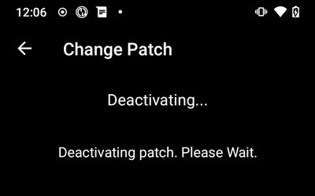

Hvis **AAPS** ikke kan deaktivere patchen (f.eks. fordi pumpebasen allerede er taget af patchen), så tryk på **Kassér** for at glemme den nuværende patch-session. Derefter kan du aktivere en ny patch.

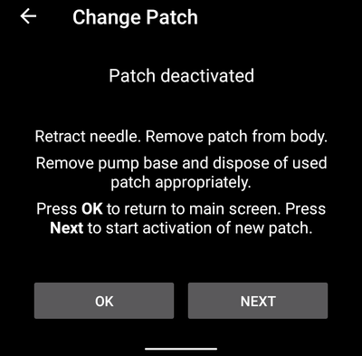

Når deaktiveringen er afsluttet, så træk nålen tilbage, og tag patchen af kroppen. Tag pumpebasen af, og smid den brugte patch ud. Tryk på **OK** for at gå tilbage til pumpeskærmen, eller på **Næste** for at begynde at aktivere en ny patch.

(nano-resume-interrupted-activation)=

### Genoptag afbrudt aktivering

Hvis aktiveringen af en patch bliver afbrudt, f.eks. fordi telefonens batteri løber tør, kan du genoptage den. Åbn [Medtrum-pumpeskærmen](#nano-overview) (**Administrer → Pumpe**), og tryk på **Skift Patch**.

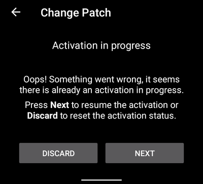

Tryk på **Næste** for at genoptage aktiveringen. Tryk på **Kassér** for at nulstille aktiveringsstatus, så du kan aktivere en ny patch.

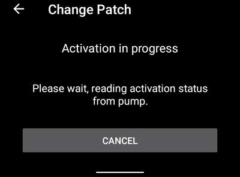

```{admonition} Older screenshot
:class: note
Skærmbillederne i **Deaktiver patchen** og **Genoptag afbrudt aktivering** er fra en ældre version af **AAPS** og kan se anderledes ud i **AAPS** 4.
```

Driveren læser aktiveringsstatus fra pumpen. Hvis det lykkes, fortsætter guiden ved det trin, hvor den stoppede.

(nano-overview)=

## Pumpeskærm

Medtrum-pumpeskærmen (**Administrer → Pumpe**) viser den aktuelle status for Medtrum-patchen. Den har også knapper til at skifte patch, nulstille alarmer og opdatere status. Et banner øverst viser vigtige tilstande, f.eks. **Patch ikke aktiveret** eller **Pumpe er pauseret**.

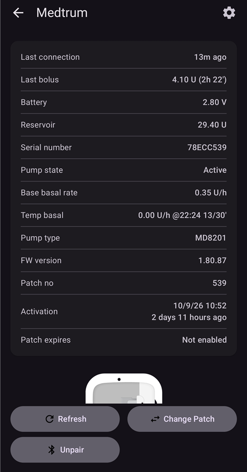

Skærmen kan vise disse rækker. Nogle rækker vises kun, når de har en værdi.

- **Seneste forbindelse**: hvor lang tid siden **AAPS** sidst forbandt til pumpen.
- **Seneste bolus**: den sidste bolus, der blev givet.
- **Batteri**: patchens aktuelle batterispænding.
- **Reservoir**: det aktuelle niveau i reservoiret.
- **Serienummer**: serienummeret på din pumpebase.
- **Pumpetilstand**: pumpens aktuelle tilstand. F.eks. **Aktiv** (patchen er aktiveret og kører normalt) eller **Stoppet** (patchen er ikke aktiveret).
- **Standardbasalrate**: den basalrate fra din profil, der kører nu.
- **Midlertidig basal**: den midlertidige basalrate, hvis der kører en.
- **Aktiv bolus**: den bolus, der bliver givet lige nu.
- **Aktive alarmer**: se [nedenfor](#medtrum-active-alarms).
- **Pumpetype**: modellen af din pumpebase.
- **Firmwareversion**: pumpebasens firmwareversion.
- **Patch nr.**: løbenummeret på den aktiverede patch. Det stiger med én, hver gang du aktiverer en ny patch.
- **Aktivering**: dato og klokkeslæt, hvor patchen blev aktiveret, og hvor lang tid siden det var.
- **Patch udløber**: dato og klokkeslæt, hvor patchen udløber. Viser **Ikke aktiveret**, hvis [Patch Udløber](#medtrum-patch-expiration) er slået fra.

(medtrum-active-alarms)=
### Aktive alarmer

Denne række viser alle alarmer, der er aktive lige nu, f.eks. lavt reservoir eller en patch, der snart udløber.

### Opdater

Denne knap opdaterer patchens status. Den kan kun bruges, når en patch er aktiv, og **AAPS** ikke er forbundet til pumpen i det øjeblik.

### Skift Patch

Denne knap starter guiden til at skifte patch. Se [Aktiver patchen](#medtrum-activate-patch) for mere information.

(medtrum-unpair)=
### Ophæv parring

Denne knap vises kun, når **AAPS** kender en pumpebase. Den sletter det gemte serienummer for pumpebasen og afbryder forbindelsen. Næste gang du aktiverer en patch, scanner **AAPS** efter en pumpebase igen (trinnet **Find pumpe**). Brug dette, hvis du skifter til en anden pumpebase. Gør det kun, når ingen patch er aktiv.

(nano-reset-alarms)=

### Nulstil alarmer

Knappen **Nulstil alarmer** vises kun på pumpeskærmen, når patchen har sat sig selv på pause, f.eks. efter en alarm om maks. insulin pr. dag. Tryk på den for at nulstille alarmerne og genoptage insulintilførslen.

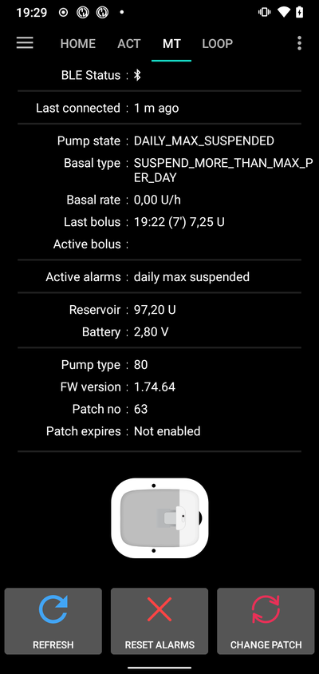

```{admonition} Older screenshot
:class: note
Skærmbilledet ovenfor er fra en tidligere **AAPS**-version. I **AAPS** 4 ser pumpeskærmen anderledes ud, men knappen **Nulstil alarmer** virker på samme måde.
```

## Skift af telefon, eksport/import af indstillinger

Når du skifter til en ny telefon, så gør sådan:
* [Eksporter indstillinger](../Maintenance/ExportImportSettings.md) på din gamle telefon.
* Overfør filen med indstillinger fra den gamle telefon til den nye telefon, og importer den i **AAPS**. Sæt flueben ved **Erstat også pumpeindstillinger** på importskærmen, ellers bliver patch-sessionen ikke overført til den nye telefon.

Den importerede fil med indstillinger skal være fra den patch-session, du bruger nu, ellers forbinder patchen ikke (se [Slangeløse pumper](#ExportImportSettings-tubeless-pumps)).

Efter import af indstillinger synkroniserer driveren historikken med pumpen. Det kan tage et stykke tid, afhængigt af hvor gammel filen med indstillinger er. Fremskridtet (»Synkroniserer poster, ... tilbage«) vises på hovedskærmen:

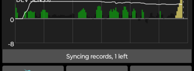

(medtrum-nano-troubleshooting)=

## Fejlfinding

### Problemer med forbindelsen

Hvis forbindelsen får timeout, eller du har andre problemer med forbindelsen:
- I Android-appindstillingerne for **AAPS** skal du sætte tilladelsen Placering til »Tillad hele tiden«.
- Prøv at aktivere **Scan ved forbindelsesfejl** (Medtrum-indstillinger > **Avancerede indstillinger**) og **BT Watchdog** (**Indstillinger** > **Pumpe**), se [Trin 2](#medtrum-step-2).

### Problemer med Bluetooth
Kendte problemer med Bluetooth-forbindelser, afbrydelser af pumper/pods eller problemer med aktivering og forbindelse: se [Problemer med Bluetooth](../GettingHelp/BluetoothTroubleshooting.md)

### Aktivering afbrudt

Hvis aktiveringen bliver afbrudt, f.eks. fordi telefonens batteri er tomt, eller telefonen går ned, kan du genoptage den. Tryk på **Skift Patch** på pumpeskærmen, og følg trinnene i [Genoptag afbrudt aktivering](#nano-resume-interrupted-activation).

### Undgå fejl på patchen

Patchen kan give mange forskellige fejl. Sådan undgår du hyppige fejl:
- Sørg for, at pumpebasen sidder rigtigt i patchen, og at der ikke er synlige mellemrum.
- Brug ikke for meget kraft på stemplet, når du fylder patchen. Prøv ikke at fylde patchen mere end det maksimum, der gælder for din model.

## Hvor kan du få hjælp

Alt udviklingsarbejde på Medtrum-driveren laves af fællesskabet som **frivilligt** arbejde. Husk det, og følg disse retningslinjer, før du beder om hjælp:

-  **Niveau 0:** Læs det relevante afsnit i denne dokumentation, så du forstår, hvordan den funktion, du har problemer med, skal virke.
-  **Niveau 1:** Hvis du stadig har problemer, som du ikke kan løse med denne side, så gå til kanalen *#Medtrum* på **Discord** med [dette invitationslink](https://discord.gg/4fQUWHZ4Mw).
-  **Niveau 2:** Søg i de eksisterende issues for at se, om dit problem allerede er rapporteret under [Issues](https://github.com/nightscout/AAPS/issues). Hvis det findes, så bekræft/kommenter/tilføj information om dit problem. Hvis ikke, så opret et [nyt issue](https://github.com/nightscout/AndroidAPS/issues) og vedhæft [dine logfiler](../GettingHelp/AccessingLogFiles.md).
-  **Vær tålmodig. De fleste i vores fællesskab er venlige frivillige, og det kræver ofte tid og tålmodighed fra både brugere og udviklere at løse problemer.**