# Omnipod DASH

Denne vejledning er til opsætning af pumpen **Omnipod DASH** **(IKKE Omnipod Eros)**. DASH-driveren er en velafprøvet måde at loope med Omnipod på.

```{contents} Table of contents
:depth: 1
:local: true
```

## Specifikationer for Omnipod DASH

Vigtige egenskaber ved **Omnipod DASH** (»DASH«):

- DASH-pods kendes på en **blå nålehætte** (den ældre EROS-pod har en gennemsigtig nålehætte). Ellers har pods præcis de samme fysiske mål.
- DASH kræver ikke en BLE-bro (der er IKKE brug for RileyLink, OrangeLink eller EmaLink).
- DASH bruger kun Bluetooth-forbindelsen, når der sendes en kommando (f.eks. en bolus), og afbryder lige efter kommandoen.
- **AAPS** venter, til poden kan nås, før den sender kommandoer.
- Ved aktivering af en pod finder **AAPS** en ny DASH-pod og forbinder til den.
- Forventet rækkevidde fra telefonen: 5-10 meter (kan variere).

(omnipod-dash-constraints)=

## Kendte begrænsninger og problemer med Omnipod DASH i AAPS
- Det generelle råd er at køre **AAPS** på Android 14 eller 16. Fællesskabet har rapporteret mange [problemer](https://github.com/nightscout/AndroidAPS/issues/3471) med Android 15. Hvis du alligevel bruger Android 15, skal du sandsynligvis slå **Bluetooth-bonding** til (i afsnittet **Avancerede indstillinger** i [Dash-indstillingerne](#omnipod-dash-advanced-settings)) for at kunne aktivere og bruge pods. Se [Fejlfinding](../GettingHelp/GeneralTroubleshooting.md) for mere om indstillingerne for bonding.
- Skift til sommertid/vintertid og skift af tidszone bliver ikke anvendt automatisk. Efter et skift af tiden skal du opdatere poden manuelt: tryk på **Opdater** på DASH-pumpeskærmen, og tryk derefter på **Sæt tid** (vises, når poden og telefonen har forskellige tidszoner), eller lav et **profilskift** (se [Skift af tidszone med Omnipod Dash](#timezone-traveling-with-pumps)).
- Dash understøtter kun basalrater i trin på 0,05 E/t. Hvis du prøver at sætte basal med trin på 0,01 i din **AAPS-profil**, giver AAPS ingen advarsel, selvom poden runder raten op til trin på 0,05. Hvis du åbner **Pod-historik** på DASH-pumpeskærmen, viser den, at der blev sat en basal på 0,05. Det betyder også, at den laveste basalrate, som DASH tillader i **AAPS**, er 0,05 E/t.
- Indstillingsfilen indeholder den aktive pod-session. Eksporter dine indstillinger efter hver aktivering af en pod, og læs [Eksport og import af indstillinger](#omnipod-dash-export-import), før du importerer indstillinger.
- Når en ny basalprofil sættes, suspenderer DASH tilførslen, før den nye basal-**profil** sættes. If there is a communication interruption or error, delivery can stay suspended until **AAPS** sets the basal profile again (every 15 minutes) or you resume it manually. Se afsnittet [Genoptagelse af insulintilførsel](#omnipod-dash-resuming-insulin-delivery) for detaljer.
- Hvis alarmer er sat op, og poden snart udløber, bliver poden ved med at bippe, indtil alarmerne er gjort lydløse. Se [Gør pod-alarmer lydløse](#omnipod-dash-silencing-pod-alerts) for detaljer.
- Der er en række kendte problemer med Bluetooth, som kan give problemer med at aktivere poden. Se [Problemer med Bluetooth](../GettingHelp/BluetoothTroubleshooting.md) for det kendte problem og løsninger på disse problemer.

(hardware-software-requirements)=

(omnipod-dash-hardware-software-requirements)=
## Krav til hardware og software

- Omnipod DASH kendes på den blå nålehætte.

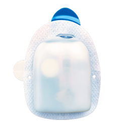

- **En kompatibel Android-telefon** med Bluetooth Low Energy (BLE) (se [Telefoner](../Getting-Started/Phones.md) for mere information). Derudover hjælper følgende oplysninger dig med andre vigtige ting at overveje, for at du kan aktivere og bruge DASH på en kompatibel telefon:
    -  **AAPS**-driveren til Omnipod Dash forbinder til DASH-poden med Bluetooth.  
      **AAPS** opretter automatisk en ny Bluetooth-forbindelse til poden, hver gang den skal sende en kommando (f.eks. en bolus). Når kommandoen er sendt, afbrydes Bluetooth-forbindelsen med det samme.
       - **BEMÆRK:**
         - Bluetooth-forbindelsen kan blive afbrudt eller forstyrret af andre Bluetooth-enheder, der er forbundet til telefonen med **AAPS**, f.eks. høretelefoner (earbuds) osv. Den slags enheder kan give forbindelsesfejl eller problemer med at aktivere poden på nogle telefonmodeller. Det er en god idé at se listen over [testede hardware-opsætninger](https://docs.google.com/spreadsheets/u/1/d/e/2PACX-1vScCNaIguEZVTVFAgpv1kXHdsHl3fs6xT6RB2Z1CeVJ561AvvqGwxMhlmSHk4J056gMCAQE02sAWJvT/pubhtml?gid=683363241&single=true) med kendte fungerende konfigurationer, når du vælger telefon til en Omnipod DASH-opsætning.
         - Der er en række kendte problemer med Bluetooth, som kan give problemer med at aktivere poden (se [Fejlfinding](#omnipod-dash-troubleshooting) for råd om andre problemer med Bluetooth), især afsnittet [Bluetooth-relaterede problemer](#omnipod-dash-bluetooth-related-issues).
    - Telefonen skal køre **Android 12 eller nyere**, og **AAPS** skal være bygget og installeret efter vejledningen [**Byg AAPS**](../SettingUpAaps/BuildingAaps.md). Brug altid den nyeste udgivne version.
- En understøttet [**kontinuerlig glukosemåler (CGM)**](../Getting-Started/CompatiblesCgms.md)

Vejledningen nedenfor forklarer, hvordan du aktiverer en ny pod-session med **AAPS**. Du bør vente, til din nuværende pod snart udløber, fordi du skal aktivere en ny pod med **AAPS**. Når en pod er deaktiveret, kan den ikke bruges eller aktiveres igen. Deaktiveringen er endelig.

## Før du starter

Sørg for, at du har læst og forstået hele denne vejledning, afsnittet **Før du begynder** og **[Begrænsninger og problemer med Omnipod og AAPS](#omnipod-dash-constraints)**, så du undgår et kendt problem.

### **SIKKERHED FØRST** - Du **MÅ IKKE** forbinde **AAPS** til en pod første gang uden at have adgang til alt det følgende:
1. Ekstra pods (3 eller flere i reserve)
2. Ekstra insulin og udstyr til pen-behandling (MDI)
3. En fungerende Omnipod PDM (hvis **AAPS** svigter)
4. En understøttet telefon er et krav! (Se [Krav til hardware og software](#hardware-software-requirements))
5. Den rigtige version af AAPS bygget og installeret

### Din Omnipod Dash PDM bliver overflødig, når AAPS-driveren til Dash aktiverer din pod.
- Før du bruger **AAPS**, har du eller din omsorgsperson styret poden med Omnipod PDM (eller i nogle lande en telefonapp) for at sende kommandoer til din DASH (f.eks. en bolus).
- DASH kan kun have forbindelse til én Bluetooth-enhed (f.eks. PDM eller telefon), som styrer den og sender kommandoer.
- Den enhed, der aktiverer poden, er fra da af den eneste enhed, der må kommunikere med poden. Det betyder, at når du aktiverer en DASH med din Android-telefon og **AAPS**, **kan du ikke længere bruge din PDM med den pod!** Så længe poden er aktiv, er **AAPS**-driveren til Dash på din Android-telefon den nye PDM for din pod.
- **SMID IKKE din PDM ud!** Det anbefales at gemme den som reserve og til nødsituationer, f.eks. hvis du mister din telefon, eller hvis **AAPS** ikke virker korrekt.

### Din pod stopper **IKKE** med at tilføre insulin, når den ikke er forbundet til AAPS.
Standard-basalraterne programmeres i poden ved aktivering, som de er sat i den nuværende aktive [**profil**](../SettingUpAaps/YourAapsProfile.md).  
Så længe **AAPS** kører, sender den kommandoer til at justere basalraten, som højst varer 120 minutter.  
Hvis poden af en eller anden grund ikke modtager nye kommandoer (f.eks. fordi kommunikationen blev afbrudt på grund af afstanden mellem pod ➜ telefon), går poden automatisk tilbage til standard-basalraterne fra din [**profil**](../SettingUpAaps/YourAapsProfile.md).

### AAPS-profiler understøtter ikke basalrate-perioder på 30 minutter
Hvis du er ny i **AAPS** og sætter din basalrate-[**profil**](../SettingUpAaps/YourAapsProfile.md) op for første gang, så vær opmærksom på, at basalrater, der starter på en halv time, ikke understøttes. På din Omnipod PDM kan du f.eks. have en basalrate på 1,1 enheder, der starter kl. 09:30 og varer 2 timer til kl. 11:30. Det er ikke muligt at lave præcis den samme basal-**profil** i **AAPS**.  
Du skal ændre denne basalrate på 1,1 enheder til et tidsrum på enten 9:00-11:00 eller 10:00-12:00. Selvom DASH-hardwaren understøtter **profil**-intervaller på 30 minutter for basalraten, understøtter **AAPS** IKKE denne funktion.

### Basalrater på 0 E/t i profilen understøttes IKKE i AAPS
DASH understøtter en basalrate på nul, men **AAPS** bruger multipla af brugerens basalrate fra **profilen** til at bestemme den automatiske behandling. Derfor kan den ikke fungere med en basalrate på nul.  
En midlertidig basalrate på nul kan i stedet opnås med funktionen »Afbryd pumpe« eller med en kombination af Deaktiver loop/midlertidig basalrate eller Suspender loop/midlertidig basalrate.  
**BEMÆRK:** Den laveste basalrate, som DASH tillader i **AAPS**, er 0,05 E/t.

## Valg af Dash i AAPS

Der er **to** måder at vælge Omnipod DASH-driveren i **AAPS**:

### Mulighed 1: Nye installationer

Når du installerer **AAPS** første gang, fører **Opsætningsguiden** dig gennem de vigtigste funktioner og krav ved installation af **AAPS**. Når du kommer til trinnet **Pumpe**, så vælg **Omnipod Dash**.


Hvis du ikke er sikker endnu, kan du vælge **Virtuel pumpe** nu og vælge **Omnipod Dash** senere, når **AAPS** er sat op (se mulighed 2).

(omnipod-dash-option-2-config-builder)=
### Mulighed 2: Skærmen Konfiguration

På en eksisterende installation kan du vælge pumpen **Omnipod Dash** på skærmen **Konfiguration**:

1. Åbn **menuen** (☰) i øverste venstre hjørne af hovedskærmen, og vælg **Konfiguration**.
2. Tryk på **Pumpe**, og vælg radioknappen for **Omnipod Dash** (*»Pumpeintegration til Omnipod Dash (Den bluetooth-aktiverede model med blå nålehætte).«*).

3. Når den er valgt, viser kortet **Omnipod Dash** to knapper:
   - **Indstillinger** åbner [Dash-indstillingerne](#omnipod-dash-settings).
   - **Åbn plugin** åbner [DASH-pumpeskærmen](#omnipod-dash-tab).

   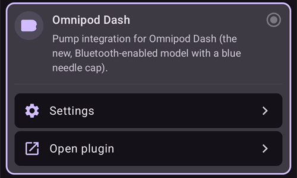

### Kontrol af valget af Omnipod-driver

For at kontrollere, at **Omnipod Dash** er valgt, åbner du **Administrer** (navigationen nederst på hovedskærmen) og trykker på **Pumpe**. DASH-pumpeskærmen åbner, som vist i næste afsnit.

(omnipod-dash-tab)=

## DASH-pumpeskærmen

På DASH-pumpeskærmen styrer du dine pods: du aktiverer og deaktiverer dem, opdaterer pod-status, gør alarmer lydløse og ser pod-historikken. Åbn den med **Administrer** > **Pumpe** eller med **Åbn plugin** på kortet **Omnipod Dash** under **Konfiguration** > **Pumpe**.

Sådan ser skærmen ud uden en aktiv pod:


Og sådan ser skærmen ud med en aktiv pod:

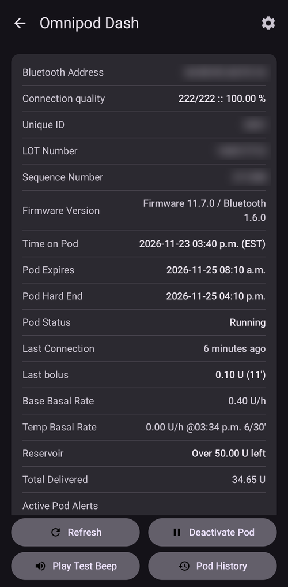

Ikonet **Indstillinger** (tandhjul) i øverste højre hjørne åbner [Dash-indstillingerne](#omnipod-dash-settings).

***BEMÆRK:** Hvis et felt på pumpeskærmen viser (usikker), så tryk på **Opdater** for at opdatere pod-status.*

### Felter

- **Bluetooth adresse:** Podens Bluetooth-adresse.

- **Forbindelseskvalitet:** Hvor pålideligt **AAPS** forbinder til poden, vist som *vellykkede forbindelser / alle forsøg på forbindelse :: succesrate*, f.eks. `412/420 :: 98.10 %`. Efter mere end 50 vellykkede forbindelser bliver værdien gul under 90% og rød under 70%. En lav værdi tyder på et problem med Bluetooth (se [Bluetooth-relaterede problemer](#omnipod-dash-bluetooth-related-issues)).

- **Afgivelsesstatus:** Den rå status for tilførslen, som poden rapporterer. Dette felt vises kun i builds med engineering mode.

- **Unikt ID:** Det unikke ID, som **AAPS** gav poden ved aktiveringen.

- **LOT nummer:** Podens produktionslotnummer.

- **Sekvensnummer:** Podens sekvensnummer.

- **Firmwareversion:** Podens firmware- og Bluetooth-versioner.

- **Tid på Pod:** Den aktuelle tid på poden med dens tidszone. Teksten bliver rød, når podens tidszone er en anden end telefonens tidszone, og gul, når podens tid afviger mere end 10 minutter.

- **Pod udløber:** Dato og tidspunkt, hvor poden udløber (72 timer efter aktivering). Teksten bliver gul i de sidste 4 timer før dette tidspunkt. Den bliver aldrig rød, fordi poden fortsætter med at tilføre insulin efter dette tidspunkt.

- **Pod stopper endeligt:** Slutningen af podens ekstra tid (8 timer efter **Pod udløber**, så en pod højst kan bruges i 80 timer). Teksten bliver gul, når den ekstra tid starter (ved **Pod udløber**), og rød i de sidste 4 timer før det endelige stop. I den ekstra tid viser feltet også den resterende tid, f.eks. *(17m tilbage)*. Poden stopper med at tilføre insulin ved det endelige stop og skal skiftes.

  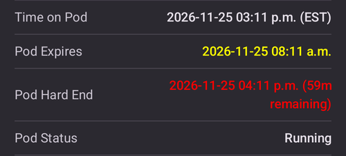

- **Pod-status:** Podens tilstand: **Ingen aktiv pod**, **Opsætning i gang**, **Kører**, **Sat på pause** eller, efter en pod-fejl, **ALARM**.

- **Seneste forbindelse:** Hvor lang tid siden **AAPS** sidst kommunikerede med poden.

  - *Øjeblikke siden* - for mindre end 10 sekunder siden.

  - *Mindre end et minut siden* - for mellem 10 og 60 sekunder siden.

  - *XX minutter siden* - for mere end 1 minut siden (og *X timer og XX minutter siden* efter en time).

- **Seneste bolus:** Mængden af den seneste bolus, der blev sendt til poden, og hvor lang tid siden den blev givet. En ubekræftet bolus er markeret med (usikker).

- **Standardbasalrate:** Den basalrate, der er programmeret for det aktuelle tidspunkt i din basal-**profil**.

- **Midlertidig basal rate:** Den midlertidige basalrate (TBR), der kører nu, med starttidspunkt og varighed. Dette felt vises kun, mens en TBR kører.

- **Reservoir:** Viser *Over 50 IE tilbage*, når der er mere end 50 enheder tilbage i reservoiret. Under 50 enheder vises den præcise mængde. Værdien bliver rød under 20 enheder.

- **Total afgivet:** Den samlede mængde insulin, der er tilført fra reservoiret. Det omfatter den insulin, der blev brugt til klargøring (priming).

- **Aktive pod alarmer:** Alarmer, der er aktive på poden lige nu, f.eks. *Pod udløber snart* eller *Lavt reservoir*.

- **Fejl:** Pod-fejlen, hvis poden har svigtet, vist med rødt som *Pod fejl:* efterfulgt af fejlkode og navn, f.eks. *Pod fejl: 020 ALARM_OCCLUDED*. Se [Pod-historik](#omnipod-dash-view-pod-history) og logfilerne for tidligere fejl og mere detaljerede oplysninger. Se [Pod-fejl](#omnipod-dash-pod-failures).

- **PDM-notifikation:** Vises kun efter en pod-fejl. Den viser fejlen, sådan som Omnipod PDM ville have vist den: en titel (f.eks. *Okklusion registreret*, *Tomt reservoir* eller *Pod udløbet*), hvad der skete (f.eks. *Insulintilførsel stoppet. Skift Pod nu.*) og en *Ref:*-kode.

### Knapper

Knapperne nederst på pumpeskærmen skifter efter podens tilstand. Kun de knapper, der giver mening i øjeblikket, vises.

- **Opdater:** Spørger poden om dens aktuelle status.
  - *Brug den til at opdatere pod-status og til at rydde felter, der viser (usikker).*
  - *Se afsnittet [Fejlfinding](#omnipod-dash-troubleshooting) nedenfor for mere information.*

- **Gør alarmer lydløse:** Stopper podens alarmbip (f.eks. når poden udløber eller reservoiret er lavt). Vises kun, mens poden har en aktiv alarm. Se [Gør pod-alarmer lydløse](#omnipod-dash-silencing-pod-alerts).

- **Genoptag insulinafgivelse:** Genoptager insulintilførslen på en suspenderet pod. Vises kun, når tilførslen er suspenderet. Se [Genoptagelse af insulintilførsel](#omnipod-dash-resuming-insulin-delivery).
  - *There is no **Suspend** button. To stop insulin delivery for a while, use **Disconnect pump** from the [loop icon](#AapsScreens-loop-status) on the main screen: see [Disconnecting the pump](#pumps-cannulas-disconnecting).*

- **Sæt tid:** Opdaterer poden til din telefons tidszone ved at sende din basal-**profil** igen. Vises kun, når podens tidszone er en anden end telefonens tidszone.

- [**Aktiver Pod**](#omnipod-dash-activate-pod): Klargør og aktiverer en ny pod. Vises, når ingen pod er aktiv.

- [**Deaktiver Pod**](#omnipod-dash-deactivate-pod): Deaktiverer den aktive pod. Vises, så snart en pod er parret med **AAPS**, også når en aktivering stoppede halvvejs (f.eks. fordi poden svigtede under aktiveringen). **AAPS** beder dig bekræfte, før den deaktiverer poden.

- **Afspil test bip:** Får poden til at afspille et enkelt testbip.

- [**Pod-historik**](#omnipod-dash-view-pod-history): Viser aktivitetshistorikken for den aktive pod.

- **Kassér Pod:** Fjerner en ufærdig pod fra **AAPS**. Vises kun, når en aktivering af en pod stoppede halvvejs. **AAPS** beder dig bekræfte. Når poden er kasseret, kan **AAPS** ikke længere kommunikere med den: fjern den fra din krop.

(omnipod-dash-activate-pod)=

## Aktiver Pod

1. Åbn DASH-pumpeskærmen (**Administrer** > **Pumpe**), og tryk på **Aktiver Pod**. Guiden til aktivering åbner.

   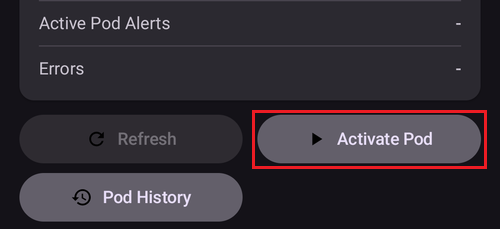

   Hvis du aldrig før har aktiveret en **profil** i **AAPS**, viser guiden først trinnet **Profil påkrævet**: vælg den profil, der skal bruges ved aktiveringen, og fortsæt.

2. Trinnet **Fyld Pod** vises. Fyld en ny pod med nok insulin til 3 dage, **mindst 80 enheder**. Lyt efter to bip fra poden: de betyder, at minimumsmængden på 80 enheder er fyldt i. Tøm påfyldningssprøjten helt, også efter du har hørt de to bip. Fjern ikke podens nålehætte endnu.

   ***BEMÆRK:** Når du beregner, hvor meget insulin du skal bruge til 3 dage, så husk, at klargøring (priming) af poden bruger ca. 3-10 enheder.*

   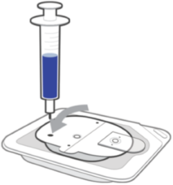

   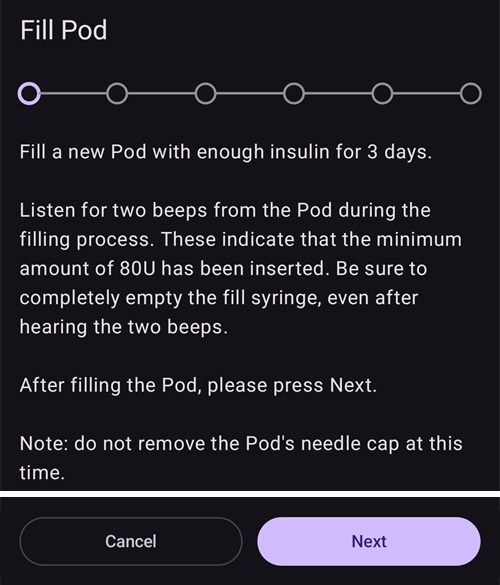

   Sørg for, at den nye pod og telefonen med **AAPS** er tæt på hinanden, og tryk på **Næste**.

3. Hvis du bruger mere end én insulin i **AAPS**, vises trinnet **Vælg insulin**. Det viser den insulin, der er **Aktiv nu**. Hvis du har fyldt poden med en anden insulin, så tryk på **Skift**, og vælg den. **AAPS** laver et **profilskift** med denne insulin, når aktiveringen er færdig. Tryk på **Næste**.

   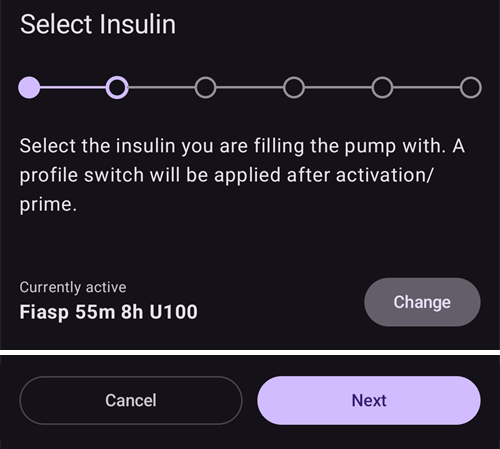

4. I trinnet **Initialiser Pod** parrer **AAPS** med den nye pod og klargør den. Du hører et klik og derefter en række tikkende lyde, mens poden klargør sig selv. Når det er færdigt og lykkedes, vises knappen **Næste**. Tryk på **Næste**.

   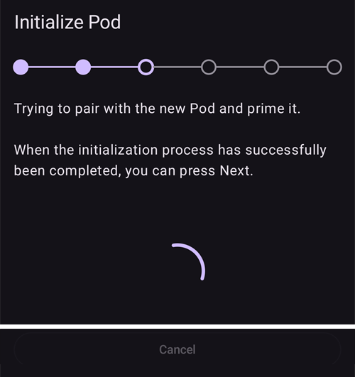    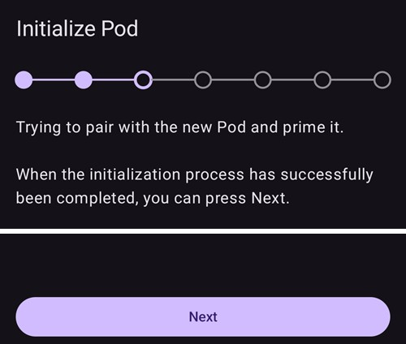

   ***BEMÆRK**: Hvis en fejlmeddelelse som _Scanning mislykkedes_ eller _'Could not find an available pod for activation'_ vises (det kan ske), så gå ikke i panik. Tryk på **Prøv igen**. I de fleste tilfælde fortsætter aktiveringen derefter uden problemer.*

   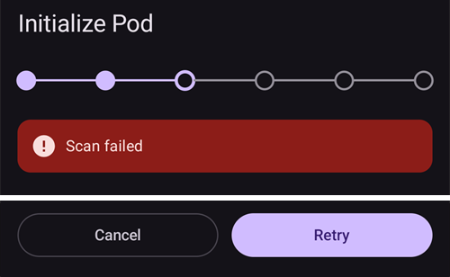

   Hvis poden har svigtet (f.eks. fordi dens aktiveringstid er overskredet), vises **Deaktiver Pod** i stedet for **Prøv igen**. Brug den, og start forfra med en ny pod.

   Hvis du trykker på **Annuller**, før aktiveringen er færdig, beder **AAPS** dig bekræfte, at du vil afslutte. Tryk på **OK** for at forlade guiden eller på **Annuller** for at blive.

   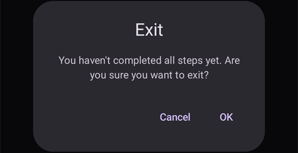

5. Hvis du styrer rotation af indstikssted for pumpen i **AAPS** (**Administrer rotation af indstikssted for pumpe** i indstillingerne for [Rotation af indstikssteder](#Aapsscreens-site-rotation)), vises trinnet **Indstikssted**. Vælg på kropstegningen, hvor du vil sætte poden, og tryk på **Næste**, eller tryk på **Spring over**.

   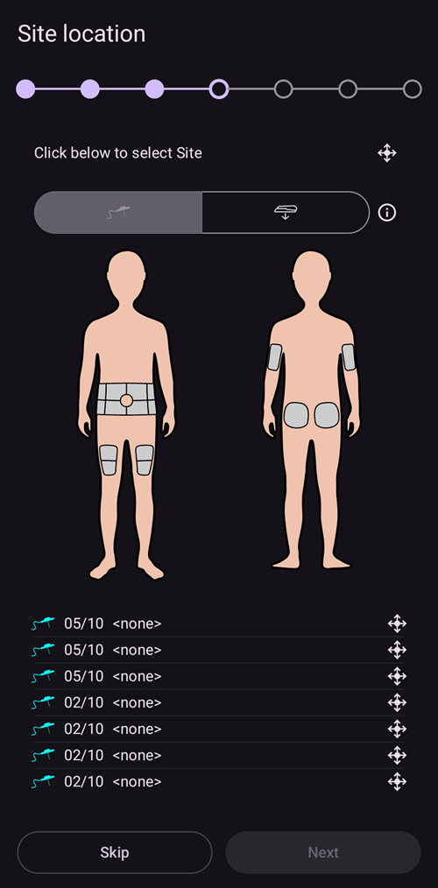

6. Forbered derefter indstiksstedet til den nye pod. Vask dine hænder for at undgå risiko for infektion. Rens indstiksstedet med sæbe og vand eller en spritserviet, og lad huden lufttørre helt, før du fortsætter. Hvis plasteret irriterer din hud, kan du overveje at bruge en beskyttende serviet eller spray (barrier wipe/spray).

   I trinnet **Påsæt Pod** fjerner du podens blå nålehætte af plastik. Hvis kanylen eller noget andet stikker ud af poden, eller hvis den ser usædvanlig ud, så **STOP**: tryk på **Annuller**, og start forfra med en ny pod. Hvis alt ser **OK** ud, så tag det hvide papir af plasteret, og sæt poden på det valgte sted på kroppen.

   Når du er færdig, så tryk på **Næste**.

   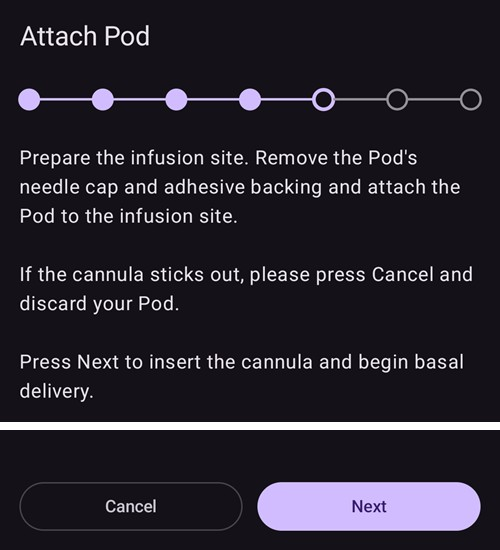

7. En dialog til bekræftelse vises: *Når du trykker på OK, vil kanylen blive indsat.* **Tryk KUN på OK, hvis du er klar til at indsætte kanylen!**

   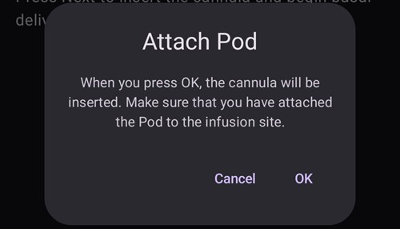

8. I trinnet **Indfør kanyle** sætter **AAPS** dit basalprogram, og poden indsætter kanylen. Det kan tage lidt tid (højst 1-2 minutter). **Vær tålmodig!**

   ***BEMÆRK:** Det er god praksis at klemme huden sammen nær stedet for kanylen, før kanylen bliver indsat. Det hjælper nålen med at gå glat ind og mindsker risikoen for okklusioner (blokeringer).*

   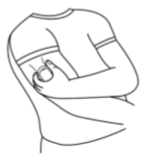    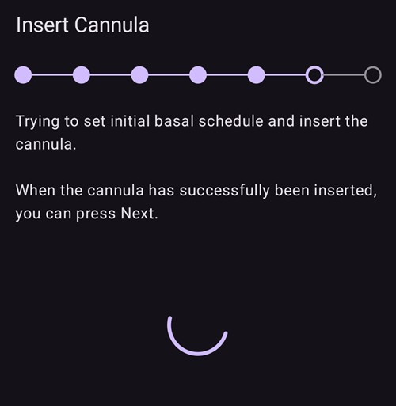

9. Når kanylen er indsat, vises knappen **Næste**. Tryk på **Næste**.

   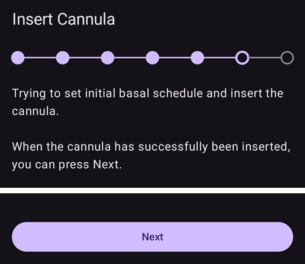

10. Trinnet **Pod aktiveret** vises. Kontroller, at kanylen er indsat korrekt, og skift poden, hvis du mener, at den ikke er det.

    Tryk på **Færdig**.

    Tillykke! Du har nu startet en ny pod-session.

    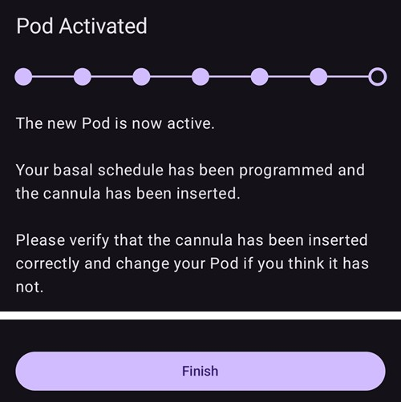

11. Du er tilbage på DASH-pumpeskærmen. Den viser nu oplysninger om din aktive pod, bl.a. den aktuelle basalrate, reservoirniveau, tilført insulin, pod-fejl og alarmer. **Aktiver Pod** er erstattet af **Deaktiver Pod**: du kan ikke aktivere en anden pod uden først at deaktivere den aktive pod.

    ***BEMÆRK:** Se [DASH-pumpeskærmen](#omnipod-dash-tab) for flere detaljer om de viste oplysninger.*

    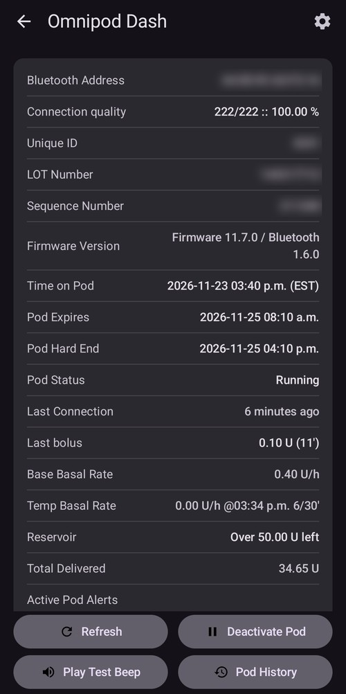

    ***BEMÆRK:** Det er god praksis at eksportere dine indstillinger EFTER aktivering af poden. Eksporter dine indstillinger efter hvert skift af pod og én gang om måneden. Kopier den eksporterede indstillingsfil til en placering i skyen (f.eks. Google Drive) eller et andet sted uden for din telefon, hvis du mister din telefon (se [**Eksporter indstillinger**](../Maintenance/ExportImportSettings.md)).*

Hvis en tidligere aktivering stoppede, efter poden var klargjort, fortsætter et tryk på **Aktiver Pod** fra trinnet **Påsæt Pod**.

(omnipod-dash-deactivate-pod)=

## Deaktiver Pod

Under normale forhold holder en pod i tre dage (72 timer) plus en ekstra tid på 8 timer efter advarslen om, at poden udløber: i alt 80 timer.

Sådan deaktiverer du en pod (enten fordi den er udløbet, eller fordi den har svigtet):

1. Åbn DASH-pumpeskærmen (**Administrer** > **Pumpe**), og tryk på **Deaktiver Pod**.

   

2. I trinnet **Deaktiver Pod** trykker du på **Næste**. En dialog spørger *En deaktiveret Pod kan ikke bruges igen. Deaktiver denne Pod nu?* Tryk på **OK** for at begynde at deaktivere poden eller på **Annuller** for at beholde den. Deaktivering suspenderer al insulintilførsel og kan ikke fortrydes.

   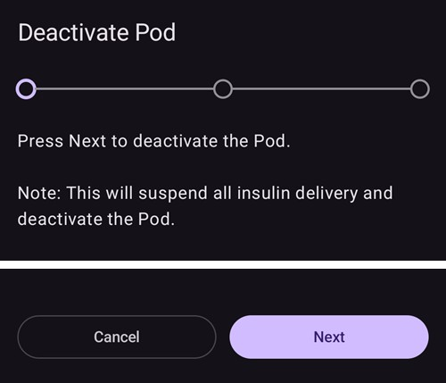

   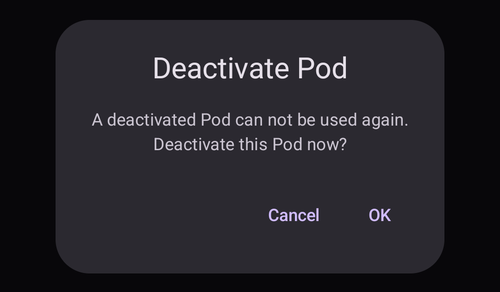

3. Trinnet **Deaktiverer Pod** vises, mens **AAPS** deaktiverer poden. Poden bipper for at bekræfte, at deaktiveringen lykkedes.

   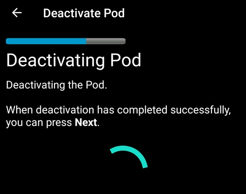

   ```{admonition} Older screenshot
   :class: note
   Skærmbilledet ovenfor er fra en tidligere **AAPS**-version. I **AAPS** 4 viser guiden sin fremgang som en række prikker øverst i stedet for en statuslinje.
   ```

   Når deaktiveringen er færdig og lykkedes, vises knappen **Næste**. Tryk på **Næste**.

   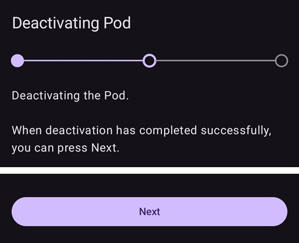

   Hvis deaktiveringen mislykkes, vises en fejlmeddelelse og en knap **Kassér Pod**. Læs [Kassering af en pod](#omnipod-dash-discard-pod) nedenfor, før du bruger den. Du kan også trykke på **Annuller** og prøve **Deaktiver Pod** igen senere.

4. Trinnet **Pod deaktiveret** vises. Fjern poden fra din krop, og tryk på **Færdig**.

   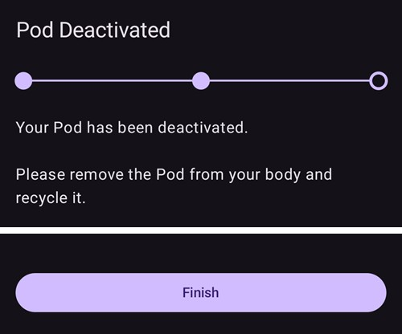

5. Du er tilbage på DASH-pumpeskærmen. Kontroller, at feltet **Pod-status** viser **Ingen aktiv pod**, og at knappen **Aktiver Pod** vises igen.

   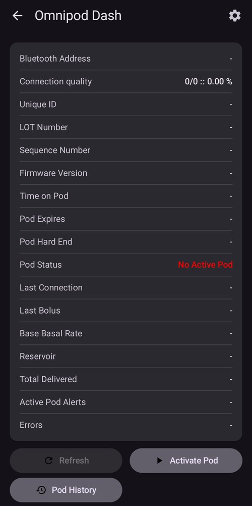

(omnipod-dash-discard-pod)=

### Kassering af en pod

Kassér kun en pod, når al kommunikation med den bliver ved med at mislykkes. Hvis **AAPS** stadig kan kommunikere med poden, så brug **Deaktiver Pod** i stedet.

- **AAPS** beder dig bekræfte, før den kasserer poden.
- Derefter kan **AAPS** ikke længere kommunikere med den pod.
- **Insulintilførslen er IKKE suspenderet**, fordi poden ikke blev deaktiveret korrekt. **Fjern poden fra din krop!**
- Trinnet **Pod kasseret** bekræfter, at podens tilstand er kasseret. Tryk på **Færdig**. Du kan nu aktivere en ny pod.

(omnipod-dash-silencing-pod-alerts)=

## Gør pod-alarmer lydløse

Dette afsnit forklarer, hvordan du stopper podens bip, når poden nærmer sig slutningen af sin levetid. Hvornår disse bip starter, afhænger af indstillingerne under **Alarmer** (se [Dash-indstillinger](#omnipod-dash-settings)):

- **Påmindelse i timer før udløb (72 timer):** hvor mange timer før udløbet efter 72 timer poden begynder at bippe.
- **Advarsel i timer før nedlukning (80 timer):** hvor mange timer før nedlukningen efter 80 timer poden bipper igen.

En pod kan højst bruges i 80 timer (3 dage og 8 timer). Producenten af poden anbefaler dog ikke at bruge den mere end 72 timer (3 dage).

***BEMÆRK**: Knappen **Gør alarmer lydløse** vises kun på DASH-pumpeskærmen, mens poden har en aktiv alarm, f.eks. når poden udløber eller reservoiret er lavt. Hvis knappen **Gør alarmer lydløse** ikke vises, men du hører poden bippe, så tryk på **Opdater**.*

1. Når tidspunktet for påmindelsen er nået, bipper poden for at fortælle dig, at den snart udløber, og at du skal skifte den. På DASH-pumpeskærmen viser feltet **Pod udløber (1)** det præcise tidspunkt, hvor poden udløber (72 timer efter aktivering). Teksten bliver gul 4 timer før dette tidspunkt. Derefter bliver **Pod stopper endeligt** gul og viser den resterende tid, til poden stopper med at tilføre insulin. Feltet **Aktive pod alarmer (2)** viser **Pod udløber snart**, og knappen **Gør alarmer lydløse (3)** vises.

   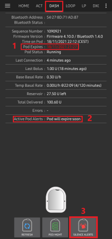

2. Tryk på **Gør alarmer lydløse**. **AAPS** sender kommandoen til poden om at stoppe bippene for udløb.

   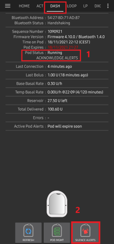

   ```{admonition} Older screenshot
   :class: note
   Skærmbilledet ovenfor er fra en tidligere **AAPS**-version, hvor denne skærm var fanen **DASH**. I **AAPS** 4 er knappen **Gør alarmer lydløse** på DASH-pumpeskærmen (**Administrer** > **Pumpe**).
   ```

3. Når alarmerne er gjort lydløse, vises alarmen ikke længere i feltet **Aktive pod alarmer**, knappen **Gør alarmer lydløse** forsvinder, og poden stopper bippene for udløb.

   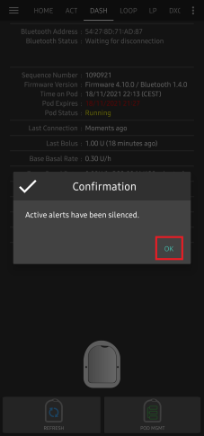

   ```{admonition} Older screenshot
   :class: note
   Skærmbilledet ovenfor er fra en tidligere **AAPS**-version, som viste en dialog til bekræftelse. I **AAPS** 4 ser du resultatet på DASH-pumpeskærmen: alarmen er væk fra feltet **Aktive pod alarmer**.
   ```

   Hvis kommandoen mislykkes, viser **AAPS** en advarselsdialog, der starter med *Det lykkedes ikke at gøre alarmer lydløse*. Tryk på **Opdater**, og prøv igen.

Alarmen for lavt reservoir virker på samme måde. Når insulinen i poden falder til det **Antal enheder**, der er sat i indstillingerne under **Alarmer**, bipper poden. Feltet **Reservoir** viser den resterende mængde, feltet **Aktive pod alarmer** viser **Lavt reservoir**, og knappen **Gør alarmer lydløse** vises. Tryk på **Gør alarmer lydløse** for at stoppe bippene, og planlæg dit næste skift af pod.

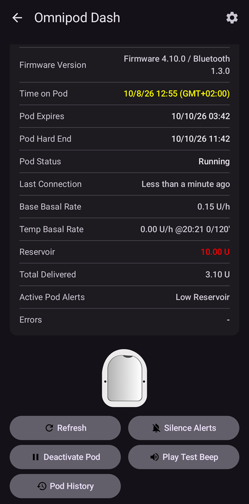

(omnipod-dash-view-pod-history)=

## Se pod-historik

Dette afsnit forklarer, hvordan du ser historikken for din aktive pod og filtrerer den efter type handling. Pod-historikken viser de kommandoer, der er sendt til din aktive pod, og deres resultater i hele dens levetid på tre dage (72-80 timer).

Den er nyttig til at kontrollere de boluser, TBR'er og basalkommandoer, der er sendt til poden. De andre kategorier hjælper med fejlfinding og viser rækkefølgen af de hændelser, der førte til en fejl.

**BEMÆRK:** **Kun den sidste kommando kan være usikker**. Nye kommandoer *bliver ikke sendt*, før **den sidste »usikre« kommando bliver »bekræftet« eller »afvist«**. For at »rette« en usikker kommando trykker du på **Opdater** på DASH-pumpeskærmen.

1. Åbn DASH-pumpeskærmen, og tryk på **Pod-historik**.

   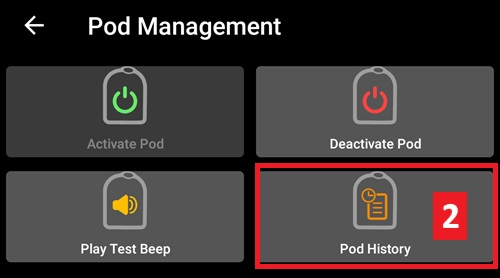

   ```{admonition} Older screenshot
   :class: note
   Skærmbilledet ovenfor er fra en tidligere **AAPS**-version. I **AAPS** 4 er **Pod-historik** en knap direkte på DASH-pumpeskærmen i stedet for i menuen **Pod Management**.
   ```

2. Skærmen **Pod-historik** åbner med filteret **Alle** valgt. Den viser hver kommando med tidspunkt og resultat, nyeste først, grupperet efter dag. Brug filterknapperne øverst (f.eks. **Bolusser** eller **Basaler**) for kun at vise én type kommando. Tryk på tilbagepilen for at vende tilbage til DASH-pumpeskærmen.

   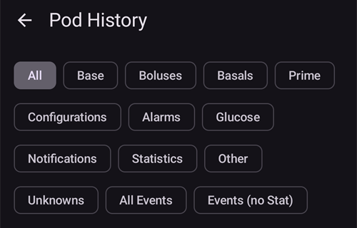 

   For boluser står bolustypen efter mængden, når det ikke er en normal bolus, f.eks. *0,05 IE (SMB)* eller *0,05 IE (Basalkorrektion)*. En basalkorrektion er en meget lille bolus (én pod-puls, 0,05 IE), som driveren selv sender. Du har ikke bedt om den.

   ```{admonition} Why basal corrections happen
   :class: note
   Poden tilfører basalinsulin i pulser på 0,05 IE, styret af et internt ur. Hver gang basalraten ændres (f.eks. når loopet sætter en ny **TBR**), starter poden dette ur forfra, og den puls, den var ved at tælle hen imod, går tabt. Fordi loopet ofte ændrer basalraten, især om natten, kan poden ende med at tilføre mindre basalinsulin end forventet.

   **AAPS** sammenligner den basalinsulin, som poden rapporterer som tilført, med den mængde, der skulle være tilført. Når manglen når en halv puls eller mere, tilfører driveren én ekstra puls som basalkorrektion, så du stadig får den basalinsulin, som din profil og loopet bad om. Der sendes ingen korrektion, mens poden er suspenderet, eller mens en **TBR** på nul kører.
   ```

(omnipod-dash-settings)=

## Dash-indstillinger

Der er to måder at åbne indstillingerne for Dash-driveren:

- Tryk på ikonet **Indstillinger** (tandhjul) i øverste højre hjørne af [DASH-pumpeskærmen](#omnipod-dash-tab).
- Åbn **menuen** (☰) i øverste venstre hjørne af hovedskærmen, og vælg **Konfiguration** > **Pumpe**. På kortet **Omnipod Dash** trykker du på **Indstillinger**.

Indstillingerne er delt i fire afsnit, som kan foldes ud: **Bekræftelsesbip**, **Alarmer**, **Notifikationer** og **Avancerede indstillinger**. Tryk på et afsnit for at åbne det:

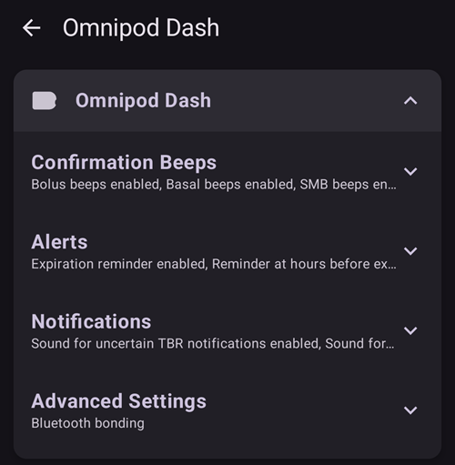

De fleste indstillinger er kontakter til/fra.

### Bekræftelsesbip

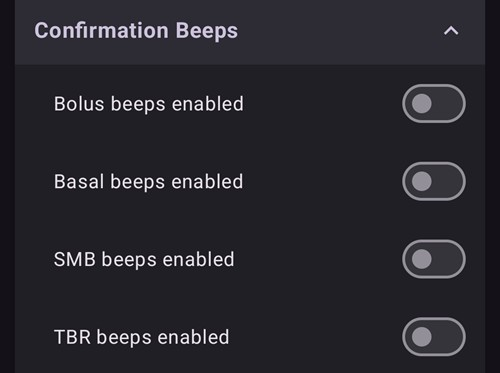

Bekræftelsesbip fra poden for tilførsel og ændringer af bolus, basal, SMB og TBR.

**Bolus bip aktiveret:**    Poden bipper, når en bolus bliver tilført. Slået til som standard.

**Basal bip aktiveret:**    Poden bipper, når en ny basalrate bliver sat, eller når den aktive basalrate bliver annulleret eller ændret. Slået fra som standard.

**SMB bip aktiveret:**  Poden bipper, når en SMB bliver tilført. Slået til som standard.

**TBR bip aktiveret:**  Poden bipper, når en TBR bliver sat eller annulleret. Slået fra som standard.

### Alarmer

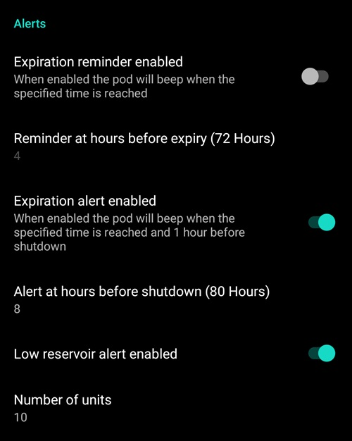

```{admonition} Older screenshot
:class: note
Skærmbilledet ovenfor er fra en tidligere **AAPS**-version. I **AAPS** 4 er disse indstillinger i afsnittet **Alarmer**, som kan foldes ud.
```

Pod-alarmer for podens udløb, nedlukning og lavt reservoir. Når du ændrer disse indstillinger, mens en pod er aktiv, sender **AAPS** de nye indstillinger for alarmer til poden.

***BEMÆRK:** En notifikation i **AAPS** vises ALTID for enhver alarm, når **AAPS** har kommunikeret med poden, efter at alarmen blev udløst. Hvis du lukker notifikationen, stopper pod-alarmen IKKE. For at stoppe alarmen skal du åbne DASH-pumpeskærmen og trykke på **Gør alarmer lydløse**.*

**Udløbsadvarsel aktiveret:**    Når den er slået til, bipper poden, når tidspunktet for påmindelsen er nået. Slået til som standard.

**Påmindelse i timer før udløb (72 timer):** Hvor mange timer før podens udløb efter 72 timer påmindelsen starter (1 til 24 timer; standard 4).

**Udløbsadvarsel aktiveret:**   Når den er slået til, bipper poden, når tidspunktet for advarslen er nået, og igen 1 time før nedlukning. Slået til som standard.

**Advarsel i timer før nedlukning (80 timer):**  Hvor mange timer før podens nedlukning efter 80 timer advarslen starter (1 til 8 timer; standard 8).

**Lav reservoir alarm aktiveret:**    Poden giver dig en alarm, når insulinen i reservoiret falder til værdien i **Antal enheder**. Slået til som standard.

**Antal enheder:**    Det antal enheder, hvor alarmen for lavt reservoir bliver udløst (5 til 50 enheder; standard 20).

### Notifikationer

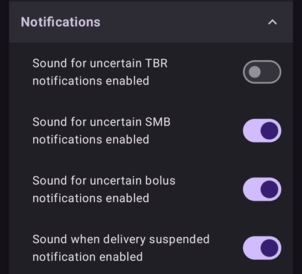

Vælg, om **AAPS** skal afspille en lyd med sine notifikationer, når det er usikkert, om en TBR, SMB eller bolus blev tilført, og når tilførslen er suspenderet.

***BEMÆRK:** Det er kun notifikationer på telefonen. Selve poden bipper ikke.*

**Lyd for usikre TBR-meddelelser aktiveret:**  Afspiller en lyd med notifikationen, når **AAPS** er usikker på, om en TBR blev sat.

**Lyd for notifikationer om usikker SMB aktiveret:**  Afspiller en lyd med notifikationen, når **AAPS** er usikker på, om en SMB blev tilført.

**Lyd for usikre bolus notifikationer aktiveret:**    Afspiller en lyd med notifikationen, når **AAPS** er usikker på, om en bolus blev tilført.

**Lyd for notifikation om stoppet tilførsel aktiveret:**     Afspiller en lyd med notifikationen, når insulintilførslen er suspenderet.

(omnipod-dash-advanced-settings)=

### Avancerede indstillinger


**Bluetooth-bonding:**  Binder poden til telefonen via Bluetooth. Prøv det kun, hvis poden ikke kan holde en stabil forbindelse, f.eks. på Android 15 (se [Kendte begrænsninger og problemer med Omnipod DASH i AAPS](#omnipod-dash-constraints)). Når den er slået til, viser telefonen anmodninger om parring, som du skal acceptere. Lad den være slået fra, hvis poden forbinder fint. Den har ingen virkning under Android 15. Slået fra som standard.

## Alder på insulin og kanyle

[Statuslinjen](#screens-sensor-level-battery) på hovedskærmen viser alderen på din insulin og kanyle. With Omnipod, these work a little differently than with tube-based pumps: the cannula row is called **Patch pump**.

**AAPS** registrerer automatisk et skift af kanyle og et skift af insulin, hver gang du aktiverer en pod. This resets the **Patch pump** and **Insulin** ages to zero after every pod change. Du behøver ikke selv registrere dem med **Klargør/Fyld**. Det skyldes, at poden indsætter kanylen direkte i huden, hvor poden sidder: Omnipod bruger ikke en slange.

Alderen for **Pumpebatteri** bliver ikke rapporteret: batteriet og insulinreservoiret er bygget ind i hver pod, og batteriet holder altid længere end selve poden (højst 80 timer).


### Niveau

**Insulinniveau**

Det viste insulinniveau er den mængde, som poden rapporterer. Poden rapporterer dog kun det faktiske niveau i reservoiret, når det er under 50 enheder. Indtil da vises *Over 50 IE tilbage*. Den rapporterede mængde er ikke præcis: når poden rapporterer »tom«, er der i de fleste tilfælde stadig et par enheder insulin tilbage i reservoiret.

DASH-pumpeskærmen viser niveauet sådan:

  * **Over 50 IE tilbage** - Poden rapporterer mere end 50 enheder i reservoiret.
  * **Under 50 enheder** - Den præcise mængde insulin, der er tilbage i reservoiret, som poden rapporterer den.

Yderligere bemærkning:
  * **SMS** - Returnerer værdien, eller 50+U ved over 50 enheder, i SMS-svar.
  * **Nightscout** - Uploader værdien 50 til Nightscout ved over 50 enheder (version 14.07 og ældre). Nyere versioner rapporterer værdien 50+ ved over 50 enheder.

(omnipod-dash-troubleshooting)=

## Fejlfinding

Dette afsnit beskriver almindelige kendte problemer og løsninger, når du bruger Omnipod DASH med AAPS. Dokumentationen har også et afsnit om [Fejlfinding](../GettingHelp/GeneralTroubleshooting.md), som du bør læse, fordi det også dækker emner, der er relevante for nogle problemer med poden.

---

(omnipod-dash-bluetooth-related-issues)=

## Bluetooth-relaterede problemer

Kendte problemer med Bluetooth-forbindelser, afbrydelser af pumper/pods eller problemer med aktivering og forbindelse: se [Problemer med Bluetooth](../GettingHelp/BluetoothTroubleshooting.md)

---

(omnipod-dash-delivery-suspended)=

### Insulintilførsel suspenderet

  - The DASH pump screen has no **Suspend** button. To stop insulin delivery for a while, press the [loop icon](#AapsScreens-loop-status) on the main screen and select **Disconnect pump** with the duration you need. **AAPS** sets a zero **TBR** on the pod and keeps your **IOB** correct. See [Disconnecting the pump](#pumps-cannulas-disconnecting).
  - Ved **profilskift** skal DASH suspendere tilførslen, før den nye basal-**profil** sættes. Hvis kommunikationen fejler mellem de to kommandoer, kan tilførslen forblive suspenderet. Når det sker:
     - Der bliver ikke tilført insulin. Det gælder basal, SMB, manuel bolus osv.
     - Der kan komme en notifikation om, at en af kommandoerne ikke er bekræftet. Det afhænger af, hvornår fejlen skete.
     - **AAPS** prøver at sætte den nye basalprofil hvert 15. minut.
     - **AAPS** viser hvert 15. minut en notifikation om, at tilførslen er suspenderet, hvis tilførslen stadig er suspenderet (genoptagelse af tilførslen mislykkedes).
     - Knappen [**Genoptag insulinafgivelse**](#omnipod-dash-resuming-insulin-delivery) vises på DASH-pumpeskærmen, hvis du vil genoptage tilførslen manuelt.
     - Hvis **AAPS** ikke selv kan genoptage tilførslen (det sker, hvis poden ikke kan nås, lyden er slået fra osv.), begynder poden at bippe 4 gange hvert minut i 3 minutter. Det gentages hvert 15. minut, hvis tilførslen stadig er suspenderet i mere end 20 minutter.
  - For ubekræftede kommandoer trykker du på **Opdater** på DASH-pumpeskærmen for at bekræfte eller afvise dem.

*****BEMÆRK:** Når du hører bip fra poden, må du ikke gå ud fra, at tilførslen fortsætter, uden at du har tjekket telefonen. Tilførslen kan forblive suspenderet, ***så du skal tjekke det!******

(omnipod-dash-resuming-insulin-delivery)=

#### Genoptagelse af insulintilførsel

Når insulintilførslen er suspenderet, skal du bede poden om at genoptage insulintilførslen. Når kommandoen er udført, tilfører poden igen insulin med basalraten for det aktuelle tidspunkt fra din aktive basal-**profil**. Poden tager igen imod kommandoer for bolus, **TBR** og **SMB**.

1. Åbn DASH-pumpeskærmen, og kontroller, at feltet **Pod-status** viser **Sat på pause**. Tryk på **Genoptag insulinafgivelse** for at bede poden om at genoptage normal insulintilførsel.

   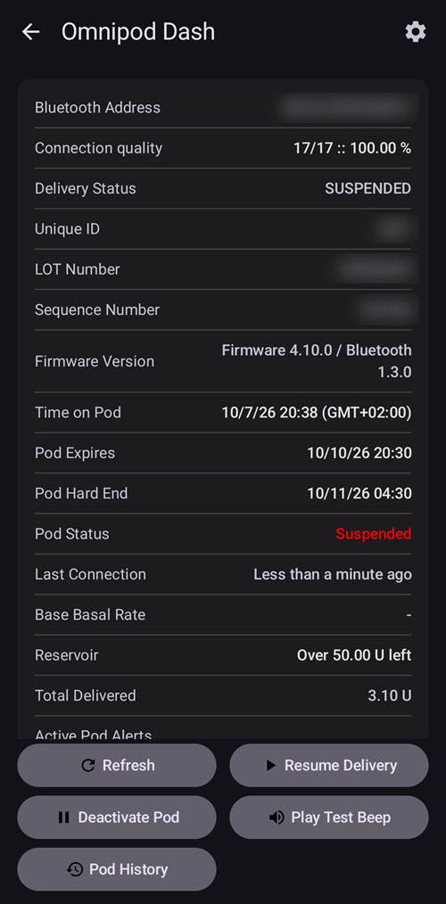

2. Når kommandoen lykkedes, viser feltet **Pod-status** **Kører**, og knappen **Genoptag insulinafgivelse** forsvinder.

   Hvis kommandoen mislykkes, viser **AAPS** en advarselsdialog, der starter med *Kunne ikke genoptage insulinafgivelse*. Tryk på **Opdater**, og prøv igen.

   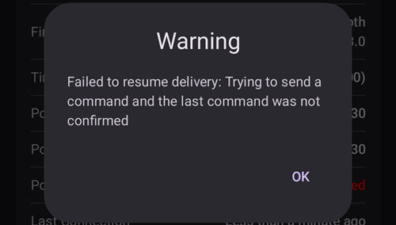

---
(omnipod-dash-pod-failures)=

### Pod-fejl

- Pods fejler af og til af forskellige grunde, også på grund af fejl i selve poden.
- Det er bedst ikke at oprette supportsager eller bede om erstatning hos Insulet, fordi AAPS ikke er en godkendt måde at bruge pods på.
- Du kan [**finde en liste over fejlkoder her**](https://github.com/openaps/openomni/wiki/Fault-event-codes), som hjælper med at finde årsagen.

Når en pod svigter, stopper den med at tilføre insulin og bipper hele tiden. **AAPS** viser en notifikation på hovedskærmen med fejlkode og navn og *Ref:*-koden, f.eks. *Pod-fejl: 020 ALARM_OCCLUDED*. Tryk på **Afvis** for at lukke notifikationen. Det stopper ikke podens bip.

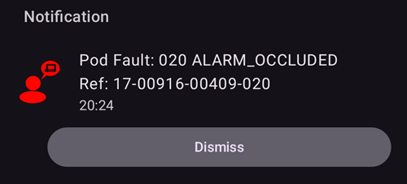

På DASH-pumpeskærmen viser feltet **Pod-status** **ALARM**, feltet **Fejl** viser pod-fejlen, og feltet **PDM-notifikation** forklarer den, f.eks. *Okklusion registreret. Insulintilførsel stoppet. Skift Pod nu. Tjek dit BS*.

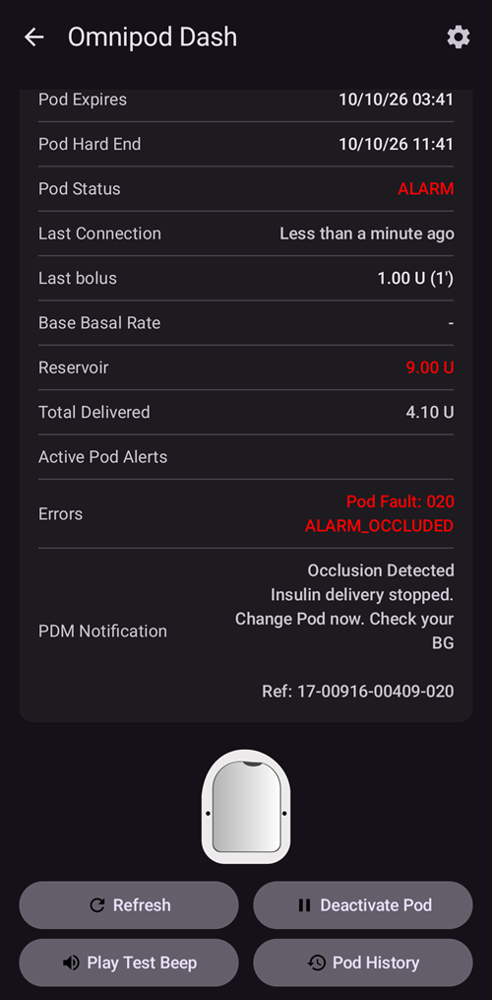

En pod, der har svigtet, kan ikke bruges igen. Tjek dit blodsukker, og [deaktiver derefter poden](#omnipod-dash-deactivate-pod), og aktiver en ny.

---
### Undgå pod-fejl 49

Denne fejl skyldes, at poden er i en forkert tilstand til en kommando, eller en fejl under en kommando til insulintilførsel. Det sker, når driveren og poden er uenige om den faktiske tilstand. Poden reagerer så (som en indbygget sikkerhedsforanstaltning) med en uoprettelig fejlkode 49 (0x31). Det ender med det, man kalder en »screamer«: det lange, irriterende bip, som kun kan stoppes ved at stikke hul på det rigtige sted bag på poden. Den præcise årsag til en »49 pod-fejl« er ofte svær at finde. Det kan f.eks. ske efter et nedbrud af appen, når du kører en udviklingsversion, eller efter en geninstallation.

---

### Advarsler om utilgængelig pumpe

Når der ikke kan oprettes forbindelse til poden i en forudindstillet tid, kommer advarslen »Pumpe utilgængelig«. Advarsler om utilgængelig pumpe kan sættes op ved at trykke på ikonet **Indstillinger** (tandhjul) øverst til højre på hovedskærmen og derefter vælge **Lokale alarmer** ➜ **Grænse for utilgængelig pumpe**. Den anbefalede værdi er en advarsel efter **120** minutter.

---
(omnipod-dash-export-import)=
### Eksport og import af indstillinger

Når du eksporterer indstillingerne i **AAPS**, kan du gendanne alle dine indstillinger og læringsmål, f.eks. efter en geninstallation af **AAPS** eller på en ny telefon. **Eksporter dine indstillinger lige efter hver aktivering af en pod**, og kopier filen til et sikkert sted uden for din telefon (f.eks. Google Drive), så den aktive pod også kan gendannes. Se [Oprettelse og gendannelse af sikkerhedskopier](#ExportImportSettings-Settings-Export).

```{admonition} Importing settings can end your active Pod
:class: warning
På den telefon, der allerede kører poden, skal **Erstat også pumpeindstillinger** ikke være markeret: pod-sessionen bevares, og kun de andre indstillinger bliver importeret. Marker det kun på en ny telefon med en fil, der er eksporteret under den pod, du har på nu. Se [Slangeløse pumper](#ExportImportSettings-tubeless-pumps).
```

Hvis de importerede indstillinger indeholder en pod, der ikke længere er aktiv, så se næste afsnit.

---
### Import af indstillinger, der indeholder pod-tilstand fra en inaktiv pod

Når du importerer indstillinger med data for en pod, der ikke længere er aktiv, prøver AAPS at forbinde til den. Det mislykkes naturligvis. Du kan ikke aktivere en ny pod i denne situation.

Sådan fjerner du den gamle pod-session:
1. Tryk på **Deaktiver Pod** på DASH-pumpeskærmen. Deaktiveringen mislykkes højst sandsynligt.
2. Når den mislykkes, så tryk på **Kassér Pod**, og bekræft (se [Kassering af en pod](#omnipod-dash-discard-pod)).
3. Når den gamle pod er fjernet, kan du aktivere en ny pod.

### Generisk fejl: java.lang.IllegalStateException: Trying to set a Bluetooth Address to ***, but it is already set to ***.

Hvis du får denne fejl, når du prøver at initialisere en ny pod, mislykkes **AAPS**, fordi den stadig har indstillinger for en gammel pod gemt i konfigurationen.

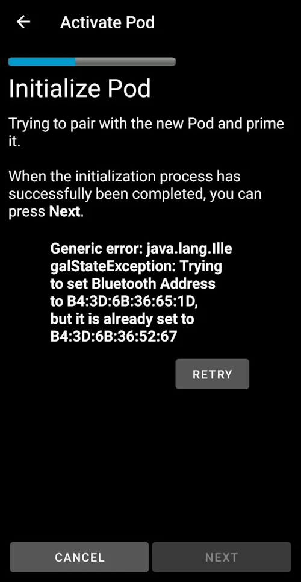

Det kan ske, hvis du gendanner fra en sikkerhedskopi, eller hvis en deaktivering af en pod mislykkes.

For at løse det skal du trykke på **Annuller** for at forlade aktiveringen. Tryk på **Kassér Pod** på DASH-pumpeskærmen, hvis knappen vises. Ellers tryk på **Deaktiver Pod**, og når deaktiveringen mislykkes, så tryk på **Kassér Pod** (se [Kassering af en pod](#omnipod-dash-discard-pod)).

Du skulle nu kunne aktivere en ny pod.

---
### Geninstallation af AAPS

Når du afinstallerer **AAPS**, mister du alle dine indstillinger, læringsmål og den nuværende pod-session. **Sørg for at have en nyligt eksporteret indstillingsfil, så du kan gendanne dem!**

Når du har en aktiv pod, så brug en eksport, der er lavet under den nuværende pod-session (se [Eksport og import af indstillinger](#omnipod-dash-export-import)).

1. Eksporter dine indstillinger, og gem en kopi et sikkert sted (f.eks. Google Drive).
2. Afinstaller **AAPS**, og genstart din telefon.
3. Installer den nye version af **AAPS**.
4. Importer dine indstillinger.
5. Kontroller alle indstillinger (importer eventuelt indstillingerne igen).
6. Aktiver en ny pod.
7. Når du er færdig: Eksporter de nuværende indstillinger.

---
### Opdatering af AAPS til en nyere version

I de fleste tilfælde er der ingen grund til at afinstallere. Du kan lave en »in-place«-installation (oven på den gamle) ved at starte installationen af den nye version. Det er også muligt under en aktiv pod-session.

1. Eksporter dine indstillinger.
2. Installer den nye **AAPS**-version.
3. Kontroller, at installationen lykkedes
4. GENOPTAG poden, eller aktiver en ny pod.
5. Når du er færdig: Eksporter de nuværende indstillinger.

---
### Advarsler fra Omnipod-driveren

Driveren til Omnipod Dash viser en række særlige advarsler på **hovedskærmen**. De fleste er kun til information og kan lukkes, mens nogle beder brugeren om at gøre noget for at løse årsagen til advarslen.

Her er en oversigt over de vigtigste advarsler, du kan møde:

- *Pod-fejl: XXX NAVN*, efterfulgt af *Ref: ...*: poden har svigtet og er stoppet med at tilføre insulin. Skift poden. Se [Pod-fejl](#omnipod-dash-pod-failures).
- *Ingen aktiv pod*: der blev ikke fundet nogen pod-session. Denne notifikation kommer igen og igen, indtil du aktiverer en ny pod. Når en pod er aktiveret, forsvinder den automatisk.
- *Insulintilførsel pauseret*: poden har suspenderet insulintilførslen. Se [Genoptagelse af insulintilførsel](#omnipod-dash-resuming-insulin-delivery).
- *Indstilling af basalprofil er måske mislykkedes. Insulintilførslen kan være suspenderet! Opdater Pod-status manuelt på pumpeskærmen, og genoptag tilførslen om nødvendigt.* Det kan være mislykkedes at sætte basal-**profilen** på poden. Tryk på **Opdater** på DASH-pumpeskærmen, og tryk på **Genoptag insulinafgivelse**, hvis knappen vises.
- *Kunne ikke bekræfte, om SMB (X IE) lykkedes. Opdater pod-status for at bekræfte eller afvise denne kommando.* **AAPS** kunne ikke bekræfte, at **SMB** blev tilført. Tryk på **Opdater** på DASH-pumpeskærmen, og tjek feltet **Seneste bolus**.
- *Bolustilførselsstatus usikker. Opdater pod-status for at bekræfte eller afvise.* Det samme gælder en normal bolus: tryk på **Opdater** på DASH-pumpeskærmen.
- *Tidszone på pod er forskellig fra tidszone på telefon. Basalrate er forkert. Skift profil for at rette* Se noten om sommertid og tidszone i [Kendte begrænsninger og problemer med Omnipod DASH i AAPS](#omnipod-dash-constraints).

(omnipod-dash-where-to-get-help-for-dash)=

## Hvor kan du få hjælp

Al udvikling af DASH-driveren laves af fællesskabet som **frivilligt** arbejde. Husk det, og følg disse retningslinjer, før du beder om hjælp:

-  **Niveau 0:** Læs det relevante afsnit i denne dokumentation, så du forstår, hvordan den funktion, du har problemer med, skal virke.
-  **Niveau 1:** Hvis du stadig har problemer, som du ikke kan løse med dette dokument, så gå til kanalen *#AAPS* på **Discord** via [dette invitationslink](https://discord.gg/4fQUWHZ4Mw). Der er også mange Facebook-grupper og andre grupper, hvor du kan spørge (se [**Hvor kan jeg få hjælp?**](../GettingHelp/WhereCanIGetHelp.md))
-  **Niveau 2:** Søg i de eksisterende problemer for at se, om dit problem allerede er rapporteret under [Issues](https://github.com/nightscout/AndroidAPS/issues). Hvis det findes, så bekræft/kommenter/tilføj information om dit problem. Hvis ikke, så opret et [nyt issue](https://github.com/nightscout/AndroidAPS/issues) og vedhæft [dine logfiler](../GettingHelp/AccessingLogFiles.md).
-  **Vær tålmodig. De fleste i vores fællesskab er venlige frivillige, og det kræver ofte tid og tålmodighed fra både brugere og udviklere at løse problemer.**

Når du beder om hjælp, så hav disse oplysninger klar. Det hjælper fællesskabet med dine konkrete spørgsmål og problemer:
- Mærke og model på din Android-telefon
- Android-version (f.eks. 15 eller 16)
  - Har du for nylig opgraderet din Android-version?
- Den version af **AAPS**, du bruger
- En beskrivelse i almindeligt sprog af det problem, du har, hvor du tænker over følgende
   - Virkede det før?
   - Hvornår virkede det, og hvornår virkede det ikke?
   - Har du ændret noget i konfigurationen eller i profilindstillingerne?
   - Har du parret en ny Bluetooth-enhed?
   - Har du opgraderet eller installeret en ny app?
   - Hvor længe virkede det, før det holdt op med at virke?
