# Omnipod Eros

Denne vejledning er til konfiguration af pumpen Omnipod Eros-generationen (**IKKE Omnipod Dash**).

```{admonition} Omnipod Eros is being phased out
:class: note

[Omnipod-systemet](https://www.omnipod.com/current-podders/resources/omnipod-system) (den originale Omnipod, som består af både Personal Diabetes Manager (PDM) og poden) udgår, og slutdatoen er forskellig fra land til land. I Canada er den f.eks. ikke længere til rådighed efter 30. juni 2026. Hvis du er afhængig af Eros-pumpen, så planlæg i god tid et skift til en understøttet pumpe.
```

**Denne software er en del af en gør-det-selv kunstig bugspytkirtel. Det er ikke et produkt, men kræver at DU læser, lærer og forstår systemet, også hvordan det bruges. Du alene er ansvarlig for det, du gør med den.**

```{contents} Table of contents
:depth: 1
:local: true
```

## Krav til hardware og software

- **Pod-kommunikationsenhed**

> Komponent, som bygger bro for kommunikationen fra din telefon med AAPS til pods af Eros-generationen.
> 
> > -   [OrangeLink-websted](https://getrileylink.org/product/orangelink)
> > - 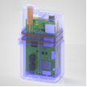 [433MHz RileyLink](https://getrileylink.org/product/rileylink433)
> > -   [Emalink-websted](https://github.com/sks01/EmaLink) - [Kontaktinfo](mailto:getemalink@gmail.com)
> > -   DiaLink - [Kontaktinfo](mailto:Boshetyn@ukr.net)
> > -   [LoopLink-websted](https://www.getlooplink.org/) - [Kontaktinfo](https://jameswedding.substack.com/) - Ikke testet

-   **Mobiltelefon**

> Komponent, som kører AAPS og sender kommandoer til pod-kommunikationsenheden.
> 
> > - En understøttet [Android-telefon](#Phones-list-of-tested-phones) med **AAPS** og tilhørende komponenter sat op.

- 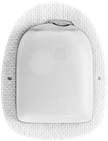  **Enhed til insulintilførsel**

> Komponent, som fortolker kommandoer, der modtages fra pod-kommunikationsenheden og kommer fra din telefon med AAPS.
> 
> > - En ny Omnipod-pod (Eros-generationen - **IKKE DASH**)

Denne vejledning går ud fra, at du starter en ny pod-session. Hvis det ikke er tilfældet, så vær tålmodig, og start processen ved dit næste podskift.

På denne side betyder **RileyLink** enhver af de pod-kommunikationsenheder, som er nævnt ovenfor.

## Før du starter

**SIKKERHED FØRST** - prøv ikke denne proces i et miljø, hvor du ikke kan rette op på en fejl (ekstra pods, insulin, en opladet RileyLink og telefon er et must).

**Din Omnipod PDM virker ikke længere, når AAPS' Omnipod-driver har aktiveret din pod**. Før brugte du din Omnipod PDM til at sende kommandoer til din Omnipod Eros-pod. En Omnipod Eros-pod tillader kun, at én enhed kommunikerer med den. Den enhed, som aktiverer poden, er fra da af den eneste enhed, som må kommunikere med den. Det betyder, at når du har aktiveret en Omnipod Eros-pod med din RileyLink gennem AAPS' Omnipod-driver, **kan du ikke længere bruge din PDM med din pod**. AAPS' Omnipod-driver med RileyLink er nu din PDM. *Det betyder IKKE, at du skal smide din PDM væk. Det anbefales at gemme den som reserve og til nødsituationer, hvor AAPS ikke virker korrekt.*

**Kun én RileyLink ad gangen kan kommunikere med en pod.** **AAPS** husker én parret RileyLink. Hvis du parrer en anden, erstatter den den forrige.

**Din pod slukker ikke, når RileyLink er uden for rækkevidde.** Når din RileyLink er uden for rækkevidde, eller signalet til den aktive pod er blokeret, fortsætter din pod med at levere basalinsulin. Når en pod aktiveres, bliver basalprofilen fra AAPS programmeret ind i den nye pod. Hvis du mister kontakten med poden, vender den tilbage til denne basalprofil. Du kan ikke sende nye kommandoer, før RileyLink er inden for rækkevidde igen og har genoprettet forbindelsen.

**Basalprofiler med 30 minutters intervaller understøttes IKKE i AAPS.** Hvis du er ny med AAPS og sætter din basalprofil op for første gang, skal du vide, at basalrater, som starter på en halv time, ikke understøttes. Du skal justere din basalprofil, så den starter på en hel time. Hvis du f.eks. har en basalrate på 1,1 IE, som starter kl. 09:30 og varer 2 timer til kl. 11:30, vil det ikke virke.  Du skal ændre denne basalrate på 1,1 IE til et tidsrum på enten 9:00-11:00 eller 10:00-12:00.  Selv om Omnipod-hardwaren selv understøtter basalprofiler med 30 minutters intervaller, kan AAPS i øjeblikket ikke tage højde for dem i sine algoritmer.

## Aktivering af Omnipod-driveren i AAPS

Du kan aktivere Omnipod-driveren i AAPS på **to måder**:

### Mulighed 1: Opsætningsguiden

Når du har installeret en ny version af AAPS, starter **Opsætningsguiden** automatisk. Hvis du allerede har eksporteret dine indstillinger fra en tidligere installation, kan du importere dem i guiden. Ved nye installationer skal du fortsætte nedenfor.

Gå gennem [AAPS-opsætningsguiden](../SettingUpAaps/SetupWizard.md), til du når trinnet **Pumpe**, og vælg derefter **Omnipod Eros** (beskrivelsen lyder »Pumpe-integration til Omnipod Eros«).


Opsætningsguiden parrer ikke din RileyLink. Når du er færdig med guiden, så åbn Omnipod-pumpeskærmen, og par den som beskrevet i [afsnittet Opsætning af RileyLink](#OmnipodEros-rileylink-setup).

**ELLER**

### Mulighed 2: Skærmen Konfiguration

Åbn **menuen** (☰) øverst til venstre > **Konfiguration** > **Pumpe**, og vælg **alternativknappen** ved **Omnipod Eros**.

Når den er valgt, viser kortet **Omnipod Eros** to knapper, **Indstillinger** og **Åbn plugin**:

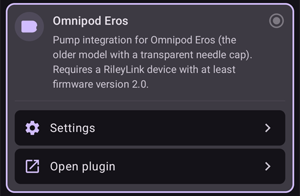

**Indstillinger** åbner indstillingerne for Omnipod-driveren (se [Omnipod-indstillinger](#OmnipodEros-omnipod-settings)):

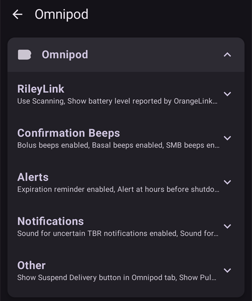

**Åbn plugin** åbner Omnipod-pumpeskærmen. Du kan også altid åbne den fra hovedskærmen med **Administrer** > **Pumpe**. Denne side kalder den **Omnipod-pumpeskærmen**. Før en RileyLink er parret og en pod er aktiveret, ser den sådan ud:

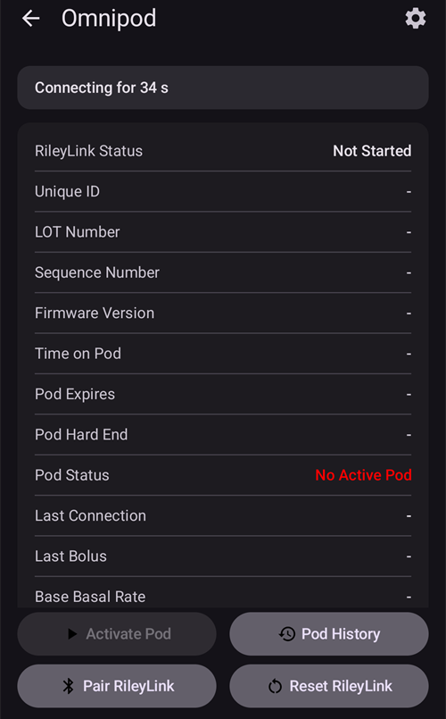

### Kontrol af valget af Omnipod-driver

For at tjekke, at du har aktiveret Omnipod-driveren, skal du åbne **Administrer** > **Pumpe** fra hovedskærmen. Du bør se pumpeskærmen for **Omnipod Eros**, som er vist ovenfor. Hvis du endnu ikke har parret en RileyLink, viser **RileyLink-status** **Ikke startet**, og **Pod-status** viser **Ingen aktiv pod**.

## Omnipod-konfiguration

Alle funktioner for pod og RileyLink er knapper på [Omnipod-pumpeskærmen](#OmnipodEros-omnipod-pod-tab) (**Administrer** > **Pumpe**). Nogle knapper vises kun i visse situationer, f.eks. når en pod er aktiv.

>  Opdater pod-forbindelse og -status
> 
> 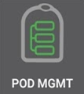 Pod-administration (aktiver, deaktiver, afspil test-bip, RileyLink-statistik og pod-historik)

```{admonition} Older screenshot
:class: note
Skærmbillederne ovenfor er fra en tidligere version af **AAPS**. I **AAPS** 4 er der ingen knap **POD MGMT** og ingen menu til pod-administration: **Opdater** og alle handlinger til pod-administration er knapper på Omnipod-pumpeskærmen.
```

(OmnipodEros-rileylink-setup)=

### Opsætning af RileyLink

Hvis du allerede har parret din RileyLink, så fortsæt til [afsnittet Aktivering af en pod](#OmnipodEros-activating-a-pod) nedenfor.

*Bemærk: Et godt visuelt tegn på, at RileyLink ikke er forbundet, er at behandlingsknapperne (Hurtigstart-værktøjslinjen) mangler på hovedskærmen. Det sker også i ca. de første 30 sekunder efter at AAPS er startet, mens den opretter forbindelse til RileyLink.*

1. Sørg for, at din RileyLink er fuldt opladet og tændt.

2. Placer RileyLink [tæt på din telefon](#OmnipodEros-optimal-omnipod-and-rileylink-positioning) (ca. 30 cm eller mindre).

3. Åbn Omnipod-pumpeskærmen (**Administrer** > **Pumpe**), og tryk på **Par RileyLink**.

4. Skærmen **Par RileyLink** begynder straks at søge efter Bluetooth-enheder. Tryk på din RileyLink i listen over fundne enheder.

   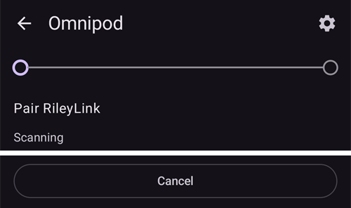

5. Når **RileyLink er parret** vises med navn og adresse på din enhed, så tryk på **OK**.

6. Tilbage på Omnipod-pumpeskærmen skal du tjekke, at **RileyLink-status** skifter til **Tilsluttet**. **Pod-status** bør vise **Ingen aktiv pod**. Hvis RileyLink ikke forbinder, så tryk på **Nulstil RileyLink**, eller genstart **AAPS**.

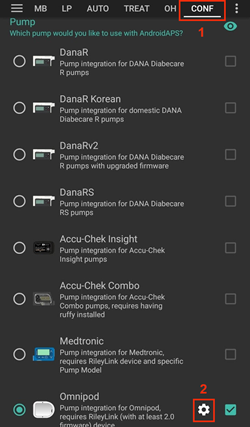 

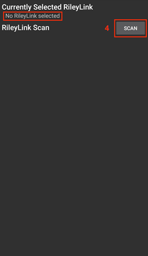 


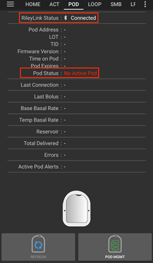

```{admonition} Older screenshot
:class: note
De seks skærmbilleder ovenfor (efter trin 6) er fra en tidligere version af **AAPS**. I **AAPS** 4 parrer du RileyLink med knappen **Par RileyLink** på Omnipod-pumpeskærmen i stedet for **RileyLink Configuration** i Omnipod-indstillingerne, og søgningen starter automatisk.
```

```{note}
For at skifte til en anden RileyLink (f.eks. en reserveenhed) skal du trykke på **Par RileyLink** igen og vælge den nye enhed. Den erstatter den, der var parret før. Du behøver ikke fjerne den gamle enhed først.
```

(OmnipodEros-activating-a-pod)=

### Aktivering af en pod

Før du kan aktivere en pod, skal du sikre dig, at din RileyLink er parret, og at **RileyLink-status** viser **Tilsluttet**. Knappen **Aktiver Pod** er ikke aktiv, før RileyLink er klar.

*PÅMINDELSE: Af sikkerhedshensyn virker kommunikationen med poden kun på kort afstand ved parring under aktivering. Før parringen er podens radiosignal svagere. Når den er parret, sender den med fuld styrke. Under disse procedurer skal du sikre dig, at din pod er* [tæt på](#OmnipodEros-optimal-omnipod-and-rileylink-positioning) *(ca. 30 cm eller mindre), men ikke oven på eller lige ved siden af RileyLink.*

01. Åbn Omnipod-pumpeskærmen (**Administrer** > **Pumpe**), og tryk på **Aktiver Pod**.

    Hvis du aldrig har aktiveret en profil, vises først trinnet **Profil påkrævet**. Vælg den profil, der skal bruges ved aktiveringen.

    > 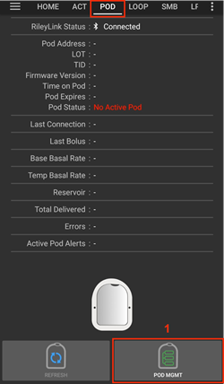 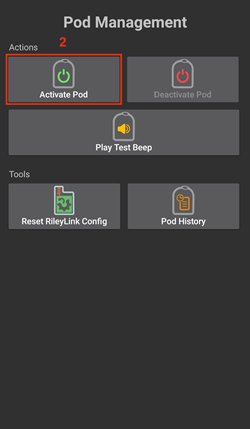 
    > 
    > ```{admonition} Older screenshot
    >     :class: note
    >     Skærmbillederne ovenfor er fra en tidligere version af **AAPS**. I **AAPS** 4 er **Aktiver Pod** en knap på Omnipod-pumpeskærmen i stedet for i menuen **POD MGMT**.
    > ```

02. Skærmen **Fyld Pod** vises. Fyld en ny pod med insulin nok til 3 dage, og lyt efter to bip. De betyder, at minimumsmængden på 80 IE er fyldt i. Tøm påfyldningssprøjten helt, også efter du har hørt de to bip. Når du beregner, hvor meget insulin du skal bruge til 3 dage, skal du huske, at klargøring af poden bruger 12 til 15 IE. Fjern ikke podens nålehætte endnu.

    > 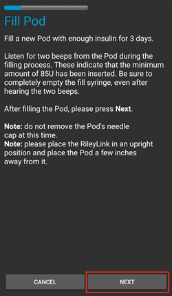
    > 
    > Sørg for, at den nye pod og RileyLink er tæt på hinanden (ca. 30 cm eller mindre), og tryk på **Næste**.

03. **Vælg insulin** (vises kun, hvis du har mere end én insulin konfigureret): vælg den insulin, du fylder i poden, og tryk på **Næste**. Et profilskift med denne insulin udføres efter aktiveringen.

04. På skærmen **Initialiser Pod** begynder poden at klargøre (du hører et klik og derefter en række tikkende lyde, mens poden klargør sig selv). Hvis RileyLink er uden for rækkevidde af den pod, der aktiveres, får du fejlmeddelelsen **Intet svar fra pod**. Hvis det sker, så [flyt RileyLink tættere](#OmnipodEros-optimal-omnipod-and-rileylink-positioning) på poden (ca. 30 cm eller mindre), men ikke oven på eller lige ved siden af den, og tryk på **Prøv igen**.

    > 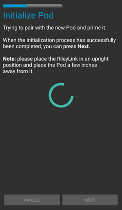 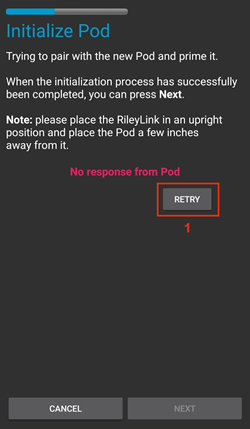

05. Når klargøringen er lykkedes, vises et grønt flueben, og knappen **Næste** bliver aktiv. Tryk på **Næste**.

    > 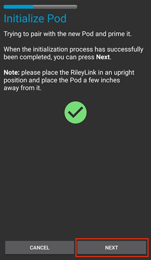

06. **Indstikssted** (vises kun, hvis **Administrer rotation af indstikssted for pumpe** er aktiveret i [Rotation af indstikssteder](#Aapsscreens-site-rotation)): vælg, hvor på kroppen du sætter poden, og tryk på **Næste**.

07. Skærmen **Påsæt Pod** vises. Gør indstiksstedet klar til den nye pod. Fjern podens nålehætte af plast og det hvide papir fra klæbefladen, og sæt poden på det valgte sted på kroppen. Hvis kanylen stikker ud, så tryk på **Annuller**, og kassér poden. Når du er færdig, så tryk på **Næste**.

    > 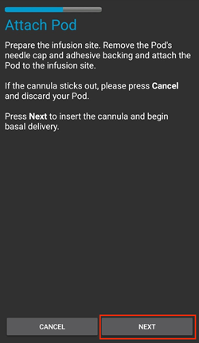

08. En bekræftelsesdialog vises: »Når du trykker på OK, vil kanylen blive indsat«. **Tryk KUN på OK, hvis du er klar til at indføre kanylen**.

    > 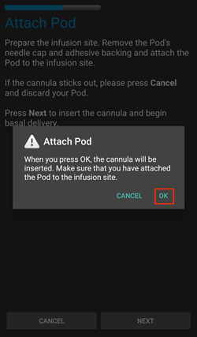

09. På skærmen **Indfør kanyle** kan det tage lidt tid, før Omnipod svarer og indfører kanylen (højst 1-2 minutter), så vær tålmodig.

    > Hvis RileyLink er uden for rækkevidde af den pod, der aktiveres, får du fejlmeddelelsen **Intet svar fra pod**. Hvis det sker, så flyt RileyLink tættere på poden (ca. 30 cm eller mindre), men ikke oven på eller lige ved siden af den, og tryk på **Prøv igen**.
    > 
    > Hvis RileyLink er uden for Bluetooth-rækkevidde eller ikke har en aktiv forbindelse til telefonen, får du fejlmeddelelsen **Intet svar fra RileyLink**. Hvis det sker, så flyt RileyLink tættere på telefonen, og tryk på **Prøv igen**.
    > 
    > *BEMÆRK: Før kanylen indføres, er det en god idé at klemme huden nær det sted, hvor kanylen skal ind. Det giver en jævn indføring af nålen og mindsker risikoen for tilstopning.*
    > 
    > 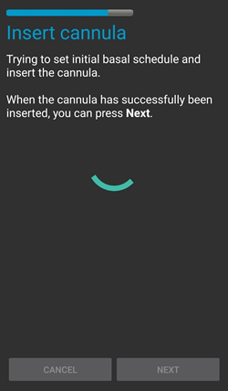
    > 
    >  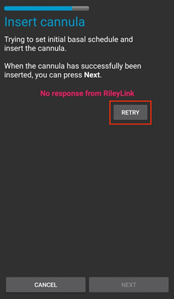

10. Et grønt flueben vises, og knappen **Næste** bliver aktiv, når kanylen er indført. Tryk på **Næste**.

    > 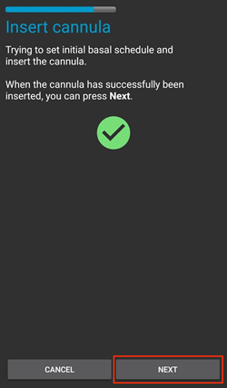

11. Skærmen **Pod aktiveret** vises. Tjek, at kanylen er indført korrekt, og skift din pod, hvis du tror, at den ikke er. Tryk på **Færdig**. Tillykke! Du har nu startet en ny aktiv pod-session.

    > 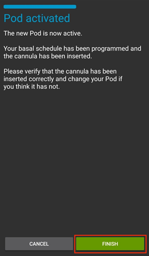 
    > 
    > ```{admonition} Older screenshot
    >     :class: note
    >     Skærmbillederne i trin 2 til 11 er fra en tidligere version af **AAPS** og kan se anderledes ud i **AAPS** 4. Trinnene **Vælg insulin** og **Indstikssted** er ikke vist på billeder.
    > ```

12. Du kommer tilbage til Omnipod-pumpeskærmen. Knappen **Aktiver Pod** erstattes af **Deaktiver Pod**, fordi du ikke kan aktivere en anden pod uden først at deaktivere den aktive.

    Pumpeskærmen viser nu oplysninger om din aktive pod, bl.a. den aktuelle basalrate, reservoirniveau, leveret insulin, pod-fejl og alarmer. Se afsnittet [Omnipod-pumpeskærmen](#OmnipodEros-omnipod-pod-tab) for flere detaljer.

    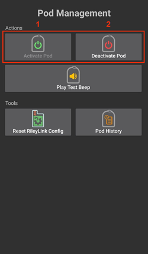 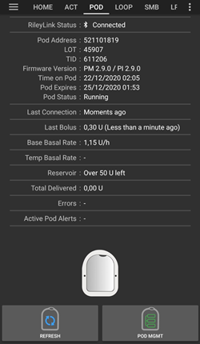

    ```{admonition} Older screenshot
    :class: note
    Skærmbillederne ovenfor er fra en tidligere version af **AAPS**. I **AAPS** 4 er der ingen menu til pod-administration: du kommer direkte tilbage til Omnipod-pumpeskærmen, hvor **Deaktiver Pod** erstatter **Aktiver Pod**.
    ```

```{note}
Hvis aktiveringen blev afbrudt efter klargøringen (f.eks. fordi appen blev lukket), så tryk på **Aktiver Pod** igen. Guiden fortsætter fra trinnene for indføring af kanylen.
```

### Deaktivering af en pod

Normalt holder en pod i tre dage (72 timer) plus 8 timer efter advarslen om, at poden udløber, i alt 80 timers brug.

Sådan deaktiverer du en pod (enten fordi den er udløbet, eller fordi den har fejl):

1. Åbn Omnipod-pumpeskærmen (**Administrer** > **Pumpe**), og tryk på **Deaktiver Pod**.

   > 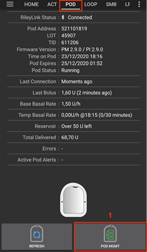 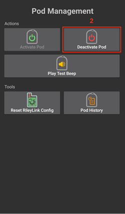 
   > 
   > ```{admonition} Older screenshot
   >    :class: note
   >    Skærmbillederne ovenfor er fra en tidligere version af **AAPS**. I **AAPS** 4 er **Deaktiver Pod** en knap på Omnipod-pumpeskærmen i stedet for i menuen **POD MGMT**.
   > ```

2. På skærmen **Deaktiver Pod** skal du først sikre dig, at RileyLink er tæt på poden, men ikke oven på eller lige ved siden af den. Tryk derefter på **Næste**. En dialog spørger *En deaktiveret Pod kan ikke bruges igen. Deaktiver denne Pod nu?* Tryk på **OK** for at begynde at deaktivere poden eller på **Annuller** for at beholde den. Deaktivering suspenderer al insulintilførsel og kan ikke fortrydes.

   > 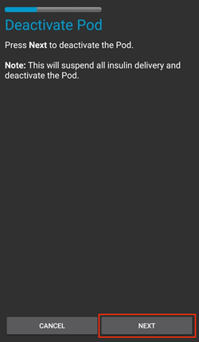

3. Skærmen **Deaktiverer Pod** vises, og poden bipper for at bekræfte, at deaktiveringen lykkedes.

   > 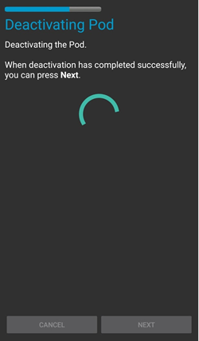
   > 
   > **HVIS deaktiveringen mislykkes**, og du ikke får et bekræftelsesbip, får du måske meddelelsen **Intet svar fra RileyLink** eller **Intet svar fra pod**. Tryk på **Prøv igen** for at prøve at deaktivere igen. Hvis deaktiveringen bliver ved med at mislykkes, så tryk på **Kassér Pod**, og bekræft. **AAPS** glemmer derefter poden. Insulintilførslen er **ikke** suspenderet, så fjern poden fra kroppen. Hvis din pod hyler med en alarm, skal du måske stoppe den manuelt (med en nål eller en papirclips), fordi **Kassér Pod** ikke stopper den.
   > 
   > > 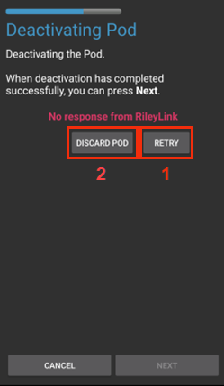  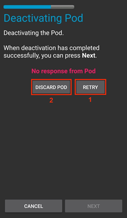

4. Et grønt flueben vises, når deaktiveringen er lykkedes. Tryk på **Næste** for at vise skærmen **Pod deaktiveret**. Du kan nu fjerne din pod, da den aktive session er deaktiveret.

   > 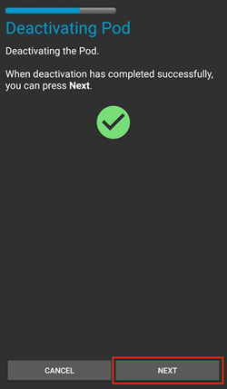

5. Tryk på **Færdig** for at komme tilbage til Omnipod-pumpeskærmen.

   > 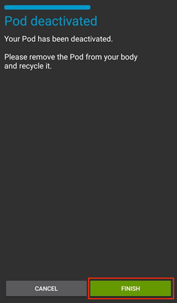 
   > 
   > ```{admonition} Older screenshot
   >    :class: note
   >    Skærmbillederne i trin 2 til 5 er fra en tidligere version af **AAPS** og kan se anderledes ud i **AAPS** 4.
   > ```

6. Tjek på Omnipod-pumpeskærmen, at **RileyLink-status** viser **Tilsluttet**, og at **Pod-status** viser **Ingen aktiv pod**.

   > 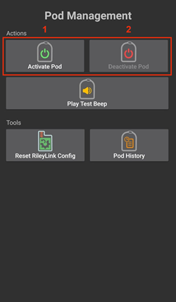   
   > 
   > ```{admonition} Older screenshot
   >    :class: note
   >    Skærmbillederne ovenfor er fra en tidligere version af **AAPS**. I **AAPS** 4 kommer du med **Færdig** direkte tilbage til Omnipod-pumpeskærmen; der er ingen menu til pod-administration og ingen fane **Omnipod (POD)**.
   > ```

### Suspendering og genoptagelse af insulintilførsel

Processen nedenfor viser, hvordan du suspenderer og genoptager insulintilførslen.

*BEMÆRK - hvis du ikke ser en knap **Suspender***, er den skjult som standard. Enable **Show Suspend Delivery button on the pump screen** in the [Omnipod settings](#OmnipodEros-omnipod-settings) under **Other**.

#### Suspendering af insulintilførsel

Brug denne kommando til at sætte den aktive pod i suspenderet tilstand. I suspenderet tilstand leverer poden ikke længere insulin. Kommandoen efterligner suspenderingsfunktionen, som den originale Omnipod PDM sender til en aktiv pod.

1. Åbn Omnipod-pumpeskærmen (**Administrer** > **Pumpe**), og tryk på **Suspender**. Kommandoen om at suspendere sendes gennem RileyLink til den aktive pod.

2. Når poden har stoppet al insulintilførsel, viser **Pod-status** **Sat på pause**, og knappen **Suspender** erstattes af **Genoptag insulinafgivelse**.

   > 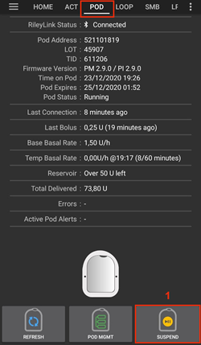 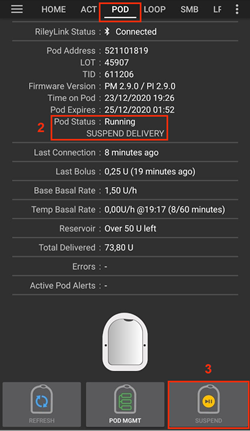
   > 
   > 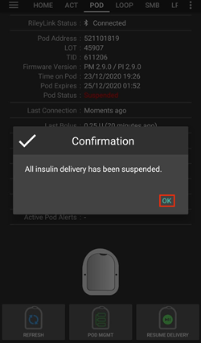
   > 
   > 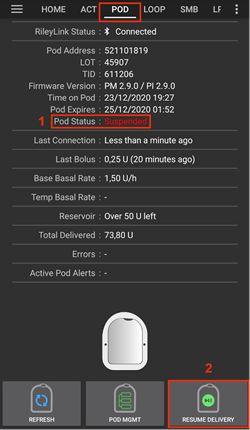 
   > 
   > ```{admonition} Older screenshot
   >    :class: note
   >    Skærmbillederne ovenfor er fra en tidligere version af **AAPS**. I **AAPS** 4 foregår disse trin på Omnipod-pumpeskærmen i stedet for på fanen **Omnipod (POD)**, og resultatet vises i **Pod-status**.
   > ```

Hvis kommandoen mislykkes, viser en dialog **Advarsel** »Kunne ikke suspendere insulinafgivelse« med årsagen. Tjek forbindelsen til RileyLink, og prøv igen.

#### Genoptagelse af insulintilførsel

Brug denne kommando til at bede den aktive, suspenderede pod om at genoptage insulintilførslen. Når kommandoen er udført, genoptager poden normal insulintilførsel med den aktuelle basalrate fra den aktive basalprofil, ud fra det aktuelle klokkeslæt. Poden accepterer igen kommandoer for bolus, TBR og SMB.

1. Åbn Omnipod-pumpeskærmen, og tjek, at **Pod-status** viser **Sat på pause**. Tryk på **Genoptag insulinafgivelse**.

2. Når kommandoen lykkes, viser **Pod-status** igen **Kører**, og knappen **Genoptag insulinafgivelse** forsvinder (knappen **Suspender** vises igen, hvis du har aktiveret den).

   > 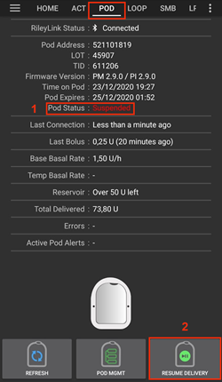 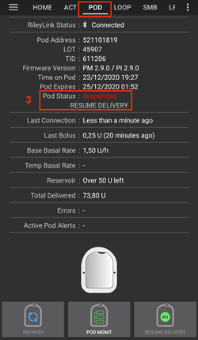
   > 
   > 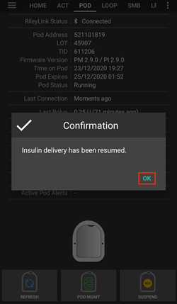
   > 
   > 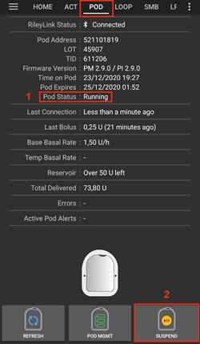 
   > 
   > ```{admonition} Older screenshot
   >    :class: note
   >    Skærmbillederne ovenfor er fra en tidligere version af **AAPS**. I **AAPS** 4 foregår disse trin på Omnipod-pumpeskærmen i stedet for på fanen **Omnipod (POD)**, og resultatet vises i **Pod-status**.
   > ```

Hvis kommandoen mislykkes, viser en dialog **Advarsel** »Kunne ikke genoptage insulinafgivelse« med årsagen. Tjek forbindelsen til RileyLink, og prøv igen.

### Gør pod-alarmer lydløse

*BEMÆRK - Knappen **Gør alarmer lydløse** vises kun på Omnipod-pumpeskærmen, mens poden har en aktiv alarm (f.eks. alarmen om at poden udløber eller om lavt reservoir), og kun hvis **Automatisk lydløse Pod alarmer** er deaktiveret.*

Processen nedenfor viser, hvordan du stopper pod-bip, som starter, når poden når advarselstiden, før den udløber. Denne advarselstid indstilles med **Advarsel i timer før nedlukning (80 timer)** i Omnipod-indstillingerne under **Alarmer**. En pod kan højst holde i 80 timer (3 dage og 8 timer), men Insulet anbefaler ikke at gå over grænsen på 72 timer (3 dage).

*BEMÆRK - Hvis du har aktiveret **Automatisk lydløse Pod alarmer** i Omnipod-indstillingerne under **Alarmer**, gør **AAPS** alarmen lydløs automatisk ved næste kommunikation med poden, og du behøver IKKE gøre det manuelt.*

1. Når advarselstiden er nået, bipper poden for at fortælle dig, at den snart udløber og skal skiftes. På Omnipod-pumpeskærmen viser **Pod udløber** det præcise tidspunkt, hvor poden udløber (72 timer efter aktivering). Feltet bliver **gult** 4 timer før. **Pod stopper endeligt** viser, hvornår poden holder op med at levere insulin. **Aktive pod alarmer** viser **Pod udløber snart**, og knappen **Gør alarmer lydløse** vises. **AAPS** viser også en notifikation om, at poden snart udløber.

   > 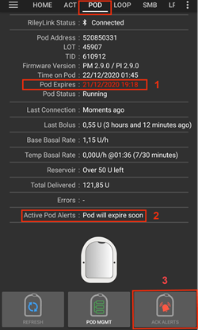 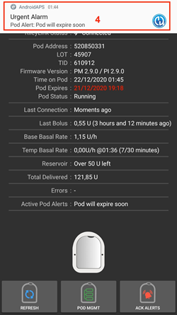 
   > 
   > ```{admonition} Older screenshot
   >    :class: note
   >    Skærmbillederne ovenfor er fra en tidligere version af **AAPS**. I **AAPS** 4 hedder knappen **ACK ALERTS** nu **Gør alarmer lydløse** og findes på Omnipod-pumpeskærmen.
   > ```

2. Tryk på **Gør alarmer lydløse**. RileyLink sender kommandoen til poden om at stoppe advarselsbippene om udløb.

   > 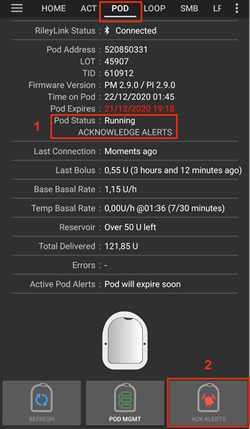 
   > 
   > ```{admonition} Older screenshot
   >    :class: note
   >    Skærmbilledet ovenfor er fra en tidligere **AAPS**-version. I **AAPS** 4 hedder knappen **Gør alarmer lydløse**.
   > ```

3. Når alarmerne er gjort lydløse, bipper poden to gange. **Aktive pod alarmer** viser ikke længere advarslen, knappen **Gør alarmer lydløse** forsvinder, og poden stopper sine advarselsbip om udløb.

   > 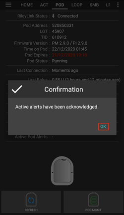 
   > 
   > ```{admonition} Older screenshot
   >    :class: note
   >    Skærmbilledet ovenfor er fra en tidligere **AAPS**-version. I **AAPS** 4 vises resultatet på Omnipod-pumpeskærmen: advarslen forsvinder fra **Aktive pod alarmer**.
   > ```

Hvis kommandoen mislykkes (f.eks. fordi RileyLink er uden for podens rækkevidde), viser en dialog **Advarsel** »Det lykkedes ikke at gøre alarmer lydløse« med årsagen. Flyt RileyLink tættere på poden, og prøv igen.

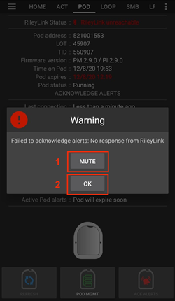

```{admonition} Older screenshot
:class: note
Skærmbilledet ovenfor er fra en tidligere **AAPS**-version. I **AAPS** 4 viser dialogen **Advarsel** »Det lykkedes ikke at gøre alarmer lydløse« med årsagen.
```

(OmnipodEros-view-pod-history)=

### Se pod-historik

Dette afsnit viser, hvordan du gennemgår historikken for din aktive pod og filtrerer efter forskellige kategorier af handlinger. Med pod-historikken kan du se de handlinger og resultater, som er sendt til din aktive pod i dens levetid på tre dage (72 - 80 timer).

Funktionen er nyttig til at tjekke boluser, TBR'er og basalændringer, som blev givet, men hvor du er usikker på, om de blev gennemført. De andre kategorier er generelt nyttige til fejlfinding og til at finde rækkefølgen af de hændelser, som førte op til en fejl.

*BEMÆRK:* **Usikre** kommandoer vises i pod-historikken, men på grund af deres natur kan du ikke være sikker på, at de er korrekte.

1. Åbn Omnipod-pumpeskærmen (**Administrer** > **Pumpe**), og tryk på **Pod-historik**.

   > 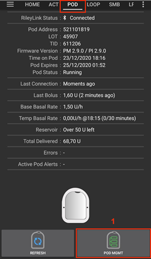 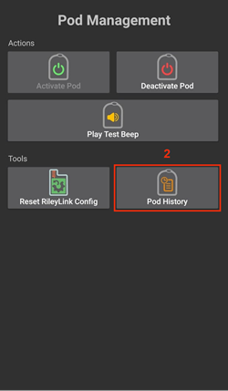 
   > 
   > ```{admonition} Older screenshot
   >    :class: note
   >    Skærmbillederne ovenfor er fra en tidligere version af **AAPS**. I **AAPS** 4 er **Pod-historik** en knap på Omnipod-pumpeskærmen i stedet for i menuen **POD MGMT**.
   > ```

2. Skærmen **Pod-historik** viser alle pod-handlinger og deres resultater, nyeste først, grupperet efter dag. Som standard er **Alle** valgt. Tryk på en af filterknapperne øverst for kun at vise én kategori. Brug tilbagepilen øverst til venstre for at komme tilbage til Omnipod-pumpeskærmen.

   > 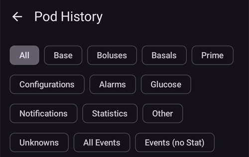

   > 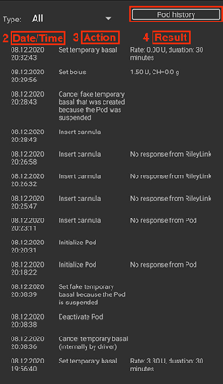 
   > 
   > ```{admonition} Older screenshot
   >    :class: note
   >    Det andet skærmbillede er fra en tidligere version af **AAPS** og kan se anderledes ud i **AAPS** 4.
   > ```

### Vis RileyLink-indstillinger og -historik

Skærmen **RileyLink-statistik** viser indstillingerne for din RileyLink og den aktive pod samt kommunikationshistorikken for begge. Den har to faner: **Indstillinger** og **Historik**.

Knappen **RileyLink-statistik** er skjult som standard. For at vise den på Omnipod-pumpeskærmen skal du aktivere **Vis knappen RileyLink-statistik i menuen til Pod-administration** i [Omnipod-indstillingerne](#OmnipodEros-omnipod-settings) under **Andet**.

#### Genopret Bluetooth-forbindelsen til pod-kommunikationsenheden manuelt

Hvis din pod-kommunikationsenhed har været uden for telefonens Bluetooth-rækkevidde et stykke tid, kan **RileyLink-status** vise **RileyLink utilgængelig** på Omnipod-pumpeskærmen. **AAPS** forbinder normalt igen af sig selv, når enheden er inden for rækkevidde igen. Hvis den ikke gør:

1. Sørg for, at RileyLink er tændt, opladet og tæt på din telefon.

2. Tryk på **Nulstil RileyLink** på Omnipod-pumpeskærmen. En meddelelse bekræfter **RileyLink-konfiguration nulstillet**. Se [noterne om Nulstil RileyLink](#OmnipodEros-reset-rileylink-config-notes) nedenfor.

3. Hvis **Bluetooth-forbindelsen** ikke kommer igen, så prøv at slå Bluetooth på din telefon **fra** og derefter **til** igen.

4. Hvis den stadig ikke forbinder igen, så tryk på **Par RileyLink**, og vælg din RileyLink igen.

5. Når forbindelsen er genoprettet, viser **RileyLink-status** **Tilsluttet**. Du kan også tjekke **Forbindelsesstatus** på fanen **Indstillinger** på skærmen **RileyLink-statistik**. Tillykke, du har nu forbundet din pod-kommunikationsenhed til AAPS igen!

 


```{admonition} Older screenshot
:class: note
Skærmbillederne ovenfor er fra en tidligere version af **AAPS**. I **AAPS** 4 forbinder du igen med **Nulstil RileyLink** eller **Par RileyLink** på Omnipod-pumpeskærmen i stedet for opdateringsknappen på skærmen RileyLink Settings.
```

#### Indstillinger for pod-kommunikationsenhed og aktiv pod

Denne skærm viser oplysninger og status for både den parrede pod-kommunikationsenhed og den aktive Omnipod Eros-pod. Oplysningerne opdateres automatisk.

1. Åbn Omnipod-pumpeskærmen (**Administrer** > **Pumpe**), og tryk på **RileyLink-statistik**. Fanen **Indstillinger** viser din parrede **RileyLink** og den aktive pod (**Enhed**).

   >   
   > 
   > ```{admonition} Older screenshot
   >    :class: note
   >    Skærmbillederne ovenfor er fra en tidligere version af **AAPS**. I **AAPS** 4 er **RileyLink-statistik** en knap på Omnipod-pumpeskærmen i stedet for i menuen **POD MGMT**.
   > ```

   > 

##### RileyLink-felter

> - **Adresse:** MAC-adressen på den parrede pod-kommunikationsenhed.
> - **Navn:** Bluetooth-navnet på den parrede pod-kommunikationsenhed.
> - **Batteriniveau:** Det aktuelle batteriniveau på den forbundne pod-kommunikationsenhed. Vises kun, når **Vis batteriniveau rapporteret af OrangeLink/EmaLink/DiaLink** er aktiveret.
> - **Forbindelsesstatus**: Den aktuelle status for Bluetooth-forbindelsen mellem pod-kommunikationsenheden og telefonen med AAPS.
> - **Forbindelsesfejl:** Hvis der er en fejl i Bluetooth-forbindelsen til pod-kommunikationsenheden, vises detaljerne her.
> - **Firmwareversion:** Den firmwareversion, som er installeret på den forbundne pod-kommunikationsenhed.

##### Enhedsfelter - med en aktiv pod

> - **Enhedstype:** Typen af den enhed, som kommunikerer med pod-kommunikationsenheden (Omnipod (Eros)).
> - **Konfigureret Enhedsmodel:** Modellen af den enhed, som er konfigureret til at kommunikere med pod-kommunikationsenheden.
> - **Forbundet Enhedsmodel:** Modellen af den enhed, som lige nu kommunikerer med pod-kommunikationsenheden.
> - **Pumpens serienummer:** Serienummeret på den aktive pod.
> - **Pumpefrekvens:** Radiofrekvensen, som bruges til at kommunikere med poden.
> - **Sidst anvendt frekvens:** Den senest kendte radiofrekvens, som poden brugte til at kommunikere med pod-kommunikationsenheden.
> - **Seneste enhedskontakt:** Dato og tid for podens seneste kontakt med pod-kommunikationsenheden.

(omnipod-eros-rileylink-and-active-pod-history)=
#### Historik for RileyLink og aktiv pod

Denne fane viser hver tilstand eller handling for RileyLink eller den forbundne pod, nyeste først. Historikken findes kun for den aktive pod. Efter et podskift slettes denne historik, og kun hændelser fra den nye pod gemmes og vises.

1. Åbn Omnipod-pumpeskærmen (**Administrer** > **Pumpe**), tryk på **RileyLink-statistik**, og tryk derefter på fanen **Historik**.

   >   
   > 
   > ```{admonition} Older screenshot
   >    :class: note
   >    Skærmbillederne ovenfor er fra en tidligere version af **AAPS**. I **AAPS** 4 er **RileyLink-statistik** en knap på Omnipod-pumpeskærmen i stedet for i menuen **POD MGMT**.
   > ```

   > 

##### Felter

Hver post viser:

> - **Enhed:** Den enhed, som handlingen eller tilstanden gælder.
> - **Tid:** Tidspunktet for hændelsen.
> - **Tilstand eller handling:** Enhedens tilstand eller den handling, den udførte.

(OmnipodEros-omnipod-pod-tab)=

## Omnipod-pumpeskærmen

Her er en forklaring på statusfelterne og knapperne på **Omnipod-pumpeskærmen** (**Administrer** > **Pumpe**, eller **Konfiguration** > **Pumpe** > **Åbn plugin**).

Tandhjulsikonet øverst til højre åbner [Omnipod-indstillingerne](#OmnipodEros-omnipod-settings).

*BEMÆRK: Hvis et statusfelt viser (usikker), så tryk på **Opdater** for at opdatere pod-status og fjerne det.*


```{admonition} Older screenshot
:class: note
Skærmbilledet ovenfor er fra en tidligere version af **AAPS**, hvor denne skærm var fanen **Omnipod (POD)**. I **AAPS** 4 er det Omnipod-pumpeskærmen, og nogle feltnavne og knapper er anderledes.
```

### Felter

- **RileyLink-status:** Viser den aktuelle forbindelsesstatus for RileyLink. Fejl vises med rødt.

- *Ikke startet* - der er endnu ikke parret en RileyLink, eller forbindelsen er ikke startet.
- *RileyLink utilgængelig* - pod-kommunikationsenheden er enten uden for telefonens Bluetooth-rækkevidde, slukket eller har en fejl, som forhindrer Bluetooth-kommunikation.
- *RileyLink klar* - pod-kommunikationsenheden er tændt og er ved at starte Bluetooth-forbindelsen.
- *Tilsluttet* - pod-kommunikationsenheden er tændt, forbundet og kan kommunikere via Bluetooth.

- **Unikt ID:** Viser adressen på den aktive pod.

- **LOT nummer:** Viser LOT-nummeret på den aktive pod.

- **Sekvensnummer:** Viser podens serienummer (TID).

- **Firmwareversion:** Viser firmwareversionen på den aktive pod.

- **Tid på Pod:** Viser det aktuelle klokkeslæt på den aktive pod. Det fremhæves, når det afviger mere end 5 minutter fra telefonens tid.

- **Pod udløber:** Viser dato og tid for, hvornår den aktive pod udløber. Teksten bliver gul i de sidste 4 timer før dette tidspunkt. Den bliver aldrig rød, fordi poden fortsætter med at tilføre insulin efter dette tidspunkt.

- **Pod stopper endeligt:** Viser slutningen af podens ekstra tid (8 timer efter **Pod udløber**, så poden højst holder i 80 timer). Teksten bliver gul, når den ekstra tid starter (ved **Pod udløber**), og rød i de sidste 4 timer før det endelige stop. I den ekstra tid viser feltet også den resterende tid, f.eks. *(17m tilbage)*. Poden stopper med at tilføre insulin ved det endelige stop og skal skiftes.

- **Pod-status:** Viser status for den aktive pod (f.eks. **Ingen aktiv pod**, **Kører** eller **Sat på pause**).

- **Seneste forbindelse:** Viser seneste tidspunkt, hvor der var kommunikation med den aktive pod. Teksten bliver rød, når [grænsen for utilgængelig pumpe](#OmnipodEros-troubleshooting) er overskredet.

- *Lige nu* - for mindre end 20 sekunder siden.
- *For mindre end et minut siden* - for mere end 20 sekunder, men mindre end 60 sekunder siden.
- *For 1 minut siden* - for mere end 60 sekunder, men mindre end 120 sekunder (2 min) siden
- *For XX minutter siden* - for mere end 2 minutter siden, som angivet af værdien XX

- **Seneste bolus:** Viser dosis for den seneste bolus, som er sendt til den aktive pod, og hvor længe siden det var, i parentes.

- **Standardbasalrate:** Viser den basalrate, der er programmeret for det aktuelle tidspunkt i basalprofilen.

- **Midlertidig basal rate:** Vises kun, mens en midlertidig basalrate kører. Vises i dette format:

- Enheder / time @ tidspunkt, hvor TBR blev sendt (minutter kørt / samlede minutter TBR vil køre)
- *Eksempel:* 0.00U/h @18:25 ( 90/120 minutes)

- **Reservoir:** Viser **Over 50 IE tilbage**, når der er mere end 50 IE tilbage i reservoiret. Under denne værdi vises det omtrentlige antal enheder. Teksten bliver rød under grænsen for lavt reservoir, som er sat i [indstillingerne for alarmer](#OmnipodEros-omnipod-settings).

- **Total afgivet:** Viser det samlede antal enheder insulin, som er leveret fra reservoiret. *Bemærk, at dette er et skøn, da klargøring og påfyldning af poden ikke er en præcis proces.*

- **Aktive pod alarmer:** Viser de alarmer, som kører på den aktive pod lige nu. Bruges normalt, når poden er over 72 timer gammel, og podens egne bip-alarmer kører.

- **Fejl:** Viser den seneste fejl (vises med rødt). Se [pod-historikken](#OmnipodEros-view-pod-history), [RileyLink-historikken](#omnipod-eros-rileylink-and-active-pod-history) og logfilerne for tidligere fejl og mere detaljeret information.

### Knapper

Knapperne nederst på pumpeskærmen skifter efter situationen. Knapper, som ikke kan bruges lige nu, er grå, f.eks. mens RileyLink ikke er forbundet.

**Knapper til pod-status** (vises, når en pod er aktiv):

- **Opdater:** Sender en opdateringskommando til den aktive pod for at opdatere dens status. Brug den til at opdatere pod-status og fjerne teksten (usikker) fra statusfelter. Se [afsnittet om fejlfinding](#OmnipodEros-troubleshooting) nedenfor for mere information.

  

  ```{admonition} Older screenshot
  :class: note
  Skærmbilledet ovenfor er fra en tidligere version af **AAPS**. I **AAPS** 4 er dette en tekstknap med navnet **Opdater** på Omnipod-pumpeskærmen.
  ```

- **Gør alarmer lydløse:** Gør bip og notifikationer om podens udløb og lavt reservoir lydløse. Vises kun, når poden har en aktiv alarm, og **Automatisk lydløse Pod alarmer** er deaktiveret. Når alarmerne er gjort lydløse, forsvinder knappen.

  

  ```{admonition} Older screenshot
  :class: note
  Skærmbilledet ovenfor er fra en tidligere version af **AAPS**. I **AAPS** 4 hedder denne knap **Gør alarmer lydløse**.
  ```

- **Sæt tid:** Opdaterer tiden på poden med den aktuelle tid på din telefon. Vises kun, når tiden på poden afviger mere end 5 minutter fra telefonens tid.

  

  ```{admonition} Older screenshot
  :class: note
  Skærmbilledet ovenfor er fra en tidligere version af **AAPS**. I **AAPS** 4 er dette en tekstknap med navnet **Sæt tid** på Omnipod-pumpeskærmen.
  ```

- **Suspender:** Suspenderer insulintilførslen på den aktive pod. Only shown if enabled in the settings (**Show Suspend Delivery button on the pump screen**).

  

  ```{admonition} Older screenshot
  :class: note
  Skærmbilledet ovenfor er fra en tidligere version af **AAPS**. I **AAPS** 4 er dette en tekstknap med navnet **Suspender** på Omnipod-pumpeskærmen.
  ```

- **Genoptag insulinafgivelse:** Genoptager insulintilførslen på den aktive pod, som er sat på pause. Vises kun, mens poden er sat på pause.

  

  ```{admonition} Older screenshot
  :class: note
  Skærmbilledet ovenfor er fra en tidligere version af **AAPS**. I **AAPS** 4 er dette en tekstknap med navnet **Genoptag insulinafgivelse** på Omnipod-pumpeskærmen.
  ```

**Knapper til administration af pod og RileyLink:**


```{admonition} Older screenshot
:class: note
Skærmbilledet ovenfor er fra en tidligere **AAPS**-version. I **AAPS** 4 er der ingen menu til pod-administration: disse handlinger er knapper direkte på Omnipod-pumpeskærmen.
```

- **Aktiver Pod:** Klargør og aktiverer en ny pod. Vises, når ingen pod er aktiv. Den er kun aktiv, når RileyLink er forbundet.

  

  ```{admonition} Older screenshot
  :class: note
  Skærmbilledet ovenfor er fra en tidligere version af **AAPS**. I **AAPS** 4 er **Aktiver Pod** en knap på Omnipod-pumpeskærmen i stedet for i menuen til pod-administration.
  ```

- **Deaktiver Pod:** Deaktiverer den aktive pod. Vises, så snart en pod er parret, også når en aktivering stoppede halvvejs (f.eks. fordi poden fik en fejl under aktiveringen). Den er kun aktiv, når RileyLink er forbundet. **AAPS** beder dig bekræfte, før den deaktiverer poden.

- Brug denne kommando til at deaktivere en hylende pod (fejl 49).
- Hvis deaktiveringen mislykkes, tilbyder deaktiveringsguiden muligheden **Kassér Pod**.

  

  ```{admonition} Older screenshot
  :class: note
  Skærmbilledet ovenfor er fra en tidligere version af **AAPS**. I **AAPS** 4 er **Deaktiver Pod** en knap på Omnipod-pumpeskærmen i stedet for i menuen til pod-administration.
  ```

- **Afspil test bip:** Afspiller et enkelt test-bip på poden, når du trykker. Vises, når en pod er parret.

  

  ```{admonition} Older screenshot
  :class: note
  Skærmbilledet ovenfor er fra en tidligere version af **AAPS**. I **AAPS** 4 er **Afspil test bip** en knap på Omnipod-pumpeskærmen i stedet for i menuen til pod-administration.
  ```

- **Pod-historik:** Viser aktivitetshistorikken for den aktive pod. Se [Vis pod-historik](#OmnipodEros-view-pod-history).

  

  ```{admonition} Older screenshot
  :class: note
  Skærmbilledet ovenfor er fra en tidligere version af **AAPS**. I **AAPS** 4 er **Pod-historik** en knap på Omnipod-pumpeskærmen i stedet for i menuen til pod-administration.
  ```

- **Par RileyLink:** Søger efter din pod-kommunikationsenhed og parrer den. Se [Opsætning af RileyLink](#OmnipodEros-rileylink-setup).

- **RileyLink-statistik:** Åbner skærmen RileyLink-statistik med to faner. Vises kun, hvis det er aktiveret i indstillingerne (**Vis knappen RileyLink-statistik i menuen til Pod-administration**).

- **Indstillinger** - viser oplysninger om indstillinger for RileyLink og den aktive pod
- **Historik** - viser historik for kommunikationen med RileyLink og pod

  

  ```{admonition} Older screenshot
  :class: note
  Skærmbilledet ovenfor er fra en tidligere version af **AAPS**. I **AAPS** 4 er **RileyLink-statistik** en knap på Omnipod-pumpeskærmen i stedet for i menuen til pod-administration.
  ```

- **Nulstil RileyLink:** Nulstiller konfigurationen af den forbundne pod-kommunikationsenhed. Når kommunikationen startes, sendes bestemte data til RileyLink og sættes i den:

- Hukommelsesregistre sættes
- Kommunikationsprotokoller sættes
- Indstillet radiofrekvens sættes
  > 
  > Se [yderligere noter](#OmnipodEros-reset-rileylink-config-notes) nedenfor.

  

  ```{admonition} Older screenshot
  :class: note
  Skærmbilledet ovenfor er fra en tidligere version af **AAPS**. I **AAPS** 4 hedder denne knap **Nulstil RileyLink** og findes på Omnipod-pumpeskærmen.
  ```

- **Kassér Pod:** Kasserer pod-tilstanden for en pod, som ikke svarer, efter en bekræftelse. Vises kun, når en pod er startet, men ikke helt parret, da korrekt deaktivering så ikke længere er mulig:

- En **pod er ikke helt parret** og ignorerer derfor kommandoer om deaktivering.
- En **pod sidder fast** mellem to trin i parringen.
- En **pod parrer slet ikke.**
  > 
  > Når du har kasseret en pod, kan **AAPS** ikke længere kommunikere med den. Fjern poden fra kroppen.

  

  ```{admonition} Older screenshot
  :class: note
  Skærmbilledet ovenfor er fra en tidligere version af **AAPS**. I **AAPS** 4 er **Kassér Pod** en knap på Omnipod-pumpeskærmen i stedet for i menuen til pod-administration.
  ```

(OmnipodEros-reset-rileylink-config-notes)=

#### *Noter om Nulstil RileyLink*

- Funktionen bruges mest, når den aktive pod-kommunikationsenhed ikke svarer, og kommunikationen sidder fast.
- Hvis pod-kommunikationsenheden slukkes og tændes igen, så tryk på **Nulstil RileyLink**, så disse kommunikationsparametre sættes igen i pod-kommunikationsenheden.
- Hvis du IKKE gør det, skal AAPS genstartes, efter at pod-kommunikationsenheden er slukket og tændt igen.
- Denne knap skal **IKKE** trykkes, når du skifter mellem forskellige pod-kommunikationsenheder.

(OmnipodEros-omnipod-settings)=

## Omnipod-indstillinger

Du åbner indstillingerne for Omnipod-driveren på en af disse måder:

- tryk på tandhjulsikonet øverst til højre på Omnipod-pumpeskærmen (**Administrer** > **Pumpe**), eller
- åbn **menuen** (☰) øverst til venstre > **Konfiguration** > **Pumpe**, og tryk på **Indstillinger** på kortet **Omnipod Eros**.


```{admonition} Older screenshot
:class: note
Skærmbilledet ovenfor er fra en tidligere **AAPS**-version. I **AAPS** 4 åbner du indstillingerne med **Indstillinger** på kortet **Omnipod Eros** eller tandhjulsikonet på Omnipod-pumpeskærmen i stedet for tandhjulet i **Konfiguration** eller menuen med 3 prikker.
```

Indstillingerne er grupperet som vist nedenfor. Tryk på en gruppe for at folde den ud. De fleste punkter er kontakter, som du kan slå til eller fra:


*BEMÆRK: En stjerne (\*) betyder, at indstillingen som standard er aktiveret.*

### RileyLink

Indstillinger for pod-kommunikationsenheden. Selve enheden parrer du med knappen **Par RileyLink** på pumpeskærmen (se [Opsætning af RileyLink](#OmnipodEros-rileylink-setup)).

- **Brug scanning:** Søger efter enheden, før der forbindes til OrangeLink. Det kan give bedre forbindelser. Det kan også bruges med andre RileyLink-kloner, hvis det er nødvendigt.

- **Vis batteriniveau rapporteret af OrangeLink/EmaLink/DiaLink:** Viser det faktiske batteriniveau for OrangeLink/EmaLink/DiaLink. Det **anbefales kraftigt**, at alle brugere af OrangeLink/EmaLink/DiaLink aktiverer denne indstilling.

- Virker IKKE med den originale RileyLink.
- Virker måske ikke med alternativer til RileyLink.
- Aktiveret - Viser det aktuelle batteriniveau for understøttede pod-kommunikationsenheder.
- Deaktiveret - Viser værdien n/a.

- **Aktiver logning af batteriskift i menuen Handlinger:** Kun til rådighed, når indstillingen for batteriniveau ovenfor er aktiveret. Nogle pod-kommunikationsenheder kan bruge almindelige batterier, som du kan skifte. Med denne indstilling aktiveret kan du registrere en [careportal-post](#aaps-screens-careportal) **Skift af pumpebatteri** for at notere skiftet og nulstille batteriets alder.

### Bekræftelsesbip

Giver bekræftelsesbip fra poden ved levering og ændring af bolus, basal, SMB og TBR.

- **\*Bolus bip aktiveret:** Slå bekræftelsesbip til eller fra, når en bolus leveres.
- **Basal bip aktiveret:** Slå bekræftelsesbip til eller fra, når en ny basalrate sættes, den aktive basalrate annulleres, eller den aktuelle basalrate ændres.
- **\*SMB bip aktiveret:** Slå bekræftelsesbip til eller fra, når en SMB leveres.
- **TBR bip aktiveret:** Slå bekræftelsesbip til eller fra, når en TBR sættes eller annulleres.

### Alarmer

Giver AAPS-alarmer og Nightscout-meddelelser, når poden udløber, slukker, eller når reservoiret er lavt ud fra det valgte antal enheder.

*Bemærk, at AAPS ALTID giver en notifikation for enhver alarm efter den første kommunikation med poden, efter at alarmen blev udløst. Hvis du afviser notifikationen, gør det IKKE alarmen lydløs, MEDMINDRE **Automatisk lydløse Pod alarmer** er aktiveret. For at gøre alarmen lydløs MANUELT skal du åbne Omnipod-pumpeskærmen og trykke på **Gør alarmer lydløse**.*

- **\*Udløbsadvarsel aktiveret:** Når den er aktiveret, bipper poden, når tiden, som er sat nedenfor, er nået.
- **Advarsel i timer før nedlukning (80 timer):** Antal timer før poden lukker ned (80 timer efter aktivering), hvor udløbspåmindelsen udløses (1 til 8 timer, standard 8).
- **\*Lav reservoir alarm aktiveret:** Slå en alarm til eller fra, når podens resterende enheder når grænsen for lavt reservoir, som er angivet i feltet Antal enheder.
- **Antal enheder:** Antal enheder, hvor podens alarm om lavt reservoir udløses (5 til 50, standard 20).
- **Automatisk lydløse Pod alarmer:** Når den er aktiveret, kommer der stadig en notifikation, men alarmen gøres lydløs automatisk ved næste kommunikation med poden, efter at alarmen startede.

### Notifikationer

Giver AAPS-notifikationer og hørbare alarmer på telefonen, når det er usikkert, om en TBR, SMB eller bolus lykkedes.

*BEMÆRK: Dette er kun notifikationer, poden bipper ikke.*

- **\*Lyd for usikre TBR-meddelelser aktiveret:** Slå denne indstilling til eller fra for at få en hørbar alarm og en notifikation på skærmen, når AAPS er usikker på, om en TBR blev sat.
- **\*Lyd for notifikationer om usikker SMB aktiveret:** Slå denne indstilling til eller fra for at få en hørbar alarm og en notifikation på skærmen, når AAPS er usikker på, om en SMB blev leveret.
- **\*Lyd for usikre bolus notifikationer aktiveret:** Slå denne indstilling til eller fra for at få en hørbar alarm og en notifikation på skærmen, når AAPS er usikker på, om en bolus blev leveret.

### Andet

Giver avancerede indstillinger til hjælp ved fejlsøgning.

- **Show Suspend Delivery button on the pump screen:** Hide or display the **Suspend** button on the Omnipod pump screen.
- **Vis knappen Pulslog i menuen til Pod-administration:** Denne indstilling vises stadig, men den nuværende version af pumpeskærmen har ingen knap **Puls Log**.

- **Vis knappen RileyLink-statistik i menuen til Pod-administration:** Skjul eller vis knappen **RileyLink-statistik** på Omnipod-pumpeskærmen.
- **\*Automatisk tidszone og sommer/vintertid aktiveret:** Gør, at skift af tidszone automatisk registreres, hvis telefonen bruges i et område med sommertid.

### Skift eller fjern en aktiv pod-kommunikationsenhed (RileyLink)

Der findes mange alternative modeller til den originale RileyLink (som OrangeLink eller EmaLink), og du kan have brug for flere eller en reserveenhed af samme slags. Derfor kan du få brug for at skifte til en anden enhed.

For at skifte skal du åbne Omnipod-pumpeskærmen (**Administrer** > **Pumpe**), trykke på **Par RileyLink** og vælge den nye enhed, som beskrevet i [Opsætning af RileyLink](#OmnipodEros-rileylink-setup). Den nye enhed erstatter den, der var parret før.

 


 

```{admonition} Older screenshot
:class: note
Skærmbillederne ovenfor er fra en tidligere version af **AAPS**. I **AAPS** 4 tilføjer du en enhed med **Par RileyLink** på Omnipod-pumpeskærmen i stedet for **RileyLink Configuration** i Omnipod-indstillingerne, og søgningen starter automatisk.
```

Der er ingen særskilt knap til at fjerne en parret enhed. Hvis du holder op med at bruge en RileyLink, så par bare den nye, når du har brug for den.


```{admonition} Older screenshot
:class: note
Skærmbillederne ovenfor er fra en tidligere version af **AAPS**. I **AAPS** 4 er der ingen knap **Fjern**: når du parrer en ny RileyLink, erstatter den den forrige.
```

## Statuslinje og careportal

Der er nogle punkter, som er særlige for Omnipod-poden i forhold til pumper med slange, især efter at en ny pod er sat på.

Alderen for **insulin** og **kanyle** i [statuslinjen](#screens-sensor-level-battery) på hovedskærmen **nulstilles** til 0 dage og 0 timer **efter hvert podskift**. Det skyldes den måde, Omnipod-pumpen er bygget på og fungerer på. **Pumpebatteriet** og **insulinreservoiret** sidder inde i hver pod. Da poden fører kanylen direkte ind i huden, hvor poden sidder, bruger Omnipod-pumper ikke en almindelig slange. *Derfor nulstilles alderen for hver af disse værdier automatisk efter et podskift.* **Pumpebatteriets alder** vises ikke, da batteriet i poden altid holder længere end poden selv (højst 80 timer).


### Niveauer

**Insulinniveau**

Mængden af insulin i Omnipod Eros-poden angives ikke præcist. Det skyldes, at man ikke ved præcis, hvor meget insulin der blev fyldt i poden, kun at der er fyldt mindst 80 IE i, når poden bipper 2 gange under påfyldning. En pod kan højst indeholde 200 IE. Klargøring kan også give afvigelser, da det ikke er en præcis proces. På grund af disse to faktorer er Omnipod-driveren skrevet, så den giver det bedste skøn over den insulin, der er tilbage i reservoiret.

> - **Over 50 IE** - Viser værdien 50+U, når der er mere end 50 IE i reservoiret.
> - **Under 50 IE** - Viser en beregnet, omtrentlig værdi for den insulin, der er tilbage i reservoiret.
> - **SMS** - Svarer med værdien eller 50+U i SMS-svar
> - **Nightscout** - Uploader værdien 50 til Nightscout, når der er over 50 IE (version 14.07 og ældre).  Nyere versioner viser værdien 50+, når der er over 50 IE.

**Batteriniveau**

Visning af batteriniveau er en indstilling, som kan aktiveres for at vise det aktuelle batteriniveau for pod-kommunikationsenheder som OrangeLink, EmaLink eller DiaLink.  RileyLink-hardwaren kan ikke vise sit batteriniveau.  Batteriniveauet vises efter hver kommunikation med poden, så under opladning ser du måske ikke en jævn stigning.  En manuel opdatering viser det aktuelle batteriniveau.  Når en understøttet pod-kommunikationsenhed ikke er forbundet, vises værdien 0%.

> - **RileyLink-hardwaren kan IKKE vise batteriniveau**
> - **Indstillingen »Vis batteriniveau rapporteret af OrangeLink/EmaLink/DiaLink« SKAL være aktiveret i Omnipod-indstillingerne for at vise batteriniveau**
> - **Visning af batteriniveau virker KUN for OrangeLink, EmaLink og DiaLink**
> - **Visning af batteriniveau KAN virke for andre enheder (dog ikke RileyLink)**
> - **SMS** - Svarer med det aktuelle batteriniveau, når der findes et faktisk niveau. Værdien n/a sendes ikke
> - **Nightscout** - Batteriniveauet sendes, når der findes et faktisk niveau. Værdien n/a sendes ikke

(OmnipodEros-troubleshooting)=

## Fejlfinding

### Pod-fejl

Pods fejler af og til af forskellige grunde, også på grund af fejl i selve poden. Det er bedst ikke at ringe til Insulet om disse fejl, da AAPS ikke er en godkendt brug. Du kan finde en liste over fejlkoder [her](https://github.com/openaps/openomni/wiki/Fault-event-codes), som kan hjælpe med at finde årsagen.

### Undgå pod-fejl 49

Denne fejl skyldes, at poden er i en forkert tilstand til en kommando, eller en fejl under en kommando til insulintilførsel. Vi anbefaler, at du indstiller Nightscout-synkronisering til *kun upload*: hold alle indstillinger »Modtag ... fra NS« deaktiveret i synkroniseringsindstillingerne for Nightscout-klienten (se [Nightscout](../SettingUpAaps/Nightscout.md)) for at undgå mulige fejl.

### Advarsler om utilgængelig pumpe

Vi anbefaler at sætte alarmer for utilgængelig pumpe til **120 minutter**. Tryk på ikonet **Indstillinger** (tandhjul) øverst til højre på hovedskærmen, vælg **Lokale alarmer** > **Grænse for utilgængelig pumpe**, og sæt den til **120**.

(OmnipodEros-import-settings-from-previous-aaps)=
### Importer indstillinger fra tidligere AAPS

```{admonition} Importing settings can end your active Pod
:class: warning
På den telefon, der allerede kører poden, skal **Erstat også pumpeindstillinger** ikke være markeret: pod-sessionen bevares, og kun de andre indstillinger bliver importeret. Sæt kun flueben, hvis filen er eksporteret, mens du bar den pod, du har på nu. Se [Slangeløse pumper](#ExportImportSettings-tubeless-pumps).
```

Den sikreste måde at geninstallere **AAPS** på er mellem to pods:

1. Deaktiver din pod-session. Tjek, at du ikke har en aktiv pod-session.
2. Eksporter dine indstillinger, og gem en kopi et sikkert sted.
3. Afinstaller den tidligere version af AAPS, og genstart din telefon.
4. Installer den nye version af AAPS, og tjek, at du ikke har en aktiv pod-session.
5. Importer dine indstillinger, og aktiver din nye pod.

### Advarsler fra Omnipod-driveren

Bemærk, at Omnipod-driveren viser en række særlige alarmer på **hovedskærmen**. De fleste er kun til information og kan afvises, mens nogle beder brugeren om at gøre noget for at løse årsagen til alarmen. Her er en oversigt over de vigtigste advarsler, du kan møde:

#### Ingen aktiv pod

Ingen aktiv pod-session fundet. Denne alarm kan midlertidigt afvises ved at trykke på **Udsæt**, men den bliver ved med at komme, så længe der ikke er aktiveret en ny pod. Når en pod er aktiveret, slås denne alarm automatisk fra.

#### Pod er pauset

Alarm til information om, at poden er sat på pause.

#### Indstilling af basalprofil mislykkedes. Insulintilførslen kan være suspenderet! Opdater pod-status manuelt på pumpeskærmen, og genoptag tilførslen om nødvendigt.

Alarm til information om, at indstilling af podens basalprofil er mislykkedes. Åbn Omnipod-pumpeskærmen, og tryk på **Opdater**, og derefter på **Genoptag insulinafgivelse**, hvis det er nødvendigt.

#### Kan ikke verificere, om SMB bolus lykkedes. Hvis du er sikker på, at bolussen ikke lykkedes, bør du manuelt slette SMB-posten fra behandlingerne.

Alarm om, at det ikke kunne verificeres, om SMB-bolussen lykkedes. Tjek feltet **Seneste bolus** på Omnipod-pumpeskærmen for at se, om SMB'en lykkedes. Hvis den ikke gjorde, så fjern posten fra behandlingerne.

#### Usikkert, om »opgave bolus/TBR/SMB« blev gennemført. Tjek manuelt, om den lykkedes.

På grund af den måde, RileyLink og Omnipod kommunikerer på, kan der opstå situationer, hvor det er *usikkert*, om en kommando blev udført. Det var nødvendigt at informere brugeren om denne usikkerhed.

Her er et par eksempler på, hvornår en notifikation om usikkerhed kan komme.

- **Boluser** - Usikre boluser kan ikke verificeres automatisk. Notifikationen bliver, indtil næste bolus, men en manuel opdatering af poden fjerner meddelelsen. *Som standard er alarmbip aktiveret for denne type notifikation, da brugeren skal tjekke dem manuelt.*
- **TBR'er, pod-status, profilskift, tidsændringer** - en manuel opdatering af poden fjerner meddelelsen.
- **Pod-tidsafvigelse -** Når tiden på poden og tiden på din telefon afviger for meget, er det svært for AAPS-loopet at fungere og lave præcise forudsigelser og dosisanbefalinger. Hvis tidsforskellen mellem pod og telefon er mere end 5 minutter, vises knappen **Sæt tid** på Omnipod-pumpeskærmen. Tryk på **Sæt tid** for at synkronisere tiden på poden med tiden på telefonen. Hvis **Pod-status** derefter viser **Sat på pause**, så tryk på **Genoptag insulinafgivelse** for at fortsætte normal brug af poden.

## Gode råd

(OmnipodEros-optimal-omnipod-and-rileylink-positioning)=

### Bedste placering af Omnipod og RileyLink

Antennen, som RileyLink bruger til at kommunikere med en Omnipod-pod, er en 433 MHz spiralantenne. På grund af sin konstruktion sender den et signal i alle retninger, formet som en tredimensionel doughnut, hvor z-aksen er den lodret stående antenne. Det betyder, at der er bedste placeringer for RileyLink, især når poden aktiveres og deaktiveres.


> *(Fig. 1. Grafisk plot af en spiralantenne med et signal i alle retninger*)

Af sikkerhedshensyn skal *aktivering* af poden ske på kortere afstand *(ca. 30 cm eller mindre)* end andre handlinger som at give en bolus, sætte en TBR eller blot opdatere pod-status. På grund af den måde, signalet sendes fra RileyLinks antenne på, anbefales det IKKE at placere poden direkte oven på eller lige ved siden af RileyLink.

Billedet nedenfor viser den bedste måde at placere RileyLink på, når poden aktiveres og deaktiveres. Poden kan godt aktiveres i andre placeringer, men du har størst succes med placeringen på billedet nedenfor.

*Bemærk: Hvis kommunikationen mislykkes, selv om pod og RileyLink er placeret bedst muligt, kan det skyldes et lavt batteri, som mindsker rækkevidden for RileyLinks antenne. For at undgå det skal du sørge for, at RileyLink er godt opladet eller sluttet direkte til et ladekabel under processen.*


## Hvor kan du få hjælp

Alt udviklingsarbejde på Omnipod-driveren udføres af fællesskabet som frivilligt arbejde. Vi beder dig tage hensyn og følge disse retningslinjer, når du beder om hjælp:

- **Niveau 0:** Læs det relevante afsnit i denne dokumentation, så du forstår, hvordan den funktion, du har problemer med, skal virke.
- **Niveau 1:** Hvis du stadig har problemer, som du ikke kan løse med dette dokument, så gå til kanalen *#androidaps* på **Discord** via [dette invitationslink](https://discord.gg/4fQUWHZ4Mw).
- **Niveau 2:** Søg i eksisterende issues for at se, om dit problem allerede er meldt. Hvis ikke, så opret et nyt [issue](https://github.com/nightscout/AndroidAPS/issues), og vedhæft dine [logfiler](../GettingHelp/AccessingLogFiles.md).
- **Vær tålmodig. De fleste i vores fællesskab er venlige frivillige, og det kræver ofte tid og tålmodighed fra både brugere og udviklere at løse problemer.**
