# AAPS-skærme

```{contents}
:backlinks: entry
:depth: 2
```

(the-homescreen)= (AapsScreens-the-homescreen)=

## Hovedskærmen

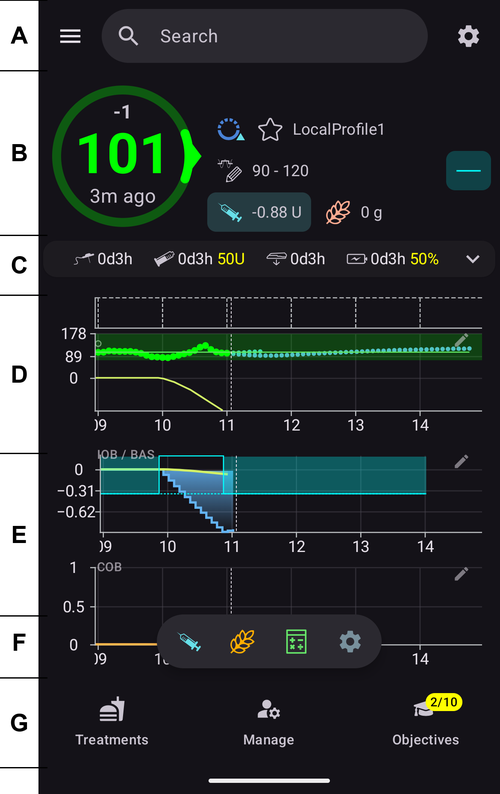

Det er den første skærm, du ser, når du åbner **AAPS**, og den indeholder det meste af den information, du har brug for i hverdagen.

### Sektion A - Topbjælke

* **Menuen** (☰) til venstre åbner navigationsmenuen med **Behandlingshistorik**, **Historikbrowser**, **Statistik**, **Profilhjælper**, **Vedligeholdelse**, **Opsætningsguide**, **Konfiguration** og mere.
* **Søgefeltet** finder indstillinger, dialoger og dokumentation - begynd bare at skrive (se [Global søgning](../DailyLifeWithAaps/GlobalSearch.md)).
* Ikonet **Indstillinger** (tandhjul) til højre åbner alle [indstillinger](../SettingUpAaps/Preferences.md).

(aaps-screens-profile--target)=

### Sektion B - Statusblok

#### Aktuelt blodsukker

Den seneste blodsukkermåling fra din CGM vises i den store cirkel til venstre sammen med forskellen til den forrige måling (delta) og målingens alder.

Farven på BS-værdien viser status i forhold til det fastsatte [område](#Preferences-range-for-visualization).

* grøn = i området
* rød = under området
* gul = over området

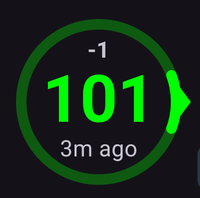 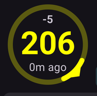 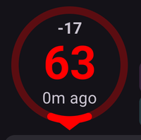

(loop-status)= (AapsScreens-loop-status)=

#### Loop-status


Ved siden af BS-cirklen viser et ikon loopets loop-tilstand (fra top til bund på billedet):

1. Grøn cirkel = [lukket loop](#KeyAapsFeatures-ClosedLoop), loopet kører
2. Lilla cirkel med stiplet linje = [stop ved lavt BS (LGS)](#KeyAapsFeatures-LGS)
3. Blå cirkel med stiplet linje = [åbent loop](#KeyAapsFeatures-OpenLoop)
4. Rød cirkel med kryds = loop deaktiveret (virker ikke, permanent)
5. Rødt pauseikon = loop suspenderet (sat på pause i en periode, men basalinsulin gives stadig) - den resterende tid vises ved siden af ikonet
6. Grå cirkel med stik = pumpe afbrudt (i en periode gives der slet ingen insulin) - den resterende tid vises ved siden af ikonet

Tryk på ikonet for at åbne Loop-dialogen. Hvad dialogen viser, afhænger af den aktuelle tilstand:

* Mens loopet **kører** (lukket, åbent eller LGS), kan du skifte loop-tilstand (Lukket loop, Stop ved lavt BS, Åbent loop eller Deaktiver loop), **suspendere** loopet eller **afbryde** pumpen i en valgt periode.
* Mens loopet er **deaktiveret**, kan du aktivere det igen ved at vælge en loop-tilstand, eller du kan afbryde pumpen.
* Mens loopet er **suspenderet**, kan du **genoptage** det, afbryde pumpen eller vælge en ny varighed under **Suspender loop** for at forlænge suspenderingen.
* Mens pumpen er **afbrudt**, kan du **genforbinde** pumpen eller vælge en ny varighed under **Afbryd pumpe** for at forlænge afbrydelsen.

Når du forlænger en suspendering eller en afbrydelse, **starter den nye varighed fra nu**: den erstatter den resterende tid, den lægges ikke til. Du behøver ikke at genoptage eller genforbinde først.

Dialogen, mens loopet kører som lukket loop:

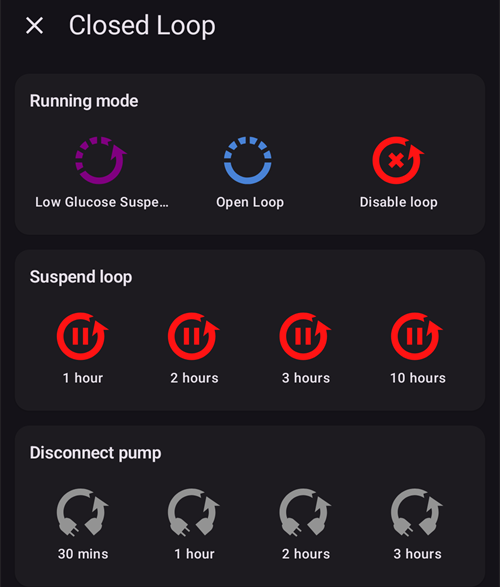

Dialogen, mens loopet er suspenderet, med **Genoptag** og varighederne til at forlænge suspenderingen:

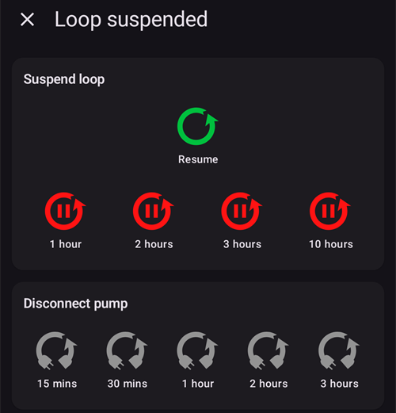

Dialogen, mens pumpen er afbrudt, med **Genforbind pumpe** og varighederne til at forlænge afbrydelsen:

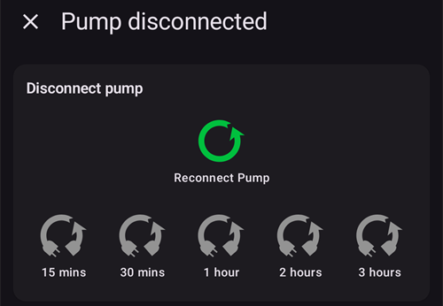

Dialogen i Stop ved lavt BS, i åbent loop og mens loopet er deaktiveret er kun forskellig i de loop-tilstande, den tilbyder:

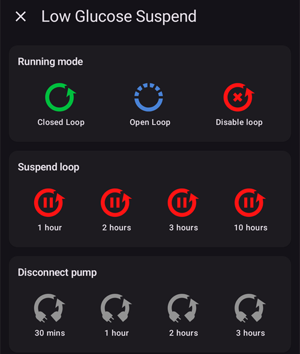

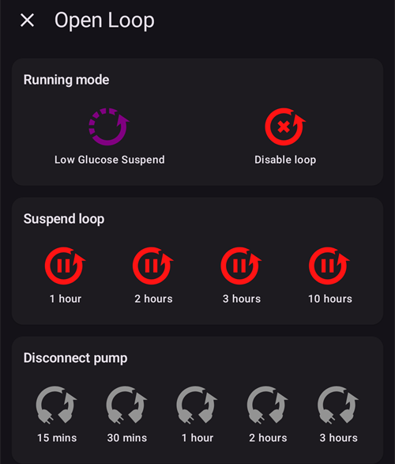

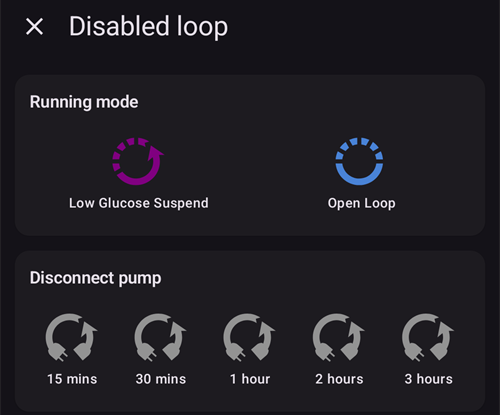

Sådan ser hovedskærmen ud i hver tilstand. Farvebåndet øverst i grafen skifter på tidspunktet for skiftet.

Stop ved lavt BS:

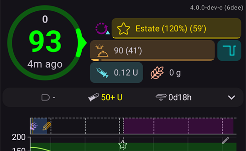

Åbent loop:

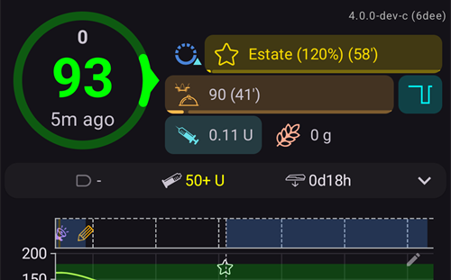

Loop deaktiveret:

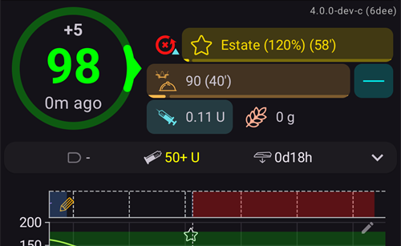

Loop suspenderet - den resterende tid vises ved siden af ikonet:

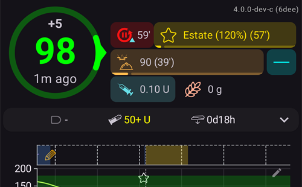

Pumpe afbrudt - den resterende tid vises ved siden af ikonet. Behandlingsknapperne bliver på Hurtigstart-værktøjslinjen, så du stadig kan registrere insulin givet med pen eller kulhydrater:

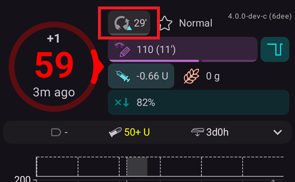

Hvert valg skal bekræftes.

```{admonition} Alarm: pumpen accepterede ikke nul-basalen :class: warning Mens pumpen er afbrudt, holder **AAPS** en midlertidig nul-basal på pumpen og sætter den igen, hvis den mangler. Hvis det stadig ikke lykkes efter 10 minutter, giver **AAPS** en akut alarm: *»Pumpen accepterede ikke nul-basalen. Den giver måske stadig basalinsulin. Tjek pumpen.«* Alarmen gentages hvert 15. minut, indtil den midlertidige nul-basal er sat, eller afbrydelsen slutter. Hvis du ser den, så tjek din pumpe: den giver måske basalinsulin, selv om **AAPS** viser den som afbrudt.

    <br />Bemærk: hvilke tilstande der tilbydes, afhænger af, hvor langt du er nået i [læringsmålene](../SettingUpAaps/CompletingTheObjectives.md) - Lukket loop og LGS bliver først tilgængelige, når du gennemfører dem.
    
    (aaps-screens-bg-warning-sign)=
    #### BS-advarselstegn
    
    Hvis **AAPS** opdager et problem med de BS-målinger, den modtager, vises en genvej til din BS-kilde (med kildens navn, f.eks. **xDrip+ BG**) i den nederste bjælke på hovedskærmen med et rødt advarselsmærke. Tryk på den for at åbne [skærmen for BS-kilden](#aaps-screens-bg-source).
    
    ##### Dobbelte BS-data
    
    Det røde advarselstegn betyder, at du skal handle med det samme: Du modtager **dobbelte BS-data**, og det forhindrer loopet i at gøre sit arbejde rigtigt. **AAPS** kan ikke beregne din BS-tendens sikkert ud fra dobbelte målinger, så den holder op med at korrigere.
    
    Hvis dit loop var lukket, skifter **AAPS** det til tilstanden [Stop ved lavt BS (LGS)](#KeyAapsFeatures-LGS): loop-ikonet bliver lilla.
    
      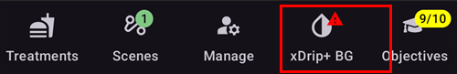
    
    Tryk på loop-ikonet: kortet **Begrænsninger** øverst fortæller dig hvorfor: "BgQualityCheck: LGS-tilstand på grund af dobbelte værdier i BS-kilden".
    
      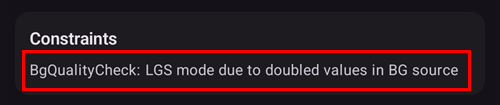
    
    ```{admonition} Dit loop kører i Stop ved lavt BS
    :class: note
    Dit loop kører stadig, men kun for at beskytte dig mod lave værdier: **AAPS** kan stadig sænke eller stoppe din basal, men den giver ingen korrektionsinsulin, før du har løst dette problem!
    

Du skal finde ud af, hvorfor du får dobbelte BS-værdier:

* Er Dexcom bridge slået til på dit Nightscout-site? Slå bridge fra: gå til administrationspanelet for din Nightscout-instans, rediger variablen "enable" og fjern delen "bridge" der. (For Heroku [kan du finde detaljer her](https://nightscout.github.io/troubleshoot/troubleshoot/#heroku).)
* Uploader flere kilder dit BS til Nightscout? Hvis du bruger BYODA-appen, så slå upload til i **AAPS**, men slå det ikke til i xDrip, hvis du bruger den.
* Har du følgere, som modtager dit BS, men som også uploader det igen til dit Nightscout-site?
* Sidste udvej: I [NSClient-indstillinger](#Preferences-nsclient) vælger du indstillingerne for Synkronisering og slår »Modtag CGM-data fra NS« fra.

For at fjerne advarslen med det samme og få dit loop til at korrigere igen skal du slette de dobbelte målinger på skærmen for BS-kilden: tryk på genvejen i den nederste bjælke. Den dobbelte måling er markeret med rødt. Tryk længe på en måling for at begynde at vælge, sæt flueben ved dubletterne, og tryk på skraldespandsikonet øverst til højre.

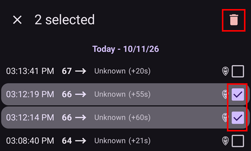

Men når der er mange dubletter, kan det være lettere at

* [sikkerhedskopiere dine indstillinger](../Maintenance/ExportImportSettings.md),
* nulstille din database i menuen Vedligeholdelse og
* [importere dine indstillinger](../Maintenance/ExportImportSettings.md) igen

    {admonition} Skift selv tilbage til Lukket loop
    :class: important
    **AAPS** går ikke selv tilbage til **Lukket loop**, når dubletterne er væk. Tryk på loop-ikonet på hovedskærmen, og vælg **Lukket loop** igen.

##### Flade BS-data

Med nogle BS-kilder (Libre 1, AiDEX, Glutec, Medtronic og kilder, der ikke oplyser deres sensortype) tjekker **AAPS** også for målinger, der ikke ændrer sig: hvis dit BS har ændret sig mindre end 2 mg/dl (0,1 mmol/l) i 45 minutter, anses dataene for at være forkerte. Genvejen til BS-kilden viser så et rødt mærke for flad tendens, og loopet stopper enhver høj midlertidig basal og giver ingen korrektionsinsulin, før målingerne ændrer sig igen. Tjek din sensor og den app, der sender målingerne.

##### Uregelmæssige BS-data

Når målingerne kommer med uregelmæssige mellemrum, eller nogle mangler, beregner **AAPS** nye 5-minutters værdier ud fra de målinger, den har. Det sker f.eks. efter et sensorskift eller med Libre-sensorer, hvis tidspunkt forskydes et minut eller to med nogle timers mellemrum. Loopet virker stadig, og du behøver ikke at gøre noget. **AAPS** 4 viser ikke længere et gult advarselstegn for dette.

#### Aktuel profil

Den aktuelle profil vises ved siden af stjerneikonet.

Tryk på profilnavnet for at åbne [profilskærmen](#aaps-screens-profile), hvor du kan se detaljerne i profilen og [skifte mellem forskellige profiler](../DailyLifeWithAaps/ProfileSwitch-ProfilePercentage.md).

For at **ændre profilprocenten** (og dens varighed) skal du trykke på profilnavnet og derefter trykke på den runde knap **▶** (Aktiver) nederst til højre på profilskærmen. I **AAPS** 3.x åbnede denne skærm med et langt tryk på profilnavnet; i **AAPS** 4 sker der ikke noget ved et langt tryk. Trin for trin: [Ændring af profilprocenten](#ProfileSwitch-change-percentage).


1. Almindelig visning med en standardprofil aktiveret.
2. Profilskift med en bestemt procent på 90% og en resterende varighed på 9 minutter - profilnavnet bliver gult, mens et midlertidigt profilskift kører.
3. Profilskift med en tidsforskydning på 1 time og en resterende varighed på 9 minutter.

#### Målværdi


Den aktuelle målværdi for blodsukker vises under profilnavnet.

Tryk kort på målværdien for at åbne skærmen **[Midlertidigt mål](../DailyLifeWithAaps/TempTargets.md)**.

1. Almindelig visning: målområdet, som det er fastsat i din profil.
2. Hvis et midlertidigt mål er sat, bliver målværdien gul/orange med ikonet for den brugte forudindstilling, og den resterende tid i minutter vises i parentes.

(AapsScreens-visualization-of-dynamic-target-adjustment)=

#### Visning af dynamisk justering af målværdien

Når du bruger [SMB-algoritmen](#Config-Builder-aps) og funktionen [Autosens](#Open-APS-features-autosens), kan **AAPS** justere din målværdi dynamisk ud fra følsomheden.

Slå den ene eller begge af disse indstillinger til i [OpenAPS SMB-indstillinger](#Preferences-openaps-smb-settings):

* »Følsomhed hæver målværdi« og/eller
* »Resistens sænker målværdi«

Hvis **AAPS** opdager resistens eller følsomhed, ændres målværdien i forhold til profilen, og den viste målværdi skifter farve for at vise justeringen.

(aaps-screens-iob-cob-basal-sens)=

#### IOB, COB, basal og følsomhed


1. **Sprøjte**: insulin om bord (IOB) - mængden af aktiv insulin i din krop  
    Tallet for insulin om bord ville være nul, hvis kun din almindelige basal kørte, og der ikke var noget insulin tilbage fra tidligere boluser. 
    * IOB kan være negativ, hvis der for nylig har været perioder med lavere basal.
    * Tryk på chippen for at se fordelingen mellem bolus- og basalinsulin (første dialog på billedet - her med en negativ IOB efter en periode med lavere basal)
2. **Korn**: [kulhydrater om bord (COB)](../DailyLifeWithAaps/CobCalculation.md) - kulhydrater, du har spist tidligere, og som endnu ikke er optaget
3. Den blågrønne knap til højre viser den **aktuelle basallevering**: en flad linje, når profilens basal kører, og et ændret ikon, mens en midlertidig basalrate er aktiv
4. **Procentrækken** viser den aktuelle følsomhed ([Autosens](#Open-APS-features-autosens) / [Dynamisk ISF](../DailyLifeWithAaps/DynamicISF.md)). Når loopet ændrer din ISF, viser rækken også profilens ISF, en pil og den ISF, som loopet bruger nu, f.eks. »80% 2,0 ↗ 2,5«. Tryk på den for at se Autosens-værdien og den effektive ISF (anden dialog på billedet). Hvis loopet arbejder med en anden værdi end det seneste Autosens-resultat (f.eks. fordi et midlertidigt mål ændrer din følsomhed), viser dialogen også den værdi som **Autosens i algoritmen**. Når Autosens er slået fra, beholder loopet profilens ISF, og der vises ingen effektiv ISF.

IOB-dialogen, der åbnes ved at trykke på IOB-chippen:

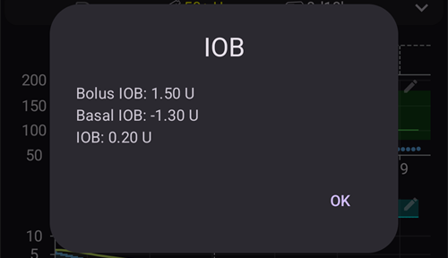

Tryk på den blågrønne knap for at se den midlertidige basalrate, der kører, hvornår den startede, og hvor længe den har kørt:

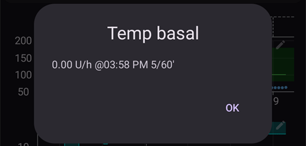

(aaps-screens-carbs-required)=

#### Kulhydrater påkrævet


Forslag om kulhydrater gives, når referencedesignet opdager, at der er brug for kulhydrater.

Det sker, når oref-algoritmen mener, at den ikke kan redde dig med nul-basal, og at du har brug for kulhydrater.

Notifikationerne om kulhydrater er meget mere avancerede end dem fra bolusberegneren. Du kan se et forslag om kulhydrater, selv om bolusberegneren ikke viser manglende kulhydrater.

Notifikationer om påkrævede kulhydrater kan sendes til Nightscout, hvis du ønsker det. I så fald vises og udsendes en meddelelse.

### Sektion C - Statusrække


Statusrækken giver en visuel advarsel for

* Kanylealder
* Insulinalder (antal dage, reservoiret er brugt) og reservoirniveau (enheder)
* Sensoralder
* Pumpebatteriets alder og niveau (%)

Hvis advarselsgrænsen overskrides, vises værdierne med gult.

Hvis den kritiske grænse overskrides, vises værdierne med rødt.

Alderen vises altid i kort form, uanset skærmens størrelse: *4h* den første dag, *3d4h* senere.

Grænserne kan ændres med det lille ikon **Indstillinger**, der vises, når statuslinjen er **udvidet** (pilen til højre) - se [Statuslys](#Preferences-status-lights).

Det udvidede statuspanel har også en knap i slutningen af nogle rækker til at registrere et skift, som nulstiller den tilhørende alder: **Tilføj** i rækken **Sensor** registrerer et sensorindstik. Hvis din pumpe understøtter det, vises **Klargør/Fyld** i rækkerne **Kanyle** (eller **Patchpumpe**) og **Insulin**, og **Tilføj** i rækken **Pumpebatteri**.


Afhængigt af din pumpe har du måske ikke alle disse ikoner.

(screens-sensor-level-battery)=

#### Sensorniveau (batteri)

Virker for CGM med en ekstra sender som f.eks. MiaoMiao 2. (Teknisk set skal sensoren sende information om batteriniveau til xDrip.)

Grænserne kan indstilles i [Statuslys](#Preferences-status-lights).

(aaps-screens-main-graph)=

### Sektion D - Hovedgraf

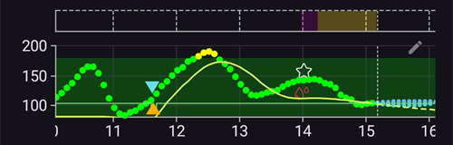

Grafen viser dit blodsukker (BS), som det er aflæst fra din glukosemåler (CGM).

Brug rulle- og knibe-zoom-bevægelser på grafen for at ændre det viste tidsrum.

Det grønne område viser dit målområde.

Denne information vises også på denne graf:

* Manuelle boluser: blå trekant lige over BS-kurven, der peger ned mod målingen på det tidspunkt, med insulinmængden
* Kulhydrater: orange trekant lige under BS-kurven, der peger op mod målingen, med mængden af kulhydrater. Et måltid, der er indtastet sammen med sin bolus, ligner én markering, delt af målingen.
* Trekanterne findes i tre størrelser (lille, mellem, stor) efter mængden sammenlignet med den største på dagen. Hvis der ikke er nogen BS-måling på det tidspunkt (hul i sensordata), tegnes trekanten nederst i grafen.
* BS-kontroller og kalibreringer: tegnes ved deres egen målte værdi, så du kan sammenligne dem med sensorkurven
* Målværdi som defineret i profilen eller ændret af et midlertidigt mål: grøn linje
* Profilskift: stjerneikoner øverst i grafen
* Loop-status: farvebånd øverst i grafen, når [loop-tilstanden](#AapsScreens-loop-status) er noget andet end lukket loop: blå = åbent loop, lilla = LGS, rød = loop deaktiveret, gul = loop suspenderet, grå = pumpe afbrudt, orange = superbolus (på skærmbilledet: lilla, derefter gul). Historikken for disse skift står i [Loop-tilstand](#AapsScreens-running-mode)
* [SMB'er](#Open-APS-features-super-micro-bolus-smb) tegnes ikke på BS-grafen (der ville være en med få minutters mellemrum): de vises på [IOB-grafen](#aaps-screens-iob).

Tryk på en **BS-kontrol** i grafen for at se dens værdi og dens notat, hvis du har skrevet et.

(aaps-screens-graph-press-and-hold)=

#### Se værdierne på et bestemt tidspunkt

**Tryk og hold** på BS-grafen et øjeblik for at se værdierne for én måling. En prik markerer den nærmeste måling, en stiplet linje tegnes på det tidspunkt i alle graferne, og et pop op-vindue øverst i grafen viser:

* tidspunktet og BS-værdien
* IOB, COB (kun når den er over 0 g) og basalraten på det tidspunkt - basalikonet viser, om en midlertidig basalrate kørte, som på hovedskærmen
* enhver bolus, SMB eller kulhydrater på det tidspunkt, med de samme trekanter som i graferne

Hold fingeren på skærmen, og flyt den til venstre eller højre for at gå fra én måling til den næste. Du mærker en let vibration ved hver måling, og grafen ruller ikke, mens du gør det. Pop op-vinduet bliver i 2 sekunder, efter at du har løftet fingeren.

Det virker på samme måde på de [ekstra grafer](#aaps-screens-additional-graphs) under BS-grafen (IOB, COB ...): tryk og hold på en af dem.

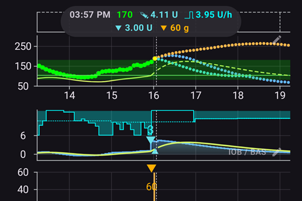

(aaps-screens-graph-clock-change)=

#### Ændringer af uret

Når telefonens ur har sprunget, ved skift til eller fra sommertid eller i en ny tidszone, markerer en stiplet lodret linje det øjeblik i BS-grafen med et lille urikon ved foden. Den samme stiplede linje går gennem de [ekstra grafer](#aaps-screens-additional-graphs) nedenfor.

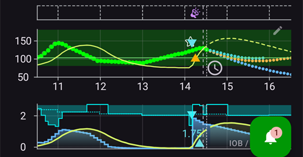

(AapsScreens-activate-optional-information)=

#### Aktiver valgfri information

Tryk på **blyant**-ikonet i grafens øverste højre hjørne for at åbne grafindstillingerne:


* **Grafhøjde** justerer, hvor høj grafen tegnes.
* **ACT** viser insulinaktivitetskurven oven på grafen: en fuldt optrukket gulgrøn linje <span style="background:#141218;color:#D3F166;padding:0 0.3em;border:1px solid #141218;border-radius:4px">━━━━</span> (må ikke forveksles med den prikkede gule UAM-prognose)
* **PRED** viser [prognoselinjerne](#aaps-screens-prediction-lines) oven på grafen (se nedenfor)

(aaps-screens-prediction-lines)=

#### Prognoselinjer

Når **PRED** er slået til, tegner AAPS sine prognoser som **prikkede linjer** til højre for »nu«-linjen. Hver prognose har sin egen farve. Det mørke tema bruger lysere nuancer af de samme farver, og en linje inden for det grønne målområde kan se lidt mere grøn ud.

| Linje                 | Lyst tema                                                                                                                         | Mørkt tema                                                                                                                         | Hvad den forudsiger         |
| --------------------- | --------------------------------------------------------------------------------------------------------------------------------- | ---------------------------------------------------------------------------------------------------------------------------------- | --------------------------- |
| **IOB** (blå)         | <span style="background:#FFFFFF;color:#1E88E5;padding:0 0.3em;border:1px solid #CCCCCC;border-radius:4px">●●●●</span>             | <span style="background:#141218;color:#64B5F6;padding:0 0.3em;border:1px solid #141218;border-radius:4px">●●●●</span>              | kun insulin                 |
| **COB** (orange)      | <span style="background:#FFFFFF;color:#FB8C00;padding:0 0.3em;border:1px solid #CCCCCC;border-radius:4px">●●●●</span>             | <span style="background:#141218;color:#FFB74D;padding:0 0.3em;border:1px solid #141218;border-radius:4px">●●●●</span>              | kulhydrater om bord         |
| **UAM** (gul)         | <span style="background:#FFFFFF;color:#C9BD60;padding:0 0.3em;border:1px solid #CCCCCC;border-radius:4px">●●●●</span>             | <span style="background:#141218;color:#E6D39A;padding:0 0.3em;border:1px solid #141218;border-radius:4px">●●●●</span>              | uanmeldt måltid             |
| **ZT** (cyan)         | <span style="background:#FFFFFF;color:#00D2D2;padding:0 0.3em;border:1px solid #CCCCCC;border-radius:4px">●●●●</span>             | <span style="background:#141218;color:#4DD4D4;padding:0 0.3em;border:1px solid #141218;border-radius:4px">●●●●</span>              | nul-basal (insulin stoppet) |
| **aCOB** (lys orange) | <span style="background:#FFFFFF;color:rgba(251,140,0,0.5);padding:0 0.3em;border:1px solid #CCCCCC;border-radius:4px">●●●●</span> | <span style="background:#141218;color:rgba(255,183,77,0.5);padding:0 0.3em;border:1px solid #141218;border-radius:4px">●●●●</span> | kun den ældre AMA-algoritme |

Når to prognoser giver de samme værdier, ligger deres prikker oven på hinanden, og du ser kun en af farverne (f.eks. UAM oven på IOB, når BS er fladt).

* **COB**-linje (orange): [kulhydrater om bord](CobCalculation.md) (orange bruges overalt i AAPS til COB og kulhydrater)
    
    Denne prognoselinje viser, hvor dit BS (ikke COB selv!) vil gå hen ud fra de nuværende indstillinger i **profilen**, hvis afvigelserne på grund af kulhydratabsorption forbliver konstante. Denne linje vises kun, hvis der er kendte COB.

* **IOB**-linje (blå): insulin om bord (blå bruges overalt i AAPS til IOB og insulin)
    
    Denne prognoselinje viser, hvad der ville ske, hvis kun insulin virkede. F.eks. hvis du gav noget insulin og så ikke spiste nogen kulhydrater.

* **ZT**-linje (cyan): nul-basal (forventet BS, hvis en midlertidig basalrate på 0% blev sat)
    
    Denne prognoselinje viser, hvordan BS-kurven ville ændre sig, hvis pumpen stoppede al insulintilførsel (0% TBR). Linjen stopper, når den stiger over din målværdi.
    
    *Denne linje vises kun, når [SMB](#Config-Builder-aps)-algoritmen bruges.*

* **UAM**-linje (gul): [uanmeldte måltider](#SensitivityDetectionAndCob-sensitivity-oref1)
    
    Uanmeldte måltider betyder, at der er opdaget en tydelig stigning i blodsukkeret på grund af måltider, adrenalin eller andre påvirkninger. Prognoselinjen ligner den **orange COB-linje**, men den antager, at afvigelserne aftager med en konstant hastighed (ved at forlænge den nuværende hastighed for faldet).
    
    *Denne linje vises kun, når [SMB](#Config-Builder-aps)-algoritmen bruges, **Aktiver UAM** er slået til i OpenAPS SMB-indstillingerne, og BS stiger mere, end insulin alene kan forklare.*

* **aCOB**-linje (lys, gennemsigtig orange): accelereret kulhydratabsorption
    
    Ligner COB, men antager en fast kulhydratabsorption på 10 mg/dl/5m (0,555 mmol/l/5m). Forældet og kun til begrænset nytte.
    
    *Denne linje vises kun, når den ældre [AMA](#Config-Builder-aps)-algoritme bruges.*

Normalt ender din rigtige blodsukkerkurve midt mellem disse linjer, eller tæt på den linje, hvis antagelser passer bedst til din situation.

(aaps-screens-how-predictions-become-a-dosing-decision)=

#### Sådan gør AAPS prognoser til en beslutning om dosering

AAPS doserer ikke insulin kun ud fra dit aktuelle BS - i hver loop-cyklus (cirka hvert 5. minut) ser den på alle prognoselinjerne ovenfor samlet og finder den sikreste handling.

Hovedreglen er **sikkerhed først**: hvis *nogen* prognoselinje, i et hvilket som helst tidsrum, falder under din nedre sikkerhedsgrænse, sætter AAPS en nul-basal (0% midlertidig basalrate) og holder mere insulin tilbage, selv om dit aktuelle BS er højt. Først når alle prognoselinjer holder sig over den grænse, vil AAPS overveje at give mere insulin.

Når det er sikkert at give mere insulin, ser AAPS på, hvor BS forventes at ende til sidst (**endeligt BS**) ud fra de samlede prognoser, og beregner, hvor meget korrektion der skal til for at bringe dette endelige BS tilbage til målværdien - givet enten som en højere midlertidig basalrate eller (hvis oref1/[SMB](#Open-APS-features-super-micro-bolus-smb)-algoritmen er slået til) som en lille bolus med det samme. Hvis BS er højt nu, men allerede er på vej nok ned af sig selv, venter AAPS, eller den sænker måske endda basalraten, i stedet for at give insulin, som kun ville gøre et senere lavt BS endnu lavere.

Eksempler på denne beslutningslogik med rigtige skærmbilleder finder du i [doseringsscenarierne i vejledningen til sundhedspersonale](#clinicianguide-dosing-scenarios) - de er skrevet til sundhedspersonale, men gælder for alle AAPS-brugere.

*Den fulde tekniske forklaring på, hvordan disse prognoser og den deraf følgende beslutning om dosering beregnes, finder du i [OpenAPS' dokumentation om determine-basal](https://openaps.readthedocs.io/en/latest/docs/While%20You%20Wait%20For%20Gear/Understand-determine-basal.html).*

#### Basaler

En **fuldt optrukket blå** linje viser pumpens basallevering og afspejler den faktiske levering over tid.

Den **stiplede blå** linje viser, hvad basalraten ville være, hvis der ikke var nogen midlertidige basaljusteringer (TBR).

Når den almindelige basalrate gives, vises området under kurven med mørkeblå. Når basalraten er justeret midlertidigt (sat op eller ned), vises området under kurven med lyseblå.

#### Aktivitet

Den **tynde gule** linje viser insulinens aktivitet.

Den er baseret på det forventede fald i BS fra insulinen i din krop, hvis der ikke var andre faktorer (som kulhydrater).

(AapsScreens-section-g-additional-graphs)= (aaps-screens-additional-graphs)=

### Sektion E - Ekstra grafer

Du kan aktivere ekstra grafer under hovedgrafen. I [Simpel tilstand](#preferences-simple-mode) er de ekstra grafer forudindstillede og kan ikke ændres. Slå **Simpel tilstand** fra, hvis du selv vil vælge opsætningen af de ekstra grafer.

De ekstra grafer følger hovedgrafen: når du ruller eller zoomer i BS-grafen, flytter de sig med. Hvis du trækker sidelæns på en ekstra graf, ruller alle graferne også. De har ingen egne tidsangivelser - aflæs tiden på BS-grafen.

For at indstille en ekstra graf skal du trykke på **blyant**-ikonet i grafens øverste højre hjørne:


Vælg de chips, der passer til de data, du vil se på denne graf; knappen **Fjern** sletter grafen.

For at oprette en graf mere skal du trykke på **Tilføj graf** under den sidste graf og vælge dens chips på samme måde:

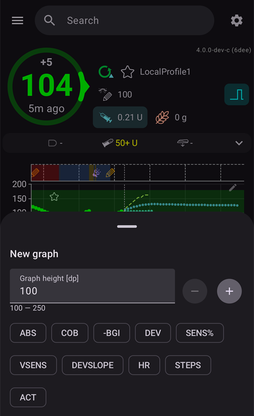

Den nye graf tilføjes under de andre - her en ekstra graf nummer to med **SENS%** og **DEV**:

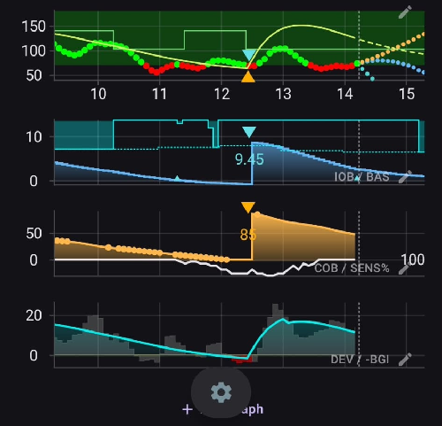

De fleste brugere synes, at denne opsætning af ekstra grafer er tilstrækkelig:

* Graf 1 med IOB, BAS
* Graf 2 med COB, ændring i følsomhed
* Graf 3 med afvigelser og BGI.

#### Absolut insulin (ABS)

Aktiv insulin, inklusive boluser **og basal**.

(aaps-screens-iob)=

#### Insulin om bord (IOB)

Viser din insulin om bord (= aktiv insulin i din krop). Den omfatter insulin fra bolus og midlertidig basal (**men ikke basalrater, der er sat i din profil**).

Hvis der ikke havde været nogen [SMB'er](#Open-APS-features-super-micro-bolus-smb), ingen boluser og ingen TBR i DIA-tiden, ville denne værdi være nul.

SMB'er vises på denne graf som blå trekanter i tre størrelser efter mængden sammenlignet med dagens største SMB.

IOB kan være negativ, hvis du ikke har nogen bolus tilbage og har haft nul-basal eller lav midlertidig basal i længere tid.

Hvor hurtigt den falder, afhænger af dine [indstillinger for DIA og insulintype](#Config-Builder-insulin-dia).

#### Kulhydrater om bord (COB)

Viser dine kulhydrater om bord (= aktive kulhydrater i din krop, som endnu ikke er optaget).

Hvor hurtigt de falder, afhænger af de [afvigelser, som algoritmen finder](../DailyLifeWithAaps/CobCalculation.md).

Hvis den opdager en højere kulhydratabsorption end forventet, gives der insulin, og det øger IOB (mere eller mindre, afhængigt af dine sikkerhedsindstillinger).

#### Ændring i følsomhed (SENS%)

Viser den følsomhed, som [Autosens](#Open-APS-features-autosens) har fundet.

Følsomhed er en beregning af følsomheden for insulin som følge af motion, hormoner osv.

Bemærk: Du skal være nået til [læringsmål 8](#objectives-objective8), før Detektering af følsomhed/[Autosens](#Open-APS-features-autosens) automatisk kan justere mængden af insulin, der leveres. Indtil du når det læringsmål, vises linjen i din graf kun til information.

### Variabel følsomhed (VSENS)

Viser følsomheden, som den er beregnet af [Dynamisk ISF](../DailyLifeWithAaps/DynamicISF.md). Har kun data, hvis du bruger denne funktion.

(screen-heart-rate-steps)=

#### Puls (HR) & skridt

Disse data kan være tilgængelige, når du bruger et [Wear-smartur](../WearOS/WearOsSmartwatch.md). Slå dem til i **AAPS**-appen på uret, og giv tilladelse til helbredsdata.

Skridt tegnes som søjler, og pulsen som en buet linje, der er afbrudt, hvor uret ikke sendte data.

#### Afvigelser (DEV)

* **Grå** søjler viser en afvigelse på grund af kulhydrater.
* **Grønne** søjler viser, at BS er højere, end algoritmen forventede. Grønne søjler bruges til at øge resistensen i [Autosens](#Open-APS-features-autosens).
* **Røde** søjler viser, at BS er lavere, end algoritmen forventede. Røde søjler bruges til at øge følsomheden i [Autosens](#Open-APS-features-autosens).
* **Gule** søjler viser en afvigelse på grund af UAM.
* **Sorte** søjler viser små afvigelser, som der ikke tages hensyn til ved følsomhed

#### Blodsukkerpåvirkning (-BGI)

Denne linje viser, hvor meget BS »burde« stige eller falde, kun ud fra insulinaktiviteten.

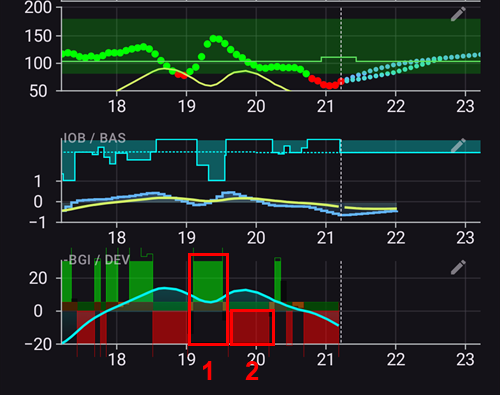

Det er en god idé at vise denne linje sammen med afvigelsessøjlerne. De har den samme skala, men den er en anden end for de andre valgfri data, så det er en god idé at vise dem på en separat graf, som vist ovenfor. At sammenligne BGI-linjen og afvigelsessøjlerne er en anden måde at forstå, hvordan **BS** svinger. Her, på tidspunktet markeret med **1**, ligger afvigelsessøjlerne et godt stykke over BGI-linjen: BS stiger mere, end insulinaktiviteten alene kan forklare (f.eks. efter kulhydrater). På tidspunktet markeret med **2** er afvigelsessøjlerne under nul (røde): BS er lavere, end algoritmen forventede.

### Sektion F - Hurtigstart-værktøjslinje


Den svævende værktøjslinje nederst på skærmen indeholder dine **[Hurtigstart](../DailyLifeWithAaps/QuickLaunch.md)**-handlinger. Det lille **tandhjul** åbner indstillingerne for Hurtigstart, hvor du vælger, hvilke knapper der vises (behandlinger, careportal-registreringer, CGM-handlinger, skærmene i arket **Administrer**, [Hurtigbolus](../DailyLifeWithAaps/QuickWizards.md)-knapper, [Scener](../DailyLifeWithAaps/Scenes.md) og mere).

En typisk opsætning er vist ovenfor: **Insulin**, **Kulhydrater** og **Bolusberegner**.

Mens pumpen er **afbrudt**, bliver behandlingsknapperne på værktøjslinjen, f.eks. så du kan registrere insulin givet med pen (se [Insulin](#aaps-screens-buttons-insulin) nedenfor). De samme handlinger findes også i [arket Behandlinger](#aaps-screens-treatments-sheet) i den nederste navigation.

(aaps-screens-buttons-insulin)=

#### Insulin


Til at give en bestemt mængde insulin uden at bruge [bolusberegneren](#aaps-screens-bolus-wizard).

Ved at slå **Start "Spiser snart" mål** til kan du automatisk starte dit [midlertidige mål Spiser snart](#TempTargets-eating-soon-temp-target).

Hvis du ikke vil give bolus med pumpen, men registrere en mængde insulin (f.eks. insulin givet med pen), så slå »**Bolus registreres kun (bliver ikke leveret af pumpe)**« til. En ekstra række **Tid**, sat til **Nu**, lader dig registrere en insulininjektion, du har taget tidligere: brug **-** / **+** til at ændre den, eller tryk på pilen for at skrive minutterne eller vælge dato og klokkeslæt.

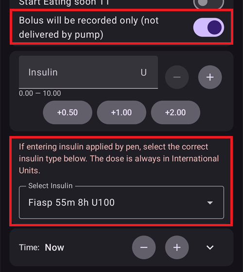 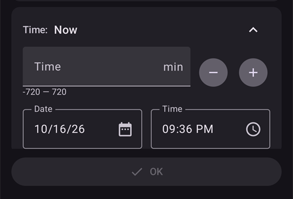

Du kan bruge knapperne **+0,5 / +1,0 / +2,0** til hurtigt at øge insulinmængden. Værdierne for knapperne kan ændres i [indstillingerne for bolusberegneren](#Preferences-deliver-this-part-of-bolus-wizard-result).

Insulindialogen kan også bruges, når pumpen er sat på pause eller afbrudt, f.eks. til at registrere insulin, der er injiceret med pen. I dette tilfælde er »**Bolus registreres kun (bliver ikke leveret af pumpe)**« tvunget til (vist med rødt), og der vises ekstra felter til at vælge insulintypen og en forskydning i **Tid** for en injektion, der er taget tidligere:

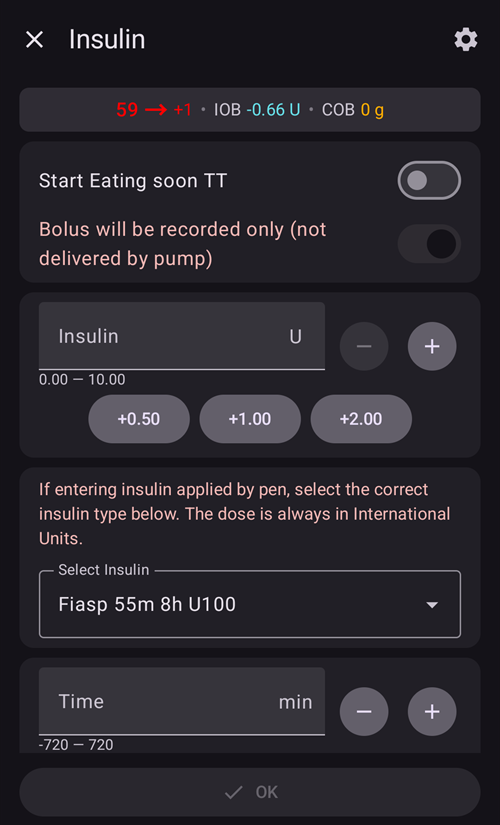

#### Kulhydrater


Til at registrere kulhydrater uden at give bolus.

Visse [forudindstillede midlertidige mål](#TempTargets-hypo-temp-target) (Hypo, Spiser snart, Aktivitet) kan startes direkte med kontakterne øverst.

**Kulhydrattid**: Hvornår du vil spise / har spist kulhydraterne.

**Varighed**: Bruges til [»forlængede kulhydrater«](ExtendedCarbs.md). Denne række er foldet sammen, så du ikke skriver grammene i den ved en fejl: brug **-** / **+** til at ændre den, eller tryk på pilen for at åbne den og skrive en værdi.

Du kan bruge knapperne **+5 / +10 / +20** til hurtigt at øge mængden af kulhydrater.

#### Hurtigbolus

Indtast nemt mængden af kulhydrater og grundlaget for beregningen med en enkelt forudindstillet knap.

Detaljerne indstilles i [Hurtigboluser (bolus med ét tryk)](../DailyLifeWithAaps/QuickWizards.md).

(aaps-screens-treatments-sheet)=

### Sektion G - Nederste navigation

Den nederste navigationsbjælke giver adgang til:

* **Behandlinger** - et ark med hurtige handlinger med dine behandlinger:
    
    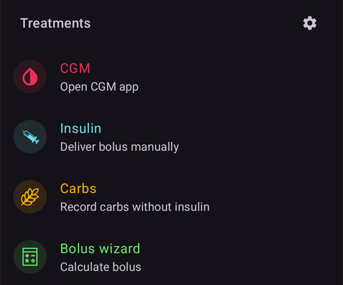

* **Scener** - vises kun, når du har mindst én [scene](../DailyLifeWithAaps/Scenes.md) eller en regel i **Automatisering**, der er markeret som **Brugerhandling**. Den åbner et ark, hvorfra du kan starte dem; et mærke viser, hvor mange du kan starte lige nu. **Blyanten** øverst i arket åbner **Administrer → Scener**.

* **Administrer** - stedet for alt det, du administrerer i **AAPS**: Profil, Insulinindstillinger, Midlertidigt mål, Hurtigbolus, Scener, Automatisering, Mad, Rotation af indstikssteder, Pumpe og Godkendte klienter. Under dem er der handlinger for enheder og basal, f.eks. Sensorindstik og Midlertidig basal. Nogle punkter vises kun, når de passer til din opsætning - f.eks. afhænger Klargør/Fyld og batteriskift af din pumpe, og Midlertidig basal, Forlænget bolus og careportal-registreringerne er skjult i [Simpel tilstand](#preferences-simple-mode):
    
    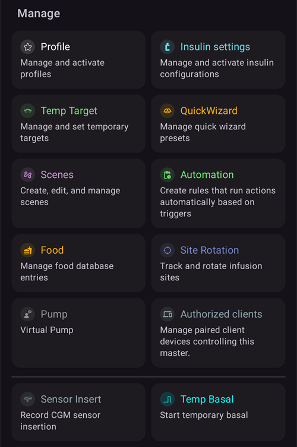

* **Mål** - hvor langt du er nået i [læringsmålene](../SettingUpAaps/CompletingTheObjectives.md); et mærke viser, hvor mange der er gennemført. Dette punkt forsvinder, når alle læringsmål er gennemført, og det findes ikke i **AAPSClient**.

(aaps-screens-notifications)=

#### Notifikationer

En **notifikationsboble** kan blive vist over den nederste bjælke til højre. Den samler de aktive notifikationer fra **AAPS**; det lille tal viser, hvor mange der er. Dens farve følger den vigtigste: rød for en akut besked, grøn for en simpel information.

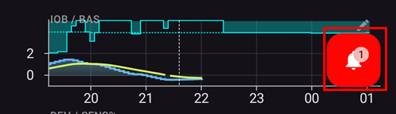

Tryk på boblen for at åbne panelet **Notifikation**. Hver besked viser det tidspunkt, hvor den kom. Tryk på **Afvis** under en besked for at fjerne den; nogle beskeder har i stedet en anden knap, der fører dig til den indstilling, der kræver din opmærksomhed.

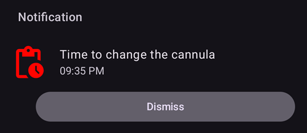

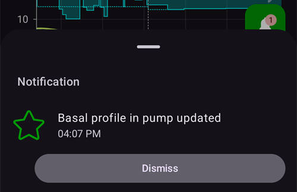

(bolus-wizard)= (aaps-screens-bolus-wizard)=

## Bolusberegner


Når du vil give en måltidsbolus, er det normalt her, du gør det.

### Sektion I

Overskriften **Beregning** viser den beregnede bolus. Hvis mængden af insulin om bord allerede er større end den beregnede bolus, viser den kun den mængde kulhydrater, der stadig er brug for.

Bolusberegneren kan bruges uanset dit aktuelle **BS**, også når det er for højt eller for lavt. Hvis **BS** er over målværdien, lægges en korrektion til måltidsbolussen. Hvis **BS** er under målværdien, bliver bolussen mindre, og hvis den insulin, der allerede er om bord, er mere end nødvendigt, fortæller beregneren dig, hvor mange kulhydrater der stadig er brug for, i stedet for at foreslå insulin.

Rækken med ikoner under overskriften viser, hvilke data der indgår i beregningen (BS, tendens, IOB, midlertidigt mål, COB). Et tryk på et ikon slår dette input til / fra i beregningen; ikonet **(i)** viser de detaljerede tal bag beregningen.

#### Kombinationer af COB og IOB, og hvad de betyder

* Af sikkerhedsgrunde kan IOB ikke slås fra, når COB er slået til, fordi du så risikerer at få for meget insulin, da **AAPS** ikke tager hensyn til det, der allerede er givet.
* Hvis du slår COB og IOB til, tages der hensyn til ikke-optagne kulhydrater, der ikke allerede er dækket med insulin, + al insulin, der er givet som TBR eller SMB.
* Hvis du slår IOB til uden COB, tager **AAPS** hensyn til insulin, der allerede er givet, men modregner den ikke mod kulhydrater, der stadig skal optages. Det giver en besked om »manglende kulhydrater«.
* Hvis du giver bolus for **ekstra mad** kort efter en måltidsbolus (f.eks. en ekstra dessert), kan det være en hjælp at **slå alle input fra**. På den måde lægges kun de nye kulhydrater til, fordi hovedmåltidet ikke nødvendigvis er optaget, så IOB passer ikke præcist med COB kort efter en måltidsbolus.
* Af sikkerhedsgrunde tages et **midlertidigt mål** kun med i beregningen, hvis du selv slår det til.

(AapsScreens-section-j)=

### Sektion J - Indtastningsfelter

I feltet **Kulhydrater** skriver du dit skøn over den mængde kulhydrater, **i gram**, du vil give bolus for; knapperne **+** under feltet lægger hurtigt kulhydrater til. **AAPS** arbejder kun med gram: hvis du tæller i brødenheder eller udvekslinger (*f.eks.* DAFNE "CHO"-udvekslinger), skal du regne dem om til gram, før du indtaster dem. Se [bemærkningen om brødenheder](#your-aaps-profile-insulin-to-carbs-ratio) på profilsiden.

#### Kulhydrattype: brød, kage eller pizza

Under feltet **Kulhydrater** fortæller knapperne **Brød**, **Kage** og **Pizza** **AAPS**, hvor hurtigt måltidet optages. Med **Kage** og **Pizza** dækker bolussen kun en del af kulhydraterne nu, og resten lægges til senere som e-kulhydrater. Se [Kulhydrattype: brød, kage eller pizza](#AapsScreens-carbs-type) på siden om forlængede kulhydrater for procenter og tidspunkter.

Rækken **Korrektion** bruges, hvis du af en eller anden grund vil ændre den endelige dosis.

Kun feltet **Kulhydrater** er altid åbent. De andre rækker (**Korrektion**, **Kulhydrattid**, **BS** og **Brug procent**) er foldet sammen: de viser deres værdi med knapperne **-** / **+**, så du kan ændre den i små trin. Tryk på pilen for at åbne en række og skrive en værdi, og tryk på den igen for at lukke rækken. Det forhindrer, at du ved en fejl skriver gram i feltet **Korrektion**.

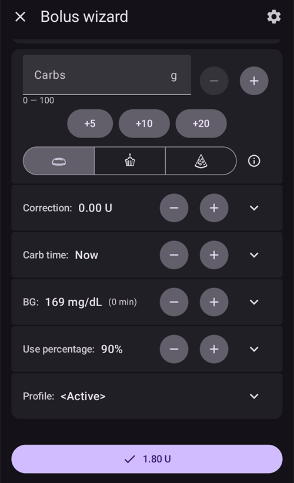

Tryk et vilkårligt sted på rækken **Profil** for at åbne listen over dine profiler, og tryk derefter på et navn for at bruge den profil til denne beregning.

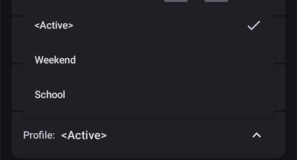

Feltet **Kulhydrattid** er til at give bolus før måltidet, så du kan fortælle systemet, at der vil gå noget tid, før kulhydraterne kommer. Du kan skrive et negativt tal i dette felt, hvis du giver bolus for kulhydrater, du allerede har spist.

**Indstil alarm** (påmindelse om at spise): når du indtaster en kulhydrattid i fremtiden, vises en kontakt »**Indstil alarm**«, så du på det angivne tidspunkt bliver mindet om at spise de kulhydrater, du har indtastet i **AAPS**:


Påmindelsen starter, når bolussen er givet. Mens den kører, tæller en bjælke **Tid til at spise** ned på hovedskærmen med **Stop** og **+5 min**. **+5 min** flytter slutningen af ventetiden fem minutter senere, og bjælken viser den samlede ventetid. Når tiden er gået, ringer påmindelsen med sin egen lyd, et blødt køkkenur. Ud over **Gør alarmen lydløs** (skærmen forbliver åben) og **Lydløs og luk** tilbyder alarmskærmen **+5 min**, som starter en ny ventetid på fem minutter. Når den har ringet, viser bjælken *Tiden er gået* med **+5 min** og **Afvis**; **Lydløs og luk** fjerner også bjælken. Bjælken og alarmen vises også i **AAPSClient** og på [uret](#WearOsSmartwatch-wizard-carb-time). Påmindelsen opretter ikke en timer i telefonens ur-app. Hvis Android ikke lader **AAPS** sætte alarmer, beder beregneren dig om at tillade *Alarmer og påmindelser* for **AAPS** i Android-indstillingerne. Klokken tilbydes ikke for en kulhydrattid i fortiden.

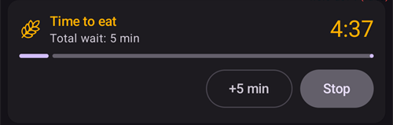

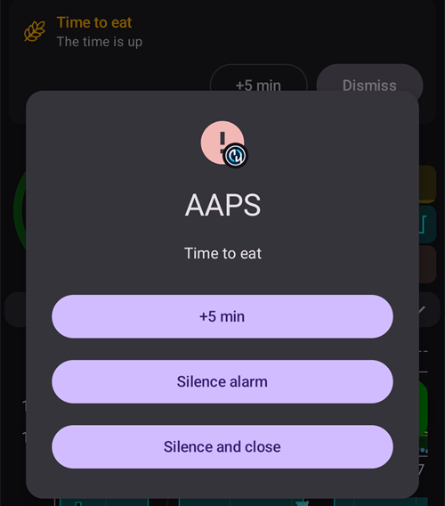

Feltet **BS** er normalt allerede udfyldt med den seneste måling fra din CGM. Hvis du ikke har en CGM, der virker, er feltet tomt. Når målingen er ny, forbliver rækken **BS** foldet sammen. Feltet følger nye målinger, mens beregneren er åben, indtil du selv ændrer det.

Resultatknappen nederst viser den foreslåede bolus; når du trykker på den, bliver du bedt om at bekræfte, før der gives insulin. Mens bekræftelsen venter, giver loopet ingen SMB, så den bolus, du bekræfter, stadig er rigtig. Hvis en SMB bliver givet i det øjeblik, venter **OK**, indtil den er færdig.

Godt at vide:

* Hvis den beregnede bolus er større end din **[Maks. bolus](#Preferences-maximum-bolus)**, sænkes den til maks. bolus, og bekræftelsen viser advarslen »Bolus-begrænsning anvendt«. En [Hurtigbolus](../DailyLifeWithAaps/QuickWizards.md) bliver i stedet afvist.
* Når bolussen kun registreres (f.eks. mens pumpen er afbrudt), bliver advarslen »**Bolus registreres kun (bliver ikke leveret af pumpe)**« øverst i dialogen, også når du ruller.
* En bolus, du giver selv, har forrang for en [SMB](#Open-APS-features-super-micro-bolus-smb), der venter på at blive givet: SMB'en droppes, og loopet beregner igen. Hvis en SMB bliver givet lige nu, afvises din bolus med beskeden »Der leveres en SMB lige nu. Prøv igen, når den er færdig.« Der gives ingen insulin, og kulhydrater, der er indtastet med den bolus, gemmes ikke: vent et øjeblik, og indtast dem igen.

(AapsScreens-wrong-cob-detection)=

#### Forkert COB-detektering


Hvis du ser advarslen ovenfor efter at have brugt bolusberegneren, har **AAPS** opdaget, at den beregnede COB-værdi måske er forkert. Så hvis du vil give bolus igen efter et tidligere måltid med COB, skal du passe på ikke at give for meget insulin!

Se tipsene på [siden COB-beregning](#CobCalculation-detection-of-wrong-cob-values) for detaljer.

Leder du efter fanen **Handlinger** fra **AAPS** 3.x? Dens funktioner er flyttet til hovedskærmen, arket **Administrer** og Hurtigstart-værktøjslinjen: se [Hvor er fanen Handlinger blevet af?](#screens-action-tab).

(aaps-screens-careportal)=

## Careportal-registreringer

Alderen og niveauerne i [statuslinjen](#screens-sensor-level-battery) (sensor, insulin, kanyle, pumpebatteri) er baseret på careportal-registreringer: **Klargør/Fyld** (registrerer skift af infusionssæt og insulinampul), **Sensorindstik** og **Skift af pumpebatteri**.

Du kan registrere dem fra det udvidede statuspanel på hovedskærmen, fra arket **Administrer** eller med [Hurtigstart](../DailyLifeWithAaps/QuickLaunch.md)-knapper.

**Klargør/Fyld** registrerer et skift af infusionssæt og/eller et skift af insulinampul og kan give en mængde til klargøring:

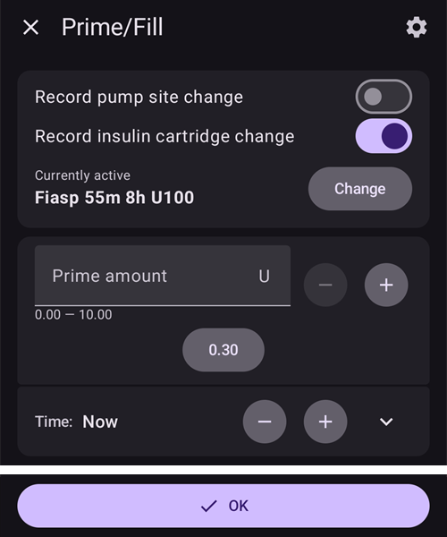

**Sensorindstik** og **Skift af pumpebatteri** spørger kun om tidspunktet for hændelsen:

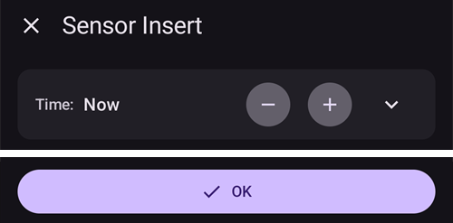

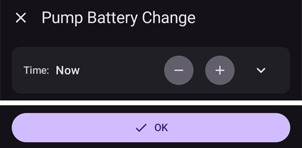 Registreringerne motion, meddelelse, spørgsmål og notat svarer til careportal i Nightscout og er særlige former for notater.

I arket **Administrer** skal du rulle ned og trykke på **Careportal** for at se disse registreringer: **BS-kontrol**, **Notat**, **Motion**, **Spørgsmål** og **Meddelelse**.

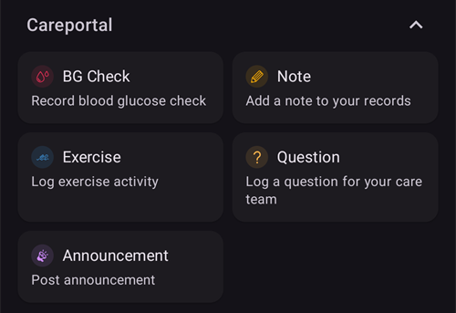

**BS-kontrol**, **Spørgsmål** og **Meddelelse** lader dig indtaste en glukoseværdi (fra et blodsukkerapparat, sensoren eller en anden kilde), et notat og tidspunktet for hændelsen. I **Spørgsmål** og **Meddelelse** er glukoserækken foldet sammen og viser målertypen ved siden af værdien: hvis du ændrer værdien, skifter typen fra **Sensor** til **Meter**.

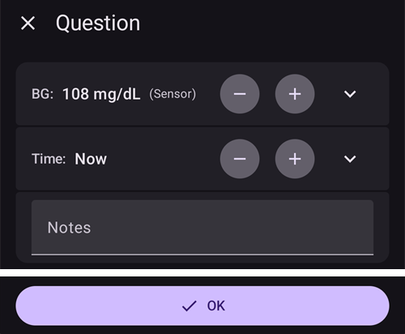

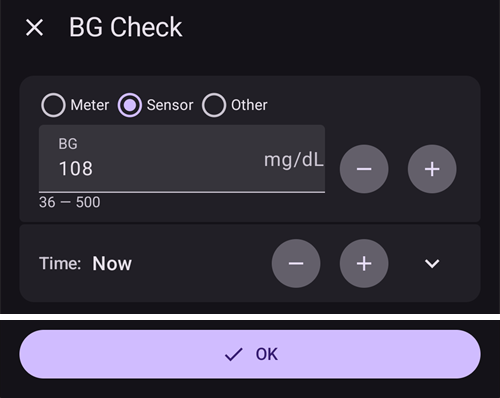

**Notat** og **Motion** lader dig indtaste en varighed (en sammenfoldet række: brug **-** / **+**, eller tryk på pilen for at skrive den), et notat og tidspunktet for hændelsen:

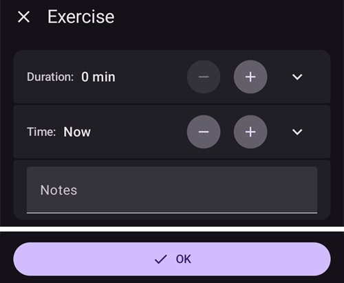

I alle disse dialoger (**Klargør/Fyld**, **Sensorindstik**, **Skift af pumpebatteri** og careportal-registreringerne) bruger tidspunktet for hændelsen den samme række **Tid** som [insulindialogen](#aaps-screens-buttons-insulin) og bolusberegneren: brug **-** / **+** til at flytte tiden i trin på 5 minutter (op til en uge tilbage og 12 timer frem), eller tryk på pilen for at vælge en vilkårlig dato og et klokkeslæt.

## Rotation af indstikssteder

**Administrer → Rotation af indstikssteder** registrerer på et kropskort, hvor hver kanyle og sensor blev sat, så du kan skifte mellem stederne: se [Rotation af indstikssteder](#Aapsscreens-site-rotation) på siden Pumper og kanyler.

**TDD** (samlet daglig dosis) og tommelfingerreglen for forholdet mellem basal og bolus er forklaret under [fanen Insulin i Statistik](#reviewing-tdd).

(AapsScreens-insulin-profile)=

## Insulin


**Administrer → Insulinindstillinger** viser og administrerer dine insulinkonfigurationer. Hver konfiguration vises på et kort med sit **spidstidspunkt** og sin **[DIA](#Config-Builder-insulin-dia)**; den, der er i brug, er markeret med **AKTIV**. Under kortet ser du aktivitetskurven. Du kan redigere kaldenavn, spids og DIA for alle konfigurationer undtagen den aktive: for at skifte den insulin, du bruger, skal du [tilføje en ny konfiguration og aktivere den](#Config-Builder-insulin-change-active).

Se [Varighed af insulinvirkning](#Config-Builder-insulin-dia) for at lære mere om, hvad det er, og hvordan du indstiller det.

## Pumpestatus

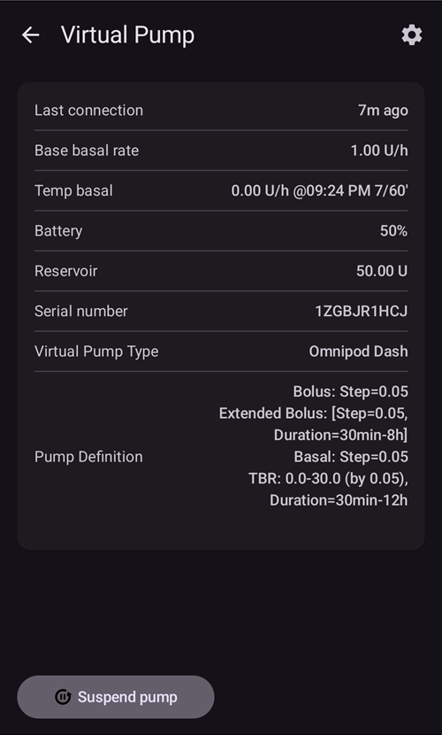

**Administrer → Pumpe** (eller **Konfiguration → Pumpe → Åbn plugin**) viser status for din pumpe: seneste forbindelse, grundlæggende basalrate, batteri, reservoir ...

* Hvilke oplysninger der vises, afhænger af din pumpemodel.
* Se [siden om pumper](../Getting-Started/CompatiblePumps.md) for detaljer.

## Loop, AMA / SMB

**Konfiguration → Loop → Åbn plugin** (og **Konfiguration → APS → Åbn plugin**) viser detaljer om algoritmens beregninger, og hvorfor **AAPS** handler, som den gør: seneste kørsel, den deraf følgende anmodning og begrænsningerne. Skærmen **Loop** viser kun de begrænsninger, der faktisk begrænsede den givne midlertidige basalrate eller SMB (og hvorfor lukket loop ikke er tilladt, hvis det er tilfældet); skærmen **APS** viser alle de begrænsninger, der indgik i beregningen.

Beregningerne køres, hver gang systemet får en ny måling fra CGM'en.

Se [APS-afsnittet på siden Konfiguration](#Config-Builder-aps) for flere detaljer.

(aaps-screens-profile)=

## Profil

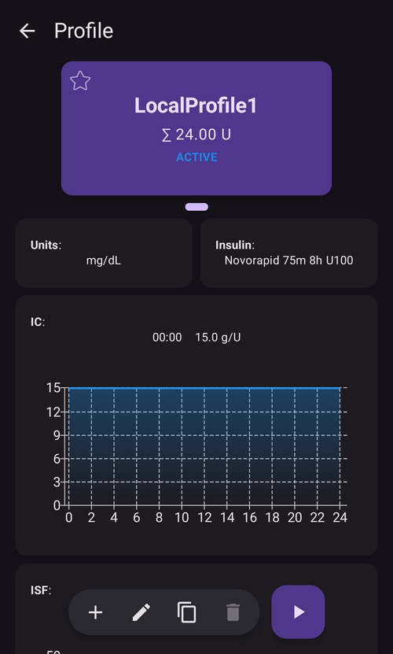

**Administrer → Profil** (eller et tryk på profilnavnet på hovedskærmen) åbner profilskærmen: dine profiler som kort, du kan bladre i med et swipe, med knapper til at tilføje, redigere, klone, slette og **aktivere** en profil.

Profilen indeholder oplysninger om dine personlige diabetesindstillinger. Se siden **[Din AAPS-profil](../SettingUpAaps/YourAapsProfile.md)** for flere oplysninger.

## Automatisering

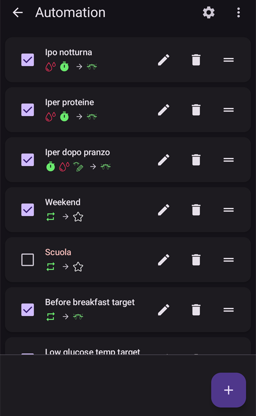

**Administrer → Automatisering** viser dine automatiseringsregler. Se den særlige side [her](../DailyLifeWithAaps/Automations.md).

## NSClient

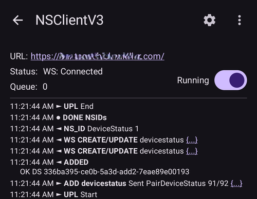

**Konfiguration → Kommunikation → NSClientV3 → Åbn plugin** viser status for forbindelsen til dit Nightscout-site: URL, websocket-status, kø og en log over synkroniseringen.

Indstillingerne kan ændres i [NSClient-indstillinger](#Preferences-nsclient).

Fejlfinding: se denne [side](../GettingHelp/TroubleshootingNsClient.md).

(aaps-screens-bg-source)=

## BS-kilde - xDrip, BYODA ...

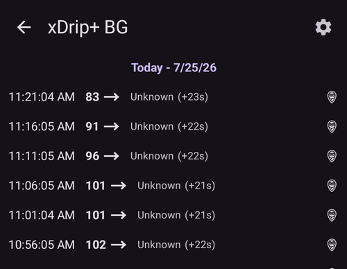

**Konfiguration → BS-kilde → Åbn plugin** viser historikken for CGM-målinger og giver mulighed for at fjerne målinger, hvis der er fejl (f.eks. kompressions-lav) eller dobbelte målinger.

## Behandlingshistorik

Åbn **menuen** (☰), og vælg **Behandlingshistorik** for at se, tjekke og rette alt det, **AAPS** har registreret: kulhydrater og boluser, midlertidige basaler, midlertidige mål, profilskift, careportal-registreringer, skift af loop-tilstand og brugerregistreringer. Se [Behandlingshistorik](#aaps-screens-treatments) på siden Gennemgang af dine data.

## Historikbrowser


Åbn **menuen** (☰), og vælg **Historikbrowser**.

Lader dig gå tilbage i historikken i **AAPS**. Se den særlige side [Gennemgang af dine data > Historikbrowser](../Maintenance/Reviewing.md).

(aaps-screens-statistics)=

## Statistik


Åbn **menuen** (☰), og vælg **Statistik**.

Giver dig statistik om din samlede daglige dosis, tid i målområde, din glukoseprofil over døgnet (AGP) og dit mønster for insulincyklus, på fire faner. Se den særlige side [Gennemgang af dine data > Statistik](#reviewing-statistics).

(aaps-screens-profile-helper)=

## Profilhjælper

Åbn **menuen** (☰), og vælg **Profilhjælper**.


Profilhjælperen lader dig sammenligne profiler og lave startprofiler til børn. Se [Din AAPS-profil](../SettingUpAaps/YourAapsProfile.md) - afsnittene [Lav en profil fra bunden til et barn](#your-aaps-profile-profile-from-scratch-for-a-kid) og [Sammenlign to profiler](#your-aaps-profile-compare-profiles).

(aaps-screens-widgets)=

## Widgets på startskærmen

**AAPS** har fem widgets, som du kan tilføje til telefonens startskærm, så du kan se dine data uden at åbne appen. Se den særlige side [Widgets på startskærmen](../DailyLifeWithAaps/Widgets.md).

