# Automatisering

```{contents} In this page
:backlinks: entry
:depth: 2
```

## Hvad er en automatisering?

»**Automatisering**« er en funktion, der kan automatisere opgaver i AAPS.

Automatisering udfører bestemte handlinger ud fra en eller flere betingelser eller udløsere. Udløsere kan være uregelmæssige hændelser som lavt eller højt blodsukker (BS) eller en bestemt mængde negativ insulin om bord (IOB). Automatiseringer kan også klare tilbagevendende hændelser, f.eks. måltider eller motion på bestemte tidspunkter af dagen, eller når brugeren er inden for en bestemt afstand af en GPS-placering eller et område med et bestemt Wi-Fi SSID. Automatisering kan lave sikkerhedskopier af AAPS-indstillingerne efter en tidsplan eller ved hvert pod-skift.

Automatiseringsregler oprettes og ændres på skærmen **Automatisering** (**Administrer → Automatisering**). Hver regel er bestemt af to dele:

- En eller flere betingelser eller »udløsere«, der starter en handling.

    Tænk på et bestemt tidspunkt, en hændelse eller en værdi i AAPS

- En eller flere handlinger, der skal udføres.

    F.eks. en alarm, at sætte en profilprocent eller at eksportere AAPS-indstillingerne ved pod-skift.


Der er mange muligheder i automatisering, og brugerne opfordres til at sætte sig ind i dem i AAPS-appen, i afsnittet Automatisering. Du kan også søge i AAPS-brugergrupperne på [**Facebook**](https://www.facebook.com/groups/AndroidAPSUsers) og [**Discord**](https://discord.gg/4fQUWHZ4Mw) efter eksempler på automatiseringer fra andre brugere.

## Sådan kan automatisering hjælpe

1. **Automatiser tilbagevendende opgaver:** Programmerede handlinger bliver udført automatisk, uden at brugeren skal gøre noget.

1. **Mindre beslutningstræthed:** Den største fordel ved **automatiseringer** er, at brugeren slipper for at skulle gribe ind manuelt i **AAPS**. [Forskning](https://www.ncbi.nlm.nih.gov/pmc/articles/PMC6286423/#ref4) anslår, at personer med type 1-diabetes i gennemsnit skal træffe 180 ekstra beslutninger hver dag. **Automatiseringer** kan mindske den mentale belastning, så brugeren får mere mental energi til andre dele af livet.

1. **Måske bedre kontrol af blodsukkeret:** **Automatiseringer** kan f.eks. sørge for, at **midlertidige mål** altid bliver sat, når der er brug for dem, også i travle perioder, eller når man glemmer noget. Hvis et barn med diabetes f.eks. har idræt i skolen om tirsdagen kl. 10 og om torsdagen kl. 14 og skal have et højt midlertidigt mål (»TT«) sat 30 minutter før idrætten, kan det **midlertidige mål** aktiveres med en **automatisering**.

1. **AAPS kan tilpasses meget**, så det er mere eller mindre aggressivt i bestemte situationer, som brugeren ønsker. For eksempel at udløse en midlertidigt lavere **profil**-% i en bestemt periode, hvis der opstår negativ **IOB** midt om natten, hvilket tyder på, at den nuværende **profil** måske er for stærk.

Eksemplet nedenfor viser, hvordan en **automatisering** kan fjerne nogle trin.

Brugeren træner hver morgen kl. 6: Han skal huske at sætte et »Midlertidigt mål - Aktivitet« manuelt i AAPS kl. 5, før han træner.

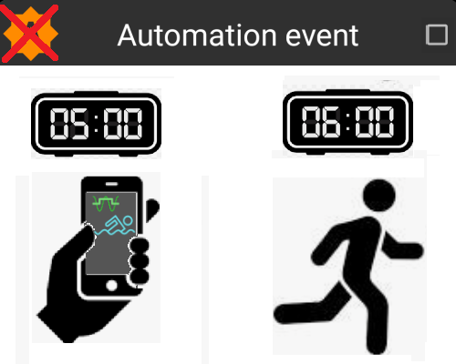

Brugeren har lavet en **automatisering**, der udløser et »Midlertidigt mål - Aktivitet« kl. 5, så **BS** og **IOB** er optimale som forberedelse til træningen kl. 6:

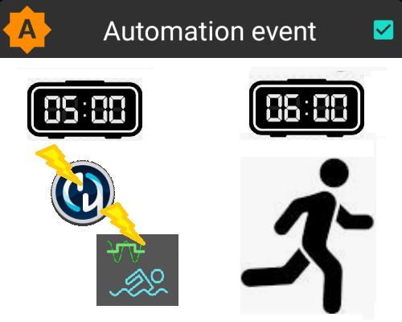

## Vigtige overvejelser, før du begynder med automatiseringer

1. Før du opsætter visse automatiseringer, bør du have rimelig god kontrol over dit **BS** med **AAPS**. Automatiseringer må ikke bruges til at rette op på dårlige indstillinger for basal, **ISF** eller **CR** (mere om det nedenfor). Undgå at sætte et automatisk **profilskift** til at modvirke stigninger i **BS** på grund af _f.eks._ mad. Dem klarer du bedre med andre strategier (SMB'er osv.).

1. Som al anden teknologi kan **CGM'er**, **pumper** og telefoner svigte: Tekniske problemer eller sensorfejl kan forstyrre handlingerne i en **automatisering**, og det kan være nødvendigt at gribe ind manuelt.

1. **Behovet for automatiseringer ændrer sig sandsynligvis, når rutinerne ændrer sig**. Når du skifter mellem arbejde, skole og ferie, så sæt en påmindelse i din kalender om at gennemgå, hvilke **automatiseringer** der er aktive lige nu (de er lette at aktivere og deaktivere). For eksempel hvis du tager på ferie og ikke længere har brug for en automatisering til idræt i skolen eller daglig motion, eller hvis du skal justere tidspunkterne.

1. **Automatiseringer** kan komme i konflikt med hinanden. Det er godt at gennemgå indstillingerne for nye **automatiseringer** grundigt i trygge omgivelser og forstå, hvorfor en **automatisering** måske er blevet udløst eller ikke er blevet udløst, som du forventede.

1. Hvis du bruger Autosens, så prøv at bruge **midlertidige mål** i stedet for **profilskift**. **Midlertidige mål** nulstiller ikke Autosens til 0. **Profilskift** nulstiller Autosens.

1. De fleste **automatiseringer** bør kun sættes for en **begrænset varighed**. Bagefter kan **AAPS** vurdere igen og gentage **automatiseringen**, hvis det er nødvendigt, og hvis betingelsen stadig er opfyldt. For eksempel »start midlertidigt mål på 7,0 mmol/l i 30 min« eller »start **profil** 110% i 10 min« _og_ »start midlertidigt mål på 5,0 mmol/l i 10 min«. Hvis du bruger **automatiseringer** til at lave varige ændringer (f.eks. til en stærkere profil-%), risikerer du hypoglykæmi.

## Hvornår kan jeg begynde at bruge automatisering?

**Automatiseringer** kan bruges fra **læringsmål 10**.

## Hvor finder jeg automatiseringer i AAPS?

Åbn **Administrer** i den nederste navigation på hovedskærmen, og vælg **Automatisering**.

## Hvordan opsætter jeg en automatisering?

For at opsætte en **automatisering** skal du trykke på knappen **+** på skærmen Automatisering for at oprette en »regel«:

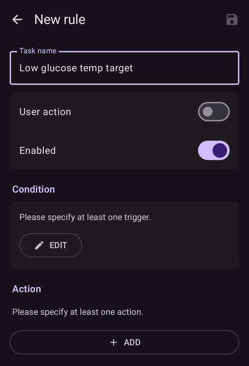

* giv din »regel« en titel (navn på opgaven);
* tryk på »**REDIGER**« under **Betingelse**. På skærmen **Betingelse** skal du vælge, hvordan udløserne kombineres (**Og**, **Eller**, **Eksklusiv eller**), og trykke på »**Tilføj udløser**«:

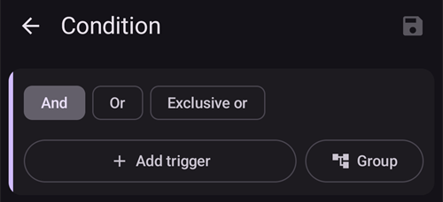

* tilføj mindst én udløser:

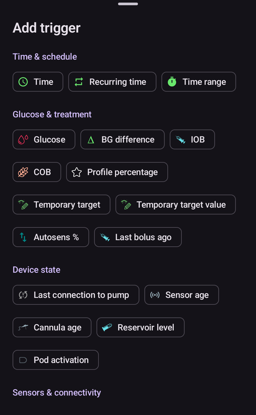

* tryk på »**TILFØJ**« under **Handling**, og vælg én handling:

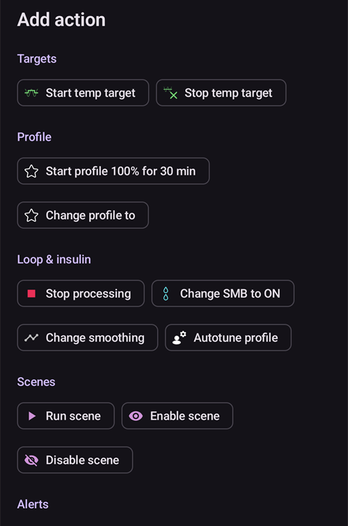

* gem reglen med knappen **Gem**, og sørg for, at der er »flueben« i feltet til venstre for regelnavnet, så **automatiseringen** er aktiveret:


For at deaktivere en **automatiseringsregel** skal du fjerne fluebenet i feltet til venstre for navnet på **automatiseringen**. Eksemplet nedenfor viser en **automatisering**, der enten er aktiveret (»med flueben«) eller deaktiveret (»uden flueben«):

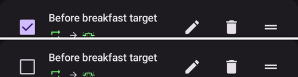


Når du opsætter en **automatisering**, kan du først teste den ved at aktivere muligheden »Notifikation« under »Handlinger«. Så viser **AAPS** først en notifikation i stedet for at udføre en handling automatisk. Når du er tryg ved, at notifikationen er blevet udløst på det rigtige tidspunkt / under de rigtige betingelser, kan du opdatere **automatiseringsreglen** og erstatte »Notifikation« med en »Handling«.

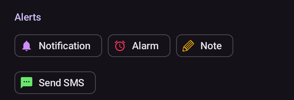

```{admonition} Important note
:class: note

**Automatiseringer** er stadig aktive, når loopet er deaktiveret!
```


## Hvornår reglerne bliver tjekket

**AAPS** tjekker alle **automatiseringsregler**, hver gang en ny glukosemåling er behandlet. Reglerne bliver altså vurderet i samme tempo som din CGM, også mens telefonens skærm er slukket. Reglerne bliver også tjekket, når telefonen begynder at lade, når netværket eller placeringen ændrer sig, og når en Bluetooth-enhed forbinder. Der kører kun ét tjek ad gangen, så en regel, hvis handlinger tager lidt tid (f.eks. en pumpekommando), kan ikke blive udført to gange.

## Sikkerhedsgrænser

Der er sikkerhedsgrænser for **automatiseringer**:

* Et **midlertidigt mål**, der er sat af en **automatisering**, skal være mellem 72 og 180 mg/dl (eller 4 og 10 mmol/l).
* **Profilprocent** skal være mellem 50% og 130%.
* Der er en tidsgrænse på 5 minutter mellem udførelser af **automatisering** (og den første udførelse).

## Korrekt brug af negative værdier

```{admonition} Warning
:class: warning

Vær forsigtig, når du vælger en negativ værdi i **Automatisering**
```

Vær forsigtig, når du vælger en »negativ værdi« i »Betingelse«, f.eks. »er mindre end«, i **automatiseringer**. For eksempel:

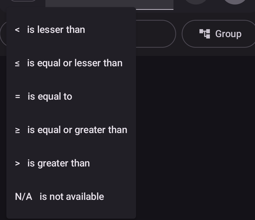

**Eksempel 1:** Hvis du opretter en betingelse **»er mindre end«** »-0,1 mmol/l« (eller »-2 mg/dl«), vil den:

Udløs en **automatisering** for ethvert tal, som er **strengt mindre end** -0,1 (-2). Det gælder tal som -0,2, -0,3, -0,4 (-4, -6, -8) og så videre. Husk, at -0,1 (-2) selv **ikke** er med i denne betingelse. (Betingelsen »er lig med eller mindre end -0,1 mmol/l (-2 mg/dl)« _vil_ tage -0,1 mmol/l eller -2 mg/dl med).

**Eksempel 2:** Hvis du opretter en betingelse »er større end« -0,1 mmol/l (-2 mg/dl), vil den:

Udløse en **automatisering** for ethvert tal, som er **større end** -0,1 mmol/l (-2 mg/dl). Det gælder tal som 0, 0,2, 0,4 mmol/l (0, 4, 8 mg/dl) og alle andre positive tal.

Det er vigtigt, at du nøje overvejer, præcis hvad din **automatisering** skal gøre, når du vælger disse betingelser og værdier.

(automations-automation-triggers)=
## Udløsere for automatisering


Rul ned for at se resten af listen:

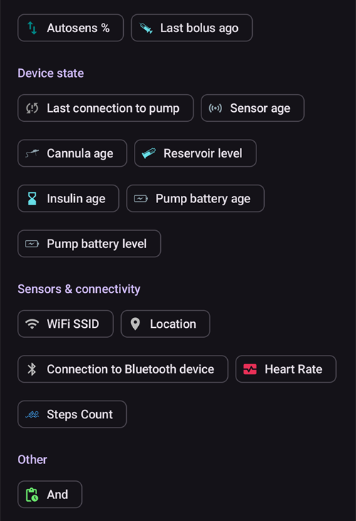

Brugeren kan vælge mellem forskellige »udløsere«. Udløsere er de betingelser, der skal være opfyldt, for at automatiseringen bliver udført. Listen nedenfor er ikke fuldstændig:

**Udløser:** forbind betingelser

**Muligheder:**

Flere betingelser kan forbindes med
* »Og«
* »Eller«
* »Eksklusiv eller« (det betyder, at hvis én - og kun én - af betingelserne er opfyldt, bliver handlingen/handlingerne udført)

**Udløser:** tid og tilbagevendende tid

**Muligheder:**

* tid = en enkelt hændelse på et bestemt tidspunkt
* tilbagevendende tid = noget, der sker regelmæssigt (f.eks. en gang om ugen, hver hverdag osv.)

**Udløser:** placering

**Muligheder:**

* i [Indstillinger > Automatisering](#preferences-maintenance-settings) kan brugeren vælge den placeringstjeneste, der skal bruges.

**Udløser:** placeringstjeneste

**Muligheder:**

* Brug passiv placering: **AAPS** henter kun placeringen, når andre apps beder om den.
* Brug netværksplacering: placeringen af dit Wi-Fi.
* Brug GPS-placering (Bemærk! Det kan bruge meget batteri!)

**Udløsere**: pumpe- og sensordata

* Udløser for kanylealder: findes for alle pumper
* Udløser for insulinalder: findes for understøttede pumper
* Udløser for batterialder: findes for understøttede pumper
* Udløser for sensoralder: findes altid
* Udløser for pod-aktivering: findes for patchpumper

Bemærk, at sammenligningen »er lig med« næppe udløses for alle udløsere, der har med alder at gøre. I det tilfælde skal du bruge to udløsere for at lave et interval

* Udløser for reservoirniveau: findes for alle pumper. Sammenligningen »NOT\_AVAILABLE« virker ikke for denne udløser, fordi værdien altid er udfyldt i **AAPS**
* Udløser for pumpebatteriniveau: findes for understøttede pumper. Sammenligningen »NOT\_AVAILABLE« virker ikke for denne udløser, fordi værdien altid er udfyldt i **AAPS**

(automations-automation-action)=
## Handling


Rul ned for at se resten af listen:

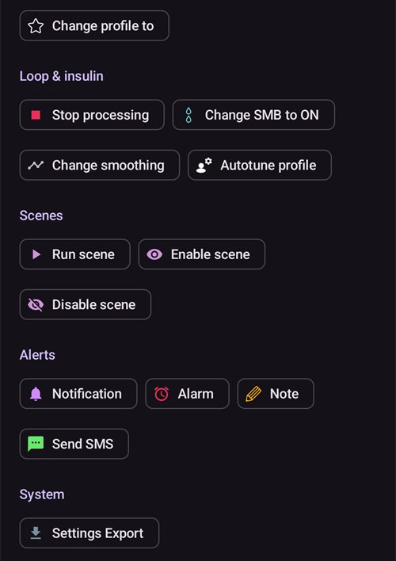

**Handlinger:** start **midlertidigt mål**

**Muligheder:**

* **BS** skal være mellem 72 mg/dl og 180 mg/dl (4 mmol/l og 10 mmol/l)
* **TT** virker kun, hvis der ikke allerede er et midlertidigt mål — **AAPS** tilføjer automatisk en linje »**Forudsætninger: Midlertidigt mål findes ikke**« til reglen

**Handlinger:** stop **midlertidigt mål**

**Muligheder:**

ingen

**Handlinger:** **Profilprocent**

**Muligheder:**

* **Profil** skal være mellem 50% og 130%
* virker kun, hvis den forrige procent er 100%

**Handlinger:** **Skift udjævning** (i gruppen **Loop & insulin**)

**Muligheder:**

* vælg den [udjævningsmetode](../CompatibleCgms/SmoothingBloodGlucoseData.md), der skal skiftes til. Listen er den samme som under **Konfiguration** > **Udjævning**, og handlingen gør præcis det samme som en ændring der: den nye metode bliver gemt, synkroniseret til parrede klienter, og BS-dataene bliver udjævnet igen med det samme.
* kører kun, hvis den udjævningsmetode ikke allerede er aktiv — **AAPS** tilføjer automatisk en linje »**Forudsætninger: Udjævning … er ikke aktiv**« til reglen. Når den valgte udjævning er aktiv, bliver reglen sprunget over uden besked.
* Eksempel: en ny sensor har ofte meget støj det første døgn. To regler med udløseren **Sensoralder** giver stærkere filtrering, mens sensoren falder til ro, og udjævning uden forsinkelse bagefter:
  * **Sensoralder** mindre end 24 t: **Skift udjævning** til **Unscented Kalman-filter**
  * **Sensoralder** mere end 24 t: **Skift udjævning** til **Gennemsnitlig udjævning**

**Handlinger:** **Notat** (i gruppen **Alarmer** på listen)

**Muligheder:**

* vælg den hændelse, der skal registreres: **Notat**, **Motion**, **Spørgsmål**, **Meddelelse** eller **Skift indstikssted**, og eventuelt et notat. Handlingens navn skifter til den hændelse, du vælger.
* **Varighed**: bruges til **Notat**, **Motion** og **Skift indstikssted**. **Spørgsmål** og **Meddelelse** har ingen varighed: de registrerer i stedet dit aktuelle BS.
* **Skift indstikssted** nulstiller kanylealderen, som om du havde registreret et skift af infusionssæt manuelt. Eksempel: nogle pumper (som Combo) registrerer selv et reservoirskift, men ikke skiftet af infusionssæt. Hvis du altid skifter begge på samme tid, kan en regel med **Insulinalder** mindre end 1 time og **Kanylealder** mere end 24 timer registrere skiftet af infusionssæt for dig.

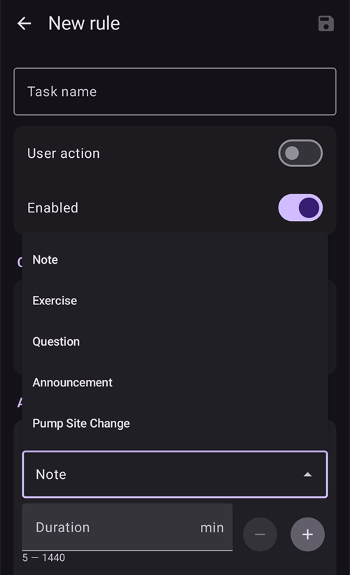 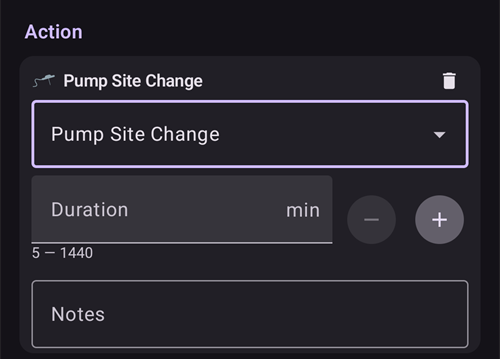

**Handlinger:** **Send SMS til alle numre** (i gruppen **Alarmer**)

**Muligheder:**

* skriv teksten til beskeden. Den bliver sendt til alle de telefonnumre, der er tilladt i indstillingerne for [SMS-kommunikator](../RemoteFeatures/SMSCommands.md). Pluginet SMS-kommunikator skal være aktiveret.

**Handlinger:** **Skift profil til** (i gruppen **Profil**)

**Muligheder:**

* vælg den **profil**, der skal aktiveres. Den bliver aktiveret med 100%, uden tidsforskydning. Hvis profilen allerede er aktiv, gør handlingen ingenting.

**Handlinger:** **Aktiver/deaktiver SMB** (i gruppen **Loop & insulin**)

**Muligheder:**

* vælg **Til** eller **Fra**. Det ændrer indstillingen **Aktiver SMB** i OpenAPS SMB, præcis som hvis du havde ændret den i **Indstillinger**, og den forbliver sådan, indtil du eller en anden regel ændrer den tilbage.

**Handlinger:** **Kør Autotune** (i gruppen **Loop & insulin**)

**Muligheder:**

* vælg den profil, der skal justeres, og antallet af dage: se [Kør Autotune med en automatiseringsregel](#autotune-run-autotune-with-an-automation-rule).

**Handlinger:** **Stop afvikling** (i gruppen **Loop & insulin**)

**Muligheder:**

* ingen. Så længe betingelserne for en regel med denne handling er sande, tjekker **AAPS** ikke reglerne under den på listen. Så snart betingelserne er falske igen, bliver reglerne nedenunder tjekket som normalt. Føj den til en regel, der skal have forrang for reglerne under den (se [rækkefølgen af automatiseringerne](#Automations-the-order-of-the-automations-in-the-list-matters)).

**Handlinger:** **Kør scene**, **Aktiver scene**, **Deaktiver scene** (i gruppen **Scener**)

**Muligheder:**

* vælg den [scene](Scenes.md), der skal køres, aktiveres eller deaktiveres.

Når »Handling« er tilføjet, skal standardværdierne ændres til det ønskede tal ved at klikke på dem og justere dem.

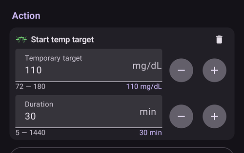

(Automations-the-order-of-the-automations-in-the-list-matters)=
## Rækkefølgen af **automatiseringerne** på listen har betydning
 **AAPS** udfører de oprettede regler i prioriteret rækkefølge, startende fra toppen af listen over **automatiseringer**. Hvis f.eks. **automatiseringen** »Lav« er den vigtigste **automatisering**, vigtigere end alle andre regler, skal denne **automatisering** stå øverst på brugerens liste over **automatiseringer**, som vist nedenfor:


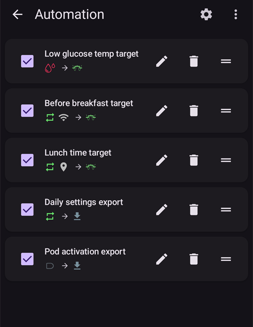

For at ændre prioriteten af **automatiseringsreglerne** skal du trykke og holde på håndtaget **=** i højre side af reglen. Skift rækkefølgen af **automatiseringerne** ved at flytte reglerne op eller ned.

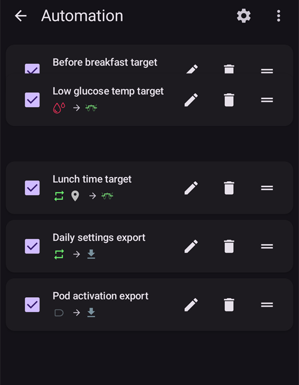

## Sådan sletter du automatiseringsregler

For at slette en **automatiseringsregel** skal du klikke på skraldespandsikonet.


## Eksempler på automatiseringer

Nedenfor er der eksempler på **automatiseringer**. Mere om **automatiseringer**, og hvordan brugere har tilpasset deres **automatisering**, kan du finde i diskussionsgrupper på Facebook eller på Discord. Eksemplerne nedenfor må ikke kopieres, uden at brugeren godt forstår, hvordan **automatiseringen** virker.

(automations-low-glucose-temp-target)=
### Midlertidigt mål ved lavt blodsukker

Denne **automatisering** udløser automatisk et **midlertidigt mål**, når **BS** falder under en bestemt grænse — her startes et mål på 110 mg/dl i 30 minutter, når glukosen er mindre end 70 mg/dl:

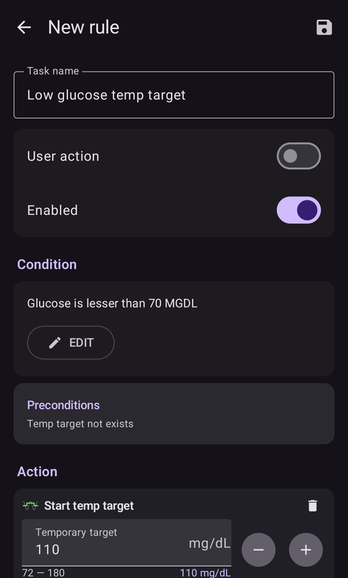

### Midlertidigt mål ved frokost (med »Placering«)

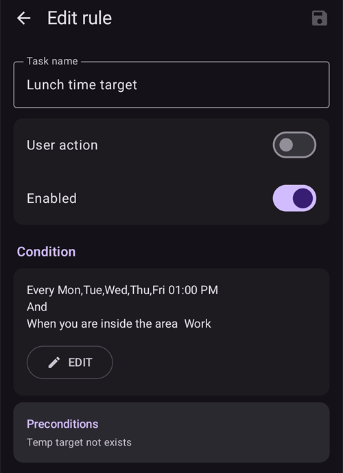

Denne **automatisering** er lavet til en bruger, der spiser frokost på arbejdet på cirka samme tidspunkt hver hverdag, men den udløses kun, hvis brugeren befinder sig inden for en bestemt »placering«.  Så hvis brugeren ikke er på arbejde en dag, bliver denne **automatisering** ikke aktiveret.

Denne **automatisering** sætter et lavt **midlertidigt mål** (Spiser snart) kl. 13:00 for at få BS ned på 90 mg/dl (eller 5 mmol/l) som forberedelse til frokost.

»Udløser«-placeringen har et navn, en position (tryk på **Vælg på kort**, eller brug din nuværende placering) og en radius i meter, og den udløses, når du er inden for (eller uden for) området:

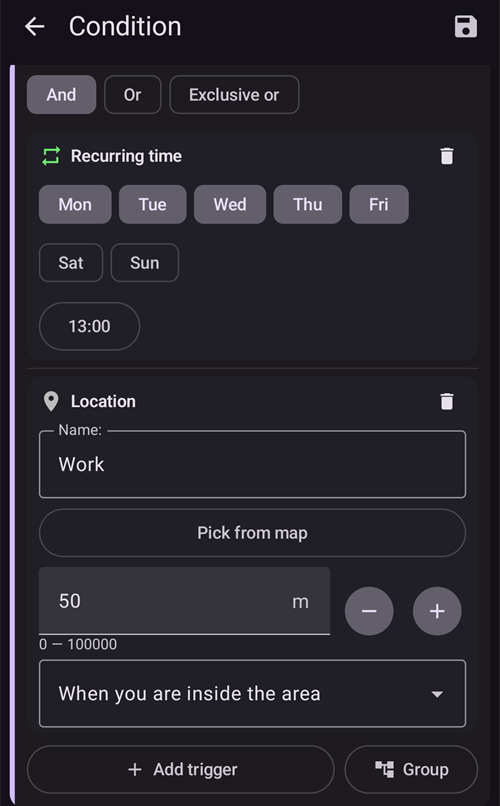

På grund af forbindelsen »Og« sker **automatiseringen** kun i det »valgte tidsrum«, og hvis brugeren er på den valgte placering.

**Automatiseringen** bliver ikke udløst på noget andet tidspunkt på denne placering eller på dette tidspunkt uden for radiussen på 50 meter omkring den valgte position.

### Automatisering med placering via Wi-Fi SSID

Et Wi-Fi SSID er en god mulighed for at udløse en **automatisering**, når du er inden for rækkevidde af et bestemt Wi-Fi-netværk (sammenlignet med GPS): det er ret præcist, bruger mindre batteri og virker indendørs, hvor GPS og andre placeringstjenester måske ikke er tilgængelige.

Her er et andet eksempel, hvor der kun sættes et **midlertidigt mål** på arbejdsdage før morgenmaden (1).


**Automatiseringen** bliver udløst kl. 05:30 kun mandag-fredag (2)  
og mens telefonen er forbundet til et Wi-Fi-netværk derhjemme (3).


Den sætter så et **midlertidigt mål** på 75 mg/dl i 30 minutter (4). En af fordelene ved at tage placeringen med er, at den f.eks. ikke bliver udløst, hvis brugeren er ude at rejse på ferie.

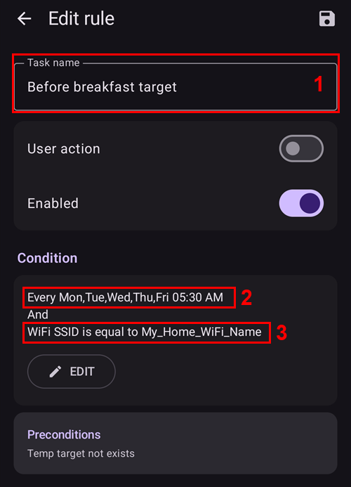

Rul ned for at se handlingen: et **midlertidigt mål** på 75 mg/dl i 30 minutter (4).

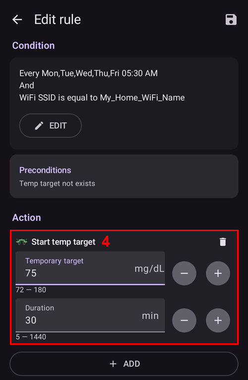

Her er skærmbilledet med detaljer om udløserne for **automatisering**:

1) Under hovedforbindelsen »OG« (begge betingelser skal være opfyldt for at udløse) 1) Tilbagevendende tid = M,T,O,T,F kl. 5:30  
1) Wi-Fi SSID = My_Home_WiFi_Name

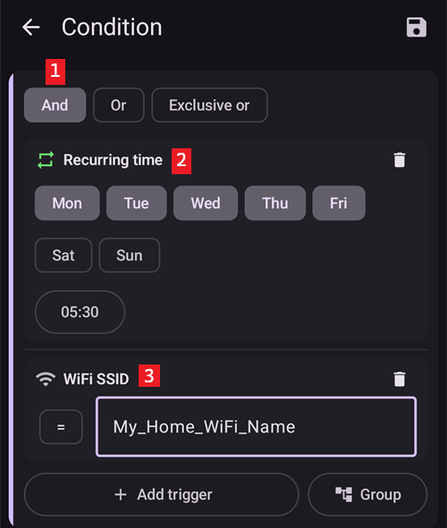

(automating-preference-settings-export)=

## Automatisk eksport af indstillinger

### Automatisk eksport: planlagt (dagligt)

Skærmbilleder med detaljer om udløserne for automatisering:

1) Betingelse: Tilbagevendende tid = M,T,O,T,F kl. 8:00 1) Handling: Eksport af indstillinger (skriv »Daglig« i »Tekst i behandlinger«)

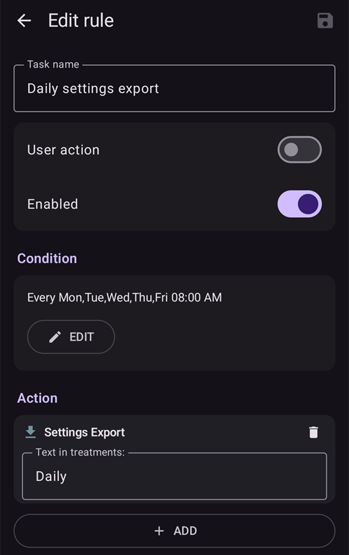

Bemærk: Hver eksport bliver logget i Careportal

### Automatisk eksport: pod-aktivering (kun patchpumpe)

Skærmbilleder med detaljer om udløserne for automatisering:

1) Betingelse: Pod-aktivering 1) Handling: Eksport af indstillinger (skriv »Pod-aktivering: eksport af indstillinger« i »Tekst i behandlinger«)

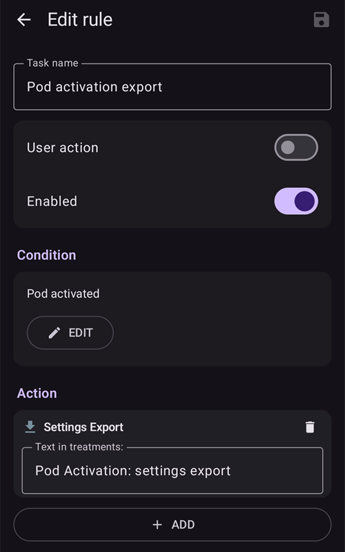

Bemærk: Hver eksport bliver logget i Careportal. Bemærk: Automatiseringen bliver **slet ikke** udløst, hvis du ikke har lavet en manuel eksport af indstillinger før. Se [Indstillinger → Vedligeholdelse](#preferences-maintenance-settings) for at aktivere automatisk eksport af indstillinger korrekt.


## Log for automatisering

**AAPS** viser en log over de seneste hændelser i **automatisering** nederst på skærmen **Automatisering**, under reglerne. Brug den til at tjekke, at dine regler blev udløst, når du forventede det.

I eksemplet nedenfor er reglen **Midlertidigt mål ved lavt blodsukker** (1) (se [Midlertidigt mål ved lavt blodsukker](#automations-low-glucose-temp-target) ovenfor) aktiveret. Loggen (2) viser, at glukosen kl. 15:09 faldt under 70 mg/dl, og at reglen blev udløst:
* handlingen var »Start midlertidigt mål: 110mg/dL@30 min«: et **midlertidigt mål** på 110 mg/dl i 30 minutter;
* **OK** til sidst betyder, at handlingen blev udført.

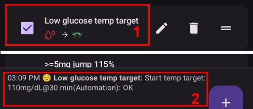

(automations-troubleshooting)=

## Fejlfinding

* Problem: __Mine automatiseringer bliver ikke udløst af AAPS?__

Tjek, at der er »flueben« i feltet til venstre for navnet på **automatiseringen**, så reglen er aktiveret:


* Problem: __Mine automatiseringer bliver udløst i den forkerte rækkefølge.__

Tjek rækkefølgen af dine regler, som beskrevet ovenfor.

* Problem: __En betingelse viser »Ukendt udløser … - aldrig sand«.__

Reglen indeholder en udløser, som denne version af **AAPS** ikke kan læse, f.eks. efter at du er gået tilbage til en ældre version eller har importeret indstillinger fra en nyere version. Sådan en udløser er aldrig sand, så reglen kører ikke. Den bliver gemt uændret, så en nyere version stadig kan bruge den. Rediger reglen, og erstat udløseren, eller opdater **AAPS**.

## Alternativer til automatiseringer

For øvede brugere er der andre muligheder for at automatisere opgaver med IFTTT eller en Android-app fra en tredjepart, der hedder Automate. 
